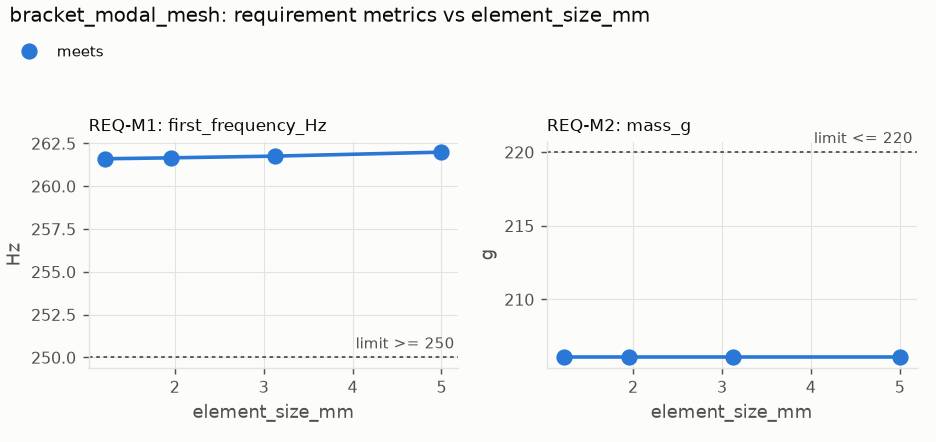
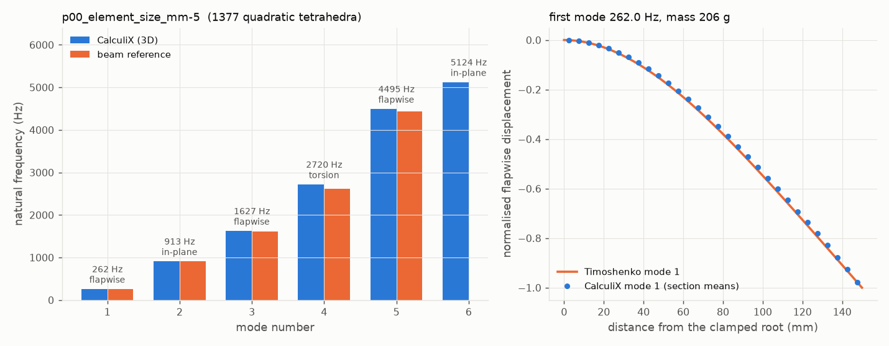
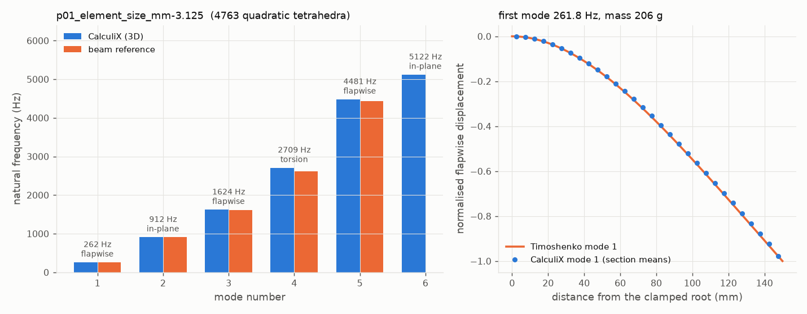
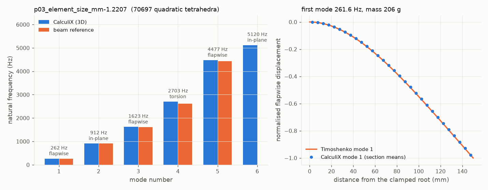

# Engineering review report: bracket_modal_mesh

- **Run:** `20261120-010318_bracket_modal_mesh`
- **Generated:** 2026-11-20T06:07:14+00:00
- **Case file SHA-256:** `4e556555e304a751c8204270bc6204a3e48b4c54ce5b3c38474a4a9b2a319165`
- **Environment:** Python 3.14.10, numpy 2.5.5, scipy 1.18.1, matplotlib 3.11.2, cadquery 2.8.0; Windows-11-10.0.26100-SP0
- **Tools:** cadquery 2.8.0; gmsh 4.15.0; CalculiX This is Version 2.22
- **Code version:** git `f27451e53271c9fdf413eecd2948844e9dd1096c` (uncommitted changes present)
- **Simulation status:** completed
- **Verification status:** PASS

## Scope

Steel bracket arm, 150 x 25 x 7 mm, clamped at one end. CalculiX frequency analysis on a Gmsh quadratic-tetrahedron mesh of the CadQuery solid, refined from 5 mm to 1.22 mm elements (ratio 1.6). Checks the first natural frequency against a 250 Hz minimum and the first six modes against beam theory.

**Assumptions**

- Linear elastic steel (E = 210 GPa, nu = 0.3, density 7850 kg/m^3); small-amplitude vibration.
- Ideal rigid clamp over the whole root face. A real bolted joint is softer and lowers the frequencies; this is the main model-form risk.
- No attached mass at the tip (the carried component is light or mounted at the root).
- The beam references assume a slender arm; checked: thickness / length below 0.2.

## Requirements

| ID | Requirement | Metric | Limit |
|---|---|---|---|
| REQ-M1 | The first natural frequency shall be at least 250 Hz (2nd engine order at 6000 rpm = 200 Hz, plus 25 % separation). | `first_frequency_Hz` | >= 250 Hz |
| REQ-M2 | The arm mass shall not exceed 220 g (synthetic mass budget). | `mass_g` | <= 220 g |

## Summary across points

| Point | element_size_mm | REQ-M1 | REQ-M2 | Checks |
|---|---|---|---|---|
| p00_element_size_mm-5 | 5 | 262 Hz: **PASS** | 206.1 g: **PASS** | 8/8 PASS |
| p01_element_size_mm-3.125 | 3.125 | 261.8 Hz: **PASS** | 206.1 g: **PASS** | 8/8 PASS |
| p02_element_size_mm-1.95312 | 1.953 | 261.7 Hz: **PASS** | 206.1 g: **PASS** | 8/8 PASS |
| p03_element_size_mm-1.2207 | 1.221 | 261.6 Hz: **PASS** | 206.1 g: **PASS** | 8/8 PASS |

## Run-level checks

Checks that use several points together (for example mesh convergence).

| Check | Description | Value | Tolerance | Status |
|---|---|---|---|---|
| discretization_first_frequency_Hz | relative discretization uncertainty of first_frequency_Hz, monotone (R = 0.533): GCI_fine, observed order 1.34, extrapolated 261.543 | 0.000292 | 0.005 | PASS |

## Point details

### p00_element_size_mm-5

Parameters: length_mm = 150, width_mm = 25, thickness_mm = 7, youngs_modulus_MPa = 2.1e+05, poisson_ratio = 0.3, density_t_per_mm3 = 7.85e-09, element_size_mm = 5, n_modes = 6

Derived: slenderness_h_over_L = 0.04667, volume_closed_form_mm3 = 2.625e+04, flapwise_timoshenko_Hz = [259.49473656150707, 1609.918122409701, 4437.436723750987], inplane_timoshenko_Hz = 908.8, torsion_saint_venant_Hz = 2616, first_mode_eff_mass_fraction_ref = 0.6136

| Requirement | Result | Limit | Margin | Verdict | Evidence |
|---|---|---|---|---|---|
| REQ-M1 | 262 Hz | >= 250 | 12 | **PASS** | [point.json](points/p00_element_size_mm-5/point.json) |
| REQ-M2 | 206.1 g | <= 220 | 13.9 | **PASS** | [point.json](points/p00_element_size_mm-5/point.json) |

| Check | Description | Value | Tolerance | Status |
|---|---|---|---|---|
| cad_volume | |CadQuery volume - L b h| / (L b h) | 0.00e+00 | 1e-09 | PASS |
| modes_identified | expected modes missing (mode 1 flapwise; >= 2 flapwise, 1 in-plane, 1 torsion) | 0.00e+00 | 0e+00 | PASS |
| flapwise_reference | max |f_FE - f_Timoshenko| / f_Timoshenko over the first 3 flapwise modes | 1.29e-02 | 2e-02 | PASS |
| inplane_reference | |f_FE - f_Timoshenko| / f_Timoshenko, first in-plane mode (model form) | 4.25e-03 | 3e-02 | PASS |
| torsion_reference | |f_FE - f_Saint-Venant| / f_Saint-Venant, first torsion mode (model form) | 3.96e-02 | 5e-02 | PASS |
| first_mode_effective_mass | |effective mass fraction of mode 1 (z) - Timoshenko| | 3.64e-04 | 1e-02 | PASS |
| first_mode_shape | 1 - MAC(FE mode 1 along the arm, Timoshenko mode 1) | 9.48e-05 | 1e-03 | PASS |
| beam_reference_valid (validity) | thickness / length (beam references need a slender arm) | 4.67e-02 | 2e-01 | PASS |

### p01_element_size_mm-3.125

Parameters: length_mm = 150, width_mm = 25, thickness_mm = 7, youngs_modulus_MPa = 2.1e+05, poisson_ratio = 0.3, density_t_per_mm3 = 7.85e-09, element_size_mm = 3.125, n_modes = 6

Derived: slenderness_h_over_L = 0.04667, volume_closed_form_mm3 = 2.625e+04, flapwise_timoshenko_Hz = [259.49473656150707, 1609.918122409701, 4437.436723750987], inplane_timoshenko_Hz = 908.8, torsion_saint_venant_Hz = 2616, first_mode_eff_mass_fraction_ref = 0.6136

| Requirement | Result | Limit | Margin | Verdict | Evidence |
|---|---|---|---|---|---|
| REQ-M1 | 261.8 Hz | >= 250 | 11.8 | **PASS** | [point.json](points/p01_element_size_mm-3.125/point.json) |
| REQ-M2 | 206.1 g | <= 220 | 13.9 | **PASS** | [point.json](points/p01_element_size_mm-3.125/point.json) |

| Check | Description | Value | Tolerance | Status |
|---|---|---|---|---|
| cad_volume | |CadQuery volume - L b h| / (L b h) | 0.00e+00 | 1e-09 | PASS |
| modes_identified | expected modes missing (mode 1 flapwise; >= 2 flapwise, 1 in-plane, 1 torsion) | 0.00e+00 | 0e+00 | PASS |
| flapwise_reference | max |f_FE - f_Timoshenko| / f_Timoshenko over the first 3 flapwise modes | 9.92e-03 | 2e-02 | PASS |
| inplane_reference | |f_FE - f_Timoshenko| / f_Timoshenko, first in-plane mode (model form) | 3.89e-03 | 3e-02 | PASS |
| torsion_reference | |f_FE - f_Saint-Venant| / f_Saint-Venant, first torsion mode (model form) | 3.53e-02 | 5e-02 | PASS |
| first_mode_effective_mass | |effective mass fraction of mode 1 (z) - Timoshenko| | 1.94e-04 | 1e-02 | PASS |
| first_mode_shape | 1 - MAC(FE mode 1 along the arm, Timoshenko mode 1) | 1.73e-05 | 1e-03 | PASS |
| beam_reference_valid (validity) | thickness / length (beam references need a slender arm) | 4.67e-02 | 2e-01 | PASS |

### p02_element_size_mm-1.95312

Parameters: length_mm = 150, width_mm = 25, thickness_mm = 7, youngs_modulus_MPa = 2.1e+05, poisson_ratio = 0.3, density_t_per_mm3 = 7.85e-09, element_size_mm = 1.953, n_modes = 6

Derived: slenderness_h_over_L = 0.04667, volume_closed_form_mm3 = 2.625e+04, flapwise_timoshenko_Hz = [259.49473656150707, 1609.918122409701, 4437.436723750987], inplane_timoshenko_Hz = 908.8, torsion_saint_venant_Hz = 2616, first_mode_eff_mass_fraction_ref = 0.6136

| Requirement | Result | Limit | Margin | Verdict | Evidence |
|---|---|---|---|---|---|
| REQ-M1 | 261.7 Hz | >= 250 | 11.7 | **PASS** | [point.json](points/p02_element_size_mm-1.95312/point.json) |
| REQ-M2 | 206.1 g | <= 220 | 13.9 | **PASS** | [point.json](points/p02_element_size_mm-1.95312/point.json) |

| Check | Description | Value | Tolerance | Status |
|---|---|---|---|---|
| cad_volume | |CadQuery volume - L b h| / (L b h) | 0.00e+00 | 1e-09 | PASS |
| modes_identified | expected modes missing (mode 1 flapwise; >= 2 flapwise, 1 in-plane, 1 torsion) | 0.00e+00 | 0e+00 | PASS |
| flapwise_reference | max |f_FE - f_Timoshenko| / f_Timoshenko over the first 3 flapwise modes | 9.28e-03 | 2e-02 | PASS |
| inplane_reference | |f_FE - f_Timoshenko| / f_Timoshenko, first in-plane mode (model form) | 3.65e-03 | 3e-02 | PASS |
| torsion_reference | |f_FE - f_Saint-Venant| / f_Saint-Venant, first torsion mode (model form) | 3.38e-02 | 5e-02 | PASS |
| first_mode_effective_mass | |effective mass fraction of mode 1 (z) - Timoshenko| | 9.43e-04 | 1e-02 | PASS |
| first_mode_shape | 1 - MAC(FE mode 1 along the arm, Timoshenko mode 1) | 1.01e-05 | 1e-03 | PASS |
| beam_reference_valid (validity) | thickness / length (beam references need a slender arm) | 4.67e-02 | 2e-01 | PASS |

### p03_element_size_mm-1.2207

Parameters: length_mm = 150, width_mm = 25, thickness_mm = 7, youngs_modulus_MPa = 2.1e+05, poisson_ratio = 0.3, density_t_per_mm3 = 7.85e-09, element_size_mm = 1.221, n_modes = 6

Derived: slenderness_h_over_L = 0.04667, volume_closed_form_mm3 = 2.625e+04, flapwise_timoshenko_Hz = [259.49473656150707, 1609.918122409701, 4437.436723750987], inplane_timoshenko_Hz = 908.8, torsion_saint_venant_Hz = 2616, first_mode_eff_mass_fraction_ref = 0.6136

| Requirement | Result | Limit | Margin | Verdict | Evidence |
|---|---|---|---|---|---|
| REQ-M1 | 261.6 Hz | >= 250 | 11.6 | **PASS** | [point.json](points/p03_element_size_mm-1.2207/point.json) |
| REQ-M2 | 206.1 g | <= 220 | 13.9 | **PASS** | [point.json](points/p03_element_size_mm-1.2207/point.json) |

| Check | Description | Value | Tolerance | Status |
|---|---|---|---|---|
| cad_volume | |CadQuery volume - L b h| / (L b h) | 0.00e+00 | 1e-09 | PASS |
| modes_identified | expected modes missing (mode 1 flapwise; >= 2 flapwise, 1 in-plane, 1 torsion) | 0.00e+00 | 0e+00 | PASS |
| flapwise_reference | max |f_FE - f_Timoshenko| / f_Timoshenko over the first 3 flapwise modes | 9.00e-03 | 2e-02 | PASS |
| inplane_reference | |f_FE - f_Timoshenko| / f_Timoshenko, first in-plane mode (model form) | 3.51e-03 | 3e-02 | PASS |
| torsion_reference | |f_FE - f_Saint-Venant| / f_Saint-Venant, first torsion mode (model form) | 3.33e-02 | 5e-02 | PASS |
| first_mode_effective_mass | |effective mass fraction of mode 1 (z) - Timoshenko| | 1.41e-03 | 1e-02 | PASS |
| first_mode_shape | 1 - MAC(FE mode 1 along the arm, Timoshenko mode 1) | 8.30e-06 | 1e-03 | PASS |
| beam_reference_valid (validity) | thickness / length (beam references need a slender arm) | 4.67e-02 | 2e-01 | PASS |

## Limitations

- Synthetic geometry and requirement.
- Beam theory is a model-form reference for a 3D clamped solid, especially for in-plane bending (length / width = 6) and torsion (warping restraint).
- No damping, no prestress, no physical test data.
- A converged solver run that matches an analytical reference shows that the equations were solved correctly. It does not show that the equations represent real hardware.

## Engineering acceptance

Pending human review. This report does not accept or reject the design.
