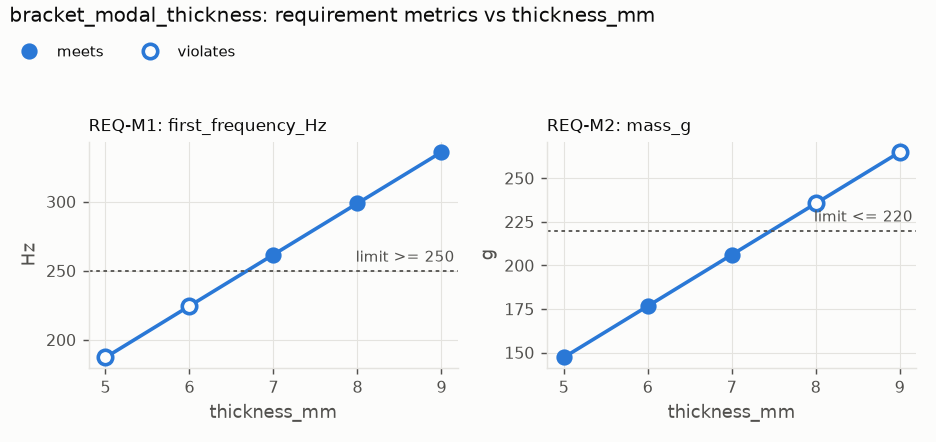
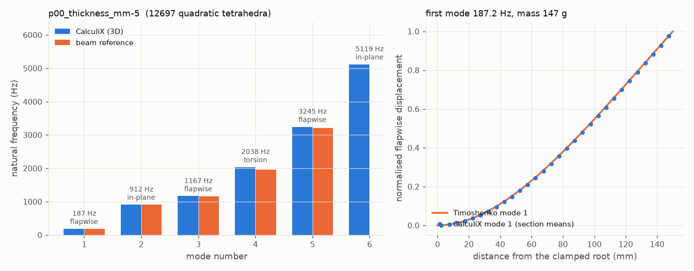
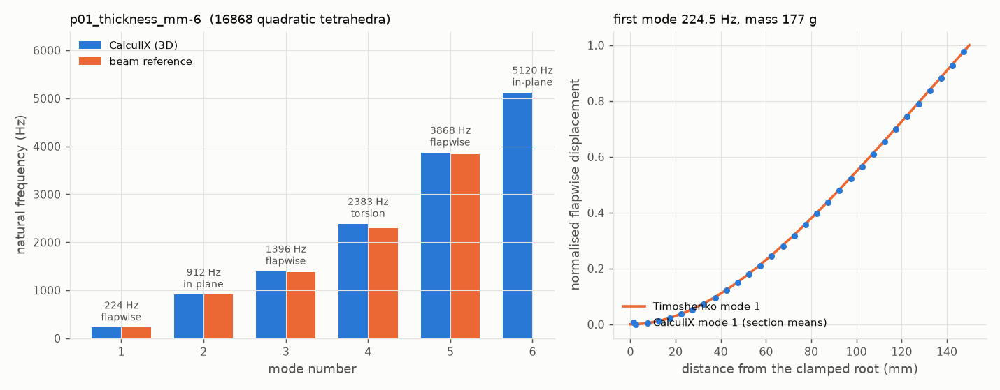
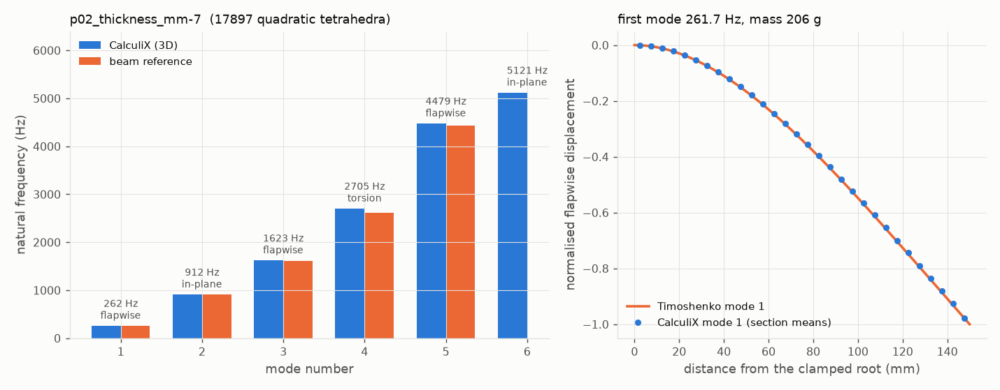
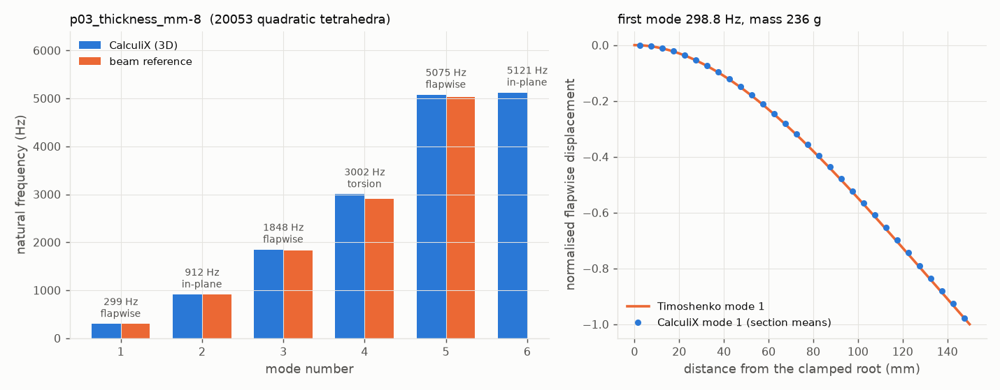
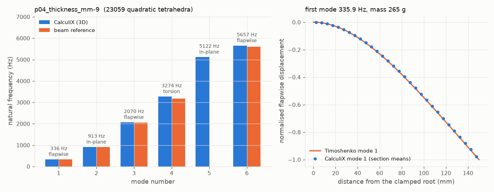

# Engineering review report: bracket_modal_thickness

- **Run:** `20261120-010521_bracket_modal_thickness`
- **Generated:** 2026-11-20T06:07:32+00:00
- **Case file SHA-256:** `88cd3f9cb9cccaac141d1014bc34d11c4b6f53b016c89239964ed34a23ef7b1f`
- **Environment:** Python 3.14.10, numpy 2.5.5, scipy 1.18.1, matplotlib 3.11.2, cadquery 2.8.0; Windows-11-10.0.26100-SP0
- **Tools:** cadquery 2.8.0; gmsh 4.15.0; CalculiX This is Version 2.22
- **Code version:** git `f27451e53271c9fdf413eecd2948844e9dd1096c` (uncommitted changes present)
- **Simulation status:** completed
- **Verification status:** PASS

## Scope

Steel bracket arm, 150 x 25 mm, clamped at one end, thickness swept from 5 to 9 mm on 1.95 mm quadratic tetrahedra (the mesh study level). Finds the thinnest arm that keeps the first natural frequency above 250 Hz within a 220 g mass budget.

**Assumptions**

- Linear elastic steel (E = 210 GPa, nu = 0.3, density 7850 kg/m^3); small-amplitude vibration.
- Ideal rigid clamp over the whole root face. A real bolted joint is softer and lowers the frequencies; this is the main model-form risk.
- No attached mass at the tip (the carried component is light or mounted at the root).
- The beam references assume a slender arm; checked: thickness / length below 0.2.

## Requirements

| ID | Requirement | Metric | Limit |
|---|---|---|---|
| REQ-M1 | The first natural frequency shall be at least 250 Hz (2nd engine order at 6000 rpm = 200 Hz, plus 25 % separation). | `first_frequency_Hz` | >= 250 Hz |
| REQ-M2 | The arm mass shall not exceed 220 g (synthetic mass budget). | `mass_g` | <= 220 g |

## Summary across points

| Point | thickness_mm | REQ-M1 | REQ-M2 | Checks |
|---|---|---|---|---|
| p00_thickness_mm-5 | 5 | 187.2 Hz: **FAIL** | 147.2 g: **PASS** | 8/8 PASS |
| p01_thickness_mm-6 | 6 | 224.5 Hz: **FAIL** | 176.6 g: **PASS** | 8/8 PASS |
| p02_thickness_mm-7 | 7 | 261.7 Hz: **PASS** | 206.1 g: **PASS** | 8/8 PASS |
| p03_thickness_mm-8 | 8 | 298.8 Hz: **PASS** | 235.5 g: **FAIL** | 8/8 PASS |
| p04_thickness_mm-9 | 9 | 335.9 Hz: **PASS** | 264.9 g: **FAIL** | 8/8 PASS |

## Point details

### p00_thickness_mm-5

Parameters: length_mm = 150, width_mm = 25, thickness_mm = 5, youngs_modulus_MPa = 2.1e+05, poisson_ratio = 0.3, density_t_per_mm3 = 7.85e-09, element_size_mm = 1.953, n_modes = 6

Derived: slenderness_h_over_L = 0.03333, volume_closed_form_mm3 = 1.875e+04, flapwise_timoshenko_Hz = [185.50844081996976, 1156.5565821042867, 3211.880531539995], inplane_timoshenko_Hz = 908.8, torsion_saint_venant_Hz = 1960, first_mode_eff_mass_fraction_ref = 0.6134

| Requirement | Result | Limit | Margin | Verdict | Evidence |
|---|---|---|---|---|---|
| REQ-M1 | 187.2 Hz | >= 250 | -62.8 | **FAIL** | [point.json](points/p00_thickness_mm-5/point.json) |
| REQ-M2 | 147.2 g | <= 220 | 72.8 | **PASS** | [point.json](points/p00_thickness_mm-5/point.json) |

| Check | Description | Value | Tolerance | Status |
|---|---|---|---|---|
| cad_volume | |CadQuery volume - L b h| / (L b h) | 0.00e+00 | 1e-09 | PASS |
| modes_identified | expected modes missing (mode 1 flapwise; >= 2 flapwise, 1 in-plane, 1 torsion) | 0.00e+00 | 0e+00 | PASS |
| flapwise_reference | max |f_FE - f_Timoshenko| / f_Timoshenko over the first 3 flapwise modes | 1.02e-02 | 2e-02 | PASS |
| inplane_reference | |f_FE - f_Timoshenko| / f_Timoshenko, first in-plane mode (model form) | 3.24e-03 | 3e-02 | PASS |
| torsion_reference | |f_FE - f_Saint-Venant| / f_Saint-Venant, first torsion mode (model form) | 3.94e-02 | 5e-02 | PASS |
| first_mode_effective_mass | |effective mass fraction of mode 1 (z) - Timoshenko| | 8.71e-04 | 1e-02 | PASS |
| first_mode_shape | 1 - MAC(FE mode 1 along the arm, Timoshenko mode 1) | 1.18e-05 | 1e-03 | PASS |
| beam_reference_valid (validity) | thickness / length (beam references need a slender arm) | 3.33e-02 | 2e-01 | PASS |

### p01_thickness_mm-6

Parameters: length_mm = 150, width_mm = 25, thickness_mm = 6, youngs_modulus_MPa = 2.1e+05, poisson_ratio = 0.3, density_t_per_mm3 = 7.85e-09, element_size_mm = 1.953, n_modes = 6

Derived: slenderness_h_over_L = 0.04, volume_closed_form_mm3 = 2.25e+04, flapwise_timoshenko_Hz = [222.52470590889487, 1384.2115801351547, 3830.7139641497824], inplane_timoshenko_Hz = 908.8, torsion_saint_venant_Hz = 2299, first_mode_eff_mass_fraction_ref = 0.6135

| Requirement | Result | Limit | Margin | Verdict | Evidence |
|---|---|---|---|---|---|
| REQ-M1 | 224.5 Hz | >= 250 | -25.5 | **FAIL** | [point.json](points/p01_thickness_mm-6/point.json) |
| REQ-M2 | 176.6 g | <= 220 | 43.4 | **PASS** | [point.json](points/p01_thickness_mm-6/point.json) |

| Check | Description | Value | Tolerance | Status |
|---|---|---|---|---|
| cad_volume | |CadQuery volume - L b h| / (L b h) | 0.00e+00 | 1e-09 | PASS |
| modes_identified | expected modes missing (mode 1 flapwise; >= 2 flapwise, 1 in-plane, 1 torsion) | 0.00e+00 | 0e+00 | PASS |
| flapwise_reference | max |f_FE - f_Timoshenko| / f_Timoshenko over the first 3 flapwise modes | 9.68e-03 | 2e-02 | PASS |
| inplane_reference | |f_FE - f_Timoshenko| / f_Timoshenko, first in-plane mode (model form) | 3.43e-03 | 3e-02 | PASS |
| torsion_reference | |f_FE - f_Saint-Venant| / f_Saint-Venant, first torsion mode (model form) | 3.68e-02 | 5e-02 | PASS |
| first_mode_effective_mass | |effective mass fraction of mode 1 (z) - Timoshenko| | 9.89e-04 | 1e-02 | PASS |
| first_mode_shape | 1 - MAC(FE mode 1 along the arm, Timoshenko mode 1) | 1.13e-05 | 1e-03 | PASS |
| beam_reference_valid (validity) | thickness / length (beam references need a slender arm) | 4.00e-02 | 2e-01 | PASS |

### p02_thickness_mm-7

Parameters: length_mm = 150, width_mm = 25, thickness_mm = 7, youngs_modulus_MPa = 2.1e+05, poisson_ratio = 0.3, density_t_per_mm3 = 7.85e-09, element_size_mm = 1.953, n_modes = 6

Derived: slenderness_h_over_L = 0.04667, volume_closed_form_mm3 = 2.625e+04, flapwise_timoshenko_Hz = [259.49473656150707, 1609.918122409701, 4437.436723750987], inplane_timoshenko_Hz = 908.8, torsion_saint_venant_Hz = 2616, first_mode_eff_mass_fraction_ref = 0.6136

| Requirement | Result | Limit | Margin | Verdict | Evidence |
|---|---|---|---|---|---|
| REQ-M1 | 261.7 Hz | >= 250 | 11.7 | **PASS** | [point.json](points/p02_thickness_mm-7/point.json) |
| REQ-M2 | 206.1 g | <= 220 | 13.9 | **PASS** | [point.json](points/p02_thickness_mm-7/point.json) |

| Check | Description | Value | Tolerance | Status |
|---|---|---|---|---|
| cad_volume | |CadQuery volume - L b h| / (L b h) | 0.00e+00 | 1e-09 | PASS |
| modes_identified | expected modes missing (mode 1 flapwise; >= 2 flapwise, 1 in-plane, 1 torsion) | 0.00e+00 | 0e+00 | PASS |
| flapwise_reference | max |f_FE - f_Timoshenko| / f_Timoshenko over the first 3 flapwise modes | 9.28e-03 | 2e-02 | PASS |
| inplane_reference | |f_FE - f_Timoshenko| / f_Timoshenko, first in-plane mode (model form) | 3.65e-03 | 3e-02 | PASS |
| torsion_reference | |f_FE - f_Saint-Venant| / f_Saint-Venant, first torsion mode (model form) | 3.38e-02 | 5e-02 | PASS |
| first_mode_effective_mass | |effective mass fraction of mode 1 (z) - Timoshenko| | 9.43e-04 | 1e-02 | PASS |
| first_mode_shape | 1 - MAC(FE mode 1 along the arm, Timoshenko mode 1) | 1.01e-05 | 1e-03 | PASS |
| beam_reference_valid (validity) | thickness / length (beam references need a slender arm) | 4.67e-02 | 2e-01 | PASS |

### p03_thickness_mm-8

Parameters: length_mm = 150, width_mm = 25, thickness_mm = 8, youngs_modulus_MPa = 2.1e+05, poisson_ratio = 0.3, density_t_per_mm3 = 7.85e-09, element_size_mm = 1.953, n_modes = 6

Derived: slenderness_h_over_L = 0.05333, volume_closed_form_mm3 = 3e+04, flapwise_timoshenko_Hz = [296.4108859931937, 1833.3884980377677, 5030.590903862463], inplane_timoshenko_Hz = 908.8, torsion_saint_venant_Hz = 2912, first_mode_eff_mass_fraction_ref = 0.6138

| Requirement | Result | Limit | Margin | Verdict | Evidence |
|---|---|---|---|---|---|
| REQ-M1 | 298.8 Hz | >= 250 | 48.8 | **PASS** | [point.json](points/p03_thickness_mm-8/point.json) |
| REQ-M2 | 235.5 g | <= 220 | -15.5 | **FAIL** | [point.json](points/p03_thickness_mm-8/point.json) |

| Check | Description | Value | Tolerance | Status |
|---|---|---|---|---|
| cad_volume | |CadQuery volume - L b h| / (L b h) | 0.00e+00 | 1e-09 | PASS |
| modes_identified | expected modes missing (mode 1 flapwise; >= 2 flapwise, 1 in-plane, 1 torsion) | 0.00e+00 | 0e+00 | PASS |
| flapwise_reference | max |f_FE - f_Timoshenko| / f_Timoshenko over the first 3 flapwise modes | 8.90e-03 | 2e-02 | PASS |
| inplane_reference | |f_FE - f_Timoshenko| / f_Timoshenko, first in-plane mode (model form) | 3.84e-03 | 3e-02 | PASS |
| torsion_reference | |f_FE - f_Saint-Venant| / f_Saint-Venant, first torsion mode (model form) | 3.08e-02 | 5e-02 | PASS |
| first_mode_effective_mass | |effective mass fraction of mode 1 (z) - Timoshenko| | 1.02e-03 | 1e-02 | PASS |
| first_mode_shape | 1 - MAC(FE mode 1 along the arm, Timoshenko mode 1) | 1.03e-05 | 1e-03 | PASS |
| beam_reference_valid (validity) | thickness / length (beam references need a slender arm) | 5.33e-02 | 2e-01 | PASS |

### p04_thickness_mm-9

Parameters: length_mm = 150, width_mm = 25, thickness_mm = 9, youngs_modulus_MPa = 2.1e+05, poisson_ratio = 0.3, density_t_per_mm3 = 7.85e-09, element_size_mm = 1.953, n_modes = 6

Derived: slenderness_h_over_L = 0.06, volume_closed_form_mm3 = 3.375e+04, flapwise_timoshenko_Hz = [333.26550055969483, 2054.3507943586055, 5608.930614279587], inplane_timoshenko_Hz = 908.8, torsion_saint_venant_Hz = 3185, first_mode_eff_mass_fraction_ref = 0.614

| Requirement | Result | Limit | Margin | Verdict | Evidence |
|---|---|---|---|---|---|
| REQ-M1 | 335.9 Hz | >= 250 | 85.9 | **PASS** | [point.json](points/p04_thickness_mm-9/point.json) |
| REQ-M2 | 264.9 g | <= 220 | -44.9 | **FAIL** | [point.json](points/p04_thickness_mm-9/point.json) |

| Check | Description | Value | Tolerance | Status |
|---|---|---|---|---|
| cad_volume | |CadQuery volume - L b h| / (L b h) | 0.00e+00 | 1e-09 | PASS |
| modes_identified | expected modes missing (mode 1 flapwise; >= 2 flapwise, 1 in-plane, 1 torsion) | 0.00e+00 | 0e+00 | PASS |
| flapwise_reference | max |f_FE - f_Timoshenko| / f_Timoshenko over the first 3 flapwise modes | 8.59e-03 | 2e-02 | PASS |
| inplane_reference | |f_FE - f_Timoshenko| / f_Timoshenko, first in-plane mode (model form) | 4.05e-03 | 3e-02 | PASS |
| torsion_reference | |f_FE - f_Saint-Venant| / f_Saint-Venant, first torsion mode (model form) | 2.77e-02 | 5e-02 | PASS |
| first_mode_effective_mass | |effective mass fraction of mode 1 (z) - Timoshenko| | 1.21e-03 | 1e-02 | PASS |
| first_mode_shape | 1 - MAC(FE mode 1 along the arm, Timoshenko mode 1) | 9.48e-06 | 1e-03 | PASS |
| beam_reference_valid (validity) | thickness / length (beam references need a slender arm) | 6.00e-02 | 2e-01 | PASS |

## Limitations

- Synthetic geometry and requirement.
- Beam theory is a model-form reference for a 3D clamped solid, especially for in-plane bending (length / width = 6) and torsion (warping restraint).
- No damping, no prestress, no physical test data.
- A converged solver run that matches an analytical reference shows that the equations were solved correctly. It does not show that the equations represent real hardware.

## Engineering acceptance

Pending human review. This report does not accept or reject the design.
