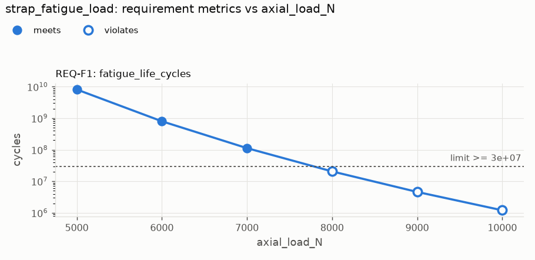
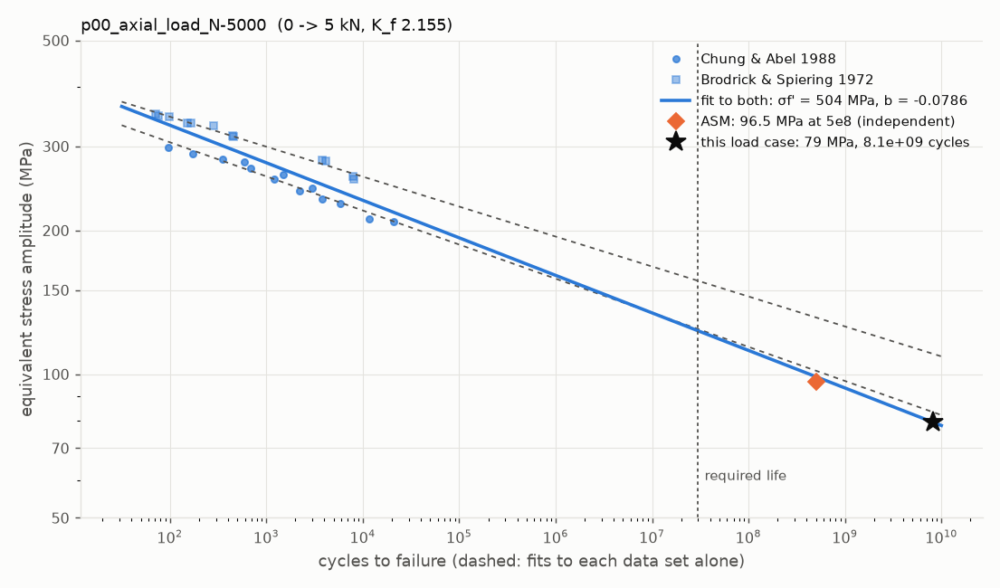
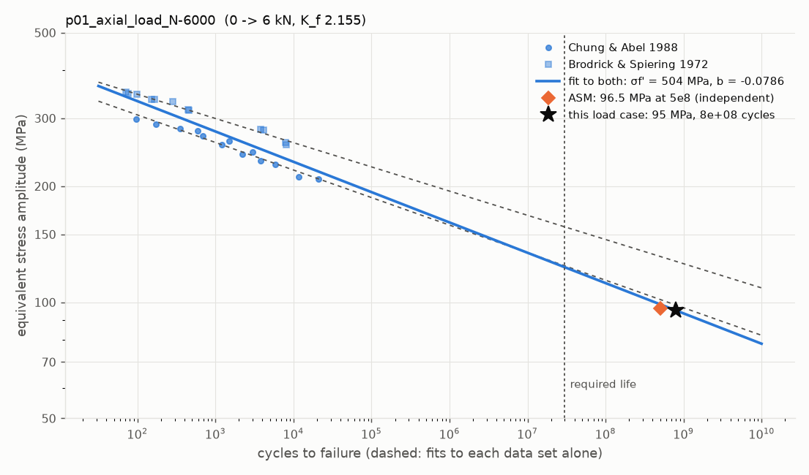
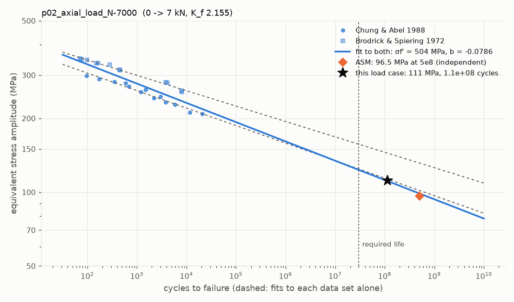
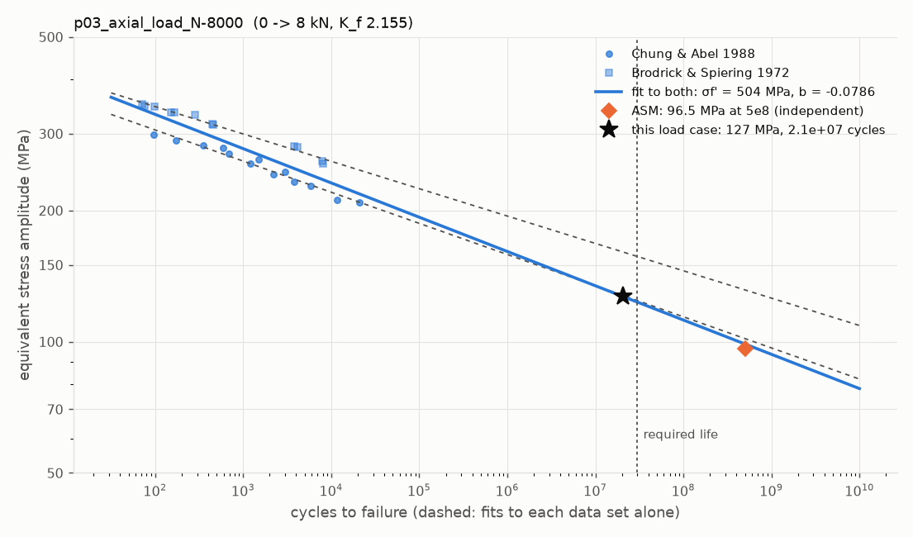
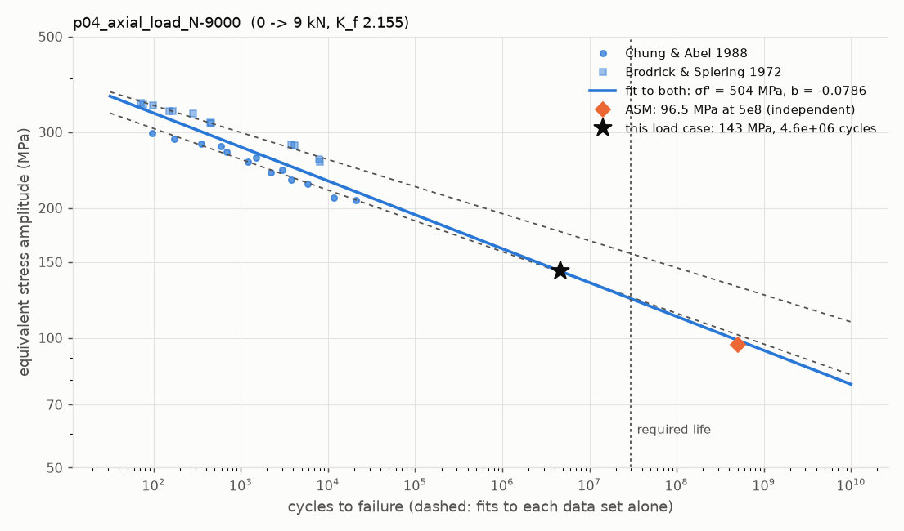
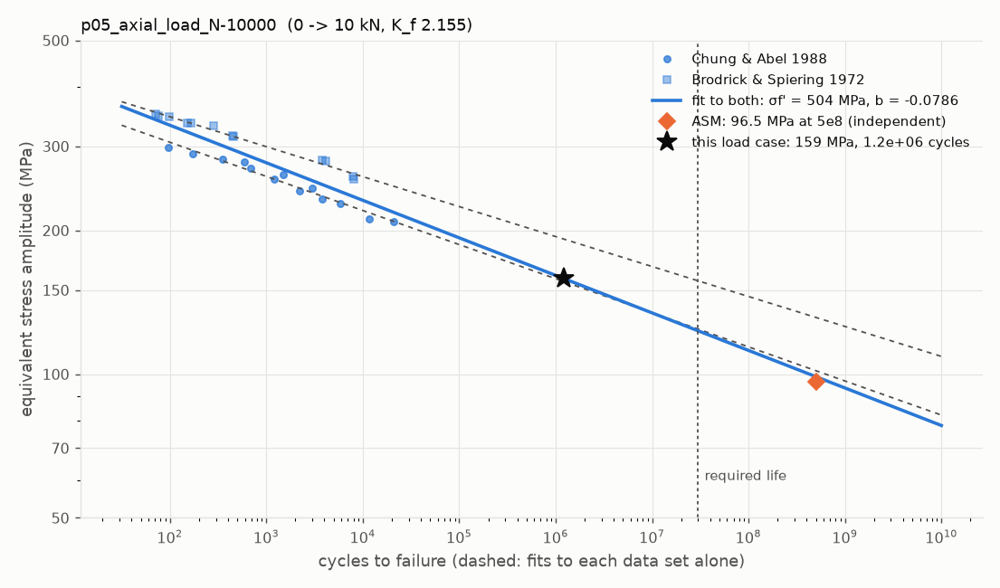

# Engineering review report: strap_fatigue_load

- **Run:** `20261120-011347_strap_fatigue_load`
- **Generated:** 2026-11-20T06:14:18+00:00
- **Case file SHA-256:** `509a0221a2e14274e071da2f8bf36d1d4719a0aef58205de2cc6c5c41e22a556`
- **Environment:** Python 3.14.10, numpy 2.5.5, scipy 1.18.1, matplotlib 3.11.2, cadquery 2.8.0; Windows-11-10.0.26100-SP0
- **Tools:** cadquery 2.8.0; gmsh 4.15.0; CalculiX This is Version 2.22
- **Code version:** git `15eae90df2c9bb7a8af9831f397723f68dd1bc54` (uncommitted changes present)
- **Simulation status:** completed
- **Verification status:** PASS

## Scope

6061-T6 strap, 160 x 40 x 4 mm, 16 mm central cable hole, axial load cycling from zero to a peak swept from 5 to 10 kN. Strap FE (CadQuery, Gmsh, CalculiX) for the hole-edge Kt, then notch, mean-stress and S-N fatigue models. Finds the fatigue life at the 5 kN service load and the highest cyclic load that gives 3e7 cycles.

**Assumptions**

- Elastic stress at the notch from the verified strap FE (plane stress); checked: notch peak stress below the 276 MPa yield, so no notch plasticity correction is needed.
- Peterson notch sensitivity with a = 0.635 mm for aluminium alloys.
- Smith-Watson-Topper mean-stress correction (load cycles 0 to peak, R = 0).
- Basquin S-N curve fitted to 25 published strain-controlled 6061-T6 test points (Chung and Abel 1988; Brodrick and Spiering 1972, via the University of Waterloo FDE database).
- Smooth machined hole; no surface treatment, corrosion, or fretting at the hole.
- Scatter factor 3 on life: 1e7 service cycles require a computed life of 3e7.

## Requirements

| ID | Requirement | Metric | Limit |
|---|---|---|---|
| REQ-F1 | Fatigue life at the load cycle shall be at least 3e7 cycles (1e7 service cycles with a scatter factor of 3). | `fatigue_life_cycles` | >= 3e+07 cycles |

## Summary across points

| Point | axial_load_N | REQ-F1 | Checks |
|---|---|---|---|
| p00_axial_load_N-5000 | 5000 | 8.133e+09 cycles: **PASS** | 7/7 PASS |
| p01_axial_load_N-6000 | 6000 | 7.995e+08 cycles: **PASS** | 7/7 PASS |
| p02_axial_load_N-7000 | 7000 | 1.125e+08 cycles: **PASS** | 7/7 PASS |
| p03_axial_load_N-8000 | 8000 | 2.057e+07 cycles: **FAIL** | 7/7 PASS |
| p04_axial_load_N-9000 | 9000 | 4.596e+06 cycles: **FAIL** | 7/7 PASS |
| p05_axial_load_N-10000 | 1e+04 | 1.203e+06 cycles: **FAIL** | 7/7 PASS |

## Point details

### p00_axial_load_N-5000

Parameters: length_mm = 160, width_mm = 40, thickness_mm = 4, hole_diameter_mm = 16, axial_load_N = 5000, min_load_N = 0, youngs_modulus_MPa = 6.89e+04, poisson_ratio = 0.33, yield_strength_MPa = 276, hole_element_size_mm = 0.4, hole_element_ratio = 0.025, far_element_size_mm = 4, sn_data_set = both

Derived: gross_stress_MPa = 31.25, net_stress_MPa = 52.08, kt_net_peterson = 2.236

| Requirement | Result | Limit | Margin | Verdict | Evidence |
|---|---|---|---|---|---|
| REQ-F1 | 8.133e+09 cycles | >= 3e+07 | 8.1e+09 | **PASS** | [point.json](points/p00_axial_load_N-5000/point.json) |

| Check | Description | Value | Tolerance | Status |
|---|---|---|---|---|
| equilibrium | |reaction on the x = 0 symmetry edge + F/2| / (F/2) | 0.00e+00 | 1e-06 | PASS |
| ligament_force | |t * integral of sigma_xx across the ligament - F/2| / (F/2) | 2.81e-04 | 1e-02 | PASS |
| kt_reference | |Kt_net FE - Peterson| / Peterson (model form) | 4.69e-03 | 2e-02 | PASS |
| sn_hcf_crosscheck | |fitted S-N amplitude at 1e9 reversals - ASM 96.5 MPa| / 96.5 (independent high-cycle value) | 2.38e-02 | 1e-01 | PASS |
| sn_fit_scatter | standard deviation of log(stress) residuals of the S-N fit | 7.39e-02 | 1e-01 | PASS |
| life_round_trip | |S-N amplitude at the computed life - SWT amplitude| / SWT amplitude | 0.00e+00 | 1e-09 | PASS |
| elastic_notch (validity) | notch peak stress / yield (elastic notch analysis valid below 1) | 4.07e-01 | 1e+00 | PASS |

### p01_axial_load_N-6000

Parameters: length_mm = 160, width_mm = 40, thickness_mm = 4, hole_diameter_mm = 16, axial_load_N = 6000, min_load_N = 0, youngs_modulus_MPa = 6.89e+04, poisson_ratio = 0.33, yield_strength_MPa = 276, hole_element_size_mm = 0.4, hole_element_ratio = 0.025, far_element_size_mm = 4, sn_data_set = both

Derived: gross_stress_MPa = 37.5, net_stress_MPa = 62.5, kt_net_peterson = 2.236

| Requirement | Result | Limit | Margin | Verdict | Evidence |
|---|---|---|---|---|---|
| REQ-F1 | 7.995e+08 cycles | >= 3e+07 | 7.69e+08 | **PASS** | [point.json](points/p01_axial_load_N-6000/point.json) |

| Check | Description | Value | Tolerance | Status |
|---|---|---|---|---|
| equilibrium | |reaction on the x = 0 symmetry edge + F/2| / (F/2) | 0.00e+00 | 1e-06 | PASS |
| ligament_force | |t * integral of sigma_xx across the ligament - F/2| / (F/2) | 2.80e-04 | 1e-02 | PASS |
| kt_reference | |Kt_net FE - Peterson| / Peterson (model form) | 4.69e-03 | 2e-02 | PASS |
| sn_hcf_crosscheck | |fitted S-N amplitude at 1e9 reversals - ASM 96.5 MPa| / 96.5 (independent high-cycle value) | 2.38e-02 | 1e-01 | PASS |
| sn_fit_scatter | standard deviation of log(stress) residuals of the S-N fit | 7.39e-02 | 1e-01 | PASS |
| life_round_trip | |S-N amplitude at the computed life - SWT amplitude| / SWT amplitude | 0.00e+00 | 1e-09 | PASS |
| elastic_notch (validity) | notch peak stress / yield (elastic notch analysis valid below 1) | 4.88e-01 | 1e+00 | PASS |

### p02_axial_load_N-7000

Parameters: length_mm = 160, width_mm = 40, thickness_mm = 4, hole_diameter_mm = 16, axial_load_N = 7000, min_load_N = 0, youngs_modulus_MPa = 6.89e+04, poisson_ratio = 0.33, yield_strength_MPa = 276, hole_element_size_mm = 0.4, hole_element_ratio = 0.025, far_element_size_mm = 4, sn_data_set = both

Derived: gross_stress_MPa = 43.75, net_stress_MPa = 72.92, kt_net_peterson = 2.236

| Requirement | Result | Limit | Margin | Verdict | Evidence |
|---|---|---|---|---|---|
| REQ-F1 | 1.125e+08 cycles | >= 3e+07 | 8.25e+07 | **PASS** | [point.json](points/p02_axial_load_N-7000/point.json) |

| Check | Description | Value | Tolerance | Status |
|---|---|---|---|---|
| equilibrium | |reaction on the x = 0 symmetry edge + F/2| / (F/2) | 0.00e+00 | 1e-06 | PASS |
| ligament_force | |t * integral of sigma_xx across the ligament - F/2| / (F/2) | 2.81e-04 | 1e-02 | PASS |
| kt_reference | |Kt_net FE - Peterson| / Peterson (model form) | 4.69e-03 | 2e-02 | PASS |
| sn_hcf_crosscheck | |fitted S-N amplitude at 1e9 reversals - ASM 96.5 MPa| / 96.5 (independent high-cycle value) | 2.38e-02 | 1e-01 | PASS |
| sn_fit_scatter | standard deviation of log(stress) residuals of the S-N fit | 7.39e-02 | 1e-01 | PASS |
| life_round_trip | |S-N amplitude at the computed life - SWT amplitude| / SWT amplitude | 0.00e+00 | 1e-09 | PASS |
| elastic_notch (validity) | notch peak stress / yield (elastic notch analysis valid below 1) | 5.69e-01 | 1e+00 | PASS |

### p03_axial_load_N-8000

Parameters: length_mm = 160, width_mm = 40, thickness_mm = 4, hole_diameter_mm = 16, axial_load_N = 8000, min_load_N = 0, youngs_modulus_MPa = 6.89e+04, poisson_ratio = 0.33, yield_strength_MPa = 276, hole_element_size_mm = 0.4, hole_element_ratio = 0.025, far_element_size_mm = 4, sn_data_set = both

Derived: gross_stress_MPa = 50, net_stress_MPa = 83.33, kt_net_peterson = 2.236

| Requirement | Result | Limit | Margin | Verdict | Evidence |
|---|---|---|---|---|---|
| REQ-F1 | 2.057e+07 cycles | >= 3e+07 | -9.43e+06 | **FAIL** | [point.json](points/p03_axial_load_N-8000/point.json) |

| Check | Description | Value | Tolerance | Status |
|---|---|---|---|---|
| equilibrium | |reaction on the x = 0 symmetry edge + F/2| / (F/2) | 0.00e+00 | 1e-06 | PASS |
| ligament_force | |t * integral of sigma_xx across the ligament - F/2| / (F/2) | 2.81e-04 | 1e-02 | PASS |
| kt_reference | |Kt_net FE - Peterson| / Peterson (model form) | 4.69e-03 | 2e-02 | PASS |
| sn_hcf_crosscheck | |fitted S-N amplitude at 1e9 reversals - ASM 96.5 MPa| / 96.5 (independent high-cycle value) | 2.38e-02 | 1e-01 | PASS |
| sn_fit_scatter | standard deviation of log(stress) residuals of the S-N fit | 7.39e-02 | 1e-01 | PASS |
| life_round_trip | |S-N amplitude at the computed life - SWT amplitude| / SWT amplitude | 0.00e+00 | 1e-09 | PASS |
| elastic_notch (validity) | notch peak stress / yield (elastic notch analysis valid below 1) | 6.51e-01 | 1e+00 | PASS |

### p04_axial_load_N-9000

Parameters: length_mm = 160, width_mm = 40, thickness_mm = 4, hole_diameter_mm = 16, axial_load_N = 9000, min_load_N = 0, youngs_modulus_MPa = 6.89e+04, poisson_ratio = 0.33, yield_strength_MPa = 276, hole_element_size_mm = 0.4, hole_element_ratio = 0.025, far_element_size_mm = 4, sn_data_set = both

Derived: gross_stress_MPa = 56.25, net_stress_MPa = 93.75, kt_net_peterson = 2.236

| Requirement | Result | Limit | Margin | Verdict | Evidence |
|---|---|---|---|---|---|
| REQ-F1 | 4.596e+06 cycles | >= 3e+07 | -2.54e+07 | **FAIL** | [point.json](points/p04_axial_load_N-9000/point.json) |

| Check | Description | Value | Tolerance | Status |
|---|---|---|---|---|
| equilibrium | |reaction on the x = 0 symmetry edge + F/2| / (F/2) | 0.00e+00 | 1e-06 | PASS |
| ligament_force | |t * integral of sigma_xx across the ligament - F/2| / (F/2) | 2.81e-04 | 1e-02 | PASS |
| kt_reference | |Kt_net FE - Peterson| / Peterson (model form) | 4.69e-03 | 2e-02 | PASS |
| sn_hcf_crosscheck | |fitted S-N amplitude at 1e9 reversals - ASM 96.5 MPa| / 96.5 (independent high-cycle value) | 2.38e-02 | 1e-01 | PASS |
| sn_fit_scatter | standard deviation of log(stress) residuals of the S-N fit | 7.39e-02 | 1e-01 | PASS |
| life_round_trip | |S-N amplitude at the computed life - SWT amplitude| / SWT amplitude | 0.00e+00 | 1e-09 | PASS |
| elastic_notch (validity) | notch peak stress / yield (elastic notch analysis valid below 1) | 7.32e-01 | 1e+00 | PASS |

### p05_axial_load_N-10000

Parameters: length_mm = 160, width_mm = 40, thickness_mm = 4, hole_diameter_mm = 16, axial_load_N = 1e+04, min_load_N = 0, youngs_modulus_MPa = 6.89e+04, poisson_ratio = 0.33, yield_strength_MPa = 276, hole_element_size_mm = 0.4, hole_element_ratio = 0.025, far_element_size_mm = 4, sn_data_set = both

Derived: gross_stress_MPa = 62.5, net_stress_MPa = 104.2, kt_net_peterson = 2.236

| Requirement | Result | Limit | Margin | Verdict | Evidence |
|---|---|---|---|---|---|
| REQ-F1 | 1.203e+06 cycles | >= 3e+07 | -2.88e+07 | **FAIL** | [point.json](points/p05_axial_load_N-10000/point.json) |

| Check | Description | Value | Tolerance | Status |
|---|---|---|---|---|
| equilibrium | |reaction on the x = 0 symmetry edge + F/2| / (F/2) | 0.00e+00 | 1e-06 | PASS |
| ligament_force | |t * integral of sigma_xx across the ligament - F/2| / (F/2) | 2.80e-04 | 1e-02 | PASS |
| kt_reference | |Kt_net FE - Peterson| / Peterson (model form) | 4.69e-03 | 2e-02 | PASS |
| sn_hcf_crosscheck | |fitted S-N amplitude at 1e9 reversals - ASM 96.5 MPa| / 96.5 (independent high-cycle value) | 2.38e-02 | 1e-01 | PASS |
| sn_fit_scatter | standard deviation of log(stress) residuals of the S-N fit | 7.39e-02 | 1e-01 | PASS |
| life_round_trip | |S-N amplitude at the computed life - SWT amplitude| / SWT amplitude | 0.00e+00 | 1e-09 | PASS |
| elastic_notch (validity) | notch peak stress / yield (elastic notch analysis valid below 1) | 8.13e-01 | 1e+00 | PASS |

## Limitations

- All S-N test data are below 5e4 reversals; life at 1e7 cycles is an extrapolation, cross-checked against one independent high-cycle value (ASM, 96.5 MPa at 5e8 cycles).
- The two data sets disagree by up to 30 % in stress at long life; the rating spans 7.8 to 9.9 kN depending on which is used.
- Synthetic geometry, load, and life requirement. No physical fatigue tests of the part.
- A converged solver run that matches an analytical reference shows that the equations were solved correctly. It does not show that the equations represent real hardware.

## Engineering acceptance

Pending human review. This report does not accept or reject the design.
