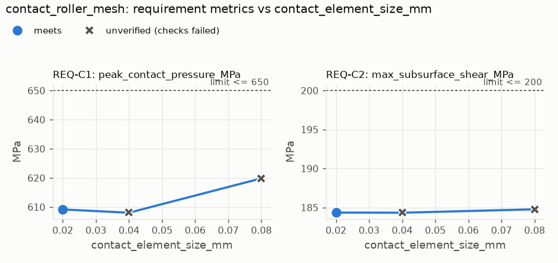
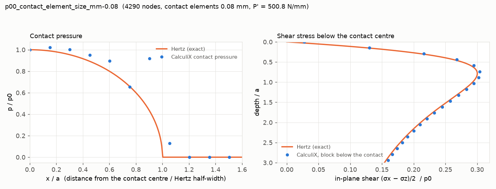
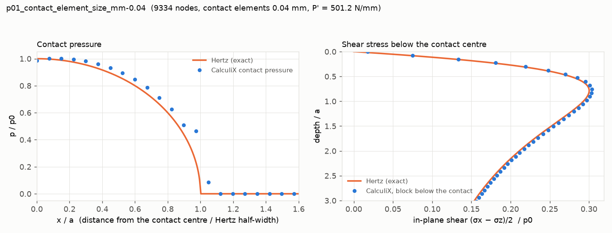
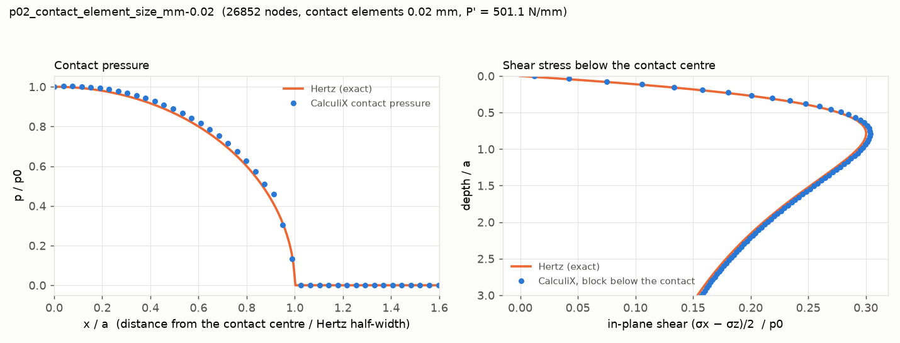

# Engineering review report: contact_roller_mesh

- **Run:** `20261120-120243_contact_roller_mesh`
- **Generated:** 2026-11-20T17:04:38+00:00
- **Case file SHA-256:** `3f8867a77490e8af343a2c412fade98b4e6d5e3a84106b00397b4b5546da3b1b`
- **Environment:** Python 3.14.10, numpy 2.5.5, scipy 1.18.1, matplotlib 3.11.2, cadquery 2.8.0; Windows-11-10.0.26100-SP0
- **Tools:** gmsh 4.15.0; CalculiX This is Version 2.22
- **Code version:** git `5d6049717f651b5e51f928f5d0487eb3917b5c7e` (uncommitted changes present)
- **Simulation status:** completed
- **Verification status:** FAIL

> **Warning:** verification did not pass for every point. Requirement verdicts marked *(unverified)* are not supported by evidence and must not be used for acceptance.

## Scope

Steel roller (R = 50 mm) pressed onto a steel plate in plane strain with CalculiX surface-to-surface penalty contact; contact element size swept 0.08 / 0.04 / 0.02 mm and verified against Hertz line contact.

**Assumptions**

- Plane strain (long roller): one-layer hex slab with uz = 0 at every node.
- Frictionless contact; linear elastic, isotropic steel in both bodies.
- Half model about the vertical symmetry plane; the roller is a quarter disc loaded through its flat top face (far from the contact, a/R = 0.01).
- Penalty contact stiffness 50 E / element size; penetration is checked against the approach.
- Hertz assumes half-spaces; the block (60 x 50 mm half) and roller are about 100 contact widths across.

## Requirements

| ID | Requirement | Metric | Limit |
|---|---|---|---|
| REQ-C1 | Peak contact pressure between roller and plate shall not exceed 650 MPa. | `peak_contact_pressure_MPa` | <= 650 MPa |
| REQ-C2 | Maximum shear stress below the contact surface shall not exceed 200 MPa (rolling-contact fatigue initiation). | `max_subsurface_shear_MPa` | <= 200 MPa |

## Summary across points

| Point | contact_element_size_mm | REQ-C1 | REQ-C2 | Checks |
|---|---|---|---|---|
| p00_contact_element_size_mm-0.08 | 0.08 | 619.8 MPa: **PASS (unverified)** | 184.8 MPa: **PASS (unverified)** | 6/9 FAIL |
| p01_contact_element_size_mm-0.04 | 0.04 | 608 MPa: **PASS (unverified)** | 184.3 MPa: **PASS (unverified)** | 7/9 FAIL |
| p02_contact_element_size_mm-0.02 | 0.02 | 609.2 MPa: **PASS** | 184.3 MPa: **PASS** | 9/9 PASS |

## Run-level checks

Checks that use several points together (for example mesh convergence).

| Check | Description | Value | Tolerance | Status |
|---|---|---|---|---|
| discretization_max_subsurface_shear_MPa | relative discretization uncertainty of max_subsurface_shear_MPa, oscillatory (R = -0.041): 1.25 x half-range of the 3 finest solutions | 0.00147 | 0.02 | PASS |
| discretization_peak_contact_pressure_MPa | relative discretization uncertainty of peak_contact_pressure_MPa, oscillatory (R = -0.096): 1.25 x half-range of the 3 finest solutions | 0.0121 | 0.02 | PASS |

## Point details

### p00_contact_element_size_mm-0.08

Parameters: roller_radius_mm = 50, block_half_width_mm = 60, block_depth_mm = 50, slab_thickness_mm = 0.5, approach_mm = 0.015, youngs_modulus_MPa = 2.1e+05, poisson_ratio = 0.3, yield_strength_MPa = 1200, contact_element_size_mm = 0.08, far_element_size_mm = 4, penalty_stiffness_factor = 50, refined_zone_mm = 1.6

Derived: E_star_MPa = 1.154e+05, penalty_N_per_mm3 = 1.312e+08

| Requirement | Result | Limit | Margin | Verdict | Evidence |
|---|---|---|---|---|---|
| REQ-C1 | 619.8 MPa | <= 650 | 30.2 | **PASS (unverified)** | [point.json](points/p00_contact_element_size_mm-0.08/point.json) |
| REQ-C2 | 184.8 MPa | <= 200 | 15.2 | **PASS (unverified)** | [point.json](points/p00_contact_element_size_mm-0.08/point.json) |

| Check | Description | Value | Tolerance | Status |
|---|---|---|---|---|
| equilibrium | |reaction at the roller top + reaction at the block base| / load | 0.00e+00 | 1e-06 | PASS |
| contact_force_balance | |2 x integral of contact pressure dx - line load| / line load | 1.63e-01 | 3e-02 | FAIL |
| hertz_peak_pressure | |peak contact pressure - Hertz p0 at this load| / p0 | 2.19e-02 | 2e-02 | FAIL |
| hertz_half_width | |fitted contact half-width - Hertz a| / a | 7.31e-02 | 2e-02 | FAIL |
| hertz_subsurface_shear | |max shear below the contact - Hertz 0.300 p0| / (0.300 p0) | 1.44e-02 | 2e-02 | PASS |
| hertz_shear_depth | |depth of max shear - Hertz 0.786 a| / element size (node-spacing limited) | 1.69e-02 | 1e+00 | PASS |
| resolution (validity) | elements across the contact half-width (Hertz a / element size), inverted | 1.52e-01 | 2e-01 | PASS |
| penalty_penetration | max penetration of the penalty contact / approach | 3.15e-04 | 1e-02 | PASS |
| elastic (validity) | max subsurface shear / shear yield (Tresca, yield / 2) | 3.08e-01 | 1e+00 | PASS |

### p01_contact_element_size_mm-0.04

Parameters: roller_radius_mm = 50, block_half_width_mm = 60, block_depth_mm = 50, slab_thickness_mm = 0.5, approach_mm = 0.015, youngs_modulus_MPa = 2.1e+05, poisson_ratio = 0.3, yield_strength_MPa = 1200, contact_element_size_mm = 0.04, far_element_size_mm = 4, penalty_stiffness_factor = 50, refined_zone_mm = 1.6

Derived: E_star_MPa = 1.154e+05, penalty_N_per_mm3 = 2.625e+08

| Requirement | Result | Limit | Margin | Verdict | Evidence |
|---|---|---|---|---|---|
| REQ-C1 | 608 MPa | <= 650 | 42 | **PASS (unverified)** | [point.json](points/p01_contact_element_size_mm-0.04/point.json) |
| REQ-C2 | 184.3 MPa | <= 200 | 15.7 | **PASS (unverified)** | [point.json](points/p01_contact_element_size_mm-0.04/point.json) |

| Check | Description | Value | Tolerance | Status |
|---|---|---|---|---|
| equilibrium | |reaction at the roller top + reaction at the block base| / load | 0.00e+00 | 1e-06 | PASS |
| contact_force_balance | |2 x integral of contact pressure dx - line load| / line load | 7.56e-02 | 3e-02 | FAIL |
| hertz_peak_pressure | |peak contact pressure - Hertz p0 at this load| / p0 | 2.10e-03 | 2e-02 | PASS |
| hertz_half_width | |fitted contact half-width - Hertz a| / a | 5.27e-02 | 2e-02 | FAIL |
| hertz_subsurface_shear | |max shear below the contact - Hertz 0.300 p0| / (0.300 p0) | 1.17e-02 | 2e-02 | PASS |
| hertz_shear_depth | |depth of max shear - Hertz 0.786 a| / element size (node-spacing limited) | 5.23e-03 | 1e+00 | PASS |
| resolution (validity) | elements across the contact half-width (Hertz a / element size), inverted | 7.61e-02 | 2e-01 | PASS |
| penalty_penetration | max penetration of the penalty contact / approach | 1.54e-04 | 1e-02 | PASS |
| elastic (validity) | max subsurface shear / shear yield (Tresca, yield / 2) | 3.07e-01 | 1e+00 | PASS |

### p02_contact_element_size_mm-0.02

Parameters: roller_radius_mm = 50, block_half_width_mm = 60, block_depth_mm = 50, slab_thickness_mm = 0.5, approach_mm = 0.015, youngs_modulus_MPa = 2.1e+05, poisson_ratio = 0.3, yield_strength_MPa = 1200, contact_element_size_mm = 0.02, far_element_size_mm = 4, penalty_stiffness_factor = 50, refined_zone_mm = 1.6

Derived: E_star_MPa = 1.154e+05, penalty_N_per_mm3 = 5.25e+08

| Requirement | Result | Limit | Margin | Verdict | Evidence |
|---|---|---|---|---|---|
| REQ-C1 | 609.2 MPa | <= 650 | 40.8 | **PASS** | [point.json](points/p02_contact_element_size_mm-0.02/point.json) |
| REQ-C2 | 184.3 MPa | <= 200 | 15.7 | **PASS** | [point.json](points/p02_contact_element_size_mm-0.02/point.json) |

| Check | Description | Value | Tolerance | Status |
|---|---|---|---|---|
| equilibrium | |reaction at the roller top + reaction at the block base| / load | 0.00e+00 | 1e-06 | PASS |
| contact_force_balance | |2 x integral of contact pressure dx - line load| / line load | 2.25e-02 | 3e-02 | PASS |
| hertz_peak_pressure | |peak contact pressure - Hertz p0 at this load| / p0 | 4.01e-03 | 2e-02 | PASS |
| hertz_half_width | |fitted contact half-width - Hertz a| / a | 4.92e-05 | 2e-02 | PASS |
| hertz_subsurface_shear | |max shear below the contact - Hertz 0.300 p0| / (0.300 p0) | 1.18e-02 | 2e-02 | PASS |
| hertz_shear_depth | |depth of max shear - Hertz 0.786 a| / element size (node-spacing limited) | 1.83e-02 | 1e+00 | PASS |
| resolution (validity) | elements across the contact half-width (Hertz a / element size), inverted | 3.80e-02 | 2e-01 | PASS |
| penalty_penetration | max penetration of the penalty contact / approach | 7.74e-05 | 1e-02 | PASS |
| elastic (validity) | max subsurface shear / shear yield (Tresca, yield / 2) | 3.07e-01 | 1e+00 | PASS |

## Limitations

- Synthetic geometry, load and allowables; not calibrated to a product.
- No friction, surface roughness, residual stress or plasticity; rolling-contact fatigue life is not assessed.
- Checks establish numerical verification against Hertz only; no test data.
- A converged solver run that matches an analytical reference shows that the equations were solved correctly. It does not show that the equations represent real hardware.

## Engineering acceptance

Pending human review. This report does not accept or reject the design.
