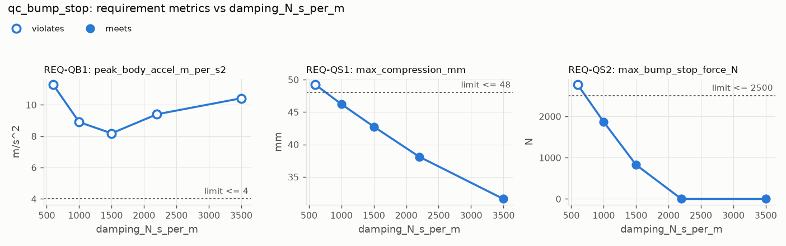
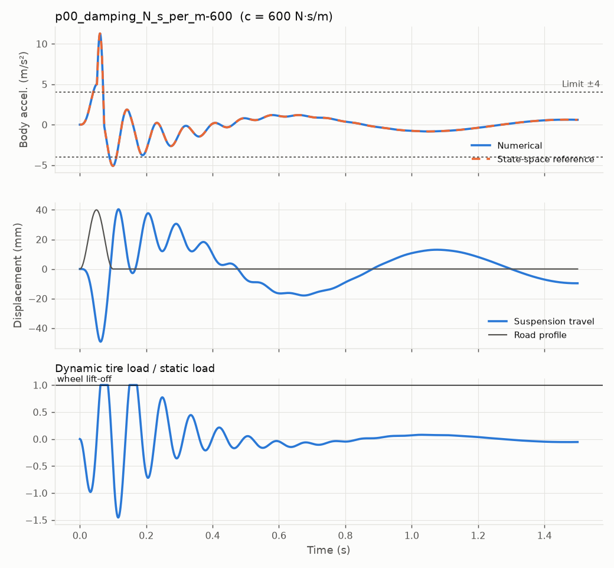
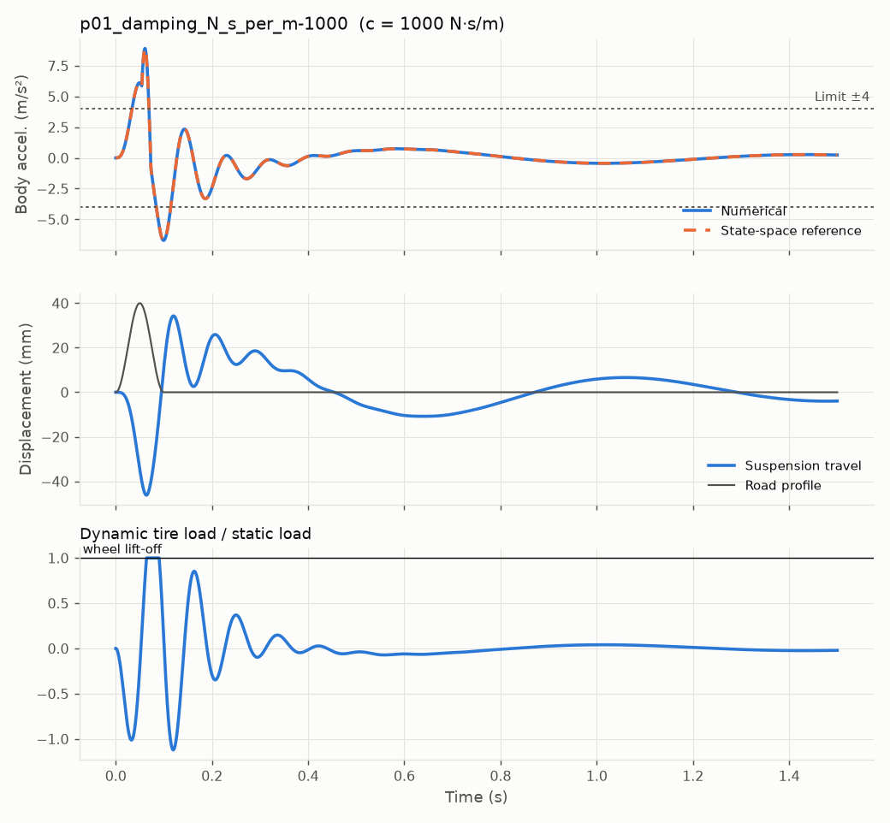
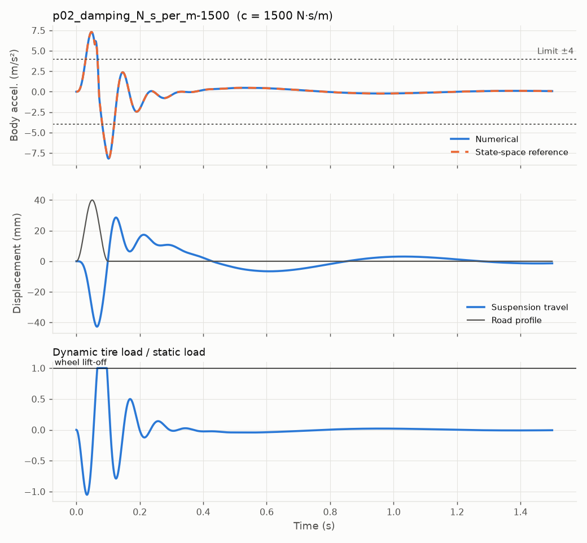
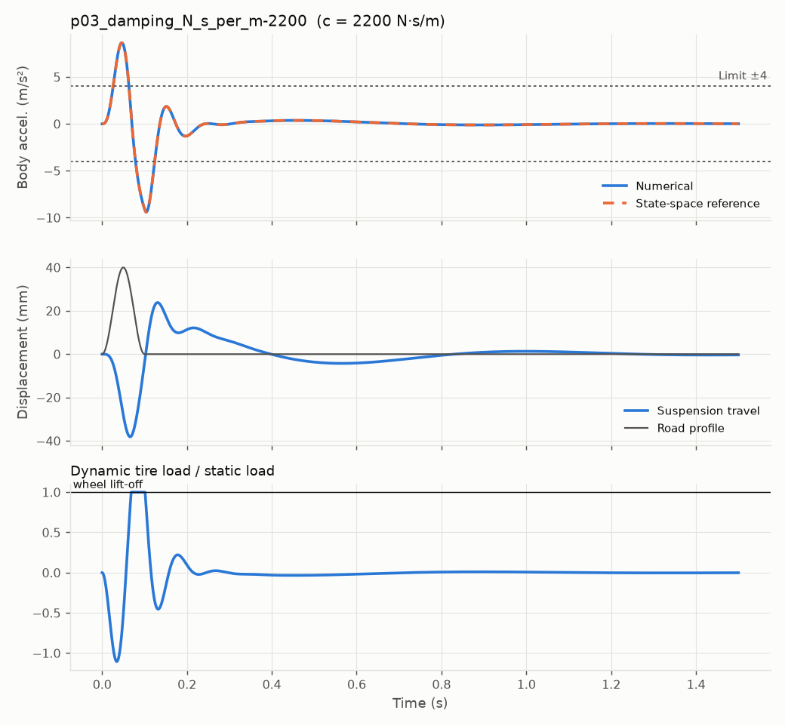
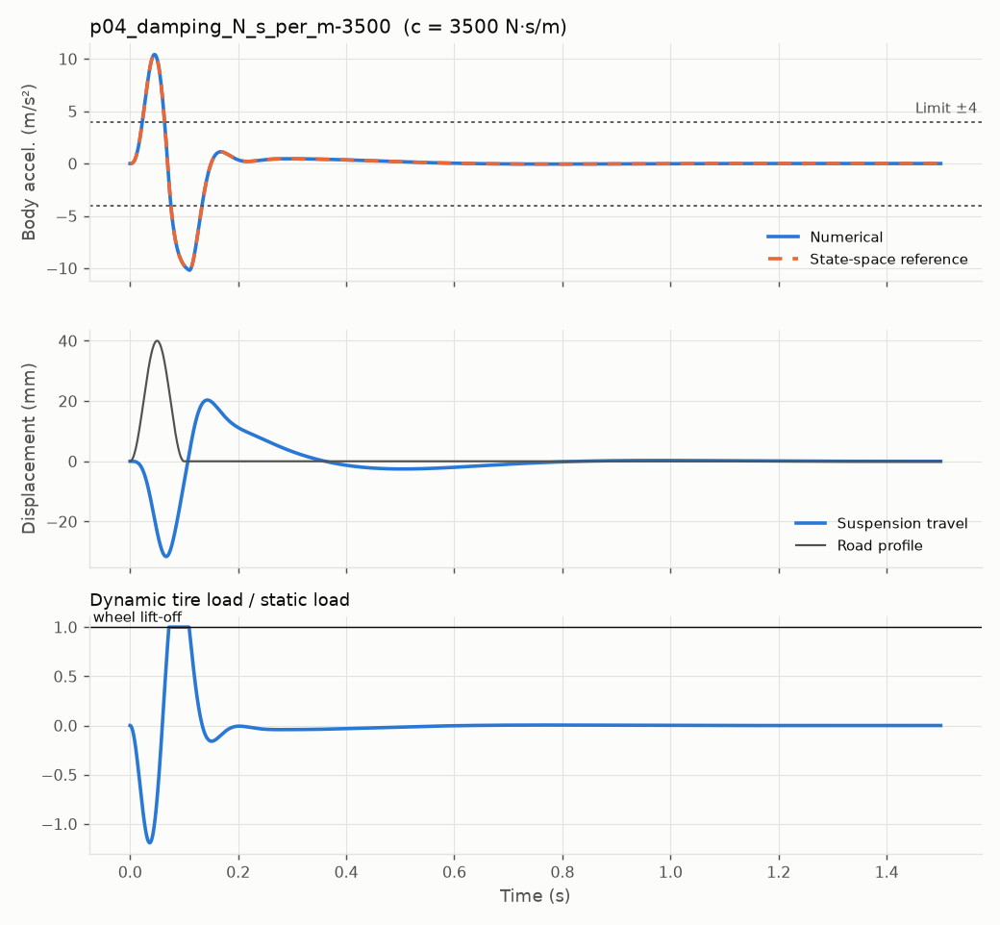

# Engineering review report: qc_bump_stop

- **Run:** `20261120-123312_qc_bump_stop`
- **Generated:** 2026-11-20T17:33:27+00:00
- **Case file SHA-256:** `b804e6e4909b148f1d2dea229fea0274abfcc7071143a781efd901087b5c8361`
- **Environment:** Python 3.14.10, numpy 2.5.5, scipy 1.18.1, matplotlib 3.11.2, cadquery 2.8.0; Windows-11-10.0.26100-SP0
- **Tools:** scipy 1.18.1
- **Code version:** git `66c2b37a8511ace40e9da2191a10c8ade713b86c` (uncommitted changes present)
- **Simulation status:** completed
- **Verification status:** PASS

## Scope

2-DOF quarter car with a tire that can leave the road and a linear jounce bump stop (300 kN/m beyond 40 mm), crossing a 40 mm x 1.0 m (1 - cos) bump at 10 m/s (36 km/h); wheel-rate damping swept from 600 to 3500 N.s/m.

**Assumptions**

- Linear spring and damper; parameters are wheel rates (motion ratio already applied).
- Point-contact tire that pushes but never pulls: load = max(0, W + kt (zr - zu)); no tire damping.
- Linear bump stop: force = kb (compression - gap) when the suspension compresses beyond the gap; no stop damping, no rebound stop.
- Coordinates from static equilibrium; gravity acts explicitly while the wheel is airborne.
- Rigid body above one corner (no pitch/roll coupling, no seat or occupant dynamics).

## Requirements

| ID | Requirement | Metric | Limit |
|---|---|---|---|
| REQ-QB1 | Peak vertical body acceleration over the bump shall not exceed 4.0 m/s^2 (comfort). | `peak_body_accel_m_per_s2` | <= 4 m/s^2 |
| REQ-QS1 | Suspension compression shall not exceed 48 mm (40 mm gap plus 8 mm of usable bump-stop stroke). | `max_compression_mm` | <= 48 mm |
| REQ-QS2 | Peak bump-stop force shall not exceed 2.5 kN (stop and mount rating). | `max_bump_stop_force_N` | <= 2500 N |

## Summary across points

| Point | damping_N_s_per_m | REQ-QB1 | REQ-QS1 | REQ-QS2 | Checks |
|---|---|---|---|---|---|
| p00_damping_N_s_per_m-600 | 600 | 11.29 m/s^2: **FAIL** | 49.23 mm: **FAIL** | 2768 N: **FAIL** | 6/6 PASS |
| p01_damping_N_s_per_m-1000 | 1000 | 8.903 m/s^2: **FAIL** | 46.23 mm: **PASS** | 1869 N: **PASS** | 6/6 PASS |
| p02_damping_N_s_per_m-1500 | 1500 | 8.185 m/s^2: **FAIL** | 42.76 mm: **PASS** | 828.1 N: **PASS** | 6/6 PASS |
| p03_damping_N_s_per_m-2200 | 2200 | 9.4 m/s^2: **FAIL** | 38.13 mm: **PASS** | 0 N: **PASS** | 6/6 PASS |
| p04_damping_N_s_per_m-3500 | 3500 | 10.42 m/s^2: **FAIL** | 31.61 mm: **PASS** | 0 N: **PASS** | 6/6 PASS |

## Point details

### p00_damping_N_s_per_m-600

Parameters: sprung_mass_kg = 350, unsprung_mass_kg = 45, suspension_stiffness_N_per_m = 2.2e+04, damping_N_s_per_m = 600, tire_stiffness_N_per_m = 2.2e+05, road = bump, speed_m_per_s = 10, bump_height_m = 0.04, bump_length_m = 1, tire_model = liftoff, bump_stop_gap_mm = 40, bump_stop_stiffness_N_per_m = 3e+05

Derived: ride_rate_N_per_m = 2e+04, body_frequency_Hz_approx = 1.203, wheel_hop_frequency_Hz_approx = 11.67, body_damping_ratio_approx = 0.1134, static_tire_load_N = 3874, slowest_decay_rate_per_s = 0.7084

| Requirement | Result | Limit | Margin | Verdict | Evidence |
|---|---|---|---|---|---|
| REQ-QB1 | 11.29 m/s^2 | <= 4 | -7.29 | **FAIL** | [point.json](points/p00_damping_N_s_per_m-600/point.json) |
| REQ-QS1 | 49.23 mm | <= 48 | -1.23 | **FAIL** | [point.json](points/p00_damping_N_s_per_m-600/point.json) |
| REQ-QS2 | 2768 N | <= 2500 | -268 | **FAIL** | [point.json](points/p00_damping_N_s_per_m-600/point.json) |

| Check | Description | Value | Tolerance | Status |
|---|---|---|---|---|
| energy_balance | |W_road - (dE + E_dissipated)| / integral |P_road| dt | 2.46e-06 | 1e-04 | PASS |
| solver_convergence | max |z(tol) - z(tol/100)| / max |z| (body and wheel) | 1.61e-09 | 1e-06 | PASS |
| contact_event_times | max |t_event model - t_event exact| [s] over tire and bump-stop switches (6 events; sequence must match) | 2.72e-11 | 1e-06 | PASS |
| reference_agreement | max |z_num - z_ref| / bump height (body and wheel; matrix-exponential ref) | 2.10e-09 | 1e-05 | PASS |
| peak_accel_reference | |peak accel num - peak accel ref| / peak accel ref | 1.69e-09 | 1e-04 | PASS |
| return_to_rest | max(|zs(t_end)|, |zu(t_end)|) / bump height | 2.44e-04 | 1e-03 | PASS |

### p01_damping_N_s_per_m-1000

Parameters: sprung_mass_kg = 350, unsprung_mass_kg = 45, suspension_stiffness_N_per_m = 2.2e+04, damping_N_s_per_m = 1000, tire_stiffness_N_per_m = 2.2e+05, road = bump, speed_m_per_s = 10, bump_height_m = 0.04, bump_length_m = 1, tire_model = liftoff, bump_stop_gap_mm = 40, bump_stop_stiffness_N_per_m = 3e+05

Derived: ride_rate_N_per_m = 2e+04, body_frequency_Hz_approx = 1.203, wheel_hop_frequency_Hz_approx = 11.67, body_damping_ratio_approx = 0.189, static_tire_load_N = 3874, slowest_decay_rate_per_s = 1.188

| Requirement | Result | Limit | Margin | Verdict | Evidence |
|---|---|---|---|---|---|
| REQ-QB1 | 8.903 m/s^2 | <= 4 | -4.9 | **FAIL** | [point.json](points/p01_damping_N_s_per_m-1000/point.json) |
| REQ-QS1 | 46.23 mm | <= 48 | 1.77 | **PASS** | [point.json](points/p01_damping_N_s_per_m-1000/point.json) |
| REQ-QS2 | 1869 N | <= 2500 | 631 | **PASS** | [point.json](points/p01_damping_N_s_per_m-1000/point.json) |

| Check | Description | Value | Tolerance | Status |
|---|---|---|---|---|
| energy_balance | |W_road - (dE + E_dissipated)| / integral |P_road| dt | 9.93e-06 | 1e-04 | PASS |
| solver_convergence | max |z(tol) - z(tol/100)| / max |z| (body and wheel) | 5.59e-10 | 1e-06 | PASS |
| contact_event_times | max |t_event model - t_event exact| [s] over tire and bump-stop switches (4 events; sequence must match) | 1.69e-11 | 1e-06 | PASS |
| reference_agreement | max |z_num - z_ref| / bump height (body and wheel; matrix-exponential ref) | 7.05e-10 | 1e-05 | PASS |
| peak_accel_reference | |peak accel num - peak accel ref| / peak accel ref | 4.07e-10 | 1e-04 | PASS |
| return_to_rest | max(|zs(t_end)|, |zu(t_end)|) / bump height | 2.58e-06 | 1e-03 | PASS |

### p02_damping_N_s_per_m-1500

Parameters: sprung_mass_kg = 350, unsprung_mass_kg = 45, suspension_stiffness_N_per_m = 2.2e+04, damping_N_s_per_m = 1500, tire_stiffness_N_per_m = 2.2e+05, road = bump, speed_m_per_s = 10, bump_height_m = 0.04, bump_length_m = 1, tire_model = liftoff, bump_stop_gap_mm = 40, bump_stop_stiffness_N_per_m = 3e+05

Derived: ride_rate_N_per_m = 2e+04, body_frequency_Hz_approx = 1.203, wheel_hop_frequency_Hz_approx = 11.67, body_damping_ratio_approx = 0.2835, static_tire_load_N = 3874, slowest_decay_rate_per_s = 1.803

| Requirement | Result | Limit | Margin | Verdict | Evidence |
|---|---|---|---|---|---|
| REQ-QB1 | 8.185 m/s^2 | <= 4 | -4.18 | **FAIL** | [point.json](points/p02_damping_N_s_per_m-1500/point.json) |
| REQ-QS1 | 42.76 mm | <= 48 | 5.24 | **PASS** | [point.json](points/p02_damping_N_s_per_m-1500/point.json) |
| REQ-QS2 | 828.1 N | <= 2500 | 1.67e+03 | **PASS** | [point.json](points/p02_damping_N_s_per_m-1500/point.json) |

| Check | Description | Value | Tolerance | Status |
|---|---|---|---|---|
| energy_balance | |W_road - (dE + E_dissipated)| / integral |P_road| dt | 7.54e-07 | 1e-04 | PASS |
| solver_convergence | max |z(tol) - z(tol/100)| / max |z| (body and wheel) | 2.12e-09 | 1e-06 | PASS |
| contact_event_times | max |t_event model - t_event exact| [s] over tire and bump-stop switches (4 events; sequence must match) | 7.24e-11 | 1e-06 | PASS |
| reference_agreement | max |z_num - z_ref| / bump height (body and wheel; matrix-exponential ref) | 2.56e-09 | 1e-05 | PASS |
| peak_accel_reference | |peak accel num - peak accel ref| / peak accel ref | 2.44e-09 | 1e-04 | PASS |
| return_to_rest | max(|zs(t_end)|, |zu(t_end)|) / bump height | 7.33e-09 | 1e-03 | PASS |

### p03_damping_N_s_per_m-2200

Parameters: sprung_mass_kg = 350, unsprung_mass_kg = 45, suspension_stiffness_N_per_m = 2.2e+04, damping_N_s_per_m = 2200, tire_stiffness_N_per_m = 2.2e+05, road = bump, speed_m_per_s = 10, bump_height_m = 0.04, bump_length_m = 1, tire_model = liftoff, bump_stop_gap_mm = 40, bump_stop_stiffness_N_per_m = 3e+05

Derived: ride_rate_N_per_m = 2e+04, body_frequency_Hz_approx = 1.203, wheel_hop_frequency_Hz_approx = 11.67, body_damping_ratio_approx = 0.4158, static_tire_load_N = 3874, slowest_decay_rate_per_s = 2.714

| Requirement | Result | Limit | Margin | Verdict | Evidence |
|---|---|---|---|---|---|
| REQ-QB1 | 9.4 m/s^2 | <= 4 | -5.4 | **FAIL** | [point.json](points/p03_damping_N_s_per_m-2200/point.json) |
| REQ-QS1 | 38.13 mm | <= 48 | 9.87 | **PASS** | [point.json](points/p03_damping_N_s_per_m-2200/point.json) |
| REQ-QS2 | 0 N | <= 2500 | 2.5e+03 | **PASS** | [point.json](points/p03_damping_N_s_per_m-2200/point.json) |

| Check | Description | Value | Tolerance | Status |
|---|---|---|---|---|
| energy_balance | |W_road - (dE + E_dissipated)| / integral |P_road| dt | 2.83e-05 | 1e-04 | PASS |
| solver_convergence | max |z(tol) - z(tol/100)| / max |z| (body and wheel) | 5.48e-10 | 1e-06 | PASS |
| contact_event_times | max |t_event model - t_event exact| [s] over tire and bump-stop switches (2 events; sequence must match) | 3.34e-12 | 1e-06 | PASS |
| reference_agreement | max |z_num - z_ref| / bump height (body and wheel; matrix-exponential ref) | 6.32e-10 | 1e-05 | PASS |
| peak_accel_reference | |peak accel num - peak accel ref| / peak accel ref | 5.33e-10 | 1e-04 | PASS |
| return_to_rest | max(|zs(t_end)|, |zu(t_end)|) / bump height | 6.08e-13 | 1e-03 | PASS |

### p04_damping_N_s_per_m-3500

Parameters: sprung_mass_kg = 350, unsprung_mass_kg = 45, suspension_stiffness_N_per_m = 2.2e+04, damping_N_s_per_m = 3500, tire_stiffness_N_per_m = 2.2e+05, road = bump, speed_m_per_s = 10, bump_height_m = 0.04, bump_length_m = 1, tire_model = liftoff, bump_stop_gap_mm = 40, bump_stop_stiffness_N_per_m = 3e+05

Derived: ride_rate_N_per_m = 2e+04, body_frequency_Hz_approx = 1.203, wheel_hop_frequency_Hz_approx = 11.67, body_damping_ratio_approx = 0.6614, static_tire_load_N = 3874, slowest_decay_rate_per_s = 4.713

| Requirement | Result | Limit | Margin | Verdict | Evidence |
|---|---|---|---|---|---|
| REQ-QB1 | 10.42 m/s^2 | <= 4 | -6.42 | **FAIL** | [point.json](points/p04_damping_N_s_per_m-3500/point.json) |
| REQ-QS1 | 31.61 mm | <= 48 | 16.4 | **PASS** | [point.json](points/p04_damping_N_s_per_m-3500/point.json) |
| REQ-QS2 | 0 N | <= 2500 | 2.5e+03 | **PASS** | [point.json](points/p04_damping_N_s_per_m-3500/point.json) |

| Check | Description | Value | Tolerance | Status |
|---|---|---|---|---|
| energy_balance | |W_road - (dE + E_dissipated)| / integral |P_road| dt | 1.47e-05 | 1e-04 | PASS |
| solver_convergence | max |z(tol) - z(tol/100)| / max |z| (body and wheel) | 9.91e-10 | 1e-06 | PASS |
| contact_event_times | max |t_event model - t_event exact| [s] over tire and bump-stop switches (2 events; sequence must match) | 1.03e-12 | 1e-06 | PASS |
| reference_agreement | max |z_num - z_ref| / bump height (body and wheel; matrix-exponential ref) | 1.03e-09 | 1e-05 | PASS |
| peak_accel_reference | |peak accel num - peak accel ref| / peak accel ref | 1.30e-11 | 1e-04 | PASS |
| return_to_rest | max(|zs(t_end)|, |zu(t_end)|) / bump height | 3.72e-15 | 1e-03 | PASS |

## Limitations

- Synthetic parameters; not calibrated to any vehicle. Real elastomer stops are progressive and damped.
- Peak acceleration is unweighted; ISO 2631 frequency weighting is not applied.
- Checks establish numerical verification only; no test data.
- A converged solver run that matches an analytical reference shows that the equations were solved correctly. It does not show that the equations represent real hardware.

## Engineering acceptance

Pending human review. This report does not accept or reject the design.
