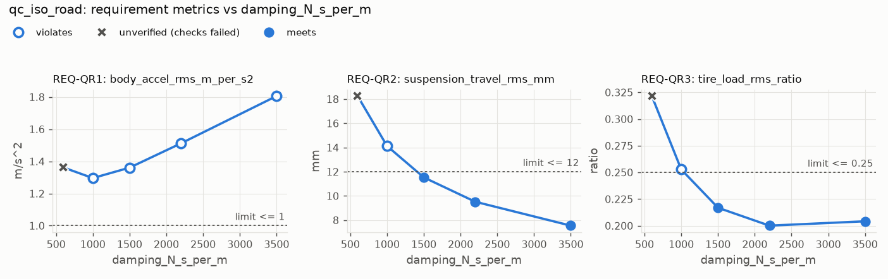
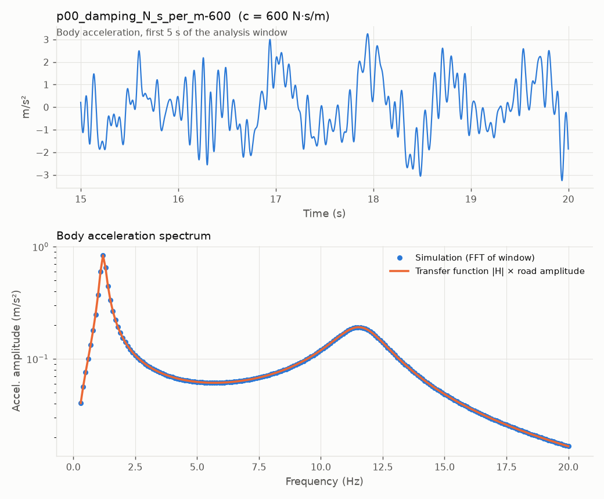
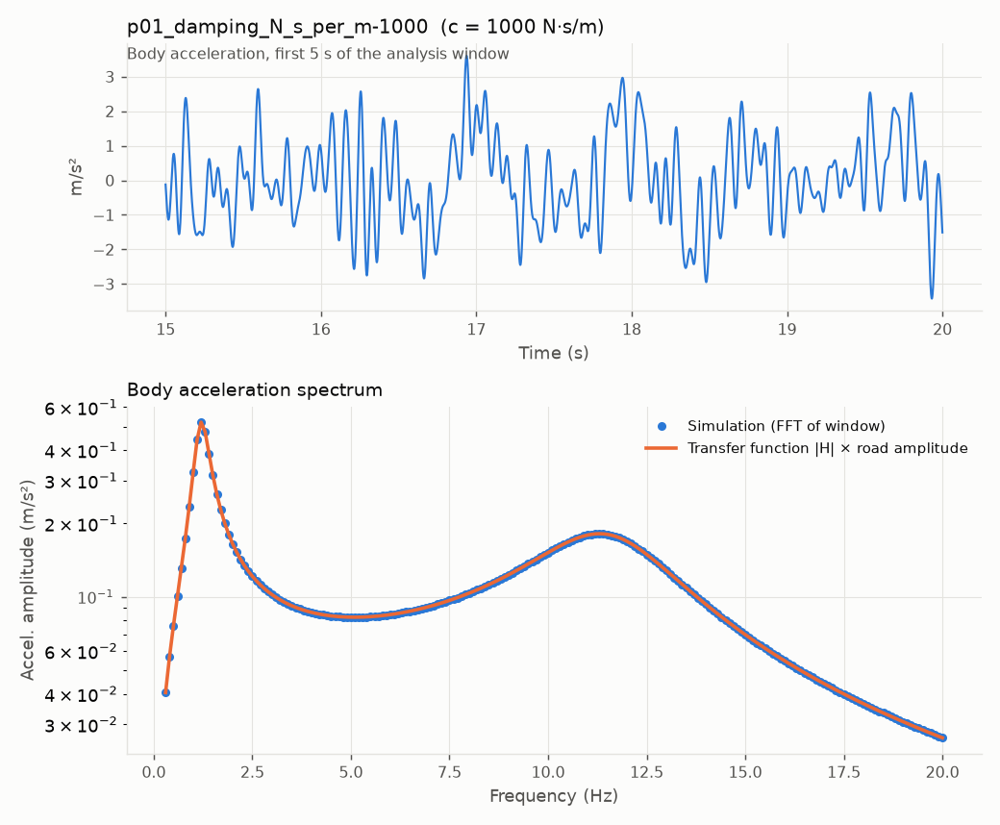
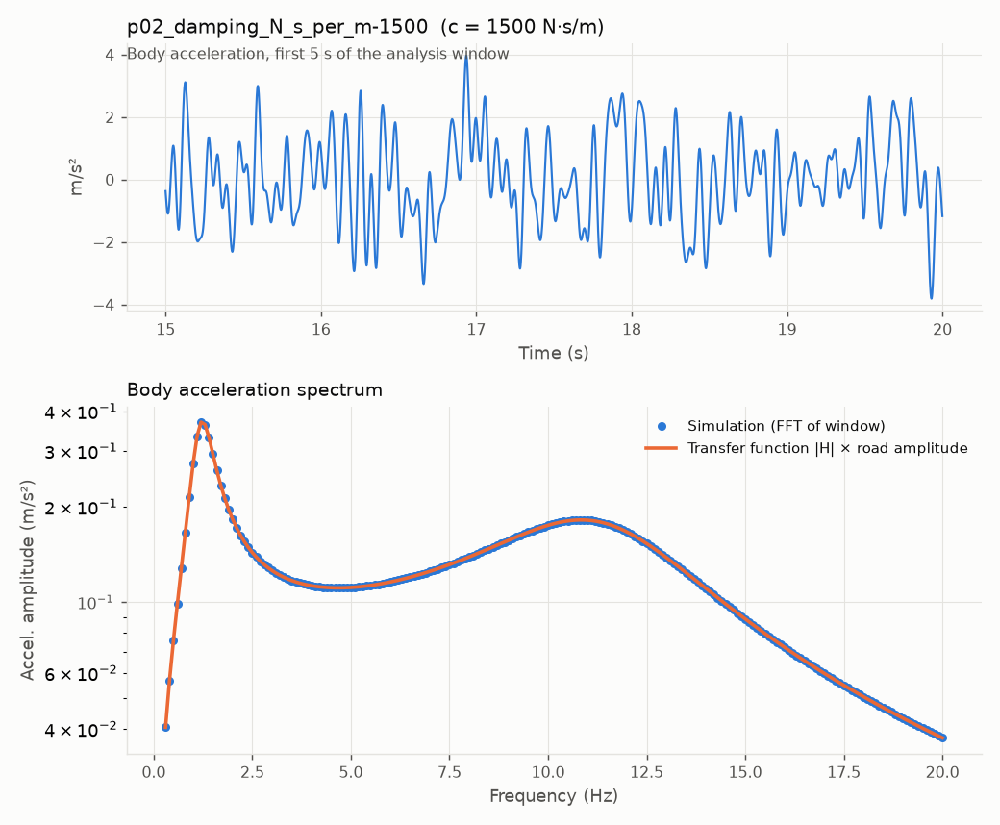
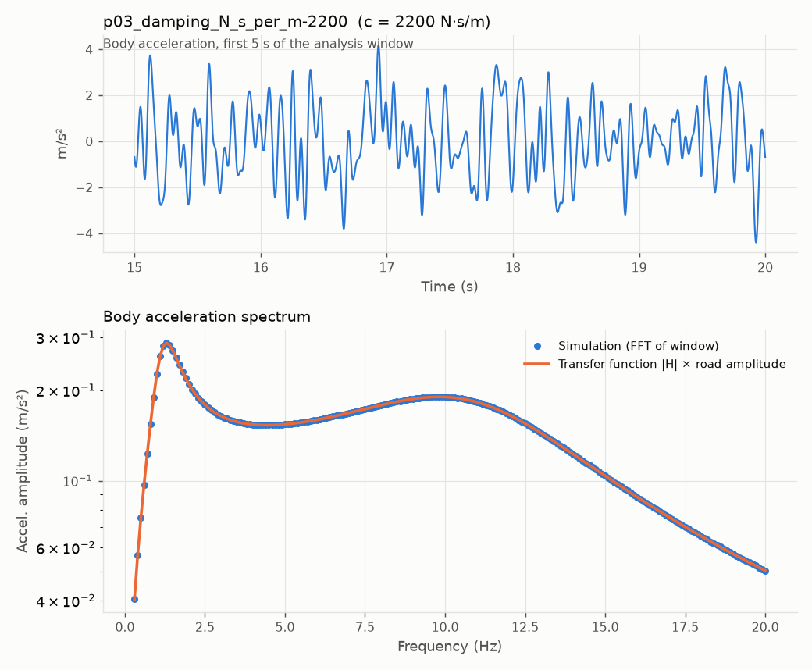
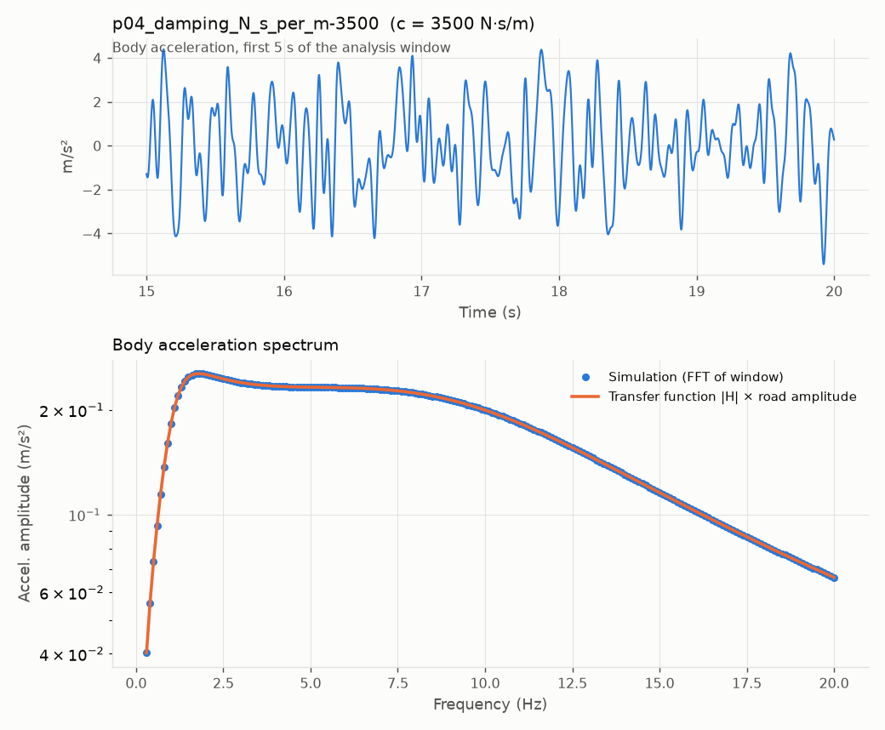

# Engineering review report: qc_iso_road

- **Run:** `20261120-124907_qc_iso_road`
- **Generated:** 2026-11-20T17:49:34+00:00
- **Case file SHA-256:** `816326c35beba5d81e86dabf77929a9c5c340deb2b78f349260fe958da46a644`
- **Environment:** Python 3.14.10, numpy 2.5.5, scipy 1.18.1, matplotlib 3.11.2, cadquery 2.8.0; Windows-11-10.0.26100-SP0
- **Tools:** scipy 1.18.1
- **Code version:** git `c16b216a2d5b9801ad8130364859bfac45eca338` (uncommitted changes present)
- **Simulation status:** completed
- **Verification status:** FAIL

> **Warning:** verification did not pass for every point. Requirement verdicts marked *(unverified)* are not supported by evidence and must not be used for acceptance.

## Scope

Linear 2-DOF quarter car on an ISO 8608 class C road (Gd(n0) = 256e-6 m^3) at 20 m/s (72 km/h); wheel-rate damping swept from 600 to 3500 N.s/m against RMS body acceleration, suspension travel, and tire load requirements.

**Assumptions**

- Linear spring, damper, and tire; parameters are wheel rates (motion ratio already applied).
- Point-contact tire with no tire damping and no enveloping; the tire never leaves the road (checked).
- Road realised as 198 sinusoids (0.011-1.0 cycles/m, i.e. 0.22-20 Hz at 20 m/s) with fixed random phases (seed 8608); content above 20 Hz is excluded.
- RMS values are taken over a 10 s window after a 15 s settling period.
- Coordinates from static equilibrium; rigid body above one corner.

## Requirements

| ID | Requirement | Metric | Limit |
|---|---|---|---|
| REQ-QR1 | RMS vertical body acceleration shall not exceed 1.0 m/s^2 (unweighted comfort target). | `body_accel_rms_m_per_s2` | <= 1 m/s^2 |
| REQ-QR2 | RMS suspension travel shall not exceed 12 mm (3-sigma within the 40 mm travel). | `suspension_travel_rms_mm` | <= 12 mm |
| REQ-QR3 | RMS dynamic tire load shall not exceed 25 % of static load (3-sigma below lift-off). | `tire_load_rms_ratio` | <= 0.25 - |

## Summary across points

| Point | damping_N_s_per_m | REQ-QR1 | REQ-QR2 | REQ-QR3 | Checks |
|---|---|---|---|---|---|
| p00_damping_N_s_per_m-600 | 600 | 1.362 m/s^2: **FAIL (unverified)** | 18.25 mm: **FAIL (unverified)** | 0.3215 -: **FAIL (unverified)** | 7/8 FAIL |
| p01_damping_N_s_per_m-1000 | 1000 | 1.296 m/s^2: **FAIL** | 14.12 mm: **FAIL** | 0.2527 -: **FAIL** | 8/8 PASS |
| p02_damping_N_s_per_m-1500 | 1500 | 1.361 m/s^2: **FAIL** | 11.53 mm: **PASS** | 0.2168 -: **PASS** | 8/8 PASS |
| p03_damping_N_s_per_m-2200 | 2200 | 1.512 m/s^2: **FAIL** | 9.516 mm: **PASS** | 0.2 -: **PASS** | 8/8 PASS |
| p04_damping_N_s_per_m-3500 | 3500 | 1.806 m/s^2: **FAIL** | 7.541 mm: **PASS** | 0.2041 -: **PASS** | 8/8 PASS |

## Point details

### p00_damping_N_s_per_m-600

Parameters: sprung_mass_kg = 350, unsprung_mass_kg = 45, suspension_stiffness_N_per_m = 2.2e+04, damping_N_s_per_m = 600, tire_stiffness_N_per_m = 2.2e+05, road = iso8608, speed_m_per_s = 20, road_Gd_n0_m3 = 0.000256, road_seed = 8608, n_min_cyc_per_m = 0.011, n_max_cyc_per_m = 1, window_s = 10

Derived: ride_rate_N_per_m = 2e+04, body_frequency_Hz_approx = 1.203, wheel_hop_frequency_Hz_approx = 11.67, body_damping_ratio_approx = 0.1134, static_tire_load_N = 3874, slowest_decay_rate_per_s = 0.7084

| Requirement | Result | Limit | Margin | Verdict | Evidence |
|---|---|---|---|---|---|
| REQ-QR1 | 1.362 m/s^2 | <= 1 | -0.362 | **FAIL (unverified)** | [point.json](points/p00_damping_N_s_per_m-600/point.json) |
| REQ-QR2 | 18.25 mm | <= 12 | -6.25 | **FAIL (unverified)** | [point.json](points/p00_damping_N_s_per_m-600/point.json) |
| REQ-QR3 | 0.3215 - | <= 0.25 | -0.0715 | **FAIL (unverified)** | [point.json](points/p00_damping_N_s_per_m-600/point.json) |

| Check | Description | Value | Tolerance | Status |
|---|---|---|---|---|
| energy_balance | |W_road - (dE + E_dissipated)| / integral |P_road| dt | 9.15e-10 | 1e-04 | PASS |
| solver_convergence | max |z(tol) - z(tol/100)| / max |z| (body and wheel) | 2.20e-08 | 1e-06 | PASS |
| no_wheel_lift (validity) | max dynamic tire load / static load (linear tire valid only < 1) | 1.10e+00 | 1e+00 | FAIL |
| body_accel_rms_m_per_s2_reference | |body_accel_rms_m_per_s2 num - closed-form| / closed-form | 1.54e-06 | 1e-03 | PASS |
| suspension_travel_rms_mm_reference | |suspension_travel_rms_mm num - closed-form| / closed-form | 1.99e-06 | 1e-03 | PASS |
| tire_load_rms_ratio_reference | |tire_load_rms_ratio num - closed-form| / closed-form | 2.21e-07 | 1e-03 | PASS |
| body_accel_weighted_rms_m_per_s2_reference | |body_accel_weighted_rms_m_per_s2 num - closed-form| / closed-form | 2.50e-04 | 1e-03 | PASS |
| transient_decayed | exp(-sigma_min * settle time): start-up transient left in window | 2.43e-05 | 1e-04 | PASS |

### p01_damping_N_s_per_m-1000

Parameters: sprung_mass_kg = 350, unsprung_mass_kg = 45, suspension_stiffness_N_per_m = 2.2e+04, damping_N_s_per_m = 1000, tire_stiffness_N_per_m = 2.2e+05, road = iso8608, speed_m_per_s = 20, road_Gd_n0_m3 = 0.000256, road_seed = 8608, n_min_cyc_per_m = 0.011, n_max_cyc_per_m = 1, window_s = 10

Derived: ride_rate_N_per_m = 2e+04, body_frequency_Hz_approx = 1.203, wheel_hop_frequency_Hz_approx = 11.67, body_damping_ratio_approx = 0.189, static_tire_load_N = 3874, slowest_decay_rate_per_s = 1.188

| Requirement | Result | Limit | Margin | Verdict | Evidence |
|---|---|---|---|---|---|
| REQ-QR1 | 1.296 m/s^2 | <= 1 | -0.296 | **FAIL** | [point.json](points/p01_damping_N_s_per_m-1000/point.json) |
| REQ-QR2 | 14.12 mm | <= 12 | -2.12 | **FAIL** | [point.json](points/p01_damping_N_s_per_m-1000/point.json) |
| REQ-QR3 | 0.2527 - | <= 0.25 | -0.00269 | **FAIL** | [point.json](points/p01_damping_N_s_per_m-1000/point.json) |

| Check | Description | Value | Tolerance | Status |
|---|---|---|---|---|
| energy_balance | |W_road - (dE + E_dissipated)| / integral |P_road| dt | 4.19e-09 | 1e-04 | PASS |
| solver_convergence | max |z(tol) - z(tol/100)| / max |z| (body and wheel) | 8.54e-09 | 1e-06 | PASS |
| no_wheel_lift (validity) | max dynamic tire load / static load (linear tire valid only < 1) | 8.27e-01 | 1e+00 | PASS |
| body_accel_rms_m_per_s2_reference | |body_accel_rms_m_per_s2 num - closed-form| / closed-form | 2.27e-10 | 1e-03 | PASS |
| suspension_travel_rms_mm_reference | |suspension_travel_rms_mm num - closed-form| / closed-form | 2.95e-10 | 1e-03 | PASS |
| tire_load_rms_ratio_reference | |tire_load_rms_ratio num - closed-form| / closed-form | 1.48e-10 | 1e-03 | PASS |
| body_accel_weighted_rms_m_per_s2_reference | |body_accel_weighted_rms_m_per_s2 num - closed-form| / closed-form | 2.87e-04 | 1e-03 | PASS |
| transient_decayed | exp(-sigma_min * settle time): start-up transient left in window | 1.83e-08 | 1e-04 | PASS |

### p02_damping_N_s_per_m-1500

Parameters: sprung_mass_kg = 350, unsprung_mass_kg = 45, suspension_stiffness_N_per_m = 2.2e+04, damping_N_s_per_m = 1500, tire_stiffness_N_per_m = 2.2e+05, road = iso8608, speed_m_per_s = 20, road_Gd_n0_m3 = 0.000256, road_seed = 8608, n_min_cyc_per_m = 0.011, n_max_cyc_per_m = 1, window_s = 10

Derived: ride_rate_N_per_m = 2e+04, body_frequency_Hz_approx = 1.203, wheel_hop_frequency_Hz_approx = 11.67, body_damping_ratio_approx = 0.2835, static_tire_load_N = 3874, slowest_decay_rate_per_s = 1.803

| Requirement | Result | Limit | Margin | Verdict | Evidence |
|---|---|---|---|---|---|
| REQ-QR1 | 1.361 m/s^2 | <= 1 | -0.361 | **FAIL** | [point.json](points/p02_damping_N_s_per_m-1500/point.json) |
| REQ-QR2 | 11.53 mm | <= 12 | 0.472 | **PASS** | [point.json](points/p02_damping_N_s_per_m-1500/point.json) |
| REQ-QR3 | 0.2168 - | <= 0.25 | 0.0332 | **PASS** | [point.json](points/p02_damping_N_s_per_m-1500/point.json) |

| Check | Description | Value | Tolerance | Status |
|---|---|---|---|---|
| energy_balance | |W_road - (dE + E_dissipated)| / integral |P_road| dt | 1.01e-08 | 1e-04 | PASS |
| solver_convergence | max |z(tol) - z(tol/100)| / max |z| (body and wheel) | 9.50e-09 | 1e-06 | PASS |
| no_wheel_lift (validity) | max dynamic tire load / static load (linear tire valid only < 1) | 7.52e-01 | 1e+00 | PASS |
| body_accel_rms_m_per_s2_reference | |body_accel_rms_m_per_s2 num - closed-form| / closed-form | 1.04e-10 | 1e-03 | PASS |
| suspension_travel_rms_mm_reference | |suspension_travel_rms_mm num - closed-form| / closed-form | 2.96e-12 | 1e-03 | PASS |
| tire_load_rms_ratio_reference | |tire_load_rms_ratio num - closed-form| / closed-form | 1.90e-10 | 1e-03 | PASS |
| body_accel_weighted_rms_m_per_s2_reference | |body_accel_weighted_rms_m_per_s2 num - closed-form| / closed-form | 2.91e-04 | 1e-03 | PASS |
| transient_decayed | exp(-sigma_min * settle time): start-up transient left in window | 1.80e-12 | 1e-04 | PASS |

### p03_damping_N_s_per_m-2200

Parameters: sprung_mass_kg = 350, unsprung_mass_kg = 45, suspension_stiffness_N_per_m = 2.2e+04, damping_N_s_per_m = 2200, tire_stiffness_N_per_m = 2.2e+05, road = iso8608, speed_m_per_s = 20, road_Gd_n0_m3 = 0.000256, road_seed = 8608, n_min_cyc_per_m = 0.011, n_max_cyc_per_m = 1, window_s = 10

Derived: ride_rate_N_per_m = 2e+04, body_frequency_Hz_approx = 1.203, wheel_hop_frequency_Hz_approx = 11.67, body_damping_ratio_approx = 0.4158, static_tire_load_N = 3874, slowest_decay_rate_per_s = 2.714

| Requirement | Result | Limit | Margin | Verdict | Evidence |
|---|---|---|---|---|---|
| REQ-QR1 | 1.512 m/s^2 | <= 1 | -0.512 | **FAIL** | [point.json](points/p03_damping_N_s_per_m-2200/point.json) |
| REQ-QR2 | 9.516 mm | <= 12 | 2.48 | **PASS** | [point.json](points/p03_damping_N_s_per_m-2200/point.json) |
| REQ-QR3 | 0.2 - | <= 0.25 | 0.05 | **PASS** | [point.json](points/p03_damping_N_s_per_m-2200/point.json) |

| Check | Description | Value | Tolerance | Status |
|---|---|---|---|---|
| energy_balance | |W_road - (dE + E_dissipated)| / integral |P_road| dt | 2.23e-08 | 1e-04 | PASS |
| solver_convergence | max |z(tol) - z(tol/100)| / max |z| (body and wheel) | 4.39e-09 | 1e-06 | PASS |
| no_wheel_lift (validity) | max dynamic tire load / static load (linear tire valid only < 1) | 7.12e-01 | 1e+00 | PASS |
| body_accel_rms_m_per_s2_reference | |body_accel_rms_m_per_s2 num - closed-form| / closed-form | 1.35e-10 | 1e-03 | PASS |
| suspension_travel_rms_mm_reference | |suspension_travel_rms_mm num - closed-form| / closed-form | 2.51e-12 | 1e-03 | PASS |
| tire_load_rms_ratio_reference | |tire_load_rms_ratio num - closed-form| / closed-form | 1.91e-10 | 1e-03 | PASS |
| body_accel_weighted_rms_m_per_s2_reference | |body_accel_weighted_rms_m_per_s2 num - closed-form| / closed-form | 2.74e-04 | 1e-03 | PASS |
| transient_decayed | exp(-sigma_min * settle time): start-up transient left in window | 2.09e-18 | 1e-04 | PASS |

### p04_damping_N_s_per_m-3500

Parameters: sprung_mass_kg = 350, unsprung_mass_kg = 45, suspension_stiffness_N_per_m = 2.2e+04, damping_N_s_per_m = 3500, tire_stiffness_N_per_m = 2.2e+05, road = iso8608, speed_m_per_s = 20, road_Gd_n0_m3 = 0.000256, road_seed = 8608, n_min_cyc_per_m = 0.011, n_max_cyc_per_m = 1, window_s = 10

Derived: ride_rate_N_per_m = 2e+04, body_frequency_Hz_approx = 1.203, wheel_hop_frequency_Hz_approx = 11.67, body_damping_ratio_approx = 0.6614, static_tire_load_N = 3874, slowest_decay_rate_per_s = 4.713

| Requirement | Result | Limit | Margin | Verdict | Evidence |
|---|---|---|---|---|---|
| REQ-QR1 | 1.806 m/s^2 | <= 1 | -0.806 | **FAIL** | [point.json](points/p04_damping_N_s_per_m-3500/point.json) |
| REQ-QR2 | 7.541 mm | <= 12 | 4.46 | **PASS** | [point.json](points/p04_damping_N_s_per_m-3500/point.json) |
| REQ-QR3 | 0.2041 - | <= 0.25 | 0.0459 | **PASS** | [point.json](points/p04_damping_N_s_per_m-3500/point.json) |

| Check | Description | Value | Tolerance | Status |
|---|---|---|---|---|
| energy_balance | |W_road - (dE + E_dissipated)| / integral |P_road| dt | 5.52e-08 | 1e-04 | PASS |
| solver_convergence | max |z(tol) - z(tol/100)| / max |z| (body and wheel) | 9.87e-09 | 1e-06 | PASS |
| no_wheel_lift (validity) | max dynamic tire load / static load (linear tire valid only < 1) | 6.89e-01 | 1e+00 | PASS |
| body_accel_rms_m_per_s2_reference | |body_accel_rms_m_per_s2 num - closed-form| / closed-form | 1.04e-10 | 1e-03 | PASS |
| suspension_travel_rms_mm_reference | |suspension_travel_rms_mm num - closed-form| / closed-form | 2.53e-11 | 1e-03 | PASS |
| tire_load_rms_ratio_reference | |tire_load_rms_ratio num - closed-form| / closed-form | 1.34e-10 | 1e-03 | PASS |
| body_accel_weighted_rms_m_per_s2_reference | |body_accel_weighted_rms_m_per_s2 num - closed-form| / closed-form | 2.35e-04 | 1e-03 | PASS |
| transient_decayed | exp(-sigma_min * settle time): start-up transient left in window | 1.99e-31 | 1e-04 | PASS |

## Limitations

- Synthetic parameters; not calibrated to any vehicle.
- Body acceleration is unweighted; ISO 2631 frequency weighting is not applied.
- One road realisation; RMS values from other seeds differ by sampling variability.
- Checks establish numerical verification and model-validity limits only; no test data.
- A converged solver run that matches an analytical reference shows that the equations were solved correctly. It does not show that the equations represent real hardware.

## Engineering acceptance

Pending human review. This report does not accept or reject the design.
