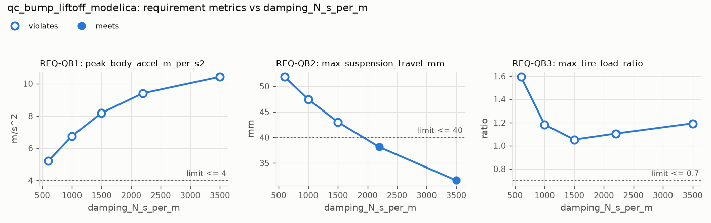
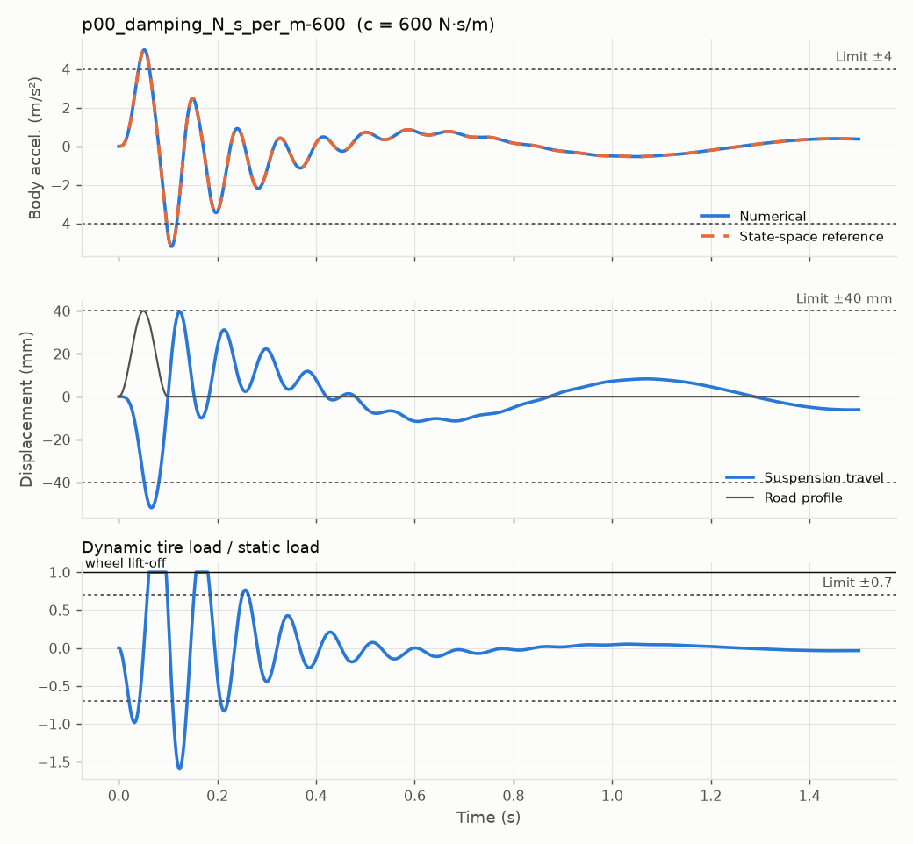
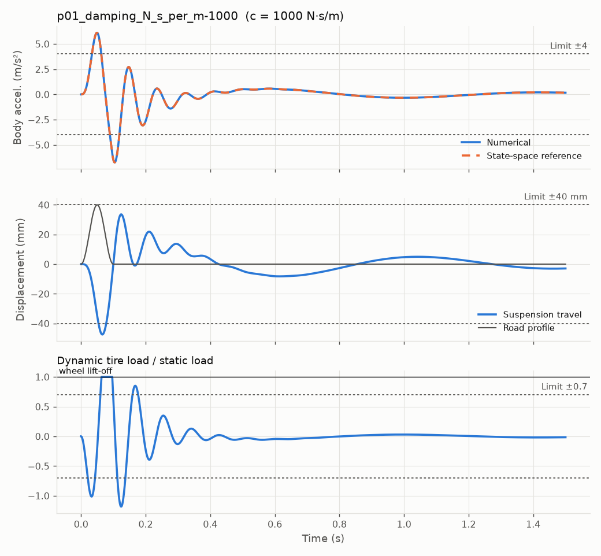
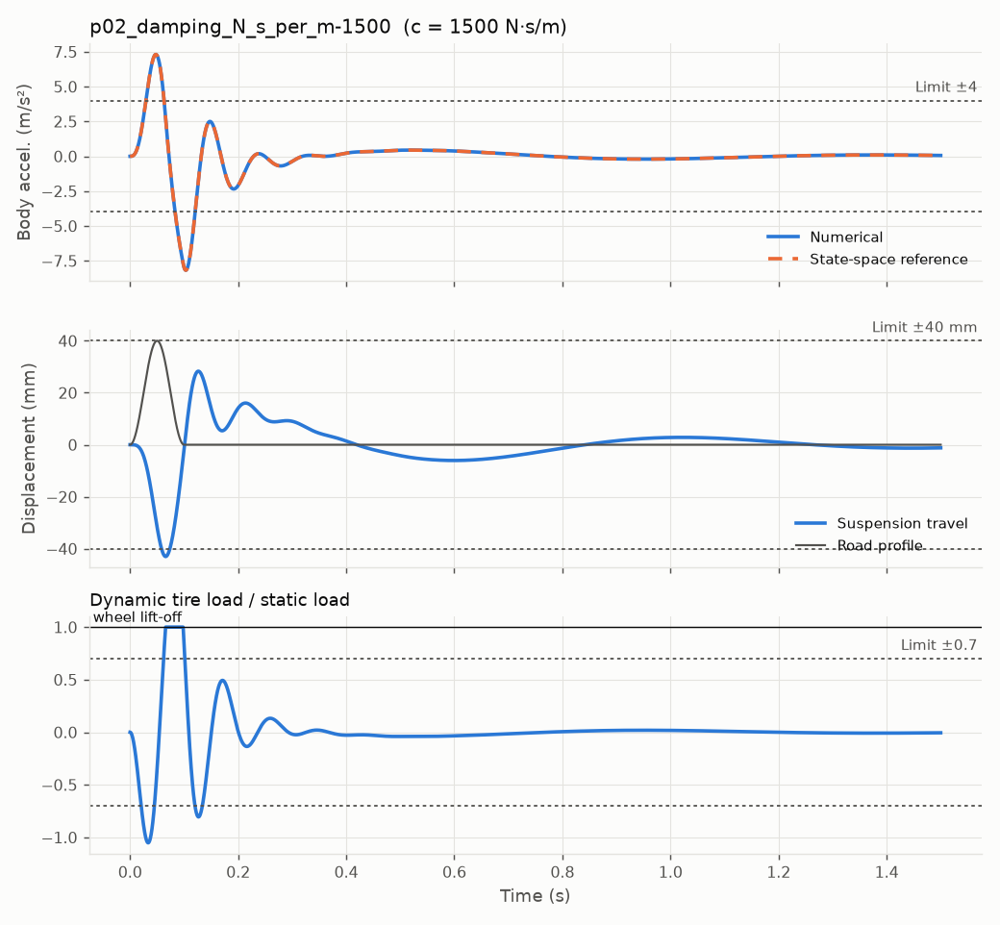
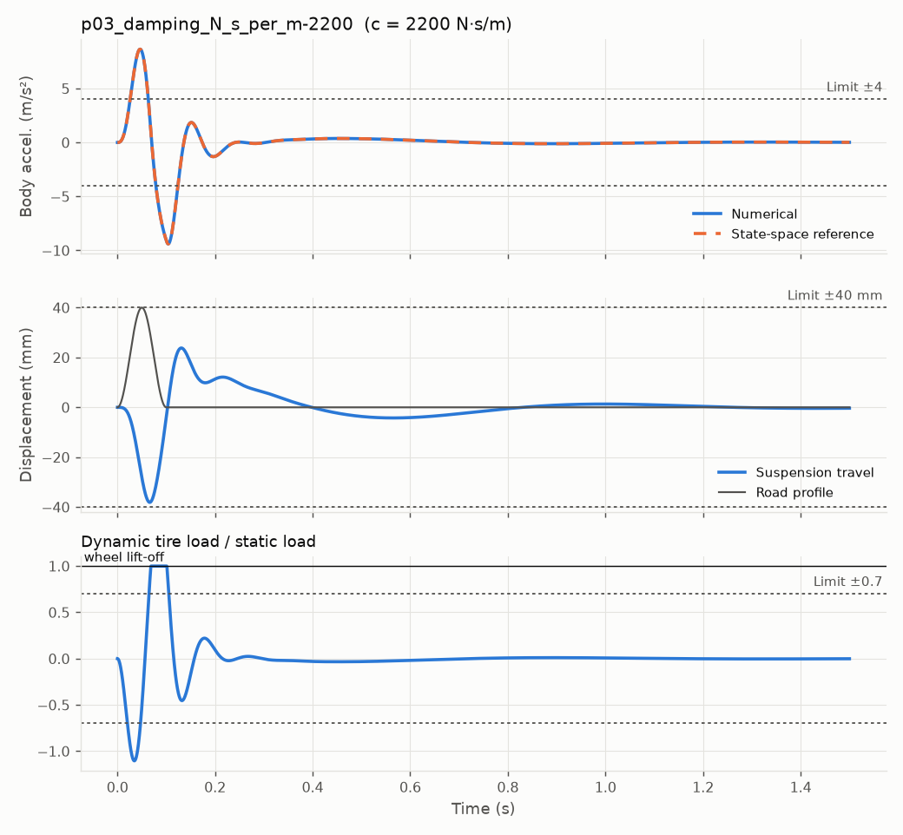
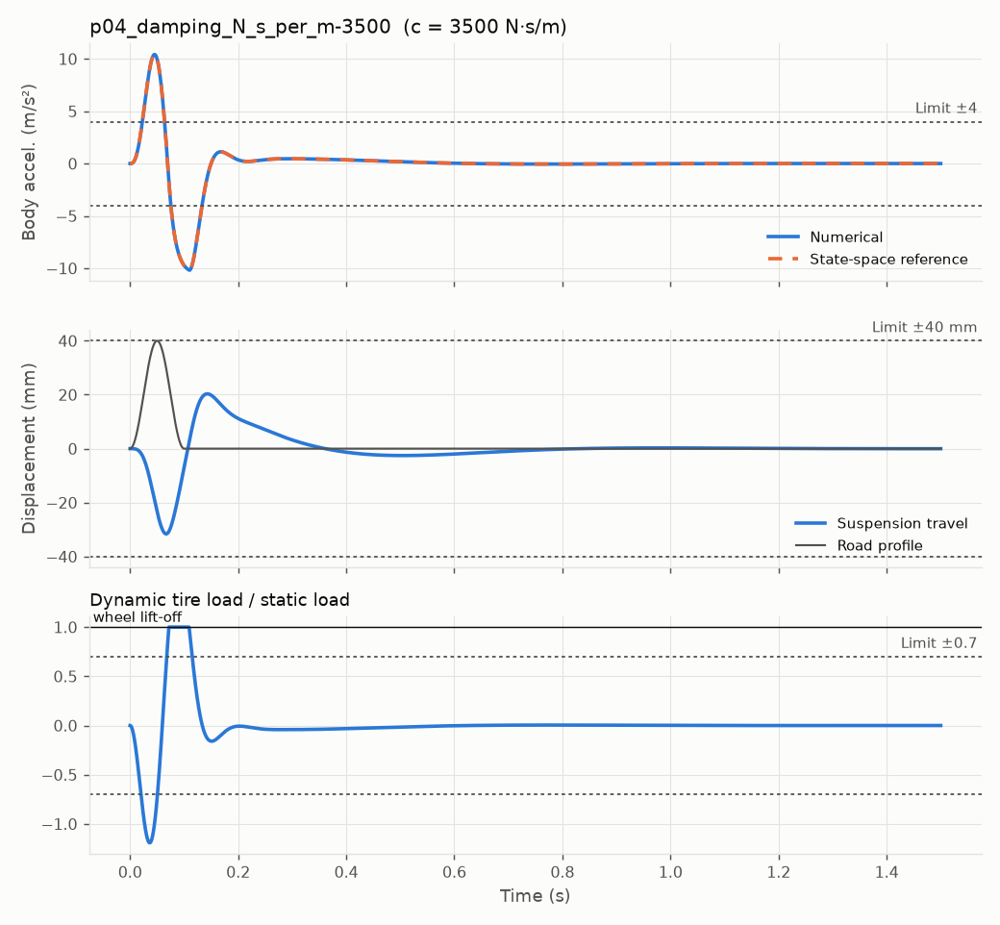

# Engineering review report: qc_bump_liftoff_modelica

- **Run:** `20261120-125151_qc_bump_liftoff_modelica`
- **Generated:** 2026-11-20T17:52:18+00:00
- **Case file SHA-256:** `f17ad36dedf6198c119b7cdff6dc9dad77b7e9c8057582bcca1aed75f0ba7c47`
- **Environment:** Python 3.14.10, numpy 2.5.5, scipy 1.18.1, matplotlib 3.11.2, cadquery 2.8.0; Windows-11-10.0.26100-SP0
- **Tools:** omc OpenModelica v1.26.3 (64-bit); Modelica Standard Library 4.1.0
- **Code version:** git `09e34d964d851385f010feb2fd217e9f72c6a90b` (uncommitted changes present)
- **Simulation status:** completed
- **Verification status:** PASS

## Scope

2-DOF quarter car with a tire that can leave the road, crossing a 40 mm x 1.0 m (1 - cos) bump at 10 m/s (36 km/h); wheel-rate damping swept from 600 to 3500 N.s/m against peak body acceleration, suspension travel, and dynamic tire load requirements.

**Assumptions**

- Linear spring and damper; parameters are wheel rates (motion ratio already applied).
- Point-contact tire that pushes but never pulls: load = max(0, W + kt (zr - zu)); no tire damping, no tread radius (the contact point follows the road profile).
- Coordinates from static equilibrium; gravity acts explicitly while the wheel is airborne.
- Rigid body above one corner (no pitch/roll coupling, no seat or occupant dynamics).
- Suspension travel stays inside the linear range (no bump-stop or rebound-stop contact); REQ-QB2 bounds it.

## Requirements

| ID | Requirement | Metric | Limit |
|---|---|---|---|
| REQ-QB1 | Peak vertical body acceleration over the bump shall not exceed 4.0 m/s^2 (comfort). | `peak_body_accel_m_per_s2` | <= 4 m/s^2 |
| REQ-QB2 | Suspension travel shall stay within +/-40 mm of static (no bump-stop contact). | `max_suspension_travel_mm` | <= 40 mm |
| REQ-QB3 | Dynamic tire load shall stay within +/-70 % of static load (road holding). | `max_tire_load_ratio` | <= 0.7 - |

## Summary across points

| Point | damping_N_s_per_m | REQ-QB1 | REQ-QB2 | REQ-QB3 | Checks |
|---|---|---|---|---|---|
| p00_damping_N_s_per_m-600 | 600 | 5.188 m/s^2: **FAIL** | 51.85 mm: **FAIL** | 1.595 -: **FAIL** | 5/5 PASS |
| p01_damping_N_s_per_m-1000 | 1000 | 6.741 m/s^2: **FAIL** | 47.45 mm: **FAIL** | 1.183 -: **FAIL** | 5/5 PASS |
| p02_damping_N_s_per_m-1500 | 1500 | 8.175 m/s^2: **FAIL** | 43.02 mm: **FAIL** | 1.052 -: **FAIL** | 5/5 PASS |
| p03_damping_N_s_per_m-2200 | 2200 | 9.4 m/s^2: **FAIL** | 38.13 mm: **PASS** | 1.104 -: **FAIL** | 5/5 PASS |
| p04_damping_N_s_per_m-3500 | 3500 | 10.42 m/s^2: **FAIL** | 31.61 mm: **PASS** | 1.192 -: **FAIL** | 5/5 PASS |

## Point details

### p00_damping_N_s_per_m-600

Parameters: sprung_mass_kg = 350, unsprung_mass_kg = 45, suspension_stiffness_N_per_m = 2.2e+04, damping_N_s_per_m = 600, tire_stiffness_N_per_m = 2.2e+05, road = bump, speed_m_per_s = 10, bump_height_m = 0.04, bump_length_m = 1, tire_model = liftoff

Derived: ride_rate_N_per_m = 2e+04, body_frequency_Hz_approx = 1.203, wheel_hop_frequency_Hz_approx = 11.67, body_damping_ratio_approx = 0.1134, static_tire_load_N = 3874, slowest_decay_rate_per_s = 0.7084

| Requirement | Result | Limit | Margin | Verdict | Evidence |
|---|---|---|---|---|---|
| REQ-QB1 | 5.188 m/s^2 | <= 4 | -1.19 | **FAIL** | [point.json](points/p00_damping_N_s_per_m-600/point.json) |
| REQ-QB2 | 51.85 mm | <= 40 | -11.9 | **FAIL** | [point.json](points/p00_damping_N_s_per_m-600/point.json) |
| REQ-QB3 | 1.595 - | <= 0.7 | -0.895 | **FAIL** | [point.json](points/p00_damping_N_s_per_m-600/point.json) |

| Check | Description | Value | Tolerance | Status |
|---|---|---|---|---|
| energy_balance | |W_road - (dE + E_dissipated)| / integral |P_road| dt | 1.97e-05 | 1e-04 | PASS |
| solver_convergence | max |z(tol) - z(tol/100)| / max |z| (body and wheel) | 7.89e-07 | 1e-04 | PASS |
| reference_agreement | max |z_num - z_ref| / bump height (body and wheel; matrix-exponential ref) | 1.10e-06 | 1e-04 | PASS |
| peak_accel_reference | |peak accel num - peak accel ref| / peak accel ref | 8.84e-08 | 1e-03 | PASS |
| return_to_rest | max(|zs(t_end)|, |zu(t_end)|) / bump height | 1.21e-04 | 1e-03 | PASS |

### p01_damping_N_s_per_m-1000

Parameters: sprung_mass_kg = 350, unsprung_mass_kg = 45, suspension_stiffness_N_per_m = 2.2e+04, damping_N_s_per_m = 1000, tire_stiffness_N_per_m = 2.2e+05, road = bump, speed_m_per_s = 10, bump_height_m = 0.04, bump_length_m = 1, tire_model = liftoff

Derived: ride_rate_N_per_m = 2e+04, body_frequency_Hz_approx = 1.203, wheel_hop_frequency_Hz_approx = 11.67, body_damping_ratio_approx = 0.189, static_tire_load_N = 3874, slowest_decay_rate_per_s = 1.188

| Requirement | Result | Limit | Margin | Verdict | Evidence |
|---|---|---|---|---|---|
| REQ-QB1 | 6.741 m/s^2 | <= 4 | -2.74 | **FAIL** | [point.json](points/p01_damping_N_s_per_m-1000/point.json) |
| REQ-QB2 | 47.45 mm | <= 40 | -7.45 | **FAIL** | [point.json](points/p01_damping_N_s_per_m-1000/point.json) |
| REQ-QB3 | 1.183 - | <= 0.7 | -0.483 | **FAIL** | [point.json](points/p01_damping_N_s_per_m-1000/point.json) |

| Check | Description | Value | Tolerance | Status |
|---|---|---|---|---|
| energy_balance | |W_road - (dE + E_dissipated)| / integral |P_road| dt | 7.56e-06 | 1e-04 | PASS |
| solver_convergence | max |z(tol) - z(tol/100)| / max |z| (body and wheel) | 3.00e-07 | 1e-04 | PASS |
| reference_agreement | max |z_num - z_ref| / bump height (body and wheel; matrix-exponential ref) | 3.97e-07 | 1e-04 | PASS |
| peak_accel_reference | |peak accel num - peak accel ref| / peak accel ref | 1.33e-07 | 1e-03 | PASS |
| return_to_rest | max(|zs(t_end)|, |zu(t_end)|) / bump height | 1.66e-06 | 1e-03 | PASS |

### p02_damping_N_s_per_m-1500

Parameters: sprung_mass_kg = 350, unsprung_mass_kg = 45, suspension_stiffness_N_per_m = 2.2e+04, damping_N_s_per_m = 1500, tire_stiffness_N_per_m = 2.2e+05, road = bump, speed_m_per_s = 10, bump_height_m = 0.04, bump_length_m = 1, tire_model = liftoff

Derived: ride_rate_N_per_m = 2e+04, body_frequency_Hz_approx = 1.203, wheel_hop_frequency_Hz_approx = 11.67, body_damping_ratio_approx = 0.2835, static_tire_load_N = 3874, slowest_decay_rate_per_s = 1.803

| Requirement | Result | Limit | Margin | Verdict | Evidence |
|---|---|---|---|---|---|
| REQ-QB1 | 8.175 m/s^2 | <= 4 | -4.18 | **FAIL** | [point.json](points/p02_damping_N_s_per_m-1500/point.json) |
| REQ-QB2 | 43.02 mm | <= 40 | -3.02 | **FAIL** | [point.json](points/p02_damping_N_s_per_m-1500/point.json) |
| REQ-QB3 | 1.052 - | <= 0.7 | -0.352 | **FAIL** | [point.json](points/p02_damping_N_s_per_m-1500/point.json) |

| Check | Description | Value | Tolerance | Status |
|---|---|---|---|---|
| energy_balance | |W_road - (dE + E_dissipated)| / integral |P_road| dt | 1.72e-05 | 1e-04 | PASS |
| solver_convergence | max |z(tol) - z(tol/100)| / max |z| (body and wheel) | 4.69e-07 | 1e-04 | PASS |
| reference_agreement | max |z_num - z_ref| / bump height (body and wheel; matrix-exponential ref) | 5.65e-07 | 1e-04 | PASS |
| peak_accel_reference | |peak accel num - peak accel ref| / peak accel ref | 2.71e-08 | 1e-03 | PASS |
| return_to_rest | max(|zs(t_end)|, |zu(t_end)|) / bump height | 2.44e-09 | 1e-03 | PASS |

### p03_damping_N_s_per_m-2200

Parameters: sprung_mass_kg = 350, unsprung_mass_kg = 45, suspension_stiffness_N_per_m = 2.2e+04, damping_N_s_per_m = 2200, tire_stiffness_N_per_m = 2.2e+05, road = bump, speed_m_per_s = 10, bump_height_m = 0.04, bump_length_m = 1, tire_model = liftoff

Derived: ride_rate_N_per_m = 2e+04, body_frequency_Hz_approx = 1.203, wheel_hop_frequency_Hz_approx = 11.67, body_damping_ratio_approx = 0.4158, static_tire_load_N = 3874, slowest_decay_rate_per_s = 2.714

| Requirement | Result | Limit | Margin | Verdict | Evidence |
|---|---|---|---|---|---|
| REQ-QB1 | 9.4 m/s^2 | <= 4 | -5.4 | **FAIL** | [point.json](points/p03_damping_N_s_per_m-2200/point.json) |
| REQ-QB2 | 38.13 mm | <= 40 | 1.87 | **PASS** | [point.json](points/p03_damping_N_s_per_m-2200/point.json) |
| REQ-QB3 | 1.104 - | <= 0.7 | -0.404 | **FAIL** | [point.json](points/p03_damping_N_s_per_m-2200/point.json) |

| Check | Description | Value | Tolerance | Status |
|---|---|---|---|---|
| energy_balance | |W_road - (dE + E_dissipated)| / integral |P_road| dt | 2.84e-05 | 1e-04 | PASS |
| solver_convergence | max |z(tol) - z(tol/100)| / max |z| (body and wheel) | 2.12e-07 | 1e-04 | PASS |
| reference_agreement | max |z_num - z_ref| / bump height (body and wheel; matrix-exponential ref) | 2.42e-07 | 1e-04 | PASS |
| peak_accel_reference | |peak accel num - peak accel ref| / peak accel ref | 5.75e-08 | 1e-03 | PASS |
| return_to_rest | max(|zs(t_end)|, |zu(t_end)|) / bump height | 4.26e-12 | 1e-03 | PASS |

### p04_damping_N_s_per_m-3500

Parameters: sprung_mass_kg = 350, unsprung_mass_kg = 45, suspension_stiffness_N_per_m = 2.2e+04, damping_N_s_per_m = 3500, tire_stiffness_N_per_m = 2.2e+05, road = bump, speed_m_per_s = 10, bump_height_m = 0.04, bump_length_m = 1, tire_model = liftoff

Derived: ride_rate_N_per_m = 2e+04, body_frequency_Hz_approx = 1.203, wheel_hop_frequency_Hz_approx = 11.67, body_damping_ratio_approx = 0.6614, static_tire_load_N = 3874, slowest_decay_rate_per_s = 4.713

| Requirement | Result | Limit | Margin | Verdict | Evidence |
|---|---|---|---|---|---|
| REQ-QB1 | 10.42 m/s^2 | <= 4 | -6.42 | **FAIL** | [point.json](points/p04_damping_N_s_per_m-3500/point.json) |
| REQ-QB2 | 31.61 mm | <= 40 | 8.39 | **PASS** | [point.json](points/p04_damping_N_s_per_m-3500/point.json) |
| REQ-QB3 | 1.192 - | <= 0.7 | -0.492 | **FAIL** | [point.json](points/p04_damping_N_s_per_m-3500/point.json) |

| Check | Description | Value | Tolerance | Status |
|---|---|---|---|---|
| energy_balance | |W_road - (dE + E_dissipated)| / integral |P_road| dt | 1.44e-05 | 1e-04 | PASS |
| solver_convergence | max |z(tol) - z(tol/100)| / max |z| (body and wheel) | 2.48e-07 | 1e-04 | PASS |
| reference_agreement | max |z_num - z_ref| / bump height (body and wheel; matrix-exponential ref) | 2.58e-07 | 1e-04 | PASS |
| peak_accel_reference | |peak accel num - peak accel ref| / peak accel ref | 2.96e-07 | 1e-03 | PASS |
| return_to_rest | max(|zs(t_end)|, |zu(t_end)|) / bump height | 1.18e-12 | 1e-03 | PASS |

## Limitations

- Synthetic parameters; not calibrated to any vehicle.
- Peak acceleration is unweighted; ISO 2631 frequency weighting is not applied.
- A point-contact tire ignores the tire's footprint, which smooths a short bump; the lift-off is likely overstated for a real tire.
- Checks establish numerical verification only; no test data.
- A converged solver run that matches an analytical reference shows that the equations were solved correctly. It does not show that the equations represent real hardware.

## Engineering acceptance

Pending human review. This report does not accept or reject the design.
