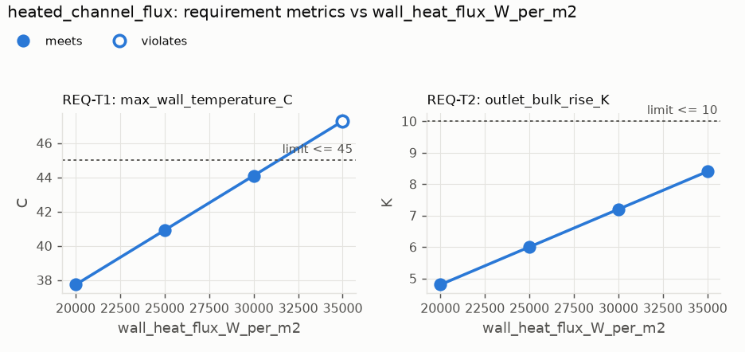
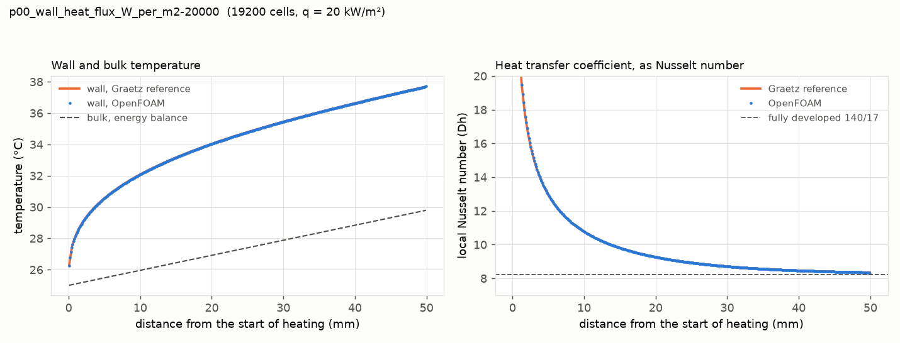
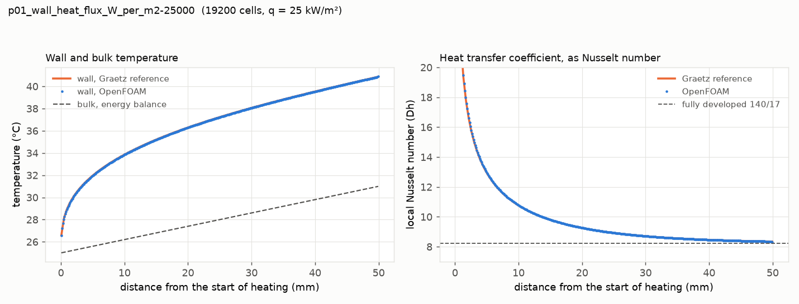
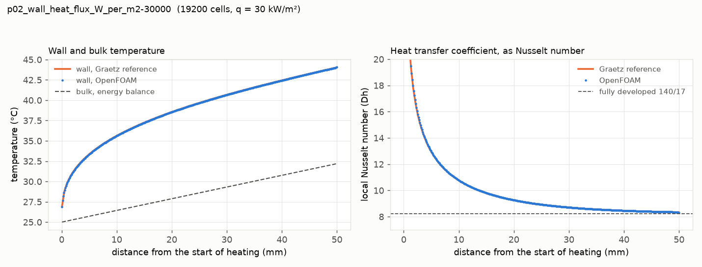

# Engineering review report: heated_channel_flux

- **Run:** `20261120-150722_heated_channel_flux`
- **Generated:** 2026-11-20T20:10:24+00:00
- **Case file SHA-256:** `0cef208ce771d78e986a3d0ed9ee295d189ba8a0fb04739ac133ab340aa220a6`
- **Environment:** Python 3.14.10, numpy 2.5.5, scipy 1.18.1, matplotlib 3.11.2, cadquery 2.8.0; Windows-11-10.0.26100-SP0
- **Tools:** openfoam_bashrc /opt/openfoam14/etc/bashrc; openfoam_version 14; openfoam_package openfoam14 20261008; linux Ubuntu 22.04.5 LTS
- **Code version:** git `2cae95ff3601497647e0b3ca88d741cf155af4f4` (uncommitted changes present)
- **Simulation status:** completed
- **Verification status:** PASS

## Scope

2D laminar water channel (1 mm gap, 0.1 m/s) with both walls heated at a uniform flux over 50 mm; OpenFOAM incompressibleFluid + scalarTransport; heat flux swept 20 to 35 kW/m2 at 40 cells across the gap, verified against the Graetz thermal-entry solution.

**Assumptions**

- Constant water properties at 25 C (temperature rise under 20 K), so temperature is a passive scalar.
- Hydrodynamically developed inflow: parabolic profile at an exact flow rate, 5 mm unheated entry.
- Uniform heat flux into the water on both walls; the plate's conduction is not modelled (no conjugate heat transfer).
- 2D: the passage is much wider than the gap (side walls neglected; the 3D duct study shows a 3 % effect on flow).

## Requirements

| ID | Requirement | Metric | Limit |
|---|---|---|---|
| REQ-T1 | Peak wall temperature over the heated length shall not exceed 45 C. | `max_wall_temperature_C` | <= 45 C |
| REQ-T2 | Coolant temperature rise from inlet to outlet shall not exceed 10 K. | `outlet_bulk_rise_K` | <= 10 K |

## Summary across points

| Point | wall_heat_flux_W_per_m2 | REQ-T1 | REQ-T2 | Checks |
|---|---|---|---|---|
| p00_wall_heat_flux_W_per_m2-20000 | 2e+04 | 37.73 C: **PASS** | 4.799 K: **PASS** | 9/9 PASS |
| p01_wall_heat_flux_W_per_m2-25000 | 2.5e+04 | 40.91 C: **PASS** | 5.999 K: **PASS** | 9/9 PASS |
| p02_wall_heat_flux_W_per_m2-30000 | 3e+04 | 44.1 C: **PASS** | 7.199 K: **PASS** | 9/9 PASS |
| p03_wall_heat_flux_W_per_m2-35000 | 3.5e+04 | 47.28 C: **FAIL** | 8.398 K: **PASS** | 9/9 PASS |

## Point details

### p00_wall_heat_flux_W_per_m2-20000

Parameters: gap_mm = 1, heated_length_mm = 50, entry_length_mm = 5, exit_length_mm = 5, mean_velocity_m_per_s = 0.1, density_kg_per_m3 = 997, dynamic_viscosity_Pa_s = 0.00089, specific_heat_J_per_kgK = 4180, conductivity_W_per_mK = 0.607, inlet_temperature_C = 25, wall_heat_flux_W_per_m2 = 2e+04, cells_across_gap = 40, cell_aspect_ratio = 5

Derived: reynolds_Dh = 224, prandtl = 6.129, peclet_Dh = 1373, graetz_x_star_end = 0.01821, bulk_rise_exact_K = 4.799, wall_minus_bulk_fully_developed_K = 8.002

| Requirement | Result | Limit | Margin | Verdict | Evidence |
|---|---|---|---|---|---|
| REQ-T1 | 37.73 C | <= 45 | 7.27 | **PASS** | [point.json](points/p00_wall_heat_flux_W_per_m2-20000/point.json) |
| REQ-T2 | 4.799 K | <= 10 | 5.2 | **PASS** | [point.json](points/p00_wall_heat_flux_W_per_m2-20000/point.json) |

| Check | Description | Value | Tolerance | Status |
|---|---|---|---|---|
| mesh | checkMesh reports Mesh OK (1 = failed) | 0.00e+00 | 5e-01 | PASS |
| temperature_converged | max |T change| anywhere over the last write interval (iterations 2400 to 2500) / outlet bulk rise | 2.08e-11 | 1e-05 | PASS |
| flow_rate | |inlet flow - U H| / (U H) | 2.60e-13 | 1e-06 | PASS |
| developed_inflow | |peak velocity at the start of heating - 1.5 U| / 1.5 U (parabolic) | 1.60e-03 | 1e-02 | PASS |
| energy_balance | |outlet bulk rise - 2 q L / (rho cp U H)| / exact rise | 3.31e-14 | 1e-06 | PASS |
| wall_temperature_reference | max |T_wall CFD - Graetz| / (T_wall - T_in) at 0.2, 0.5, 0.9 of the heated length | 1.34e-03 | 1e-02 | PASS |
| peak_vs_reference | |peak wall temperature - Graetz at the end of heating| / rise (model form: the reference has no axial conduction) | 3.17e-03 | 1e-02 | PASS |
| laminar (validity) | Reynolds number (Dh) / 2000 | 1.12e-01 | 1e+00 | PASS |
| reference_assumption (validity) | 100 / Peclet (the reference neglects axial conduction) | 7.28e-02 | 1e+00 | PASS |

### p01_wall_heat_flux_W_per_m2-25000

Parameters: gap_mm = 1, heated_length_mm = 50, entry_length_mm = 5, exit_length_mm = 5, mean_velocity_m_per_s = 0.1, density_kg_per_m3 = 997, dynamic_viscosity_Pa_s = 0.00089, specific_heat_J_per_kgK = 4180, conductivity_W_per_mK = 0.607, inlet_temperature_C = 25, wall_heat_flux_W_per_m2 = 2.5e+04, cells_across_gap = 40, cell_aspect_ratio = 5

Derived: reynolds_Dh = 224, prandtl = 6.129, peclet_Dh = 1373, graetz_x_star_end = 0.01821, bulk_rise_exact_K = 5.999, wall_minus_bulk_fully_developed_K = 10

| Requirement | Result | Limit | Margin | Verdict | Evidence |
|---|---|---|---|---|---|
| REQ-T1 | 40.91 C | <= 45 | 4.09 | **PASS** | [point.json](points/p01_wall_heat_flux_W_per_m2-25000/point.json) |
| REQ-T2 | 5.999 K | <= 10 | 4 | **PASS** | [point.json](points/p01_wall_heat_flux_W_per_m2-25000/point.json) |

| Check | Description | Value | Tolerance | Status |
|---|---|---|---|---|
| mesh | checkMesh reports Mesh OK (1 = failed) | 0.00e+00 | 5e-01 | PASS |
| temperature_converged | max |T change| anywhere over the last write interval (iterations 2400 to 2500) / outlet bulk rise | 1.67e-11 | 1e-05 | PASS |
| flow_rate | |inlet flow - U H| / (U H) | 2.60e-13 | 1e-06 | PASS |
| developed_inflow | |peak velocity at the start of heating - 1.5 U| / 1.5 U (parabolic) | 1.60e-03 | 1e-02 | PASS |
| energy_balance | |outlet bulk rise - 2 q L / (rho cp U H)| / exact rise | 3.48e-12 | 1e-06 | PASS |
| wall_temperature_reference | max |T_wall CFD - Graetz| / (T_wall - T_in) at 0.2, 0.5, 0.9 of the heated length | 1.34e-03 | 1e-02 | PASS |
| peak_vs_reference | |peak wall temperature - Graetz at the end of heating| / rise (model form: the reference has no axial conduction) | 3.17e-03 | 1e-02 | PASS |
| laminar (validity) | Reynolds number (Dh) / 2000 | 1.12e-01 | 1e+00 | PASS |
| reference_assumption (validity) | 100 / Peclet (the reference neglects axial conduction) | 7.28e-02 | 1e+00 | PASS |

### p02_wall_heat_flux_W_per_m2-30000

Parameters: gap_mm = 1, heated_length_mm = 50, entry_length_mm = 5, exit_length_mm = 5, mean_velocity_m_per_s = 0.1, density_kg_per_m3 = 997, dynamic_viscosity_Pa_s = 0.00089, specific_heat_J_per_kgK = 4180, conductivity_W_per_mK = 0.607, inlet_temperature_C = 25, wall_heat_flux_W_per_m2 = 3e+04, cells_across_gap = 40, cell_aspect_ratio = 5

Derived: reynolds_Dh = 224, prandtl = 6.129, peclet_Dh = 1373, graetz_x_star_end = 0.01821, bulk_rise_exact_K = 7.199, wall_minus_bulk_fully_developed_K = 12

| Requirement | Result | Limit | Margin | Verdict | Evidence |
|---|---|---|---|---|---|
| REQ-T1 | 44.1 C | <= 45 | 0.903 | **PASS** | [point.json](points/p02_wall_heat_flux_W_per_m2-30000/point.json) |
| REQ-T2 | 7.199 K | <= 10 | 2.8 | **PASS** | [point.json](points/p02_wall_heat_flux_W_per_m2-30000/point.json) |

| Check | Description | Value | Tolerance | Status |
|---|---|---|---|---|
| mesh | checkMesh reports Mesh OK (1 = failed) | 0.00e+00 | 5e-01 | PASS |
| temperature_converged | max |T change| anywhere over the last write interval (iterations 2400 to 2500) / outlet bulk rise | 0.00e+00 | 1e-05 | PASS |
| flow_rate | |inlet flow - U H| / (U H) | 2.60e-13 | 1e-06 | PASS |
| developed_inflow | |peak velocity at the start of heating - 1.5 U| / 1.5 U (parabolic) | 1.60e-03 | 1e-02 | PASS |
| energy_balance | |outlet bulk rise - 2 q L / (rho cp U H)| / exact rise | 1.36e-12 | 1e-06 | PASS |
| wall_temperature_reference | max |T_wall CFD - Graetz| / (T_wall - T_in) at 0.2, 0.5, 0.9 of the heated length | 1.34e-03 | 1e-02 | PASS |
| peak_vs_reference | |peak wall temperature - Graetz at the end of heating| / rise (model form: the reference has no axial conduction) | 3.17e-03 | 1e-02 | PASS |
| laminar (validity) | Reynolds number (Dh) / 2000 | 1.12e-01 | 1e+00 | PASS |
| reference_assumption (validity) | 100 / Peclet (the reference neglects axial conduction) | 7.28e-02 | 1e+00 | PASS |

### p03_wall_heat_flux_W_per_m2-35000

Parameters: gap_mm = 1, heated_length_mm = 50, entry_length_mm = 5, exit_length_mm = 5, mean_velocity_m_per_s = 0.1, density_kg_per_m3 = 997, dynamic_viscosity_Pa_s = 0.00089, specific_heat_J_per_kgK = 4180, conductivity_W_per_mK = 0.607, inlet_temperature_C = 25, wall_heat_flux_W_per_m2 = 3.5e+04, cells_across_gap = 40, cell_aspect_ratio = 5

Derived: reynolds_Dh = 224, prandtl = 6.129, peclet_Dh = 1373, graetz_x_star_end = 0.01821, bulk_rise_exact_K = 8.398, wall_minus_bulk_fully_developed_K = 14

| Requirement | Result | Limit | Margin | Verdict | Evidence |
|---|---|---|---|---|---|
| REQ-T1 | 47.28 C | <= 45 | -2.28 | **FAIL** | [point.json](points/p03_wall_heat_flux_W_per_m2-35000/point.json) |
| REQ-T2 | 8.398 K | <= 10 | 1.6 | **PASS** | [point.json](points/p03_wall_heat_flux_W_per_m2-35000/point.json) |

| Check | Description | Value | Tolerance | Status |
|---|---|---|---|---|
| mesh | checkMesh reports Mesh OK (1 = failed) | 0.00e+00 | 5e-01 | PASS |
| temperature_converged | max |T change| anywhere over the last write interval (iterations 2400 to 2500) / outlet bulk rise | 1.19e-11 | 1e-05 | PASS |
| flow_rate | |inlet flow - U H| / (U H) | 2.60e-13 | 1e-06 | PASS |
| developed_inflow | |peak velocity at the start of heating - 1.5 U| / 1.5 U (parabolic) | 1.60e-03 | 1e-02 | PASS |
| energy_balance | |outlet bulk rise - 2 q L / (rho cp U H)| / exact rise | 1.05e-12 | 1e-06 | PASS |
| wall_temperature_reference | max |T_wall CFD - Graetz| / (T_wall - T_in) at 0.2, 0.5, 0.9 of the heated length | 1.34e-03 | 1e-02 | PASS |
| peak_vs_reference | |peak wall temperature - Graetz at the end of heating| / rise (model form: the reference has no axial conduction) | 3.17e-03 | 1e-02 | PASS |
| laminar (validity) | Reynolds number (Dh) / 2000 | 1.12e-01 | 1e+00 | PASS |
| reference_assumption (validity) | 100 / Peclet (the reference neglects axial conduction) | 7.28e-02 | 1e+00 | PASS |

## Limitations

- Synthetic geometry and loads; not calibrated to a product.
- No conjugate conduction in the plate, so real wall temperatures would be smoothed along the length.
- Checks establish numerical verification against the Graetz solution and the energy balance only; no test data.
- A converged solver run that matches an analytical reference shows that the equations were solved correctly. It does not show that the equations represent real hardware.

## Engineering acceptance

Pending human review. This report does not accept or reject the design.
