# Engineering review report: bracket_opt

- **Run:** `20261120-225322_bracket_opt`
- **Generated:** 2026-11-21T03:56:51+00:00
- **Case file SHA-256:** `d8fa568db7b6c075f14c4054ee7b684736a9526d6c43de1131b21f57dc429d3c`
- **Environment:** Python 3.14.10, numpy 2.5.5, scipy 1.18.1, matplotlib 3.11.2, cadquery 2.8.0; Windows-11-10.0.26100-SP0
- **Tools:** cadquery 2.8.0; gmsh 4.15.0; CalculiX This is Version 2.22
- **Code version:** git `d89f3eb4b3297ce9c7f67030eaeb9a09e04bd06b` (uncommitted changes present)
- **Simulation status:** completed
- **Verification status:** PASS

## Scope

Lightest linearly tapered steel cantilever bracket (200 mm long, 20 mm wide, 1 kN tip load) with tip deflection at most 1.0 mm and peak bending stress at most 100 MPa; COBYLA drives the CadQuery -> Gmsh -> CalculiX pipeline over root and tip height, and every candidate must pass the study's checks.

**Assumptions**

- Linear elastic steel (E = 210 GPa, nu = 0.3); checked: peak stress below yield.
- Small deflection; checked: tip deflection / length below 1 %.
- Root face fully fixed (rigid mounting); the clamp-corner stress is singular and is not used as a design stress.
- Tip load applied as a uniform shear traction over the tip face.
- Width fixed at 20 mm by the mounting (synthetic); only the two heights vary, linearly between them.
- Stress allowable 100 MPa (fatigue-rated) and deflection limit 1.0 mm: synthetic.

## Requirements

| ID | Requirement | Metric | Limit |
|---|---|---|---|
| REQ-B1 | Tip deflection under the 1 kN load shall not exceed 1.0 mm. | `tip_deflection_mm` | <= 1 mm |
| REQ-B2 | Peak bending stress along the span (tension surface, outside the singular clamp corner, from the FE stress-to-M/Z ratio) shall not exceed 100 MPa (fatigue-rated allowable). | `peak_bending_stress_MPa` | <= 100 MPa |

## Optimisation

- **Objective:** minimise `mass_g`; constraints are the requirements with a 0.5 % design margin.
- **Candidates evaluated:** 32 (optimiser: Return from COBYLA because the trust region radius reaches its lower bound.)
- **Rejected by the checks (treated as infeasible):** c007
- **Optimum:** c026 (root_height_mm = 26.0324, tip_height_mm = 8.7421); mass_g = 545.9603

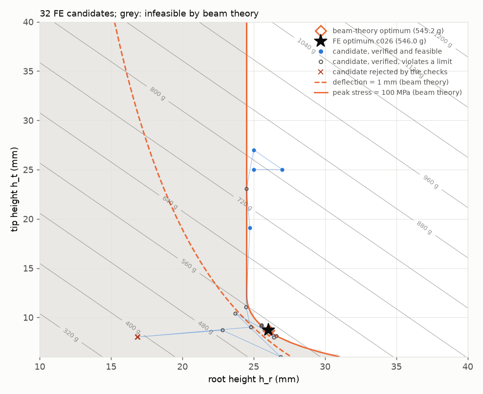

The overall verification status of an optimisation run rests on the optimum and the run-level checks; mesh convergence at the optimum is a separate confirmation case.

## Summary across points

| Point | REQ-B1 | REQ-B2 | Checks |
|---|---|---|---|
| c000 | 0.4898 mm: **PASS** | 96 MPa: **PASS** | 10/10 PASS |
| c001 | 0.4124 mm: **PASS** | 82.29 MPa: **PASS** | 10/10 PASS |
| c002 | 0.4623 mm: **PASS** | 96.01 MPa: **PASS** | 10/10 PASS |
| c003 | 0.5446 mm: **PASS** | 100 MPa: **FAIL** | 10/10 PASS |
| c004 | 0.612 mm: **PASS** | 98.07 MPa: **PASS** | 10/10 PASS |
| c005 | 0.9128 mm: **PASS** | 101.2 MPa: **FAIL** | 10/10 PASS |
| c006 | 1.011 mm: **FAIL** | 105.8 MPa: **FAIL** | 10/10 PASS |
| c007 | 2.696 mm: **FAIL (unverified)** | 212 MPa: **FAIL (unverified)** | 9/10 FAIL |
| c008 | 1.257 mm: **FAIL** | 122.4 MPa: **FAIL** | 10/10 PASS |
| c009 | 1.062 mm: **FAIL** | 120.2 MPa: **FAIL** | 10/10 PASS |
| c010 | 1.021 mm: **FAIL** | 108.4 MPa: **FAIL** | 10/10 PASS |
| c011 | 0.9434 mm: **PASS** | 101.3 MPa: **FAIL** | 10/10 PASS |
| c012 | 0.9394 mm: **PASS** | 102.5 MPa: **FAIL** | 10/10 PASS |
| c013 | 0.9334 mm: **PASS** | 100.3 MPa: **FAIL** | 10/10 PASS |
| c014 | 0.9195 mm: **PASS** | 99.55 MPa: **PASS** | 10/10 PASS |
| c015 | 0.9142 mm: **PASS** | 100.5 MPa: **FAIL** | 10/10 PASS |
| c016 | 0.929 mm: **PASS** | 99.99 MPa: **PASS** | 10/10 PASS |
| c017 | 0.9174 mm: **PASS** | 99.61 MPa: **PASS** | 10/10 PASS |
| c018 | 0.9171 mm: **PASS** | 99.49 MPa: **PASS** | 10/10 PASS |
| c019 | 0.9145 mm: **PASS** | 99.59 MPa: **PASS** | 10/10 PASS |
| c020 | 0.9194 mm: **PASS** | 99.54 MPa: **PASS** | 10/10 PASS |
| c021 | 0.9158 mm: **PASS** | 99.53 MPa: **PASS** | 10/10 PASS |
| c022 | 0.9183 mm: **PASS** | 99.51 MPa: **PASS** | 10/10 PASS |
| c023 | 0.919 mm: **PASS** | 99.63 MPa: **PASS** | 10/10 PASS |
| c024 | 0.9169 mm: **PASS** | 99.5 MPa: **PASS** | 10/10 PASS |
| c025 | 0.9164 mm: **PASS** | 99.5 MPa: **PASS** | 10/10 PASS |
| c026 | 0.9169 mm: **PASS** | 99.5 MPa: **PASS** | 10/10 PASS |
| c027 | 0.9178 mm: **PASS** | 99.51 MPa: **PASS** | 10/10 PASS |
| c028 | 0.9165 mm: **PASS** | 99.5 MPa: **PASS** | 10/10 PASS |
| c029 | 0.9178 mm: **PASS** | 99.57 MPa: **PASS** | 10/10 PASS |
| c030 | 0.9171 mm: **PASS** | 99.5 MPa: **PASS** | 10/10 PASS |
| c031 | 0.9168 mm: **PASS** | 99.5 MPa: **PASS** | 10/10 PASS |

## Run-level checks

Checks that use several points together (for example mesh convergence).

| Check | Description | Value | Tolerance | Status |
|---|---|---|---|---|
| optimum_found | a verified candidate meets every requirement with the design margin (1 = none) | 0 | 0.5 | PASS |
| optimizer_converged | COBYLA met its final trust-region radius within the evaluation limit (1 = no) | 0 | 0.5 | PASS |

## Point details

### c000

Parameters: length_mm = 200, width_mm = 20, root_height_mm = 25, tip_height_mm = 25, youngs_modulus_MPa = 2.1e+05, poisson_ratio = 0.3, density_t_per_mm3 = 7.85e-09, tip_load_N = 1000, element_size_mm = 3, yield_strength_MPa = 355

Derived: tip_deflection_beam_mm = 0.4934, peak_nominal_stress_MPa = 96, peak_nominal_stress_x_mm = 0, root_nominal_stress_MPa = 96, volume_closed_form_mm3 = 1e+05, taper_slope = 0, root_height_over_length = 0.125

| Requirement | Result | Limit | Margin | Verdict | Evidence |
|---|---|---|---|---|---|
| REQ-B1 | 0.4898 mm | <= 1 | 0.51 | **PASS** | [point.json](points/c000/point.json) |
| REQ-B2 | 96 MPa | <= 100 | 4 | **PASS** | [point.json](points/c000/point.json) |

| Check | Description | Value | Tolerance | Status |
|---|---|---|---|---|
| cad_volume | |CadQuery B-rep volume - b L (h_r + h_t) / 2| / closed form | 2.91e-16 | 1e-09 | PASS |
| load_applied | |sum of tip nodal forces + F| / F and |tip area from the mesh - b h_t| / (b h_t) | 0.00e+00 | 1e-09 | PASS |
| equilibrium | |R_root - (0, 0, F)| / F (sum of reactions) | 3.57e-12 | 1e-06 | PASS |
| deflection_reference | |tip deflection FE - tapered Timoshenko beam| / beam (model form) | 7.42e-03 | 2e-02 | PASS |
| stress_ratio_reference | max over the span of |fitted FE fibre stress / nominal M/Z - 1| (model form: beam theory) | 6.14e-06 | 2e-02 | PASS |
| stress_field_reference | max over 2-element bins of |mean FE fibre stress / nominal - 1| in the smooth region (field, model form) | 7.34e-05 | 3e-02 | PASS |
| linear_material (validity) | peak bending stress / yield strength | 2.70e-01 | 1e+00 | PASS |
| small_deflection (validity) | tip deflection / length (geometrically linear analysis) | 2.45e-03 | 1e-02 | PASS |
| beam_reference_valid (validity) | taper slope |h_r - h_t| / 2L (tapered beam theory) | 0.00e+00 | 1e-01 | PASS |
| slender (validity) | root height / length (beam theory) | 1.25e-01 | 2e-01 | PASS |

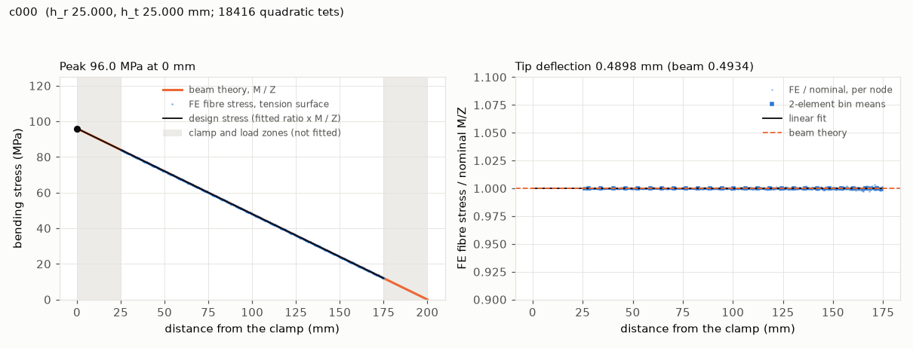

### c001

Parameters: length_mm = 200, width_mm = 20, root_height_mm = 27, tip_height_mm = 25, youngs_modulus_MPa = 2.1e+05, poisson_ratio = 0.3, density_t_per_mm3 = 7.85e-09, tip_load_N = 1000, element_size_mm = 3, yield_strength_MPa = 355

Derived: tip_deflection_beam_mm = 0.4156, peak_nominal_stress_MPa = 82.3, peak_nominal_stress_x_mm = 0, root_nominal_stress_MPa = 82.3, volume_closed_form_mm3 = 1.04e+05, taper_slope = 0.005, root_height_over_length = 0.135

| Requirement | Result | Limit | Margin | Verdict | Evidence |
|---|---|---|---|---|---|
| REQ-B1 | 0.4124 mm | <= 1 | 0.588 | **PASS** | [point.json](points/c001/point.json) |
| REQ-B2 | 82.29 MPa | <= 100 | 17.7 | **PASS** | [point.json](points/c001/point.json) |

| Check | Description | Value | Tolerance | Status |
|---|---|---|---|---|
| cad_volume | |CadQuery B-rep volume - b L (h_r + h_t) / 2| / closed form | 1.40e-16 | 1e-09 | PASS |
| load_applied | |sum of tip nodal forces + F| / F and |tip area from the mesh - b h_t| / (b h_t) | 0.00e+00 | 1e-09 | PASS |
| equilibrium | |R_root - (0, 0, F)| / F (sum of reactions) | 4.29e-12 | 1e-06 | PASS |
| deflection_reference | |tip deflection FE - tapered Timoshenko beam| / beam (model form) | 7.70e-03 | 2e-02 | PASS |
| stress_ratio_reference | max over the span of |fitted FE fibre stress / nominal M/Z - 1| (model form: beam theory) | 1.25e-03 | 2e-02 | PASS |
| stress_field_reference | max over 2-element bins of |mean FE fibre stress / nominal - 1| in the smooth region (field, model form) | 1.70e-03 | 3e-02 | PASS |
| linear_material (validity) | peak bending stress / yield strength | 2.32e-01 | 1e+00 | PASS |
| small_deflection (validity) | tip deflection / length (geometrically linear analysis) | 2.06e-03 | 1e-02 | PASS |
| beam_reference_valid (validity) | taper slope |h_r - h_t| / 2L (tapered beam theory) | 5.00e-03 | 1e-01 | PASS |
| slender (validity) | root height / length (beam theory) | 1.35e-01 | 2e-01 | PASS |

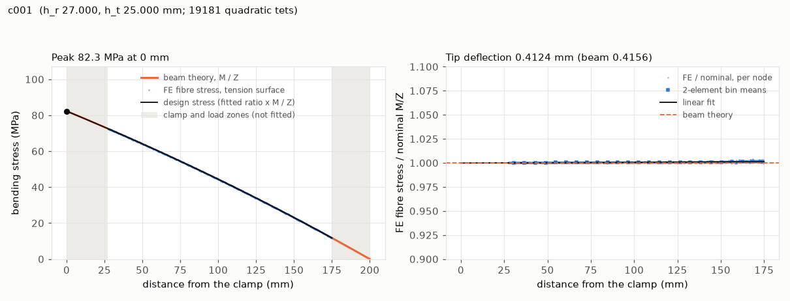

### c002

Parameters: length_mm = 200, width_mm = 20, root_height_mm = 25, tip_height_mm = 27, youngs_modulus_MPa = 2.1e+05, poisson_ratio = 0.3, density_t_per_mm3 = 7.85e-09, tip_load_N = 1000, element_size_mm = 3, yield_strength_MPa = 355

Derived: tip_deflection_beam_mm = 0.4657, peak_nominal_stress_MPa = 96, peak_nominal_stress_x_mm = 0, root_nominal_stress_MPa = 96, volume_closed_form_mm3 = 1.04e+05, taper_slope = 0.005, root_height_over_length = 0.125

| Requirement | Result | Limit | Margin | Verdict | Evidence |
|---|---|---|---|---|---|
| REQ-B1 | 0.4623 mm | <= 1 | 0.538 | **PASS** | [point.json](points/c002/point.json) |
| REQ-B2 | 96.01 MPa | <= 100 | 3.99 | **PASS** | [point.json](points/c002/point.json) |

| Check | Description | Value | Tolerance | Status |
|---|---|---|---|---|
| cad_volume | |CadQuery B-rep volume - b L (h_r + h_t) / 2| / closed form | 0.00e+00 | 1e-09 | PASS |
| load_applied | |sum of tip nodal forces + F| / F and |tip area from the mesh - b h_t| / (b h_t) | 0.00e+00 | 1e-09 | PASS |
| equilibrium | |R_root - (0, 0, F)| / F (sum of reactions) | 4.62e-12 | 1e-06 | PASS |
| deflection_reference | |tip deflection FE - tapered Timoshenko beam| / beam (model form) | 7.30e-03 | 2e-02 | PASS |
| stress_ratio_reference | max over the span of |fitted FE fibre stress / nominal M/Z - 1| (model form: beam theory) | 1.31e-03 | 2e-02 | PASS |
| stress_field_reference | max over 2-element bins of |mean FE fibre stress / nominal - 1| in the smooth region (field, model form) | 2.13e-03 | 3e-02 | PASS |
| linear_material (validity) | peak bending stress / yield strength | 2.70e-01 | 1e+00 | PASS |
| small_deflection (validity) | tip deflection / length (geometrically linear analysis) | 2.31e-03 | 1e-02 | PASS |
| beam_reference_valid (validity) | taper slope |h_r - h_t| / 2L (tapered beam theory) | 5.00e-03 | 1e-01 | PASS |
| slender (validity) | root height / length (beam theory) | 1.25e-01 | 2e-01 | PASS |

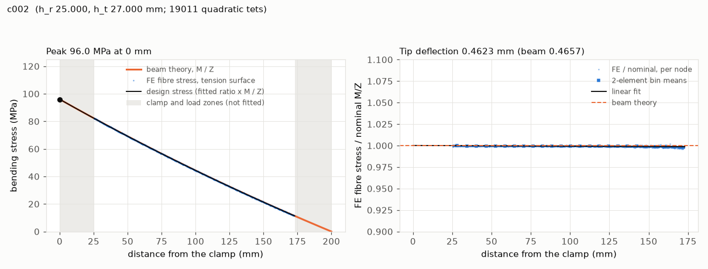

### c003

Parameters: length_mm = 200, width_mm = 20, root_height_mm = 24.49, tip_height_mm = 23.07, youngs_modulus_MPa = 2.1e+05, poisson_ratio = 0.3, density_t_per_mm3 = 7.85e-09, tip_load_N = 1000, element_size_mm = 3, yield_strength_MPa = 355

Derived: tip_deflection_beam_mm = 0.5487, peak_nominal_stress_MPa = 100.1, peak_nominal_stress_x_mm = 0, root_nominal_stress_MPa = 100.1, volume_closed_form_mm3 = 9.511e+04, taper_slope = 0.003551, root_height_over_length = 0.1224

| Requirement | Result | Limit | Margin | Verdict | Evidence |
|---|---|---|---|---|---|
| REQ-B1 | 0.5446 mm | <= 1 | 0.455 | **PASS** | [point.json](points/c003/point.json) |
| REQ-B2 | 100 MPa | <= 100 | -0.0483 | **FAIL** | [point.json](points/c003/point.json) |

| Check | Description | Value | Tolerance | Status |
|---|---|---|---|---|
| cad_volume | |CadQuery B-rep volume - b L (h_r + h_t) / 2| / closed form | 0.00e+00 | 1e-09 | PASS |
| load_applied | |sum of tip nodal forces + F| / F and |tip area from the mesh - b h_t| / (b h_t) | 1.17e-13 | 1e-09 | PASS |
| equilibrium | |R_root - (0, 0, F)| / F (sum of reactions) | 4.56e-12 | 1e-06 | PASS |
| deflection_reference | |tip deflection FE - tapered Timoshenko beam| / beam (model form) | 7.42e-03 | 2e-02 | PASS |
| stress_ratio_reference | max over the span of |fitted FE fibre stress / nominal M/Z - 1| (model form: beam theory) | 8.67e-04 | 2e-02 | PASS |
| stress_field_reference | max over 2-element bins of |mean FE fibre stress / nominal - 1| in the smooth region (field, model form) | 1.47e-03 | 3e-02 | PASS |
| linear_material (validity) | peak bending stress / yield strength | 2.82e-01 | 1e+00 | PASS |
| small_deflection (validity) | tip deflection / length (geometrically linear analysis) | 2.72e-03 | 1e-02 | PASS |
| beam_reference_valid (validity) | taper slope |h_r - h_t| / 2L (tapered beam theory) | 3.55e-03 | 1e-01 | PASS |
| slender (validity) | root height / length (beam theory) | 1.22e-01 | 2e-01 | PASS |

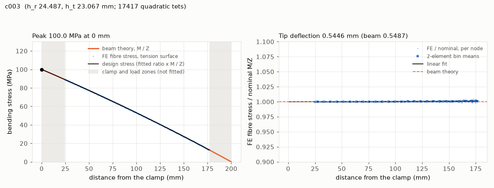

### c004

Parameters: length_mm = 200, width_mm = 20, root_height_mm = 24.73, tip_height_mm = 19.07, youngs_modulus_MPa = 2.1e+05, poisson_ratio = 0.3, density_t_per_mm3 = 7.85e-09, tip_load_N = 1000, element_size_mm = 3, yield_strength_MPa = 355

Derived: tip_deflection_beam_mm = 0.6165, peak_nominal_stress_MPa = 98.12, peak_nominal_stress_x_mm = 0, root_nominal_stress_MPa = 98.12, volume_closed_form_mm3 = 8.761e+04, taper_slope = 0.01414, root_height_over_length = 0.1236

| Requirement | Result | Limit | Margin | Verdict | Evidence |
|---|---|---|---|---|---|
| REQ-B1 | 0.612 mm | <= 1 | 0.388 | **PASS** | [point.json](points/c004/point.json) |
| REQ-B2 | 98.07 MPa | <= 100 | 1.93 | **PASS** | [point.json](points/c004/point.json) |

| Check | Description | Value | Tolerance | Status |
|---|---|---|---|---|
| cad_volume | |CadQuery B-rep volume - b L (h_r + h_t) / 2| / closed form | 3.32e-16 | 1e-09 | PASS |
| load_applied | |sum of tip nodal forces + F| / F and |tip area from the mesh - b h_t| / (b h_t) | 7.75e-15 | 1e-09 | PASS |
| equilibrium | |R_root - (0, 0, F)| / F (sum of reactions) | 1.65e-12 | 1e-06 | PASS |
| deflection_reference | |tip deflection FE - tapered Timoshenko beam| / beam (model form) | 7.34e-03 | 2e-02 | PASS |
| stress_ratio_reference | max over the span of |fitted FE fibre stress / nominal M/Z - 1| (model form: beam theory) | 3.15e-03 | 2e-02 | PASS |
| stress_field_reference | max over 2-element bins of |mean FE fibre stress / nominal - 1| in the smooth region (field, model form) | 4.95e-03 | 3e-02 | PASS |
| linear_material (validity) | peak bending stress / yield strength | 2.76e-01 | 1e+00 | PASS |
| small_deflection (validity) | tip deflection / length (geometrically linear analysis) | 3.06e-03 | 1e-02 | PASS |
| beam_reference_valid (validity) | taper slope |h_r - h_t| / 2L (tapered beam theory) | 1.41e-02 | 1e-01 | PASS |
| slender (validity) | root height / length (beam theory) | 1.24e-01 | 2e-01 | PASS |

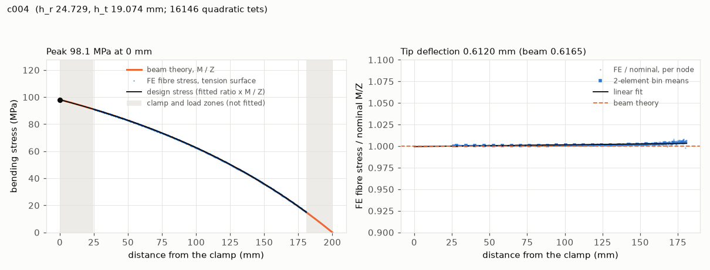

### c005

Parameters: length_mm = 200, width_mm = 20, root_height_mm = 24.45, tip_height_mm = 11.08, youngs_modulus_MPa = 2.1e+05, poisson_ratio = 0.3, density_t_per_mm3 = 7.85e-09, tip_load_N = 1000, element_size_mm = 3, yield_strength_MPa = 355

Derived: tip_deflection_beam_mm = 0.9184, peak_nominal_stress_MPa = 101.2, peak_nominal_stress_x_mm = 34.33, root_nominal_stress_MPa = 100.3, volume_closed_form_mm3 = 7.106e+04, taper_slope = 0.03344, root_height_over_length = 0.1223

| Requirement | Result | Limit | Margin | Verdict | Evidence |
|---|---|---|---|---|---|
| REQ-B1 | 0.9128 mm | <= 1 | 0.0872 | **PASS** | [point.json](points/c005/point.json) |
| REQ-B2 | 101.2 MPa | <= 100 | -1.24 | **FAIL** | [point.json](points/c005/point.json) |

| Check | Description | Value | Tolerance | Status |
|---|---|---|---|---|
| cad_volume | |CadQuery B-rep volume - b L (h_r + h_t) / 2| / closed form | 4.10e-16 | 1e-09 | PASS |
| load_applied | |sum of tip nodal forces + F| / F and |tip area from the mesh - b h_t| / (b h_t) | 1.18e-14 | 1e-09 | PASS |
| equilibrium | |R_root - (0, 0, F)| / F (sum of reactions) | 7.21e-12 | 1e-06 | PASS |
| deflection_reference | |tip deflection FE - tapered Timoshenko beam| / beam (model form) | 6.12e-03 | 2e-02 | PASS |
| stress_ratio_reference | max over the span of |fitted FE fibre stress / nominal M/Z - 1| (model form: beam theory) | 5.73e-03 | 2e-02 | PASS |
| stress_field_reference | max over 2-element bins of |mean FE fibre stress / nominal - 1| in the smooth region (field, model form) | 1.25e-02 | 3e-02 | PASS |
| linear_material (validity) | peak bending stress / yield strength | 2.85e-01 | 1e+00 | PASS |
| small_deflection (validity) | tip deflection / length (geometrically linear analysis) | 4.56e-03 | 1e-02 | PASS |
| beam_reference_valid (validity) | taper slope |h_r - h_t| / 2L (tapered beam theory) | 3.34e-02 | 1e-01 | PASS |
| slender (validity) | root height / length (beam theory) | 1.22e-01 | 2e-01 | PASS |

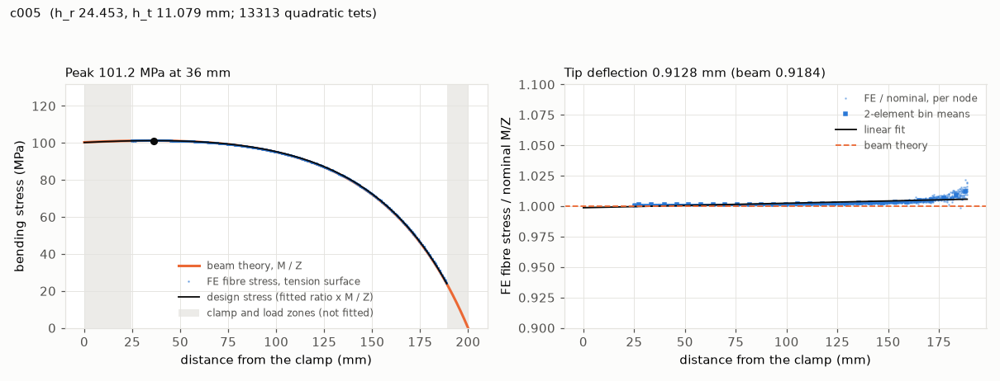

### c006

Parameters: length_mm = 200, width_mm = 20, root_height_mm = 24.78, tip_height_mm = 9.011, youngs_modulus_MPa = 2.1e+05, poisson_ratio = 0.3, density_t_per_mm3 = 7.85e-09, tip_load_N = 1000, element_size_mm = 3, yield_strength_MPa = 355

Derived: tip_deflection_beam_mm = 1.017, peak_nominal_stress_MPa = 105.6, peak_nominal_stress_x_mm = 85.69, root_nominal_stress_MPa = 97.74, volume_closed_form_mm3 = 6.757e+04, taper_slope = 0.03941, root_height_over_length = 0.1239

| Requirement | Result | Limit | Margin | Verdict | Evidence |
|---|---|---|---|---|---|
| REQ-B1 | 1.011 mm | <= 1 | -0.0111 | **FAIL** | [point.json](points/c006/point.json) |
| REQ-B2 | 105.8 MPa | <= 100 | -5.8 | **FAIL** | [point.json](points/c006/point.json) |

| Check | Description | Value | Tolerance | Status |
|---|---|---|---|---|
| cad_volume | |CadQuery B-rep volume - b L (h_r + h_t) / 2| / closed form | 2.15e-16 | 1e-09 | PASS |
| load_applied | |sum of tip nodal forces + F| / F and |tip area from the mesh - b h_t| / (b h_t) | 8.67e-15 | 1e-09 | PASS |
| equilibrium | |R_root - (0, 0, F)| / F (sum of reactions) | 1.36e-12 | 1e-06 | PASS |
| deflection_reference | |tip deflection FE - tapered Timoshenko beam| / beam (model form) | 5.60e-03 | 2e-02 | PASS |
| stress_ratio_reference | max over the span of |fitted FE fibre stress / nominal M/Z - 1| (model form: beam theory) | 5.87e-03 | 2e-02 | PASS |
| stress_field_reference | max over 2-element bins of |mean FE fibre stress / nominal - 1| in the smooth region (field, model form) | 1.21e-02 | 3e-02 | PASS |
| linear_material (validity) | peak bending stress / yield strength | 2.98e-01 | 1e+00 | PASS |
| small_deflection (validity) | tip deflection / length (geometrically linear analysis) | 5.06e-03 | 1e-02 | PASS |
| beam_reference_valid (validity) | taper slope |h_r - h_t| / 2L (tapered beam theory) | 3.94e-02 | 1e-01 | PASS |
| slender (validity) | root height / length (beam theory) | 1.24e-01 | 2e-01 | PASS |

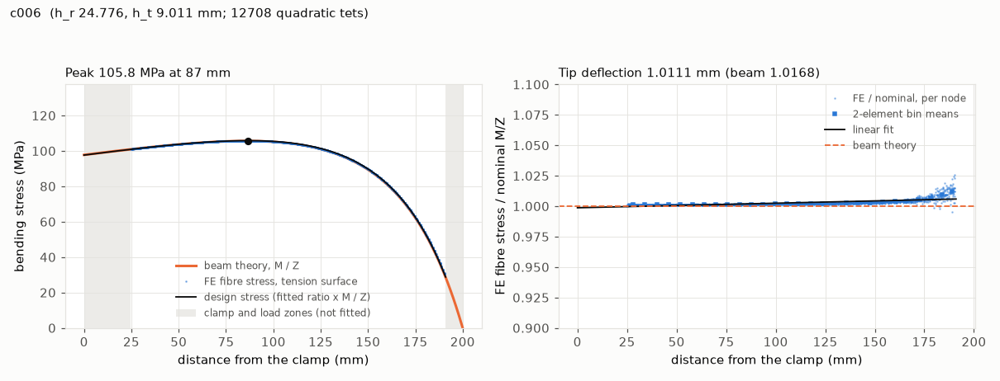

### c007

Parameters: length_mm = 200, width_mm = 20, root_height_mm = 16.84, tip_height_mm = 8.009, youngs_modulus_MPa = 2.1e+05, poisson_ratio = 0.3, density_t_per_mm3 = 7.85e-09, tip_load_N = 1000, element_size_mm = 3, yield_strength_MPa = 355

Derived: tip_deflection_beam_mm = 2.71, peak_nominal_stress_MPa = 212.1, peak_nominal_stress_x_mm = 18.58, root_nominal_stress_MPa = 211.6, volume_closed_form_mm3 = 4.97e+04, taper_slope = 0.02207, root_height_over_length = 0.08419

| Requirement | Result | Limit | Margin | Verdict | Evidence |
|---|---|---|---|---|---|
| REQ-B1 | 2.696 mm | <= 1 | -1.7 | **FAIL (unverified)** | [point.json](points/c007/point.json) |
| REQ-B2 | 212 MPa | <= 100 | -112 | **FAIL (unverified)** | [point.json](points/c007/point.json) |

| Check | Description | Value | Tolerance | Status |
|---|---|---|---|---|
| cad_volume | |CadQuery B-rep volume - b L (h_r + h_t) / 2| / closed form | 0.00e+00 | 1e-09 | PASS |
| load_applied | |sum of tip nodal forces + F| / F and |tip area from the mesh - b h_t| / (b h_t) | 1.02e-13 | 1e-09 | PASS |
| equilibrium | |R_root - (0, 0, F)| / F (sum of reactions) | 1.19e-11 | 1e-06 | PASS |
| deflection_reference | |tip deflection FE - tapered Timoshenko beam| / beam (model form) | 5.12e-03 | 2e-02 | PASS |
| stress_ratio_reference | max over the span of |fitted FE fibre stress / nominal M/Z - 1| (model form: beam theory) | 3.00e-03 | 2e-02 | PASS |
| stress_field_reference | max over 2-element bins of |mean FE fibre stress / nominal - 1| in the smooth region (field, model form) | 8.54e-03 | 3e-02 | PASS |
| linear_material (validity) | peak bending stress / yield strength | 5.97e-01 | 1e+00 | PASS |
| small_deflection (validity) | tip deflection / length (geometrically linear analysis) | 1.35e-02 | 1e-02 | FAIL |
| beam_reference_valid (validity) | taper slope |h_r - h_t| / 2L (tapered beam theory) | 2.21e-02 | 1e-01 | PASS |
| slender (validity) | root height / length (beam theory) | 8.42e-02 | 2e-01 | PASS |

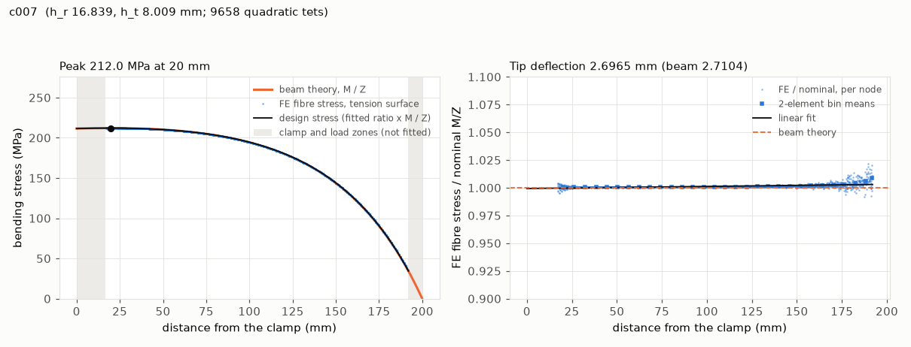

### c008

Parameters: length_mm = 200, width_mm = 20, root_height_mm = 22.8, tip_height_mm = 8.702, youngs_modulus_MPa = 2.1e+05, poisson_ratio = 0.3, density_t_per_mm3 = 7.85e-09, tip_load_N = 1000, element_size_mm = 3, yield_strength_MPa = 355

Derived: tip_deflection_beam_mm = 1.264, peak_nominal_stress_MPa = 122.3, peak_nominal_stress_x_mm = 76.54, root_nominal_stress_MPa = 115.4, volume_closed_form_mm3 = 6.3e+04, taper_slope = 0.03524, root_height_over_length = 0.114

| Requirement | Result | Limit | Margin | Verdict | Evidence |
|---|---|---|---|---|---|
| REQ-B1 | 1.257 mm | <= 1 | -0.257 | **FAIL** | [point.json](points/c008/point.json) |
| REQ-B2 | 122.4 MPa | <= 100 | -22.4 | **FAIL** | [point.json](points/c008/point.json) |

| Check | Description | Value | Tolerance | Status |
|---|---|---|---|---|
| cad_volume | |CadQuery B-rep volume - b L (h_r + h_t) / 2| / closed form | 1.15e-16 | 1e-09 | PASS |
| load_applied | |sum of tip nodal forces + F| / F and |tip area from the mesh - b h_t| / (b h_t) | 5.39e-15 | 1e-09 | PASS |
| equilibrium | |R_root - (0, 0, F)| / F (sum of reactions) | 1.69e-12 | 1e-06 | PASS |
| deflection_reference | |tip deflection FE - tapered Timoshenko beam| / beam (model form) | 5.40e-03 | 2e-02 | PASS |
| stress_ratio_reference | max over the span of |fitted FE fibre stress / nominal M/Z - 1| (model form: beam theory) | 5.19e-03 | 2e-02 | PASS |
| stress_field_reference | max over 2-element bins of |mean FE fibre stress / nominal - 1| in the smooth region (field, model form) | 1.06e-02 | 3e-02 | PASS |
| linear_material (validity) | peak bending stress / yield strength | 3.45e-01 | 1e+00 | PASS |
| small_deflection (validity) | tip deflection / length (geometrically linear analysis) | 6.28e-03 | 1e-02 | PASS |
| beam_reference_valid (validity) | taper slope |h_r - h_t| / 2L (tapered beam theory) | 3.52e-02 | 1e-01 | PASS |
| slender (validity) | root height / length (beam theory) | 1.14e-01 | 2e-01 | PASS |

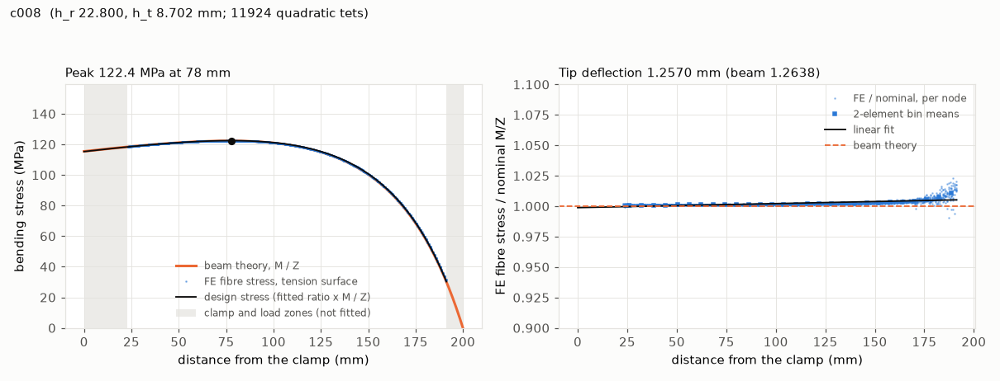

### c009

Parameters: length_mm = 200, width_mm = 20, root_height_mm = 26.89, tip_height_mm = 6, youngs_modulus_MPa = 2.1e+05, poisson_ratio = 0.3, density_t_per_mm3 = 7.85e-09, tip_load_N = 1000, element_size_mm = 3, yield_strength_MPa = 355

Derived: tip_deflection_beam_mm = 1.067, peak_nominal_stress_MPa = 119.7, peak_nominal_stress_x_mm = 142.5, root_nominal_stress_MPa = 83, volume_closed_form_mm3 = 6.577e+04, taper_slope = 0.05221, root_height_over_length = 0.1344

| Requirement | Result | Limit | Margin | Verdict | Evidence |
|---|---|---|---|---|---|
| REQ-B1 | 1.062 mm | <= 1 | -0.0623 | **FAIL** | [point.json](points/c009/point.json) |
| REQ-B2 | 120.2 MPa | <= 100 | -20.2 | **FAIL** | [point.json](points/c009/point.json) |

| Check | Description | Value | Tolerance | Status |
|---|---|---|---|---|
| cad_volume | |CadQuery B-rep volume - b L (h_r + h_t) / 2| / closed form | 0.00e+00 | 1e-09 | PASS |
| load_applied | |sum of tip nodal forces + F| / F and |tip area from the mesh - b h_t| / (b h_t) | 0.00e+00 | 1e-09 | PASS |
| equilibrium | |R_root - (0, 0, F)| / F (sum of reactions) | 1.28e-12 | 1e-06 | PASS |
| deflection_reference | |tip deflection FE - tapered Timoshenko beam| / beam (model form) | 4.76e-03 | 2e-02 | PASS |
| stress_ratio_reference | max over the span of |fitted FE fibre stress / nominal M/Z - 1| (model form: beam theory) | 6.21e-03 | 2e-02 | PASS |
| stress_field_reference | max over 2-element bins of |mean FE fibre stress / nominal - 1| in the smooth region (field, model form) | 1.44e-02 | 3e-02 | PASS |
| linear_material (validity) | peak bending stress / yield strength | 3.39e-01 | 1e+00 | PASS |
| small_deflection (validity) | tip deflection / length (geometrically linear analysis) | 5.31e-03 | 1e-02 | PASS |
| beam_reference_valid (validity) | taper slope |h_r - h_t| / 2L (tapered beam theory) | 5.22e-02 | 1e-01 | PASS |
| slender (validity) | root height / length (beam theory) | 1.34e-01 | 2e-01 | PASS |

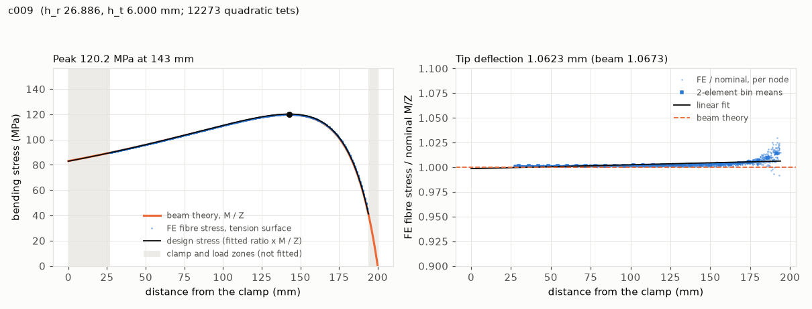

### c010

Parameters: length_mm = 200, width_mm = 20, root_height_mm = 23.7, tip_height_mm = 10.43, youngs_modulus_MPa = 2.1e+05, poisson_ratio = 0.3, density_t_per_mm3 = 7.85e-09, tip_load_N = 1000, element_size_mm = 3, yield_strength_MPa = 355

Derived: tip_deflection_beam_mm = 1.027, peak_nominal_stress_MPa = 108.3, peak_nominal_stress_x_mm = 42.76, root_nominal_stress_MPa = 106.8, volume_closed_form_mm3 = 6.828e+04, taper_slope = 0.03318, root_height_over_length = 0.1185

| Requirement | Result | Limit | Margin | Verdict | Evidence |
|---|---|---|---|---|---|
| REQ-B1 | 1.021 mm | <= 1 | -0.0207 | **FAIL** | [point.json](points/c010/point.json) |
| REQ-B2 | 108.4 MPa | <= 100 | -8.36 | **FAIL** | [point.json](points/c010/point.json) |

| Check | Description | Value | Tolerance | Status |
|---|---|---|---|---|
| cad_volume | |CadQuery B-rep volume - b L (h_r + h_t) / 2| / closed form | 0.00e+00 | 1e-09 | PASS |
| load_applied | |sum of tip nodal forces + F| / F and |tip area from the mesh - b h_t| / (b h_t) | 7.71e-14 | 1e-09 | PASS |
| equilibrium | |R_root - (0, 0, F)| / F (sum of reactions) | 5.00e-12 | 1e-06 | PASS |
| deflection_reference | |tip deflection FE - tapered Timoshenko beam| / beam (model form) | 5.94e-03 | 2e-02 | PASS |
| stress_ratio_reference | max over the span of |fitted FE fibre stress / nominal M/Z - 1| (model form: beam theory) | 5.61e-03 | 2e-02 | PASS |
| stress_field_reference | max over 2-element bins of |mean FE fibre stress / nominal - 1| in the smooth region (field, model form) | 1.12e-02 | 3e-02 | PASS |
| linear_material (validity) | peak bending stress / yield strength | 3.05e-01 | 1e+00 | PASS |
| small_deflection (validity) | tip deflection / length (geometrically linear analysis) | 5.10e-03 | 1e-02 | PASS |
| beam_reference_valid (validity) | taper slope |h_r - h_t| / 2L (tapered beam theory) | 3.32e-02 | 1e-01 | PASS |
| slender (validity) | root height / length (beam theory) | 1.19e-01 | 2e-01 | PASS |

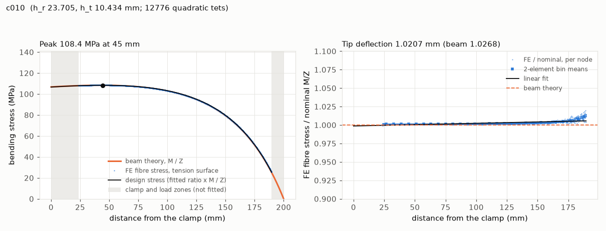

### c011

Parameters: length_mm = 200, width_mm = 20, root_height_mm = 25.73, tip_height_mm = 8.724, youngs_modulus_MPa = 2.1e+05, poisson_ratio = 0.3, density_t_per_mm3 = 7.85e-09, tip_load_N = 1000, element_size_mm = 3, yield_strength_MPa = 355

Derived: tip_deflection_beam_mm = 0.9487, peak_nominal_stress_MPa = 101.1, peak_nominal_stress_x_mm = 97.42, root_nominal_stress_MPa = 90.6, volume_closed_form_mm3 = 6.892e+04, taper_slope = 0.04252, root_height_over_length = 0.1287

| Requirement | Result | Limit | Margin | Verdict | Evidence |
|---|---|---|---|---|---|
| REQ-B1 | 0.9434 mm | <= 1 | 0.0566 | **PASS** | [point.json](points/c011/point.json) |
| REQ-B2 | 101.3 MPa | <= 100 | -1.34 | **FAIL** | [point.json](points/c011/point.json) |

| Check | Description | Value | Tolerance | Status |
|---|---|---|---|---|
| cad_volume | |CadQuery B-rep volume - b L (h_r + h_t) / 2| / closed form | 0.00e+00 | 1e-09 | PASS |
| load_applied | |sum of tip nodal forces + F| / F and |tip area from the mesh - b h_t| / (b h_t) | 9.28e-14 | 1e-09 | PASS |
| equilibrium | |R_root - (0, 0, F)| / F (sum of reactions) | 3.86e-12 | 1e-06 | PASS |
| deflection_reference | |tip deflection FE - tapered Timoshenko beam| / beam (model form) | 5.60e-03 | 2e-02 | PASS |
| stress_ratio_reference | max over the span of |fitted FE fibre stress / nominal M/Z - 1| (model form: beam theory) | 6.46e-03 | 2e-02 | PASS |
| stress_field_reference | max over 2-element bins of |mean FE fibre stress / nominal - 1| in the smooth region (field, model form) | 1.51e-02 | 3e-02 | PASS |
| linear_material (validity) | peak bending stress / yield strength | 2.85e-01 | 1e+00 | PASS |
| small_deflection (validity) | tip deflection / length (geometrically linear analysis) | 4.72e-03 | 1e-02 | PASS |
| beam_reference_valid (validity) | taper slope |h_r - h_t| / 2L (tapered beam theory) | 4.25e-02 | 1e-01 | PASS |
| slender (validity) | root height / length (beam theory) | 1.29e-01 | 2e-01 | PASS |

### c012

Parameters: length_mm = 200, width_mm = 20, root_height_mm = 26.39, tip_height_mm = 7.971, youngs_modulus_MPa = 2.1e+05, poisson_ratio = 0.3, density_t_per_mm3 = 7.85e-09, tip_load_N = 1000, element_size_mm = 3, yield_strength_MPa = 355

Derived: tip_deflection_beam_mm = 0.9445, peak_nominal_stress_MPa = 102.2, peak_nominal_stress_x_mm = 113.5, root_nominal_stress_MPa = 86.14, volume_closed_form_mm3 = 6.873e+04, taper_slope = 0.04605, root_height_over_length = 0.132

| Requirement | Result | Limit | Margin | Verdict | Evidence |
|---|---|---|---|---|---|
| REQ-B1 | 0.9394 mm | <= 1 | 0.0606 | **PASS** | [point.json](points/c012/point.json) |
| REQ-B2 | 102.5 MPa | <= 100 | -2.49 | **FAIL** | [point.json](points/c012/point.json) |

| Check | Description | Value | Tolerance | Status |
|---|---|---|---|---|
| cad_volume | |CadQuery B-rep volume - b L (h_r + h_t) / 2| / closed form | 0.00e+00 | 1e-09 | PASS |
| load_applied | |sum of tip nodal forces + F| / F and |tip area from the mesh - b h_t| / (b h_t) | 1.05e-13 | 1e-09 | PASS |
| equilibrium | |R_root - (0, 0, F)| / F (sum of reactions) | 4.93e-12 | 1e-06 | PASS |
| deflection_reference | |tip deflection FE - tapered Timoshenko beam| / beam (model form) | 5.42e-03 | 2e-02 | PASS |
| stress_ratio_reference | max over the span of |fitted FE fibre stress / nominal M/Z - 1| (model form: beam theory) | 6.63e-03 | 2e-02 | PASS |
| stress_field_reference | max over 2-element bins of |mean FE fibre stress / nominal - 1| in the smooth region (field, model form) | 1.43e-02 | 3e-02 | PASS |
| linear_material (validity) | peak bending stress / yield strength | 2.89e-01 | 1e+00 | PASS |
| small_deflection (validity) | tip deflection / length (geometrically linear analysis) | 4.70e-03 | 1e-02 | PASS |
| beam_reference_valid (validity) | taper slope |h_r - h_t| / 2L (tapered beam theory) | 4.61e-02 | 1e-01 | PASS |
| slender (validity) | root height / length (beam theory) | 1.32e-01 | 2e-01 | PASS |

### c013

Parameters: length_mm = 200, width_mm = 20, root_height_mm = 25.51, tip_height_mm = 9.171, youngs_modulus_MPa = 2.1e+05, poisson_ratio = 0.3, density_t_per_mm3 = 7.85e-09, tip_load_N = 1000, element_size_mm = 3, yield_strength_MPa = 355

Derived: tip_deflection_beam_mm = 0.9388, peak_nominal_stress_MPa = 100.1, peak_nominal_stress_x_mm = 87.74, root_nominal_stress_MPa = 92.2, volume_closed_form_mm3 = 6.936e+04, taper_slope = 0.04085, root_height_over_length = 0.1276

| Requirement | Result | Limit | Margin | Verdict | Evidence |
|---|---|---|---|---|---|
| REQ-B1 | 0.9334 mm | <= 1 | 0.0666 | **PASS** | [point.json](points/c013/point.json) |
| REQ-B2 | 100.3 MPa | <= 100 | -0.315 | **FAIL** | [point.json](points/c013/point.json) |

| Check | Description | Value | Tolerance | Status |
|---|---|---|---|---|
| cad_volume | |CadQuery B-rep volume - b L (h_r + h_t) / 2| / closed form | 2.10e-16 | 1e-09 | PASS |
| load_applied | |sum of tip nodal forces + F| / F and |tip area from the mesh - b h_t| / (b h_t) | 7.92e-14 | 1e-09 | PASS |
| equilibrium | |R_root - (0, 0, F)| / F (sum of reactions) | 8.39e-12 | 1e-06 | PASS |
| deflection_reference | |tip deflection FE - tapered Timoshenko beam| / beam (model form) | 5.72e-03 | 2e-02 | PASS |
| stress_ratio_reference | max over the span of |fitted FE fibre stress / nominal M/Z - 1| (model form: beam theory) | 6.35e-03 | 2e-02 | PASS |
| stress_field_reference | max over 2-element bins of |mean FE fibre stress / nominal - 1| in the smooth region (field, model form) | 1.33e-02 | 3e-02 | PASS |
| linear_material (validity) | peak bending stress / yield strength | 2.83e-01 | 1e+00 | PASS |
| small_deflection (validity) | tip deflection / length (geometrically linear analysis) | 4.67e-03 | 1e-02 | PASS |
| beam_reference_valid (validity) | taper slope |h_r - h_t| / 2L (tapered beam theory) | 4.08e-02 | 1e-01 | PASS |
| slender (validity) | root height / length (beam theory) | 1.28e-01 | 2e-01 | PASS |

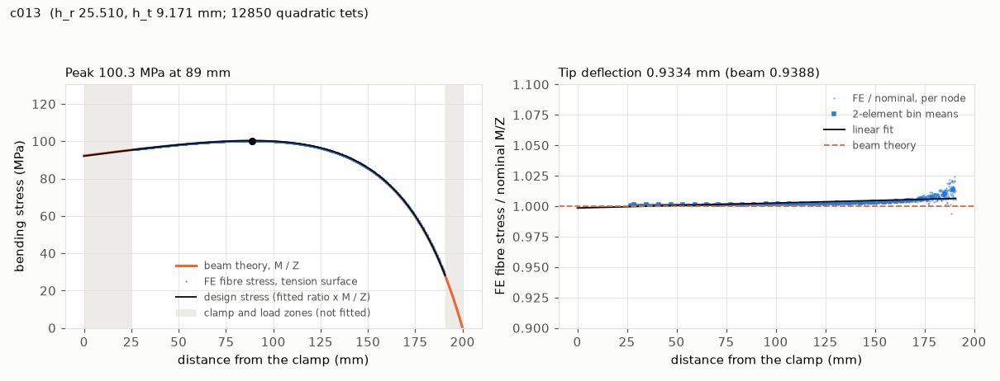

### c014

Parameters: length_mm = 200, width_mm = 20, root_height_mm = 25.91, tip_height_mm = 8.865, youngs_modulus_MPa = 2.1e+05, poisson_ratio = 0.3, density_t_per_mm3 = 7.85e-09, tip_load_N = 1000, element_size_mm = 3, yield_strength_MPa = 355

Derived: tip_deflection_beam_mm = 0.9248, peak_nominal_stress_MPa = 99.3, peak_nominal_stress_x_mm = 95.96, root_nominal_stress_MPa = 89.41, volume_closed_form_mm3 = 6.954e+04, taper_slope = 0.0426, root_height_over_length = 0.1295

| Requirement | Result | Limit | Margin | Verdict | Evidence |
|---|---|---|---|---|---|
| REQ-B1 | 0.9195 mm | <= 1 | 0.0805 | **PASS** | [point.json](points/c014/point.json) |
| REQ-B2 | 99.55 MPa | <= 100 | 0.447 | **PASS** | [point.json](points/c014/point.json) |

| Check | Description | Value | Tolerance | Status |
|---|---|---|---|---|
| cad_volume | |CadQuery B-rep volume - b L (h_r + h_t) / 2| / closed form | 2.09e-16 | 1e-09 | PASS |
| load_applied | |sum of tip nodal forces + F| / F and |tip area from the mesh - b h_t| / (b h_t) | 4.54e-14 | 1e-09 | PASS |
| equilibrium | |R_root - (0, 0, F)| / F (sum of reactions) | 5.32e-12 | 1e-06 | PASS |
| deflection_reference | |tip deflection FE - tapered Timoshenko beam| / beam (model form) | 5.64e-03 | 2e-02 | PASS |
| stress_ratio_reference | max over the span of |fitted FE fibre stress / nominal M/Z - 1| (model form: beam theory) | 6.77e-03 | 2e-02 | PASS |
| stress_field_reference | max over 2-element bins of |mean FE fibre stress / nominal - 1| in the smooth region (field, model form) | 1.57e-02 | 3e-02 | PASS |
| linear_material (validity) | peak bending stress / yield strength | 2.80e-01 | 1e+00 | PASS |
| small_deflection (validity) | tip deflection / length (geometrically linear analysis) | 4.60e-03 | 1e-02 | PASS |
| beam_reference_valid (validity) | taper slope |h_r - h_t| / 2L (tapered beam theory) | 4.26e-02 | 1e-01 | PASS |
| slender (validity) | root height / length (beam theory) | 1.30e-01 | 2e-01 | PASS |

### c015

Parameters: length_mm = 200, width_mm = 20, root_height_mm = 26.57, tip_height_mm = 8.118, youngs_modulus_MPa = 2.1e+05, poisson_ratio = 0.3, density_t_per_mm3 = 7.85e-09, tip_load_N = 1000, element_size_mm = 3, yield_strength_MPa = 355

Derived: tip_deflection_beam_mm = 0.9193, peak_nominal_stress_MPa = 100.1, peak_nominal_stress_x_mm = 112, root_nominal_stress_MPa = 84.99, volume_closed_form_mm3 = 6.938e+04, taper_slope = 0.04613, root_height_over_length = 0.1329

| Requirement | Result | Limit | Margin | Verdict | Evidence |
|---|---|---|---|---|---|
| REQ-B1 | 0.9142 mm | <= 1 | 0.0858 | **PASS** | [point.json](points/c015/point.json) |
| REQ-B2 | 100.5 MPa | <= 100 | -0.466 | **FAIL** | [point.json](points/c015/point.json) |

| Check | Description | Value | Tolerance | Status |
|---|---|---|---|---|
| cad_volume | |CadQuery B-rep volume - b L (h_r + h_t) / 2| / closed form | 2.10e-16 | 1e-09 | PASS |
| load_applied | |sum of tip nodal forces + F| / F and |tip area from the mesh - b h_t| / (b h_t) | 4.71e-14 | 1e-09 | PASS |
| equilibrium | |R_root - (0, 0, F)| / F (sum of reactions) | 6.72e-12 | 1e-06 | PASS |
| deflection_reference | |tip deflection FE - tapered Timoshenko beam| / beam (model form) | 5.47e-03 | 2e-02 | PASS |
| stress_ratio_reference | max over the span of |fitted FE fibre stress / nominal M/Z - 1| (model form: beam theory) | 6.73e-03 | 2e-02 | PASS |
| stress_field_reference | max over 2-element bins of |mean FE fibre stress / nominal - 1| in the smooth region (field, model form) | 1.65e-02 | 3e-02 | PASS |
| linear_material (validity) | peak bending stress / yield strength | 2.83e-01 | 1e+00 | PASS |
| small_deflection (validity) | tip deflection / length (geometrically linear analysis) | 4.57e-03 | 1e-02 | PASS |
| beam_reference_valid (validity) | taper slope |h_r - h_t| / 2L (tapered beam theory) | 4.61e-02 | 1e-01 | PASS |
| slender (validity) | root height / length (beam theory) | 1.33e-01 | 2e-01 | PASS |

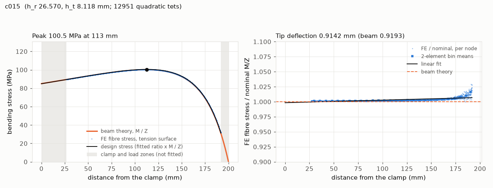

### c016

Parameters: length_mm = 200, width_mm = 20, root_height_mm = 25.54, tip_height_mm = 9.203, youngs_modulus_MPa = 2.1e+05, poisson_ratio = 0.3, density_t_per_mm3 = 7.85e-09, tip_load_N = 1000, element_size_mm = 3, yield_strength_MPa = 355

Derived: tip_deflection_beam_mm = 0.9344, peak_nominal_stress_MPa = 99.78, peak_nominal_stress_x_mm = 87.31, root_nominal_stress_MPa = 92, volume_closed_form_mm3 = 6.948e+04, taper_slope = 0.04084, root_height_over_length = 0.1277

| Requirement | Result | Limit | Margin | Verdict | Evidence |
|---|---|---|---|---|---|
| REQ-B1 | 0.929 mm | <= 1 | 0.071 | **PASS** | [point.json](points/c016/point.json) |
| REQ-B2 | 99.99 MPa | <= 100 | 0.00921 | **PASS** | [point.json](points/c016/point.json) |

| Check | Description | Value | Tolerance | Status |
|---|---|---|---|---|
| cad_volume | |CadQuery B-rep volume - b L (h_r + h_t) / 2| / closed form | 2.09e-16 | 1e-09 | PASS |
| load_applied | |sum of tip nodal forces + F| / F and |tip area from the mesh - b h_t| / (b h_t) | 1.06e-13 | 1e-09 | PASS |
| equilibrium | |R_root - (0, 0, F)| / F (sum of reactions) | 3.15e-12 | 1e-06 | PASS |
| deflection_reference | |tip deflection FE - tapered Timoshenko beam| / beam (model form) | 5.74e-03 | 2e-02 | PASS |
| stress_ratio_reference | max over the span of |fitted FE fibre stress / nominal M/Z - 1| (model form: beam theory) | 6.18e-03 | 2e-02 | PASS |
| stress_field_reference | max over 2-element bins of |mean FE fibre stress / nominal - 1| in the smooth region (field, model form) | 1.36e-02 | 3e-02 | PASS |
| linear_material (validity) | peak bending stress / yield strength | 2.82e-01 | 1e+00 | PASS |
| small_deflection (validity) | tip deflection / length (geometrically linear analysis) | 4.65e-03 | 1e-02 | PASS |
| beam_reference_valid (validity) | taper slope |h_r - h_t| / 2L (tapered beam theory) | 4.08e-02 | 1e-01 | PASS |
| slender (validity) | root height / length (beam theory) | 1.28e-01 | 2e-01 | PASS |

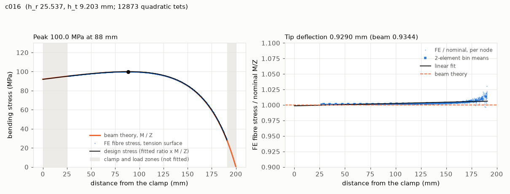

### c017

Parameters: length_mm = 200, width_mm = 20, root_height_mm = 26.07, tip_height_mm = 8.681, youngs_modulus_MPa = 2.1e+05, poisson_ratio = 0.3, density_t_per_mm3 = 7.85e-09, tip_load_N = 1000, element_size_mm = 3, yield_strength_MPa = 355

Derived: tip_deflection_beam_mm = 0.9225, peak_nominal_stress_MPa = 99.34, peak_nominal_stress_x_mm = 100.2, root_nominal_stress_MPa = 88.25, volume_closed_form_mm3 = 6.951e+04, taper_slope = 0.04348, root_height_over_length = 0.1304

| Requirement | Result | Limit | Margin | Verdict | Evidence |
|---|---|---|---|---|---|
| REQ-B1 | 0.9174 mm | <= 1 | 0.0826 | **PASS** | [point.json](points/c017/point.json) |
| REQ-B2 | 99.61 MPa | <= 100 | 0.386 | **PASS** | [point.json](points/c017/point.json) |

| Check | Description | Value | Tolerance | Status |
|---|---|---|---|---|
| cad_volume | |CadQuery B-rep volume - b L (h_r + h_t) / 2| / closed form | 2.09e-16 | 1e-09 | PASS |
| load_applied | |sum of tip nodal forces + F| / F and |tip area from the mesh - b h_t| / (b h_t) | 4.55e-14 | 1e-09 | PASS |
| equilibrium | |R_root - (0, 0, F)| / F (sum of reactions) | 1.25e-12 | 1e-06 | PASS |
| deflection_reference | |tip deflection FE - tapered Timoshenko beam| / beam (model form) | 5.60e-03 | 2e-02 | PASS |
| stress_ratio_reference | max over the span of |fitted FE fibre stress / nominal M/Z - 1| (model form: beam theory) | 6.61e-03 | 2e-02 | PASS |
| stress_field_reference | max over 2-element bins of |mean FE fibre stress / nominal - 1| in the smooth region (field, model form) | 1.54e-02 | 3e-02 | PASS |
| linear_material (validity) | peak bending stress / yield strength | 2.81e-01 | 1e+00 | PASS |
| small_deflection (validity) | tip deflection / length (geometrically linear analysis) | 4.59e-03 | 1e-02 | PASS |
| beam_reference_valid (validity) | taper slope |h_r - h_t| / 2L (tapered beam theory) | 4.35e-02 | 1e-01 | PASS |
| slender (validity) | root height / length (beam theory) | 1.30e-01 | 2e-01 | PASS |

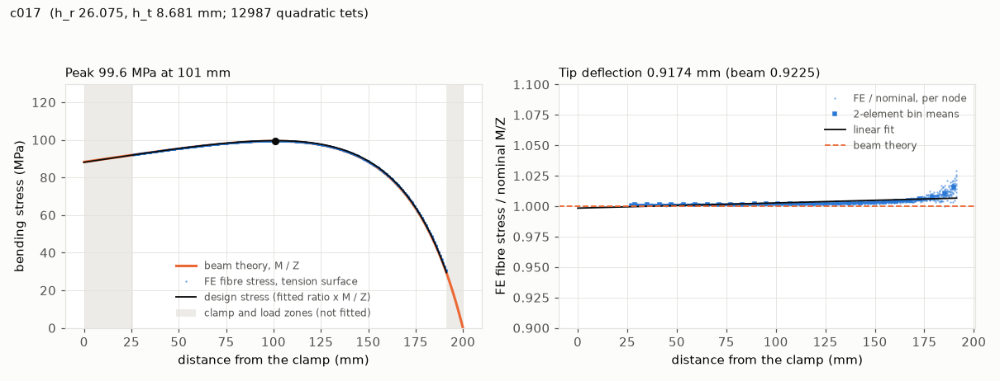

### c018

Parameters: length_mm = 200, width_mm = 20, root_height_mm = 26.01, tip_height_mm = 8.768, youngs_modulus_MPa = 2.1e+05, poisson_ratio = 0.3, density_t_per_mm3 = 7.85e-09, tip_load_N = 1000, element_size_mm = 3, yield_strength_MPa = 355

Derived: tip_deflection_beam_mm = 0.9223, peak_nominal_stress_MPa = 99.23, peak_nominal_stress_x_mm = 98.28, root_nominal_stress_MPa = 88.7, volume_closed_form_mm3 = 6.955e+04, taper_slope = 0.0431, root_height_over_length = 0.13

| Requirement | Result | Limit | Margin | Verdict | Evidence |
|---|---|---|---|---|---|
| REQ-B1 | 0.9171 mm | <= 1 | 0.0829 | **PASS** | [point.json](points/c018/point.json) |
| REQ-B2 | 99.49 MPa | <= 100 | 0.513 | **PASS** | [point.json](points/c018/point.json) |

| Check | Description | Value | Tolerance | Status |
|---|---|---|---|---|
| cad_volume | |CadQuery B-rep volume - b L (h_r + h_t) / 2| / closed form | 0.00e+00 | 1e-09 | PASS |
| load_applied | |sum of tip nodal forces + F| / F and |tip area from the mesh - b h_t| / (b h_t) | 4.44e-14 | 1e-09 | PASS |
| equilibrium | |R_root - (0, 0, F)| / F (sum of reactions) | 5.56e-12 | 1e-06 | PASS |
| deflection_reference | |tip deflection FE - tapered Timoshenko beam| / beam (model form) | 5.63e-03 | 2e-02 | PASS |
| stress_ratio_reference | max over the span of |fitted FE fibre stress / nominal M/Z - 1| (model form: beam theory) | 6.50e-03 | 2e-02 | PASS |
| stress_field_reference | max over 2-element bins of |mean FE fibre stress / nominal - 1| in the smooth region (field, model form) | 1.39e-02 | 3e-02 | PASS |
| linear_material (validity) | peak bending stress / yield strength | 2.80e-01 | 1e+00 | PASS |
| small_deflection (validity) | tip deflection / length (geometrically linear analysis) | 4.59e-03 | 1e-02 | PASS |
| beam_reference_valid (validity) | taper slope |h_r - h_t| / 2L (tapered beam theory) | 4.31e-02 | 1e-01 | PASS |
| slender (validity) | root height / length (beam theory) | 1.30e-01 | 2e-01 | PASS |

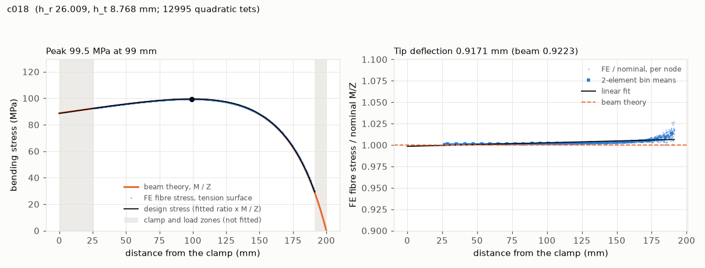

### c019

Parameters: length_mm = 200, width_mm = 20, root_height_mm = 26.2, tip_height_mm = 8.563, youngs_modulus_MPa = 2.1e+05, poisson_ratio = 0.3, density_t_per_mm3 = 7.85e-09, tip_load_N = 1000, element_size_mm = 3, yield_strength_MPa = 355

Derived: tip_deflection_beam_mm = 0.9196, peak_nominal_stress_MPa = 99.31, peak_nominal_stress_x_mm = 102.9, root_nominal_stress_MPa = 87.39, volume_closed_form_mm3 = 6.953e+04, taper_slope = 0.0441, root_height_over_length = 0.131

| Requirement | Result | Limit | Margin | Verdict | Evidence |
|---|---|---|---|---|---|
| REQ-B1 | 0.9145 mm | <= 1 | 0.0855 | **PASS** | [point.json](points/c019/point.json) |
| REQ-B2 | 99.59 MPa | <= 100 | 0.413 | **PASS** | [point.json](points/c019/point.json) |

| Check | Description | Value | Tolerance | Status |
|---|---|---|---|---|
| cad_volume | |CadQuery B-rep volume - b L (h_r + h_t) / 2| / closed form | 0.00e+00 | 1e-09 | PASS |
| load_applied | |sum of tip nodal forces + F| / F and |tip area from the mesh - b h_t| / (b h_t) | 3.77e-14 | 1e-09 | PASS |
| equilibrium | |R_root - (0, 0, F)| / F (sum of reactions) | 4.23e-12 | 1e-06 | PASS |
| deflection_reference | |tip deflection FE - tapered Timoshenko beam| / beam (model form) | 5.58e-03 | 2e-02 | PASS |
| stress_ratio_reference | max over the span of |fitted FE fibre stress / nominal M/Z - 1| (model form: beam theory) | 6.60e-03 | 2e-02 | PASS |
| stress_field_reference | max over 2-element bins of |mean FE fibre stress / nominal - 1| in the smooth region (field, model form) | 1.53e-02 | 3e-02 | PASS |
| linear_material (validity) | peak bending stress / yield strength | 2.81e-01 | 1e+00 | PASS |
| small_deflection (validity) | tip deflection / length (geometrically linear analysis) | 4.57e-03 | 1e-02 | PASS |
| beam_reference_valid (validity) | taper slope |h_r - h_t| / 2L (tapered beam theory) | 4.41e-02 | 1e-01 | PASS |
| slender (validity) | root height / length (beam theory) | 1.31e-01 | 2e-01 | PASS |

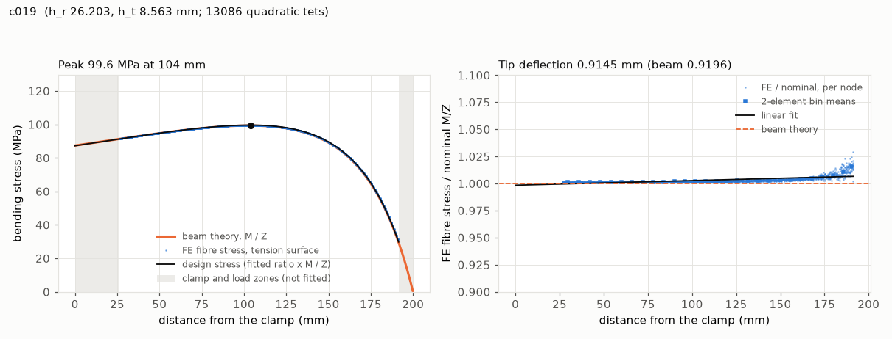

### c020

Parameters: length_mm = 200, width_mm = 20, root_height_mm = 25.91, tip_height_mm = 8.866, youngs_modulus_MPa = 2.1e+05, poisson_ratio = 0.3, density_t_per_mm3 = 7.85e-09, tip_load_N = 1000, element_size_mm = 3, yield_strength_MPa = 355

Derived: tip_deflection_beam_mm = 0.9246, peak_nominal_stress_MPa = 99.29, peak_nominal_stress_x_mm = 95.95, root_nominal_stress_MPa = 89.4, volume_closed_form_mm3 = 6.954e+04, taper_slope = 0.0426, root_height_over_length = 0.1295

| Requirement | Result | Limit | Margin | Verdict | Evidence |
|---|---|---|---|---|---|
| REQ-B1 | 0.9194 mm | <= 1 | 0.0806 | **PASS** | [point.json](points/c020/point.json) |
| REQ-B2 | 99.54 MPa | <= 100 | 0.463 | **PASS** | [point.json](points/c020/point.json) |

| Check | Description | Value | Tolerance | Status |
|---|---|---|---|---|
| cad_volume | |CadQuery B-rep volume - b L (h_r + h_t) / 2| / closed form | 0.00e+00 | 1e-09 | PASS |
| load_applied | |sum of tip nodal forces + F| / F and |tip area from the mesh - b h_t| / (b h_t) | 8.69e-14 | 1e-09 | PASS |
| equilibrium | |R_root - (0, 0, F)| / F (sum of reactions) | 6.65e-12 | 1e-06 | PASS |
| deflection_reference | |tip deflection FE - tapered Timoshenko beam| / beam (model form) | 5.64e-03 | 2e-02 | PASS |
| stress_ratio_reference | max over the span of |fitted FE fibre stress / nominal M/Z - 1| (model form: beam theory) | 6.44e-03 | 2e-02 | PASS |
| stress_field_reference | max over 2-element bins of |mean FE fibre stress / nominal - 1| in the smooth region (field, model form) | 1.40e-02 | 3e-02 | PASS |
| linear_material (validity) | peak bending stress / yield strength | 2.80e-01 | 1e+00 | PASS |
| small_deflection (validity) | tip deflection / length (geometrically linear analysis) | 4.60e-03 | 1e-02 | PASS |
| beam_reference_valid (validity) | taper slope |h_r - h_t| / 2L (tapered beam theory) | 4.26e-02 | 1e-01 | PASS |
| slender (validity) | root height / length (beam theory) | 1.30e-01 | 2e-01 | PASS |

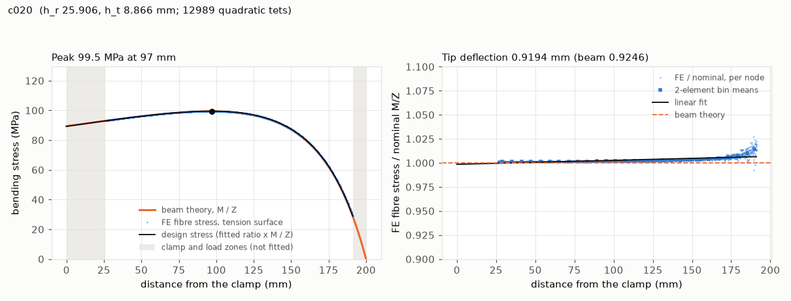

### c021

Parameters: length_mm = 200, width_mm = 20, root_height_mm = 26.11, tip_height_mm = 8.665, youngs_modulus_MPa = 2.1e+05, poisson_ratio = 0.3, density_t_per_mm3 = 7.85e-09, tip_load_N = 1000, element_size_mm = 3, yield_strength_MPa = 355

Derived: tip_deflection_beam_mm = 0.9209, peak_nominal_stress_MPa = 99.25, peak_nominal_stress_x_mm = 100.6, root_nominal_stress_MPa = 88.04, volume_closed_form_mm3 = 6.954e+04, taper_slope = 0.0436, root_height_over_length = 0.1305

| Requirement | Result | Limit | Margin | Verdict | Evidence |
|---|---|---|---|---|---|
| REQ-B1 | 0.9158 mm | <= 1 | 0.0842 | **PASS** | [point.json](points/c021/point.json) |
| REQ-B2 | 99.53 MPa | <= 100 | 0.472 | **PASS** | [point.json](points/c021/point.json) |

| Check | Description | Value | Tolerance | Status |
|---|---|---|---|---|
| cad_volume | |CadQuery B-rep volume - b L (h_r + h_t) / 2| / closed form | 0.00e+00 | 1e-09 | PASS |
| load_applied | |sum of tip nodal forces + F| / F and |tip area from the mesh - b h_t| / (b h_t) | 6.30e-14 | 1e-09 | PASS |
| equilibrium | |R_root - (0, 0, F)| / F (sum of reactions) | 3.60e-12 | 1e-06 | PASS |
| deflection_reference | |tip deflection FE - tapered Timoshenko beam| / beam (model form) | 5.60e-03 | 2e-02 | PASS |
| stress_ratio_reference | max over the span of |fitted FE fibre stress / nominal M/Z - 1| (model form: beam theory) | 6.70e-03 | 2e-02 | PASS |
| stress_field_reference | max over 2-element bins of |mean FE fibre stress / nominal - 1| in the smooth region (field, model form) | 1.42e-02 | 3e-02 | PASS |
| linear_material (validity) | peak bending stress / yield strength | 2.80e-01 | 1e+00 | PASS |
| small_deflection (validity) | tip deflection / length (geometrically linear analysis) | 4.58e-03 | 1e-02 | PASS |
| beam_reference_valid (validity) | taper slope |h_r - h_t| / 2L (tapered beam theory) | 4.36e-02 | 1e-01 | PASS |
| slender (validity) | root height / length (beam theory) | 1.31e-01 | 2e-01 | PASS |

### c022

Parameters: length_mm = 200, width_mm = 20, root_height_mm = 25.96, tip_height_mm = 8.817, youngs_modulus_MPa = 2.1e+05, poisson_ratio = 0.3, density_t_per_mm3 = 7.85e-09, tip_load_N = 1000, element_size_mm = 3, yield_strength_MPa = 355

Derived: tip_deflection_beam_mm = 0.9235, peak_nominal_stress_MPa = 99.26, peak_nominal_stress_x_mm = 97.12, root_nominal_stress_MPa = 89.05, volume_closed_form_mm3 = 6.955e+04, taper_slope = 0.04285, root_height_over_length = 0.1298

| Requirement | Result | Limit | Margin | Verdict | Evidence |
|---|---|---|---|---|---|
| REQ-B1 | 0.9183 mm | <= 1 | 0.0817 | **PASS** | [point.json](points/c022/point.json) |
| REQ-B2 | 99.51 MPa | <= 100 | 0.488 | **PASS** | [point.json](points/c022/point.json) |

| Check | Description | Value | Tolerance | Status |
|---|---|---|---|---|
| cad_volume | |CadQuery B-rep volume - b L (h_r + h_t) / 2| / closed form | 2.09e-16 | 1e-09 | PASS |
| load_applied | |sum of tip nodal forces + F| / F and |tip area from the mesh - b h_t| / (b h_t) | 9.61e-14 | 1e-09 | PASS |
| equilibrium | |R_root - (0, 0, F)| / F (sum of reactions) | 2.90e-12 | 1e-06 | PASS |
| deflection_reference | |tip deflection FE - tapered Timoshenko beam| / beam (model form) | 5.64e-03 | 2e-02 | PASS |
| stress_ratio_reference | max over the span of |fitted FE fibre stress / nominal M/Z - 1| (model form: beam theory) | 6.58e-03 | 2e-02 | PASS |
| stress_field_reference | max over 2-element bins of |mean FE fibre stress / nominal - 1| in the smooth region (field, model form) | 1.51e-02 | 3e-02 | PASS |
| linear_material (validity) | peak bending stress / yield strength | 2.80e-01 | 1e+00 | PASS |
| small_deflection (validity) | tip deflection / length (geometrically linear analysis) | 4.59e-03 | 1e-02 | PASS |
| beam_reference_valid (validity) | taper slope |h_r - h_t| / 2L (tapered beam theory) | 4.29e-02 | 1e-01 | PASS |
| slender (validity) | root height / length (beam theory) | 1.30e-01 | 2e-01 | PASS |

### c023

Parameters: length_mm = 200, width_mm = 20, root_height_mm = 26, tip_height_mm = 8.755, youngs_modulus_MPa = 2.1e+05, poisson_ratio = 0.3, density_t_per_mm3 = 7.85e-09, tip_load_N = 1000, element_size_mm = 3, yield_strength_MPa = 355

Derived: tip_deflection_beam_mm = 0.9242, peak_nominal_stress_MPa = 99.37, peak_nominal_stress_x_mm = 98.44, root_nominal_stress_MPa = 88.78, volume_closed_form_mm3 = 6.95e+04, taper_slope = 0.0431, root_height_over_length = 0.13

| Requirement | Result | Limit | Margin | Verdict | Evidence |
|---|---|---|---|---|---|
| REQ-B1 | 0.919 mm | <= 1 | 0.081 | **PASS** | [point.json](points/c023/point.json) |
| REQ-B2 | 99.63 MPa | <= 100 | 0.37 | **PASS** | [point.json](points/c023/point.json) |

| Check | Description | Value | Tolerance | Status |
|---|---|---|---|---|
| cad_volume | |CadQuery B-rep volume - b L (h_r + h_t) / 2| / closed form | 0.00e+00 | 1e-09 | PASS |
| load_applied | |sum of tip nodal forces + F| / F and |tip area from the mesh - b h_t| / (b h_t) | 2.42e-14 | 1e-09 | PASS |
| equilibrium | |R_root - (0, 0, F)| / F (sum of reactions) | 4.18e-12 | 1e-06 | PASS |
| deflection_reference | |tip deflection FE - tapered Timoshenko beam| / beam (model form) | 5.62e-03 | 2e-02 | PASS |
| stress_ratio_reference | max over the span of |fitted FE fibre stress / nominal M/Z - 1| (model form: beam theory) | 6.51e-03 | 2e-02 | PASS |
| stress_field_reference | max over 2-element bins of |mean FE fibre stress / nominal - 1| in the smooth region (field, model form) | 1.55e-02 | 3e-02 | PASS |
| linear_material (validity) | peak bending stress / yield strength | 2.81e-01 | 1e+00 | PASS |
| small_deflection (validity) | tip deflection / length (geometrically linear analysis) | 4.60e-03 | 1e-02 | PASS |
| beam_reference_valid (validity) | taper slope |h_r - h_t| / 2L (tapered beam theory) | 4.31e-02 | 1e-01 | PASS |
| slender (validity) | root height / length (beam theory) | 1.30e-01 | 2e-01 | PASS |

### c024

Parameters: length_mm = 200, width_mm = 20, root_height_mm = 26.03, tip_height_mm = 8.742, youngs_modulus_MPa = 2.1e+05, poisson_ratio = 0.3, density_t_per_mm3 = 7.85e-09, tip_load_N = 1000, element_size_mm = 3, yield_strength_MPa = 355

Derived: tip_deflection_beam_mm = 0.9221, peak_nominal_stress_MPa = 99.24, peak_nominal_stress_x_mm = 98.88, root_nominal_stress_MPa = 88.54, volume_closed_form_mm3 = 6.955e+04, taper_slope = 0.04323, root_height_over_length = 0.1302

| Requirement | Result | Limit | Margin | Verdict | Evidence |
|---|---|---|---|---|---|
| REQ-B1 | 0.9169 mm | <= 1 | 0.0831 | **PASS** | [point.json](points/c024/point.json) |
| REQ-B2 | 99.5 MPa | <= 100 | 0.497 | **PASS** | [point.json](points/c024/point.json) |

| Check | Description | Value | Tolerance | Status |
|---|---|---|---|---|
| cad_volume | |CadQuery B-rep volume - b L (h_r + h_t) / 2| / closed form | 2.09e-16 | 1e-09 | PASS |
| load_applied | |sum of tip nodal forces + F| / F and |tip area from the mesh - b h_t| / (b h_t) | 6.31e-14 | 1e-09 | PASS |
| equilibrium | |R_root - (0, 0, F)| / F (sum of reactions) | 1.46e-12 | 1e-06 | PASS |
| deflection_reference | |tip deflection FE - tapered Timoshenko beam| / beam (model form) | 5.62e-03 | 2e-02 | PASS |
| stress_ratio_reference | max over the span of |fitted FE fibre stress / nominal M/Z - 1| (model form: beam theory) | 6.52e-03 | 2e-02 | PASS |
| stress_field_reference | max over 2-element bins of |mean FE fibre stress / nominal - 1| in the smooth region (field, model form) | 1.43e-02 | 3e-02 | PASS |
| linear_material (validity) | peak bending stress / yield strength | 2.80e-01 | 1e+00 | PASS |
| small_deflection (validity) | tip deflection / length (geometrically linear analysis) | 4.58e-03 | 1e-02 | PASS |
| beam_reference_valid (validity) | taper slope |h_r - h_t| / 2L (tapered beam theory) | 4.32e-02 | 1e-01 | PASS |
| slender (validity) | root height / length (beam theory) | 1.30e-01 | 2e-01 | PASS |

### c025

Parameters: length_mm = 200, width_mm = 20, root_height_mm = 26.06, tip_height_mm = 8.717, youngs_modulus_MPa = 2.1e+05, poisson_ratio = 0.3, density_t_per_mm3 = 7.85e-09, tip_load_N = 1000, element_size_mm = 3, yield_strength_MPa = 355

Derived: tip_deflection_beam_mm = 0.9216, peak_nominal_stress_MPa = 99.24, peak_nominal_stress_x_mm = 99.46, root_nominal_stress_MPa = 88.37, volume_closed_form_mm3 = 6.955e+04, taper_slope = 0.04335, root_height_over_length = 0.1303

| Requirement | Result | Limit | Margin | Verdict | Evidence |
|---|---|---|---|---|---|
| REQ-B1 | 0.9164 mm | <= 1 | 0.0836 | **PASS** | [point.json](points/c025/point.json) |
| REQ-B2 | 99.5 MPa | <= 100 | 0.498 | **PASS** | [point.json](points/c025/point.json) |

| Check | Description | Value | Tolerance | Status |
|---|---|---|---|---|
| cad_volume | |CadQuery B-rep volume - b L (h_r + h_t) / 2| / closed form | 2.09e-16 | 1e-09 | PASS |
| load_applied | |sum of tip nodal forces + F| / F and |tip area from the mesh - b h_t| / (b h_t) | 3.00e-14 | 1e-09 | PASS |
| equilibrium | |R_root - (0, 0, F)| / F (sum of reactions) | 3.47e-12 | 1e-06 | PASS |
| deflection_reference | |tip deflection FE - tapered Timoshenko beam| / beam (model form) | 5.61e-03 | 2e-02 | PASS |
| stress_ratio_reference | max over the span of |fitted FE fibre stress / nominal M/Z - 1| (model form: beam theory) | 6.56e-03 | 2e-02 | PASS |
| stress_field_reference | max over 2-element bins of |mean FE fibre stress / nominal - 1| in the smooth region (field, model form) | 1.51e-02 | 3e-02 | PASS |
| linear_material (validity) | peak bending stress / yield strength | 2.80e-01 | 1e+00 | PASS |
| small_deflection (validity) | tip deflection / length (geometrically linear analysis) | 4.58e-03 | 1e-02 | PASS |
| beam_reference_valid (validity) | taper slope |h_r - h_t| / 2L (tapered beam theory) | 4.34e-02 | 1e-01 | PASS |
| slender (validity) | root height / length (beam theory) | 1.30e-01 | 2e-01 | PASS |

### c026

Parameters: length_mm = 200, width_mm = 20, root_height_mm = 26.03, tip_height_mm = 8.742, youngs_modulus_MPa = 2.1e+05, poisson_ratio = 0.3, density_t_per_mm3 = 7.85e-09, tip_load_N = 1000, element_size_mm = 3, yield_strength_MPa = 355

Derived: tip_deflection_beam_mm = 0.9221, peak_nominal_stress_MPa = 99.24, peak_nominal_stress_x_mm = 98.88, root_nominal_stress_MPa = 88.54, volume_closed_form_mm3 = 6.955e+04, taper_slope = 0.04323, root_height_over_length = 0.1302

| Requirement | Result | Limit | Margin | Verdict | Evidence |
|---|---|---|---|---|---|
| REQ-B1 | 0.9169 mm | <= 1 | 0.0831 | **PASS** | [point.json](points/c026/point.json) |
| REQ-B2 | 99.5 MPa | <= 100 | 0.501 | **PASS** | [point.json](points/c026/point.json) |

| Check | Description | Value | Tolerance | Status |
|---|---|---|---|---|
| cad_volume | |CadQuery B-rep volume - b L (h_r + h_t) / 2| / closed form | 2.09e-16 | 1e-09 | PASS |
| load_applied | |sum of tip nodal forces + F| / F and |tip area from the mesh - b h_t| / (b h_t) | 3.89e-14 | 1e-09 | PASS |
| equilibrium | |R_root - (0, 0, F)| / F (sum of reactions) | 1.36e-12 | 1e-06 | PASS |
| deflection_reference | |tip deflection FE - tapered Timoshenko beam| / beam (model form) | 5.62e-03 | 2e-02 | PASS |
| stress_ratio_reference | max over the span of |fitted FE fibre stress / nominal M/Z - 1| (model form: beam theory) | 6.47e-03 | 2e-02 | PASS |
| stress_field_reference | max over 2-element bins of |mean FE fibre stress / nominal - 1| in the smooth region (field, model form) | 1.40e-02 | 3e-02 | PASS |
| linear_material (validity) | peak bending stress / yield strength | 2.80e-01 | 1e+00 | PASS |
| small_deflection (validity) | tip deflection / length (geometrically linear analysis) | 4.58e-03 | 1e-02 | PASS |
| beam_reference_valid (validity) | taper slope |h_r - h_t| / 2L (tapered beam theory) | 4.32e-02 | 1e-01 | PASS |
| slender (validity) | root height / length (beam theory) | 1.30e-01 | 2e-01 | PASS |

### c027

Parameters: length_mm = 200, width_mm = 20, root_height_mm = 25.98, tip_height_mm = 8.792, youngs_modulus_MPa = 2.1e+05, poisson_ratio = 0.3, density_t_per_mm3 = 7.85e-09, tip_load_N = 1000, element_size_mm = 3, yield_strength_MPa = 355

Derived: tip_deflection_beam_mm = 0.923, peak_nominal_stress_MPa = 99.25, peak_nominal_stress_x_mm = 97.71, root_nominal_stress_MPa = 88.88, volume_closed_form_mm3 = 6.955e+04, taper_slope = 0.04298, root_height_over_length = 0.1299

| Requirement | Result | Limit | Margin | Verdict | Evidence |
|---|---|---|---|---|---|
| REQ-B1 | 0.9178 mm | <= 1 | 0.0822 | **PASS** | [point.json](points/c027/point.json) |
| REQ-B2 | 99.51 MPa | <= 100 | 0.491 | **PASS** | [point.json](points/c027/point.json) |

| Check | Description | Value | Tolerance | Status |
|---|---|---|---|---|
| cad_volume | |CadQuery B-rep volume - b L (h_r + h_t) / 2| / closed form | 0.00e+00 | 1e-09 | PASS |
| load_applied | |sum of tip nodal forces + F| / F and |tip area from the mesh - b h_t| / (b h_t) | 5.69e-14 | 1e-09 | PASS |
| equilibrium | |R_root - (0, 0, F)| / F (sum of reactions) | 5.58e-12 | 1e-06 | PASS |
| deflection_reference | |tip deflection FE - tapered Timoshenko beam| / beam (model form) | 5.63e-03 | 2e-02 | PASS |
| stress_ratio_reference | max over the span of |fitted FE fibre stress / nominal M/Z - 1| (model form: beam theory) | 6.53e-03 | 2e-02 | PASS |
| stress_field_reference | max over 2-element bins of |mean FE fibre stress / nominal - 1| in the smooth region (field, model form) | 1.45e-02 | 3e-02 | PASS |
| linear_material (validity) | peak bending stress / yield strength | 2.80e-01 | 1e+00 | PASS |
| small_deflection (validity) | tip deflection / length (geometrically linear analysis) | 4.59e-03 | 1e-02 | PASS |
| beam_reference_valid (validity) | taper slope |h_r - h_t| / 2L (tapered beam theory) | 4.30e-02 | 1e-01 | PASS |
| slender (validity) | root height / length (beam theory) | 1.30e-01 | 2e-01 | PASS |

### c028

Parameters: length_mm = 200, width_mm = 20, root_height_mm = 26.06, tip_height_mm = 8.717, youngs_modulus_MPa = 2.1e+05, poisson_ratio = 0.3, density_t_per_mm3 = 7.85e-09, tip_load_N = 1000, element_size_mm = 3, yield_strength_MPa = 355

Derived: tip_deflection_beam_mm = 0.9216, peak_nominal_stress_MPa = 99.24, peak_nominal_stress_x_mm = 99.46, root_nominal_stress_MPa = 88.37, volume_closed_form_mm3 = 6.955e+04, taper_slope = 0.04335, root_height_over_length = 0.1303

| Requirement | Result | Limit | Margin | Verdict | Evidence |
|---|---|---|---|---|---|
| REQ-B1 | 0.9165 mm | <= 1 | 0.0835 | **PASS** | [point.json](points/c028/point.json) |
| REQ-B2 | 99.5 MPa | <= 100 | 0.496 | **PASS** | [point.json](points/c028/point.json) |

| Check | Description | Value | Tolerance | Status |
|---|---|---|---|---|
| cad_volume | |CadQuery B-rep volume - b L (h_r + h_t) / 2| / closed form | 0.00e+00 | 1e-09 | PASS |
| load_applied | |sum of tip nodal forces + F| / F and |tip area from the mesh - b h_t| / (b h_t) | 6.39e-14 | 1e-09 | PASS |
| equilibrium | |R_root - (0, 0, F)| / F (sum of reactions) | 6.54e-12 | 1e-06 | PASS |
| deflection_reference | |tip deflection FE - tapered Timoshenko beam| / beam (model form) | 5.61e-03 | 2e-02 | PASS |
| stress_ratio_reference | max over the span of |fitted FE fibre stress / nominal M/Z - 1| (model form: beam theory) | 6.55e-03 | 2e-02 | PASS |
| stress_field_reference | max over 2-element bins of |mean FE fibre stress / nominal - 1| in the smooth region (field, model form) | 1.36e-02 | 3e-02 | PASS |
| linear_material (validity) | peak bending stress / yield strength | 2.80e-01 | 1e+00 | PASS |
| small_deflection (validity) | tip deflection / length (geometrically linear analysis) | 4.58e-03 | 1e-02 | PASS |
| beam_reference_valid (validity) | taper slope |h_r - h_t| / 2L (tapered beam theory) | 4.34e-02 | 1e-01 | PASS |
| slender (validity) | root height / length (beam theory) | 1.30e-01 | 2e-01 | PASS |

### c029

Parameters: length_mm = 200, width_mm = 20, root_height_mm = 26.03, tip_height_mm = 8.736, youngs_modulus_MPa = 2.1e+05, poisson_ratio = 0.3, density_t_per_mm3 = 7.85e-09, tip_load_N = 1000, element_size_mm = 3, yield_strength_MPa = 355

Derived: tip_deflection_beam_mm = 0.923, peak_nominal_stress_MPa = 99.31, peak_nominal_stress_x_mm = 98.95, root_nominal_stress_MPa = 88.58, volume_closed_form_mm3 = 6.952e+04, taper_slope = 0.04323, root_height_over_length = 0.1301

| Requirement | Result | Limit | Margin | Verdict | Evidence |
|---|---|---|---|---|---|
| REQ-B1 | 0.9178 mm | <= 1 | 0.0822 | **PASS** | [point.json](points/c029/point.json) |
| REQ-B2 | 99.57 MPa | <= 100 | 0.429 | **PASS** | [point.json](points/c029/point.json) |

| Check | Description | Value | Tolerance | Status |
|---|---|---|---|---|
| cad_volume | |CadQuery B-rep volume - b L (h_r + h_t) / 2| / closed form | 2.09e-16 | 1e-09 | PASS |
| load_applied | |sum of tip nodal forces + F| / F and |tip area from the mesh - b h_t| / (b h_t) | 3.12e-14 | 1e-09 | PASS |
| equilibrium | |R_root - (0, 0, F)| / F (sum of reactions) | 1.83e-12 | 1e-06 | PASS |
| deflection_reference | |tip deflection FE - tapered Timoshenko beam| / beam (model form) | 5.62e-03 | 2e-02 | PASS |
| stress_ratio_reference | max over the span of |fitted FE fibre stress / nominal M/Z - 1| (model form: beam theory) | 6.54e-03 | 2e-02 | PASS |
| stress_field_reference | max over 2-element bins of |mean FE fibre stress / nominal - 1| in the smooth region (field, model form) | 1.52e-02 | 3e-02 | PASS |
| linear_material (validity) | peak bending stress / yield strength | 2.80e-01 | 1e+00 | PASS |
| small_deflection (validity) | tip deflection / length (geometrically linear analysis) | 4.59e-03 | 1e-02 | PASS |
| beam_reference_valid (validity) | taper slope |h_r - h_t| / 2L (tapered beam theory) | 4.32e-02 | 1e-01 | PASS |
| slender (validity) | root height / length (beam theory) | 1.30e-01 | 2e-01 | PASS |

### c030

Parameters: length_mm = 200, width_mm = 20, root_height_mm = 26.02, tip_height_mm = 8.754, youngs_modulus_MPa = 2.1e+05, poisson_ratio = 0.3, density_t_per_mm3 = 7.85e-09, tip_load_N = 1000, element_size_mm = 3, yield_strength_MPa = 355

Derived: tip_deflection_beam_mm = 0.9223, peak_nominal_stress_MPa = 99.24, peak_nominal_stress_x_mm = 98.59, root_nominal_stress_MPa = 88.62, volume_closed_form_mm3 = 6.955e+04, taper_slope = 0.04316, root_height_over_length = 0.1301

| Requirement | Result | Limit | Margin | Verdict | Evidence |
|---|---|---|---|---|---|
| REQ-B1 | 0.9171 mm | <= 1 | 0.0829 | **PASS** | [point.json](points/c030/point.json) |
| REQ-B2 | 99.5 MPa | <= 100 | 0.498 | **PASS** | [point.json](points/c030/point.json) |

| Check | Description | Value | Tolerance | Status |
|---|---|---|---|---|
| cad_volume | |CadQuery B-rep volume - b L (h_r + h_t) / 2| / closed form | 0.00e+00 | 1e-09 | PASS |
| load_applied | |sum of tip nodal forces + F| / F and |tip area from the mesh - b h_t| / (b h_t) | 9.58e-15 | 1e-09 | PASS |
| equilibrium | |R_root - (0, 0, F)| / F (sum of reactions) | 2.51e-12 | 1e-06 | PASS |
| deflection_reference | |tip deflection FE - tapered Timoshenko beam| / beam (model form) | 5.62e-03 | 2e-02 | PASS |
| stress_ratio_reference | max over the span of |fitted FE fibre stress / nominal M/Z - 1| (model form: beam theory) | 6.51e-03 | 2e-02 | PASS |
| stress_field_reference | max over 2-element bins of |mean FE fibre stress / nominal - 1| in the smooth region (field, model form) | 1.42e-02 | 3e-02 | PASS |
| linear_material (validity) | peak bending stress / yield strength | 2.80e-01 | 1e+00 | PASS |
| small_deflection (validity) | tip deflection / length (geometrically linear analysis) | 4.59e-03 | 1e-02 | PASS |
| beam_reference_valid (validity) | taper slope |h_r - h_t| / 2L (tapered beam theory) | 4.32e-02 | 1e-01 | PASS |
| slender (validity) | root height / length (beam theory) | 1.30e-01 | 2e-01 | PASS |

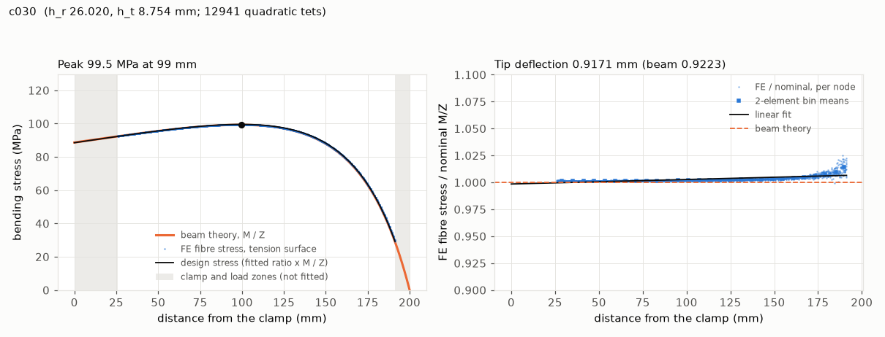

### c031

Parameters: length_mm = 200, width_mm = 20, root_height_mm = 26.04, tip_height_mm = 8.735, youngs_modulus_MPa = 2.1e+05, poisson_ratio = 0.3, density_t_per_mm3 = 7.85e-09, tip_load_N = 1000, element_size_mm = 3, yield_strength_MPa = 355

Derived: tip_deflection_beam_mm = 0.9219, peak_nominal_stress_MPa = 99.24, peak_nominal_stress_x_mm = 99.04, root_nominal_stress_MPa = 88.49, volume_closed_form_mm3 = 6.955e+04, taper_slope = 0.04326, root_height_over_length = 0.1302

| Requirement | Result | Limit | Margin | Verdict | Evidence |
|---|---|---|---|---|---|
| REQ-B1 | 0.9168 mm | <= 1 | 0.0832 | **PASS** | [point.json](points/c031/point.json) |
| REQ-B2 | 99.5 MPa | <= 100 | 0.497 | **PASS** | [point.json](points/c031/point.json) |

| Check | Description | Value | Tolerance | Status |
|---|---|---|---|---|
| cad_volume | |CadQuery B-rep volume - b L (h_r + h_t) / 2| / closed form | 0.00e+00 | 1e-09 | PASS |
| load_applied | |sum of tip nodal forces + F| / F and |tip area from the mesh - b h_t| / (b h_t) | 6.23e-14 | 1e-09 | PASS |
| equilibrium | |R_root - (0, 0, F)| / F (sum of reactions) | 3.70e-12 | 1e-06 | PASS |
| deflection_reference | |tip deflection FE - tapered Timoshenko beam| / beam (model form) | 5.62e-03 | 2e-02 | PASS |
| stress_ratio_reference | max over the span of |fitted FE fibre stress / nominal M/Z - 1| (model form: beam theory) | 6.55e-03 | 2e-02 | PASS |
| stress_field_reference | max over 2-element bins of |mean FE fibre stress / nominal - 1| in the smooth region (field, model form) | 1.47e-02 | 3e-02 | PASS |
| linear_material (validity) | peak bending stress / yield strength | 2.80e-01 | 1e+00 | PASS |
| small_deflection (validity) | tip deflection / length (geometrically linear analysis) | 4.58e-03 | 1e-02 | PASS |
| beam_reference_valid (validity) | taper slope |h_r - h_t| / 2L (tapered beam theory) | 4.33e-02 | 1e-01 | PASS |
| slender (validity) | root height / length (beam theory) | 1.30e-01 | 2e-01 | PASS |

## Limitations

- Linear taper only; a curved profile could be lighter still.
- No lateral-torsional buckling check (the bracket is a deep, short cantilever loaded in its stiff plane).
- The stress metric uses the FE stress-to-nominal ratio in the smooth region, extrapolated linearly to the root; the root joint itself (weld, bolts) needs its own assessment.
- Beam theory (deflection and nominal stress) is a model-form reference.
- No physical test data.
- A converged solver run that matches an analytical reference shows that the equations were solved correctly. It does not show that the equations represent real hardware.

## Engineering acceptance

Pending human review. This report does not accept or reject the design.
