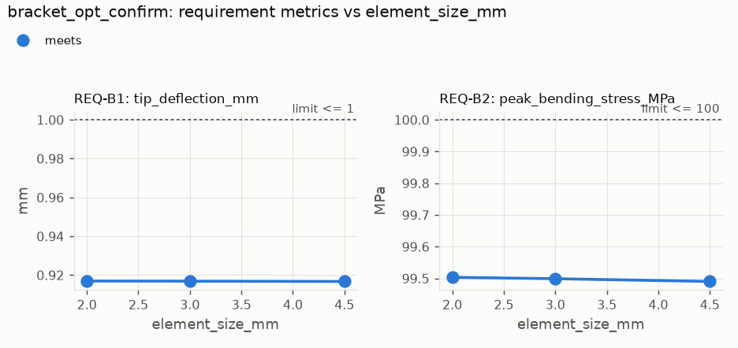
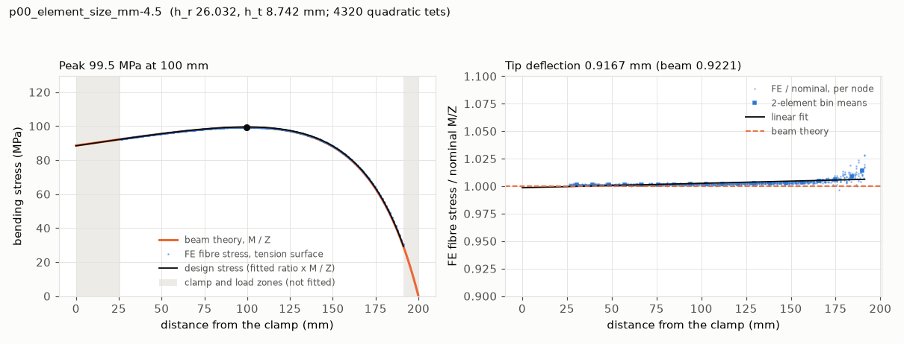
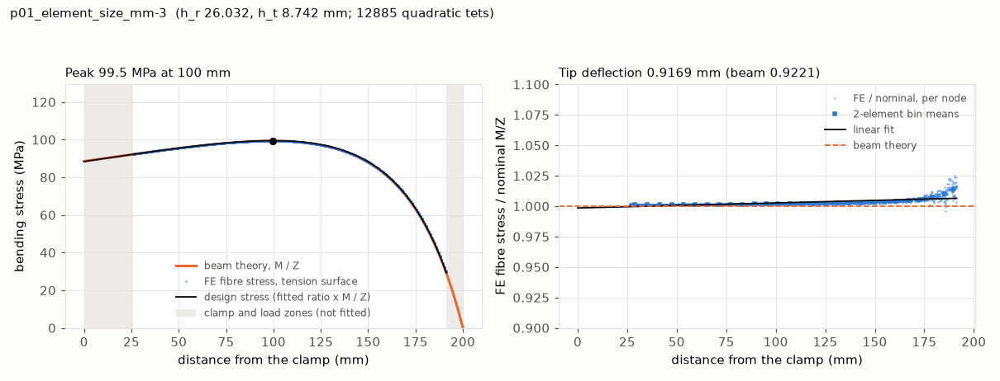
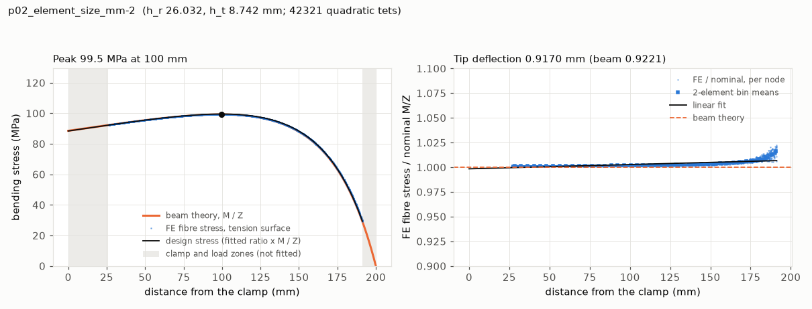

# Engineering review report: bracket_opt_confirm

- **Run:** `20261120-225744_bracket_opt_confirm`
- **Generated:** 2026-11-21T03:58:22+00:00
- **Case file SHA-256:** `415c2bc69918c9bb3378ad655ccd1b0ee73d84242e53885e97d88b9416cad8c3`
- **Environment:** Python 3.14.10, numpy 2.5.5, scipy 1.18.1, matplotlib 3.11.2, cadquery 2.8.0; Windows-11-10.0.26100-SP0
- **Tools:** cadquery 2.8.0; gmsh 4.15.0; CalculiX This is Version 2.22
- **Code version:** git `d89f3eb4b3297ce9c7f67030eaeb9a09e04bd06b` (uncommitted changes present)
- **Simulation status:** completed
- **Verification status:** PASS

## Scope

Confirmation of the optimisation run 20261120-225322_bracket_opt: mesh study (4.5 / 3 / 2 mm quadratic tetrahedra) at the optimum c026 and a spot check against the independent beam-theory optimum. Original problem: lightest linearly tapered steel cantilever bracket (200 mm long, 20 mm wide, 1 kN tip load) with tip deflection at most 1.0 mm and peak bending stress at most 100 MPa; COBYLA drives the CadQuery -> Gmsh -> CalculiX pipeline over root and tip height, and every candidate must pass the study's checks.

**Assumptions**

- Linear elastic steel (E = 210 GPa, nu = 0.3); checked: peak stress below yield.
- Small deflection; checked: tip deflection / length below 1 %.
- Root face fully fixed (rigid mounting); the clamp-corner stress is singular and is not used as a design stress.
- Tip load applied as a uniform shear traction over the tip face.
- Width fixed at 20 mm by the mounting (synthetic); only the two heights vary, linearly between them.
- Stress allowable 100 MPa (fatigue-rated) and deflection limit 1.0 mm: synthetic.

## Requirements

| ID | Requirement | Metric | Limit |
|---|---|---|---|
| REQ-B1 | Tip deflection under the 1 kN load shall not exceed 1.0 mm. | `tip_deflection_mm` | <= 1 mm |
| REQ-B2 | Peak bending stress along the span (tension surface, outside the singular clamp corner, from the FE stress-to-M/Z ratio) shall not exceed 100 MPa (fatigue-rated allowable). | `peak_bending_stress_MPa` | <= 100 MPa |

## Summary across points

| Point | element_size_mm | REQ-B1 | REQ-B2 | Checks |
|---|---|---|---|---|
| p00_element_size_mm-4.5 | 4.5 | 0.9167 mm: **PASS** | 99.49 MPa: **PASS** | 10/10 PASS |
| p01_element_size_mm-3 | 3 | 0.9169 mm: **PASS** | 99.5 MPa: **PASS** | 10/10 PASS |
| p02_element_size_mm-2 | 2 | 0.917 mm: **PASS** | 99.5 MPa: **PASS** | 10/10 PASS |

## Run-level checks

Checks that use several points together (for example mesh convergence).

| Check | Description | Value | Tolerance | Status |
|---|---|---|---|---|
| discretization_peak_bending_stress_MPa | relative discretization uncertainty of peak_bending_stress_MPa, monotone (R = 0.499): GCI_fine, observed order 1.71, extrapolated 99.5078 | 5.46e-05 | 0.005 | PASS |
| requirement_margin_peak_bending_stress_MPa | (finest peak_bending_stress_MPa x (1 + uncertainty) - limit) / limit, must be <= 0 | -0.00491 | 0 | PASS |
| discretization_tip_deflection_mm | relative discretization uncertainty of tip_deflection_mm, monotone (R = 0.577): GCI_fine, observed order 1.36, extrapolated 0.917071 | 0.00016 | 0.005 | PASS |
| requirement_margin_tip_deflection_mm | (finest tip_deflection_mm x (1 + uncertainty) - limit) / limit, must be <= 0 | -0.0829 | 0 | PASS |
| optimum_vs_beam_theory | |FE optimum mass - beam-theory optimum mass| / beam (independent optimum, same limits and margin; model form) | 0.00134 | 0.01 | PASS |

## Point details

### p00_element_size_mm-4.5

Parameters: length_mm = 200, width_mm = 20, root_height_mm = 26.03, tip_height_mm = 8.742, youngs_modulus_MPa = 2.1e+05, poisson_ratio = 0.3, density_t_per_mm3 = 7.85e-09, tip_load_N = 1000, element_size_mm = 4.5, yield_strength_MPa = 355

Derived: tip_deflection_beam_mm = 0.9221, peak_nominal_stress_MPa = 99.24, peak_nominal_stress_x_mm = 98.88, root_nominal_stress_MPa = 88.54, volume_closed_form_mm3 = 6.955e+04, taper_slope = 0.04323, root_height_over_length = 0.1302

| Requirement | Result | Limit | Margin | Verdict | Evidence |
|---|---|---|---|---|---|
| REQ-B1 | 0.9167 mm | <= 1 | 0.0833 | **PASS** | [point.json](points/p00_element_size_mm-4.5/point.json) |
| REQ-B2 | 99.49 MPa | <= 100 | 0.51 | **PASS** | [point.json](points/p00_element_size_mm-4.5/point.json) |

| Check | Description | Value | Tolerance | Status |
|---|---|---|---|---|
| cad_volume | |CadQuery B-rep volume - b L (h_r + h_t) / 2| / closed form | 2.09e-16 | 1e-09 | PASS |
| load_applied | |sum of tip nodal forces + F| / F and |tip area from the mesh - b h_t| / (b h_t) | 3.89e-14 | 1e-09 | PASS |
| equilibrium | |R_root - (0, 0, F)| / F (sum of reactions) | 5.21e-12 | 1e-06 | PASS |
| deflection_reference | |tip deflection FE - tapered Timoshenko beam| / beam (model form) | 5.78e-03 | 2e-02 | PASS |
| stress_ratio_reference | max over the span of |fitted FE fibre stress / nominal M/Z - 1| (model form: beam theory) | 6.24e-03 | 2e-02 | PASS |
| stress_field_reference | max over 2-element bins of |mean FE fibre stress / nominal - 1| in the smooth region (field, model form) | 1.42e-02 | 3e-02 | PASS |
| linear_material (validity) | peak bending stress / yield strength | 2.80e-01 | 1e+00 | PASS |
| small_deflection (validity) | tip deflection / length (geometrically linear analysis) | 4.58e-03 | 1e-02 | PASS |
| beam_reference_valid (validity) | taper slope |h_r - h_t| / 2L (tapered beam theory) | 4.32e-02 | 1e-01 | PASS |
| slender (validity) | root height / length (beam theory) | 1.30e-01 | 2e-01 | PASS |

### p01_element_size_mm-3

Parameters: length_mm = 200, width_mm = 20, root_height_mm = 26.03, tip_height_mm = 8.742, youngs_modulus_MPa = 2.1e+05, poisson_ratio = 0.3, density_t_per_mm3 = 7.85e-09, tip_load_N = 1000, element_size_mm = 3, yield_strength_MPa = 355

Derived: tip_deflection_beam_mm = 0.9221, peak_nominal_stress_MPa = 99.24, peak_nominal_stress_x_mm = 98.88, root_nominal_stress_MPa = 88.54, volume_closed_form_mm3 = 6.955e+04, taper_slope = 0.04323, root_height_over_length = 0.1302

| Requirement | Result | Limit | Margin | Verdict | Evidence |
|---|---|---|---|---|---|
| REQ-B1 | 0.9169 mm | <= 1 | 0.0831 | **PASS** | [point.json](points/p01_element_size_mm-3/point.json) |
| REQ-B2 | 99.5 MPa | <= 100 | 0.501 | **PASS** | [point.json](points/p01_element_size_mm-3/point.json) |

| Check | Description | Value | Tolerance | Status |
|---|---|---|---|---|
| cad_volume | |CadQuery B-rep volume - b L (h_r + h_t) / 2| / closed form | 2.09e-16 | 1e-09 | PASS |
| load_applied | |sum of tip nodal forces + F| / F and |tip area from the mesh - b h_t| / (b h_t) | 3.89e-14 | 1e-09 | PASS |
| equilibrium | |R_root - (0, 0, F)| / F (sum of reactions) | 1.36e-12 | 1e-06 | PASS |
| deflection_reference | |tip deflection FE - tapered Timoshenko beam| / beam (model form) | 5.62e-03 | 2e-02 | PASS |
| stress_ratio_reference | max over the span of |fitted FE fibre stress / nominal M/Z - 1| (model form: beam theory) | 6.47e-03 | 2e-02 | PASS |
| stress_field_reference | max over 2-element bins of |mean FE fibre stress / nominal - 1| in the smooth region (field, model form) | 1.40e-02 | 3e-02 | PASS |
| linear_material (validity) | peak bending stress / yield strength | 2.80e-01 | 1e+00 | PASS |
| small_deflection (validity) | tip deflection / length (geometrically linear analysis) | 4.58e-03 | 1e-02 | PASS |
| beam_reference_valid (validity) | taper slope |h_r - h_t| / 2L (tapered beam theory) | 4.32e-02 | 1e-01 | PASS |
| slender (validity) | root height / length (beam theory) | 1.30e-01 | 2e-01 | PASS |

### p02_element_size_mm-2

Parameters: length_mm = 200, width_mm = 20, root_height_mm = 26.03, tip_height_mm = 8.742, youngs_modulus_MPa = 2.1e+05, poisson_ratio = 0.3, density_t_per_mm3 = 7.85e-09, tip_load_N = 1000, element_size_mm = 2, yield_strength_MPa = 355

Derived: tip_deflection_beam_mm = 0.9221, peak_nominal_stress_MPa = 99.24, peak_nominal_stress_x_mm = 98.88, root_nominal_stress_MPa = 88.54, volume_closed_form_mm3 = 6.955e+04, taper_slope = 0.04323, root_height_over_length = 0.1302

| Requirement | Result | Limit | Margin | Verdict | Evidence |
|---|---|---|---|---|---|
| REQ-B1 | 0.917 mm | <= 1 | 0.083 | **PASS** | [point.json](points/p02_element_size_mm-2/point.json) |
| REQ-B2 | 99.5 MPa | <= 100 | 0.497 | **PASS** | [point.json](points/p02_element_size_mm-2/point.json) |

| Check | Description | Value | Tolerance | Status |
|---|---|---|---|---|
| cad_volume | |CadQuery B-rep volume - b L (h_r + h_t) / 2| / closed form | 2.09e-16 | 1e-09 | PASS |
| load_applied | |sum of tip nodal forces + F| / F and |tip area from the mesh - b h_t| / (b h_t) | 3.89e-14 | 1e-09 | PASS |
| equilibrium | |R_root - (0, 0, F)| / F (sum of reactions) | 8.35e-13 | 1e-06 | PASS |
| deflection_reference | |tip deflection FE - tapered Timoshenko beam| / beam (model form) | 5.53e-03 | 2e-02 | PASS |
| stress_ratio_reference | max over the span of |fitted FE fibre stress / nominal M/Z - 1| (model form: beam theory) | 6.68e-03 | 2e-02 | PASS |
| stress_field_reference | max over 2-element bins of |mean FE fibre stress / nominal - 1| in the smooth region (field, model form) | 1.61e-02 | 3e-02 | PASS |
| linear_material (validity) | peak bending stress / yield strength | 2.80e-01 | 1e+00 | PASS |
| small_deflection (validity) | tip deflection / length (geometrically linear analysis) | 4.58e-03 | 1e-02 | PASS |
| beam_reference_valid (validity) | taper slope |h_r - h_t| / 2L (tapered beam theory) | 4.32e-02 | 1e-01 | PASS |
| slender (validity) | root height / length (beam theory) | 1.30e-01 | 2e-01 | PASS |

## Limitations

- Linear taper only; a curved profile could be lighter still.
- No lateral-torsional buckling check (the bracket is a deep, short cantilever loaded in its stiff plane).
- The stress metric uses the FE stress-to-nominal ratio in the smooth region, extrapolated linearly to the root; the root joint itself (weld, bolts) needs its own assessment.
- Beam theory (deflection and nominal stress) is a model-form reference.
- No physical test data.
- A converged solver run that matches an analytical reference shows that the equations were solved correctly. It does not show that the equations represent real hardware.

## Engineering acceptance

Pending human review. This report does not accept or reject the design.
