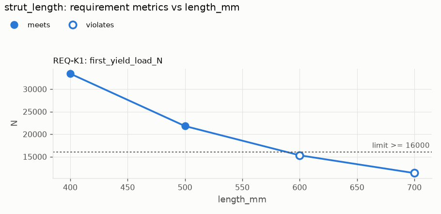
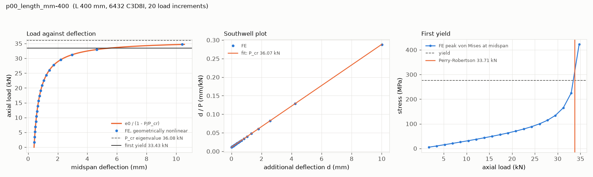
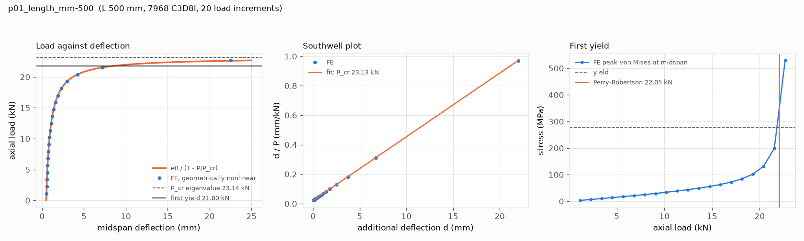
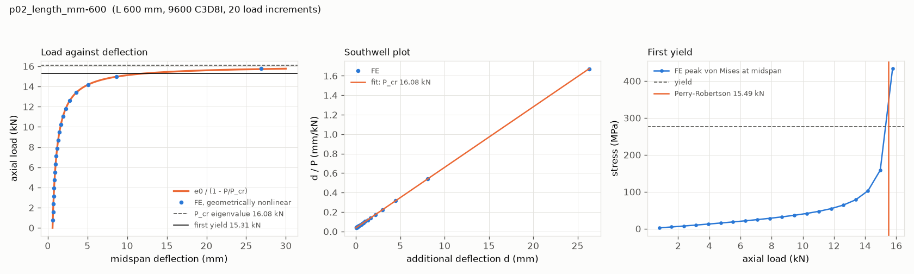
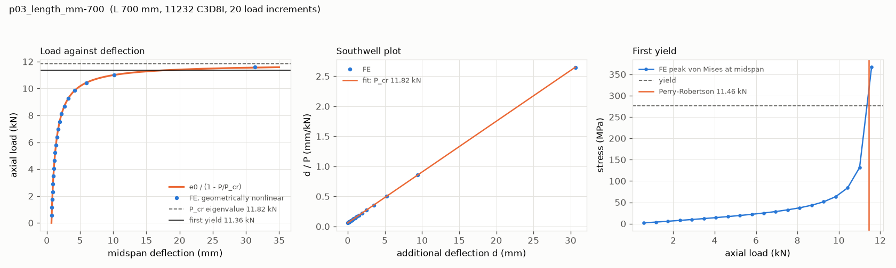

# Engineering review report: strut_length

- **Run:** `20261120-232856_strut_length`
- **Generated:** 2026-11-21T04:36:32+00:00
- **Case file SHA-256:** `7ade3c618864b21348fb227410d42654259deafb3f31f921c77f6285e48570ec`
- **Environment:** Python 3.14.10, numpy 2.5.5, scipy 1.18.1, matplotlib 3.11.2, cadquery 2.8.0; Windows-11-10.0.26100-SP0
- **Tools:** CalculiX This is Version 2.22
- **Code version:** git `1eafbc4d5003a06ba7248c449ed08ef12df709fa` (uncommitted changes present)
- **Simulation status:** completed
- **Verification status:** PASS

## Scope

Pinned-pinned 6061-T6 strut, 25 x 16 mm solid section, in compression: CalculiX linear buckling and a geometrically nonlinear analysis with an L/1000 initial bow to first yield, at L = 400 / 500 / 600 / 700 mm; checked against Euler-Engesser, the amplification law, the Southwell plot and Perry-Robertson.

**Assumptions**

- Pins on the centroidal axis at both ends (knife-edge line supports across the width at mid-thickness).
- Initial bow e0 = L/1000 in the weak direction, half-sine shaped (the first buckling mode): synthetic tolerance.
- Load axial and concentric at the ends, uniform over the end face (dead load).
- Linear elastic material up to first yield (6061-T6, E = 68.9 GPa, yield 276 MPa); the analysis stops just past first yield.
- Elastic buckling governs; checked: Euler stress at most half the yield stress (Johnson range otherwise).
- Moderate deflection at first yield; checked: below 5 % of the length.

## Requirements

| ID | Requirement | Metric | Limit |
|---|---|---|---|
| REQ-K1 | The strut, with an L/1000 initial bow, shall reach 16 kN (twice the 8 kN service load) before first yield. | `first_yield_load_N` | >= 16000 N |

## Summary across points

| Point | length_mm | REQ-K1 | Checks |
|---|---|---|---|
| p00_length_mm-400 | 400 | 3.343e+04 N: **PASS** | 11/11 PASS |
| p01_length_mm-500 | 500 | 2.18e+04 N: **PASS** | 11/11 PASS |
| p02_length_mm-600 | 600 | 1.531e+04 N: **FAIL** | 11/11 PASS |
| p03_length_mm-700 | 700 | 1.136e+04 N: **FAIL** | 11/11 PASS |

## Point details

### p00_length_mm-400

Parameters: length_mm = 400, width_mm = 25, thickness_mm = 16, youngs_modulus_MPa = 6.89e+04, poisson_ratio = 0.33, yield_strength_MPa = 276, element_size_mm = 3, imperfection_over_length = 0.001

Derived: slenderness_L_over_r = 86.6, euler_load_N = 3.627e+04, critical_load_engesser_N = 3.612e+04, euler_stress_MPa = 90.67, johnson_stress_MPa = 65.96, perry_robertson_load_N = 3.373e+04, squash_load_N = 1.104e+05, thickness_over_length = 0.04

| Requirement | Result | Limit | Margin | Verdict | Evidence |
|---|---|---|---|---|---|
| REQ-K1 | 3.343e+04 N | >= 16000 | 1.74e+04 | **PASS** | [point.json](points/p00_length_mm-400/point.json) |

| Check | Description | Value | Tolerance | Status |
|---|---|---|---|---|
| buckling_reference | |P_cr FE - Euler with Engesser shear correction| / reference (model form) | 9.57e-04 | 1e-02 | PASS |
| mode_shape | 1 - MAC(first mode on the axis, half sine) (weak-axis buckling) | 1.04e-10 | 1e-03 | PASS |
| southwell_vs_eigenvalue | |P_cr from the Southwell plot of the nonlinear run - eigenvalue| / eigenvalue (two independent FE routes) | 3.83e-04 | 1e-02 | PASS |
| southwell_imperfection | |initial bow recovered by the Southwell fit - imposed| / imposed | 5.06e-03 | 3e-02 | PASS |
| amplification_reference | max over P <= 0.8 P_cr of |midspan deflection - e0 / (1 - P/P_cr)| / deflection (model form: small-deflection theory) | 2.62e-03 | 2e-02 | PASS |
| first_yield_bracketed | first yield reached inside the load range (1 = not reached) | 0.00e+00 | 5e-01 | PASS |
| first_yield_reference | |first-yield load FE - Perry-Robertson (FE P_cr)| / Perry-Robertson (model form: beam stresses) | 8.25e-03 | 2e-02 | PASS |
| equilibrium | |axial reaction at the midspan restraint| / end load, last increment (the two end loads balance) | 9.42e-16 | 1e-06 | PASS |
| euler_range (validity) | Euler stress / (yield / 2): elastic buckling governs at or below 1 (Johnson range otherwise) | 6.57e-01 | 1e+00 | PASS |
| moderate_deflection (validity) | midspan deflection at first yield / length | 1.53e-02 | 5e-02 | PASS |
| slender (validity) | thickness / length (beam-column references) | 4.00e-02 | 1e-01 | PASS |

### p01_length_mm-500

Parameters: length_mm = 500, width_mm = 25, thickness_mm = 16, youngs_modulus_MPa = 6.89e+04, poisson_ratio = 0.33, yield_strength_MPa = 276, element_size_mm = 3, imperfection_over_length = 0.001

Derived: slenderness_L_over_r = 108.3, euler_load_N = 2.321e+04, critical_load_engesser_N = 2.315e+04, euler_stress_MPa = 58.03, johnson_stress_MPa = -52.19, perry_robertson_load_N = 2.207e+04, squash_load_N = 1.104e+05, thickness_over_length = 0.032

| Requirement | Result | Limit | Margin | Verdict | Evidence |
|---|---|---|---|---|---|
| REQ-K1 | 2.18e+04 N | >= 16000 | 5.8e+03 | **PASS** | [point.json](points/p01_length_mm-500/point.json) |

| Check | Description | Value | Tolerance | Status |
|---|---|---|---|---|
| buckling_reference | |P_cr FE - Euler with Engesser shear correction| / reference (model form) | 6.12e-04 | 1e-02 | PASS |
| mode_shape | 1 - MAC(first mode on the axis, half sine) (weak-axis buckling) | 2.51e-11 | 1e-03 | PASS |
| southwell_vs_eigenvalue | |P_cr from the Southwell plot of the nonlinear run - eigenvalue| / eigenvalue (two independent FE routes) | 2.00e-04 | 1e-02 | PASS |
| southwell_imperfection | |initial bow recovered by the Southwell fit - imposed| / imposed | 3.14e-03 | 3e-02 | PASS |
| amplification_reference | max over P <= 0.8 P_cr of |midspan deflection - e0 / (1 - P/P_cr)| / deflection (model form: small-deflection theory) | 1.69e-03 | 2e-02 | PASS |
| first_yield_bracketed | first yield reached inside the load range (1 = not reached) | 0.00e+00 | 5e-01 | PASS |
| first_yield_reference | |first-yield load FE - Perry-Robertson (FE P_cr)| / Perry-Robertson (model form: beam stresses) | 1.13e-02 | 2e-02 | PASS |
| equilibrium | |axial reaction at the midspan restraint| / end load, last increment (the two end loads balance) | 6.72e-15 | 1e-06 | PASS |
| euler_range (validity) | Euler stress / (yield / 2): elastic buckling governs at or below 1 (Johnson range otherwise) | 4.20e-01 | 1e+00 | PASS |
| moderate_deflection (validity) | midspan deflection at first yield / length | 2.16e-02 | 5e-02 | PASS |
| slender (validity) | thickness / length (beam-column references) | 3.20e-02 | 1e-01 | PASS |

### p02_length_mm-600

Parameters: length_mm = 600, width_mm = 25, thickness_mm = 16, youngs_modulus_MPa = 6.89e+04, poisson_ratio = 0.33, yield_strength_MPa = 276, element_size_mm = 3, imperfection_over_length = 0.001

Derived: slenderness_L_over_r = 129.9, euler_load_N = 1.612e+04, critical_load_engesser_N = 1.609e+04, euler_stress_MPa = 40.3, johnson_stress_MPa = -196.6, perry_robertson_load_N = 1.55e+04, squash_load_N = 1.104e+05, thickness_over_length = 0.02667

| Requirement | Result | Limit | Margin | Verdict | Evidence |
|---|---|---|---|---|---|
| REQ-K1 | 1.531e+04 N | >= 16000 | -691 | **FAIL** | [point.json](points/p02_length_mm-600/point.json) |

| Check | Description | Value | Tolerance | Status |
|---|---|---|---|---|
| buckling_reference | |P_cr FE - Euler with Engesser shear correction| / reference (model form) | 4.25e-04 | 1e-02 | PASS |
| mode_shape | 1 - MAC(first mode on the axis, half sine) (weak-axis buckling) | 7.93e-12 | 1e-03 | PASS |
| southwell_vs_eigenvalue | |P_cr from the Southwell plot of the nonlinear run - eigenvalue| / eigenvalue (two independent FE routes) | 1.11e-04 | 1e-02 | PASS |
| southwell_imperfection | |initial bow recovered by the Southwell fit - imposed| / imposed | 2.13e-03 | 3e-02 | PASS |
| amplification_reference | max over P <= 0.8 P_cr of |midspan deflection - e0 / (1 - P/P_cr)| / deflection (model form: small-deflection theory) | 1.19e-03 | 2e-02 | PASS |
| first_yield_bracketed | first yield reached inside the load range (1 = not reached) | 0.00e+00 | 5e-01 | PASS |
| first_yield_reference | |first-yield load FE - Perry-Robertson (FE P_cr)| / Perry-Robertson (model form: beam stresses) | 1.18e-02 | 2e-02 | PASS |
| equilibrium | |axial reaction at the midspan restraint| / end load, last increment (the two end loads balance) | 3.24e-15 | 1e-06 | PASS |
| euler_range (validity) | Euler stress / (yield / 2): elastic buckling governs at or below 1 (Johnson range otherwise) | 2.92e-01 | 1e+00 | PASS |
| moderate_deflection (validity) | midspan deflection at first yield / length | 2.74e-02 | 5e-02 | PASS |
| slender (validity) | thickness / length (beam-column references) | 2.67e-02 | 1e-01 | PASS |

### p03_length_mm-700

Parameters: length_mm = 700, width_mm = 25, thickness_mm = 16, youngs_modulus_MPa = 6.89e+04, poisson_ratio = 0.33, yield_strength_MPa = 276, element_size_mm = 3, imperfection_over_length = 0.001

Derived: slenderness_L_over_r = 151.6, euler_load_N = 1.184e+04, critical_load_engesser_N = 1.183e+04, euler_stress_MPa = 29.61, johnson_stress_MPa = -367.2, perry_robertson_load_N = 1.147e+04, squash_load_N = 1.104e+05, thickness_over_length = 0.02286

| Requirement | Result | Limit | Margin | Verdict | Evidence |
|---|---|---|---|---|---|
| REQ-K1 | 1.136e+04 N | >= 16000 | -4.64e+03 | **FAIL** | [point.json](points/p03_length_mm-700/point.json) |

| Check | Description | Value | Tolerance | Status |
|---|---|---|---|---|
| buckling_reference | |P_cr FE - Euler with Engesser shear correction| / reference (model form) | 3.12e-04 | 1e-02 | PASS |
| mode_shape | 1 - MAC(first mode on the axis, half sine) (weak-axis buckling) | 3.06e-12 | 1e-03 | PASS |
| southwell_vs_eigenvalue | |P_cr from the Southwell plot of the nonlinear run - eigenvalue| / eigenvalue (two independent FE routes) | 5.73e-05 | 1e-02 | PASS |
| southwell_imperfection | |initial bow recovered by the Southwell fit - imposed| / imposed | 1.51e-03 | 3e-02 | PASS |
| amplification_reference | max over P <= 0.8 P_cr of |midspan deflection - e0 / (1 - P/P_cr)| / deflection (model form: small-deflection theory) | 8.86e-04 | 2e-02 | PASS |
| first_yield_bracketed | first yield reached inside the load range (1 = not reached) | 0.00e+00 | 5e-01 | PASS |
| first_yield_reference | |first-yield load FE - Perry-Robertson (FE P_cr)| / Perry-Robertson (model form: beam stresses) | 8.76e-03 | 2e-02 | PASS |
| equilibrium | |axial reaction at the midspan restraint| / end load, last increment (the two end loads balance) | 1.39e-14 | 1e-06 | PASS |
| euler_range (validity) | Euler stress / (yield / 2): elastic buckling governs at or below 1 (Johnson range otherwise) | 2.15e-01 | 1e+00 | PASS |
| moderate_deflection (validity) | midspan deflection at first yield / length | 3.31e-02 | 5e-02 | PASS |
| slender (validity) | thickness / length (beam-column references) | 2.29e-02 | 1e-01 | PASS |

## Limitations

- No residual stresses, end eccentricity or load misalignment beyond the bow.
- Capacity defined as first yield, not collapse (the plastic reserve beyond first yield is not used).
- References are model form (beam-column theory) except the Southwell plot, which uses the FE response itself.
- No physical test data.
- A converged solver run that matches an analytical reference shows that the equations were solved correctly. It does not show that the equations represent real hardware.

## Engineering acceptance

Pending human review. This report does not accept or reject the design.
