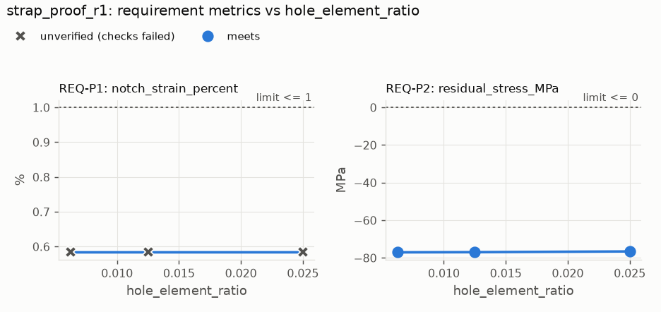
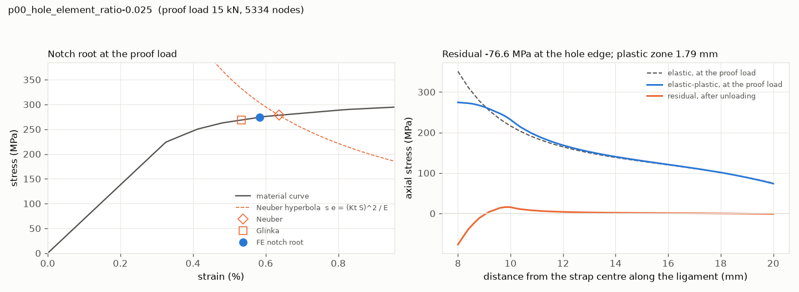
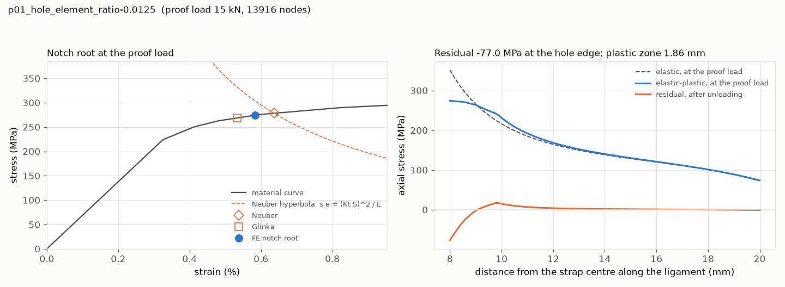
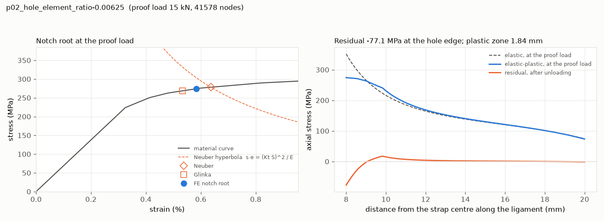

# Engineering review report: strap_proof_r1

- **Run:** `20261120-233830_strap_proof_r1`
- **Generated:** 2026-11-21T04:47:34+00:00
- **Case file SHA-256:** `afa850a07ddd56f4fdb2f06ee5adb8a824962afe020c02b93c894d5ea5b8e9a1`
- **Environment:** Python 3.14.10, numpy 2.5.5, scipy 1.18.1, matplotlib 3.11.2, cadquery 2.8.0; Windows-11-10.0.26100-SP0
- **Tools:** cadquery 2.8.0; gmsh 4.15.0; CalculiX This is Version 2.22
- **Code version:** git `356901c82d9a18b1bef3dcca4aad4413874a0b7d` (uncommitted changes present)
- **Simulation status:** completed
- **Verification status:** FAIL

> **Warning:** verification did not pass for every point. Requirement verdicts marked *(unverified)* are not supported by evidence and must not be used for acceptance.

## Scope

6061-T6 strap, 160 x 40 x 4 mm with a 16 mm hole, proof loaded to 15 kN (three times service) and unloaded; CalculiX isotropic-hardening plasticity in true plane stress; hole-edge element size 2.5 / 1.25 / 0.625 % of the diameter; checked against Peterson, Neuber, Glinka and elastic-unloading superposition.

**Assumptions**

- True plane stress (thin analysed layer with scaled loads, as in the strap-hole study).
- Isotropic hardening along a synthetic Ramberg-Osgood-fitted table (0.2 % proof 276 MPa); monotonic loading then unloading.
- Geometrically linear, small strain; checked: notch strain below 5 %.
- Contained yielding; checked: net section below first yield and plastic zone under a quarter of the ligament.
- Elastic unloading; checked: residual stress below the current flow stress (no reversed yield).

## Requirements

| ID | Requirement | Metric | Limit |
|---|---|---|---|
| REQ-P1 | Total strain at the hole edge during the 15 kN proof test shall not exceed 1.0 % (synthetic limit for a proof test that must not damage the part). | `notch_strain_percent` | <= 1 % |
| REQ-P2 | The proof test shall leave a compressive residual stress at the hole edge (axial stress after unloading at most 0 MPa), the fatigue benefit the test is relied on for. | `residual_stress_MPa` | <= 0 MPa |

## Summary across points

| Point | hole_element_ratio | REQ-P1 | REQ-P2 | Checks |
|---|---|---|---|---|
| p00_hole_element_ratio-0.025 | 0.025 | 0.5835 %: **PASS (unverified)** | -76.58 MPa: **PASS** | 11/11 PASS |
| p01_hole_element_ratio-0.0125 | 0.0125 | 0.5834 %: **PASS (unverified)** | -76.97 MPa: **PASS** | 11/11 PASS |
| p02_hole_element_ratio-0.00625 | 0.00625 | 0.5834 %: **PASS (unverified)** | -77.06 MPa: **PASS** | 11/11 PASS |

## Run-level checks

Checks that use several points together (for example mesh convergence).

| Check | Description | Value | Tolerance | Status |
|---|---|---|---|---|
| discretization_notch_strain_percent | relative discretization uncertainty of notch_strain_percent, divergent (R = 1.714): no estimate | inf | 0.02 | FAIL |
| discretization_residual_stress_MPa | relative discretization uncertainty of residual_stress_MPa, monotone (R = 0.233): GCI_fine, observed order 2.10, extrapolated -77.0898 | 0.000453 | 0.02 | PASS |

A failed run-level check withholds the verdicts of requirements on `notch_strain_percent` at every point: they are marked *(unverified)* in the table above.

## Point details

### p00_hole_element_ratio-0.025

Parameters: length_mm = 160, width_mm = 40, thickness_mm = 4, hole_diameter_mm = 16, axial_load_N = 1.5e+04, youngs_modulus_MPa = 6.89e+04, poisson_ratio = 0.33, far_element_size_mm = 4, hole_element_ratio = 0.025, plastic_strain = [0.0, 0.0002, 0.0005, 0.001, 0.002, 0.004, 0.007, 0.012, 0.02, 0.04, 0.08], plastic_stress_MPa = [223.8, 234.9, 250.5, 262.9, 276.0, 289.7, 301.3, 312.9, 324.3, 340.4, 357.3]

Derived: kt_net_peterson = 2.236, net_stress_MPa = 156.2, elastic_peak_peterson_MPa = 349.3, neuber_stress_MPa = 278.2, neuber_strain = 0.006365, glinka_stress_MPa = 268.6, glinka_strain = 0.005331, residual_neuber_MPa = -71.08, initial_yield_MPa = 223.8

| Requirement | Result | Limit | Margin | Verdict | Evidence |
|---|---|---|---|---|---|
| REQ-P1 | 0.5835 % | <= 1 | 0.417 | **PASS (unverified)** | [point.json](points/p00_hole_element_ratio-0.025/point.json) |
| REQ-P2 | -76.58 MPa | <= 0 | 76.6 | **PASS** | [point.json](points/p00_hole_element_ratio-0.025/point.json) |

| Check | Description | Value | Tolerance | Status |
|---|---|---|---|---|
| equilibrium_proof | |reaction on the symmetry edge + F/2| / (F/2) at the proof load | 0.00e+00 | 1e-06 | PASS |
| equilibrium_unloaded | |reaction on the symmetry edge| / (F/2) after unloading | 1.04e-17 | 1e-06 | PASS |
| elastic_kt_reference | |FE elastic peak / net stress - Peterson Kt| / Kt (handbook) | 4.69e-03 | 2e-02 | PASS |
| neuber_glinka_bracket | notch-root strain outside [Glinka, Neuber], as a fraction of the bound crossed (0 = inside) | 0.00e+00 | 3e-02 | PASS |
| neuber_reference | |notch-root strain FE - Neuber| / Neuber (model form; plane stress) | 8.34e-02 | 1e-01 | PASS |
| residual_superposition | |residual stress - (proof stress - elastic peak)| / elastic peak (exact if the unloading is elastic) | 2.28e-06 | 1e-04 | PASS |
| residual_reference | |residual stress FE - Neuber state minus Peterson elastic peak| / elastic peak (model form) | 1.57e-02 | 5e-02 | PASS |
| net_section_elastic (validity) | net-section stress / initial yield (contained yielding) | 6.98e-01 | 1e+00 | PASS |
| contained_yield (validity) | plastic zone along the ligament / ligament width | 1.49e-01 | 2e-01 | PASS |
| elastic_unloading (validity) | |residual stress| / current flow stress at the notch root (no reversed yield) | 2.79e-01 | 1e+00 | PASS |
| small_strain (validity) | notch-root strain (geometrically linear analysis) | 5.83e-03 | 5e-02 | PASS |

### p01_hole_element_ratio-0.0125

Parameters: length_mm = 160, width_mm = 40, thickness_mm = 4, hole_diameter_mm = 16, axial_load_N = 1.5e+04, youngs_modulus_MPa = 6.89e+04, poisson_ratio = 0.33, far_element_size_mm = 4, hole_element_ratio = 0.0125, plastic_strain = [0.0, 0.0002, 0.0005, 0.001, 0.002, 0.004, 0.007, 0.012, 0.02, 0.04, 0.08], plastic_stress_MPa = [223.8, 234.9, 250.5, 262.9, 276.0, 289.7, 301.3, 312.9, 324.3, 340.4, 357.3]

Derived: kt_net_peterson = 2.236, net_stress_MPa = 156.2, elastic_peak_peterson_MPa = 349.3, neuber_stress_MPa = 278.2, neuber_strain = 0.006365, glinka_stress_MPa = 268.6, glinka_strain = 0.005331, residual_neuber_MPa = -71.08, initial_yield_MPa = 223.8

| Requirement | Result | Limit | Margin | Verdict | Evidence |
|---|---|---|---|---|---|
| REQ-P1 | 0.5834 % | <= 1 | 0.417 | **PASS (unverified)** | [point.json](points/p01_hole_element_ratio-0.0125/point.json) |
| REQ-P2 | -76.97 MPa | <= 0 | 77 | **PASS** | [point.json](points/p01_hole_element_ratio-0.0125/point.json) |

| Check | Description | Value | Tolerance | Status |
|---|---|---|---|---|
| equilibrium_proof | |reaction on the symmetry edge + F/2| / (F/2) at the proof load | 0.00e+00 | 1e-06 | PASS |
| equilibrium_unloaded | |reaction on the symmetry edge| / (F/2) after unloading | 5.92e-18 | 1e-06 | PASS |
| elastic_kt_reference | |FE elastic peak / net stress - Peterson Kt| / Kt (handbook) | 5.68e-03 | 2e-02 | PASS |
| neuber_glinka_bracket | notch-root strain outside [Glinka, Neuber], as a fraction of the bound crossed (0 = inside) | 0.00e+00 | 3e-02 | PASS |
| neuber_reference | |notch-root strain FE - Neuber| / Neuber (model form; plane stress) | 8.34e-02 | 1e-01 | PASS |
| residual_superposition | |residual stress - (proof stress - elastic peak)| / elastic peak (exact if the unloading is elastic) | 5.69e-07 | 1e-04 | PASS |
| residual_reference | |residual stress FE - Neuber state minus Peterson elastic peak| / elastic peak (model form) | 1.68e-02 | 5e-02 | PASS |
| net_section_elastic (validity) | net-section stress / initial yield (contained yielding) | 6.98e-01 | 1e+00 | PASS |
| contained_yield (validity) | plastic zone along the ligament / ligament width | 1.55e-01 | 2e-01 | PASS |
| elastic_unloading (validity) | |residual stress| / current flow stress at the notch root (no reversed yield) | 2.81e-01 | 1e+00 | PASS |
| small_strain (validity) | notch-root strain (geometrically linear analysis) | 5.83e-03 | 5e-02 | PASS |

### p02_hole_element_ratio-0.00625

Parameters: length_mm = 160, width_mm = 40, thickness_mm = 4, hole_diameter_mm = 16, axial_load_N = 1.5e+04, youngs_modulus_MPa = 6.89e+04, poisson_ratio = 0.33, far_element_size_mm = 4, hole_element_ratio = 0.00625, plastic_strain = [0.0, 0.0002, 0.0005, 0.001, 0.002, 0.004, 0.007, 0.012, 0.02, 0.04, 0.08], plastic_stress_MPa = [223.8, 234.9, 250.5, 262.9, 276.0, 289.7, 301.3, 312.9, 324.3, 340.4, 357.3]

Derived: kt_net_peterson = 2.236, net_stress_MPa = 156.2, elastic_peak_peterson_MPa = 349.3, neuber_stress_MPa = 278.2, neuber_strain = 0.006365, glinka_stress_MPa = 268.6, glinka_strain = 0.005331, residual_neuber_MPa = -71.08, initial_yield_MPa = 223.8

| Requirement | Result | Limit | Margin | Verdict | Evidence |
|---|---|---|---|---|---|
| REQ-P1 | 0.5834 % | <= 1 | 0.417 | **PASS (unverified)** | [point.json](points/p02_hole_element_ratio-0.00625/point.json) |
| REQ-P2 | -77.06 MPa | <= 0 | 77.1 | **PASS** | [point.json](points/p02_hole_element_ratio-0.00625/point.json) |

| Check | Description | Value | Tolerance | Status |
|---|---|---|---|---|
| equilibrium_proof | |reaction on the symmetry edge + F/2| / (F/2) at the proof load | 0.00e+00 | 1e-06 | PASS |
| equilibrium_unloaded | |reaction on the symmetry edge| / (F/2) after unloading | 9.62e-18 | 1e-06 | PASS |
| elastic_kt_reference | |FE elastic peak / net stress - Peterson Kt| / Kt (handbook) | 6.07e-03 | 2e-02 | PASS |
| neuber_glinka_bracket | notch-root strain outside [Glinka, Neuber], as a fraction of the bound crossed (0 = inside) | 0.00e+00 | 3e-02 | PASS |
| neuber_reference | |notch-root strain FE - Neuber| / Neuber (model form; plane stress) | 8.35e-02 | 1e-01 | PASS |
| residual_superposition | |residual stress - (proof stress - elastic peak)| / elastic peak (exact if the unloading is elastic) | 2.85e-07 | 1e-04 | PASS |
| residual_reference | |residual stress FE - Neuber state minus Peterson elastic peak| / elastic peak (model form) | 1.71e-02 | 5e-02 | PASS |
| net_section_elastic (validity) | net-section stress / initial yield (contained yielding) | 6.98e-01 | 1e+00 | PASS |
| contained_yield (validity) | plastic zone along the ligament / ligament width | 1.53e-01 | 2e-01 | PASS |
| elastic_unloading (validity) | |residual stress| / current flow stress at the notch root (no reversed yield) | 2.81e-01 | 1e+00 | PASS |
| small_strain (validity) | notch-root strain (geometrically linear analysis) | 5.83e-03 | 5e-02 | PASS |

## Limitations

- Synthetic material curve; a real proof test would use the certified curve of the batch.
- No Bauschinger effect (isotropic hardening); with reversed yield, which does not occur here, kinematic hardening would matter.
- Neuber and Glinka are model-form estimates; the exact checks are the equilibrium and the unloading superposition.
- No physical test data.
- A converged solver run that matches an analytical reference shows that the equations were solved correctly. It does not show that the equations represent real hardware.

## Engineering acceptance

Pending human review. This report does not accept or reject the design.
