# Engineering review report: clevis_opt

- **Run:** `20261121-000013_clevis_opt`
- **Generated:** 2026-11-21T05:21:34+00:00
- **Case file SHA-256:** `09939ec13e579756ab2915669fae7881682b7fe79886b9abeb7daec2fde6b097`
- **Environment:** Python 3.14.10, numpy 2.5.5, scipy 1.18.1, matplotlib 3.11.2, cadquery 2.8.0; Windows-11-10.0.26100-SP0
- **Tools:** cadquery 2.8.0; gmsh 4.15.0; CalculiX This is Version 2.22
- **Code version:** git `356901c82d9a18b1bef3dcca4aad4413874a0b7d` (uncommitted changes present)
- **Simulation status:** partial
- **Verification status:** PASS

## Scope

Lightest 6061-T6 machined clevis bracket (base 100 x 100 x 10 mm, lug 40 mm wide with a 16 mm pin at 70 mm, two gussets, 3 mm fillets) under a (1.5, 1.0, 4.5) kN pin load, with peak von Mises at most 100 MPa and pin deflection at most 0.10 mm; COBYLA over lug thickness, gusset thickness and gusset height, each candidate built in CadQuery, meshed in Gmsh, solved and checked in CalculiX.

**Assumptions**

- Base bottom face fixed (bolted and dowelled to a rigid machine frame); the bottom half of the base is not assessed (the edge of a fixed face is singular, and the real joint is not modelled).
- Pin load through a rigid pin tied to the hole surface; a ring of one pin diameter around the hole is not assessed (pin bearing and lug net section are sized by the standard lug method).
- Linear elastic 6061-T6 (E 68.9 GPa, nu 0.33); checked: peak stress below yield.
- Small deflection; checked: pin deflection / pin height below 1 %.
- Stress allowable 100 MPa (fatigue-rated) and pin deflection limit 0.10 mm: synthetic.

## Requirements

| ID | Requirement | Metric | Limit |
|---|---|---|---|
| REQ-C1 | Peak von Mises stress (outside the fixed base layer and the pin ring) shall not exceed 100 MPa (fatigue-rated allowable). | `peak_von_mises_MPa` | <= 100 MPa |
| REQ-C2 | Pin deflection under the load shall not exceed 0.10 mm. | `pin_deflection_mm` | <= 0.1 mm |

## Optimisation

- **Objective:** minimise `mass_g`; constraints are the requirements with a 1 % design margin.
- **Candidates evaluated:** 30 (optimiser: Return from COBYLA because the trust region radius reaches its lower bound.)
- **Rejected by the checks (treated as infeasible):** c019
- **Optimum:** c004 (lug_thickness_mm = 10.1616, gusset_thickness_mm = 7.2746, gusset_height_mm = 39.6933); mass_g = 371.0636

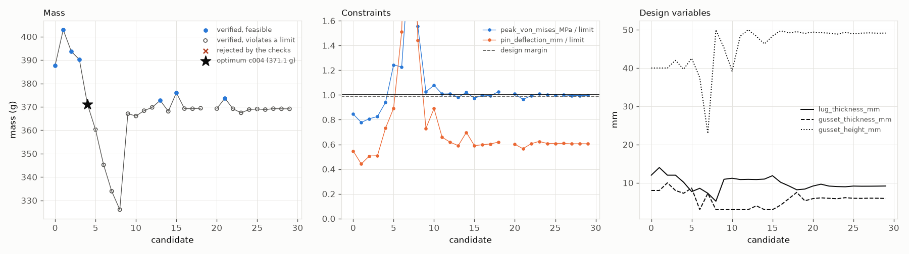

The overall verification status of an optimisation run rests on the optimum and the run-level checks; mesh convergence at the optimum is a separate confirmation case.

## Summary across points

| Point | REQ-C1 | REQ-C2 | Checks |
|---|---|---|---|
| c000 | 84.53 MPa: **PASS** | 0.05471 mm: **PASS** | 6/6 PASS |
| c001 | 77.82 MPa: **PASS** | 0.04419 mm: **PASS** | 6/6 PASS |
| c002 | 80.78 MPa: **PASS** | 0.05064 mm: **PASS** | 6/6 PASS |
| c003 | 82.56 MPa: **PASS** | 0.05088 mm: **PASS** | 6/6 PASS |
| c004 | 93.97 MPa: **PASS** | 0.07313 mm: **PASS** | 6/6 PASS |
| c005 | 124.3 MPa: **FAIL** | 0.08923 mm: **PASS** | 6/6 PASS |
| c006 | 122.7 MPa: **FAIL** | 0.1511 mm: **FAIL** | 6/6 PASS |
| c007 | 214.1 MPa: **FAIL** | 0.3644 mm: **FAIL** | 7/7 PASS |
| c008 | 155.4 MPa: **FAIL** | 0.1443 mm: **FAIL** | 6/6 PASS |
| c009 | 102.5 MPa: **FAIL** | 0.07303 mm: **PASS** | 6/6 PASS |
| c010 | 107.9 MPa: **FAIL** | 0.08898 mm: **PASS** | 6/6 PASS |
| c011 | 100.8 MPa: **FAIL** | 0.06584 mm: **PASS** | 6/6 PASS |
| c012 | 100.9 MPa: **FAIL** | 0.0618 mm: **PASS** | 6/6 PASS |
| c013 | 98.22 MPa: **PASS** | 0.05904 mm: **PASS** | 6/6 PASS |
| c014 | 102.1 MPa: **FAIL** | 0.06978 mm: **PASS** | 6/6 PASS |
| c015 | 97.34 MPa: **PASS** | 0.05897 mm: **PASS** | 6/6 PASS |
| c016 | 99.91 MPa: **PASS** | 0.05982 mm: **PASS** | 6/6 PASS |
| c017 | 99.47 MPa: **PASS** | 0.06037 mm: **PASS** | 6/6 PASS |
| c018 | 102.7 MPa: **FAIL** | 0.062 mm: **PASS** | 6/6 PASS |
| c019 | - MPa: **NO RESULT** | - mm: **NO RESULT** | 0/0 NOT_RUN |
| c020 | 101 MPa: **FAIL** | 0.06012 mm: **PASS** | 6/6 PASS |
| c021 | 96.36 MPa: **PASS** | 0.05656 mm: **PASS** | 6/6 PASS |
| c022 | 99.33 MPa: **PASS** | 0.06053 mm: **PASS** | 6/6 PASS |
| c023 | 100.9 MPa: **FAIL** | 0.06244 mm: **PASS** | 6/6 PASS |
| c024 | 100.4 MPa: **FAIL** | 0.06078 mm: **PASS** | 6/6 PASS |
| c025 | 99.93 MPa: **PASS** | 0.06081 mm: **PASS** | 6/6 PASS |
| c026 | 100.1 MPa: **FAIL** | 0.06086 mm: **PASS** | 6/6 PASS |
| c027 | 99.5 MPa: **PASS** | 0.06047 mm: **PASS** | 6/6 PASS |
| c028 | 99.54 MPa: **PASS** | 0.06057 mm: **PASS** | 6/6 PASS |
| c029 | 99.68 MPa: **PASS** | 0.06052 mm: **PASS** | 6/6 PASS |

## Run-level checks

Checks that use several points together (for example mesh convergence).

| Check | Description | Value | Tolerance | Status |
|---|---|---|---|---|
| optimum_found | a verified candidate meets every requirement with the design margin (1 = none) | 0 | 0.5 | PASS |
| optimizer_converged | COBYLA met its final trust-region radius within the evaluation limit (1 = no) | 0 | 0.5 | PASS |

## Point details

### c000

Parameters: base_length_mm = 100, base_width_mm = 100, base_thickness_mm = 10, lug_radius_mm = 20, pin_height_mm = 70, pin_diameter_mm = 16, lug_thickness_mm = 12, gusset_thickness_mm = 8, gusset_height_mm = 40, gusset_aspect = 0.7, fillet_radius_mm = 3, youngs_modulus_MPa = 6.89e+04, poisson_ratio = 0.33, density_t_per_mm3 = 2.7e-09, yield_strength_MPa = 276, load_x_N = 1500, load_y_N = 1000, load_z_N = 4500, element_size_mm = 4

Derived: gusset_reach_mm = 37, load_magnitude_N = 4848

| Requirement | Result | Limit | Margin | Verdict | Evidence |
|---|---|---|---|---|---|
| REQ-C1 | 84.53 MPa | <= 100 | 15.5 | **PASS** | [point.json](points/c000/point.json) |
| REQ-C2 | 0.05471 mm | <= 0.1 | 0.0453 | **PASS** | [point.json](points/c000/point.json) |

| Check | Description | Value | Tolerance | Status |
|---|---|---|---|---|
| cad_valid | CadQuery B-rep is a valid solid (1 = no) | 0.00e+00 | 5e-01 | PASS |
| mesh_volume | |meshed volume (straight-sided tets) - CAD volume| / CAD volume | 7.18e-04 | 2e-03 | PASS |
| force_balance | |sum of base reactions + pin load| / |pin load| | 1.39e-09 | 1e-06 | PASS |
| moment_balance | |moment of the base reactions + moment of the pin load| about the origin / (|F| x pin height) (the load acts where intended) | 5.16e-08 | 1e-06 | PASS |
| linear_material (validity) | peak von Mises / yield strength | 3.06e-01 | 1e+00 | PASS |
| small_deflection (validity) | pin deflection / pin height | 7.82e-04 | 1e-02 | PASS |

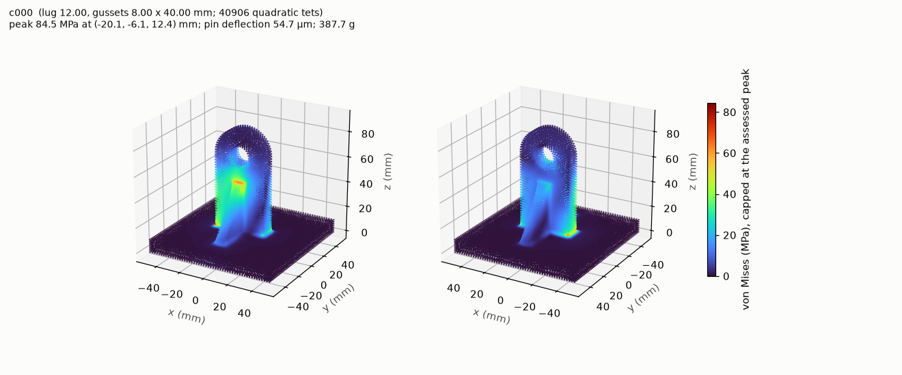

### c001

Parameters: base_length_mm = 100, base_width_mm = 100, base_thickness_mm = 10, lug_radius_mm = 20, pin_height_mm = 70, pin_diameter_mm = 16, lug_thickness_mm = 14, gusset_thickness_mm = 8, gusset_height_mm = 40, gusset_aspect = 0.7, fillet_radius_mm = 3, youngs_modulus_MPa = 6.89e+04, poisson_ratio = 0.33, density_t_per_mm3 = 2.7e-09, yield_strength_MPa = 276, load_x_N = 1500, load_y_N = 1000, load_z_N = 4500, element_size_mm = 4

Derived: gusset_reach_mm = 38, load_magnitude_N = 4848

| Requirement | Result | Limit | Margin | Verdict | Evidence |
|---|---|---|---|---|---|
| REQ-C1 | 77.82 MPa | <= 100 | 22.2 | **PASS** | [point.json](points/c001/point.json) |
| REQ-C2 | 0.04419 mm | <= 0.1 | 0.0558 | **PASS** | [point.json](points/c001/point.json) |

| Check | Description | Value | Tolerance | Status |
|---|---|---|---|---|
| cad_valid | CadQuery B-rep is a valid solid (1 = no) | 0.00e+00 | 5e-01 | PASS |
| mesh_volume | |meshed volume (straight-sided tets) - CAD volume| / CAD volume | 7.25e-04 | 2e-03 | PASS |
| force_balance | |sum of base reactions + pin load| / |pin load| | 2.33e-09 | 1e-06 | PASS |
| moment_balance | |moment of the base reactions + moment of the pin load| about the origin / (|F| x pin height) (the load acts where intended) | 1.90e-08 | 1e-06 | PASS |
| linear_material (validity) | peak von Mises / yield strength | 2.82e-01 | 1e+00 | PASS |
| small_deflection (validity) | pin deflection / pin height | 6.31e-04 | 1e-02 | PASS |

### c002

Parameters: base_length_mm = 100, base_width_mm = 100, base_thickness_mm = 10, lug_radius_mm = 20, pin_height_mm = 70, pin_diameter_mm = 16, lug_thickness_mm = 12, gusset_thickness_mm = 10, gusset_height_mm = 40, gusset_aspect = 0.7, fillet_radius_mm = 3, youngs_modulus_MPa = 6.89e+04, poisson_ratio = 0.33, density_t_per_mm3 = 2.7e-09, yield_strength_MPa = 276, load_x_N = 1500, load_y_N = 1000, load_z_N = 4500, element_size_mm = 4

Derived: gusset_reach_mm = 37, load_magnitude_N = 4848

| Requirement | Result | Limit | Margin | Verdict | Evidence |
|---|---|---|---|---|---|
| REQ-C1 | 80.78 MPa | <= 100 | 19.2 | **PASS** | [point.json](points/c002/point.json) |
| REQ-C2 | 0.05064 mm | <= 0.1 | 0.0494 | **PASS** | [point.json](points/c002/point.json) |

| Check | Description | Value | Tolerance | Status |
|---|---|---|---|---|
| cad_valid | CadQuery B-rep is a valid solid (1 = no) | 0.00e+00 | 5e-01 | PASS |
| mesh_volume | |meshed volume (straight-sided tets) - CAD volume| / CAD volume | 7.05e-04 | 2e-03 | PASS |
| force_balance | |sum of base reactions + pin load| / |pin load| | 1.19e-08 | 1e-06 | PASS |
| moment_balance | |moment of the base reactions + moment of the pin load| about the origin / (|F| x pin height) (the load acts where intended) | 5.02e-08 | 1e-06 | PASS |
| linear_material (validity) | peak von Mises / yield strength | 2.93e-01 | 1e+00 | PASS |
| small_deflection (validity) | pin deflection / pin height | 7.23e-04 | 1e-02 | PASS |

### c003

Parameters: base_length_mm = 100, base_width_mm = 100, base_thickness_mm = 10, lug_radius_mm = 20, pin_height_mm = 70, pin_diameter_mm = 16, lug_thickness_mm = 12, gusset_thickness_mm = 8, gusset_height_mm = 42, gusset_aspect = 0.7, fillet_radius_mm = 3, youngs_modulus_MPa = 6.89e+04, poisson_ratio = 0.33, density_t_per_mm3 = 2.7e-09, yield_strength_MPa = 276, load_x_N = 1500, load_y_N = 1000, load_z_N = 4500, element_size_mm = 4

Derived: gusset_reach_mm = 38.4, load_magnitude_N = 4848

| Requirement | Result | Limit | Margin | Verdict | Evidence |
|---|---|---|---|---|---|
| REQ-C1 | 82.56 MPa | <= 100 | 17.4 | **PASS** | [point.json](points/c003/point.json) |
| REQ-C2 | 0.05088 mm | <= 0.1 | 0.0491 | **PASS** | [point.json](points/c003/point.json) |

| Check | Description | Value | Tolerance | Status |
|---|---|---|---|---|
| cad_valid | CadQuery B-rep is a valid solid (1 = no) | 0.00e+00 | 5e-01 | PASS |
| mesh_volume | |meshed volume (straight-sided tets) - CAD volume| / CAD volume | 7.10e-04 | 2e-03 | PASS |
| force_balance | |sum of base reactions + pin load| / |pin load| | 2.97e-09 | 1e-06 | PASS |
| moment_balance | |moment of the base reactions + moment of the pin load| about the origin / (|F| x pin height) (the load acts where intended) | 2.87e-08 | 1e-06 | PASS |
| linear_material (validity) | peak von Mises / yield strength | 2.99e-01 | 1e+00 | PASS |
| small_deflection (validity) | pin deflection / pin height | 7.27e-04 | 1e-02 | PASS |

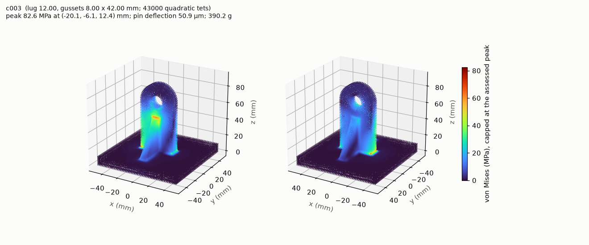

### c004

Parameters: base_length_mm = 100, base_width_mm = 100, base_thickness_mm = 10, lug_radius_mm = 20, pin_height_mm = 70, pin_diameter_mm = 16, lug_thickness_mm = 10.16, gusset_thickness_mm = 7.275, gusset_height_mm = 39.69, gusset_aspect = 0.7, fillet_radius_mm = 3, youngs_modulus_MPa = 6.89e+04, poisson_ratio = 0.33, density_t_per_mm3 = 2.7e-09, yield_strength_MPa = 276, load_x_N = 1500, load_y_N = 1000, load_z_N = 4500, element_size_mm = 4

Derived: gusset_reach_mm = 35.87, load_magnitude_N = 4848

| Requirement | Result | Limit | Margin | Verdict | Evidence |
|---|---|---|---|---|---|
| REQ-C1 | 93.97 MPa | <= 100 | 6.03 | **PASS** | [point.json](points/c004/point.json) |
| REQ-C2 | 0.07313 mm | <= 0.1 | 0.0269 | **PASS** | [point.json](points/c004/point.json) |

| Check | Description | Value | Tolerance | Status |
|---|---|---|---|---|
| cad_valid | CadQuery B-rep is a valid solid (1 = no) | 0.00e+00 | 5e-01 | PASS |
| mesh_volume | |meshed volume (straight-sided tets) - CAD volume| / CAD volume | 6.79e-04 | 2e-03 | PASS |
| force_balance | |sum of base reactions + pin load| / |pin load| | 1.42e-08 | 1e-06 | PASS |
| moment_balance | |moment of the base reactions + moment of the pin load| about the origin / (|F| x pin height) (the load acts where intended) | 2.66e-08 | 1e-06 | PASS |
| linear_material (validity) | peak von Mises / yield strength | 3.40e-01 | 1e+00 | PASS |
| small_deflection (validity) | pin deflection / pin height | 1.04e-03 | 1e-02 | PASS |

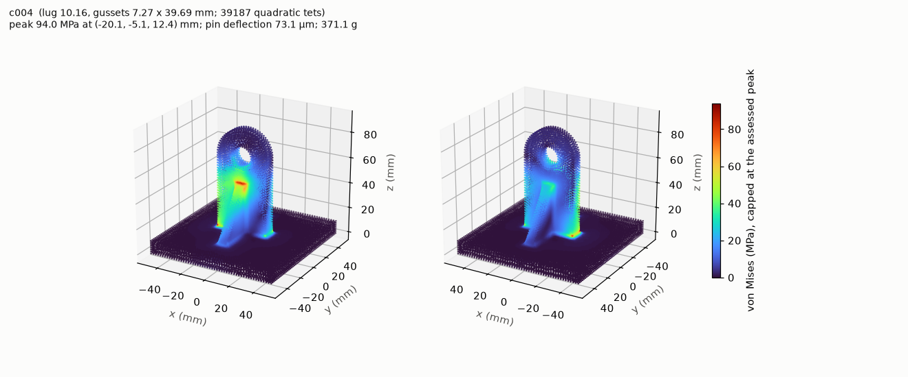

### c005

Parameters: base_length_mm = 100, base_width_mm = 100, base_thickness_mm = 10, lug_radius_mm = 20, pin_height_mm = 70, pin_diameter_mm = 16, lug_thickness_mm = 7.707, gusset_thickness_mm = 8.632, gusset_height_mm = 42.55, gusset_aspect = 0.7, fillet_radius_mm = 3, youngs_modulus_MPa = 6.89e+04, poisson_ratio = 0.33, density_t_per_mm3 = 2.7e-09, yield_strength_MPa = 276, load_x_N = 1500, load_y_N = 1000, load_z_N = 4500, element_size_mm = 4

Derived: gusset_reach_mm = 36.64, load_magnitude_N = 4848

| Requirement | Result | Limit | Margin | Verdict | Evidence |
|---|---|---|---|---|---|
| REQ-C1 | 124.3 MPa | <= 100 | -24.3 | **FAIL** | [point.json](points/c005/point.json) |
| REQ-C2 | 0.08923 mm | <= 0.1 | 0.0108 | **PASS** | [point.json](points/c005/point.json) |

| Check | Description | Value | Tolerance | Status |
|---|---|---|---|---|
| cad_valid | CadQuery B-rep is a valid solid (1 = no) | 0.00e+00 | 5e-01 | PASS |
| mesh_volume | |meshed volume (straight-sided tets) - CAD volume| / CAD volume | 5.64e-04 | 2e-03 | PASS |
| force_balance | |sum of base reactions + pin load| / |pin load| | 6.28e-09 | 1e-06 | PASS |
| moment_balance | |moment of the base reactions + moment of the pin load| about the origin / (|F| x pin height) (the load acts where intended) | 2.28e-08 | 1e-06 | PASS |
| linear_material (validity) | peak von Mises / yield strength | 4.50e-01 | 1e+00 | PASS |
| small_deflection (validity) | pin deflection / pin height | 1.27e-03 | 1e-02 | PASS |

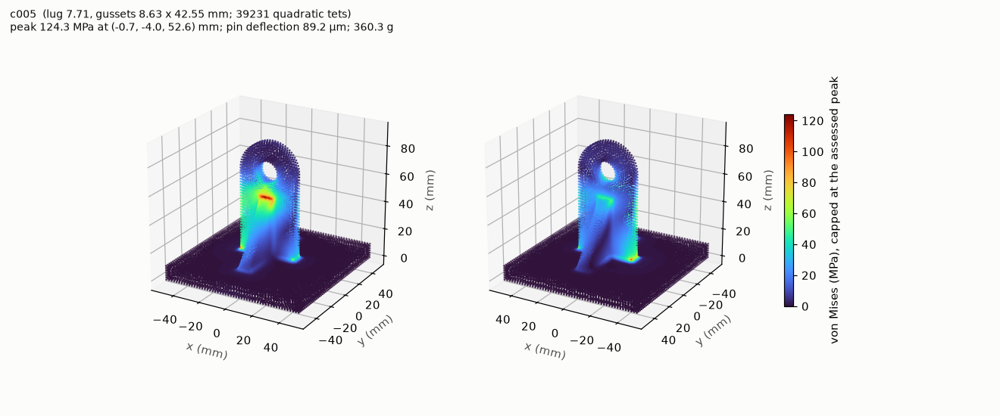

### c006

Parameters: base_length_mm = 100, base_width_mm = 100, base_thickness_mm = 10, lug_radius_mm = 20, pin_height_mm = 70, pin_diameter_mm = 16, lug_thickness_mm = 8.578, gusset_thickness_mm = 3, gusset_height_mm = 37.48, gusset_aspect = 0.7, fillet_radius_mm = 3, youngs_modulus_MPa = 6.89e+04, poisson_ratio = 0.33, density_t_per_mm3 = 2.7e-09, yield_strength_MPa = 276, load_x_N = 1500, load_y_N = 1000, load_z_N = 4500, element_size_mm = 4

Derived: gusset_reach_mm = 33.53, load_magnitude_N = 4848

| Requirement | Result | Limit | Margin | Verdict | Evidence |
|---|---|---|---|---|---|
| REQ-C1 | 122.7 MPa | <= 100 | -22.7 | **FAIL** | [point.json](points/c006/point.json) |
| REQ-C2 | 0.1511 mm | <= 0.1 | -0.0511 | **FAIL** | [point.json](points/c006/point.json) |

| Check | Description | Value | Tolerance | Status |
|---|---|---|---|---|
| cad_valid | CadQuery B-rep is a valid solid (1 = no) | 0.00e+00 | 5e-01 | PASS |
| mesh_volume | |meshed volume (straight-sided tets) - CAD volume| / CAD volume | 6.62e-04 | 2e-03 | PASS |
| force_balance | |sum of base reactions + pin load| / |pin load| | 1.44e-08 | 1e-06 | PASS |
| moment_balance | |moment of the base reactions + moment of the pin load| about the origin / (|F| x pin height) (the load acts where intended) | 3.42e-08 | 1e-06 | PASS |
| linear_material (validity) | peak von Mises / yield strength | 4.44e-01 | 1e+00 | PASS |
| small_deflection (validity) | pin deflection / pin height | 2.16e-03 | 1e-02 | PASS |

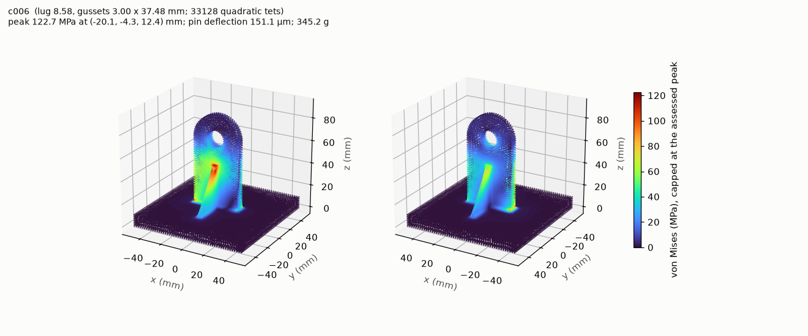

### c007

Parameters: base_length_mm = 100, base_width_mm = 100, base_thickness_mm = 10, lug_radius_mm = 20, pin_height_mm = 70, pin_diameter_mm = 16, lug_thickness_mm = 7.277, gusset_thickness_mm = 7.247, gusset_height_mm = 22.9, gusset_aspect = 0.7, fillet_radius_mm = 3, youngs_modulus_MPa = 6.89e+04, poisson_ratio = 0.33, density_t_per_mm3 = 2.7e-09, yield_strength_MPa = 276, load_x_N = 1500, load_y_N = 1000, load_z_N = 4500, element_size_mm = 4

Derived: gusset_reach_mm = 22.67, load_magnitude_N = 4848

| Requirement | Result | Limit | Margin | Verdict | Evidence |
|---|---|---|---|---|---|
| REQ-C1 | 214.1 MPa | <= 100 | -114 | **FAIL** | [point.json](points/c007/point.json) |
| REQ-C2 | 0.3644 mm | <= 0.1 | -0.264 | **FAIL** | [point.json](points/c007/point.json) |

| Check | Description | Value | Tolerance | Status |
|---|---|---|---|---|
| cad_valid | CadQuery B-rep is a valid solid (1 = no) | 0.00e+00 | 5e-01 | PASS |
| mesh_volume | |meshed volume (straight-sided tets) - CAD volume| / CAD volume | 4.19e-04 | 2e-03 | PASS |
| force_balance | |sum of base reactions + pin load| / |pin load| | 5.62e-09 | 1e-06 | PASS |
| moment_balance | |moment of the base reactions + moment of the pin load| about the origin / (|F| x pin height) (the load acts where intended) | 3.05e-08 | 1e-06 | PASS |
| lug_section_reference | max |sigma_zz FE - beam theory| / max |beam| at the lug section corners, z = 48.9 mm (model form) | 6.23e-02 | 1e-01 | PASS |
| linear_material (validity) | peak von Mises / yield strength | 7.76e-01 | 1e+00 | PASS |
| small_deflection (validity) | pin deflection / pin height | 5.21e-03 | 1e-02 | PASS |

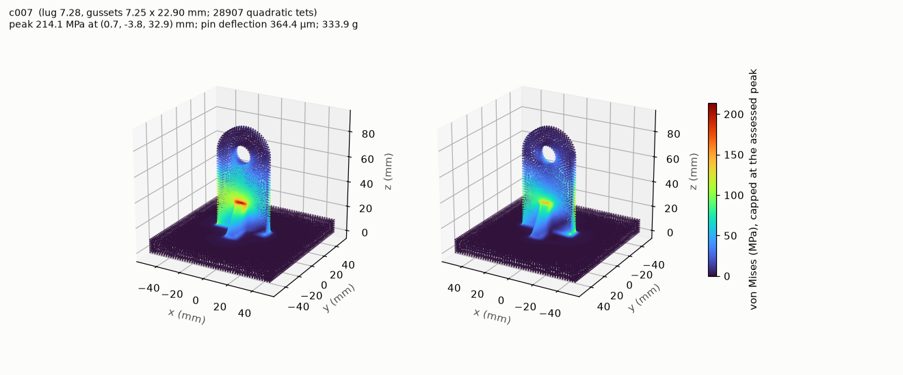

### c008

Parameters: base_length_mm = 100, base_width_mm = 100, base_thickness_mm = 10, lug_radius_mm = 20, pin_height_mm = 70, pin_diameter_mm = 16, lug_thickness_mm = 5.203, gusset_thickness_mm = 3, gusset_height_mm = 50, gusset_aspect = 0.7, fillet_radius_mm = 3, youngs_modulus_MPa = 6.89e+04, poisson_ratio = 0.33, density_t_per_mm3 = 2.7e-09, yield_strength_MPa = 276, load_x_N = 1500, load_y_N = 1000, load_z_N = 4500, element_size_mm = 4

Derived: gusset_reach_mm = 40.6, load_magnitude_N = 4848

| Requirement | Result | Limit | Margin | Verdict | Evidence |
|---|---|---|---|---|---|
| REQ-C1 | 155.4 MPa | <= 100 | -55.4 | **FAIL** | [point.json](points/c008/point.json) |
| REQ-C2 | 0.1443 mm | <= 0.1 | -0.0443 | **FAIL** | [point.json](points/c008/point.json) |

| Check | Description | Value | Tolerance | Status |
|---|---|---|---|---|
| cad_valid | CadQuery B-rep is a valid solid (1 = no) | 0.00e+00 | 5e-01 | PASS |
| mesh_volume | |meshed volume (straight-sided tets) - CAD volume| / CAD volume | 7.69e-04 | 2e-03 | PASS |
| force_balance | |sum of base reactions + pin load| / |pin load| | 4.96e-09 | 1e-06 | PASS |
| moment_balance | |moment of the base reactions + moment of the pin load| about the origin / (|F| x pin height) (the load acts where intended) | 5.64e-08 | 1e-06 | PASS |
| linear_material (validity) | peak von Mises / yield strength | 5.63e-01 | 1e+00 | PASS |
| small_deflection (validity) | pin deflection / pin height | 2.06e-03 | 1e-02 | PASS |

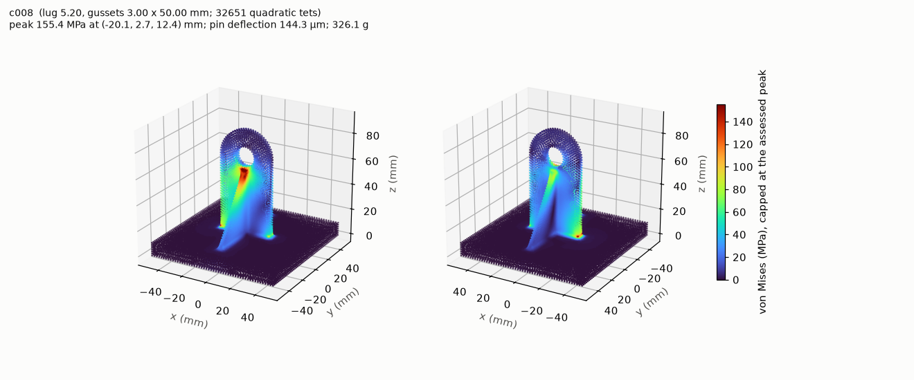

### c009

Parameters: base_length_mm = 100, base_width_mm = 100, base_thickness_mm = 10, lug_radius_mm = 20, pin_height_mm = 70, pin_diameter_mm = 16, lug_thickness_mm = 10.92, gusset_thickness_mm = 3, gusset_height_mm = 45.26, gusset_aspect = 0.7, fillet_radius_mm = 3, youngs_modulus_MPa = 6.89e+04, poisson_ratio = 0.33, density_t_per_mm3 = 2.7e-09, yield_strength_MPa = 276, load_x_N = 1500, load_y_N = 1000, load_z_N = 4500, element_size_mm = 4

Derived: gusset_reach_mm = 40.14, load_magnitude_N = 4848

| Requirement | Result | Limit | Margin | Verdict | Evidence |
|---|---|---|---|---|---|
| REQ-C1 | 102.5 MPa | <= 100 | -2.52 | **FAIL** | [point.json](points/c009/point.json) |
| REQ-C2 | 0.07303 mm | <= 0.1 | 0.027 | **PASS** | [point.json](points/c009/point.json) |

| Check | Description | Value | Tolerance | Status |
|---|---|---|---|---|
| cad_valid | CadQuery B-rep is a valid solid (1 = no) | 0.00e+00 | 5e-01 | PASS |
| mesh_volume | |meshed volume (straight-sided tets) - CAD volume| / CAD volume | 7.71e-04 | 2e-03 | PASS |
| force_balance | |sum of base reactions + pin load| / |pin load| | 2.03e-09 | 1e-06 | PASS |
| moment_balance | |moment of the base reactions + moment of the pin load| about the origin / (|F| x pin height) (the load acts where intended) | 5.00e-08 | 1e-06 | PASS |
| linear_material (validity) | peak von Mises / yield strength | 3.71e-01 | 1e+00 | PASS |
| small_deflection (validity) | pin deflection / pin height | 1.04e-03 | 1e-02 | PASS |

### c010

Parameters: base_length_mm = 100, base_width_mm = 100, base_thickness_mm = 10, lug_radius_mm = 20, pin_height_mm = 70, pin_diameter_mm = 16, lug_thickness_mm = 11.2, gusset_thickness_mm = 3, gusset_height_mm = 39.17, gusset_aspect = 0.7, fillet_radius_mm = 3, youngs_modulus_MPa = 6.89e+04, poisson_ratio = 0.33, density_t_per_mm3 = 2.7e-09, yield_strength_MPa = 276, load_x_N = 1500, load_y_N = 1000, load_z_N = 4500, element_size_mm = 4

Derived: gusset_reach_mm = 36.02, load_magnitude_N = 4848

| Requirement | Result | Limit | Margin | Verdict | Evidence |
|---|---|---|---|---|---|
| REQ-C1 | 107.9 MPa | <= 100 | -7.88 | **FAIL** | [point.json](points/c010/point.json) |
| REQ-C2 | 0.08898 mm | <= 0.1 | 0.011 | **PASS** | [point.json](points/c010/point.json) |

| Check | Description | Value | Tolerance | Status |
|---|---|---|---|---|
| cad_valid | CadQuery B-rep is a valid solid (1 = no) | 0.00e+00 | 5e-01 | PASS |
| mesh_volume | |meshed volume (straight-sided tets) - CAD volume| / CAD volume | 7.07e-04 | 2e-03 | PASS |
| force_balance | |sum of base reactions + pin load| / |pin load| | 1.25e-08 | 1e-06 | PASS |
| moment_balance | |moment of the base reactions + moment of the pin load| about the origin / (|F| x pin height) (the load acts where intended) | 3.09e-08 | 1e-06 | PASS |
| linear_material (validity) | peak von Mises / yield strength | 3.91e-01 | 1e+00 | PASS |
| small_deflection (validity) | pin deflection / pin height | 1.27e-03 | 1e-02 | PASS |

### c011

Parameters: base_length_mm = 100, base_width_mm = 100, base_thickness_mm = 10, lug_radius_mm = 20, pin_height_mm = 70, pin_diameter_mm = 16, lug_thickness_mm = 10.87, gusset_thickness_mm = 3, gusset_height_mm = 48.3, gusset_aspect = 0.7, fillet_radius_mm = 3, youngs_modulus_MPa = 6.89e+04, poisson_ratio = 0.33, density_t_per_mm3 = 2.7e-09, yield_strength_MPa = 276, load_x_N = 1500, load_y_N = 1000, load_z_N = 4500, element_size_mm = 4

Derived: gusset_reach_mm = 42.24, load_magnitude_N = 4848

| Requirement | Result | Limit | Margin | Verdict | Evidence |
|---|---|---|---|---|---|
| REQ-C1 | 100.8 MPa | <= 100 | -0.785 | **FAIL** | [point.json](points/c011/point.json) |
| REQ-C2 | 0.06584 mm | <= 0.1 | 0.0342 | **PASS** | [point.json](points/c011/point.json) |

| Check | Description | Value | Tolerance | Status |
|---|---|---|---|---|
| cad_valid | CadQuery B-rep is a valid solid (1 = no) | 0.00e+00 | 5e-01 | PASS |
| mesh_volume | |meshed volume (straight-sided tets) - CAD volume| / CAD volume | 7.65e-04 | 2e-03 | PASS |
| force_balance | |sum of base reactions + pin load| / |pin load| | 5.83e-09 | 1e-06 | PASS |
| moment_balance | |moment of the base reactions + moment of the pin load| about the origin / (|F| x pin height) (the load acts where intended) | 5.12e-08 | 1e-06 | PASS |
| linear_material (validity) | peak von Mises / yield strength | 3.65e-01 | 1e+00 | PASS |
| small_deflection (validity) | pin deflection / pin height | 9.41e-04 | 1e-02 | PASS |

### c012

Parameters: base_length_mm = 100, base_width_mm = 100, base_thickness_mm = 10, lug_radius_mm = 20, pin_height_mm = 70, pin_diameter_mm = 16, lug_thickness_mm = 10.92, gusset_thickness_mm = 3, gusset_height_mm = 50, gusset_aspect = 0.7, fillet_radius_mm = 3, youngs_modulus_MPa = 6.89e+04, poisson_ratio = 0.33, density_t_per_mm3 = 2.7e-09, yield_strength_MPa = 276, load_x_N = 1500, load_y_N = 1000, load_z_N = 4500, element_size_mm = 4

Derived: gusset_reach_mm = 43.46, load_magnitude_N = 4848

| Requirement | Result | Limit | Margin | Verdict | Evidence |
|---|---|---|---|---|---|
| REQ-C1 | 100.9 MPa | <= 100 | -0.907 | **FAIL** | [point.json](points/c012/point.json) |
| REQ-C2 | 0.0618 mm | <= 0.1 | 0.0382 | **PASS** | [point.json](points/c012/point.json) |

| Check | Description | Value | Tolerance | Status |
|---|---|---|---|---|
| cad_valid | CadQuery B-rep is a valid solid (1 = no) | 0.00e+00 | 5e-01 | PASS |
| mesh_volume | |meshed volume (straight-sided tets) - CAD volume| / CAD volume | 8.15e-04 | 2e-03 | PASS |
| force_balance | |sum of base reactions + pin load| / |pin load| | 1.84e-08 | 1e-06 | PASS |
| moment_balance | |moment of the base reactions + moment of the pin load| about the origin / (|F| x pin height) (the load acts where intended) | 2.24e-08 | 1e-06 | PASS |
| linear_material (validity) | peak von Mises / yield strength | 3.66e-01 | 1e+00 | PASS |
| small_deflection (validity) | pin deflection / pin height | 8.83e-04 | 1e-02 | PASS |

### c013

Parameters: base_length_mm = 100, base_width_mm = 100, base_thickness_mm = 10, lug_radius_mm = 20, pin_height_mm = 70, pin_diameter_mm = 16, lug_thickness_mm = 10.87, gusset_thickness_mm = 4, gusset_height_mm = 48.3, gusset_aspect = 0.7, fillet_radius_mm = 3, youngs_modulus_MPa = 6.89e+04, poisson_ratio = 0.33, density_t_per_mm3 = 2.7e-09, yield_strength_MPa = 276, load_x_N = 1500, load_y_N = 1000, load_z_N = 4500, element_size_mm = 4

Derived: gusset_reach_mm = 42.24, load_magnitude_N = 4848

| Requirement | Result | Limit | Margin | Verdict | Evidence |
|---|---|---|---|---|---|
| REQ-C1 | 98.22 MPa | <= 100 | 1.78 | **PASS** | [point.json](points/c013/point.json) |
| REQ-C2 | 0.05904 mm | <= 0.1 | 0.041 | **PASS** | [point.json](points/c013/point.json) |

| Check | Description | Value | Tolerance | Status |
|---|---|---|---|---|
| cad_valid | CadQuery B-rep is a valid solid (1 = no) | 0.00e+00 | 5e-01 | PASS |
| mesh_volume | |meshed volume (straight-sided tets) - CAD volume| / CAD volume | 7.66e-04 | 2e-03 | PASS |
| force_balance | |sum of base reactions + pin load| / |pin load| | 2.48e-08 | 1e-06 | PASS |
| moment_balance | |moment of the base reactions + moment of the pin load| about the origin / (|F| x pin height) (the load acts where intended) | 4.97e-08 | 1e-06 | PASS |
| linear_material (validity) | peak von Mises / yield strength | 3.56e-01 | 1e+00 | PASS |
| small_deflection (validity) | pin deflection / pin height | 8.43e-04 | 1e-02 | PASS |

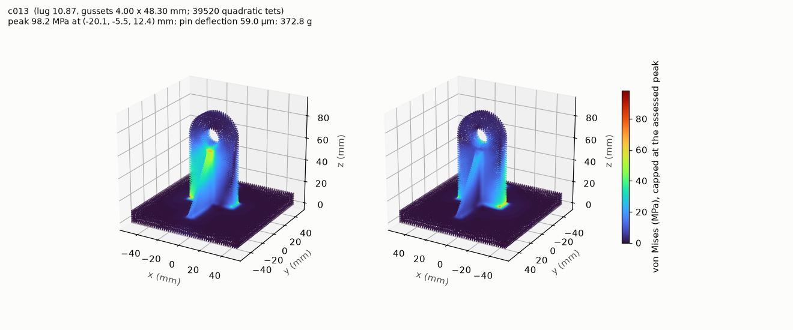

### c014

Parameters: base_length_mm = 100, base_width_mm = 100, base_thickness_mm = 10, lug_radius_mm = 20, pin_height_mm = 70, pin_diameter_mm = 16, lug_thickness_mm = 10.98, gusset_thickness_mm = 3, gusset_height_mm = 46.31, gusset_aspect = 0.7, fillet_radius_mm = 3, youngs_modulus_MPa = 6.89e+04, poisson_ratio = 0.33, density_t_per_mm3 = 2.7e-09, yield_strength_MPa = 276, load_x_N = 1500, load_y_N = 1000, load_z_N = 4500, element_size_mm = 4

Derived: gusset_reach_mm = 40.9, load_magnitude_N = 4848

| Requirement | Result | Limit | Margin | Verdict | Evidence |
|---|---|---|---|---|---|
| REQ-C1 | 102.1 MPa | <= 100 | -2.07 | **FAIL** | [point.json](points/c014/point.json) |
| REQ-C2 | 0.06978 mm | <= 0.1 | 0.0302 | **PASS** | [point.json](points/c014/point.json) |

| Check | Description | Value | Tolerance | Status |
|---|---|---|---|---|
| cad_valid | CadQuery B-rep is a valid solid (1 = no) | 0.00e+00 | 5e-01 | PASS |
| mesh_volume | |meshed volume (straight-sided tets) - CAD volume| / CAD volume | 7.79e-04 | 2e-03 | PASS |
| force_balance | |sum of base reactions + pin load| / |pin load| | 3.51e-09 | 1e-06 | PASS |
| moment_balance | |moment of the base reactions + moment of the pin load| about the origin / (|F| x pin height) (the load acts where intended) | 2.86e-08 | 1e-06 | PASS |
| linear_material (validity) | peak von Mises / yield strength | 3.70e-01 | 1e+00 | PASS |
| small_deflection (validity) | pin deflection / pin height | 9.97e-04 | 1e-02 | PASS |

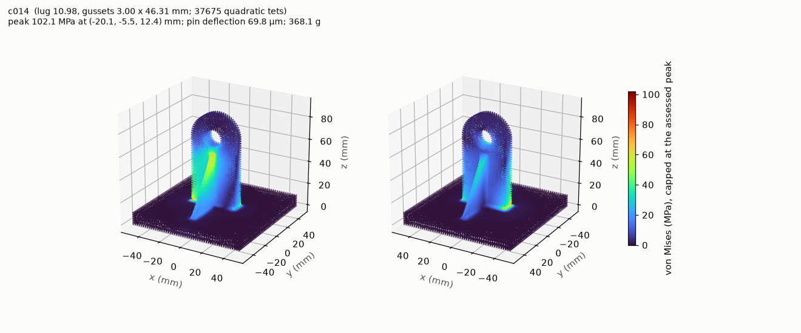

### c015

Parameters: base_length_mm = 100, base_width_mm = 100, base_thickness_mm = 10, lug_radius_mm = 20, pin_height_mm = 70, pin_diameter_mm = 16, lug_thickness_mm = 11.86, gusset_thickness_mm = 3, gusset_height_mm = 48.36, gusset_aspect = 0.7, fillet_radius_mm = 3, youngs_modulus_MPa = 6.89e+04, poisson_ratio = 0.33, density_t_per_mm3 = 2.7e-09, yield_strength_MPa = 276, load_x_N = 1500, load_y_N = 1000, load_z_N = 4500, element_size_mm = 4

Derived: gusset_reach_mm = 42.78, load_magnitude_N = 4848

| Requirement | Result | Limit | Margin | Verdict | Evidence |
|---|---|---|---|---|---|
| REQ-C1 | 97.34 MPa | <= 100 | 2.66 | **PASS** | [point.json](points/c015/point.json) |
| REQ-C2 | 0.05897 mm | <= 0.1 | 0.041 | **PASS** | [point.json](points/c015/point.json) |

| Check | Description | Value | Tolerance | Status |
|---|---|---|---|---|
| cad_valid | CadQuery B-rep is a valid solid (1 = no) | 0.00e+00 | 5e-01 | PASS |
| mesh_volume | |meshed volume (straight-sided tets) - CAD volume| / CAD volume | 7.85e-04 | 2e-03 | PASS |
| force_balance | |sum of base reactions + pin load| / |pin load| | 8.92e-09 | 1e-06 | PASS |
| moment_balance | |moment of the base reactions + moment of the pin load| about the origin / (|F| x pin height) (the load acts where intended) | 3.20e-08 | 1e-06 | PASS |
| linear_material (validity) | peak von Mises / yield strength | 3.53e-01 | 1e+00 | PASS |
| small_deflection (validity) | pin deflection / pin height | 8.42e-04 | 1e-02 | PASS |

### c016

Parameters: base_length_mm = 100, base_width_mm = 100, base_thickness_mm = 10, lug_radius_mm = 20, pin_height_mm = 70, pin_diameter_mm = 16, lug_thickness_mm = 10.16, gusset_thickness_mm = 4.163, gusset_height_mm = 49.77, gusset_aspect = 0.7, fillet_radius_mm = 3, youngs_modulus_MPa = 6.89e+04, poisson_ratio = 0.33, density_t_per_mm3 = 2.7e-09, yield_strength_MPa = 276, load_x_N = 1500, load_y_N = 1000, load_z_N = 4500, element_size_mm = 4

Derived: gusset_reach_mm = 42.92, load_magnitude_N = 4848

| Requirement | Result | Limit | Margin | Verdict | Evidence |
|---|---|---|---|---|---|
| REQ-C1 | 99.91 MPa | <= 100 | 0.0908 | **PASS** | [point.json](points/c016/point.json) |
| REQ-C2 | 0.05982 mm | <= 0.1 | 0.0402 | **PASS** | [point.json](points/c016/point.json) |

| Check | Description | Value | Tolerance | Status |
|---|---|---|---|---|
| cad_valid | CadQuery B-rep is a valid solid (1 = no) | 0.00e+00 | 5e-01 | PASS |
| mesh_volume | |meshed volume (straight-sided tets) - CAD volume| / CAD volume | 7.62e-04 | 2e-03 | PASS |
| force_balance | |sum of base reactions + pin load| / |pin load| | 1.29e-08 | 1e-06 | PASS |
| moment_balance | |moment of the base reactions + moment of the pin load| about the origin / (|F| x pin height) (the load acts where intended) | 2.95e-08 | 1e-06 | PASS |
| linear_material (validity) | peak von Mises / yield strength | 3.62e-01 | 1e+00 | PASS |
| small_deflection (validity) | pin deflection / pin height | 8.55e-04 | 1e-02 | PASS |

### c017

Parameters: base_length_mm = 100, base_width_mm = 100, base_thickness_mm = 10, lug_radius_mm = 20, pin_height_mm = 70, pin_diameter_mm = 16, lug_thickness_mm = 9.223, gusset_thickness_mm = 5.827, gusset_height_mm = 49.17, gusset_aspect = 0.7, fillet_radius_mm = 3, youngs_modulus_MPa = 6.89e+04, poisson_ratio = 0.33, density_t_per_mm3 = 2.7e-09, yield_strength_MPa = 276, load_x_N = 1500, load_y_N = 1000, load_z_N = 4500, element_size_mm = 4

Derived: gusset_reach_mm = 42.03, load_magnitude_N = 4848

| Requirement | Result | Limit | Margin | Verdict | Evidence |
|---|---|---|---|---|---|
| REQ-C1 | 99.47 MPa | <= 100 | 0.527 | **PASS** | [point.json](points/c017/point.json) |
| REQ-C2 | 0.06037 mm | <= 0.1 | 0.0396 | **PASS** | [point.json](points/c017/point.json) |

| Check | Description | Value | Tolerance | Status |
|---|---|---|---|---|
| cad_valid | CadQuery B-rep is a valid solid (1 = no) | 0.00e+00 | 5e-01 | PASS |
| mesh_volume | |meshed volume (straight-sided tets) - CAD volume| / CAD volume | 7.80e-04 | 2e-03 | PASS |
| force_balance | |sum of base reactions + pin load| / |pin load| | 1.15e-08 | 1e-06 | PASS |
| moment_balance | |moment of the base reactions + moment of the pin load| about the origin / (|F| x pin height) (the load acts where intended) | 5.48e-08 | 1e-06 | PASS |
| linear_material (validity) | peak von Mises / yield strength | 3.60e-01 | 1e+00 | PASS |
| small_deflection (validity) | pin deflection / pin height | 8.62e-04 | 1e-02 | PASS |

### c018

Parameters: base_length_mm = 100, base_width_mm = 100, base_thickness_mm = 10, lug_radius_mm = 20, pin_height_mm = 70, pin_diameter_mm = 16, lug_thickness_mm = 8.187, gusset_thickness_mm = 7.506, gusset_height_mm = 49.49, gusset_aspect = 0.7, fillet_radius_mm = 3, youngs_modulus_MPa = 6.89e+04, poisson_ratio = 0.33, density_t_per_mm3 = 2.7e-09, yield_strength_MPa = 276, load_x_N = 1500, load_y_N = 1000, load_z_N = 4500, element_size_mm = 4

Derived: gusset_reach_mm = 41.74, load_magnitude_N = 4848

| Requirement | Result | Limit | Margin | Verdict | Evidence |
|---|---|---|---|---|---|
| REQ-C1 | 102.7 MPa | <= 100 | -2.74 | **FAIL** | [point.json](points/c018/point.json) |
| REQ-C2 | 0.062 mm | <= 0.1 | 0.038 | **PASS** | [point.json](points/c018/point.json) |

| Check | Description | Value | Tolerance | Status |
|---|---|---|---|---|
| cad_valid | CadQuery B-rep is a valid solid (1 = no) | 0.00e+00 | 5e-01 | PASS |
| mesh_volume | |meshed volume (straight-sided tets) - CAD volume| / CAD volume | 7.32e-04 | 2e-03 | PASS |
| force_balance | |sum of base reactions + pin load| / |pin load| | 4.93e-09 | 1e-06 | PASS |
| moment_balance | |moment of the base reactions + moment of the pin load| about the origin / (|F| x pin height) (the load acts where intended) | 2.18e-08 | 1e-06 | PASS |
| linear_material (validity) | peak von Mises / yield strength | 3.72e-01 | 1e+00 | PASS |
| small_deflection (validity) | pin deflection / pin height | 8.86e-04 | 1e-02 | PASS |

### c019

Parameters: base_length_mm = 100, base_width_mm = 100, base_thickness_mm = 10, lug_radius_mm = 20, pin_height_mm = 70, pin_diameter_mm = 16, lug_thickness_mm = 8.373, gusset_thickness_mm = 5.312, gusset_height_mm = 49.06, gusset_aspect = 0.7, fillet_radius_mm = 3, youngs_modulus_MPa = 6.89e+04, poisson_ratio = 0.33, density_t_per_mm3 = 2.7e-09, yield_strength_MPa = 276, load_x_N = 1500, load_y_N = 1000, load_z_N = 4500, element_size_mm = 4

Derived: gusset_reach_mm = 41.53, load_magnitude_N = 4848

| Requirement | Result | Limit | Margin | Verdict | Evidence |
|---|---|---|---|---|---|
| REQ-C1 | - MPa | <= 100 | - | **NO RESULT** | [point.json](points/c019/point.json) |
| REQ-C2 | - mm | <= 0.1 | - | **NO RESULT** | [point.json](points/c019/point.json) |

No verification checks recorded (status: NOT_RUN).

### c020

Parameters: base_length_mm = 100, base_width_mm = 100, base_thickness_mm = 10, lug_radius_mm = 20, pin_height_mm = 70, pin_diameter_mm = 16, lug_thickness_mm = 9.161, gusset_thickness_mm = 5.877, gusset_height_mm = 49.4, gusset_aspect = 0.7, fillet_radius_mm = 3, youngs_modulus_MPa = 6.89e+04, poisson_ratio = 0.33, density_t_per_mm3 = 2.7e-09, yield_strength_MPa = 276, load_x_N = 1500, load_y_N = 1000, load_z_N = 4500, element_size_mm = 4

Derived: gusset_reach_mm = 42.16, load_magnitude_N = 4848

| Requirement | Result | Limit | Margin | Verdict | Evidence |
|---|---|---|---|---|---|
| REQ-C1 | 101 MPa | <= 100 | -0.971 | **FAIL** | [point.json](points/c020/point.json) |
| REQ-C2 | 0.06012 mm | <= 0.1 | 0.0399 | **PASS** | [point.json](points/c020/point.json) |

| Check | Description | Value | Tolerance | Status |
|---|---|---|---|---|
| cad_valid | CadQuery B-rep is a valid solid (1 = no) | 0.00e+00 | 5e-01 | PASS |
| mesh_volume | |meshed volume (straight-sided tets) - CAD volume| / CAD volume | 7.39e-04 | 2e-03 | PASS |
| force_balance | |sum of base reactions + pin load| / |pin load| | 6.59e-09 | 1e-06 | PASS |
| moment_balance | |moment of the base reactions + moment of the pin load| about the origin / (|F| x pin height) (the load acts where intended) | 2.07e-08 | 1e-06 | PASS |
| linear_material (validity) | peak von Mises / yield strength | 3.66e-01 | 1e+00 | PASS |
| small_deflection (validity) | pin deflection / pin height | 8.59e-04 | 1e-02 | PASS |

### c021

Parameters: base_length_mm = 100, base_width_mm = 100, base_thickness_mm = 10, lug_radius_mm = 20, pin_height_mm = 70, pin_diameter_mm = 16, lug_thickness_mm = 9.647, gusset_thickness_mm = 6.085, gusset_height_mm = 49.22, gusset_aspect = 0.7, fillet_radius_mm = 3, youngs_modulus_MPa = 6.89e+04, poisson_ratio = 0.33, density_t_per_mm3 = 2.7e-09, yield_strength_MPa = 276, load_x_N = 1500, load_y_N = 1000, load_z_N = 4500, element_size_mm = 4

Derived: gusset_reach_mm = 42.28, load_magnitude_N = 4848

| Requirement | Result | Limit | Margin | Verdict | Evidence |
|---|---|---|---|---|---|
| REQ-C1 | 96.36 MPa | <= 100 | 3.64 | **PASS** | [point.json](points/c021/point.json) |
| REQ-C2 | 0.05656 mm | <= 0.1 | 0.0434 | **PASS** | [point.json](points/c021/point.json) |

| Check | Description | Value | Tolerance | Status |
|---|---|---|---|---|
| cad_valid | CadQuery B-rep is a valid solid (1 = no) | 0.00e+00 | 5e-01 | PASS |
| mesh_volume | |meshed volume (straight-sided tets) - CAD volume| / CAD volume | 7.36e-04 | 2e-03 | PASS |
| force_balance | |sum of base reactions + pin load| / |pin load| | 1.09e-08 | 1e-06 | PASS |
| moment_balance | |moment of the base reactions + moment of the pin load| about the origin / (|F| x pin height) (the load acts where intended) | 2.04e-08 | 1e-06 | PASS |
| linear_material (validity) | peak von Mises / yield strength | 3.49e-01 | 1e+00 | PASS |
| small_deflection (validity) | pin deflection / pin height | 8.08e-04 | 1e-02 | PASS |

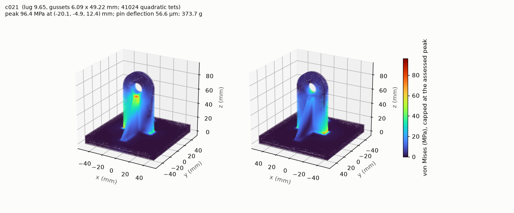

### c022

Parameters: base_length_mm = 100, base_width_mm = 100, base_thickness_mm = 10, lug_radius_mm = 20, pin_height_mm = 70, pin_diameter_mm = 16, lug_thickness_mm = 9.149, gusset_thickness_mm = 5.958, gusset_height_mm = 49.12, gusset_aspect = 0.7, fillet_radius_mm = 3, youngs_modulus_MPa = 6.89e+04, poisson_ratio = 0.33, density_t_per_mm3 = 2.7e-09, yield_strength_MPa = 276, load_x_N = 1500, load_y_N = 1000, load_z_N = 4500, element_size_mm = 4

Derived: gusset_reach_mm = 41.96, load_magnitude_N = 4848

| Requirement | Result | Limit | Margin | Verdict | Evidence |
|---|---|---|---|---|---|
| REQ-C1 | 99.33 MPa | <= 100 | 0.666 | **PASS** | [point.json](points/c022/point.json) |
| REQ-C2 | 0.06053 mm | <= 0.1 | 0.0395 | **PASS** | [point.json](points/c022/point.json) |

| Check | Description | Value | Tolerance | Status |
|---|---|---|---|---|
| cad_valid | CadQuery B-rep is a valid solid (1 = no) | 0.00e+00 | 5e-01 | PASS |
| mesh_volume | |meshed volume (straight-sided tets) - CAD volume| / CAD volume | 7.98e-04 | 2e-03 | PASS |
| force_balance | |sum of base reactions + pin load| / |pin load| | 1.07e-08 | 1e-06 | PASS |
| moment_balance | |moment of the base reactions + moment of the pin load| about the origin / (|F| x pin height) (the load acts where intended) | 5.62e-08 | 1e-06 | PASS |
| linear_material (validity) | peak von Mises / yield strength | 3.60e-01 | 1e+00 | PASS |
| small_deflection (validity) | pin deflection / pin height | 8.65e-04 | 1e-02 | PASS |

### c023

Parameters: base_length_mm = 100, base_width_mm = 100, base_thickness_mm = 10, lug_radius_mm = 20, pin_height_mm = 70, pin_diameter_mm = 16, lug_thickness_mm = 9.029, gusset_thickness_mm = 5.844, gusset_height_mm = 48.85, gusset_aspect = 0.7, fillet_radius_mm = 3, youngs_modulus_MPa = 6.89e+04, poisson_ratio = 0.33, density_t_per_mm3 = 2.7e-09, yield_strength_MPa = 276, load_x_N = 1500, load_y_N = 1000, load_z_N = 4500, element_size_mm = 4

Derived: gusset_reach_mm = 41.71, load_magnitude_N = 4848

| Requirement | Result | Limit | Margin | Verdict | Evidence |
|---|---|---|---|---|---|
| REQ-C1 | 100.9 MPa | <= 100 | -0.896 | **FAIL** | [point.json](points/c023/point.json) |
| REQ-C2 | 0.06244 mm | <= 0.1 | 0.0376 | **PASS** | [point.json](points/c023/point.json) |

| Check | Description | Value | Tolerance | Status |
|---|---|---|---|---|
| cad_valid | CadQuery B-rep is a valid solid (1 = no) | 0.00e+00 | 5e-01 | PASS |
| mesh_volume | |meshed volume (straight-sided tets) - CAD volume| / CAD volume | 7.22e-04 | 2e-03 | PASS |
| force_balance | |sum of base reactions + pin load| / |pin load| | 9.63e-09 | 1e-06 | PASS |
| moment_balance | |moment of the base reactions + moment of the pin load| about the origin / (|F| x pin height) (the load acts where intended) | 5.43e-08 | 1e-06 | PASS |
| linear_material (validity) | peak von Mises / yield strength | 3.66e-01 | 1e+00 | PASS |
| small_deflection (validity) | pin deflection / pin height | 8.92e-04 | 1e-02 | PASS |

### c024

Parameters: base_length_mm = 100, base_width_mm = 100, base_thickness_mm = 10, lug_radius_mm = 20, pin_height_mm = 70, pin_diameter_mm = 16, lug_thickness_mm = 8.973, gusset_thickness_mm = 6.127, gusset_height_mm = 49.32, gusset_aspect = 0.7, fillet_radius_mm = 3, youngs_modulus_MPa = 6.89e+04, poisson_ratio = 0.33, density_t_per_mm3 = 2.7e-09, yield_strength_MPa = 276, load_x_N = 1500, load_y_N = 1000, load_z_N = 4500, element_size_mm = 4

Derived: gusset_reach_mm = 42.01, load_magnitude_N = 4848

| Requirement | Result | Limit | Margin | Verdict | Evidence |
|---|---|---|---|---|---|
| REQ-C1 | 100.4 MPa | <= 100 | -0.361 | **FAIL** | [point.json](points/c024/point.json) |
| REQ-C2 | 0.06078 mm | <= 0.1 | 0.0392 | **PASS** | [point.json](points/c024/point.json) |

| Check | Description | Value | Tolerance | Status |
|---|---|---|---|---|
| cad_valid | CadQuery B-rep is a valid solid (1 = no) | 0.00e+00 | 5e-01 | PASS |
| mesh_volume | |meshed volume (straight-sided tets) - CAD volume| / CAD volume | 7.41e-04 | 2e-03 | PASS |
| force_balance | |sum of base reactions + pin load| / |pin load| | 2.57e-09 | 1e-06 | PASS |
| moment_balance | |moment of the base reactions + moment of the pin load| about the origin / (|F| x pin height) (the load acts where intended) | 5.92e-08 | 1e-06 | PASS |
| linear_material (validity) | peak von Mises / yield strength | 3.64e-01 | 1e+00 | PASS |
| small_deflection (validity) | pin deflection / pin height | 8.68e-04 | 1e-02 | PASS |

### c025

Parameters: base_length_mm = 100, base_width_mm = 100, base_thickness_mm = 10, lug_radius_mm = 20, pin_height_mm = 70, pin_diameter_mm = 16, lug_thickness_mm = 9.153, gusset_thickness_mm = 5.97, gusset_height_mm = 48.96, gusset_aspect = 0.7, fillet_radius_mm = 3, youngs_modulus_MPa = 6.89e+04, poisson_ratio = 0.33, density_t_per_mm3 = 2.7e-09, yield_strength_MPa = 276, load_x_N = 1500, load_y_N = 1000, load_z_N = 4500, element_size_mm = 4

Derived: gusset_reach_mm = 41.85, load_magnitude_N = 4848

| Requirement | Result | Limit | Margin | Verdict | Evidence |
|---|---|---|---|---|---|
| REQ-C1 | 99.93 MPa | <= 100 | 0.0658 | **PASS** | [point.json](points/c025/point.json) |
| REQ-C2 | 0.06081 mm | <= 0.1 | 0.0392 | **PASS** | [point.json](points/c025/point.json) |

| Check | Description | Value | Tolerance | Status |
|---|---|---|---|---|
| cad_valid | CadQuery B-rep is a valid solid (1 = no) | 0.00e+00 | 5e-01 | PASS |
| mesh_volume | |meshed volume (straight-sided tets) - CAD volume| / CAD volume | 7.54e-04 | 2e-03 | PASS |
| force_balance | |sum of base reactions + pin load| / |pin load| | 1.05e-08 | 1e-06 | PASS |
| moment_balance | |moment of the base reactions + moment of the pin load| about the origin / (|F| x pin height) (the load acts where intended) | 2.87e-08 | 1e-06 | PASS |
| linear_material (validity) | peak von Mises / yield strength | 3.62e-01 | 1e+00 | PASS |
| small_deflection (validity) | pin deflection / pin height | 8.69e-04 | 1e-02 | PASS |

### c026

Parameters: base_length_mm = 100, base_width_mm = 100, base_thickness_mm = 10, lug_radius_mm = 20, pin_height_mm = 70, pin_diameter_mm = 16, lug_thickness_mm = 9.115, gusset_thickness_mm = 5.938, gusset_height_mm = 49.12, gusset_aspect = 0.7, fillet_radius_mm = 3, youngs_modulus_MPa = 6.89e+04, poisson_ratio = 0.33, density_t_per_mm3 = 2.7e-09, yield_strength_MPa = 276, load_x_N = 1500, load_y_N = 1000, load_z_N = 4500, element_size_mm = 4

Derived: gusset_reach_mm = 41.94, load_magnitude_N = 4848

| Requirement | Result | Limit | Margin | Verdict | Evidence |
|---|---|---|---|---|---|
| REQ-C1 | 100.1 MPa | <= 100 | -0.076 | **FAIL** | [point.json](points/c026/point.json) |
| REQ-C2 | 0.06086 mm | <= 0.1 | 0.0391 | **PASS** | [point.json](points/c026/point.json) |

| Check | Description | Value | Tolerance | Status |
|---|---|---|---|---|
| cad_valid | CadQuery B-rep is a valid solid (1 = no) | 0.00e+00 | 5e-01 | PASS |
| mesh_volume | |meshed volume (straight-sided tets) - CAD volume| / CAD volume | 7.40e-04 | 2e-03 | PASS |
| force_balance | |sum of base reactions + pin load| / |pin load| | 1.42e-08 | 1e-06 | PASS |
| moment_balance | |moment of the base reactions + moment of the pin load| about the origin / (|F| x pin height) (the load acts where intended) | 2.97e-08 | 1e-06 | PASS |
| linear_material (validity) | peak von Mises / yield strength | 3.63e-01 | 1e+00 | PASS |
| small_deflection (validity) | pin deflection / pin height | 8.69e-04 | 1e-02 | PASS |

### c027

Parameters: base_length_mm = 100, base_width_mm = 100, base_thickness_mm = 10, lug_radius_mm = 20, pin_height_mm = 70, pin_diameter_mm = 16, lug_thickness_mm = 9.121, gusset_thickness_mm = 5.998, gusset_height_mm = 49.18, gusset_aspect = 0.7, fillet_radius_mm = 3, youngs_modulus_MPa = 6.89e+04, poisson_ratio = 0.33, density_t_per_mm3 = 2.7e-09, yield_strength_MPa = 276, load_x_N = 1500, load_y_N = 1000, load_z_N = 4500, element_size_mm = 4

Derived: gusset_reach_mm = 41.99, load_magnitude_N = 4848

| Requirement | Result | Limit | Margin | Verdict | Evidence |
|---|---|---|---|---|---|
| REQ-C1 | 99.5 MPa | <= 100 | 0.501 | **PASS** | [point.json](points/c027/point.json) |
| REQ-C2 | 0.06047 mm | <= 0.1 | 0.0395 | **PASS** | [point.json](points/c027/point.json) |

| Check | Description | Value | Tolerance | Status |
|---|---|---|---|---|
| cad_valid | CadQuery B-rep is a valid solid (1 = no) | 0.00e+00 | 5e-01 | PASS |
| mesh_volume | |meshed volume (straight-sided tets) - CAD volume| / CAD volume | 7.46e-04 | 2e-03 | PASS |
| force_balance | |sum of base reactions + pin load| / |pin load| | 1.02e-08 | 1e-06 | PASS |
| moment_balance | |moment of the base reactions + moment of the pin load| about the origin / (|F| x pin height) (the load acts where intended) | 2.74e-08 | 1e-06 | PASS |
| linear_material (validity) | peak von Mises / yield strength | 3.61e-01 | 1e+00 | PASS |
| small_deflection (validity) | pin deflection / pin height | 8.64e-04 | 1e-02 | PASS |

### c028

Parameters: base_length_mm = 100, base_width_mm = 100, base_thickness_mm = 10, lug_radius_mm = 20, pin_height_mm = 70, pin_diameter_mm = 16, lug_thickness_mm = 9.14, gusset_thickness_mm = 5.976, gusset_height_mm = 49.1, gusset_aspect = 0.7, fillet_radius_mm = 3, youngs_modulus_MPa = 6.89e+04, poisson_ratio = 0.33, density_t_per_mm3 = 2.7e-09, yield_strength_MPa = 276, load_x_N = 1500, load_y_N = 1000, load_z_N = 4500, element_size_mm = 4

Derived: gusset_reach_mm = 41.94, load_magnitude_N = 4848

| Requirement | Result | Limit | Margin | Verdict | Evidence |
|---|---|---|---|---|---|
| REQ-C1 | 99.54 MPa | <= 100 | 0.458 | **PASS** | [point.json](points/c028/point.json) |
| REQ-C2 | 0.06057 mm | <= 0.1 | 0.0394 | **PASS** | [point.json](points/c028/point.json) |

| Check | Description | Value | Tolerance | Status |
|---|---|---|---|---|
| cad_valid | CadQuery B-rep is a valid solid (1 = no) | 0.00e+00 | 5e-01 | PASS |
| mesh_volume | |meshed volume (straight-sided tets) - CAD volume| / CAD volume | 7.51e-04 | 2e-03 | PASS |
| force_balance | |sum of base reactions + pin load| / |pin load| | 6.33e-09 | 1e-06 | PASS |
| moment_balance | |moment of the base reactions + moment of the pin load| about the origin / (|F| x pin height) (the load acts where intended) | 2.76e-08 | 1e-06 | PASS |
| linear_material (validity) | peak von Mises / yield strength | 3.61e-01 | 1e+00 | PASS |
| small_deflection (validity) | pin deflection / pin height | 8.65e-04 | 1e-02 | PASS |

### c029

Parameters: base_length_mm = 100, base_width_mm = 100, base_thickness_mm = 10, lug_radius_mm = 20, pin_height_mm = 70, pin_diameter_mm = 16, lug_thickness_mm = 9.169, gusset_thickness_mm = 5.914, gusset_height_mm = 49.13, gusset_aspect = 0.7, fillet_radius_mm = 3, youngs_modulus_MPa = 6.89e+04, poisson_ratio = 0.33, density_t_per_mm3 = 2.7e-09, yield_strength_MPa = 276, load_x_N = 1500, load_y_N = 1000, load_z_N = 4500, element_size_mm = 4

Derived: gusset_reach_mm = 41.98, load_magnitude_N = 4848

| Requirement | Result | Limit | Margin | Verdict | Evidence |
|---|---|---|---|---|---|
| REQ-C1 | 99.68 MPa | <= 100 | 0.318 | **PASS** | [point.json](points/c029/point.json) |
| REQ-C2 | 0.06052 mm | <= 0.1 | 0.0395 | **PASS** | [point.json](points/c029/point.json) |

| Check | Description | Value | Tolerance | Status |
|---|---|---|---|---|
| cad_valid | CadQuery B-rep is a valid solid (1 = no) | 0.00e+00 | 5e-01 | PASS |
| mesh_volume | |meshed volume (straight-sided tets) - CAD volume| / CAD volume | 7.74e-04 | 2e-03 | PASS |
| force_balance | |sum of base reactions + pin load| / |pin load| | 7.03e-09 | 1e-06 | PASS |
| moment_balance | |moment of the base reactions + moment of the pin load| about the origin / (|F| x pin height) (the load acts where intended) | 5.56e-08 | 1e-06 | PASS |
| linear_material (validity) | peak von Mises / yield strength | 3.61e-01 | 1e+00 | PASS |
| small_deflection (validity) | pin deflection / pin height | 8.65e-04 | 1e-02 | PASS |

## Limitations

- Static load only; the fatigue rating is folded into the allowable.
- No closed-form reference for the whole part: the evidence is exact equilibrium, geometry fidelity, a model-form check of the lug section and mesh convergence at the optimum.
- Fixed outline and fillet radius; only three dimensions vary.
- No physical test data.
- A converged solver run that matches an analytical reference shows that the equations were solved correctly. It does not show that the equations represent real hardware.

## Engineering acceptance

Pending human review. This report does not accept or reject the design.
