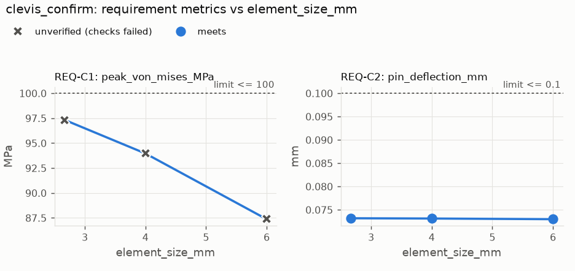
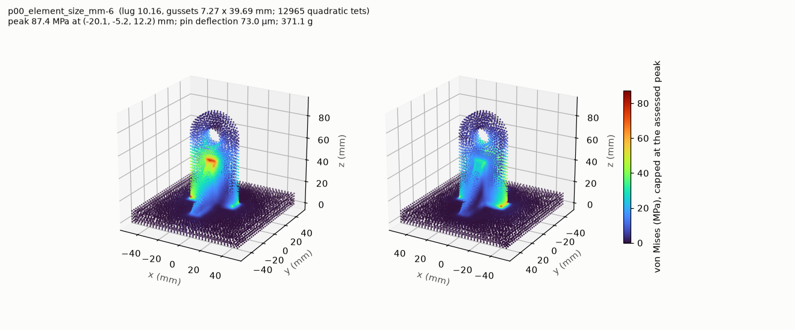
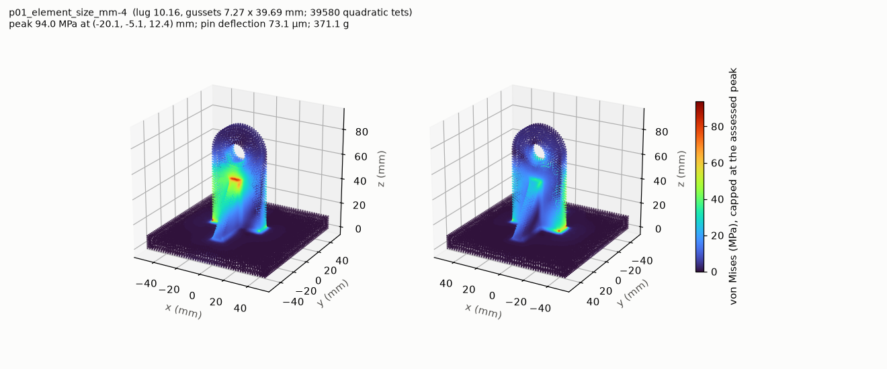
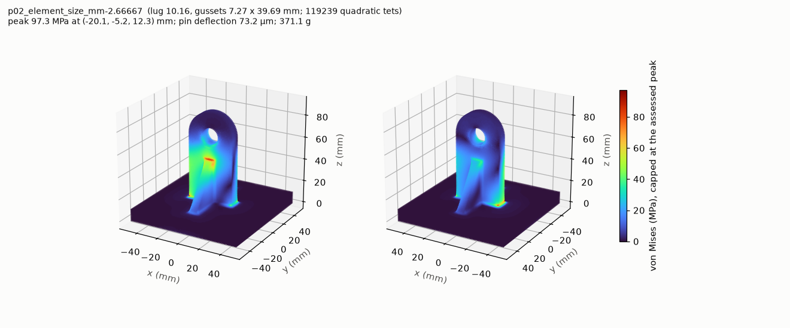

# Engineering review report: clevis_confirm

- **Run:** `20261121-004057_clevis_confirm`
- **Generated:** 2026-11-21T05:46:48+00:00
- **Case file SHA-256:** `01725991f4d890be21d4612fae6fe67b9fc312c24ddc919411e49c320df6d976`
- **Environment:** Python 3.14.10, numpy 2.5.5, scipy 1.18.1, matplotlib 3.11.2, cadquery 2.8.0; Windows-11-10.0.26100-SP0
- **Tools:** cadquery 2.8.0; gmsh 4.15.0; CalculiX This is Version 2.22
- **Code version:** git `3aec7102ab616c566b8736c844b9c13f41b73f3f` (uncommitted changes present)
- **Simulation status:** completed
- **Verification status:** FAIL

> **Warning:** verification did not pass for every point. Requirement verdicts marked *(unverified)* are not supported by evidence and must not be used for acceptance.

## Scope

Confirmation of the optimisation run 20261121-000013_clevis_opt: mesh study (6 / 4 / 2.67 mm quadratic tetrahedra, curvature refinement scaled with the element size) at the recommended design c004. Original problem: lightest 6061-T6 machined clevis bracket (base 100 x 100 x 10 mm, lug 40 mm wide with a 16 mm pin at 70 mm, two gussets, 3 mm fillets) under a (1.5, 1.0, 4.5) kN pin load, with peak von Mises at most 100 MPa and pin deflection at most 0.10 mm.

**Assumptions**

- Base bottom face fixed (bolted and dowelled to a rigid machine frame); the bottom half of the base is not assessed (the edge of a fixed face is singular, and the real joint is not modelled).
- Pin load through a rigid pin tied to the hole surface; a ring of one pin diameter around the hole is not assessed (pin bearing and lug net section are sized by the standard lug method).
- Linear elastic 6061-T6 (E 68.9 GPa, nu 0.33); checked: peak stress below yield.
- Small deflection; checked: pin deflection / pin height below 1 %.
- Stress allowable 100 MPa (fatigue-rated) and pin deflection limit 0.10 mm: synthetic.

## Requirements

| ID | Requirement | Metric | Limit |
|---|---|---|---|
| REQ-C1 | Peak von Mises stress (outside the fixed base layer and the pin ring) shall not exceed 100 MPa (fatigue-rated allowable). | `peak_von_mises_MPa` | <= 100 MPa |
| REQ-C2 | Pin deflection under the load shall not exceed 0.10 mm. | `pin_deflection_mm` | <= 0.1 mm |

## Summary across points

| Point | element_size_mm | REQ-C1 | REQ-C2 | Checks |
|---|---|---|---|---|
| p00_element_size_mm-6 | 6 | 87.38 MPa: **PASS (unverified)** | 0.07299 mm: **PASS** | 6/6 PASS |
| p01_element_size_mm-4 | 4 | 93.97 MPa: **PASS (unverified)** | 0.07314 mm: **PASS** | 6/6 PASS |
| p02_element_size_mm-2.66667 | 2.667 | 97.33 MPa: **PASS (unverified)** | 0.07319 mm: **PASS** | 6/6 PASS |

## Run-level checks

Checks that use several points together (for example mesh convergence).

| Check | Description | Value | Tolerance | Status |
|---|---|---|---|---|
| discretization_peak_von_mises_MPa | relative discretization uncertainty of peak_von_mises_MPa, monotone (R = 0.510): GCI_fine, observed order 1.66, extrapolated 100.839 | 0.045 | 0.01 | FAIL |
| requirement_margin_peak_von_mises_MPa | (finest peak_von_mises_MPa x (1 + uncertainty) - limit) / limit, must be <= 0 | 0.0172 | 0 | FAIL |
| discretization_pin_deflection_mm | relative discretization uncertainty of pin_deflection_mm, monotone (R = 0.384): GCI_fine, observed order 2.36, extrapolated 0.073225 | 0.000586 | 0.01 | PASS |
| requirement_margin_pin_deflection_mm | (finest pin_deflection_mm x (1 + uncertainty) - limit) / limit, must be <= 0 | -0.268 | 0 | PASS |

A failed run-level check withholds the verdicts of requirements on `peak_von_mises_MPa` at every point: they are marked *(unverified)* in the table above.

## Point details

### p00_element_size_mm-6

Parameters: base_length_mm = 100, base_width_mm = 100, base_thickness_mm = 10, lug_radius_mm = 20, pin_height_mm = 70, pin_diameter_mm = 16, lug_thickness_mm = 10.16, gusset_thickness_mm = 7.275, gusset_height_mm = 39.69, gusset_aspect = 0.7, fillet_radius_mm = 3, youngs_modulus_MPa = 6.89e+04, poisson_ratio = 0.33, density_t_per_mm3 = 2.7e-09, yield_strength_MPa = 276, load_x_N = 1500, load_y_N = 1000, load_z_N = 4500, element_size_mm = 6

Derived: gusset_reach_mm = 35.87, load_magnitude_N = 4848

| Requirement | Result | Limit | Margin | Verdict | Evidence |
|---|---|---|---|---|---|
| REQ-C1 | 87.38 MPa | <= 100 | 12.6 | **PASS (unverified)** | [point.json](points/p00_element_size_mm-6/point.json) |
| REQ-C2 | 0.07299 mm | <= 0.1 | 0.027 | **PASS** | [point.json](points/p00_element_size_mm-6/point.json) |

| Check | Description | Value | Tolerance | Status |
|---|---|---|---|---|
| cad_valid | CadQuery B-rep is a valid solid (1 = no) | 0.00e+00 | 5e-01 | PASS |
| mesh_volume | |meshed volume (straight-sided tets) - CAD volume| / CAD volume | 1.63e-03 | 2e-03 | PASS |
| force_balance | |sum of base reactions + pin load| / |pin load| | 1.38e-08 | 1e-06 | PASS |
| moment_balance | |moment of the base reactions + moment of the pin load| about the origin / (|F| x pin height) (the load acts where intended) | 6.14e-08 | 1e-06 | PASS |
| linear_material (validity) | peak von Mises / yield strength | 3.17e-01 | 1e+00 | PASS |
| small_deflection (validity) | pin deflection / pin height | 1.04e-03 | 1e-02 | PASS |

### p01_element_size_mm-4

Parameters: base_length_mm = 100, base_width_mm = 100, base_thickness_mm = 10, lug_radius_mm = 20, pin_height_mm = 70, pin_diameter_mm = 16, lug_thickness_mm = 10.16, gusset_thickness_mm = 7.275, gusset_height_mm = 39.69, gusset_aspect = 0.7, fillet_radius_mm = 3, youngs_modulus_MPa = 6.89e+04, poisson_ratio = 0.33, density_t_per_mm3 = 2.7e-09, yield_strength_MPa = 276, load_x_N = 1500, load_y_N = 1000, load_z_N = 4500, element_size_mm = 4

Derived: gusset_reach_mm = 35.87, load_magnitude_N = 4848

| Requirement | Result | Limit | Margin | Verdict | Evidence |
|---|---|---|---|---|---|
| REQ-C1 | 93.97 MPa | <= 100 | 6.03 | **PASS (unverified)** | [point.json](points/p01_element_size_mm-4/point.json) |
| REQ-C2 | 0.07314 mm | <= 0.1 | 0.0269 | **PASS** | [point.json](points/p01_element_size_mm-4/point.json) |

| Check | Description | Value | Tolerance | Status |
|---|---|---|---|---|
| cad_valid | CadQuery B-rep is a valid solid (1 = no) | 0.00e+00 | 5e-01 | PASS |
| mesh_volume | |meshed volume (straight-sided tets) - CAD volume| / CAD volume | 6.74e-04 | 2e-03 | PASS |
| force_balance | |sum of base reactions + pin load| / |pin load| | 6.16e-09 | 1e-06 | PASS |
| moment_balance | |moment of the base reactions + moment of the pin load| about the origin / (|F| x pin height) (the load acts where intended) | 2.83e-08 | 1e-06 | PASS |
| linear_material (validity) | peak von Mises / yield strength | 3.40e-01 | 1e+00 | PASS |
| small_deflection (validity) | pin deflection / pin height | 1.04e-03 | 1e-02 | PASS |

### p02_element_size_mm-2.66667

Parameters: base_length_mm = 100, base_width_mm = 100, base_thickness_mm = 10, lug_radius_mm = 20, pin_height_mm = 70, pin_diameter_mm = 16, lug_thickness_mm = 10.16, gusset_thickness_mm = 7.275, gusset_height_mm = 39.69, gusset_aspect = 0.7, fillet_radius_mm = 3, youngs_modulus_MPa = 6.89e+04, poisson_ratio = 0.33, density_t_per_mm3 = 2.7e-09, yield_strength_MPa = 276, load_x_N = 1500, load_y_N = 1000, load_z_N = 4500, element_size_mm = 2.667

Derived: gusset_reach_mm = 35.87, load_magnitude_N = 4848

| Requirement | Result | Limit | Margin | Verdict | Evidence |
|---|---|---|---|---|---|
| REQ-C1 | 97.33 MPa | <= 100 | 2.67 | **PASS (unverified)** | [point.json](points/p02_element_size_mm-2.66667/point.json) |
| REQ-C2 | 0.07319 mm | <= 0.1 | 0.0268 | **PASS** | [point.json](points/p02_element_size_mm-2.66667/point.json) |

| Check | Description | Value | Tolerance | Status |
|---|---|---|---|---|
| cad_valid | CadQuery B-rep is a valid solid (1 = no) | 0.00e+00 | 5e-01 | PASS |
| mesh_volume | |meshed volume (straight-sided tets) - CAD volume| / CAD volume | 3.41e-04 | 2e-03 | PASS |
| force_balance | |sum of base reactions + pin load| / |pin load| | 1.18e-09 | 1e-06 | PASS |
| moment_balance | |moment of the base reactions + moment of the pin load| about the origin / (|F| x pin height) (the load acts where intended) | 9.10e-09 | 1e-06 | PASS |
| linear_material (validity) | peak von Mises / yield strength | 3.53e-01 | 1e+00 | PASS |
| small_deflection (validity) | pin deflection / pin height | 1.05e-03 | 1e-02 | PASS |

## Limitations

- Static load only; the fatigue rating is folded into the allowable.
- No closed-form reference for the whole part: the evidence is exact equilibrium, geometry fidelity, a model-form check of the lug section and this mesh study.
- Fixed outline and fillet radius; only three dimensions vary.
- No physical test data.
- A converged solver run that matches an analytical reference shows that the equations were solved correctly. It does not show that the equations represent real hardware.

## Engineering acceptance

Pending human review. This report does not accept or reject the design.
