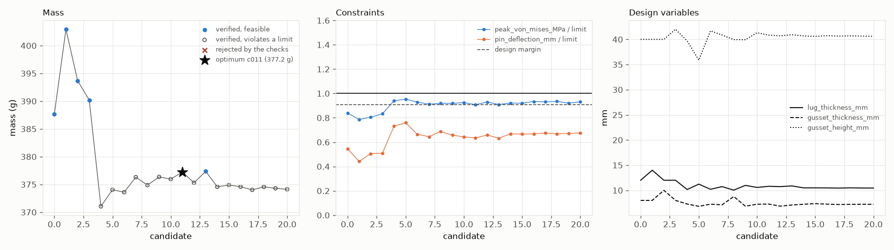
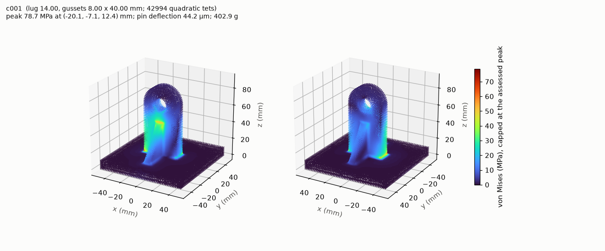
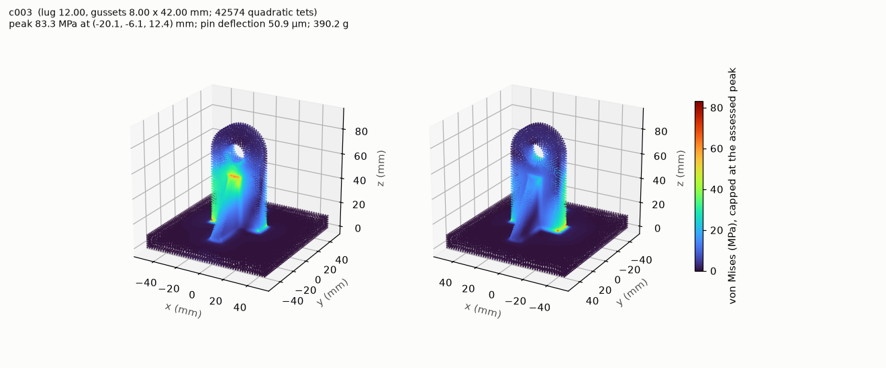
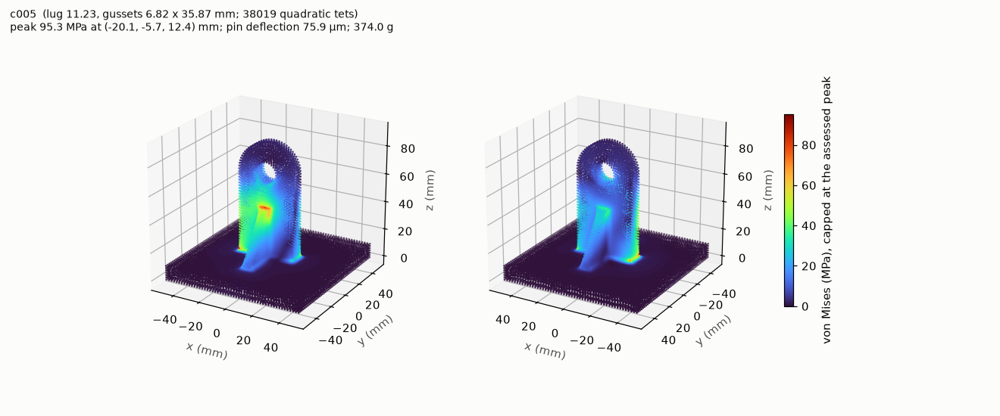
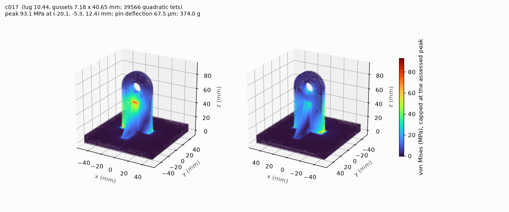
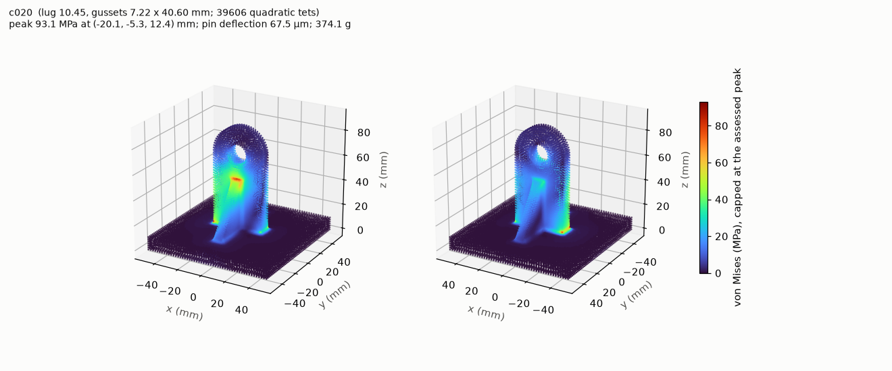

# Engineering review report: clevis_opt_r1

- **Run:** `20261121-004740_clevis_opt_r1`
- **Generated:** 2026-11-21T06:04:19+00:00
- **Case file SHA-256:** `4dfd0d792d0b116d8aa2a9ee849396e78ea9c5b27221962fe54f7f41e944166d`
- **Environment:** Python 3.14.10, numpy 2.5.5, scipy 1.18.1, matplotlib 3.11.2, cadquery 2.8.0; Windows-11-10.0.26100-SP0
- **Tools:** cadquery 2.8.0; gmsh 4.15.0; CalculiX This is Version 2.22
- **Code version:** git `3aec7102ab616c566b8736c844b9c13f41b73f3f` (uncommitted changes present)
- **Simulation status:** completed
- **Verification status:** PASS

## Scope

Lightest 6061-T6 machined clevis bracket (base 100 x 100 x 10 mm, lug 40 mm wide with a 16 mm pin at 70 mm, two gussets, 3 mm fillets) under a (1.5, 1.0, 4.5) kN pin load, with peak von Mises at most 100 MPa and pin deflection at most 0.10 mm; COBYLA over lug thickness, gusset thickness and gusset height, each candidate built in CadQuery, meshed in Gmsh, solved and checked in CalculiX.

**Assumptions**

- Base bottom face fixed (bolted and dowelled to a rigid machine frame); the bottom half of the base is not assessed (the edge of a fixed face is singular, and the real joint is not modelled).
- Pin load through a rigid pin tied to the hole surface; a ring of one pin diameter around the hole is not assessed (pin bearing and lug net section are sized by the standard lug method).
- Linear elastic 6061-T6 (E 68.9 GPa, nu 0.33); checked: peak stress below yield.
- Small deflection; checked: pin deflection / pin height below 1 %.
- Stress allowable 100 MPa (fatigue-rated) and pin deflection limit 0.10 mm: synthetic.

## Requirements

| ID | Requirement | Metric | Limit |
|---|---|---|---|
| REQ-C1 | Peak von Mises stress (outside the fixed base layer and the pin ring) shall not exceed 100 MPa (fatigue-rated allowable). | `peak_von_mises_MPa` | <= 100 MPa |
| REQ-C2 | Pin deflection under the load shall not exceed 0.10 mm. | `pin_deflection_mm` | <= 0.1 mm |

## Optimisation

- **Objective:** minimise `mass_g`; constraints are the requirements with a 9 % design margin.
- **Candidates evaluated:** 21 (optimiser: Return from COBYLA because the trust region radius reaches its lower bound.)
- **Rejected by the checks (treated as infeasible):** none
- **Optimum:** c011 (lug_thickness_mm = 10.8006, gusset_thickness_mm = 7.2686, gusset_height_mm = 40.8421); mass_g = 377.2419

The overall verification status of an optimisation run rests on the optimum and the run-level checks; mesh convergence at the optimum is a separate confirmation case.

## Summary across points

| Point | REQ-C1 | REQ-C2 | Checks |
|---|---|---|---|
| c000 | 83.96 MPa: **PASS** | 0.05471 mm: **PASS** | 6/6 PASS |
| c001 | 78.75 MPa: **PASS** | 0.04419 mm: **PASS** | 6/6 PASS |
| c002 | 80.45 MPa: **PASS** | 0.05064 mm: **PASS** | 6/6 PASS |
| c003 | 83.3 MPa: **PASS** | 0.05088 mm: **PASS** | 6/6 PASS |
| c004 | 93.97 MPa: **PASS** | 0.07314 mm: **PASS** | 6/6 PASS |
| c005 | 95.33 MPa: **PASS** | 0.07595 mm: **PASS** | 6/6 PASS |
| c006 | 92.88 MPa: **PASS** | 0.06647 mm: **PASS** | 6/6 PASS |
| c007 | 91.19 MPa: **PASS** | 0.06451 mm: **PASS** | 6/6 PASS |
| c008 | 91.95 MPa: **PASS** | 0.06875 mm: **PASS** | 6/6 PASS |
| c009 | 91.86 MPa: **PASS** | 0.06581 mm: **PASS** | 6/6 PASS |
| c010 | 92.54 MPa: **PASS** | 0.06428 mm: **PASS** | 6/6 PASS |
| c011 | 90.81 MPa: **PASS** | 0.06355 mm: **PASS** | 6/6 PASS |
| c012 | 92.97 MPa: **PASS** | 0.06585 mm: **PASS** | 6/6 PASS |
| c013 | 90.93 MPa: **PASS** | 0.06325 mm: **PASS** | 6/6 PASS |
| c014 | 92.18 MPa: **PASS** | 0.06683 mm: **PASS** | 6/6 PASS |
| c015 | 91.93 MPa: **PASS** | 0.06664 mm: **PASS** | 6/6 PASS |
| c016 | 93.45 MPa: **PASS** | 0.06676 mm: **PASS** | 6/6 PASS |
| c017 | 93.11 MPa: **PASS** | 0.06755 mm: **PASS** | 6/6 PASS |
| c018 | 93.51 MPa: **PASS** | 0.0668 mm: **PASS** | 6/6 PASS |
| c019 | 92.05 MPa: **PASS** | 0.06722 mm: **PASS** | 6/6 PASS |
| c020 | 93.09 MPa: **PASS** | 0.0675 mm: **PASS** | 6/6 PASS |

## Run-level checks

Checks that use several points together (for example mesh convergence).

| Check | Description | Value | Tolerance | Status |
|---|---|---|---|---|
| optimum_found | a verified candidate meets every requirement with the design margin (1 = none) | 0 | 0.5 | PASS |
| optimizer_converged | COBYLA met its final trust-region radius within the evaluation limit (1 = no) | 0 | 0.5 | PASS |

## Point details

### c000

Parameters: base_length_mm = 100, base_width_mm = 100, base_thickness_mm = 10, lug_radius_mm = 20, pin_height_mm = 70, pin_diameter_mm = 16, lug_thickness_mm = 12, gusset_thickness_mm = 8, gusset_height_mm = 40, gusset_aspect = 0.7, fillet_radius_mm = 3, youngs_modulus_MPa = 6.89e+04, poisson_ratio = 0.33, density_t_per_mm3 = 2.7e-09, yield_strength_MPa = 276, load_x_N = 1500, load_y_N = 1000, load_z_N = 4500, element_size_mm = 4

Derived: gusset_reach_mm = 37, load_magnitude_N = 4848

| Requirement | Result | Limit | Margin | Verdict | Evidence |
|---|---|---|---|---|---|
| REQ-C1 | 83.96 MPa | <= 100 | 16 | **PASS** | [point.json](points/c000/point.json) |
| REQ-C2 | 0.05471 mm | <= 0.1 | 0.0453 | **PASS** | [point.json](points/c000/point.json) |

| Check | Description | Value | Tolerance | Status |
|---|---|---|---|---|
| cad_valid | CadQuery B-rep is a valid solid (1 = no) | 0.00e+00 | 5e-01 | PASS |
| mesh_volume | |meshed volume (straight-sided tets) - CAD volume| / CAD volume | 7.03e-04 | 2e-03 | PASS |
| force_balance | |sum of base reactions + pin load| / |pin load| | 1.45e-08 | 1e-06 | PASS |
| moment_balance | |moment of the base reactions + moment of the pin load| about the origin / (|F| x pin height) (the load acts where intended) | 3.03e-08 | 1e-06 | PASS |
| linear_material (validity) | peak von Mises / yield strength | 3.04e-01 | 1e+00 | PASS |
| small_deflection (validity) | pin deflection / pin height | 7.82e-04 | 1e-02 | PASS |

### c001

Parameters: base_length_mm = 100, base_width_mm = 100, base_thickness_mm = 10, lug_radius_mm = 20, pin_height_mm = 70, pin_diameter_mm = 16, lug_thickness_mm = 14, gusset_thickness_mm = 8, gusset_height_mm = 40, gusset_aspect = 0.7, fillet_radius_mm = 3, youngs_modulus_MPa = 6.89e+04, poisson_ratio = 0.33, density_t_per_mm3 = 2.7e-09, yield_strength_MPa = 276, load_x_N = 1500, load_y_N = 1000, load_z_N = 4500, element_size_mm = 4

Derived: gusset_reach_mm = 38, load_magnitude_N = 4848

| Requirement | Result | Limit | Margin | Verdict | Evidence |
|---|---|---|---|---|---|
| REQ-C1 | 78.75 MPa | <= 100 | 21.3 | **PASS** | [point.json](points/c001/point.json) |
| REQ-C2 | 0.04419 mm | <= 0.1 | 0.0558 | **PASS** | [point.json](points/c001/point.json) |

| Check | Description | Value | Tolerance | Status |
|---|---|---|---|---|
| cad_valid | CadQuery B-rep is a valid solid (1 = no) | 0.00e+00 | 5e-01 | PASS |
| mesh_volume | |meshed volume (straight-sided tets) - CAD volume| / CAD volume | 7.24e-04 | 2e-03 | PASS |
| force_balance | |sum of base reactions + pin load| / |pin load| | 1.37e-08 | 1e-06 | PASS |
| moment_balance | |moment of the base reactions + moment of the pin load| about the origin / (|F| x pin height) (the load acts where intended) | 1.71e-08 | 1e-06 | PASS |
| linear_material (validity) | peak von Mises / yield strength | 2.85e-01 | 1e+00 | PASS |
| small_deflection (validity) | pin deflection / pin height | 6.31e-04 | 1e-02 | PASS |

### c002

Parameters: base_length_mm = 100, base_width_mm = 100, base_thickness_mm = 10, lug_radius_mm = 20, pin_height_mm = 70, pin_diameter_mm = 16, lug_thickness_mm = 12, gusset_thickness_mm = 10, gusset_height_mm = 40, gusset_aspect = 0.7, fillet_radius_mm = 3, youngs_modulus_MPa = 6.89e+04, poisson_ratio = 0.33, density_t_per_mm3 = 2.7e-09, yield_strength_MPa = 276, load_x_N = 1500, load_y_N = 1000, load_z_N = 4500, element_size_mm = 4

Derived: gusset_reach_mm = 37, load_magnitude_N = 4848

| Requirement | Result | Limit | Margin | Verdict | Evidence |
|---|---|---|---|---|---|
| REQ-C1 | 80.45 MPa | <= 100 | 19.6 | **PASS** | [point.json](points/c002/point.json) |
| REQ-C2 | 0.05064 mm | <= 0.1 | 0.0494 | **PASS** | [point.json](points/c002/point.json) |

| Check | Description | Value | Tolerance | Status |
|---|---|---|---|---|
| cad_valid | CadQuery B-rep is a valid solid (1 = no) | 0.00e+00 | 5e-01 | PASS |
| mesh_volume | |meshed volume (straight-sided tets) - CAD volume| / CAD volume | 6.92e-04 | 2e-03 | PASS |
| force_balance | |sum of base reactions + pin load| / |pin load| | 5.03e-09 | 1e-06 | PASS |
| moment_balance | |moment of the base reactions + moment of the pin load| about the origin / (|F| x pin height) (the load acts where intended) | 2.97e-08 | 1e-06 | PASS |
| linear_material (validity) | peak von Mises / yield strength | 2.91e-01 | 1e+00 | PASS |
| small_deflection (validity) | pin deflection / pin height | 7.23e-04 | 1e-02 | PASS |

### c003

Parameters: base_length_mm = 100, base_width_mm = 100, base_thickness_mm = 10, lug_radius_mm = 20, pin_height_mm = 70, pin_diameter_mm = 16, lug_thickness_mm = 12, gusset_thickness_mm = 8, gusset_height_mm = 42, gusset_aspect = 0.7, fillet_radius_mm = 3, youngs_modulus_MPa = 6.89e+04, poisson_ratio = 0.33, density_t_per_mm3 = 2.7e-09, yield_strength_MPa = 276, load_x_N = 1500, load_y_N = 1000, load_z_N = 4500, element_size_mm = 4

Derived: gusset_reach_mm = 38.4, load_magnitude_N = 4848

| Requirement | Result | Limit | Margin | Verdict | Evidence |
|---|---|---|---|---|---|
| REQ-C1 | 83.3 MPa | <= 100 | 16.7 | **PASS** | [point.json](points/c003/point.json) |
| REQ-C2 | 0.05088 mm | <= 0.1 | 0.0491 | **PASS** | [point.json](points/c003/point.json) |

| Check | Description | Value | Tolerance | Status |
|---|---|---|---|---|
| cad_valid | CadQuery B-rep is a valid solid (1 = no) | 0.00e+00 | 5e-01 | PASS |
| mesh_volume | |meshed volume (straight-sided tets) - CAD volume| / CAD volume | 7.18e-04 | 2e-03 | PASS |
| force_balance | |sum of base reactions + pin load| / |pin load| | 5.65e-09 | 1e-06 | PASS |
| moment_balance | |moment of the base reactions + moment of the pin load| about the origin / (|F| x pin height) (the load acts where intended) | 2.45e-08 | 1e-06 | PASS |
| linear_material (validity) | peak von Mises / yield strength | 3.02e-01 | 1e+00 | PASS |
| small_deflection (validity) | pin deflection / pin height | 7.27e-04 | 1e-02 | PASS |

### c004

Parameters: base_length_mm = 100, base_width_mm = 100, base_thickness_mm = 10, lug_radius_mm = 20, pin_height_mm = 70, pin_diameter_mm = 16, lug_thickness_mm = 10.16, gusset_thickness_mm = 7.275, gusset_height_mm = 39.69, gusset_aspect = 0.7, fillet_radius_mm = 3, youngs_modulus_MPa = 6.89e+04, poisson_ratio = 0.33, density_t_per_mm3 = 2.7e-09, yield_strength_MPa = 276, load_x_N = 1500, load_y_N = 1000, load_z_N = 4500, element_size_mm = 4

Derived: gusset_reach_mm = 35.87, load_magnitude_N = 4848

| Requirement | Result | Limit | Margin | Verdict | Evidence |
|---|---|---|---|---|---|
| REQ-C1 | 93.97 MPa | <= 100 | 6.03 | **PASS** | [point.json](points/c004/point.json) |
| REQ-C2 | 0.07314 mm | <= 0.1 | 0.0269 | **PASS** | [point.json](points/c004/point.json) |

| Check | Description | Value | Tolerance | Status |
|---|---|---|---|---|
| cad_valid | CadQuery B-rep is a valid solid (1 = no) | 0.00e+00 | 5e-01 | PASS |
| mesh_volume | |meshed volume (straight-sided tets) - CAD volume| / CAD volume | 6.80e-04 | 2e-03 | PASS |
| force_balance | |sum of base reactions + pin load| / |pin load| | 3.58e-09 | 1e-06 | PASS |
| moment_balance | |moment of the base reactions + moment of the pin load| about the origin / (|F| x pin height) (the load acts where intended) | 2.74e-08 | 1e-06 | PASS |
| linear_material (validity) | peak von Mises / yield strength | 3.40e-01 | 1e+00 | PASS |
| small_deflection (validity) | pin deflection / pin height | 1.04e-03 | 1e-02 | PASS |

### c005

Parameters: base_length_mm = 100, base_width_mm = 100, base_thickness_mm = 10, lug_radius_mm = 20, pin_height_mm = 70, pin_diameter_mm = 16, lug_thickness_mm = 11.23, gusset_thickness_mm = 6.823, gusset_height_mm = 35.87, gusset_aspect = 0.7, fillet_radius_mm = 3, youngs_modulus_MPa = 6.89e+04, poisson_ratio = 0.33, density_t_per_mm3 = 2.7e-09, yield_strength_MPa = 276, load_x_N = 1500, load_y_N = 1000, load_z_N = 4500, element_size_mm = 4

Derived: gusset_reach_mm = 33.72, load_magnitude_N = 4848

| Requirement | Result | Limit | Margin | Verdict | Evidence |
|---|---|---|---|---|---|
| REQ-C1 | 95.33 MPa | <= 100 | 4.67 | **PASS** | [point.json](points/c005/point.json) |
| REQ-C2 | 0.07595 mm | <= 0.1 | 0.0241 | **PASS** | [point.json](points/c005/point.json) |

| Check | Description | Value | Tolerance | Status |
|---|---|---|---|---|
| cad_valid | CadQuery B-rep is a valid solid (1 = no) | 0.00e+00 | 5e-01 | PASS |
| mesh_volume | |meshed volume (straight-sided tets) - CAD volume| / CAD volume | 6.70e-04 | 2e-03 | PASS |
| force_balance | |sum of base reactions + pin load| / |pin load| | 1.10e-08 | 1e-06 | PASS |
| moment_balance | |moment of the base reactions + moment of the pin load| about the origin / (|F| x pin height) (the load acts where intended) | 2.27e-08 | 1e-06 | PASS |
| linear_material (validity) | peak von Mises / yield strength | 3.45e-01 | 1e+00 | PASS |
| small_deflection (validity) | pin deflection / pin height | 1.08e-03 | 1e-02 | PASS |

### c006

Parameters: base_length_mm = 100, base_width_mm = 100, base_thickness_mm = 10, lug_radius_mm = 20, pin_height_mm = 70, pin_diameter_mm = 16, lug_thickness_mm = 10.2, gusset_thickness_mm = 7.248, gusset_height_mm = 41.69, gusset_aspect = 0.7, fillet_radius_mm = 3, youngs_modulus_MPa = 6.89e+04, poisson_ratio = 0.33, density_t_per_mm3 = 2.7e-09, yield_strength_MPa = 276, load_x_N = 1500, load_y_N = 1000, load_z_N = 4500, element_size_mm = 4

Derived: gusset_reach_mm = 37.29, load_magnitude_N = 4848

| Requirement | Result | Limit | Margin | Verdict | Evidence |
|---|---|---|---|---|---|
| REQ-C1 | 92.88 MPa | <= 100 | 7.12 | **PASS** | [point.json](points/c006/point.json) |
| REQ-C2 | 0.06647 mm | <= 0.1 | 0.0335 | **PASS** | [point.json](points/c006/point.json) |

| Check | Description | Value | Tolerance | Status |
|---|---|---|---|---|
| cad_valid | CadQuery B-rep is a valid solid (1 = no) | 0.00e+00 | 5e-01 | PASS |
| mesh_volume | |meshed volume (straight-sided tets) - CAD volume| / CAD volume | 6.91e-04 | 2e-03 | PASS |
| force_balance | |sum of base reactions + pin load| / |pin load| | 6.59e-09 | 1e-06 | PASS |
| moment_balance | |moment of the base reactions + moment of the pin load| about the origin / (|F| x pin height) (the load acts where intended) | 2.49e-08 | 1e-06 | PASS |
| linear_material (validity) | peak von Mises / yield strength | 3.37e-01 | 1e+00 | PASS |
| small_deflection (validity) | pin deflection / pin height | 9.50e-04 | 1e-02 | PASS |

### c007

Parameters: base_length_mm = 100, base_width_mm = 100, base_thickness_mm = 10, lug_radius_mm = 20, pin_height_mm = 70, pin_diameter_mm = 16, lug_thickness_mm = 10.74, gusset_thickness_mm = 7.125, gusset_height_mm = 40.86, gusset_aspect = 0.7, fillet_radius_mm = 3, youngs_modulus_MPa = 6.89e+04, poisson_ratio = 0.33, density_t_per_mm3 = 2.7e-09, yield_strength_MPa = 276, load_x_N = 1500, load_y_N = 1000, load_z_N = 4500, element_size_mm = 4

Derived: gusset_reach_mm = 36.97, load_magnitude_N = 4848

| Requirement | Result | Limit | Margin | Verdict | Evidence |
|---|---|---|---|---|---|
| REQ-C1 | 91.19 MPa | <= 100 | 8.81 | **PASS** | [point.json](points/c007/point.json) |
| REQ-C2 | 0.06451 mm | <= 0.1 | 0.0355 | **PASS** | [point.json](points/c007/point.json) |

| Check | Description | Value | Tolerance | Status |
|---|---|---|---|---|
| cad_valid | CadQuery B-rep is a valid solid (1 = no) | 0.00e+00 | 5e-01 | PASS |
| mesh_volume | |meshed volume (straight-sided tets) - CAD volume| / CAD volume | 7.10e-04 | 2e-03 | PASS |
| force_balance | |sum of base reactions + pin load| / |pin load| | 1.23e-08 | 1e-06 | PASS |
| moment_balance | |moment of the base reactions + moment of the pin load| about the origin / (|F| x pin height) (the load acts where intended) | 2.29e-08 | 1e-06 | PASS |
| linear_material (validity) | peak von Mises / yield strength | 3.30e-01 | 1e+00 | PASS |
| small_deflection (validity) | pin deflection / pin height | 9.22e-04 | 1e-02 | PASS |

### c008

Parameters: base_length_mm = 100, base_width_mm = 100, base_thickness_mm = 10, lug_radius_mm = 20, pin_height_mm = 70, pin_diameter_mm = 16, lug_thickness_mm = 10.04, gusset_thickness_mm = 8.764, gusset_height_mm = 39.95, gusset_aspect = 0.7, fillet_radius_mm = 3, youngs_modulus_MPa = 6.89e+04, poisson_ratio = 0.33, density_t_per_mm3 = 2.7e-09, yield_strength_MPa = 276, load_x_N = 1500, load_y_N = 1000, load_z_N = 4500, element_size_mm = 4

Derived: gusset_reach_mm = 35.98, load_magnitude_N = 4848

| Requirement | Result | Limit | Margin | Verdict | Evidence |
|---|---|---|---|---|---|
| REQ-C1 | 91.95 MPa | <= 100 | 8.05 | **PASS** | [point.json](points/c008/point.json) |
| REQ-C2 | 0.06875 mm | <= 0.1 | 0.0312 | **PASS** | [point.json](points/c008/point.json) |

| Check | Description | Value | Tolerance | Status |
|---|---|---|---|---|
| cad_valid | CadQuery B-rep is a valid solid (1 = no) | 0.00e+00 | 5e-01 | PASS |
| mesh_volume | |meshed volume (straight-sided tets) - CAD volume| / CAD volume | 6.59e-04 | 2e-03 | PASS |
| force_balance | |sum of base reactions + pin load| / |pin load| | 1.55e-08 | 1e-06 | PASS |
| moment_balance | |moment of the base reactions + moment of the pin load| about the origin / (|F| x pin height) (the load acts where intended) | 2.33e-08 | 1e-06 | PASS |
| linear_material (validity) | peak von Mises / yield strength | 3.33e-01 | 1e+00 | PASS |
| small_deflection (validity) | pin deflection / pin height | 9.82e-04 | 1e-02 | PASS |

### c009

Parameters: base_length_mm = 100, base_width_mm = 100, base_thickness_mm = 10, lug_radius_mm = 20, pin_height_mm = 70, pin_diameter_mm = 16, lug_thickness_mm = 10.98, gusset_thickness_mm = 6.855, gusset_height_mm = 39.92, gusset_aspect = 0.7, fillet_radius_mm = 3, youngs_modulus_MPa = 6.89e+04, poisson_ratio = 0.33, density_t_per_mm3 = 2.7e-09, yield_strength_MPa = 276, load_x_N = 1500, load_y_N = 1000, load_z_N = 4500, element_size_mm = 4

Derived: gusset_reach_mm = 36.44, load_magnitude_N = 4848

| Requirement | Result | Limit | Margin | Verdict | Evidence |
|---|---|---|---|---|---|
| REQ-C1 | 91.86 MPa | <= 100 | 8.14 | **PASS** | [point.json](points/c009/point.json) |
| REQ-C2 | 0.06581 mm | <= 0.1 | 0.0342 | **PASS** | [point.json](points/c009/point.json) |

| Check | Description | Value | Tolerance | Status |
|---|---|---|---|---|
| cad_valid | CadQuery B-rep is a valid solid (1 = no) | 0.00e+00 | 5e-01 | PASS |
| mesh_volume | |meshed volume (straight-sided tets) - CAD volume| / CAD volume | 7.03e-04 | 2e-03 | PASS |
| force_balance | |sum of base reactions + pin load| / |pin load| | 8.97e-09 | 1e-06 | PASS |
| moment_balance | |moment of the base reactions + moment of the pin load| about the origin / (|F| x pin height) (the load acts where intended) | 2.52e-08 | 1e-06 | PASS |
| linear_material (validity) | peak von Mises / yield strength | 3.33e-01 | 1e+00 | PASS |
| small_deflection (validity) | pin deflection / pin height | 9.40e-04 | 1e-02 | PASS |

### c010

Parameters: base_length_mm = 100, base_width_mm = 100, base_thickness_mm = 10, lug_radius_mm = 20, pin_height_mm = 70, pin_diameter_mm = 16, lug_thickness_mm = 10.57, gusset_thickness_mm = 7.238, gusset_height_mm = 41.31, gusset_aspect = 0.7, fillet_radius_mm = 3, youngs_modulus_MPa = 6.89e+04, poisson_ratio = 0.33, density_t_per_mm3 = 2.7e-09, yield_strength_MPa = 276, load_x_N = 1500, load_y_N = 1000, load_z_N = 4500, element_size_mm = 4

Derived: gusset_reach_mm = 37.21, load_magnitude_N = 4848

| Requirement | Result | Limit | Margin | Verdict | Evidence |
|---|---|---|---|---|---|
| REQ-C1 | 92.54 MPa | <= 100 | 7.46 | **PASS** | [point.json](points/c010/point.json) |
| REQ-C2 | 0.06428 mm | <= 0.1 | 0.0357 | **PASS** | [point.json](points/c010/point.json) |

| Check | Description | Value | Tolerance | Status |
|---|---|---|---|---|
| cad_valid | CadQuery B-rep is a valid solid (1 = no) | 0.00e+00 | 5e-01 | PASS |
| mesh_volume | |meshed volume (straight-sided tets) - CAD volume| / CAD volume | 6.89e-04 | 2e-03 | PASS |
| force_balance | |sum of base reactions + pin load| / |pin load| | 1.07e-08 | 1e-06 | PASS |
| moment_balance | |moment of the base reactions + moment of the pin load| about the origin / (|F| x pin height) (the load acts where intended) | 2.52e-08 | 1e-06 | PASS |
| linear_material (validity) | peak von Mises / yield strength | 3.35e-01 | 1e+00 | PASS |
| small_deflection (validity) | pin deflection / pin height | 9.18e-04 | 1e-02 | PASS |

### c011

Parameters: base_length_mm = 100, base_width_mm = 100, base_thickness_mm = 10, lug_radius_mm = 20, pin_height_mm = 70, pin_diameter_mm = 16, lug_thickness_mm = 10.8, gusset_thickness_mm = 7.269, gusset_height_mm = 40.84, gusset_aspect = 0.7, fillet_radius_mm = 3, youngs_modulus_MPa = 6.89e+04, poisson_ratio = 0.33, density_t_per_mm3 = 2.7e-09, yield_strength_MPa = 276, load_x_N = 1500, load_y_N = 1000, load_z_N = 4500, element_size_mm = 4

Derived: gusset_reach_mm = 36.99, load_magnitude_N = 4848

| Requirement | Result | Limit | Margin | Verdict | Evidence |
|---|---|---|---|---|---|
| REQ-C1 | 90.81 MPa | <= 100 | 9.19 | **PASS** | [point.json](points/c011/point.json) |
| REQ-C2 | 0.06355 mm | <= 0.1 | 0.0365 | **PASS** | [point.json](points/c011/point.json) |

| Check | Description | Value | Tolerance | Status |
|---|---|---|---|---|
| cad_valid | CadQuery B-rep is a valid solid (1 = no) | 0.00e+00 | 5e-01 | PASS |
| mesh_volume | |meshed volume (straight-sided tets) - CAD volume| / CAD volume | 7.04e-04 | 2e-03 | PASS |
| force_balance | |sum of base reactions + pin load| / |pin load| | 3.08e-09 | 1e-06 | PASS |
| moment_balance | |moment of the base reactions + moment of the pin load| about the origin / (|F| x pin height) (the load acts where intended) | 2.22e-08 | 1e-06 | PASS |
| linear_material (validity) | peak von Mises / yield strength | 3.29e-01 | 1e+00 | PASS |
| small_deflection (validity) | pin deflection / pin height | 9.08e-04 | 1e-02 | PASS |

### c012

Parameters: base_length_mm = 100, base_width_mm = 100, base_thickness_mm = 10, lug_radius_mm = 20, pin_height_mm = 70, pin_diameter_mm = 16, lug_thickness_mm = 10.74, gusset_thickness_mm = 6.852, gusset_height_mm = 40.69, gusset_aspect = 0.7, fillet_radius_mm = 3, youngs_modulus_MPa = 6.89e+04, poisson_ratio = 0.33, density_t_per_mm3 = 2.7e-09, yield_strength_MPa = 276, load_x_N = 1500, load_y_N = 1000, load_z_N = 4500, element_size_mm = 4

Derived: gusset_reach_mm = 36.86, load_magnitude_N = 4848

| Requirement | Result | Limit | Margin | Verdict | Evidence |
|---|---|---|---|---|---|
| REQ-C1 | 92.97 MPa | <= 100 | 7.03 | **PASS** | [point.json](points/c012/point.json) |
| REQ-C2 | 0.06585 mm | <= 0.1 | 0.0341 | **PASS** | [point.json](points/c012/point.json) |

| Check | Description | Value | Tolerance | Status |
|---|---|---|---|---|
| cad_valid | CadQuery B-rep is a valid solid (1 = no) | 0.00e+00 | 5e-01 | PASS |
| mesh_volume | |meshed volume (straight-sided tets) - CAD volume| / CAD volume | 7.04e-04 | 2e-03 | PASS |
| force_balance | |sum of base reactions + pin load| / |pin load| | 4.36e-09 | 1e-06 | PASS |
| moment_balance | |moment of the base reactions + moment of the pin load| about the origin / (|F| x pin height) (the load acts where intended) | 2.45e-08 | 1e-06 | PASS |
| linear_material (validity) | peak von Mises / yield strength | 3.37e-01 | 1e+00 | PASS |
| small_deflection (validity) | pin deflection / pin height | 9.41e-04 | 1e-02 | PASS |

### c013

Parameters: base_length_mm = 100, base_width_mm = 100, base_thickness_mm = 10, lug_radius_mm = 20, pin_height_mm = 70, pin_diameter_mm = 16, lug_thickness_mm = 10.88, gusset_thickness_mm = 7.091, gusset_height_mm = 40.91, gusset_aspect = 0.7, fillet_radius_mm = 3, youngs_modulus_MPa = 6.89e+04, poisson_ratio = 0.33, density_t_per_mm3 = 2.7e-09, yield_strength_MPa = 276, load_x_N = 1500, load_y_N = 1000, load_z_N = 4500, element_size_mm = 4

Derived: gusset_reach_mm = 37.08, load_magnitude_N = 4848

| Requirement | Result | Limit | Margin | Verdict | Evidence |
|---|---|---|---|---|---|
| REQ-C1 | 90.93 MPa | <= 100 | 9.07 | **PASS** | [point.json](points/c013/point.json) |
| REQ-C2 | 0.06325 mm | <= 0.1 | 0.0367 | **PASS** | [point.json](points/c013/point.json) |

| Check | Description | Value | Tolerance | Status |
|---|---|---|---|---|
| cad_valid | CadQuery B-rep is a valid solid (1 = no) | 0.00e+00 | 5e-01 | PASS |
| mesh_volume | |meshed volume (straight-sided tets) - CAD volume| / CAD volume | 7.33e-04 | 2e-03 | PASS |
| force_balance | |sum of base reactions + pin load| / |pin load| | 3.28e-09 | 1e-06 | PASS |
| moment_balance | |moment of the base reactions + moment of the pin load| about the origin / (|F| x pin height) (the load acts where intended) | 2.59e-08 | 1e-06 | PASS |
| linear_material (validity) | peak von Mises / yield strength | 3.29e-01 | 1e+00 | PASS |
| small_deflection (validity) | pin deflection / pin height | 9.04e-04 | 1e-02 | PASS |

### c014

Parameters: base_length_mm = 100, base_width_mm = 100, base_thickness_mm = 10, lug_radius_mm = 20, pin_height_mm = 70, pin_diameter_mm = 16, lug_thickness_mm = 10.49, gusset_thickness_mm = 7.232, gusset_height_mm = 40.69, gusset_aspect = 0.7, fillet_radius_mm = 3, youngs_modulus_MPa = 6.89e+04, poisson_ratio = 0.33, density_t_per_mm3 = 2.7e-09, yield_strength_MPa = 276, load_x_N = 1500, load_y_N = 1000, load_z_N = 4500, element_size_mm = 4

Derived: gusset_reach_mm = 36.73, load_magnitude_N = 4848

| Requirement | Result | Limit | Margin | Verdict | Evidence |
|---|---|---|---|---|---|
| REQ-C1 | 92.18 MPa | <= 100 | 7.82 | **PASS** | [point.json](points/c014/point.json) |
| REQ-C2 | 0.06683 mm | <= 0.1 | 0.0332 | **PASS** | [point.json](points/c014/point.json) |

| Check | Description | Value | Tolerance | Status |
|---|---|---|---|---|
| cad_valid | CadQuery B-rep is a valid solid (1 = no) | 0.00e+00 | 5e-01 | PASS |
| mesh_volume | |meshed volume (straight-sided tets) - CAD volume| / CAD volume | 6.73e-04 | 2e-03 | PASS |
| force_balance | |sum of base reactions + pin load| / |pin load| | 5.63e-09 | 1e-06 | PASS |
| moment_balance | |moment of the base reactions + moment of the pin load| about the origin / (|F| x pin height) (the load acts where intended) | 3.12e-08 | 1e-06 | PASS |
| linear_material (validity) | peak von Mises / yield strength | 3.34e-01 | 1e+00 | PASS |
| small_deflection (validity) | pin deflection / pin height | 9.55e-04 | 1e-02 | PASS |

### c015

Parameters: base_length_mm = 100, base_width_mm = 100, base_thickness_mm = 10, lug_radius_mm = 20, pin_height_mm = 70, pin_diameter_mm = 16, lug_thickness_mm = 10.49, gusset_thickness_mm = 7.359, gusset_height_mm = 40.59, gusset_aspect = 0.7, fillet_radius_mm = 3, youngs_modulus_MPa = 6.89e+04, poisson_ratio = 0.33, density_t_per_mm3 = 2.7e-09, yield_strength_MPa = 276, load_x_N = 1500, load_y_N = 1000, load_z_N = 4500, element_size_mm = 4

Derived: gusset_reach_mm = 36.66, load_magnitude_N = 4848

| Requirement | Result | Limit | Margin | Verdict | Evidence |
|---|---|---|---|---|---|
| REQ-C1 | 91.93 MPa | <= 100 | 8.07 | **PASS** | [point.json](points/c015/point.json) |
| REQ-C2 | 0.06664 mm | <= 0.1 | 0.0334 | **PASS** | [point.json](points/c015/point.json) |

| Check | Description | Value | Tolerance | Status |
|---|---|---|---|---|
| cad_valid | CadQuery B-rep is a valid solid (1 = no) | 0.00e+00 | 5e-01 | PASS |
| mesh_volume | |meshed volume (straight-sided tets) - CAD volume| / CAD volume | 6.98e-04 | 2e-03 | PASS |
| force_balance | |sum of base reactions + pin load| / |pin load| | 1.86e-08 | 1e-06 | PASS |
| moment_balance | |moment of the base reactions + moment of the pin load| about the origin / (|F| x pin height) (the load acts where intended) | 2.86e-08 | 1e-06 | PASS |
| linear_material (validity) | peak von Mises / yield strength | 3.33e-01 | 1e+00 | PASS |
| small_deflection (validity) | pin deflection / pin height | 9.52e-04 | 1e-02 | PASS |

### c016

Parameters: base_length_mm = 100, base_width_mm = 100, base_thickness_mm = 10, lug_radius_mm = 20, pin_height_mm = 70, pin_diameter_mm = 16, lug_thickness_mm = 10.48, gusset_thickness_mm = 7.254, gusset_height_mm = 40.72, gusset_aspect = 0.7, fillet_radius_mm = 3, youngs_modulus_MPa = 6.89e+04, poisson_ratio = 0.33, density_t_per_mm3 = 2.7e-09, yield_strength_MPa = 276, load_x_N = 1500, load_y_N = 1000, load_z_N = 4500, element_size_mm = 4

Derived: gusset_reach_mm = 36.74, load_magnitude_N = 4848

| Requirement | Result | Limit | Margin | Verdict | Evidence |
|---|---|---|---|---|---|
| REQ-C1 | 93.45 MPa | <= 100 | 6.55 | **PASS** | [point.json](points/c016/point.json) |
| REQ-C2 | 0.06676 mm | <= 0.1 | 0.0332 | **PASS** | [point.json](points/c016/point.json) |

| Check | Description | Value | Tolerance | Status |
|---|---|---|---|---|
| cad_valid | CadQuery B-rep is a valid solid (1 = no) | 0.00e+00 | 5e-01 | PASS |
| mesh_volume | |meshed volume (straight-sided tets) - CAD volume| / CAD volume | 6.95e-04 | 2e-03 | PASS |
| force_balance | |sum of base reactions + pin load| / |pin load| | 1.12e-08 | 1e-06 | PASS |
| moment_balance | |moment of the base reactions + moment of the pin load| about the origin / (|F| x pin height) (the load acts where intended) | 3.04e-08 | 1e-06 | PASS |
| linear_material (validity) | peak von Mises / yield strength | 3.39e-01 | 1e+00 | PASS |
| small_deflection (validity) | pin deflection / pin height | 9.54e-04 | 1e-02 | PASS |

### c017

Parameters: base_length_mm = 100, base_width_mm = 100, base_thickness_mm = 10, lug_radius_mm = 20, pin_height_mm = 70, pin_diameter_mm = 16, lug_thickness_mm = 10.44, gusset_thickness_mm = 7.184, gusset_height_mm = 40.65, gusset_aspect = 0.7, fillet_radius_mm = 3, youngs_modulus_MPa = 6.89e+04, poisson_ratio = 0.33, density_t_per_mm3 = 2.7e-09, yield_strength_MPa = 276, load_x_N = 1500, load_y_N = 1000, load_z_N = 4500, element_size_mm = 4

Derived: gusset_reach_mm = 36.67, load_magnitude_N = 4848

| Requirement | Result | Limit | Margin | Verdict | Evidence |
|---|---|---|---|---|---|
| REQ-C1 | 93.11 MPa | <= 100 | 6.89 | **PASS** | [point.json](points/c017/point.json) |
| REQ-C2 | 0.06755 mm | <= 0.1 | 0.0325 | **PASS** | [point.json](points/c017/point.json) |

| Check | Description | Value | Tolerance | Status |
|---|---|---|---|---|
| cad_valid | CadQuery B-rep is a valid solid (1 = no) | 0.00e+00 | 5e-01 | PASS |
| mesh_volume | |meshed volume (straight-sided tets) - CAD volume| / CAD volume | 6.86e-04 | 2e-03 | PASS |
| force_balance | |sum of base reactions + pin load| / |pin load| | 2.35e-08 | 1e-06 | PASS |
| moment_balance | |moment of the base reactions + moment of the pin load| about the origin / (|F| x pin height) (the load acts where intended) | 3.46e-08 | 1e-06 | PASS |
| linear_material (validity) | peak von Mises / yield strength | 3.37e-01 | 1e+00 | PASS |
| small_deflection (validity) | pin deflection / pin height | 9.65e-04 | 1e-02 | PASS |

### c018

Parameters: base_length_mm = 100, base_width_mm = 100, base_thickness_mm = 10, lug_radius_mm = 20, pin_height_mm = 70, pin_diameter_mm = 16, lug_thickness_mm = 10.5, gusset_thickness_mm = 7.213, gusset_height_mm = 40.7, gusset_aspect = 0.7, fillet_radius_mm = 3, youngs_modulus_MPa = 6.89e+04, poisson_ratio = 0.33, density_t_per_mm3 = 2.7e-09, yield_strength_MPa = 276, load_x_N = 1500, load_y_N = 1000, load_z_N = 4500, element_size_mm = 4

Derived: gusset_reach_mm = 36.74, load_magnitude_N = 4848

| Requirement | Result | Limit | Margin | Verdict | Evidence |
|---|---|---|---|---|---|
| REQ-C1 | 93.51 MPa | <= 100 | 6.49 | **PASS** | [point.json](points/c018/point.json) |
| REQ-C2 | 0.0668 mm | <= 0.1 | 0.0332 | **PASS** | [point.json](points/c018/point.json) |

| Check | Description | Value | Tolerance | Status |
|---|---|---|---|---|
| cad_valid | CadQuery B-rep is a valid solid (1 = no) | 0.00e+00 | 5e-01 | PASS |
| mesh_volume | |meshed volume (straight-sided tets) - CAD volume| / CAD volume | 6.74e-04 | 2e-03 | PASS |
| force_balance | |sum of base reactions + pin load| / |pin load| | 9.28e-09 | 1e-06 | PASS |
| moment_balance | |moment of the base reactions + moment of the pin load| about the origin / (|F| x pin height) (the load acts where intended) | 3.11e-08 | 1e-06 | PASS |
| linear_material (validity) | peak von Mises / yield strength | 3.39e-01 | 1e+00 | PASS |
| small_deflection (validity) | pin deflection / pin height | 9.54e-04 | 1e-02 | PASS |

### c019

Parameters: base_length_mm = 100, base_width_mm = 100, base_thickness_mm = 10, lug_radius_mm = 20, pin_height_mm = 70, pin_diameter_mm = 16, lug_thickness_mm = 10.46, gusset_thickness_mm = 7.231, gusset_height_mm = 40.65, gusset_aspect = 0.7, fillet_radius_mm = 3, youngs_modulus_MPa = 6.89e+04, poisson_ratio = 0.33, density_t_per_mm3 = 2.7e-09, yield_strength_MPa = 276, load_x_N = 1500, load_y_N = 1000, load_z_N = 4500, element_size_mm = 4

Derived: gusset_reach_mm = 36.68, load_magnitude_N = 4848

| Requirement | Result | Limit | Margin | Verdict | Evidence |
|---|---|---|---|---|---|
| REQ-C1 | 92.05 MPa | <= 100 | 7.95 | **PASS** | [point.json](points/c019/point.json) |
| REQ-C2 | 0.06722 mm | <= 0.1 | 0.0328 | **PASS** | [point.json](points/c019/point.json) |

| Check | Description | Value | Tolerance | Status |
|---|---|---|---|---|
| cad_valid | CadQuery B-rep is a valid solid (1 = no) | 0.00e+00 | 5e-01 | PASS |
| mesh_volume | |meshed volume (straight-sided tets) - CAD volume| / CAD volume | 6.88e-04 | 2e-03 | PASS |
| force_balance | |sum of base reactions + pin load| / |pin load| | 5.52e-09 | 1e-06 | PASS |
| moment_balance | |moment of the base reactions + moment of the pin load| about the origin / (|F| x pin height) (the load acts where intended) | 2.98e-08 | 1e-06 | PASS |
| linear_material (validity) | peak von Mises / yield strength | 3.34e-01 | 1e+00 | PASS |
| small_deflection (validity) | pin deflection / pin height | 9.60e-04 | 1e-02 | PASS |

### c020

Parameters: base_length_mm = 100, base_width_mm = 100, base_thickness_mm = 10, lug_radius_mm = 20, pin_height_mm = 70, pin_diameter_mm = 16, lug_thickness_mm = 10.45, gusset_thickness_mm = 7.218, gusset_height_mm = 40.6, gusset_aspect = 0.7, fillet_radius_mm = 3, youngs_modulus_MPa = 6.89e+04, poisson_ratio = 0.33, density_t_per_mm3 = 2.7e-09, yield_strength_MPa = 276, load_x_N = 1500, load_y_N = 1000, load_z_N = 4500, element_size_mm = 4

Derived: gusset_reach_mm = 36.65, load_magnitude_N = 4848

| Requirement | Result | Limit | Margin | Verdict | Evidence |
|---|---|---|---|---|---|
| REQ-C1 | 93.09 MPa | <= 100 | 6.91 | **PASS** | [point.json](points/c020/point.json) |
| REQ-C2 | 0.0675 mm | <= 0.1 | 0.0325 | **PASS** | [point.json](points/c020/point.json) |

| Check | Description | Value | Tolerance | Status |
|---|---|---|---|---|
| cad_valid | CadQuery B-rep is a valid solid (1 = no) | 0.00e+00 | 5e-01 | PASS |
| mesh_volume | |meshed volume (straight-sided tets) - CAD volume| / CAD volume | 7.08e-04 | 2e-03 | PASS |
| force_balance | |sum of base reactions + pin load| / |pin load| | 8.92e-09 | 1e-06 | PASS |
| moment_balance | |moment of the base reactions + moment of the pin load| about the origin / (|F| x pin height) (the load acts where intended) | 3.16e-08 | 1e-06 | PASS |
| linear_material (validity) | peak von Mises / yield strength | 3.37e-01 | 1e+00 | PASS |
| small_deflection (validity) | pin deflection / pin height | 9.64e-04 | 1e-02 | PASS |

## Limitations

- Static load only; the fatigue rating is folded into the allowable.
- No closed-form reference for the whole part: the evidence is exact equilibrium, geometry fidelity, a model-form check of the lug section and mesh convergence at the optimum.
- Fixed outline and fillet radius; only three dimensions vary.
- No physical test data.
- A converged solver run that matches an analytical reference shows that the equations were solved correctly. It does not show that the equations represent real hardware.

## Engineering acceptance

Pending human review. This report does not accept or reject the design.
