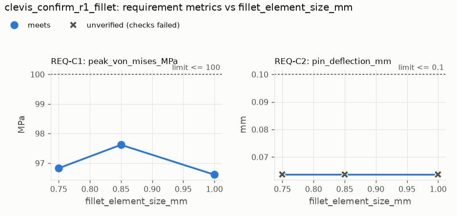
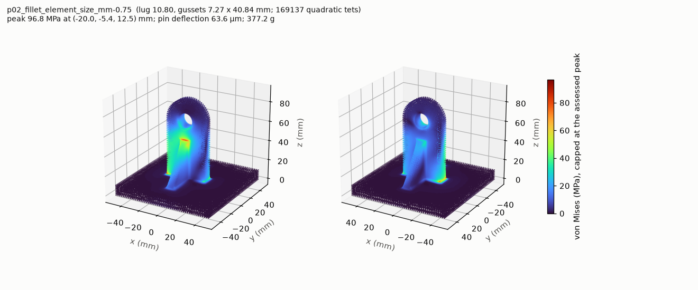

# Engineering review report: clevis_confirm_r1_fillet

- **Run:** `20261121-091836_clevis_confirm_r1_fillet`
- **Generated:** 2026-11-21T14:45:06+00:00
- **Case file SHA-256:** `dd6d6c70640440b375b64142ff5f755477b8e2876365529ae8c489d7b02266d5`
- **Environment:** Python 3.14.10, numpy 2.5.5, scipy 1.18.1, matplotlib 3.11.2, cadquery 2.8.0; Windows-11-10.0.26100-SP0
- **Tools:** cadquery 2.8.0; gmsh 4.15.0; CalculiX This is Version 2.22
- **Code version:** git `6e284df9a6dafeff85f0f748867344118bca9ad0` (uncommitted changes present)
- **Simulation status:** completed
- **Verification status:** FAIL

> **Warning:** verification did not pass for every point. Requirement verdicts marked *(unverified)* are not supported by evidence and must not be used for acceptance.

## Scope

Confirmation of the optimisation run 20261121-004740_clevis_opt_r1 at its optimum c011 by local refinement: 4 mm quadratic tetrahedra globally, fillet element size 1.0 / 0.85 / 0.75 mm (curvature refinement set so the 3 mm fillets, where the peak sits, get elements no larger than that). Original problem: lightest 6061-T6 machined clevis bracket (base 100 x 100 x 10 mm, lug 40 mm wide with a 16 mm pin at 70 mm, two gussets, 3 mm fillets) under a (1.5, 1.0, 4.5) kN pin load, with peak von Mises at most 100 MPa and pin deflection at most 0.10 mm.

**Assumptions**

- Base bottom face fixed (bolted and dowelled to a rigid machine frame); the bottom half of the base is not assessed (the edge of a fixed face is singular, and the real joint is not modelled).
- Pin load through a rigid pin tied to the hole surface; a ring of one pin diameter around the hole is not assessed (pin bearing and lug net section are sized by the standard lug method).
- Linear elastic 6061-T6 (E 68.9 GPa, nu 0.33); checked: peak stress below yield.
- Small deflection; checked: pin deflection / pin height below 1 %.
- Stress allowable 100 MPa (fatigue-rated) and pin deflection limit 0.10 mm: synthetic.

## Requirements

| ID | Requirement | Metric | Limit |
|---|---|---|---|
| REQ-C1 | Peak von Mises stress (outside the fixed base layer and the pin ring) shall not exceed 100 MPa (fatigue-rated allowable). | `peak_von_mises_MPa` | <= 100 MPa |
| REQ-C2 | Pin deflection under the load shall not exceed 0.10 mm. | `pin_deflection_mm` | <= 0.1 mm |

## Summary across points

| Point | fillet_element_size_mm | REQ-C1 | REQ-C2 | Checks |
|---|---|---|---|---|
| p00_fillet_element_size_mm-1 | 1 | 96.61 MPa: **PASS** | 0.06359 mm: **PASS (unverified)** | 6/6 PASS |
| p01_fillet_element_size_mm-0.85 | 0.85 | 97.62 MPa: **PASS** | 0.0636 mm: **PASS (unverified)** | 6/6 PASS |
| p02_fillet_element_size_mm-0.75 | 0.75 | 96.83 MPa: **PASS** | 0.0636 mm: **PASS (unverified)** | 6/6 PASS |

## Run-level checks

Checks that use several points together (for example mesh convergence).

| Check | Description | Value | Tolerance | Status |
|---|---|---|---|---|
| discretization_peak_von_mises_MPa | relative discretization uncertainty of peak_von_mises_MPa, oscillatory (R = -0.783): 1.25 x half-range of the 3 finest solutions | 0.00652 | 0.01 | PASS |
| requirement_margin_peak_von_mises_MPa | (finest peak_von_mises_MPa x (1 + uncertainty) - limit) / limit, must be <= 0 | -0.0254 | 0 | PASS |
| discretization_pin_deflection_mm | relative discretization uncertainty of pin_deflection_mm, anomalous: observed order 4.72 is far above the design order 2, so the solutions are not in the asymptotic range (singularity or coincidence); no estimate | inf | 0.01 | FAIL |
| requirement_margin_pin_deflection_mm | (finest pin_deflection_mm x (1 + uncertainty) - limit) / limit, must be <= 0 | inf | 0 | FAIL |

A failed run-level check withholds the verdicts of requirements on `pin_deflection_mm` at every point: they are marked *(unverified)* in the table above.

## Point details

### p00_fillet_element_size_mm-1

Parameters: base_length_mm = 100, base_width_mm = 100, base_thickness_mm = 10, lug_radius_mm = 20, pin_height_mm = 70, pin_diameter_mm = 16, lug_thickness_mm = 10.8, gusset_thickness_mm = 7.269, gusset_height_mm = 40.84, gusset_aspect = 0.7, fillet_radius_mm = 3, youngs_modulus_MPa = 6.89e+04, poisson_ratio = 0.33, density_t_per_mm3 = 2.7e-09, yield_strength_MPa = 276, load_x_N = 1500, load_y_N = 1000, load_z_N = 4500, element_size_mm = 4, fillet_element_size_mm = 1

Derived: gusset_reach_mm = 36.99, load_magnitude_N = 4848

| Requirement | Result | Limit | Margin | Verdict | Evidence |
|---|---|---|---|---|---|
| REQ-C1 | 96.61 MPa | <= 100 | 3.39 | **PASS** | [point.json](points/p00_fillet_element_size_mm-1/point.json) |
| REQ-C2 | 0.06359 mm | <= 0.1 | 0.0364 | **PASS (unverified)** | [point.json](points/p00_fillet_element_size_mm-1/point.json) |

| Check | Description | Value | Tolerance | Status |
|---|---|---|---|---|
| cad_valid | CadQuery B-rep is a valid solid (1 = no) | 0.00e+00 | 5e-01 | PASS |
| mesh_volume | |meshed volume (straight-sided tets) - CAD volume| / CAD volume | 2.04e-04 | 2e-03 | PASS |
| force_balance | |sum of base reactions + pin load| / |pin load| | 1.07e-08 | 1e-06 | PASS |
| moment_balance | |moment of the base reactions + moment of the pin load| about the origin / (|F| x pin height) (the load acts where intended) | 2.39e-08 | 1e-06 | PASS |
| linear_material (validity) | peak von Mises / yield strength | 3.50e-01 | 1e+00 | PASS |
| small_deflection (validity) | pin deflection / pin height | 9.08e-04 | 1e-02 | PASS |

### p01_fillet_element_size_mm-0.85

Parameters: base_length_mm = 100, base_width_mm = 100, base_thickness_mm = 10, lug_radius_mm = 20, pin_height_mm = 70, pin_diameter_mm = 16, lug_thickness_mm = 10.8, gusset_thickness_mm = 7.269, gusset_height_mm = 40.84, gusset_aspect = 0.7, fillet_radius_mm = 3, youngs_modulus_MPa = 6.89e+04, poisson_ratio = 0.33, density_t_per_mm3 = 2.7e-09, yield_strength_MPa = 276, load_x_N = 1500, load_y_N = 1000, load_z_N = 4500, element_size_mm = 4, fillet_element_size_mm = 0.85

Derived: gusset_reach_mm = 36.99, load_magnitude_N = 4848

| Requirement | Result | Limit | Margin | Verdict | Evidence |
|---|---|---|---|---|---|
| REQ-C1 | 97.62 MPa | <= 100 | 2.38 | **PASS** | [point.json](points/p01_fillet_element_size_mm-0.85/point.json) |
| REQ-C2 | 0.0636 mm | <= 0.1 | 0.0364 | **PASS (unverified)** | [point.json](points/p01_fillet_element_size_mm-0.85/point.json) |

| Check | Description | Value | Tolerance | Status |
|---|---|---|---|---|
| cad_valid | CadQuery B-rep is a valid solid (1 = no) | 0.00e+00 | 5e-01 | PASS |
| mesh_volume | |meshed volume (straight-sided tets) - CAD volume| / CAD volume | 9.92e-05 | 2e-03 | PASS |
| force_balance | |sum of base reactions + pin load| / |pin load| | 7.80e-09 | 1e-06 | PASS |
| moment_balance | |moment of the base reactions + moment of the pin load| about the origin / (|F| x pin height) (the load acts where intended) | 2.87e-08 | 1e-06 | PASS |
| linear_material (validity) | peak von Mises / yield strength | 3.54e-01 | 1e+00 | PASS |
| small_deflection (validity) | pin deflection / pin height | 9.09e-04 | 1e-02 | PASS |

### p02_fillet_element_size_mm-0.75

Parameters: base_length_mm = 100, base_width_mm = 100, base_thickness_mm = 10, lug_radius_mm = 20, pin_height_mm = 70, pin_diameter_mm = 16, lug_thickness_mm = 10.8, gusset_thickness_mm = 7.269, gusset_height_mm = 40.84, gusset_aspect = 0.7, fillet_radius_mm = 3, youngs_modulus_MPa = 6.89e+04, poisson_ratio = 0.33, density_t_per_mm3 = 2.7e-09, yield_strength_MPa = 276, load_x_N = 1500, load_y_N = 1000, load_z_N = 4500, element_size_mm = 4, fillet_element_size_mm = 0.75

Derived: gusset_reach_mm = 36.99, load_magnitude_N = 4848

| Requirement | Result | Limit | Margin | Verdict | Evidence |
|---|---|---|---|---|---|
| REQ-C1 | 96.83 MPa | <= 100 | 3.17 | **PASS** | [point.json](points/p02_fillet_element_size_mm-0.75/point.json) |
| REQ-C2 | 0.0636 mm | <= 0.1 | 0.0364 | **PASS (unverified)** | [point.json](points/p02_fillet_element_size_mm-0.75/point.json) |

| Check | Description | Value | Tolerance | Status |
|---|---|---|---|---|
| cad_valid | CadQuery B-rep is a valid solid (1 = no) | 0.00e+00 | 5e-01 | PASS |
| mesh_volume | |meshed volume (straight-sided tets) - CAD volume| / CAD volume | 1.39e-05 | 2e-03 | PASS |
| force_balance | |sum of base reactions + pin load| / |pin load| | 1.42e-08 | 1e-06 | PASS |
| moment_balance | |moment of the base reactions + moment of the pin load| about the origin / (|F| x pin height) (the load acts where intended) | 2.85e-08 | 1e-06 | PASS |
| linear_material (validity) | peak von Mises / yield strength | 3.51e-01 | 1e+00 | PASS |
| small_deflection (validity) | pin deflection / pin height | 9.09e-04 | 1e-02 | PASS |

## Limitations

- Static load only; the fatigue rating is folded into the allowable.
- No closed-form reference for the whole part: the evidence is exact equilibrium, geometry fidelity, a model-form check of the lug section and this mesh study.
- Fixed outline and fillet radius; only three dimensions vary.
- No physical test data.
- A converged solver run that matches an analytical reference shows that the equations were solved correctly. It does not show that the equations represent real hardware.

## Engineering acceptance

Pending human review. This report does not accept or reject the design.
