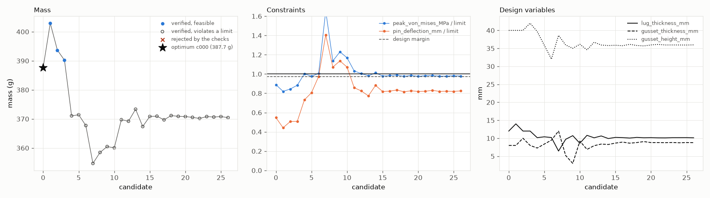
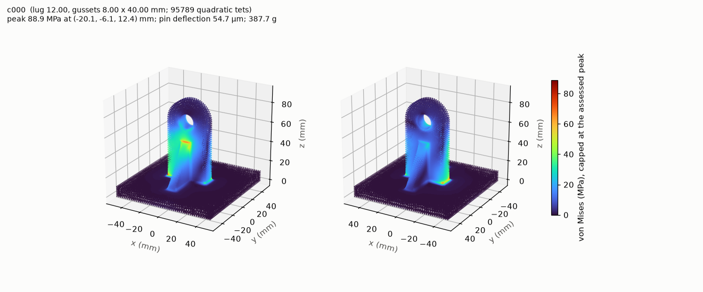
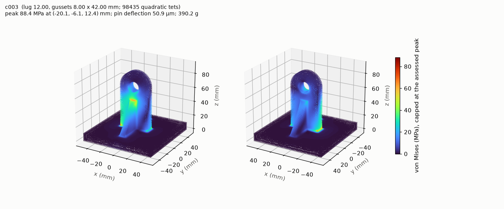
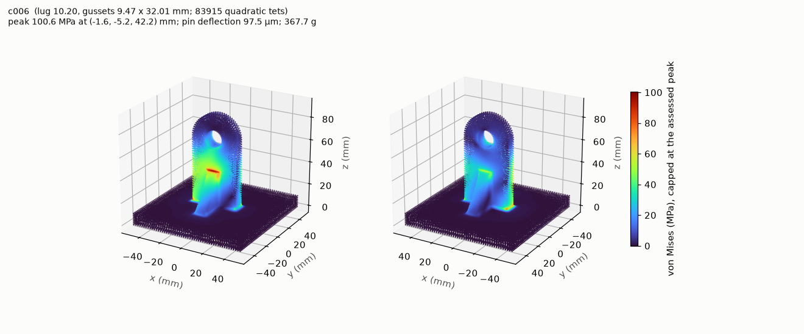
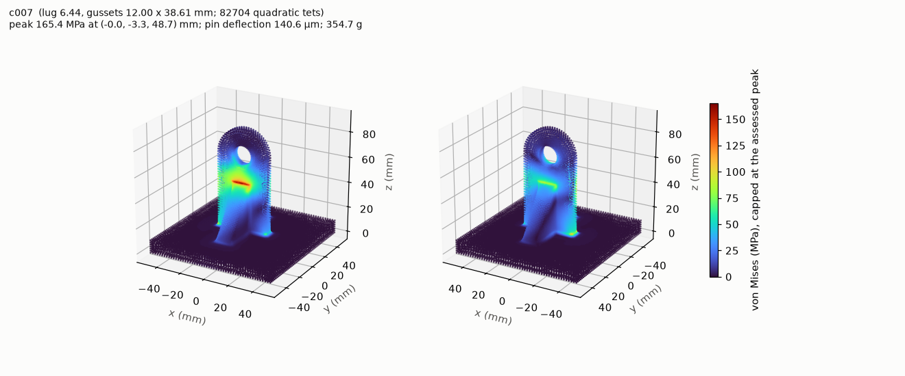
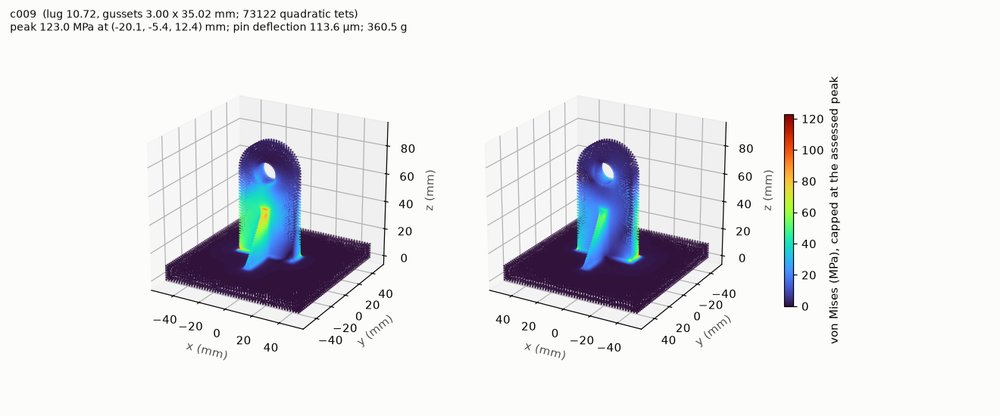
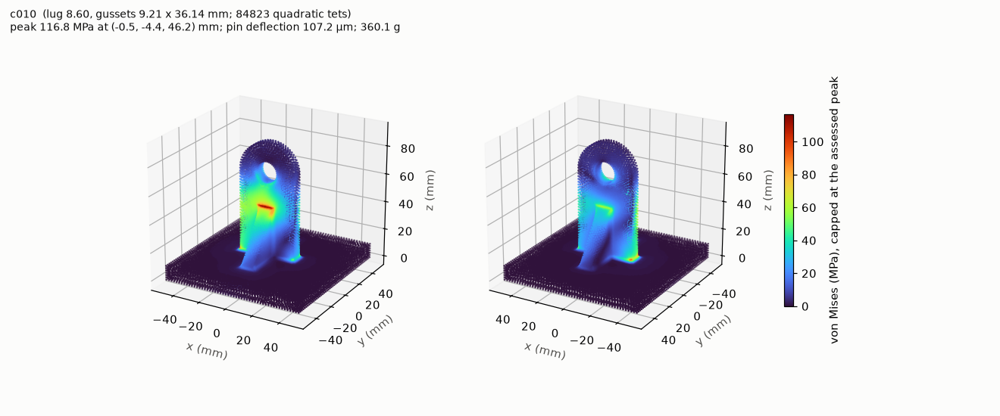
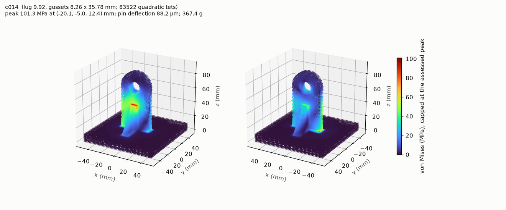
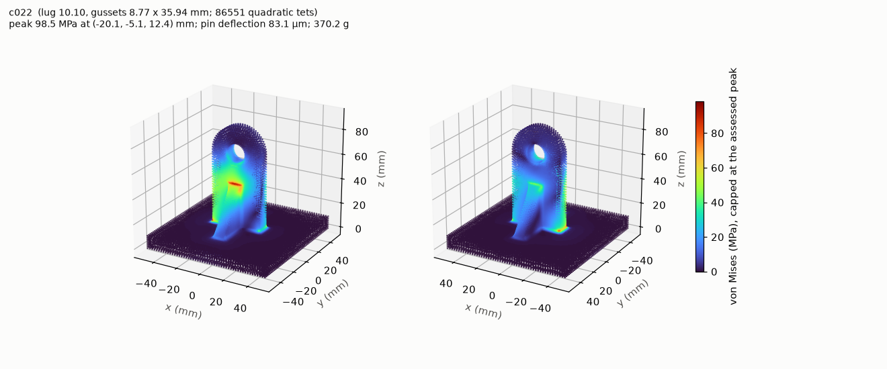

# Engineering review report: clevis_opt_r2

- **Run:** `20261121-091836_clevis_opt_r2`
- **Generated:** 2026-11-21T16:12:20+00:00
- **Case file SHA-256:** `e4b16de5a4ab467f187cfbc423c9416e1b143dff4da70e6f732f01440195af0c`
- **Environment:** Python 3.14.10, numpy 2.5.5, scipy 1.18.1, matplotlib 3.11.2, cadquery 2.8.0; Windows-11-10.0.26100-SP0
- **Tools:** cadquery 2.8.0; gmsh 4.15.0; CalculiX This is Version 2.22
- **Code version:** git `6e284df9a6dafeff85f0f748867344118bca9ad0` (uncommitted changes present)
- **Simulation status:** completed
- **Verification status:** PASS

## Scope

Lightest 6061-T6 machined clevis bracket (base 100 x 100 x 10 mm, lug 40 mm wide with a 16 mm pin at 70 mm, two gussets, 3 mm fillets) under a (1.5, 1.0, 4.5) kN pin load, with peak von Mises at most 100 MPa and pin deflection at most 0.10 mm; COBYLA over lug thickness, gusset thickness and gusset height, each candidate built in CadQuery, meshed in Gmsh, solved and checked in CalculiX.

**Assumptions**

- Base bottom face fixed (bolted and dowelled to a rigid machine frame); the bottom half of the base is not assessed (the edge of a fixed face is singular, and the real joint is not modelled).
- Pin load through a rigid pin tied to the hole surface; a ring of one pin diameter around the hole is not assessed (pin bearing and lug net section are sized by the standard lug method).
- Linear elastic 6061-T6 (E 68.9 GPa, nu 0.33); checked: peak stress below yield.
- Small deflection; checked: pin deflection / pin height below 1 %.
- Stress allowable 100 MPa (fatigue-rated) and pin deflection limit 0.10 mm: synthetic.

## Requirements

| ID | Requirement | Metric | Limit |
|---|---|---|---|
| REQ-C1 | Peak von Mises stress (outside the fixed base layer and the pin ring) shall not exceed 100 MPa (fatigue-rated allowable). | `peak_von_mises_MPa` | <= 100 MPa |
| REQ-C2 | Pin deflection under the load shall not exceed 0.10 mm. | `pin_deflection_mm` | <= 0.1 mm |

## Optimisation

- **Objective:** minimise `mass_g`; constraints are the requirements with a 2.5 % design margin.
- **Candidates evaluated:** 27 (optimiser: Return from COBYLA because the trust region radius reaches its lower bound.)
- **Rejected by the checks (treated as infeasible):** none
- **Optimum:** c000 (lug_thickness_mm = 12.0000, gusset_thickness_mm = 8.0000, gusset_height_mm = 40.0000); mass_g = 387.6512

The overall verification status of an optimisation run rests on the optimum and the run-level checks; mesh convergence at the optimum is a separate confirmation case.

## Summary across points

| Point | REQ-C1 | REQ-C2 | Checks |
|---|---|---|---|
| c000 | 88.9 MPa: **PASS** | 0.05474 mm: **PASS** | 6/6 PASS |
| c001 | 82.04 MPa: **PASS** | 0.04421 mm: **PASS** | 6/6 PASS |
| c002 | 84.4 MPa: **PASS** | 0.05068 mm: **PASS** | 6/6 PASS |
| c003 | 88.4 MPa: **PASS** | 0.05091 mm: **PASS** | 6/6 PASS |
| c004 | 100.3 MPa: **FAIL** | 0.07319 mm: **PASS** | 6/6 PASS |
| c005 | 97.72 MPa: **PASS** | 0.08063 mm: **PASS** | 6/6 PASS |
| c006 | 100.6 MPa: **FAIL** | 0.09745 mm: **PASS** | 6/6 PASS |
| c007 | 165.4 MPa: **FAIL** | 0.1406 mm: **FAIL** | 6/6 PASS |
| c008 | 113.6 MPa: **FAIL** | 0.1072 mm: **FAIL** | 6/6 PASS |
| c009 | 123 MPa: **FAIL** | 0.1136 mm: **FAIL** | 6/6 PASS |
| c010 | 116.8 MPa: **FAIL** | 0.1072 mm: **FAIL** | 6/6 PASS |
| c011 | 103.2 MPa: **FAIL** | 0.08582 mm: **PASS** | 6/6 PASS |
| c012 | 100.4 MPa: **FAIL** | 0.08245 mm: **PASS** | 6/6 PASS |
| c013 | 98.15 MPa: **PASS** | 0.07731 mm: **PASS** | 6/6 PASS |
| c014 | 101.3 MPa: **FAIL** | 0.08824 mm: **PASS** | 6/6 PASS |
| c015 | 97.93 MPa: **PASS** | 0.08186 mm: **PASS** | 6/6 PASS |
| c016 | 98.35 MPa: **PASS** | 0.08227 mm: **PASS** | 6/6 PASS |
| c017 | 99.05 MPa: **PASS** | 0.08346 mm: **PASS** | 6/6 PASS |
| c018 | 97.53 MPa: **PASS** | 0.08159 mm: **PASS** | 6/6 PASS |
| c019 | 98.67 MPa: **PASS** | 0.08262 mm: **PASS** | 6/6 PASS |
| c020 | 97.6 MPa: **PASS** | 0.08192 mm: **PASS** | 6/6 PASS |
| c021 | 98.31 MPa: **PASS** | 0.08212 mm: **PASS** | 6/6 PASS |
| c022 | 98.5 MPa: **PASS** | 0.08309 mm: **PASS** | 6/6 PASS |
| c023 | 97.76 MPa: **PASS** | 0.08195 mm: **PASS** | 6/6 PASS |
| c024 | 97.85 MPa: **PASS** | 0.08218 mm: **PASS** | 6/6 PASS |
| c025 | 98.23 MPa: **PASS** | 0.08197 mm: **PASS** | 6/6 PASS |
| c026 | 97.93 MPa: **PASS** | 0.08252 mm: **PASS** | 6/6 PASS |

## Run-level checks

Checks that use several points together (for example mesh convergence).

| Check | Description | Value | Tolerance | Status |
|---|---|---|---|---|
| optimum_found | a verified candidate meets every requirement with the design margin (1 = none) | 0 | 0.5 | PASS |
| optimizer_converged | COBYLA met its final trust-region radius within the evaluation limit (1 = no) | 0 | 0.5 | PASS |

## Point details

### c000

Parameters: base_length_mm = 100, base_width_mm = 100, base_thickness_mm = 10, lug_radius_mm = 20, pin_height_mm = 70, pin_diameter_mm = 16, lug_thickness_mm = 12, gusset_thickness_mm = 8, gusset_height_mm = 40, gusset_aspect = 0.7, fillet_radius_mm = 3, youngs_modulus_MPa = 6.89e+04, poisson_ratio = 0.33, density_t_per_mm3 = 2.7e-09, yield_strength_MPa = 276, load_x_N = 1500, load_y_N = 1000, load_z_N = 4500, element_size_mm = 4, fillet_element_size_mm = 1

Derived: gusset_reach_mm = 37, load_magnitude_N = 4848

| Requirement | Result | Limit | Margin | Verdict | Evidence |
|---|---|---|---|---|---|
| REQ-C1 | 88.9 MPa | <= 100 | 11.1 | **PASS** | [point.json](points/c000/point.json) |
| REQ-C2 | 0.05474 mm | <= 0.1 | 0.0453 | **PASS** | [point.json](points/c000/point.json) |

| Check | Description | Value | Tolerance | Status |
|---|---|---|---|---|
| cad_valid | CadQuery B-rep is a valid solid (1 = no) | 0.00e+00 | 5e-01 | PASS |
| mesh_volume | |meshed volume (straight-sided tets) - CAD volume| / CAD volume | 2.13e-04 | 2e-03 | PASS |
| force_balance | |sum of base reactions + pin load| / |pin load| | 5.29e-09 | 1e-06 | PASS |
| moment_balance | |moment of the base reactions + moment of the pin load| about the origin / (|F| x pin height) (the load acts where intended) | 2.31e-08 | 1e-06 | PASS |
| linear_material (validity) | peak von Mises / yield strength | 3.22e-01 | 1e+00 | PASS |
| small_deflection (validity) | pin deflection / pin height | 7.82e-04 | 1e-02 | PASS |

### c001

Parameters: base_length_mm = 100, base_width_mm = 100, base_thickness_mm = 10, lug_radius_mm = 20, pin_height_mm = 70, pin_diameter_mm = 16, lug_thickness_mm = 14, gusset_thickness_mm = 8, gusset_height_mm = 40, gusset_aspect = 0.7, fillet_radius_mm = 3, youngs_modulus_MPa = 6.89e+04, poisson_ratio = 0.33, density_t_per_mm3 = 2.7e-09, yield_strength_MPa = 276, load_x_N = 1500, load_y_N = 1000, load_z_N = 4500, element_size_mm = 4, fillet_element_size_mm = 1

Derived: gusset_reach_mm = 38, load_magnitude_N = 4848

| Requirement | Result | Limit | Margin | Verdict | Evidence |
|---|---|---|---|---|---|
| REQ-C1 | 82.04 MPa | <= 100 | 18 | **PASS** | [point.json](points/c001/point.json) |
| REQ-C2 | 0.04421 mm | <= 0.1 | 0.0558 | **PASS** | [point.json](points/c001/point.json) |

| Check | Description | Value | Tolerance | Status |
|---|---|---|---|---|
| cad_valid | CadQuery B-rep is a valid solid (1 = no) | 0.00e+00 | 5e-01 | PASS |
| mesh_volume | |meshed volume (straight-sided tets) - CAD volume| / CAD volume | 2.08e-04 | 2e-03 | PASS |
| force_balance | |sum of base reactions + pin load| / |pin load| | 5.15e-09 | 1e-06 | PASS |
| moment_balance | |moment of the base reactions + moment of the pin load| about the origin / (|F| x pin height) (the load acts where intended) | 2.32e-08 | 1e-06 | PASS |
| linear_material (validity) | peak von Mises / yield strength | 2.97e-01 | 1e+00 | PASS |
| small_deflection (validity) | pin deflection / pin height | 6.32e-04 | 1e-02 | PASS |

### c002

Parameters: base_length_mm = 100, base_width_mm = 100, base_thickness_mm = 10, lug_radius_mm = 20, pin_height_mm = 70, pin_diameter_mm = 16, lug_thickness_mm = 12, gusset_thickness_mm = 10, gusset_height_mm = 40, gusset_aspect = 0.7, fillet_radius_mm = 3, youngs_modulus_MPa = 6.89e+04, poisson_ratio = 0.33, density_t_per_mm3 = 2.7e-09, yield_strength_MPa = 276, load_x_N = 1500, load_y_N = 1000, load_z_N = 4500, element_size_mm = 4, fillet_element_size_mm = 1

Derived: gusset_reach_mm = 37, load_magnitude_N = 4848

| Requirement | Result | Limit | Margin | Verdict | Evidence |
|---|---|---|---|---|---|
| REQ-C1 | 84.4 MPa | <= 100 | 15.6 | **PASS** | [point.json](points/c002/point.json) |
| REQ-C2 | 0.05068 mm | <= 0.1 | 0.0493 | **PASS** | [point.json](points/c002/point.json) |

| Check | Description | Value | Tolerance | Status |
|---|---|---|---|---|
| cad_valid | CadQuery B-rep is a valid solid (1 = no) | 0.00e+00 | 5e-01 | PASS |
| mesh_volume | |meshed volume (straight-sided tets) - CAD volume| / CAD volume | 2.10e-04 | 2e-03 | PASS |
| force_balance | |sum of base reactions + pin load| / |pin load| | 4.15e-09 | 1e-06 | PASS |
| moment_balance | |moment of the base reactions + moment of the pin load| about the origin / (|F| x pin height) (the load acts where intended) | 1.82e-08 | 1e-06 | PASS |
| linear_material (validity) | peak von Mises / yield strength | 3.06e-01 | 1e+00 | PASS |
| small_deflection (validity) | pin deflection / pin height | 7.24e-04 | 1e-02 | PASS |

### c003

Parameters: base_length_mm = 100, base_width_mm = 100, base_thickness_mm = 10, lug_radius_mm = 20, pin_height_mm = 70, pin_diameter_mm = 16, lug_thickness_mm = 12, gusset_thickness_mm = 8, gusset_height_mm = 42, gusset_aspect = 0.7, fillet_radius_mm = 3, youngs_modulus_MPa = 6.89e+04, poisson_ratio = 0.33, density_t_per_mm3 = 2.7e-09, yield_strength_MPa = 276, load_x_N = 1500, load_y_N = 1000, load_z_N = 4500, element_size_mm = 4, fillet_element_size_mm = 1

Derived: gusset_reach_mm = 38.4, load_magnitude_N = 4848

| Requirement | Result | Limit | Margin | Verdict | Evidence |
|---|---|---|---|---|---|
| REQ-C1 | 88.4 MPa | <= 100 | 11.6 | **PASS** | [point.json](points/c003/point.json) |
| REQ-C2 | 0.05091 mm | <= 0.1 | 0.0491 | **PASS** | [point.json](points/c003/point.json) |

| Check | Description | Value | Tolerance | Status |
|---|---|---|---|---|
| cad_valid | CadQuery B-rep is a valid solid (1 = no) | 0.00e+00 | 5e-01 | PASS |
| mesh_volume | |meshed volume (straight-sided tets) - CAD volume| / CAD volume | 2.12e-04 | 2e-03 | PASS |
| force_balance | |sum of base reactions + pin load| / |pin load| | 4.70e-09 | 1e-06 | PASS |
| moment_balance | |moment of the base reactions + moment of the pin load| about the origin / (|F| x pin height) (the load acts where intended) | 2.23e-08 | 1e-06 | PASS |
| linear_material (validity) | peak von Mises / yield strength | 3.20e-01 | 1e+00 | PASS |
| small_deflection (validity) | pin deflection / pin height | 7.27e-04 | 1e-02 | PASS |

### c004

Parameters: base_length_mm = 100, base_width_mm = 100, base_thickness_mm = 10, lug_radius_mm = 20, pin_height_mm = 70, pin_diameter_mm = 16, lug_thickness_mm = 10.16, gusset_thickness_mm = 7.275, gusset_height_mm = 39.69, gusset_aspect = 0.7, fillet_radius_mm = 3, youngs_modulus_MPa = 6.89e+04, poisson_ratio = 0.33, density_t_per_mm3 = 2.7e-09, yield_strength_MPa = 276, load_x_N = 1500, load_y_N = 1000, load_z_N = 4500, element_size_mm = 4, fillet_element_size_mm = 1

Derived: gusset_reach_mm = 35.87, load_magnitude_N = 4848

| Requirement | Result | Limit | Margin | Verdict | Evidence |
|---|---|---|---|---|---|
| REQ-C1 | 100.3 MPa | <= 100 | -0.275 | **FAIL** | [point.json](points/c004/point.json) |
| REQ-C2 | 0.07319 mm | <= 0.1 | 0.0268 | **PASS** | [point.json](points/c004/point.json) |

| Check | Description | Value | Tolerance | Status |
|---|---|---|---|---|
| cad_valid | CadQuery B-rep is a valid solid (1 = no) | 0.00e+00 | 5e-01 | PASS |
| mesh_volume | |meshed volume (straight-sided tets) - CAD volume| / CAD volume | 1.79e-04 | 2e-03 | PASS |
| force_balance | |sum of base reactions + pin load| / |pin load| | 7.00e-09 | 1e-06 | PASS |
| moment_balance | |moment of the base reactions + moment of the pin load| about the origin / (|F| x pin height) (the load acts where intended) | 2.78e-08 | 1e-06 | PASS |
| linear_material (validity) | peak von Mises / yield strength | 3.63e-01 | 1e+00 | PASS |
| small_deflection (validity) | pin deflection / pin height | 1.05e-03 | 1e-02 | PASS |

### c005

Parameters: base_length_mm = 100, base_width_mm = 100, base_thickness_mm = 10, lug_radius_mm = 20, pin_height_mm = 70, pin_diameter_mm = 16, lug_thickness_mm = 10.4, gusset_thickness_mm = 8.379, gusset_height_mm = 35.86, gusset_aspect = 0.7, fillet_radius_mm = 3, youngs_modulus_MPa = 6.89e+04, poisson_ratio = 0.33, density_t_per_mm3 = 2.7e-09, yield_strength_MPa = 276, load_x_N = 1500, load_y_N = 1000, load_z_N = 4500, element_size_mm = 4, fillet_element_size_mm = 1

Derived: gusset_reach_mm = 33.3, load_magnitude_N = 4848

| Requirement | Result | Limit | Margin | Verdict | Evidence |
|---|---|---|---|---|---|
| REQ-C1 | 97.72 MPa | <= 100 | 2.28 | **PASS** | [point.json](points/c005/point.json) |
| REQ-C2 | 0.08063 mm | <= 0.1 | 0.0194 | **PASS** | [point.json](points/c005/point.json) |

| Check | Description | Value | Tolerance | Status |
|---|---|---|---|---|
| cad_valid | CadQuery B-rep is a valid solid (1 = no) | 0.00e+00 | 5e-01 | PASS |
| mesh_volume | |meshed volume (straight-sided tets) - CAD volume| / CAD volume | 1.70e-04 | 2e-03 | PASS |
| force_balance | |sum of base reactions + pin load| / |pin load| | 8.25e-09 | 1e-06 | PASS |
| moment_balance | |moment of the base reactions + moment of the pin load| about the origin / (|F| x pin height) (the load acts where intended) | 2.27e-08 | 1e-06 | PASS |
| linear_material (validity) | peak von Mises / yield strength | 3.54e-01 | 1e+00 | PASS |
| small_deflection (validity) | pin deflection / pin height | 1.15e-03 | 1e-02 | PASS |

### c006

Parameters: base_length_mm = 100, base_width_mm = 100, base_thickness_mm = 10, lug_radius_mm = 20, pin_height_mm = 70, pin_diameter_mm = 16, lug_thickness_mm = 10.2, gusset_thickness_mm = 9.474, gusset_height_mm = 32.01, gusset_aspect = 0.7, fillet_radius_mm = 3, youngs_modulus_MPa = 6.89e+04, poisson_ratio = 0.33, density_t_per_mm3 = 2.7e-09, yield_strength_MPa = 276, load_x_N = 1500, load_y_N = 1000, load_z_N = 4500, element_size_mm = 4, fillet_element_size_mm = 1

Derived: gusset_reach_mm = 30.51, load_magnitude_N = 4848

| Requirement | Result | Limit | Margin | Verdict | Evidence |
|---|---|---|---|---|---|
| REQ-C1 | 100.6 MPa | <= 100 | -0.571 | **FAIL** | [point.json](points/c006/point.json) |
| REQ-C2 | 0.09745 mm | <= 0.1 | 0.00255 | **PASS** | [point.json](points/c006/point.json) |

| Check | Description | Value | Tolerance | Status |
|---|---|---|---|---|
| cad_valid | CadQuery B-rep is a valid solid (1 = no) | 0.00e+00 | 5e-01 | PASS |
| mesh_volume | |meshed volume (straight-sided tets) - CAD volume| / CAD volume | 1.44e-04 | 2e-03 | PASS |
| force_balance | |sum of base reactions + pin load| / |pin load| | 8.55e-09 | 1e-06 | PASS |
| moment_balance | |moment of the base reactions + moment of the pin load| about the origin / (|F| x pin height) (the load acts where intended) | 3.32e-08 | 1e-06 | PASS |
| linear_material (validity) | peak von Mises / yield strength | 3.64e-01 | 1e+00 | PASS |
| small_deflection (validity) | pin deflection / pin height | 1.39e-03 | 1e-02 | PASS |

### c007

Parameters: base_length_mm = 100, base_width_mm = 100, base_thickness_mm = 10, lug_radius_mm = 20, pin_height_mm = 70, pin_diameter_mm = 16, lug_thickness_mm = 6.441, gusset_thickness_mm = 12, gusset_height_mm = 38.61, gusset_aspect = 0.7, fillet_radius_mm = 3, youngs_modulus_MPa = 6.89e+04, poisson_ratio = 0.33, density_t_per_mm3 = 2.7e-09, yield_strength_MPa = 276, load_x_N = 1500, load_y_N = 1000, load_z_N = 4500, element_size_mm = 4, fillet_element_size_mm = 1

Derived: gusset_reach_mm = 33.25, load_magnitude_N = 4848

| Requirement | Result | Limit | Margin | Verdict | Evidence |
|---|---|---|---|---|---|
| REQ-C1 | 165.4 MPa | <= 100 | -65.4 | **FAIL** | [point.json](points/c007/point.json) |
| REQ-C2 | 0.1406 mm | <= 0.1 | -0.0406 | **FAIL** | [point.json](points/c007/point.json) |

| Check | Description | Value | Tolerance | Status |
|---|---|---|---|---|
| cad_valid | CadQuery B-rep is a valid solid (1 = no) | 0.00e+00 | 5e-01 | PASS |
| mesh_volume | |meshed volume (straight-sided tets) - CAD volume| / CAD volume | 2.04e-04 | 2e-03 | PASS |
| force_balance | |sum of base reactions + pin load| / |pin load| | 9.12e-09 | 1e-06 | PASS |
| moment_balance | |moment of the base reactions + moment of the pin load| about the origin / (|F| x pin height) (the load acts where intended) | 2.37e-08 | 1e-06 | PASS |
| linear_material (validity) | peak von Mises / yield strength | 5.99e-01 | 1e+00 | PASS |
| small_deflection (validity) | pin deflection / pin height | 2.01e-03 | 1e-02 | PASS |

### c008

Parameters: base_length_mm = 100, base_width_mm = 100, base_thickness_mm = 10, lug_radius_mm = 20, pin_height_mm = 70, pin_diameter_mm = 16, lug_thickness_mm = 9.703, gusset_thickness_mm = 5.202, gusset_height_mm = 35.94, gusset_aspect = 0.7, fillet_radius_mm = 3, youngs_modulus_MPa = 6.89e+04, poisson_ratio = 0.33, density_t_per_mm3 = 2.7e-09, yield_strength_MPa = 276, load_x_N = 1500, load_y_N = 1000, load_z_N = 4500, element_size_mm = 4, fillet_element_size_mm = 1

Derived: gusset_reach_mm = 33.01, load_magnitude_N = 4848

| Requirement | Result | Limit | Margin | Verdict | Evidence |
|---|---|---|---|---|---|
| REQ-C1 | 113.6 MPa | <= 100 | -13.6 | **FAIL** | [point.json](points/c008/point.json) |
| REQ-C2 | 0.1072 mm | <= 0.1 | -0.00724 | **FAIL** | [point.json](points/c008/point.json) |

| Check | Description | Value | Tolerance | Status |
|---|---|---|---|---|
| cad_valid | CadQuery B-rep is a valid solid (1 = no) | 0.00e+00 | 5e-01 | PASS |
| mesh_volume | |meshed volume (straight-sided tets) - CAD volume| / CAD volume | 1.77e-04 | 2e-03 | PASS |
| force_balance | |sum of base reactions + pin load| / |pin load| | 5.70e-09 | 1e-06 | PASS |
| moment_balance | |moment of the base reactions + moment of the pin load| about the origin / (|F| x pin height) (the load acts where intended) | 2.86e-08 | 1e-06 | PASS |
| linear_material (validity) | peak von Mises / yield strength | 4.12e-01 | 1e+00 | PASS |
| small_deflection (validity) | pin deflection / pin height | 1.53e-03 | 1e-02 | PASS |

### c009

Parameters: base_length_mm = 100, base_width_mm = 100, base_thickness_mm = 10, lug_radius_mm = 20, pin_height_mm = 70, pin_diameter_mm = 16, lug_thickness_mm = 10.72, gusset_thickness_mm = 3, gusset_height_mm = 35.02, gusset_aspect = 0.7, fillet_radius_mm = 3, youngs_modulus_MPa = 6.89e+04, poisson_ratio = 0.33, density_t_per_mm3 = 2.7e-09, yield_strength_MPa = 276, load_x_N = 1500, load_y_N = 1000, load_z_N = 4500, element_size_mm = 4, fillet_element_size_mm = 1

Derived: gusset_reach_mm = 32.87, load_magnitude_N = 4848

| Requirement | Result | Limit | Margin | Verdict | Evidence |
|---|---|---|---|---|---|
| REQ-C1 | 123 MPa | <= 100 | -23 | **FAIL** | [point.json](points/c009/point.json) |
| REQ-C2 | 0.1136 mm | <= 0.1 | -0.0136 | **FAIL** | [point.json](points/c009/point.json) |

| Check | Description | Value | Tolerance | Status |
|---|---|---|---|---|
| cad_valid | CadQuery B-rep is a valid solid (1 = no) | 0.00e+00 | 5e-01 | PASS |
| mesh_volume | |meshed volume (straight-sided tets) - CAD volume| / CAD volume | 1.86e-04 | 2e-03 | PASS |
| force_balance | |sum of base reactions + pin load| / |pin load| | 3.14e-09 | 1e-06 | PASS |
| moment_balance | |moment of the base reactions + moment of the pin load| about the origin / (|F| x pin height) (the load acts where intended) | 2.71e-08 | 1e-06 | PASS |
| linear_material (validity) | peak von Mises / yield strength | 4.46e-01 | 1e+00 | PASS |
| small_deflection (validity) | pin deflection / pin height | 1.62e-03 | 1e-02 | PASS |

### c010

Parameters: base_length_mm = 100, base_width_mm = 100, base_thickness_mm = 10, lug_radius_mm = 20, pin_height_mm = 70, pin_diameter_mm = 16, lug_thickness_mm = 8.601, gusset_thickness_mm = 9.208, gusset_height_mm = 36.14, gusset_aspect = 0.7, fillet_radius_mm = 3, youngs_modulus_MPa = 6.89e+04, poisson_ratio = 0.33, density_t_per_mm3 = 2.7e-09, yield_strength_MPa = 276, load_x_N = 1500, load_y_N = 1000, load_z_N = 4500, element_size_mm = 4, fillet_element_size_mm = 1

Derived: gusset_reach_mm = 32.6, load_magnitude_N = 4848

| Requirement | Result | Limit | Margin | Verdict | Evidence |
|---|---|---|---|---|---|
| REQ-C1 | 116.8 MPa | <= 100 | -16.8 | **FAIL** | [point.json](points/c010/point.json) |
| REQ-C2 | 0.1072 mm | <= 0.1 | -0.00719 | **FAIL** | [point.json](points/c010/point.json) |

| Check | Description | Value | Tolerance | Status |
|---|---|---|---|---|
| cad_valid | CadQuery B-rep is a valid solid (1 = no) | 0.00e+00 | 5e-01 | PASS |
| mesh_volume | |meshed volume (straight-sided tets) - CAD volume| / CAD volume | 1.71e-04 | 2e-03 | PASS |
| force_balance | |sum of base reactions + pin load| / |pin load| | 8.13e-09 | 1e-06 | PASS |
| moment_balance | |moment of the base reactions + moment of the pin load| about the origin / (|F| x pin height) (the load acts where intended) | 2.42e-08 | 1e-06 | PASS |
| linear_material (validity) | peak von Mises / yield strength | 4.23e-01 | 1e+00 | PASS |
| small_deflection (validity) | pin deflection / pin height | 1.53e-03 | 1e-02 | PASS |

### c011

Parameters: base_length_mm = 100, base_width_mm = 100, base_thickness_mm = 10, lug_radius_mm = 20, pin_height_mm = 70, pin_diameter_mm = 16, lug_thickness_mm = 10.81, gusset_thickness_mm = 6.896, gusset_height_mm = 34.58, gusset_aspect = 0.7, fillet_radius_mm = 3, youngs_modulus_MPa = 6.89e+04, poisson_ratio = 0.33, density_t_per_mm3 = 2.7e-09, yield_strength_MPa = 276, load_x_N = 1500, load_y_N = 1000, load_z_N = 4500, element_size_mm = 4, fillet_element_size_mm = 1

Derived: gusset_reach_mm = 32.61, load_magnitude_N = 4848

| Requirement | Result | Limit | Margin | Verdict | Evidence |
|---|---|---|---|---|---|
| REQ-C1 | 103.2 MPa | <= 100 | -3.22 | **FAIL** | [point.json](points/c011/point.json) |
| REQ-C2 | 0.08582 mm | <= 0.1 | 0.0142 | **PASS** | [point.json](points/c011/point.json) |

| Check | Description | Value | Tolerance | Status |
|---|---|---|---|---|
| cad_valid | CadQuery B-rep is a valid solid (1 = no) | 0.00e+00 | 5e-01 | PASS |
| mesh_volume | |meshed volume (straight-sided tets) - CAD volume| / CAD volume | 1.84e-04 | 2e-03 | PASS |
| force_balance | |sum of base reactions + pin load| / |pin load| | 6.00e-09 | 1e-06 | PASS |
| moment_balance | |moment of the base reactions + moment of the pin load| about the origin / (|F| x pin height) (the load acts where intended) | 2.59e-08 | 1e-06 | PASS |
| linear_material (validity) | peak von Mises / yield strength | 3.74e-01 | 1e+00 | PASS |
| small_deflection (validity) | pin deflection / pin height | 1.23e-03 | 1e-02 | PASS |

### c012

Parameters: base_length_mm = 100, base_width_mm = 100, base_thickness_mm = 10, lug_radius_mm = 20, pin_height_mm = 70, pin_diameter_mm = 16, lug_thickness_mm = 10.13, gusset_thickness_mm = 7.927, gusset_height_mm = 36.71, gusset_aspect = 0.7, fillet_radius_mm = 3, youngs_modulus_MPa = 6.89e+04, poisson_ratio = 0.33, density_t_per_mm3 = 2.7e-09, yield_strength_MPa = 276, load_x_N = 1500, load_y_N = 1000, load_z_N = 4500, element_size_mm = 4, fillet_element_size_mm = 1

Derived: gusset_reach_mm = 33.76, load_magnitude_N = 4848

| Requirement | Result | Limit | Margin | Verdict | Evidence |
|---|---|---|---|---|---|
| REQ-C1 | 100.4 MPa | <= 100 | -0.434 | **FAIL** | [point.json](points/c012/point.json) |
| REQ-C2 | 0.08245 mm | <= 0.1 | 0.0176 | **PASS** | [point.json](points/c012/point.json) |

| Check | Description | Value | Tolerance | Status |
|---|---|---|---|---|
| cad_valid | CadQuery B-rep is a valid solid (1 = no) | 0.00e+00 | 5e-01 | PASS |
| mesh_volume | |meshed volume (straight-sided tets) - CAD volume| / CAD volume | 1.68e-04 | 2e-03 | PASS |
| force_balance | |sum of base reactions + pin load| / |pin load| | 7.07e-09 | 1e-06 | PASS |
| moment_balance | |moment of the base reactions + moment of the pin load| about the origin / (|F| x pin height) (the load acts where intended) | 2.79e-08 | 1e-06 | PASS |
| linear_material (validity) | peak von Mises / yield strength | 3.64e-01 | 1e+00 | PASS |
| small_deflection (validity) | pin deflection / pin height | 1.18e-03 | 1e-02 | PASS |

### c013

Parameters: base_length_mm = 100, base_width_mm = 100, base_thickness_mm = 10, lug_radius_mm = 20, pin_height_mm = 70, pin_diameter_mm = 16, lug_thickness_mm = 10.64, gusset_thickness_mm = 8.378, gusset_height_mm = 35.93, gusset_aspect = 0.7, fillet_radius_mm = 3, youngs_modulus_MPa = 6.89e+04, poisson_ratio = 0.33, density_t_per_mm3 = 2.7e-09, yield_strength_MPa = 276, load_x_N = 1500, load_y_N = 1000, load_z_N = 4500, element_size_mm = 4, fillet_element_size_mm = 1

Derived: gusset_reach_mm = 33.47, load_magnitude_N = 4848

| Requirement | Result | Limit | Margin | Verdict | Evidence |
|---|---|---|---|---|---|
| REQ-C1 | 98.15 MPa | <= 100 | 1.85 | **PASS** | [point.json](points/c013/point.json) |
| REQ-C2 | 0.07731 mm | <= 0.1 | 0.0227 | **PASS** | [point.json](points/c013/point.json) |

| Check | Description | Value | Tolerance | Status |
|---|---|---|---|---|
| cad_valid | CadQuery B-rep is a valid solid (1 = no) | 0.00e+00 | 5e-01 | PASS |
| mesh_volume | |meshed volume (straight-sided tets) - CAD volume| / CAD volume | 1.60e-04 | 2e-03 | PASS |
| force_balance | |sum of base reactions + pin load| / |pin load| | 2.82e-09 | 1e-06 | PASS |
| moment_balance | |moment of the base reactions + moment of the pin load| about the origin / (|F| x pin height) (the load acts where intended) | 2.22e-08 | 1e-06 | PASS |
| linear_material (validity) | peak von Mises / yield strength | 3.56e-01 | 1e+00 | PASS |
| small_deflection (validity) | pin deflection / pin height | 1.10e-03 | 1e-02 | PASS |

### c014

Parameters: base_length_mm = 100, base_width_mm = 100, base_thickness_mm = 10, lug_radius_mm = 20, pin_height_mm = 70, pin_diameter_mm = 16, lug_thickness_mm = 9.919, gusset_thickness_mm = 8.26, gusset_height_mm = 35.78, gusset_aspect = 0.7, fillet_radius_mm = 3, youngs_modulus_MPa = 6.89e+04, poisson_ratio = 0.33, density_t_per_mm3 = 2.7e-09, yield_strength_MPa = 276, load_x_N = 1500, load_y_N = 1000, load_z_N = 4500, element_size_mm = 4, fillet_element_size_mm = 1

Derived: gusset_reach_mm = 33.01, load_magnitude_N = 4848

| Requirement | Result | Limit | Margin | Verdict | Evidence |
|---|---|---|---|---|---|
| REQ-C1 | 101.3 MPa | <= 100 | -1.26 | **FAIL** | [point.json](points/c014/point.json) |
| REQ-C2 | 0.08824 mm | <= 0.1 | 0.0118 | **PASS** | [point.json](points/c014/point.json) |

| Check | Description | Value | Tolerance | Status |
|---|---|---|---|---|
| cad_valid | CadQuery B-rep is a valid solid (1 = no) | 0.00e+00 | 5e-01 | PASS |
| mesh_volume | |meshed volume (straight-sided tets) - CAD volume| / CAD volume | 1.68e-04 | 2e-03 | PASS |
| force_balance | |sum of base reactions + pin load| / |pin load| | 1.08e-08 | 1e-06 | PASS |
| moment_balance | |moment of the base reactions + moment of the pin load| about the origin / (|F| x pin height) (the load acts where intended) | 2.32e-08 | 1e-06 | PASS |
| linear_material (validity) | peak von Mises / yield strength | 3.67e-01 | 1e+00 | PASS |
| small_deflection (validity) | pin deflection / pin height | 1.26e-03 | 1e-02 | PASS |

### c015

Parameters: base_length_mm = 100, base_width_mm = 100, base_thickness_mm = 10, lug_radius_mm = 20, pin_height_mm = 70, pin_diameter_mm = 16, lug_thickness_mm = 10.24, gusset_thickness_mm = 8.65, gusset_height_mm = 35.87, gusset_aspect = 0.7, fillet_radius_mm = 3, youngs_modulus_MPa = 6.89e+04, poisson_ratio = 0.33, density_t_per_mm3 = 2.7e-09, yield_strength_MPa = 276, load_x_N = 1500, load_y_N = 1000, load_z_N = 4500, element_size_mm = 4, fillet_element_size_mm = 1

Derived: gusset_reach_mm = 33.22, load_magnitude_N = 4848

| Requirement | Result | Limit | Margin | Verdict | Evidence |
|---|---|---|---|---|---|
| REQ-C1 | 97.93 MPa | <= 100 | 2.07 | **PASS** | [point.json](points/c015/point.json) |
| REQ-C2 | 0.08186 mm | <= 0.1 | 0.0181 | **PASS** | [point.json](points/c015/point.json) |

| Check | Description | Value | Tolerance | Status |
|---|---|---|---|---|
| cad_valid | CadQuery B-rep is a valid solid (1 = no) | 0.00e+00 | 5e-01 | PASS |
| mesh_volume | |meshed volume (straight-sided tets) - CAD volume| / CAD volume | 1.65e-04 | 2e-03 | PASS |
| force_balance | |sum of base reactions + pin load| / |pin load| | 1.86e-08 | 1e-06 | PASS |
| moment_balance | |moment of the base reactions + moment of the pin load| about the origin / (|F| x pin height) (the load acts where intended) | 2.54e-08 | 1e-06 | PASS |
| linear_material (validity) | peak von Mises / yield strength | 3.55e-01 | 1e+00 | PASS |
| small_deflection (validity) | pin deflection / pin height | 1.17e-03 | 1e-02 | PASS |

### c016

Parameters: base_length_mm = 100, base_width_mm = 100, base_thickness_mm = 10, lug_radius_mm = 20, pin_height_mm = 70, pin_diameter_mm = 16, lug_thickness_mm = 10.18, gusset_thickness_mm = 8.933, gusset_height_mm = 35.74, gusset_aspect = 0.7, fillet_radius_mm = 3, youngs_modulus_MPa = 6.89e+04, poisson_ratio = 0.33, density_t_per_mm3 = 2.7e-09, yield_strength_MPa = 276, load_x_N = 1500, load_y_N = 1000, load_z_N = 4500, element_size_mm = 4, fillet_element_size_mm = 1

Derived: gusset_reach_mm = 33.11, load_magnitude_N = 4848

| Requirement | Result | Limit | Margin | Verdict | Evidence |
|---|---|---|---|---|---|
| REQ-C1 | 98.35 MPa | <= 100 | 1.65 | **PASS** | [point.json](points/c016/point.json) |
| REQ-C2 | 0.08227 mm | <= 0.1 | 0.0177 | **PASS** | [point.json](points/c016/point.json) |

| Check | Description | Value | Tolerance | Status |
|---|---|---|---|---|
| cad_valid | CadQuery B-rep is a valid solid (1 = no) | 0.00e+00 | 5e-01 | PASS |
| mesh_volume | |meshed volume (straight-sided tets) - CAD volume| / CAD volume | 1.62e-04 | 2e-03 | PASS |
| force_balance | |sum of base reactions + pin load| / |pin load| | 1.08e-08 | 1e-06 | PASS |
| moment_balance | |moment of the base reactions + moment of the pin load| about the origin / (|F| x pin height) (the load acts where intended) | 2.32e-08 | 1e-06 | PASS |
| linear_material (validity) | peak von Mises / yield strength | 3.56e-01 | 1e+00 | PASS |
| small_deflection (validity) | pin deflection / pin height | 1.18e-03 | 1e-02 | PASS |

### c017

Parameters: base_length_mm = 100, base_width_mm = 100, base_thickness_mm = 10, lug_radius_mm = 20, pin_height_mm = 70, pin_diameter_mm = 16, lug_thickness_mm = 10.05, gusset_thickness_mm = 8.627, gusset_height_mm = 36.12, gusset_aspect = 0.7, fillet_radius_mm = 3, youngs_modulus_MPa = 6.89e+04, poisson_ratio = 0.33, density_t_per_mm3 = 2.7e-09, yield_strength_MPa = 276, load_x_N = 1500, load_y_N = 1000, load_z_N = 4500, element_size_mm = 4, fillet_element_size_mm = 1

Derived: gusset_reach_mm = 33.31, load_magnitude_N = 4848

| Requirement | Result | Limit | Margin | Verdict | Evidence |
|---|---|---|---|---|---|
| REQ-C1 | 99.05 MPa | <= 100 | 0.952 | **PASS** | [point.json](points/c017/point.json) |
| REQ-C2 | 0.08346 mm | <= 0.1 | 0.0165 | **PASS** | [point.json](points/c017/point.json) |

| Check | Description | Value | Tolerance | Status |
|---|---|---|---|---|
| cad_valid | CadQuery B-rep is a valid solid (1 = no) | 0.00e+00 | 5e-01 | PASS |
| mesh_volume | |meshed volume (straight-sided tets) - CAD volume| / CAD volume | 1.77e-04 | 2e-03 | PASS |
| force_balance | |sum of base reactions + pin load| / |pin load| | 1.35e-08 | 1e-06 | PASS |
| moment_balance | |moment of the base reactions + moment of the pin load| about the origin / (|F| x pin height) (the load acts where intended) | 2.37e-08 | 1e-06 | PASS |
| linear_material (validity) | peak von Mises / yield strength | 3.59e-01 | 1e+00 | PASS |
| small_deflection (validity) | pin deflection / pin height | 1.19e-03 | 1e-02 | PASS |

### c018

Parameters: base_length_mm = 100, base_width_mm = 100, base_thickness_mm = 10, lug_radius_mm = 20, pin_height_mm = 70, pin_diameter_mm = 16, lug_thickness_mm = 10.24, gusset_thickness_mm = 8.798, gusset_height_mm = 35.81, gusset_aspect = 0.7, fillet_radius_mm = 3, youngs_modulus_MPa = 6.89e+04, poisson_ratio = 0.33, density_t_per_mm3 = 2.7e-09, yield_strength_MPa = 276, load_x_N = 1500, load_y_N = 1000, load_z_N = 4500, element_size_mm = 4, fillet_element_size_mm = 1

Derived: gusset_reach_mm = 33.19, load_magnitude_N = 4848

| Requirement | Result | Limit | Margin | Verdict | Evidence |
|---|---|---|---|---|---|
| REQ-C1 | 97.53 MPa | <= 100 | 2.47 | **PASS** | [point.json](points/c018/point.json) |
| REQ-C2 | 0.08159 mm | <= 0.1 | 0.0184 | **PASS** | [point.json](points/c018/point.json) |

| Check | Description | Value | Tolerance | Status |
|---|---|---|---|---|
| cad_valid | CadQuery B-rep is a valid solid (1 = no) | 0.00e+00 | 5e-01 | PASS |
| mesh_volume | |meshed volume (straight-sided tets) - CAD volume| / CAD volume | 1.66e-04 | 2e-03 | PASS |
| force_balance | |sum of base reactions + pin load| / |pin load| | 1.86e-08 | 1e-06 | PASS |
| moment_balance | |moment of the base reactions + moment of the pin load| about the origin / (|F| x pin height) (the load acts where intended) | 2.48e-08 | 1e-06 | PASS |
| linear_material (validity) | peak von Mises / yield strength | 3.53e-01 | 1e+00 | PASS |
| small_deflection (validity) | pin deflection / pin height | 1.17e-03 | 1e-02 | PASS |

### c019

Parameters: base_length_mm = 100, base_width_mm = 100, base_thickness_mm = 10, lug_radius_mm = 20, pin_height_mm = 70, pin_diameter_mm = 16, lug_thickness_mm = 10.14, gusset_thickness_mm = 9.069, gusset_height_mm = 35.68, gusset_aspect = 0.7, fillet_radius_mm = 3, youngs_modulus_MPa = 6.89e+04, poisson_ratio = 0.33, density_t_per_mm3 = 2.7e-09, yield_strength_MPa = 276, load_x_N = 1500, load_y_N = 1000, load_z_N = 4500, element_size_mm = 4, fillet_element_size_mm = 1

Derived: gusset_reach_mm = 33.05, load_magnitude_N = 4848

| Requirement | Result | Limit | Margin | Verdict | Evidence |
|---|---|---|---|---|---|
| REQ-C1 | 98.67 MPa | <= 100 | 1.33 | **PASS** | [point.json](points/c019/point.json) |
| REQ-C2 | 0.08262 mm | <= 0.1 | 0.0174 | **PASS** | [point.json](points/c019/point.json) |

| Check | Description | Value | Tolerance | Status |
|---|---|---|---|---|
| cad_valid | CadQuery B-rep is a valid solid (1 = no) | 0.00e+00 | 5e-01 | PASS |
| mesh_volume | |meshed volume (straight-sided tets) - CAD volume| / CAD volume | 1.60e-04 | 2e-03 | PASS |
| force_balance | |sum of base reactions + pin load| / |pin load| | 4.41e-09 | 1e-06 | PASS |
| moment_balance | |moment of the base reactions + moment of the pin load| about the origin / (|F| x pin height) (the load acts where intended) | 2.58e-08 | 1e-06 | PASS |
| linear_material (validity) | peak von Mises / yield strength | 3.57e-01 | 1e+00 | PASS |
| small_deflection (validity) | pin deflection / pin height | 1.18e-03 | 1e-02 | PASS |

### c020

Parameters: base_length_mm = 100, base_width_mm = 100, base_thickness_mm = 10, lug_radius_mm = 20, pin_height_mm = 70, pin_diameter_mm = 16, lug_thickness_mm = 10.17, gusset_thickness_mm = 8.79, gusset_height_mm = 35.95, gusset_aspect = 0.7, fillet_radius_mm = 3, youngs_modulus_MPa = 6.89e+04, poisson_ratio = 0.33, density_t_per_mm3 = 2.7e-09, yield_strength_MPa = 276, load_x_N = 1500, load_y_N = 1000, load_z_N = 4500, element_size_mm = 4, fillet_element_size_mm = 1

Derived: gusset_reach_mm = 33.25, load_magnitude_N = 4848

| Requirement | Result | Limit | Margin | Verdict | Evidence |
|---|---|---|---|---|---|
| REQ-C1 | 97.6 MPa | <= 100 | 2.4 | **PASS** | [point.json](points/c020/point.json) |
| REQ-C2 | 0.08192 mm | <= 0.1 | 0.0181 | **PASS** | [point.json](points/c020/point.json) |

| Check | Description | Value | Tolerance | Status |
|---|---|---|---|---|
| cad_valid | CadQuery B-rep is a valid solid (1 = no) | 0.00e+00 | 5e-01 | PASS |
| mesh_volume | |meshed volume (straight-sided tets) - CAD volume| / CAD volume | 1.74e-04 | 2e-03 | PASS |
| force_balance | |sum of base reactions + pin load| / |pin load| | 1.48e-08 | 1e-06 | PASS |
| moment_balance | |moment of the base reactions + moment of the pin load| about the origin / (|F| x pin height) (the load acts where intended) | 2.61e-08 | 1e-06 | PASS |
| linear_material (validity) | peak von Mises / yield strength | 3.54e-01 | 1e+00 | PASS |
| small_deflection (validity) | pin deflection / pin height | 1.17e-03 | 1e-02 | PASS |

### c021

Parameters: base_length_mm = 100, base_width_mm = 100, base_thickness_mm = 10, lug_radius_mm = 20, pin_height_mm = 70, pin_diameter_mm = 16, lug_thickness_mm = 10.11, gusset_thickness_mm = 8.793, gusset_height_mm = 36.1, gusset_aspect = 0.7, fillet_radius_mm = 3, youngs_modulus_MPa = 6.89e+04, poisson_ratio = 0.33, density_t_per_mm3 = 2.7e-09, yield_strength_MPa = 276, load_x_N = 1500, load_y_N = 1000, load_z_N = 4500, element_size_mm = 4, fillet_element_size_mm = 1

Derived: gusset_reach_mm = 33.33, load_magnitude_N = 4848

| Requirement | Result | Limit | Margin | Verdict | Evidence |
|---|---|---|---|---|---|
| REQ-C1 | 98.31 MPa | <= 100 | 1.69 | **PASS** | [point.json](points/c021/point.json) |
| REQ-C2 | 0.08212 mm | <= 0.1 | 0.0179 | **PASS** | [point.json](points/c021/point.json) |

| Check | Description | Value | Tolerance | Status |
|---|---|---|---|---|
| cad_valid | CadQuery B-rep is a valid solid (1 = no) | 0.00e+00 | 5e-01 | PASS |
| mesh_volume | |meshed volume (straight-sided tets) - CAD volume| / CAD volume | 1.72e-04 | 2e-03 | PASS |
| force_balance | |sum of base reactions + pin load| / |pin load| | 1.75e-08 | 1e-06 | PASS |
| moment_balance | |moment of the base reactions + moment of the pin load| about the origin / (|F| x pin height) (the load acts where intended) | 2.44e-08 | 1e-06 | PASS |
| linear_material (validity) | peak von Mises / yield strength | 3.56e-01 | 1e+00 | PASS |
| small_deflection (validity) | pin deflection / pin height | 1.17e-03 | 1e-02 | PASS |

### c022

Parameters: base_length_mm = 100, base_width_mm = 100, base_thickness_mm = 10, lug_radius_mm = 20, pin_height_mm = 70, pin_diameter_mm = 16, lug_thickness_mm = 10.1, gusset_thickness_mm = 8.767, gusset_height_mm = 35.94, gusset_aspect = 0.7, fillet_radius_mm = 3, youngs_modulus_MPa = 6.89e+04, poisson_ratio = 0.33, density_t_per_mm3 = 2.7e-09, yield_strength_MPa = 276, load_x_N = 1500, load_y_N = 1000, load_z_N = 4500, element_size_mm = 4, fillet_element_size_mm = 1

Derived: gusset_reach_mm = 33.21, load_magnitude_N = 4848

| Requirement | Result | Limit | Margin | Verdict | Evidence |
|---|---|---|---|---|---|
| REQ-C1 | 98.5 MPa | <= 100 | 1.5 | **PASS** | [point.json](points/c022/point.json) |
| REQ-C2 | 0.08309 mm | <= 0.1 | 0.0169 | **PASS** | [point.json](points/c022/point.json) |

| Check | Description | Value | Tolerance | Status |
|---|---|---|---|---|
| cad_valid | CadQuery B-rep is a valid solid (1 = no) | 0.00e+00 | 5e-01 | PASS |
| mesh_volume | |meshed volume (straight-sided tets) - CAD volume| / CAD volume | 1.66e-04 | 2e-03 | PASS |
| force_balance | |sum of base reactions + pin load| / |pin load| | 1.09e-08 | 1e-06 | PASS |
| moment_balance | |moment of the base reactions + moment of the pin load| about the origin / (|F| x pin height) (the load acts where intended) | 2.50e-08 | 1e-06 | PASS |
| linear_material (validity) | peak von Mises / yield strength | 3.57e-01 | 1e+00 | PASS |
| small_deflection (validity) | pin deflection / pin height | 1.19e-03 | 1e-02 | PASS |

### c023

Parameters: base_length_mm = 100, base_width_mm = 100, base_thickness_mm = 10, lug_radius_mm = 20, pin_height_mm = 70, pin_diameter_mm = 16, lug_thickness_mm = 10.17, gusset_thickness_mm = 8.814, gusset_height_mm = 35.95, gusset_aspect = 0.7, fillet_radius_mm = 3, youngs_modulus_MPa = 6.89e+04, poisson_ratio = 0.33, density_t_per_mm3 = 2.7e-09, yield_strength_MPa = 276, load_x_N = 1500, load_y_N = 1000, load_z_N = 4500, element_size_mm = 4, fillet_element_size_mm = 1

Derived: gusset_reach_mm = 33.25, load_magnitude_N = 4848

| Requirement | Result | Limit | Margin | Verdict | Evidence |
|---|---|---|---|---|---|
| REQ-C1 | 97.76 MPa | <= 100 | 2.24 | **PASS** | [point.json](points/c023/point.json) |
| REQ-C2 | 0.08195 mm | <= 0.1 | 0.018 | **PASS** | [point.json](points/c023/point.json) |

| Check | Description | Value | Tolerance | Status |
|---|---|---|---|---|
| cad_valid | CadQuery B-rep is a valid solid (1 = no) | 0.00e+00 | 5e-01 | PASS |
| mesh_volume | |meshed volume (straight-sided tets) - CAD volume| / CAD volume | 1.67e-04 | 2e-03 | PASS |
| force_balance | |sum of base reactions + pin load| / |pin load| | 7.60e-09 | 1e-06 | PASS |
| moment_balance | |moment of the base reactions + moment of the pin load| about the origin / (|F| x pin height) (the load acts where intended) | 2.15e-08 | 1e-06 | PASS |
| linear_material (validity) | peak von Mises / yield strength | 3.54e-01 | 1e+00 | PASS |
| small_deflection (validity) | pin deflection / pin height | 1.17e-03 | 1e-02 | PASS |

### c024

Parameters: base_length_mm = 100, base_width_mm = 100, base_thickness_mm = 10, lug_radius_mm = 20, pin_height_mm = 70, pin_diameter_mm = 16, lug_thickness_mm = 10.17, gusset_thickness_mm = 8.742, gusset_height_mm = 35.94, gusset_aspect = 0.7, fillet_radius_mm = 3, youngs_modulus_MPa = 6.89e+04, poisson_ratio = 0.33, density_t_per_mm3 = 2.7e-09, yield_strength_MPa = 276, load_x_N = 1500, load_y_N = 1000, load_z_N = 4500, element_size_mm = 4, fillet_element_size_mm = 1

Derived: gusset_reach_mm = 33.24, load_magnitude_N = 4848

| Requirement | Result | Limit | Margin | Verdict | Evidence |
|---|---|---|---|---|---|
| REQ-C1 | 97.85 MPa | <= 100 | 2.15 | **PASS** | [point.json](points/c024/point.json) |
| REQ-C2 | 0.08218 mm | <= 0.1 | 0.0178 | **PASS** | [point.json](points/c024/point.json) |

| Check | Description | Value | Tolerance | Status |
|---|---|---|---|---|
| cad_valid | CadQuery B-rep is a valid solid (1 = no) | 0.00e+00 | 5e-01 | PASS |
| mesh_volume | |meshed volume (straight-sided tets) - CAD volume| / CAD volume | 1.67e-04 | 2e-03 | PASS |
| force_balance | |sum of base reactions + pin load| / |pin load| | 1.14e-08 | 1e-06 | PASS |
| moment_balance | |moment of the base reactions + moment of the pin load| about the origin / (|F| x pin height) (the load acts where intended) | 2.30e-08 | 1e-06 | PASS |
| linear_material (validity) | peak von Mises / yield strength | 3.55e-01 | 1e+00 | PASS |
| small_deflection (validity) | pin deflection / pin height | 1.17e-03 | 1e-02 | PASS |

### c025

Parameters: base_length_mm = 100, base_width_mm = 100, base_thickness_mm = 10, lug_radius_mm = 20, pin_height_mm = 70, pin_diameter_mm = 16, lug_thickness_mm = 10.17, gusset_thickness_mm = 8.796, gusset_height_mm = 35.93, gusset_aspect = 0.7, fillet_radius_mm = 3, youngs_modulus_MPa = 6.89e+04, poisson_ratio = 0.33, density_t_per_mm3 = 2.7e-09, yield_strength_MPa = 276, load_x_N = 1500, load_y_N = 1000, load_z_N = 4500, element_size_mm = 4, fillet_element_size_mm = 1

Derived: gusset_reach_mm = 33.24, load_magnitude_N = 4848

| Requirement | Result | Limit | Margin | Verdict | Evidence |
|---|---|---|---|---|---|
| REQ-C1 | 98.23 MPa | <= 100 | 1.77 | **PASS** | [point.json](points/c025/point.json) |
| REQ-C2 | 0.08197 mm | <= 0.1 | 0.018 | **PASS** | [point.json](points/c025/point.json) |

| Check | Description | Value | Tolerance | Status |
|---|---|---|---|---|
| cad_valid | CadQuery B-rep is a valid solid (1 = no) | 0.00e+00 | 5e-01 | PASS |
| mesh_volume | |meshed volume (straight-sided tets) - CAD volume| / CAD volume | 1.68e-04 | 2e-03 | PASS |
| force_balance | |sum of base reactions + pin load| / |pin load| | 1.12e-08 | 1e-06 | PASS |
| moment_balance | |moment of the base reactions + moment of the pin load| about the origin / (|F| x pin height) (the load acts where intended) | 2.41e-08 | 1e-06 | PASS |
| linear_material (validity) | peak von Mises / yield strength | 3.56e-01 | 1e+00 | PASS |
| small_deflection (validity) | pin deflection / pin height | 1.17e-03 | 1e-02 | PASS |

### c026

Parameters: base_length_mm = 100, base_width_mm = 100, base_thickness_mm = 10, lug_radius_mm = 20, pin_height_mm = 70, pin_diameter_mm = 16, lug_thickness_mm = 10.13, gusset_thickness_mm = 8.772, gusset_height_mm = 35.97, gusset_aspect = 0.7, fillet_radius_mm = 3, youngs_modulus_MPa = 6.89e+04, poisson_ratio = 0.33, density_t_per_mm3 = 2.7e-09, yield_strength_MPa = 276, load_x_N = 1500, load_y_N = 1000, load_z_N = 4500, element_size_mm = 4, fillet_element_size_mm = 1

Derived: gusset_reach_mm = 33.24, load_magnitude_N = 4848

| Requirement | Result | Limit | Margin | Verdict | Evidence |
|---|---|---|---|---|---|
| REQ-C1 | 97.93 MPa | <= 100 | 2.07 | **PASS** | [point.json](points/c026/point.json) |
| REQ-C2 | 0.08252 mm | <= 0.1 | 0.0175 | **PASS** | [point.json](points/c026/point.json) |

| Check | Description | Value | Tolerance | Status |
|---|---|---|---|---|
| cad_valid | CadQuery B-rep is a valid solid (1 = no) | 0.00e+00 | 5e-01 | PASS |
| mesh_volume | |meshed volume (straight-sided tets) - CAD volume| / CAD volume | 1.75e-04 | 2e-03 | PASS |
| force_balance | |sum of base reactions + pin load| / |pin load| | 3.77e-09 | 1e-06 | PASS |
| moment_balance | |moment of the base reactions + moment of the pin load| about the origin / (|F| x pin height) (the load acts where intended) | 2.60e-08 | 1e-06 | PASS |
| linear_material (validity) | peak von Mises / yield strength | 3.55e-01 | 1e+00 | PASS |
| small_deflection (validity) | pin deflection / pin height | 1.18e-03 | 1e-02 | PASS |

## Limitations

- Static load only; the fatigue rating is folded into the allowable.
- No closed-form reference for the whole part: the evidence is exact equilibrium, geometry fidelity, a model-form check of the lug section and mesh convergence at the optimum.
- Fixed outline and fillet radius; only three dimensions vary.
- No physical test data.
- A converged solver run that matches an analytical reference shows that the equations were solved correctly. It does not show that the equations represent real hardware.

## Engineering acceptance

Pending human review. This report does not accept or reject the design.
