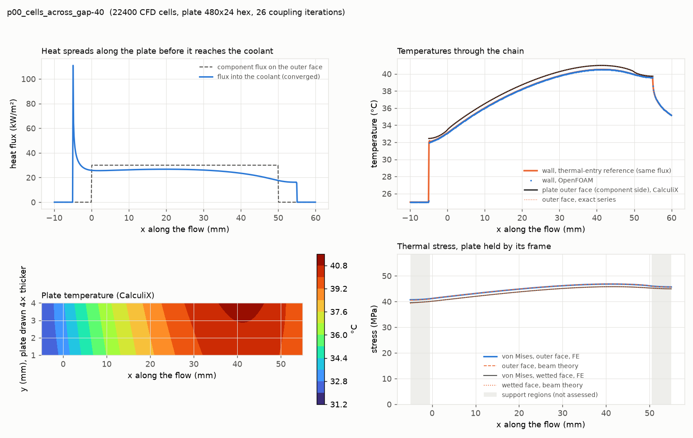

# Engineering review report: cold_plate_solver_check

- **Run:** `20261121-093029_cold_plate_solver_check`
- **Generated:** 2026-11-21T14:37:40+00:00
- **Case file SHA-256:** `66eac210210c80ab62780306e68476367f7936a6d604bc4f7fe234766f67542f`
- **Environment:** Python 3.14.10, numpy 2.5.5, scipy 1.18.1, matplotlib 3.11.2, cadquery 2.8.0; Windows-11-10.0.26100-SP0
- **Tools:** openfoam_bashrc /opt/openfoam14/etc/bashrc; CalculiX This is Version 2.22; openfoam_version 14; openfoam_package openfoam14 20261008; linux Ubuntu 22.04.5 LTS
- **Code version:** git `6e284df9a6dafeff85f0f748867344118bca9ad0` (uncommitted changes present)
- **Simulation status:** completed
- **Verification status:** FAIL

> **Warning:** verification did not pass for every point. Requirement verdicts marked *(unverified)* are not supported by evidence and must not be used for acceptance.

## Scope

Cold plate: OpenFOAM coolant channel (1 mm gap, water 0.1 m/s) coupled to CalculiX conduction in a 3 mm 6061 plate with 30 kW/m2 over a 50 mm footprint, then CalculiX thermal stress with the plate clamped at both ends; meshes 20 / 40 / 80 cells across the gap, plate refined with them.

**Assumptions**

- Symmetric construction: a plate and a component on each side of the channel, so both channel walls see the same flux; checked: top and bottom wall temperatures agree.
- Constant water properties at 25 C, so temperature is a passive scalar on the frozen flow (rise under 20 K).
- Developed laminar inflow; checked: Re and the peak inflow velocity.
- 2D: plate and channel much wider than the gap (side walls neglected; the 3D duct study shows a 3 % effect on flow).
- Perfect thermal contact between component and plate, and between plate and water (no interface resistance): synthetic.
- Plate ends adiabatic; all component heat leaves through the coolant.
- Frame rigid: each plate end held in x over its whole face (no growth, no rotation) and in y on its mid-thickness line; plate held in width (plane strain). This bounds the stress from above; a compliant frame would lower it.
- Linear elastic, small deflection; checked: peak stress under yield, membrane stress well below buckling.
- Stress-free at the 20 C assembly temperature: synthetic.

## Requirements

| ID | Requirement | Metric | Limit |
|---|---|---|---|
| REQ-C1 | Peak temperature of the component face (plate outer face over the footprint) shall not exceed 45 C. | `component_face_max_temperature_C` | <= 45 C |
| REQ-C2 | Coolant temperature rise from inlet to outlet shall not exceed 10 K. | `coolant_rise_K` | <= 10 K |
| REQ-C3 | Peak von Mises stress in the plate away from the supports (more than 1.5 plate thicknesses from each end) shall not exceed 60 MPa (synthetic allowable for thermal cycling). | `interior_von_mises_max_MPa` | <= 60 MPa |

## Summary across points

| Point | cells_across_gap | REQ-C1 | REQ-C2 | REQ-C3 | Checks |
|---|---|---|---|---|---|
| p00_cells_across_gap-40 | 40 | 40.99 C: **PASS (unverified)** | 7.199 K: **PASS (unverified)** | 46.8 MPa: **PASS (unverified)** | 26/26 PASS |

## Run-level checks

Checks that use several points together (for example mesh convergence).

| Check | Description | Value | Tolerance | Status |
|---|---|---|---|---|
| mesh_convergence_gci | needs >= 3 completed mesh levels | inf | 0 | FAIL |

A failed run-level check withholds the verdicts of all requirements at every point: they are marked *(unverified)* in the table above.

## Point details

### p00_cells_across_gap-40

Parameters: gap_mm = 1, footprint_length_mm = 50, entry_length_mm = 5, exit_length_mm = 5, unplated_length_mm = 5, mean_velocity_m_per_s = 0.1, density_kg_per_m3 = 997, dynamic_viscosity_Pa_s = 0.00089, specific_heat_J_per_kgK = 4180, conductivity_W_per_mK = 0.607, inlet_temperature_C = 25, cells_across_gap = 40, cell_aspect_ratio = 5, component_heat_flux_W_per_m2 = 3e+04, plate_thickness_mm = 3, plate_conductivity_W_per_mK = 167, coupling_htc_W_per_m2K = 2500, youngs_modulus_MPa = 6.89e+04, poisson_ratio = 0.33, expansion_per_K = 2.36e-05, assembly_temperature_C = 20, yield_strength_MPa = 276, interior_margin_mm = 4.5, uniform_check_rise_K = 20

Derived: reynolds_Dh = 224, prandtl = 6.129, peclet_Dh = 1373, coolant_rise_exact_K = 7.199, h_fully_developed_W_per_m2K = 2499, plate_biot = 0.0449, plate_spreading_length_mm = 14.16, slab_dT_K = 0.5389, thickness_over_span = 0.05, buckling_stress_MPa = 635.9, uniform_case_exact_MPa = -48.54

| Requirement | Result | Limit | Margin | Verdict | Evidence |
|---|---|---|---|---|---|
| REQ-C1 | 40.99 C | <= 45 | 4.01 | **PASS (unverified)** | [point.json](points/p00_cells_across_gap-40/point.json) |
| REQ-C2 | 7.199 K | <= 10 | 2.8 | **PASS (unverified)** | [point.json](points/p00_cells_across_gap-40/point.json) |
| REQ-C3 | 46.8 MPa | <= 60 | 13.2 | **PASS (unverified)** | [point.json](points/p00_cells_across_gap-40/point.json) |

| Check | Description | Value | Tolerance | Status |
|---|---|---|---|---|
| cfd_mesh | checkMesh reports Mesh OK (1 = failed) | 0.00e+00 | 5e-01 | PASS |
| cfd_temperature_converged | max |T change| over the last write interval of the final pass (iterations 27400 to 27500) / coolant rise | 5.47e-09 | 1e-05 | PASS |
| cfd_flow_rate | |inlet flow - U H| / (U H) | 2.60e-13 | 1e-06 | PASS |
| cfd_developed_inflow | |peak velocity at the start of the footprint - 1.5 U| / 1.5 U | 1.26e-03 | 1e-02 | PASS |
| cfd_energy_balance | |outlet bulk rise - 2 (heat given to the CFD) / (rho cp U H)| / exact rise | 1.81e-14 | 1e-06 | PASS |
| cfd_wall_reference | max over the wall of |T_wall CFD - thermal-entry reference with the same flux profile| / coolant rise (model form: no axial conduction in the reference), outside 2 mm of the plate edges (flux steps) | 2.72e-03 | 1e-02 | PASS |
| cfd_wall_symmetry | max |T_wall top - T_wall bottom| / coolant rise (symmetric case) | 2.22e-10 | 1e-06 | PASS |
| laminar (validity) | Reynolds number (Dh) / 2000 | 1.12e-01 | 1e+00 | PASS |
| reference_assumption (validity) | 100 / Peclet (the CFD reference neglects axial conduction) | 7.28e-02 | 1e+00 | PASS |
| coupling_converged | coupling loop met both criteria within the iteration limit (1 = no) | 0.00e+00 | 5e-01 | PASS |
| interface_temperature | max |plate wetted-surface T - CFD wall T| / coolant rise, final iteration | 4.91e-05 | 1e-04 | PASS |
| interface_flux | max |flux the plate returns - flux the CFD used| / component flux, final iteration | 2.95e-05 | 1e-04 | PASS |
| handoff_heat_to_cfd | |heat the CFD received - component heat| / component heat | 0.00e+00 | 1e-06 | PASS |
| plate_energy_balance | |heat the plate passes to the coolant - component heat| / component heat | 4.86e-09 | 1e-06 | PASS |
| handoff_temperature_to_stress | max |nodal T in the stress solve - thermal result| (K) | 5.00e-05 | 1e-03 | PASS |
| plate_reference | max over every node of |T FE - exact 2D series| / coolant rise | 1.96e-04 | 1e-03 | PASS |
| plate_slab | |outer - wetted T at mid-footprint - t (q_component + q_coolant) / 2k| / slab estimate (model form: 1D slab, mean of the two face fluxes) | 1.80e-04 | 5e-02 | PASS |
| plate_plane | max |T front - T back| of the one-element-deep plate (K) | 0.00e+00 | 1e-09 | PASS |
| stress_uniform_exact | uniform rise through the same deck and solver: max |sigma - (-E alpha dT / (1 - nu))| and |sigma_y|, |tau_xy| over all nodes / exact | 5.23e-08 | 1e-06 | PASS |
| stress_reaction_balance | |sum of support reactions (x, y)| / |end reaction| | 0.00e+00 | 1e-06 | PASS |
| stress_membrane_reference | |membrane stress from the end reaction - beam theory N / t| / |N / t| | 2.78e-09 | 1e-02 | PASS |
| stress_peak_reference | |interior peak von Mises FE - beam theory| / beam theory (model form) | 9.06e-04 | 2e-02 | PASS |
| stress_field_reference | max over the interior of |sigma_x FE - beam theory| / max |sigma_x| (model form) | 2.11e-03 | 3e-02 | PASS |
| linear_material (validity) | interior peak von Mises / yield strength | 1.70e-01 | 1e+00 | PASS |
| no_buckling (validity) | |membrane stress| / clamped-strip buckling stress (linear analysis) | 6.92e-02 | 1e-01 | PASS |
| thin_plate (validity) | plate thickness / span (beam-theory reference) | 5.00e-02 | 1e-01 | PASS |

## Limitations

- Synthetic geometry, loads and limits; not calibrated to a product.
- Stress near the supports (within 4.5 mm, 1.5 plate thicknesses, of each end) is not assessed: the clamped corners are singular and the real bolt joint is not modelled.
- One-way thermal-to-structural coupling (deformation does not change the heat transfer).
- References: the thermal-entry solution and beam theory are model form (no axial conduction; plane sections); the plate series is exact for the data it is given.
- No physical test data.
- A converged solver run that matches an analytical reference shows that the equations were solved correctly. It does not show that the equations represent real hardware.

## Engineering acceptance

Pending human review. This report does not accept or reject the design.
