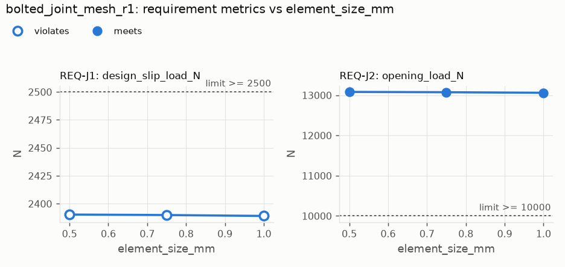
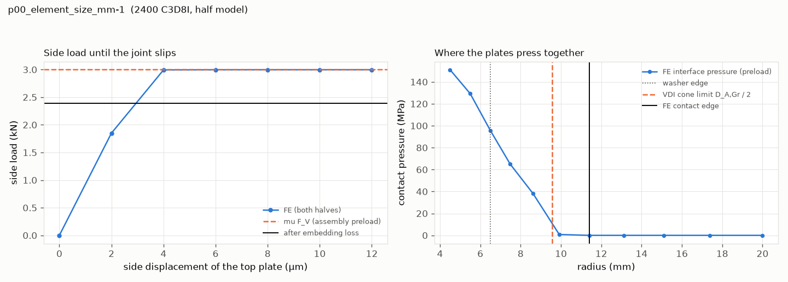
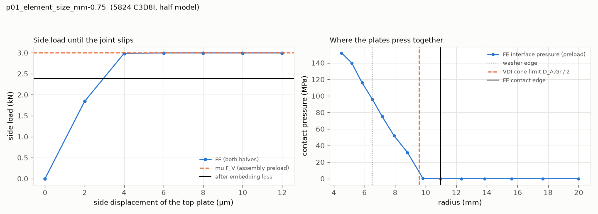
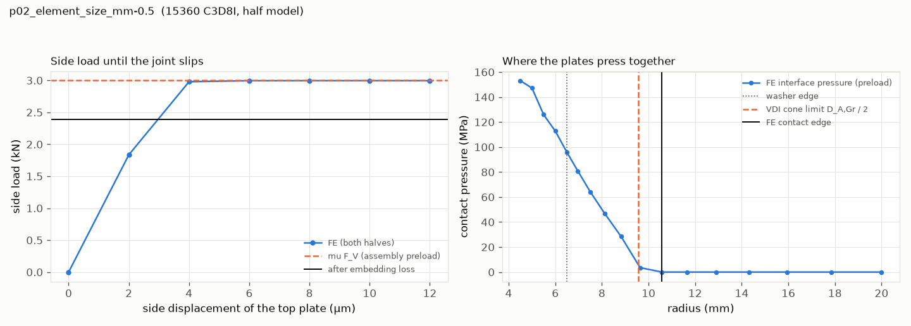

# Engineering review report: bolted_joint_mesh_r1

- **Run:** `20261121-110554_bolted_joint_mesh_r1`
- **Generated:** 2026-11-21T17:17:56+00:00
- **Case file SHA-256:** `777156979a9d6c6ae0b11b2585110a9eea35d7becb7c45b9fa9ba52afb9dd209`
- **Environment:** Python 3.14.10, numpy 2.5.5, scipy 1.18.1, matplotlib 3.11.2, cadquery 2.8.0; Windows-11-10.0.26100-SP0
- **Tools:** CalculiX This is Version 2.22
- **Code version:** git `6e284df9a6dafeff85f0f748867344118bca9ad0` (uncommitted changes present)
- **Simulation status:** completed
- **Verification status:** PASS

## Scope

Two 6 mm steel plates clamped by an M8 8.8 bolt at 15 kN, friction 0.2: CalculiX half model with penalty friction contact, clamp then side displacement to gross slip; joint diagram with VDI 2230 bolt compliance and embedding; element size 1.0 / 0.75 / 0.5 mm; each point also solved with the plates 100 times stiffer to extrapolate the slip load to a rigid interface.

**Assumptions**

- The bolt acts through its clamp force: uniform pressure on the washer annuli (head and nut bearing areas); its shank is not modelled and must not touch the hole (checked: slip displacement below the 0.5 mm clearance).
- Coulomb friction, mu = 0.2 at the plate interface (dry machined steel): synthetic.
- Clamped region represented by circular plates of 40 mm diameter (the VDI substitute body; checked: the pressure cone fits inside).
- Embedding (settling) 9.5 um: VDI 2230 Table 5 for Rz < 10 um, axial load (thread 3, head 2.5, nut 2.5, one interface 1.5): synthetic surface finish.
- Axial load introduced at mid-thickness of the plates (load introduction factor n = 0.5): synthetic.
- Linear elastic steel, small displacement.

## Requirements

| ID | Requirement | Metric | Limit |
|---|---|---|---|
| REQ-J1 | After settling, the joint shall carry 2.5 kN of side load by friction before slipping (2 kN service load, safety 1.25 against slip). | `design_slip_load_N` | >= 2500 N |
| REQ-J2 | After settling, the joint shall not open under a 10 kN axial separating load. | `opening_load_N` | >= 10000 N |

## Summary across points

| Point | element_size_mm | REQ-J1 | REQ-J2 | Checks |
|---|---|---|---|---|
| p00_element_size_mm-1 | 1 | 2389 N: **FAIL** | 1.306e+04 N: **PASS** | 10/10 PASS |
| p01_element_size_mm-0.75 | 0.75 | 2390 N: **FAIL** | 1.307e+04 N: **PASS** | 10/10 PASS |
| p02_element_size_mm-0.5 | 0.5 | 2390 N: **FAIL** | 1.308e+04 N: **PASS** | 10/10 PASS |

## Run-level checks

Checks that use several points together (for example mesh convergence).

| Check | Description | Value | Tolerance | Status |
|---|---|---|---|---|
| discretization_design_slip_load_N | relative discretization uncertainty of design_slip_load_N, monotone (R = 0.531): GCI_fine, observed order 2.90, extrapolated 2390.52 | 0.000101 | 0.01 | PASS |
| discretization_opening_load_N | relative discretization uncertainty of opening_load_N, monotone (R = 0.552): GCI_fine, observed order 2.78, extrapolated 13085.4 | 0.000349 | 0.01 | PASS |

## Point details

### p00_element_size_mm-1

Parameters: plate_outer_diameter_mm = 40, hole_diameter_mm = 9, washer_diameter_mm = 13, top_thickness_mm = 6, bottom_thickness_mm = 6, youngs_modulus_MPa = 2.1e+05, poisson_ratio = 0.3, preload_N = 1.5e+04, friction_coefficient = 0.2, element_size_mm = 1, contact_stiffness_factor = 50, stick_slope_factor = 50, slip_displacement_mm = 0.012, slip_increments = 6, bolt_thread = M8, bolt_shank_length_mm = 8, bolt_free_thread_length_mm = 4, bolt_proof_stress_MPa = 600, embedding_um = 9.5, load_introduction_factor = 0.5

Derived: bolt_compliance_mm_per_N = 2.6e-06, plate_compliance_vdi_mm_per_N = 4.513e-07, cone_limit_diameter_mm = 19.11, slip_load_vdi_N = 3000, embedding_loss_vdi_N = 3113, load_factor_vdi = 0.07394, opening_load_vdi_N = 1.284e+04, design_slip_load_vdi_N = 2377, bolt_stress_area_mm2 = 36.61, bolt_preload_stress_MPa = 409.8, hole_clearance_mm = 0.5

| Requirement | Result | Limit | Margin | Verdict | Evidence |
|---|---|---|---|---|---|
| REQ-J1 | 2389 N | >= 2500 | -111 | **FAIL** | [point.json](points/p00_element_size_mm-1/point.json) |
| REQ-J2 | 1.306e+04 N | >= 10000 | 3.06e+03 | **PASS** | [point.json](points/p00_element_size_mm-1/point.json) |

| Check | Description | Value | Tolerance | Status |
|---|---|---|---|---|
| slip_rigid_limit | |slip load extrapolated to a rigid interface (E and 100 E, linear in 1/E) - mu F_V| / mu F_V (Coulomb: exact) | 1.21e-07 | 1e-05 | PASS |
| slip_deformable | |slip load (FE, gross slip) - mu F_V| / mu F_V (model form: the interface tilts by about the strain under the side load) | 1.32e-03 | 5e-03 | PASS |
| gross_slip_reached | spread of the rim force over the last three increments / force (a plateau: the whole interface slides) | 2.54e-05 | 1e-04 | PASS |
| clamp_force_balance | |z reaction at the support| / (F_V / 2) (the clamp forces balance; none lost into a support) | 1.62e-16 | 1e-06 | PASS |
| shear_balance | |top rim force + bottom rim force| / rim force, last increment | 0.00e+00 | 1e-06 | PASS |
| plate_compliance_reference | |plate compliance FE - VDI 2230 pressure cone| / VDI (model form; the plates are about 15 % of the joint compliance) | 1.66e-01 | 2e-01 | PASS |
| contact_diameter_reference | |interface contact diameter FE - VDI cone limit D_A,Gr| / D_A,Gr (model form) | 1.94e-01 | 2e-01 | PASS |
| cone_fits (validity) | VDI cone limit diameter / plate diameter (cone formula valid at or below 1) | 4.78e-01 | 1e+00 | PASS |
| no_bolt_bearing (validity) | slip displacement / hole clearance (the bolt shank is not modelled: it must not touch the hole) | 2.40e-02 | 1e+00 | PASS |
| bolt_within_proof (validity) | preload stress in the bolt / proof stress | 6.83e-01 | 9e-01 | PASS |

### p01_element_size_mm-0.75

Parameters: plate_outer_diameter_mm = 40, hole_diameter_mm = 9, washer_diameter_mm = 13, top_thickness_mm = 6, bottom_thickness_mm = 6, youngs_modulus_MPa = 2.1e+05, poisson_ratio = 0.3, preload_N = 1.5e+04, friction_coefficient = 0.2, element_size_mm = 0.75, contact_stiffness_factor = 50, stick_slope_factor = 50, slip_displacement_mm = 0.012, slip_increments = 6, bolt_thread = M8, bolt_shank_length_mm = 8, bolt_free_thread_length_mm = 4, bolt_proof_stress_MPa = 600, embedding_um = 9.5, load_introduction_factor = 0.5

Derived: bolt_compliance_mm_per_N = 2.6e-06, plate_compliance_vdi_mm_per_N = 4.513e-07, cone_limit_diameter_mm = 19.11, slip_load_vdi_N = 3000, embedding_loss_vdi_N = 3113, load_factor_vdi = 0.07394, opening_load_vdi_N = 1.284e+04, design_slip_load_vdi_N = 2377, bolt_stress_area_mm2 = 36.61, bolt_preload_stress_MPa = 409.8, hole_clearance_mm = 0.5

| Requirement | Result | Limit | Margin | Verdict | Evidence |
|---|---|---|---|---|---|
| REQ-J1 | 2390 N | >= 2500 | -110 | **FAIL** | [point.json](points/p01_element_size_mm-0.75/point.json) |
| REQ-J2 | 1.307e+04 N | >= 10000 | 3.07e+03 | **PASS** | [point.json](points/p01_element_size_mm-0.75/point.json) |

| Check | Description | Value | Tolerance | Status |
|---|---|---|---|---|
| slip_rigid_limit | |slip load extrapolated to a rigid interface (E and 100 E, linear in 1/E) - mu F_V| / mu F_V (Coulomb: exact) | 2.76e-07 | 1e-05 | PASS |
| slip_deformable | |slip load (FE, gross slip) - mu F_V| / mu F_V (model form: the interface tilts by about the strain under the side load) | 1.36e-03 | 5e-03 | PASS |
| gross_slip_reached | spread of the rim force over the last three increments / force (a plateau: the whole interface slides) | 3.27e-05 | 1e-04 | PASS |
| clamp_force_balance | |z reaction at the support| / (F_V / 2) (the clamp forces balance; none lost into a support) | 1.83e-18 | 1e-06 | PASS |
| shear_balance | |top rim force + bottom rim force| / rim force, last increment | 0.00e+00 | 1e-06 | PASS |
| plate_compliance_reference | |plate compliance FE - VDI 2230 pressure cone| / VDI (model form; the plates are about 15 % of the joint compliance) | 1.76e-01 | 2e-01 | PASS |
| contact_diameter_reference | |interface contact diameter FE - VDI cone limit D_A,Gr| / D_A,Gr (model form) | 1.49e-01 | 2e-01 | PASS |
| cone_fits (validity) | VDI cone limit diameter / plate diameter (cone formula valid at or below 1) | 4.78e-01 | 1e+00 | PASS |
| no_bolt_bearing (validity) | slip displacement / hole clearance (the bolt shank is not modelled: it must not touch the hole) | 2.40e-02 | 1e+00 | PASS |
| bolt_within_proof (validity) | preload stress in the bolt / proof stress | 6.83e-01 | 9e-01 | PASS |

### p02_element_size_mm-0.5

Parameters: plate_outer_diameter_mm = 40, hole_diameter_mm = 9, washer_diameter_mm = 13, top_thickness_mm = 6, bottom_thickness_mm = 6, youngs_modulus_MPa = 2.1e+05, poisson_ratio = 0.3, preload_N = 1.5e+04, friction_coefficient = 0.2, element_size_mm = 0.5, contact_stiffness_factor = 50, stick_slope_factor = 50, slip_displacement_mm = 0.012, slip_increments = 6, bolt_thread = M8, bolt_shank_length_mm = 8, bolt_free_thread_length_mm = 4, bolt_proof_stress_MPa = 600, embedding_um = 9.5, load_introduction_factor = 0.5

Derived: bolt_compliance_mm_per_N = 2.6e-06, plate_compliance_vdi_mm_per_N = 4.513e-07, cone_limit_diameter_mm = 19.11, slip_load_vdi_N = 3000, embedding_loss_vdi_N = 3113, load_factor_vdi = 0.07394, opening_load_vdi_N = 1.284e+04, design_slip_load_vdi_N = 2377, bolt_stress_area_mm2 = 36.61, bolt_preload_stress_MPa = 409.8, hole_clearance_mm = 0.5

| Requirement | Result | Limit | Margin | Verdict | Evidence |
|---|---|---|---|---|---|
| REQ-J1 | 2390 N | >= 2500 | -110 | **FAIL** | [point.json](points/p02_element_size_mm-0.5/point.json) |
| REQ-J2 | 1.308e+04 N | >= 10000 | 3.08e+03 | **PASS** | [point.json](points/p02_element_size_mm-0.5/point.json) |

| Check | Description | Value | Tolerance | Status |
|---|---|---|---|---|
| slip_rigid_limit | |slip load extrapolated to a rigid interface (E and 100 E, linear in 1/E) - mu F_V| / mu F_V (Coulomb: exact) | 1.10e-07 | 1e-05 | PASS |
| slip_deformable | |slip load (FE, gross slip) - mu F_V| / mu F_V (model form: the interface tilts by about the strain under the side load) | 1.39e-03 | 5e-03 | PASS |
| gross_slip_reached | spread of the rim force over the last three increments / force (a plateau: the whole interface slides) | 4.01e-05 | 1e-04 | PASS |
| clamp_force_balance | |z reaction at the support| / (F_V / 2) (the clamp forces balance; none lost into a support) | 8.85e-17 | 1e-06 | PASS |
| shear_balance | |top rim force + bottom rim force| / rim force, last increment | 0.00e+00 | 1e-06 | PASS |
| plate_compliance_reference | |plate compliance FE - VDI 2230 pressure cone| / VDI (model form; the plates are about 15 % of the joint compliance) | 1.82e-01 | 2e-01 | PASS |
| contact_diameter_reference | |interface contact diameter FE - VDI cone limit D_A,Gr| / D_A,Gr (model form) | 1.07e-01 | 2e-01 | PASS |
| cone_fits (validity) | VDI cone limit diameter / plate diameter (cone formula valid at or below 1) | 4.78e-01 | 1e+00 | PASS |
| no_bolt_bearing (validity) | slip displacement / hole clearance (the bolt shank is not modelled: it must not touch the hole) | 2.40e-02 | 1e+00 | PASS |
| bolt_within_proof (validity) | preload stress in the bolt / proof stress | 6.83e-01 | 9e-01 | PASS |

## Limitations

- No tightening torque scatter (VDI alpha_A): the 15 kN is the minimum preload assumed after tightening.
- Bolt compliance, embedding and the load factor come from VDI 2230 (hand method), not from a modelled bolt.
- Slip under a static side load only; no cyclic loading, fretting or self-loosening.
- No physical test data.
- A converged solver run that matches an analytical reference shows that the equations were solved correctly. It does not show that the equations represent real hardware.

## Engineering acceptance

Pending human review. This report does not accept or reject the design.
