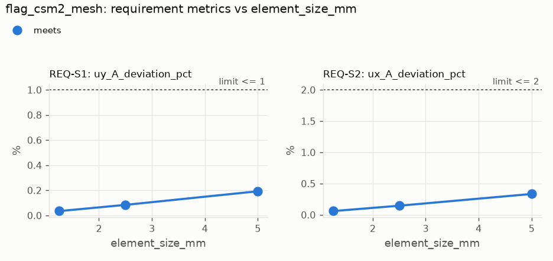
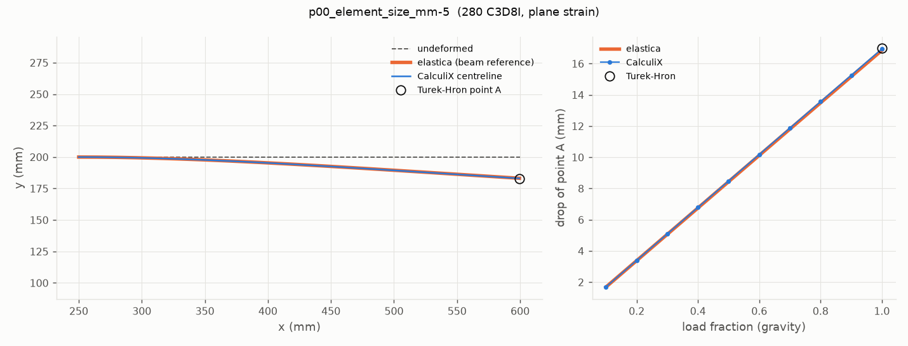
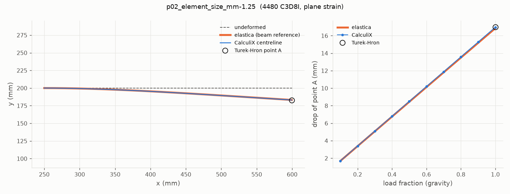

# Engineering review report: flag_csm2_mesh

- **Run:** `20261121-131133_flag_csm2_mesh`
- **Generated:** 2026-11-21T18:11:50+00:00
- **Case file SHA-256:** `ee580b7d5681914b4c75c928b1cac788c53a25c952354a0453cbcf8f7d3c4567`
- **Environment:** Python 3.14.10, numpy 2.5.5, scipy 1.18.1, matplotlib 3.11.2, cadquery 2.8.0; Windows-11-10.0.26100-SP0
- **Tools:** CalculiX This is Version 2.22
- **Code version:** git `fea8e67765680000672273b44ac416863a8bbcdd` (uncommitted changes present)
- **Simulation status:** completed
- **Verification status:** PASS

## Scope

Turek-Hron CSM2: the elastic flag alone (plane strain, St. Venant-Kirchhoff, mu_s 2 MPa, nu 0.4, rho 1000 kg/m3) clamped on the cylinder and bent by gravity (2 m/s2); CalculiX NLGEOM static, C3D8I elements of 5 / 2.5 / 1.25 mm; checked against the benchmark, a large-deflection elastica and beam vibration theory.

**Assumptions**

- Plane strain, per unit depth: the benchmark is 2D, and the elastica only matches it with the plane-strain modulus E / (1 - nu^2) (plane stress would give a 17 % larger drop).
- St. Venant-Kirchhoff material (CalculiX *ELASTIC under NLGEOM), as the benchmark defines it.
- The cylinder is rigid: the flag's left end, on the cylinder arc, is fully clamped.
- Gravity is a dead load applied in equal increments; the static solution is path independent (elastic).

## Requirements

| ID | Requirement | Metric | Limit |
|---|---|---|---|
| REQ-S1 | Before it is coupled to the fluid, the solid model shall reproduce the Turek-Hron CSM2 vertical displacement of point A within 1 %. | `uy_A_deviation_pct` | <= 1 % |
| REQ-S2 | It shall reproduce the CSM2 horizontal displacement of point A within 2 % (a second-order quantity, about a tenth of the vertical one). | `ux_A_deviation_pct` | <= 2 % |

## Summary across points

| Point | element_size_mm | REQ-S1 | REQ-S2 | Checks |
|---|---|---|---|---|
| p00_element_size_mm-5 | 5 | 0.192 %: **PASS** | 0.3334 %: **PASS** | 8/8 PASS |
| p01_element_size_mm-2.5 | 2.5 | 0.0836 %: **PASS** | 0.1453 %: **PASS** | 8/8 PASS |
| p02_element_size_mm-1.25 | 1.25 | 0.03411 %: **PASS** | 0.05917 %: **PASS** | 8/8 PASS |

## Run-level checks

Checks that use several points together (for example mesh convergence).

| Check | Description | Value | Tolerance | Status |
|---|---|---|---|---|
| discretization_ux_A_mm | relative discretization uncertainty of ux_A_mm, monotone (R = 0.458): GCI_fine, observed order 1.13, extrapolated -0.469064 | 0.00091 | 0.01 | PASS |
| discretization_uy_A_mm | relative discretization uncertainty of uy_A_mm, monotone (R = 0.457): GCI_fine, observed order 1.13, extrapolated -16.9752 | 0.00052 | 0.01 | PASS |
| discretization_first_frequency_Hz | relative discretization uncertainty of first_frequency_Hz, monotone (R = 0.439): GCI_fine, observed order 1.19, extrapolated 2.14353 | 0.000254 | 0.01 | PASS |

## Point details

### p00_element_size_mm-5

Parameters: shear_modulus_Pa = 2e+06, density_kg_per_m3 = 1000, poisson_ratio = 0.4, gravity_m_per_s2 = 2, flag_length_m = 0.35, flag_height_m = 0.02, cylinder_radius_m = 0.05, element_size_mm = 5, benchmark_ux_A_mm = -0.469, benchmark_uy_A_mm = -16.97

Derived: youngs_modulus_Pa = 5.6e+06, load_parameter_qL3_over_EI = 0.3859, linear_uy_A_mm = -16.88, elastica_ux_A_mm = -0.4639, elastica_uy_A_mm = -16.85, beam_frequency_Hz = 2.153, height_over_length = 0.05714

| Requirement | Result | Limit | Margin | Verdict | Evidence |
|---|---|---|---|---|---|
| REQ-S1 | 0.192 % | <= 1 | 0.808 | **PASS** | [point.json](points/p00_element_size_mm-5/point.json) |
| REQ-S2 | 0.3334 % | <= 2 | 1.67 | **PASS** | [point.json](points/p00_element_size_mm-5/point.json) |

| Check | Description | Value | Tolerance | Status |
|---|---|---|---|---|
| increments_complete | static step reached the full load (1 = not) | 0.00e+00 | 5e-01 | PASS |
| equilibrium | |clamp reaction - weight carried through the elements| / weight (the weight lumped on the clamp nodes is excluded from CalculiX's reaction total) | 2.39e-07 | 1e-06 | PASS |
| elastica_uy | |uy(A) - elastica| / |elastica| (model form: inextensible beam, root on a straight line) | 5.38e-03 | 2e-02 | PASS |
| elastica_ux | |ux(A) - elastica| / |elastica| (model form) | 7.57e-03 | 3e-02 | PASS |
| load_path | max over increments of |uy(A) - elastica at that load| / |elastica uy at full load| (model form) | 5.38e-03 | 2e-02 | PASS |
| deflected_shape | max |centreline y - elastica y| at the same x / |elastica uy(A)| (model form) | 5.39e-03 | 2e-02 | PASS |
| frequency_reference | |f1 FE - Euler-Bernoulli cantilever| / beam value (model form) | 3.54e-03 | 2e-02 | PASS |
| slender (validity) | height / length (beam references) | 5.71e-02 | 1e-01 | PASS |

### p01_element_size_mm-2.5

Parameters: shear_modulus_Pa = 2e+06, density_kg_per_m3 = 1000, poisson_ratio = 0.4, gravity_m_per_s2 = 2, flag_length_m = 0.35, flag_height_m = 0.02, cylinder_radius_m = 0.05, element_size_mm = 2.5, benchmark_ux_A_mm = -0.469, benchmark_uy_A_mm = -16.97

Derived: youngs_modulus_Pa = 5.6e+06, load_parameter_qL3_over_EI = 0.3859, linear_uy_A_mm = -16.88, elastica_ux_A_mm = -0.4639, elastica_uy_A_mm = -16.85, beam_frequency_Hz = 2.153, height_over_length = 0.05714

| Requirement | Result | Limit | Margin | Verdict | Evidence |
|---|---|---|---|---|---|
| REQ-S1 | 0.0836 % | <= 1 | 0.916 | **PASS** | [point.json](points/p01_element_size_mm-2.5/point.json) |
| REQ-S2 | 0.1453 % | <= 2 | 1.85 | **PASS** | [point.json](points/p01_element_size_mm-2.5/point.json) |

| Check | Description | Value | Tolerance | Status |
|---|---|---|---|---|
| increments_complete | static step reached the full load (1 = not) | 0.00e+00 | 5e-01 | PASS |
| equilibrium | |clamp reaction - weight carried through the elements| / weight (the weight lumped on the clamp nodes is excluded from CalculiX's reaction total) | 1.94e-08 | 1e-06 | PASS |
| elastica_uy | |uy(A) - elastica| / |elastica| (model form: inextensible beam, root on a straight line) | 6.47e-03 | 2e-02 | PASS |
| elastica_ux | |ux(A) - elastica| / |elastica| (model form) | 9.47e-03 | 3e-02 | PASS |
| load_path | max over increments of |uy(A) - elastica at that load| / |elastica uy at full load| (model form) | 6.47e-03 | 2e-02 | PASS |
| deflected_shape | max |centreline y - elastica y| at the same x / |elastica uy(A)| (model form) | 6.49e-03 | 2e-02 | PASS |
| frequency_reference | |f1 FE - Euler-Bernoulli cantilever| / beam value (model form) | 4.13e-03 | 2e-02 | PASS |
| slender (validity) | height / length (beam references) | 5.71e-02 | 1e-01 | PASS |

### p02_element_size_mm-1.25

Parameters: shear_modulus_Pa = 2e+06, density_kg_per_m3 = 1000, poisson_ratio = 0.4, gravity_m_per_s2 = 2, flag_length_m = 0.35, flag_height_m = 0.02, cylinder_radius_m = 0.05, element_size_mm = 1.25, benchmark_ux_A_mm = -0.469, benchmark_uy_A_mm = -16.97

Derived: youngs_modulus_Pa = 5.6e+06, load_parameter_qL3_over_EI = 0.3859, linear_uy_A_mm = -16.88, elastica_ux_A_mm = -0.4639, elastica_uy_A_mm = -16.85, beam_frequency_Hz = 2.153, height_over_length = 0.05714

| Requirement | Result | Limit | Margin | Verdict | Evidence |
|---|---|---|---|---|---|
| REQ-S1 | 0.03411 % | <= 1 | 0.966 | **PASS** | [point.json](points/p02_element_size_mm-1.25/point.json) |
| REQ-S2 | 0.05917 % | <= 2 | 1.94 | **PASS** | [point.json](points/p02_element_size_mm-1.25/point.json) |

| Check | Description | Value | Tolerance | Status |
|---|---|---|---|---|
| increments_complete | static step reached the full load (1 = not) | 0.00e+00 | 5e-01 | PASS |
| equilibrium | |clamp reaction - weight carried through the elements| / weight (the weight lumped on the clamp nodes is excluded from CalculiX's reaction total) | 2.38e-07 | 1e-06 | PASS |
| elastica_uy | |uy(A) - elastica| / |elastica| (model form: inextensible beam, root on a straight line) | 6.97e-03 | 2e-02 | PASS |
| elastica_ux | |ux(A) - elastica| / |elastica| (model form) | 1.03e-02 | 3e-02 | PASS |
| load_path | max over increments of |uy(A) - elastica at that load| / |elastica uy at full load| (model form) | 6.97e-03 | 2e-02 | PASS |
| deflected_shape | max |centreline y - elastica y| at the same x / |elastica uy(A)| (model form) | 6.99e-03 | 2e-02 | PASS |
| frequency_reference | |f1 FE - Euler-Bernoulli cantilever| / beam value (model form) | 4.39e-03 | 2e-02 | PASS |
| slender (validity) | height / length (beam references) | 5.71e-02 | 1e-01 | PASS |

## Limitations

- A solver-qualification case: it shows that the solid participant reproduces the published solid-only results, not that the coupled FSI result is right.
- The elastica is a beam model (no shear, straight root, inextensible), so it bounds the FE to about 1 %, not to the benchmark's digits.
- A converged solver run that matches an analytical reference shows that the equations were solved correctly. It does not show that the equations represent real hardware.

## Engineering acceptance

Pending human review. This report does not accept or reject the design.
