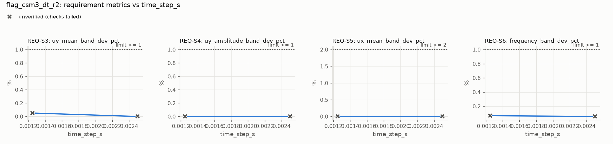
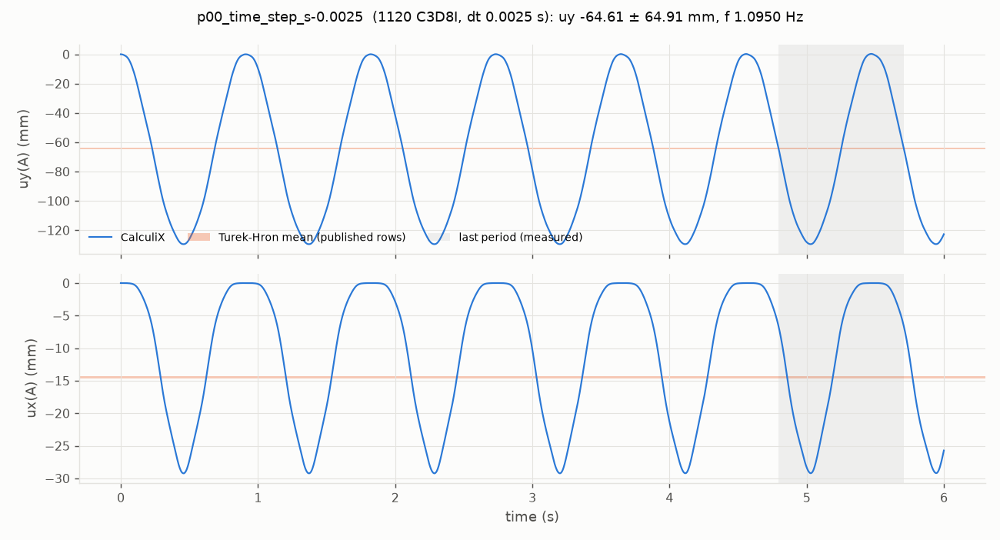
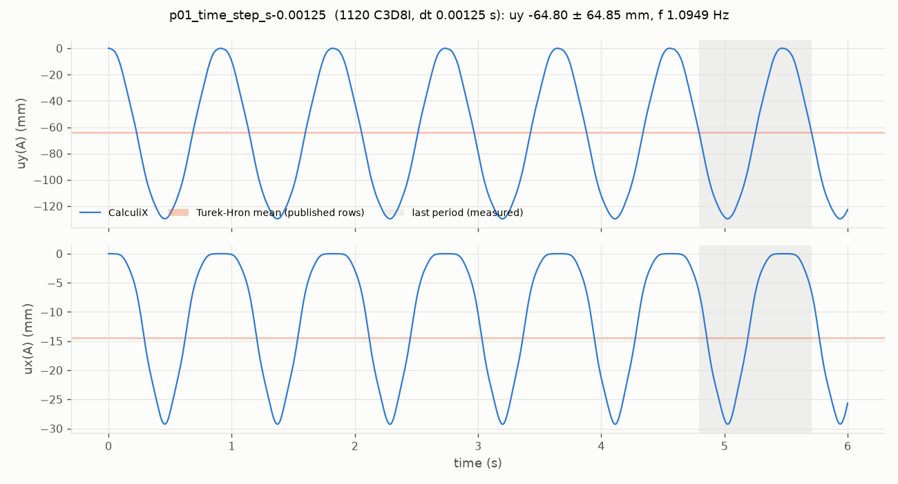

# Engineering review report: flag_csm3_dt_r2

- **Run:** `20261121-164522_flag_csm3_dt_r2`
- **Generated:** 2026-11-21T23:40:14+00:00
- **Case file SHA-256:** `feb85a90db3f9351763b6bf81567e8cc6f966b067218b0347a616c48c2d6537a`
- **Environment:** Python 3.14.10, numpy 2.5.5, scipy 1.18.1, matplotlib 3.11.2, cadquery 2.8.0; Windows-11-10.0.26100-SP0
- **Tools:** CalculiX This is Version 2.22
- **Code version:** git `4582fe5649a4da94a432af7b5fb00c6c8d5772e2` (uncommitted changes present)
- **Simulation status:** partial
- **Verification status:** FAIL

> **Warning:** verification did not pass for every point. Requirement verdicts marked *(unverified)* are not supported by evidence and must not be used for acceptance.

## Scope

Turek-Hron CSM3: the elastic flag (plane strain, St. Venant-Kirchhoff, mu_s 0.5 MPa, nu 0.4, rho 1000 kg/m3) released from rest under gravity (2 m/s2) and left to swing undamped; CalculiX NLGEOM *DYNAMIC (trapezoidal rule), 2.5 mm C3D8I, time step 0.0025 / 0.00125 / 0.000625 s, 6 s; checked against the published band, a small-amplitude companion run, the modal frequency and beam theory.

**Assumptions**

- Plane strain, per unit depth (established in flag_csm1_mesh).
- St. Venant-Kirchhoff material (CalculiX *ELASTIC under NLGEOM), as the benchmark defines it.
- No damping, physical or numerical (ALPHA = 0), so the oscillation should repeat exactly.
- 2.5 mm elements: the static mesh study (flag_csm1_mesh) puts uy(A) at this size 0.09 % from its extrapolated value.

## Requirements

| ID | Requirement | Metric | Limit |
|---|---|---|---|
| REQ-S3 | The solid model shall reproduce the CSM3 mean vertical displacement of point A inside the band of the published rows, or within 1 % of its nearest edge. | `uy_mean_band_dev_pct` | <= 1 % |
| REQ-S4 | It shall reproduce the CSM3 vertical amplitude of point A inside the published band, or within 1 % of its nearest edge. | `uy_amplitude_band_dev_pct` | <= 1 % |
| REQ-S5 | It shall reproduce the CSM3 mean horizontal displacement of point A inside the published band, or within 2 % of its nearest edge. | `ux_mean_band_dev_pct` | <= 2 % |
| REQ-S6 | It shall reproduce the CSM3 oscillation frequency inside the published band, or within 1 % of its nearest edge. | `frequency_band_dev_pct` | <= 1 % |

## Summary across points

| Point | time_step_s | REQ-S3 | REQ-S4 | REQ-S5 | REQ-S6 | Checks |
|---|---|---|---|---|---|---|
| p00_time_step_s-0.0025 | 0.0025 | 0 %: **PASS (unverified)** | 0 %: **PASS (unverified)** | 0 %: **PASS (unverified)** | 0.0549 %: **PASS (unverified)** | 7/7 PASS |
| p01_time_step_s-0.00125 | 0.00125 | 0.05096 %: **PASS (unverified)** | 0 %: **PASS (unverified)** | 0 %: **PASS (unverified)** | 0.06585 %: **PASS (unverified)** | 7/7 PASS |
| p02_time_step_s-0.000625 | 0.000625 | - %: **NO RESULT** | - %: **NO RESULT** | - %: **NO RESULT** | - %: **NO RESULT** | 0/0 NOT_RUN |

## Run-level checks

Checks that use several points together (for example mesh convergence).

| Check | Description | Value | Tolerance | Status |
|---|---|---|---|---|
| time_step_convergence | needs >= 3 completed time steps | inf | 0 | FAIL |

A failed run-level check withholds the verdicts of all requirements at every point: they are marked *(unverified)* in the table above.

## Point details

### p00_time_step_s-0.0025

Parameters: density_kg_per_m3 = 1000, shear_modulus_Pa = 5e+05, poisson_ratio = 0.4, gravity_m_per_s2 = 2, flag_length_m = 0.35, flag_height_m = 0.02, cylinder_radius_m = 0.05, element_size_mm = 2.5, time_step_s = 0.0025

Derived: beam_frequency_Hz = 1.077, steps_per_linear_period = 371.5, height_over_length = 0.05714

| Requirement | Result | Limit | Margin | Verdict | Evidence |
|---|---|---|---|---|---|
| REQ-S3 | 0 % | <= 1 | 1 | **PASS (unverified)** | [point.json](points/p00_time_step_s-0.0025/point.json) |
| REQ-S4 | 0 % | <= 1 | 1 | **PASS (unverified)** | [point.json](points/p00_time_step_s-0.0025/point.json) |
| REQ-S5 | 0 % | <= 2 | 2 | **PASS (unverified)** | [point.json](points/p00_time_step_s-0.0025/point.json) |
| REQ-S6 | 0.0549 % | <= 1 | 0.945 | **PASS (unverified)** | [point.json](points/p00_time_step_s-0.0025/point.json) |

| Check | Description | Value | Tolerance | Status |
|---|---|---|---|---|
| integrator_small_amplitude | |mean frequency over every period of a gravity/1000 run - linear modal f1| / f1 (the time integrator alone) | 1.83e-05 | 2e-03 | PASS |
| returns_to_start | max uy(A) over the last period / amplitude (undamped: the flag swings back to its undeformed height) | 4.50e-03 | 1e-02 | PASS |
| periodic_troughs | spread of the trough depths of uy(A) over all periods / mean depth | 9.18e-05 | 1e-02 | PASS |
| periodic_periods | spread of the periods / mean period | 1.24e-04 | 1e-02 | PASS |
| frequency_reference | |f1 modal - Euler-Bernoulli cantilever| / beam value (model form) | 4.13e-03 | 2e-02 | PASS |
| periods_seen | shortfall of full periods before the last one (needs >= 3) | 0.00e+00 | 5e-01 | PASS |
| steps_per_period (validity) | 50 / time steps per linear period (below 1: at least 50 steps a period, period error of the trapezoidal rule about (2 pi / 50)^2 / 12 = 0.13 %) | 1.35e-01 | 1e+00 | PASS |

### p01_time_step_s-0.00125

Parameters: density_kg_per_m3 = 1000, shear_modulus_Pa = 5e+05, poisson_ratio = 0.4, gravity_m_per_s2 = 2, flag_length_m = 0.35, flag_height_m = 0.02, cylinder_radius_m = 0.05, element_size_mm = 2.5, time_step_s = 0.00125

Derived: beam_frequency_Hz = 1.077, steps_per_linear_period = 743, height_over_length = 0.05714

| Requirement | Result | Limit | Margin | Verdict | Evidence |
|---|---|---|---|---|---|
| REQ-S3 | 0.05096 % | <= 1 | 0.949 | **PASS (unverified)** | [point.json](points/p01_time_step_s-0.00125/point.json) |
| REQ-S4 | 0 % | <= 1 | 1 | **PASS (unverified)** | [point.json](points/p01_time_step_s-0.00125/point.json) |
| REQ-S5 | 0 % | <= 2 | 2 | **PASS (unverified)** | [point.json](points/p01_time_step_s-0.00125/point.json) |
| REQ-S6 | 0.06585 % | <= 1 | 0.934 | **PASS (unverified)** | [point.json](points/p01_time_step_s-0.00125/point.json) |

| Check | Description | Value | Tolerance | Status |
|---|---|---|---|---|
| integrator_small_amplitude | |mean frequency over every period of a gravity/1000 run - linear modal f1| / f1 (the time integrator alone) | 2.83e-05 | 2e-03 | PASS |
| returns_to_start | max uy(A) over the last period / amplitude (undamped: the flag swings back to its undeformed height) | 7.41e-04 | 1e-02 | PASS |
| periodic_troughs | spread of the trough depths of uy(A) over all periods / mean depth | 9.63e-04 | 1e-02 | PASS |
| periodic_periods | spread of the periods / mean period | 1.75e-04 | 1e-02 | PASS |
| frequency_reference | |f1 modal - Euler-Bernoulli cantilever| / beam value (model form) | 4.13e-03 | 2e-02 | PASS |
| periods_seen | shortfall of full periods before the last one (needs >= 3) | 0.00e+00 | 5e-01 | PASS |
| steps_per_period (validity) | 50 / time steps per linear period (below 1: at least 50 steps a period, period error of the trapezoidal rule about (2 pi / 50)^2 / 12 = 0.13 %) | 6.73e-02 | 1e+00 | PASS |

### p02_time_step_s-0.000625

Parameters: density_kg_per_m3 = 1000, shear_modulus_Pa = 5e+05, poisson_ratio = 0.4, gravity_m_per_s2 = 2, flag_length_m = 0.35, flag_height_m = 0.02, cylinder_radius_m = 0.05, element_size_mm = 2.5, time_step_s = 0.000625

Derived: beam_frequency_Hz = 1.077, steps_per_linear_period = 1486, height_over_length = 0.05714

| Requirement | Result | Limit | Margin | Verdict | Evidence |
|---|---|---|---|---|---|
| REQ-S3 | - % | <= 1 | - | **NO RESULT** | [point.json](points/p02_time_step_s-0.000625/point.json) |
| REQ-S4 | - % | <= 1 | - | **NO RESULT** | [point.json](points/p02_time_step_s-0.000625/point.json) |
| REQ-S5 | - % | <= 2 | - | **NO RESULT** | [point.json](points/p02_time_step_s-0.000625/point.json) |
| REQ-S6 | - % | <= 1 | - | **NO RESULT** | [point.json](points/p02_time_step_s-0.000625/point.json) |

No verification checks recorded (status: NOT_RUN).

## Limitations

- Time-step convergence only; the spatial error is taken from the static mesh study at the same size.
- The published rows are not labelled with their time step, so the reference is a band, not a value.
- A converged solver run that matches an analytical reference shows that the equations were solved correctly. It does not show that the equations represent real hardware.

## Engineering acceptance

Pending human review. This report does not accept or reject the design.
