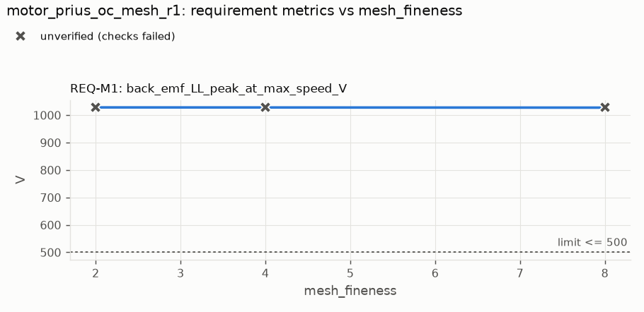
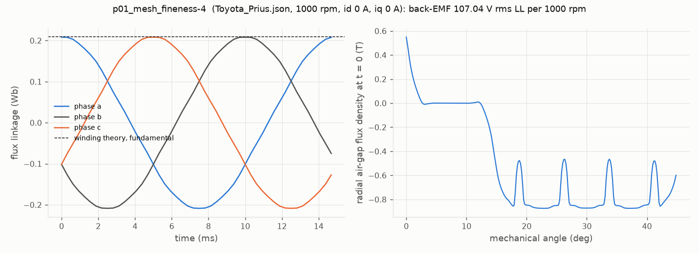
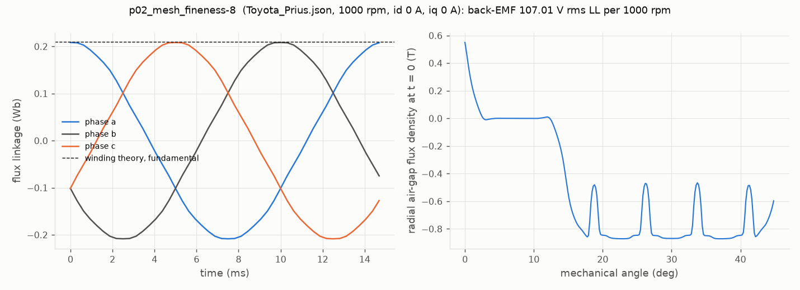

# Engineering review report: motor_prius_oc_mesh_r1

- **Run:** `20261121-194926_motor_prius_oc_mesh_r1`
- **Generated:** 2026-11-22T01:07:19+00:00
- **Case file SHA-256:** `dd790c92378b775d19b3bbebaa5eeea65e12b6dccdbcf2802ec3165df2f507ff`
- **Environment:** Python 3.14.10, numpy 2.5.5, scipy 1.18.1, matplotlib 3.11.2, cadquery 2.8.0; Windows-11-10.0.26100-SP0
- **Tools:** pyleecan 1.5.2; SciDataTool 2.5.0; numpy_pyleecan_env 2.5.5
- **Code version:** git `d8148ec7299e0968800032eadf7bf7e9d628ce34` (uncommitted changes present)
- **Simulation status:** completed
- **Verification status:** FAIL

> **Warning:** verification did not pass for every point. Requirement verdicts marked *(unverified)* are not supported by evidence and must not be used for acceptance.

## Scope

2004 Toyota Prius traction motor (48 slots, 8 poles, interior V magnets) at open circuit, 1000 rpm; Pyleecan + FEMM 4.2 magnetostatics over one electrical period (48 steps), mesh fineness 2 / 4 / 8; back-EMF and the uncontrolled-generator voltage at top speed.

**Assumptions**

- 2D magnetostatics (FEMM), no end effects: the stack (83.8 mm) is long against the air gap (0.75 mm), but end-winding leakage and axial fringing are not modelled.
- Magnet and lamination grades are Pyleecan's generic choices (NdFeB 1.24 T at 20 C; M400-50A), not Toyota's.
- Magnet temperature 20 C; Br falls about 0.1 %/K, so a hot motor has a lower back-EMF (stated, not modelled here).
- Maximum speed 6000 rpm, the commonly published rating for this motor; ORNL's design report tabulates ratings only up to base speed.

## Requirements

| ID | Requirement | Metric | Limit |
|---|---|---|---|
| REQ-M1 | With the inverter not switching (a fault at top speed), the line-to-line back-EMF peak at 6000 rpm shall not exceed the 500 V maximum bus voltage. | `back_emf_LL_peak_at_max_speed_V` | <= 500 V |

## Summary across points

| Point | mesh_fineness | REQ-M1 | Checks |
|---|---|---|---|
| p00_mesh_fineness-2 | 2 | 1028 V: **FAIL (unverified)** | 5/5 PASS |
| p01_mesh_fineness-4 | 4 | 1028 V: **FAIL (unverified)** | 5/5 PASS |
| p02_mesh_fineness-8 | 8 | 1027 V: **FAIL (unverified)** | 5/5 PASS |

## Run-level checks

Checks that use several points together (for example mesh convergence).

| Check | Description | Value | Tolerance | Status |
|---|---|---|---|---|
| discretization_back_emf_LL_peak_at_max_speed_V | relative discretization uncertainty of back_emf_LL_peak_at_max_speed_V, divergent (R = 2.666): no estimate | inf | 0.01 | FAIL |
| discretization_lambda1_Wb | relative discretization uncertainty of lambda1_Wb, monotone (R = 0.258): GCI_fine, observed order 1.95, extrapolated 0.208568 | 0.000107 | 0.01 | PASS |

A failed run-level check withholds the verdicts of requirements on `back_emf_LL_peak_at_max_speed_V` at every point: they are marked *(unverified)* in the table above.

## Point details

### p00_mesh_fineness-2

Parameters: machine = Toyota_Prius.json, speed_rpm = 1000, id_A = 0, iq_A = 0, mesh_fineness = 2, steps_per_period = 48, angle_points = 2048, max_speed_rpm = 6000, bus_voltage_V = 500, rated_torque_Nm = 400

Derived: speed_ratio_to_max = 6

| Requirement | Result | Limit | Margin | Verdict | Evidence |
|---|---|---|---|---|---|
| REQ-M1 | 1028 V | <= 500 | -528 | **FAIL (unverified)** | [point.json](points/p00_mesh_fineness-2/point.json) |

| Check | Description | Value | Tolerance | Status |
|---|---|---|---|---|
| phase_symmetry | spread of the three phases' fundamental flux linkage / mean | 3.91e-04 | 1e-03 | PASS |
| phase_shift | max |phase shift between phases - 120 deg| (deg) | 1.12e-01 | 5e-01 | PASS |
| winding_theory | |2 N k_w1 B_1 R L / p from the air-gap field - FEMM coil flux linkage| / FEMM (model form: mid-gap sampling, slot openings, leakage) | 5.53e-03 | 2e-02 | PASS |
| open_circuit_torque | |mean torque at zero current| / rated torque (no net torque without current) | 5.84e-05 | 1e-03 | PASS |
| time_resolution (validity) | 48 / steps per electrical period (below 1: at least 48) | 1.00e+00 | 1e+00 | PASS |

### p01_mesh_fineness-4

Parameters: machine = Toyota_Prius.json, speed_rpm = 1000, id_A = 0, iq_A = 0, mesh_fineness = 4, steps_per_period = 48, angle_points = 2048, max_speed_rpm = 6000, bus_voltage_V = 500, rated_torque_Nm = 400

Derived: speed_ratio_to_max = 6

| Requirement | Result | Limit | Margin | Verdict | Evidence |
|---|---|---|---|---|---|
| REQ-M1 | 1028 V | <= 500 | -528 | **FAIL (unverified)** | [point.json](points/p01_mesh_fineness-4/point.json) |

| Check | Description | Value | Tolerance | Status |
|---|---|---|---|---|
| phase_symmetry | spread of the three phases' fundamental flux linkage / mean | 2.21e-04 | 1e-03 | PASS |
| phase_shift | max |phase shift between phases - 120 deg| (deg) | 2.97e-02 | 5e-01 | PASS |
| winding_theory | |2 N k_w1 B_1 R L / p from the air-gap field - FEMM coil flux linkage| / FEMM (model form: mid-gap sampling, slot openings, leakage) | 5.62e-03 | 2e-02 | PASS |
| open_circuit_torque | |mean torque at zero current| / rated torque (no net torque without current) | 2.16e-05 | 1e-03 | PASS |
| time_resolution (validity) | 48 / steps per electrical period (below 1: at least 48) | 1.00e+00 | 1e+00 | PASS |

### p02_mesh_fineness-8

Parameters: machine = Toyota_Prius.json, speed_rpm = 1000, id_A = 0, iq_A = 0, mesh_fineness = 8, steps_per_period = 48, angle_points = 2048, max_speed_rpm = 6000, bus_voltage_V = 500, rated_torque_Nm = 400

Derived: speed_ratio_to_max = 6

| Requirement | Result | Limit | Margin | Verdict | Evidence |
|---|---|---|---|---|---|
| REQ-M1 | 1027 V | <= 500 | -527 | **FAIL (unverified)** | [point.json](points/p02_mesh_fineness-8/point.json) |

| Check | Description | Value | Tolerance | Status |
|---|---|---|---|---|
| phase_symmetry | spread of the three phases' fundamental flux linkage / mean | 1.66e-04 | 1e-03 | PASS |
| phase_shift | max |phase shift between phases - 120 deg| (deg) | 1.83e-02 | 5e-01 | PASS |
| winding_theory | |2 N k_w1 B_1 R L / p from the air-gap field - FEMM coil flux linkage| / FEMM (model form: mid-gap sampling, slot openings, leakage) | 5.45e-03 | 2e-02 | PASS |
| open_circuit_torque | |mean torque at zero current| / rated torque (no net torque without current) | 1.34e-06 | 1e-03 | PASS |
| time_resolution (validity) | 48 / steps per electrical period (below 1: at least 48) | 1.00e+00 | 1e+00 | PASS |

## Limitations

- No test data in this case: the ORNL comparison is a separate, blind step.
- Line-to-line peak from the phase flux linkages with their harmonics; the inverter's own clamping is not modelled.
- A converged solver run that matches an analytical reference shows that the equations were solved correctly. It does not show that the equations represent real hardware.

## Engineering acceptance

Pending human review. This report does not accept or reject the design.
