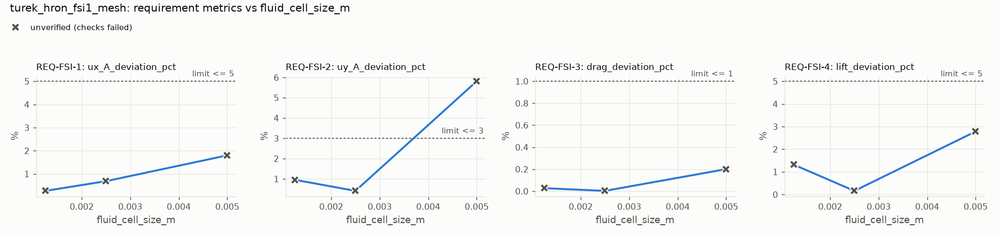
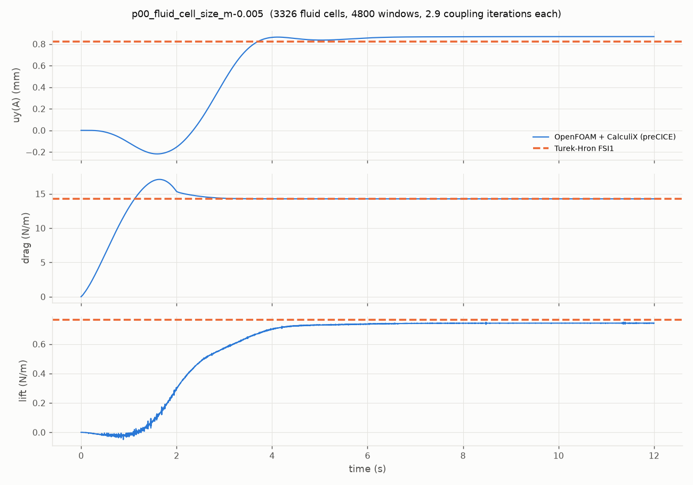
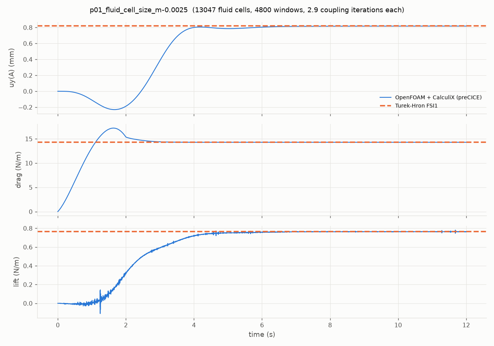
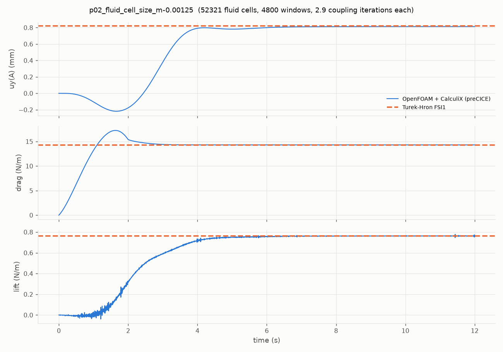

# Engineering review report: turek_hron_fsi1_mesh

- **Run:** `20261121-203031_turek_hron_fsi1_mesh`
- **Generated:** 2026-11-22T05:35:28+00:00
- **Case file SHA-256:** `45cfed698d6286eb25fc85c49ced6660127df6680c366f52e725f48fd4fa4df9`
- **Environment:** Python 3.14.10, numpy 2.5.5, scipy 1.18.1, matplotlib 3.11.2, cadquery 2.8.0; Windows-11-10.0.26100-SP0
- **Tools:** openfoam_bashrc /usr/lib/openfoam/openfoam2512/etc/bashrc; gmsh 4.15.0; openfoam_version v2512; openfoam_package openfoam2512 2512.0-2; precice 3.4.1; calculix_precice 2.20.2-1; linux Ubuntu 22.04.5 LTS
- **Code version:** git `3c379c1c390451ca752cba44ea7879ba428d5f94`
- **Simulation status:** completed
- **Verification status:** FAIL

> **Warning:** verification did not pass for every point. Requirement verdicts marked *(unverified)* are not supported by evidence and must not be used for acceptance.

## Scope

Turek-Hron FSI1: steady laminar flow (Re 20) bending the elastic flag behind the cylinder; OpenFOAM v2512 (moving mesh) coupled to CalculiX through preCICE; fluid cell size at the body 5 / 2.5 / 1.25 mm, solid 2.5 mm, dt 0.0025 s to 12 s; tip displacements, drag and lift against the published benchmark.

**Assumptions**

- 2D: one cell deep in the fluid, plane strain in the solid (one element layer, as deep as the fluid).
- St. Venant-Kirchhoff solid (CalculiX *ELASTIC under NLGEOM), no gravity, as the FSI tests define it.
- Steady target: numerical damping in the solid only speeds up settling (ALPHA -0.3).
- Inflow: the benchmark's parabola with its (1 - cos) ramp over 2 s.

## Requirements

| ID | Requirement | Metric | Limit |
|---|---|---|---|
| REQ-FSI-1 | The coupled model shall reproduce the Turek-Hron FSI1 horizontal displacement of point A within 5 % (a second-order quantity, 3 % of the vertical one). | `ux_A_deviation_pct` | <= 5 % |
| REQ-FSI-2 | It shall reproduce the FSI1 vertical displacement of point A within 3 %. | `uy_A_deviation_pct` | <= 3 % |
| REQ-FSI-3 | It shall reproduce the FSI1 drag within 1 %. | `drag_deviation_pct` | <= 1 % |
| REQ-FSI-4 | It shall reproduce the FSI1 lift within 5 % (lift is about 5 % of the drag and moved 30 % from the rigid CFD1 value once the flag bends). | `lift_deviation_pct` | <= 5 % |

## Summary across points

| Point | fluid_cell_size_m | REQ-FSI-1 | REQ-FSI-2 | REQ-FSI-3 | REQ-FSI-4 | Checks |
|---|---|---|---|---|---|---|
| p00_fluid_cell_size_m-0.005 | 0.005 | 1.798 %: **PASS (unverified)** | 5.813 %: **FAIL (unverified)** | 0.2003 %: **PASS (unverified)** | 2.781 %: **PASS (unverified)** | 5/6 FAIL |
| p01_fluid_cell_size_m-0.0025 | 0.0025 | 0.6841 %: **PASS (unverified)** | 0.4086 %: **PASS (unverified)** | 0.002557 %: **PASS (unverified)** | 0.1596 %: **PASS (unverified)** | 5/6 FAIL |
| p02_fluid_cell_size_m-0.00125 | 0.00125 | 0.2657 %: **PASS (unverified)** | 0.955 %: **PASS (unverified)** | 0.02694 %: **PASS (unverified)** | 1.316 %: **PASS (unverified)** | 4/6 FAIL |

## Run-level checks

Checks that use several points together (for example mesh convergence).

| Check | Description | Value | Tolerance | Status |
|---|---|---|---|---|
| discretization_ux_A_m | relative discretization uncertainty of ux_A_m, monotone (R = 0.376): GCI_fine, observed order 1.41, extrapolated 2.27018e-05 | 0.00316 | 0.01 | PASS |
| discretization_uy_A_m | relative discretization uncertainty of uy_A_m, anomalous: observed order 3.51 is far above the design order 2, so the solutions are not in the asymptotic range (singularity or coincidence); no estimate | inf | 0.01 | FAIL |
| discretization_drag_N_per_m | relative discretization uncertainty of drag_N_per_m, monotone (R = 0.149): GCI_fine, observed order 2.75, extrapolated 14.2988 | 6.46e-05 | 0.01 | PASS |
| discretization_lift_N_per_m | relative discretization uncertainty of lift_N_per_m, oscillatory (R = -0.441): 1.25 x half-range of the 3 finest solutions | 0.0166 | 0.01 | FAIL |

A failed run-level check withholds the verdicts of requirements on `lift_deviation_pct`, `uy_A_deviation_pct` at every point: they are marked *(unverified)* in the table above.

## Point details

### p00_fluid_cell_size_m-0.005

Parameters: solid_density_kg_per_m3 = 1000, shear_modulus_Pa = 5e+05, poisson_ratio = 0.4, fluid_density_kg_per_m3 = 1000, kinematic_viscosity_m2_per_s = 0.001, mean_velocity_m_per_s = 0.2, fluid_cell_size_m = 0.005, solid_element_size_mm = 2.5, time_step_s = 0.0025, end_time_s = 12, benchmark_ux_A_m = 2.27e-05, benchmark_uy_A_m = 0.0008209, benchmark_drag_N_per_m = 14.29, benchmark_lift_N_per_m = 0.7637

Derived: reynolds_D = 20, mass_ratio = 1

| Requirement | Result | Limit | Margin | Verdict | Evidence |
|---|---|---|---|---|---|
| REQ-FSI-1 | 1.798 % | <= 5 | 3.2 | **PASS (unverified)** | [point.json](points/p00_fluid_cell_size_m-0.005/point.json) |
| REQ-FSI-2 | 5.813 % | <= 3 | -2.81 | **FAIL (unverified)** | [point.json](points/p00_fluid_cell_size_m-0.005/point.json) |
| REQ-FSI-3 | 0.2003 % | <= 1 | 0.8 | **PASS (unverified)** | [point.json](points/p00_fluid_cell_size_m-0.005/point.json) |
| REQ-FSI-4 | 2.781 % | <= 5 | 2.22 | **PASS (unverified)** | [point.json](points/p00_fluid_cell_size_m-0.005/point.json) |

| Check | Description | Value | Tolerance | Status |
|---|---|---|---|---|
| mesh | checkMesh reports Mesh OK (1 = failed) | 0.00e+00 | 5e-01 | PASS |
| coupling_converged | coupling windows that hit the iteration limit without converging | 0.00e+00 | 5e-01 | PASS |
| steady | max over uy(A), drag, lift of the spread over the last 2 s / final value | 1.70e-02 | 1e-03 | FAIL |
| force_transfer | |fluid force on the flag + clamp reaction in the solid| / |fluid force on the flag| at the end (the coupling conserves force) | 2.47e-05 | 1e-03 | PASS |
| inflow_profile | max over inlet faces |U - benchmark parabola| / (1.5 U_mean), after the ramp | 4.57e-10 | 1e-06 | PASS |
| laminar (validity) | Reynolds number (D) / 200 | 1.00e-01 | 1e+00 | PASS |

### p01_fluid_cell_size_m-0.0025

Parameters: solid_density_kg_per_m3 = 1000, shear_modulus_Pa = 5e+05, poisson_ratio = 0.4, fluid_density_kg_per_m3 = 1000, kinematic_viscosity_m2_per_s = 0.001, mean_velocity_m_per_s = 0.2, fluid_cell_size_m = 0.0025, solid_element_size_mm = 2.5, time_step_s = 0.0025, end_time_s = 12, benchmark_ux_A_m = 2.27e-05, benchmark_uy_A_m = 0.0008209, benchmark_drag_N_per_m = 14.29, benchmark_lift_N_per_m = 0.7637

Derived: reynolds_D = 20, mass_ratio = 1

| Requirement | Result | Limit | Margin | Verdict | Evidence |
|---|---|---|---|---|---|
| REQ-FSI-1 | 0.6841 % | <= 5 | 4.32 | **PASS (unverified)** | [point.json](points/p01_fluid_cell_size_m-0.0025/point.json) |
| REQ-FSI-2 | 0.4086 % | <= 3 | 2.59 | **PASS (unverified)** | [point.json](points/p01_fluid_cell_size_m-0.0025/point.json) |
| REQ-FSI-3 | 0.002557 % | <= 1 | 0.997 | **PASS (unverified)** | [point.json](points/p01_fluid_cell_size_m-0.0025/point.json) |
| REQ-FSI-4 | 0.1596 % | <= 5 | 4.84 | **PASS (unverified)** | [point.json](points/p01_fluid_cell_size_m-0.0025/point.json) |

| Check | Description | Value | Tolerance | Status |
|---|---|---|---|---|
| mesh | checkMesh reports Mesh OK (1 = failed) | 0.00e+00 | 5e-01 | PASS |
| coupling_converged | coupling windows that hit the iteration limit without converging | 0.00e+00 | 5e-01 | PASS |
| steady | max over uy(A), drag, lift of the spread over the last 2 s / final value | 4.52e-02 | 1e-03 | FAIL |
| force_transfer | |fluid force on the flag + clamp reaction in the solid| / |fluid force on the flag| at the end (the coupling conserves force) | 4.66e-04 | 1e-03 | PASS |
| inflow_profile | max over inlet faces |U - benchmark parabola| / (1.5 U_mean), after the ramp | 4.66e-10 | 1e-06 | PASS |
| laminar (validity) | Reynolds number (D) / 200 | 1.00e-01 | 1e+00 | PASS |

### p02_fluid_cell_size_m-0.00125

Parameters: solid_density_kg_per_m3 = 1000, shear_modulus_Pa = 5e+05, poisson_ratio = 0.4, fluid_density_kg_per_m3 = 1000, kinematic_viscosity_m2_per_s = 0.001, mean_velocity_m_per_s = 0.2, fluid_cell_size_m = 0.00125, solid_element_size_mm = 2.5, time_step_s = 0.0025, end_time_s = 12, benchmark_ux_A_m = 2.27e-05, benchmark_uy_A_m = 0.0008209, benchmark_drag_N_per_m = 14.29, benchmark_lift_N_per_m = 0.7637

Derived: reynolds_D = 20, mass_ratio = 1

| Requirement | Result | Limit | Margin | Verdict | Evidence |
|---|---|---|---|---|---|
| REQ-FSI-1 | 0.2657 % | <= 5 | 4.73 | **PASS (unverified)** | [point.json](points/p02_fluid_cell_size_m-0.00125/point.json) |
| REQ-FSI-2 | 0.955 % | <= 3 | 2.04 | **PASS (unverified)** | [point.json](points/p02_fluid_cell_size_m-0.00125/point.json) |
| REQ-FSI-3 | 0.02694 % | <= 1 | 0.973 | **PASS (unverified)** | [point.json](points/p02_fluid_cell_size_m-0.00125/point.json) |
| REQ-FSI-4 | 1.316 % | <= 5 | 3.68 | **PASS (unverified)** | [point.json](points/p02_fluid_cell_size_m-0.00125/point.json) |

| Check | Description | Value | Tolerance | Status |
|---|---|---|---|---|
| mesh | checkMesh reports Mesh OK (1 = failed) | 0.00e+00 | 5e-01 | PASS |
| coupling_converged | coupling windows that hit the iteration limit without converging | 0.00e+00 | 5e-01 | PASS |
| steady | max over uy(A), drag, lift of the spread over the last 2 s / final value | 4.26e-02 | 1e-03 | FAIL |
| force_transfer | |fluid force on the flag + clamp reaction in the solid| / |fluid force on the flag| at the end (the coupling conserves force) | 2.91e-03 | 1e-03 | FAIL |
| inflow_profile | max over inlet faces |U - benchmark parabola| / (1.5 U_mean), after the ramp | 5.04e-10 | 1e-06 | PASS |
| laminar (validity) | Reynolds number (D) / 200 | 1.00e-01 | 1e+00 | PASS |

## Limitations

- The solid mesh is not refined in this study (CSM1 put it within 0.08 % at 2.5 mm).
- The fluid mesh is regenerated at each size (not nested), which made the CFD lift scatter by about +-0.6 %.
- A converged solver run that matches an analytical reference shows that the equations were solved correctly. It does not show that the equations represent real hardware.

## Engineering acceptance

Pending human review. This report does not accept or reject the design.
