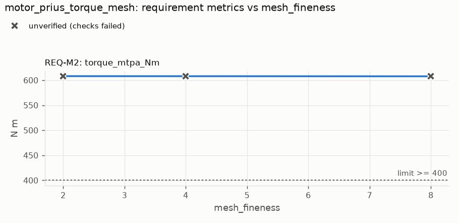
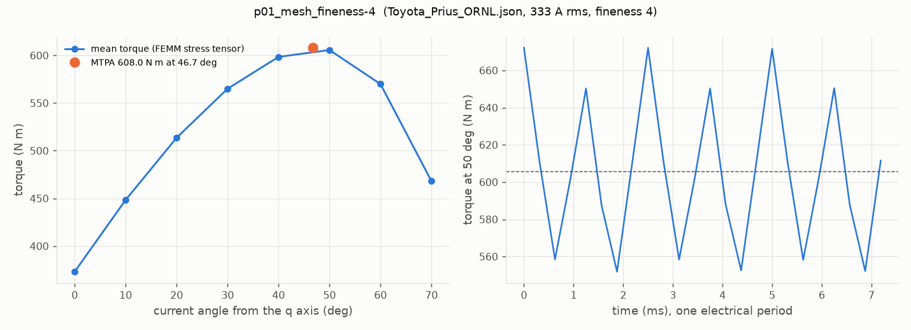
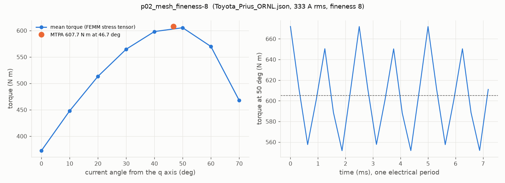

# Engineering review report: motor_prius_torque_mesh

- **Run:** `20261121-224707_motor_prius_torque_mesh`
- **Generated:** 2026-11-22T05:08:49+00:00
- **Case file SHA-256:** `d2cc7cf5c82b98dfa14efb001b4791680d255ed5e1653d25d5a01b28a945d181`
- **Environment:** Python 3.14.10, numpy 2.5.5, scipy 1.18.1, matplotlib 3.11.2, cadquery 2.8.0; Windows-11-10.0.26100-SP0
- **Tools:** pyleecan 1.5.2; SciDataTool 2.5.0; numpy_pyleecan_env 2.5.5
- **Code version:** git `9fe3aa652b4c2f8389ec99252f3ef1172603619f` (uncommitted changes present)
- **Simulation status:** completed
- **Verification status:** FAIL

> **Warning:** verification did not pass for every point. Requirement verdicts marked *(unverified)* are not supported by evidence and must not be used for acceptance.

## Scope

2004 Toyota Prius traction motor (our machine from ORNL Fig. 21) at 333 A rms (25 A/mm^2 in the copper), 1000 rpm; Pyleecan + FEMM 4.2 magnetostatics, current angle 0-70 deg from the q axis, MTPA torque; mesh fineness 2 / 4 / 8.

**Assumptions**

- 2D magnetostatics (FEMM), no end effects; torque is the mean of FEMM's stress-tensor torque over one electrical period.
- Magnets, magnet pockets and materials as in models/motor/Toyota_Prius_ORNL.json (see its build script for which are Pyleecan's).
- Magnet temperature 20 C.
- Current-density limit 25 A/mm^2 rms on 0.84 x 143.0 mm^2 of copper per slot (stated assumption, not a published rating).

## Requirements

| ID | Requirement | Metric | Limit |
|---|---|---|---|
| REQ-M2 | At the 25 A/mm^2 rms copper current-density limit, the maximum torque per amp shall reach the rated 400 N m peak torque. | `torque_mtpa_Nm` | >= 400 N m |

## Summary across points

| Point | mesh_fineness | REQ-M2 | Checks |
|---|---|---|---|
| p00_mesh_fineness-2 | 2 | 608.1 N m: **PASS (unverified)** | 5/5 PASS |
| p01_mesh_fineness-4 | 4 | 608 N m: **PASS (unverified)** | 5/5 PASS |
| p02_mesh_fineness-8 | 8 | 607.7 N m: **PASS (unverified)** | 5/5 PASS |

## Run-level checks

Checks that use several points together (for example mesh convergence).

| Check | Description | Value | Tolerance | Status |
|---|---|---|---|---|
| discretization_torque_mtpa_Nm | relative discretization uncertainty of torque_mtpa_Nm, divergent (R = 2.182): no estimate | inf | 0.01 | FAIL |

A failed run-level check withholds the verdicts of requirements on `torque_mtpa_Nm` at every point: they are marked *(unverified)* in the table above.

## Point details

### p00_mesh_fineness-2

Parameters: machine = Toyota_Prius_ORNL.json, speed_rpm = 1000, current_rms_A = 333, angle_min_deg = 0, angle_max_deg = 70, angle_steps = 8, mesh_fineness = 2, steps_per_period = 48, angle_points = 2048, rated_torque_Nm = 400, slot_fill = 0.84, slot_area_mm2 = 143, turns_per_slot = 9

Derived: current_density_rms_A_per_mm2 = 24.95

| Requirement | Result | Limit | Margin | Verdict | Evidence |
|---|---|---|---|---|---|
| REQ-M2 | 608.1 N m | >= 400 | 208 | **PASS (unverified)** | [point.json](points/p00_mesh_fineness-2/point.json) |

| Check | Description | Value | Tolerance | Status |
|---|---|---|---|---|
| power_balance | max over current angles of |mean(sum i dphi/dt) - mean torque x omega_m| / (mean torque x omega_m): energy conservation, an independent route to FEMM's stress-tensor torque | 1.13e-03 | 2e-02 | PASS |
| current_amplitude | max |imposed phase current fundamental - sqrt(2) x requested rms| / peak (Pyleecan's dq currents are rms) | 2.41e-16 | 1e-03 | PASS |
| phase_symmetry_load | max over angles of the spread of the three phases' fundamental flux linkage / mean, under load | 9.84e-05 | 2e-03 | PASS |
| mtpa_bracketed (validity) | maximum torque inside the angle sweep (0 = yes) | 0.00e+00 | 0e+00 | PASS |
| time_resolution (validity) | 48 / steps per electrical period (below 1: at least 48) | 1.00e+00 | 1e+00 | PASS |

### p01_mesh_fineness-4

Parameters: machine = Toyota_Prius_ORNL.json, speed_rpm = 1000, current_rms_A = 333, angle_min_deg = 0, angle_max_deg = 70, angle_steps = 8, mesh_fineness = 4, steps_per_period = 48, angle_points = 2048, rated_torque_Nm = 400, slot_fill = 0.84, slot_area_mm2 = 143, turns_per_slot = 9

Derived: current_density_rms_A_per_mm2 = 24.95

| Requirement | Result | Limit | Margin | Verdict | Evidence |
|---|---|---|---|---|---|
| REQ-M2 | 608 N m | >= 400 | 208 | **PASS (unverified)** | [point.json](points/p01_mesh_fineness-4/point.json) |

| Check | Description | Value | Tolerance | Status |
|---|---|---|---|---|
| power_balance | max over current angles of |mean(sum i dphi/dt) - mean torque x omega_m| / (mean torque x omega_m): energy conservation, an independent route to FEMM's stress-tensor torque | 1.17e-03 | 2e-02 | PASS |
| current_amplitude | max |imposed phase current fundamental - sqrt(2) x requested rms| / peak (Pyleecan's dq currents are rms) | 2.41e-16 | 1e-03 | PASS |
| phase_symmetry_load | max over angles of the spread of the three phases' fundamental flux linkage / mean, under load | 9.38e-05 | 2e-03 | PASS |
| mtpa_bracketed (validity) | maximum torque inside the angle sweep (0 = yes) | 0.00e+00 | 0e+00 | PASS |
| time_resolution (validity) | 48 / steps per electrical period (below 1: at least 48) | 1.00e+00 | 1e+00 | PASS |

### p02_mesh_fineness-8

Parameters: machine = Toyota_Prius_ORNL.json, speed_rpm = 1000, current_rms_A = 333, angle_min_deg = 0, angle_max_deg = 70, angle_steps = 8, mesh_fineness = 8, steps_per_period = 48, angle_points = 2048, rated_torque_Nm = 400, slot_fill = 0.84, slot_area_mm2 = 143, turns_per_slot = 9

Derived: current_density_rms_A_per_mm2 = 24.95

| Requirement | Result | Limit | Margin | Verdict | Evidence |
|---|---|---|---|---|---|
| REQ-M2 | 607.7 N m | >= 400 | 208 | **PASS (unverified)** | [point.json](points/p02_mesh_fineness-8/point.json) |

| Check | Description | Value | Tolerance | Status |
|---|---|---|---|---|
| power_balance | max over current angles of |mean(sum i dphi/dt) - mean torque x omega_m| / (mean torque x omega_m): energy conservation, an independent route to FEMM's stress-tensor torque | 9.91e-04 | 2e-02 | PASS |
| current_amplitude | max |imposed phase current fundamental - sqrt(2) x requested rms| / peak (Pyleecan's dq currents are rms) | 2.41e-16 | 1e-03 | PASS |
| phase_symmetry_load | max over angles of the spread of the three phases' fundamental flux linkage / mean, under load | 7.43e-05 | 2e-03 | PASS |
| mtpa_bracketed (validity) | maximum torque inside the angle sweep (0 = yes) | 0.00e+00 | 0e+00 | PASS |
| time_resolution (validity) | 48 / steps per electrical period (below 1: at least 48) | 1.00e+00 | 1e+00 | PASS |

## Limitations

- No test data in this case: the ORNL comparison is a separate, blind step at the end of the study.
- Sinusoidal currents; no inverter harmonics, no voltage limit (1000 rpm is below base speed).
- MTPA from an 8-angle sweep and a local parabola.
- A converged solver run that matches an analytical reference shows that the equations were solved correctly. It does not show that the equations represent real hardware.

## Engineering acceptance

Pending human review. This report does not accept or reject the design.
