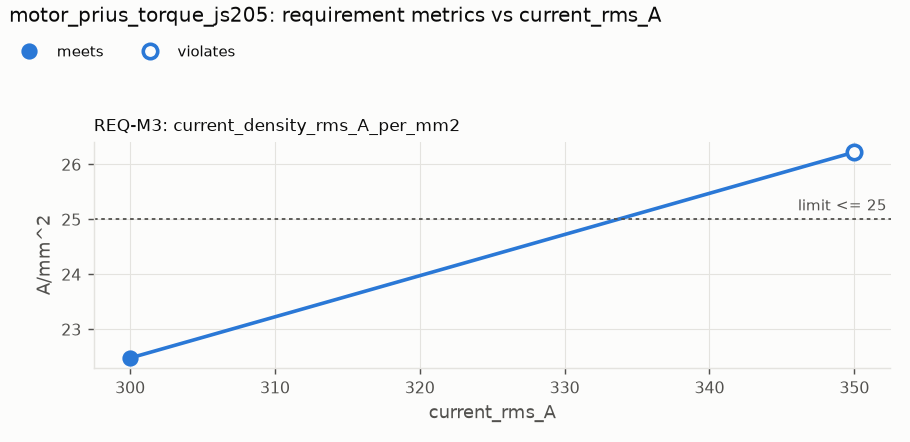
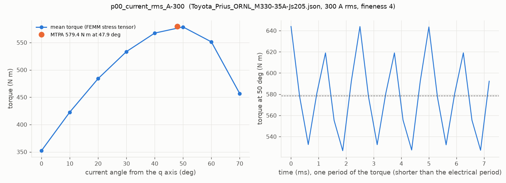
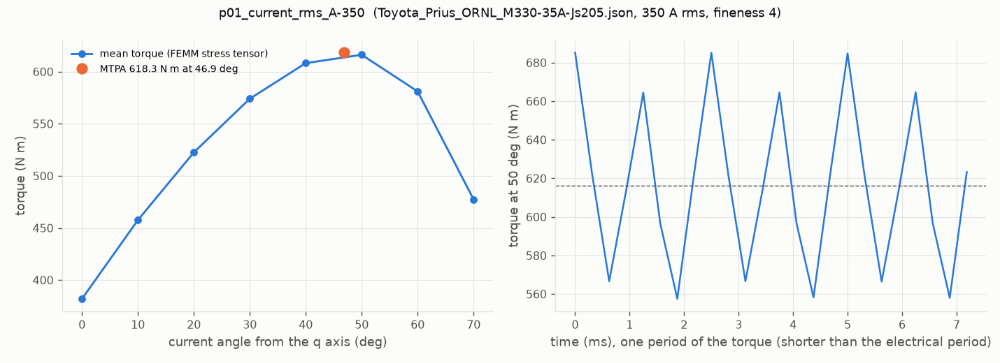

# Engineering review report: motor_prius_torque_js205

- **Run:** `20261122-091610_motor_prius_torque_js205`
- **Generated:** 2026-11-22T14:41:45+00:00
- **Case file SHA-256:** `7d1f8bfc385dfbf23a02b5d352eb664318ef7544c8b7498e4e3dea6dc69fa5a0`
- **Environment:** Python 3.14.10, numpy 2.5.5, scipy 1.18.1, matplotlib 3.11.2, cadquery 2.8.0; Windows-11-10.0.26100-SP0
- **Tools:** pyleecan 1.5.2; SciDataTool 2.5.0; numpy_pyleecan_env 2.5.5
- **Code version:** git `7babb3d67a43e18fe5d06cb07d099bd7c9e1b33b` (uncommitted changes present)
- **Simulation status:** completed
- **Verification status:** PASS

## Scope

2004 Toyota Prius traction motor (our machine from ORNL Fig. 21, laminations M330-35A with the B-H tail saturating at 2.05 T), MTPA torque at 300 and 350 A rms, 1000 rpm; Pyleecan + FEMM 4.2 magnetostatics, current angle 0-70 deg from the q axis, mesh fineness 4.

**Assumptions**

- 2D magnetostatics (FEMM), no end effects; torque is the mean of FEMM's stress-tensor torque over one electrical period.
- Magnets, magnet pockets and materials as in models/motor/Toyota_Prius_ORNL_M330-35A-Js205.json; laminations M330-35A (Tata Steel typical data, 50 Hz, up to 1.8 T), extrapolated above with saturation polarization 2.05 T (a sensitivity; the prediction uses 2.0 T).
- Magnet temperature 20 C.
- Current-density limit 25 A/mm^2 rms on 0.84 x 143.0 mm^2 of copper per slot (stated assumption).

## Requirements

| ID | Requirement | Metric | Limit |
|---|---|---|---|
| REQ-M3 | Each operating point of the torque curve shall stay within the 25 A/mm^2 rms copper current-density limit (marks which points of the curve the motor can sustain for a short time). | `current_density_rms_A_per_mm2` | <= 25 A/mm^2 |

## Summary across points

| Point | current_rms_A | REQ-M3 | Checks |
|---|---|---|---|
| p00_current_rms_A-300 | 300 | 22.48 A/mm^2: **PASS** | 5/5 PASS |
| p01_current_rms_A-350 | 350 | 26.22 A/mm^2: **FAIL** | 5/5 PASS |

## Point details

### p00_current_rms_A-300

Parameters: machine = Toyota_Prius_ORNL_M330-35A-Js205.json, speed_rpm = 1000, current_rms_A = 300, angle_min_deg = 0, angle_max_deg = 70, angle_steps = 8, mesh_fineness = 4, steps_per_period = 48, angle_points = 2048, rated_torque_Nm = 400, slot_fill = 0.84, slot_area_mm2 = 143, turns_per_slot = 9

Derived: current_density_rms_A_per_mm2 = 22.48

| Requirement | Result | Limit | Margin | Verdict | Evidence |
|---|---|---|---|---|---|
| REQ-M3 | 22.48 A/mm^2 | <= 25 | 2.52 | **PASS** | [point.json](points/p00_current_rms_A-300/point.json) |

| Check | Description | Value | Tolerance | Status |
|---|---|---|---|---|
| power_balance | max over current angles of |mean(sum i dphi/dt) - mean torque x omega_m| / (mean torque x omega_m): energy conservation, an independent route to FEMM's stress-tensor torque | 8.07e-04 | 2e-02 | PASS |
| current_amplitude | max |imposed phase current fundamental - sqrt(2) x requested rms| / peak (Pyleecan's dq currents are rms) | 4.02e-16 | 1e-03 | PASS |
| phase_symmetry_load | max over angles of the spread of the three phases' fundamental flux linkage / mean, under load | 1.11e-04 | 2e-03 | PASS |
| mtpa_bracketed (validity) | maximum torque inside the angle sweep (0 = yes) | 0.00e+00 | 0e+00 | PASS |
| time_resolution (validity) | 48 / steps per electrical period (below 1: at least 48) | 1.00e+00 | 1e+00 | PASS |

### p01_current_rms_A-350

Parameters: machine = Toyota_Prius_ORNL_M330-35A-Js205.json, speed_rpm = 1000, current_rms_A = 350, angle_min_deg = 0, angle_max_deg = 70, angle_steps = 8, mesh_fineness = 4, steps_per_period = 48, angle_points = 2048, rated_torque_Nm = 400, slot_fill = 0.84, slot_area_mm2 = 143, turns_per_slot = 9

Derived: current_density_rms_A_per_mm2 = 26.22

| Requirement | Result | Limit | Margin | Verdict | Evidence |
|---|---|---|---|---|---|
| REQ-M3 | 26.22 A/mm^2 | <= 25 | -1.22 | **FAIL** | [point.json](points/p01_current_rms_A-350/point.json) |

| Check | Description | Value | Tolerance | Status |
|---|---|---|---|---|
| power_balance | max over current angles of |mean(sum i dphi/dt) - mean torque x omega_m| / (mean torque x omega_m): energy conservation, an independent route to FEMM's stress-tensor torque | 8.86e-04 | 2e-02 | PASS |
| current_amplitude | max |imposed phase current fundamental - sqrt(2) x requested rms| / peak (Pyleecan's dq currents are rms) | 2.30e-16 | 1e-03 | PASS |
| phase_symmetry_load | max over angles of the spread of the three phases' fundamental flux linkage / mean, under load | 1.09e-04 | 2e-03 | PASS |
| mtpa_bracketed (validity) | maximum torque inside the angle sweep (0 = yes) | 0.00e+00 | 0e+00 | PASS |
| time_resolution (validity) | 48 / steps per electrical period (below 1: at least 48) | 1.00e+00 | 1e+00 | PASS |

## Limitations

- No test data in this case: the ORNL comparison is a separate, blind step at the end of the study.
- Sinusoidal currents; no inverter harmonics, no voltage limit (1000 rpm is below base speed).
- A converged solver run that matches an analytical reference shows that the equations were solved correctly. It does not show that the equations represent real hardware.

## Engineering acceptance

Pending human review. This report does not accept or reject the design.
