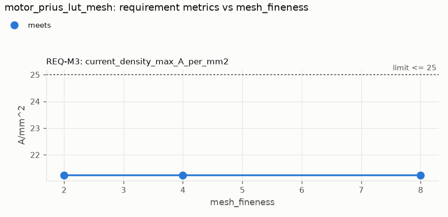
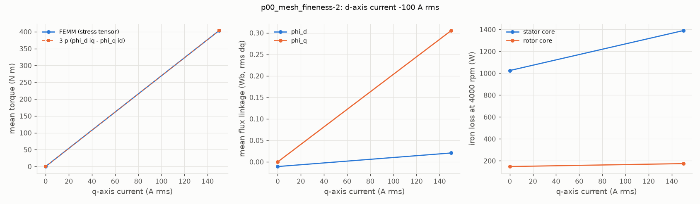
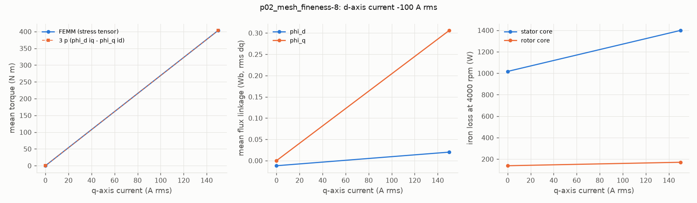

# Engineering review report: motor_prius_lut_mesh

- **Run:** `20261122-094746_motor_prius_lut_mesh`
- **Generated:** 2026-11-22T15:18:55+00:00
- **Case file SHA-256:** `e036dd126e797621b345895dff4ca52d1bbb573b69d7251836e2d696407406d7`
- **Environment:** Python 3.14.10, numpy 2.5.5, scipy 1.18.1, matplotlib 3.11.2, cadquery 2.8.0; Windows-11-10.0.26100-SP0
- **Tools:** pyleecan 1.5.2; SciDataTool 2.5.0; numpy_pyleecan_env 2.5.5
- **Code version:** git `0d89080e1ad2cd0cffef4068c7075c075b5cc08d` (uncommitted changes present)
- **Simulation status:** completed
- **Verification status:** FAIL

> **Warning:** verification did not pass for every point. Requirement verdicts marked *(unverified)* are not supported by evidence and must not be used for acceptance.

## Scope

2004 Toyota Prius traction motor (our machine from ORNL Fig. 21, laminations M330-35A, magnets at 20 C), dq look-up table column at id -100 A rms, iq 0 and 150 A rms, 1000 rpm; Pyleecan + FEMM 4.2 magnetostatics over one electrical period (48 steps) with element fields; mesh fineness 2 / 4 / 8; torque, dq flux linkages and iron-loss coefficients.

**Assumptions**

- 2D magnetostatics (FEMM), no end effects; torque is the mean of FEMM's stress-tensor torque over one electrical period.
- Iron loss from the element fields with the M330-35A three-term fit applied per harmonic; rotational fields counted as two orthogonal alternating ones; minor loops and DC bias not modelled.
- Core mass without the stacking factor (FEMM models the stack as solid steel, lam_fill 1).
- Magnet temperature 20 C (MagFEMM T_mag; Br falls 0.1 %/K).
- Copper 76.4 mm^2 per slot (Pyleecan's 13 x 0.912 mm strands per turn, 9 turns), consistent with ORNL's 0.84 fill on the squares of insulated wires.

## Requirements

| ID | Requirement | Metric | Limit |
|---|---|---|---|
| REQ-M3 | The column's operating points shall stay within the 25 A/mm^2 rms copper current-density limit (marks the grid points the motor can sustain for a short time). | `current_density_max_A_per_mm2` | <= 25 A/mm^2 |

## Summary across points

| Point | mesh_fineness | REQ-M3 | Checks |
|---|---|---|---|
| p00_mesh_fineness-2 | 2 | 21.23 A/mm^2: **PASS** | 5/5 PASS |
| p01_mesh_fineness-4 | 4 | 21.23 A/mm^2: **PASS** | 5/5 PASS |
| p02_mesh_fineness-8 | 8 | 21.23 A/mm^2: **PASS** | 5/5 PASS |

## Run-level checks

Checks that use several points together (for example mesh convergence).

| Check | Description | Value | Tolerance | Status |
|---|---|---|---|---|
| discretization_torque_at_iq_max_Nm | relative discretization uncertainty of torque_at_iq_max_Nm, divergent (oscillating, growing) (R = -2.617): no estimate | inf | 0.02 | FAIL |
| discretization_iron_loss_at_iq_max_1000rpm_W | relative discretization uncertainty of iron_loss_at_iq_max_1000rpm_W, anomalous: observed order 3.91 is far above the design order 2, so the solutions are not in the asymptotic range (singularity or coincidence); no estimate | inf | 0.02 | FAIL |
| discretization_iron_loss_at_iq_max_6000rpm_W | relative discretization uncertainty of iron_loss_at_iq_max_6000rpm_W, oscillatory (R = -0.114): 1.25 x half-range of the 3 finest solutions | 0.00221 | 0.02 | PASS |

A failed run-level check withholds the verdicts of requirements on `iron_loss_at_iq_max_1000rpm_W`, `torque_at_iq_max_Nm` at every point: they are marked *(unverified)* in the table above.

## Point details

### p00_mesh_fineness-2

Parameters: machine = Toyota_Prius_ORNL.json, speed_rpm = 1000, id_A = -100, iq_min_A = 0, iq_max_A = 150, iq_steps = 2, mesh_fineness = 2, steps_per_period = 48, angle_points = 2048, magnet_temperature_C = 20, iron_kh = 0.0202, iron_alpha = 1.791, iron_kc = 7.91e-05, iron_ke = 0.00037, slot_fill = 0.5345, slot_area_mm2 = 143, turns_per_slot = 9

Derived: current_rms_max_A = 180.3

| Requirement | Result | Limit | Margin | Verdict | Evidence |
|---|---|---|---|---|---|
| REQ-M3 | 21.23 A/mm^2 | <= 25 | 3.77 | **PASS** | [point.json](points/p00_mesh_fineness-2/point.json) |

| Check | Description | Value | Tolerance | Status |
|---|---|---|---|---|
| power_balance | max over q-axis currents (|T| >= 5 N m) of |mean(sum i dphi/dt) - mean torque x omega_m| / (mean torque x omega_m) | 1.24e-04 | 2e-02 | PASS |
| dq_torque | max over q-axis currents (|T| >= 5 N m) of |3 p (phi_d i_q - phi_q i_d) - FEMM torque| / FEMM torque: the mean dq flux linkages the efficiency map interpolates reproduce the torque (model form: harmonics are left out of the dq means) | 1.24e-04 | 5e-03 | PASS |
| current_amplitude | max |imposed phase current fundamental - sqrt(2) x requested rms| / peak | 1.11e-16 | 1e-03 | PASS |
| iron_coefficients_non_negative | min iron-loss coefficient over cores and currents (W), below 0 would be unphysical | -1.62e-03 | 0e+00 | PASS |
| time_resolution (validity) | 48 / steps per electrical period (below 1: at least 48) | 1.00e+00 | 1e+00 | PASS |

### p01_mesh_fineness-4

Parameters: machine = Toyota_Prius_ORNL.json, speed_rpm = 1000, id_A = -100, iq_min_A = 0, iq_max_A = 150, iq_steps = 2, mesh_fineness = 4, steps_per_period = 48, angle_points = 2048, magnet_temperature_C = 20, iron_kh = 0.0202, iron_alpha = 1.791, iron_kc = 7.91e-05, iron_ke = 0.00037, slot_fill = 0.5345, slot_area_mm2 = 143, turns_per_slot = 9

Derived: current_rms_max_A = 180.3

| Requirement | Result | Limit | Margin | Verdict | Evidence |
|---|---|---|---|---|---|
| REQ-M3 | 21.23 A/mm^2 | <= 25 | 3.77 | **PASS** | [point.json](points/p01_mesh_fineness-4/point.json) |

| Check | Description | Value | Tolerance | Status |
|---|---|---|---|---|
| power_balance | max over q-axis currents (|T| >= 5 N m) of |mean(sum i dphi/dt) - mean torque x omega_m| / (mean torque x omega_m) | 2.41e-04 | 2e-02 | PASS |
| dq_torque | max over q-axis currents (|T| >= 5 N m) of |3 p (phi_d i_q - phi_q i_d) - FEMM torque| / FEMM torque: the mean dq flux linkages the efficiency map interpolates reproduce the torque (model form: harmonics are left out of the dq means) | 2.41e-04 | 5e-03 | PASS |
| current_amplitude | max |imposed phase current fundamental - sqrt(2) x requested rms| / peak | 1.11e-16 | 1e-03 | PASS |
| iron_coefficients_non_negative | min iron-loss coefficient over cores and currents (W), below 0 would be unphysical | -1.54e-03 | 0e+00 | PASS |
| time_resolution (validity) | 48 / steps per electrical period (below 1: at least 48) | 1.00e+00 | 1e+00 | PASS |

### p02_mesh_fineness-8

Parameters: machine = Toyota_Prius_ORNL.json, speed_rpm = 1000, id_A = -100, iq_min_A = 0, iq_max_A = 150, iq_steps = 2, mesh_fineness = 8, steps_per_period = 48, angle_points = 2048, magnet_temperature_C = 20, iron_kh = 0.0202, iron_alpha = 1.791, iron_kc = 7.91e-05, iron_ke = 0.00037, slot_fill = 0.5345, slot_area_mm2 = 143, turns_per_slot = 9

Derived: current_rms_max_A = 180.3

| Requirement | Result | Limit | Margin | Verdict | Evidence |
|---|---|---|---|---|---|
| REQ-M3 | 21.23 A/mm^2 | <= 25 | 3.77 | **PASS** | [point.json](points/p02_mesh_fineness-8/point.json) |

| Check | Description | Value | Tolerance | Status |
|---|---|---|---|---|
| power_balance | max over q-axis currents (|T| >= 5 N m) of |mean(sum i dphi/dt) - mean torque x omega_m| / (mean torque x omega_m) | 2.27e-04 | 2e-02 | PASS |
| dq_torque | max over q-axis currents (|T| >= 5 N m) of |3 p (phi_d i_q - phi_q i_d) - FEMM torque| / FEMM torque: the mean dq flux linkages the efficiency map interpolates reproduce the torque (model form: harmonics are left out of the dq means) | 2.27e-04 | 5e-03 | PASS |
| current_amplitude | max |imposed phase current fundamental - sqrt(2) x requested rms| / peak | 1.11e-16 | 1e-03 | PASS |
| iron_coefficients_non_negative | min iron-loss coefficient over cores and currents (W), below 0 would be unphysical | -1.51e-03 | 0e+00 | PASS |
| time_resolution (validity) | 48 / steps per electrical period (below 1: at least 48) | 1.00e+00 | 1e+00 | PASS |

## Limitations

- No test data in this case: the ORNL comparison is a separate, blind step at the end of the study.
- The loss fit covers 0.1-1.8 T at 50-2500 Hz; deep-saturation regions (tooth tips at load) extrapolate it.
- No magnet eddy-current loss, no AC copper loss (proximity, skin), no mechanical loss.
- A converged solver run that matches an analytical reference shows that the equations were solved correctly. It does not show that the equations represent real hardware.

## Engineering acceptance

Pending human review. This report does not accept or reject the design.
