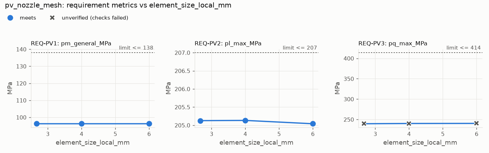
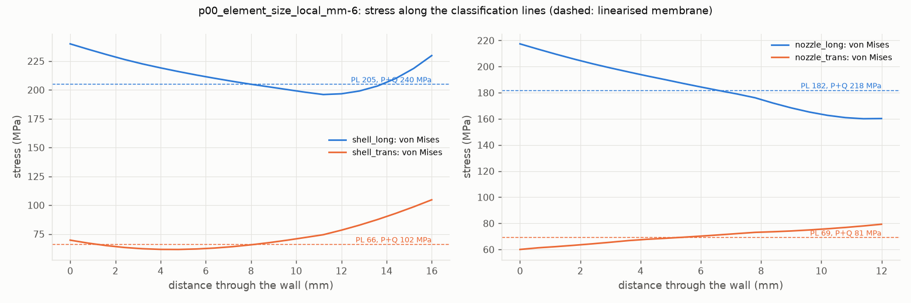
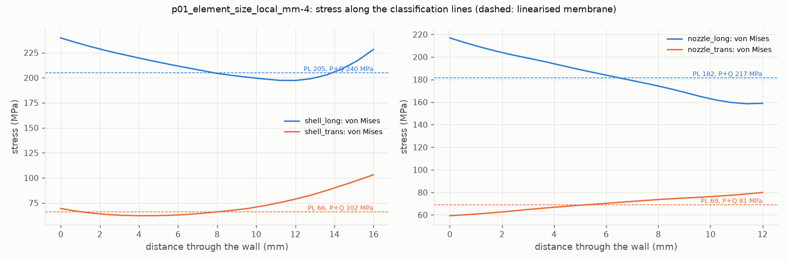
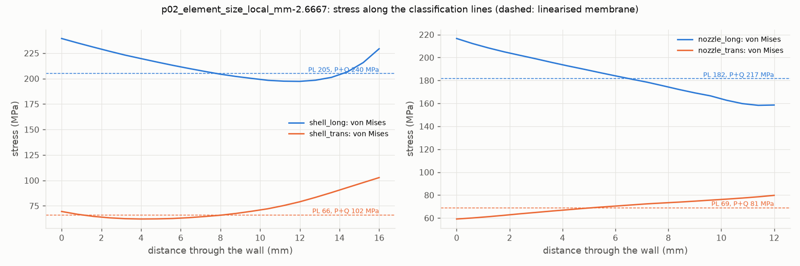

# Engineering review report: pv_nozzle_mesh

- **Run:** `20261122-102842_pv_nozzle_mesh`
- **Generated:** 2026-11-22T15:34:04+00:00
- **Case file SHA-256:** `befec7abc88ed60c11518abd4a83081db97c9fbd4866cb01498866b73cb22637`
- **Environment:** Python 3.14.10, numpy 2.5.5, scipy 1.18.1, matplotlib 3.11.2, cadquery 2.8.0; Windows-11-10.0.26100-SP0
- **Tools:** cadquery 2.8.0; gmsh 4.15.0; CalculiX This is Version 2.22
- **Code version:** git `d57e443f46e882236215cdb171faf3f407d817ae` (uncommitted changes present)
- **Simulation status:** completed
- **Verification status:** FAIL

> **Warning:** verification did not pass for every point. Requirement verdicts marked *(unverified)* are not supported by evidence and must not be used for acceptance.

## Scope

Cylindrical shell (Ri 500 mm, t 16 mm) with a set-in radial nozzle (ri 100 mm, tn 12 mm, 10 mm outer weld fillet) at 3.5 MPa internal pressure; quarter model, CadQuery + Gmsh C3D10 + CalculiX static; stresses linearised along classification lines; local element size 6 / 4 / 2.67 mm at the junction.

**Assumptions**

- Linear elastic steel, E 200 GPa, nu 0.3; small displacement (checked).
- Closed vessel: the end thrusts of the shell and the nozzle are applied as uniform axial tractions on their cut ends (the far field is then the Lame closed-end cylinder exactly).
- Symmetry about the planes through the nozzle axis; no external nozzle loads (piping loads would add to the junction stresses).
- Outer weld modelled as a 10 mm fillet; the inner corner of the bore is sharp (affects peak stress, not the linearised values on the toe lines).
- Classification: membrane at the junction lines is local primary (PL), membrane plus bending there is primary plus secondary (P + Q); far from the nozzle the membrane is general primary (Pm). S_PS taken as 3 S.
- Allowable S = 138 MPa: synthetic, of the order of carbon-steel plate values; not from ASME Section II.

## Requirements

| ID | Requirement | Metric | Limit |
|---|---|---|---|
| REQ-PV1 | General primary membrane stress in the shell away from the nozzle shall not exceed S (138 MPa). | `pm_general_MPa` | <= 138 MPa |
| REQ-PV2 | Local primary membrane stress at the nozzle junction (all classification lines) shall not exceed 1.5 S (207 MPa). | `pl_max_MPa` | <= 207 MPa |
| REQ-PV3 | Primary plus secondary stress at the nozzle junction (membrane plus bending, all classification lines) shall not exceed S_PS = 3 S (414 MPa). | `pq_max_MPa` | <= 414 MPa |

## Summary across points

| Point | element_size_local_mm | REQ-PV1 | REQ-PV2 | REQ-PV3 | Checks |
|---|---|---|---|---|---|
| p00_element_size_local_mm-6 | 6 | 96.24 MPa: **PASS** | 205 MPa: **PASS** | 240.4 MPa: **PASS (unverified)** | 9/9 PASS |
| p01_element_size_local_mm-4 | 4 | 96.23 MPa: **PASS** | 205.1 MPa: **PASS** | 240.2 MPa: **PASS (unverified)** | 9/9 PASS |
| p02_element_size_local_mm-2.6667 | 2.667 | 96.24 MPa: **PASS** | 205.1 MPa: **PASS** | 239.6 MPa: **PASS (unverified)** | 9/9 PASS |

## Run-level checks

Checks that use several points together (for example mesh convergence).

| Check | Description | Value | Tolerance | Status |
|---|---|---|---|---|
| discretization_pl_max_MPa | relative discretization uncertainty of pl_max_MPa, oscillatory (R = -0.070): 1.25 x half-range of the 3 finest solutions | 0.00028 | 0.03 | PASS |
| discretization_pm_general_MPa | relative discretization uncertainty of pm_general_MPa, oscillatory (R = -0.367): 1.25 x half-range of the 3 finest solutions | 4.16e-05 | 0.03 | PASS |
| discretization_pq_max_MPa | relative discretization uncertainty of pq_max_MPa, divergent (R = 3.733): no estimate | inf | 0.03 | FAIL |

A failed run-level check withholds the verdicts of requirements on `pq_max_MPa` at every point: they are marked *(unverified)* in the table above.

## Point details

### p00_element_size_local_mm-6

Parameters: shell_inner_radius_mm = 500, shell_thickness_mm = 16, shell_half_length_mm = 1000, nozzle_inner_radius_mm = 100, nozzle_thickness_mm = 12, nozzle_length_mm = 350, weld_fillet_radius_mm = 10, pressure_MPa = 3.5, youngs_modulus_MPa = 2e+05, poisson_ratio = 0.3, element_size_local_mm = 6, element_size_far_mm = 14, refine_radius_mm = 140, mesh_growth = 0.08, allowable_stress_MPa = 138

Derived: hoop_membrane_pR_over_t_MPa = 109.4, allowable_PL_MPa = 207, allowable_PS_MPa = 414, d_over_D = 0.2, sqrt_Rt_mm = 90.16, pressure_area_mean_stress_MPa = 153.2

| Requirement | Result | Limit | Margin | Verdict | Evidence |
|---|---|---|---|---|---|
| REQ-PV1 | 96.24 MPa | <= 138 | 41.8 | **PASS** | [point.json](points/p00_element_size_local_mm-6/point.json) |
| REQ-PV2 | 205 MPa | <= 207 | 1.96 | **PASS** | [point.json](points/p00_element_size_local_mm-6/point.json) |
| REQ-PV3 | 240.4 MPa | <= 414 | 174 | **PASS (unverified)** | [point.json](points/p00_element_size_local_mm-6/point.json) |

| Check | Description | Value | Tolerance | Status |
|---|---|---|---|---|
| cad_valid | CadQuery B-rep valid (0 = yes) | 0.00e+00 | 0e+00 | PASS |
| mesh_volume | |mesh volume (straight-sided tets) - CAD volume| / CAD volume | 1.43e-05 | 1e-02 | PASS |
| equilibrium_y | |support reaction on y = 0 - exact pressure resultant (p x projected wetted area)| / resultant | 2.76e-07 | 1e-05 | PASS |
| equilibrium_z | |support reaction on z = 0 - exact resultant (end thrust + nozzle bore)| / resultant | 2.96e-07 | 1e-05 | PASS |
| self_balance_x | |reaction at the single axial support| / quarter nozzle thrust (closed vessel: 0) | 8.26e-07 | 1e-05 | PASS |
| lame_bore_hoop | |FE hoop stress at the bore on the far line - Lame| / Lame (exact) | 4.85e-03 | 1e-02 | PASS |
| lame_membrane | |FE linearised membrane (von Mises) on the far line - the same linearisation of the Lame stresses| / Lame (exact) | 2.91e-04 | 1e-02 | PASS |
| scl_inside_mesh (validity) | max barycentric violation of the SCL sample points (0 = inside an element; points on a curved surface lie about h^2 / 8R outside the straight-sided element, where the quadratic shape functions extrapolate smoothly) | 1.69e-03 | 1e-02 | PASS |
| small_displacement (validity) | max displacement / shell thickness (linear geometry) | 3.74e-02 | 1e-01 | PASS |

### p01_element_size_local_mm-4

Parameters: shell_inner_radius_mm = 500, shell_thickness_mm = 16, shell_half_length_mm = 1000, nozzle_inner_radius_mm = 100, nozzle_thickness_mm = 12, nozzle_length_mm = 350, weld_fillet_radius_mm = 10, pressure_MPa = 3.5, youngs_modulus_MPa = 2e+05, poisson_ratio = 0.3, element_size_local_mm = 4, element_size_far_mm = 14, refine_radius_mm = 140, mesh_growth = 0.08, allowable_stress_MPa = 138

Derived: hoop_membrane_pR_over_t_MPa = 109.4, allowable_PL_MPa = 207, allowable_PS_MPa = 414, d_over_D = 0.2, sqrt_Rt_mm = 90.16, pressure_area_mean_stress_MPa = 153.2

| Requirement | Result | Limit | Margin | Verdict | Evidence |
|---|---|---|---|---|---|
| REQ-PV1 | 96.23 MPa | <= 138 | 41.8 | **PASS** | [point.json](points/p01_element_size_local_mm-4/point.json) |
| REQ-PV2 | 205.1 MPa | <= 207 | 1.87 | **PASS** | [point.json](points/p01_element_size_local_mm-4/point.json) |
| REQ-PV3 | 240.2 MPa | <= 414 | 174 | **PASS (unverified)** | [point.json](points/p01_element_size_local_mm-4/point.json) |

| Check | Description | Value | Tolerance | Status |
|---|---|---|---|---|
| cad_valid | CadQuery B-rep valid (0 = yes) | 0.00e+00 | 0e+00 | PASS |
| mesh_volume | |mesh volume (straight-sided tets) - CAD volume| / CAD volume | 1.09e-05 | 1e-02 | PASS |
| equilibrium_y | |support reaction on y = 0 - exact pressure resultant (p x projected wetted area)| / resultant | 2.76e-07 | 1e-05 | PASS |
| equilibrium_z | |support reaction on z = 0 - exact resultant (end thrust + nozzle bore)| / resultant | 2.96e-07 | 1e-05 | PASS |
| self_balance_x | |reaction at the single axial support| / quarter nozzle thrust (closed vessel: 0) | 8.26e-07 | 1e-05 | PASS |
| lame_bore_hoop | |FE hoop stress at the bore on the far line - Lame| / Lame (exact) | 4.79e-03 | 1e-02 | PASS |
| lame_membrane | |FE linearised membrane (von Mises) on the far line - the same linearisation of the Lame stresses| / Lame (exact) | 2.24e-04 | 1e-02 | PASS |
| scl_inside_mesh (validity) | max barycentric violation of the SCL sample points (0 = inside an element; points on a curved surface lie about h^2 / 8R outside the straight-sided element, where the quadratic shape functions extrapolate smoothly) | 1.17e-03 | 1e-02 | PASS |
| small_displacement (validity) | max displacement / shell thickness (linear geometry) | 3.75e-02 | 1e-01 | PASS |

### p02_element_size_local_mm-2.6667

Parameters: shell_inner_radius_mm = 500, shell_thickness_mm = 16, shell_half_length_mm = 1000, nozzle_inner_radius_mm = 100, nozzle_thickness_mm = 12, nozzle_length_mm = 350, weld_fillet_radius_mm = 10, pressure_MPa = 3.5, youngs_modulus_MPa = 2e+05, poisson_ratio = 0.3, element_size_local_mm = 2.667, element_size_far_mm = 14, refine_radius_mm = 140, mesh_growth = 0.08, allowable_stress_MPa = 138

Derived: hoop_membrane_pR_over_t_MPa = 109.4, allowable_PL_MPa = 207, allowable_PS_MPa = 414, d_over_D = 0.2, sqrt_Rt_mm = 90.16, pressure_area_mean_stress_MPa = 153.2

| Requirement | Result | Limit | Margin | Verdict | Evidence |
|---|---|---|---|---|---|
| REQ-PV1 | 96.24 MPa | <= 138 | 41.8 | **PASS** | [point.json](points/p02_element_size_local_mm-2.6667/point.json) |
| REQ-PV2 | 205.1 MPa | <= 207 | 1.87 | **PASS** | [point.json](points/p02_element_size_local_mm-2.6667/point.json) |
| REQ-PV3 | 239.6 MPa | <= 414 | 174 | **PASS (unverified)** | [point.json](points/p02_element_size_local_mm-2.6667/point.json) |

| Check | Description | Value | Tolerance | Status |
|---|---|---|---|---|
| cad_valid | CadQuery B-rep valid (0 = yes) | 0.00e+00 | 0e+00 | PASS |
| mesh_volume | |mesh volume (straight-sided tets) - CAD volume| / CAD volume | 1.34e-07 | 1e-02 | PASS |
| equilibrium_y | |support reaction on y = 0 - exact pressure resultant (p x projected wetted area)| / resultant | 0.00e+00 | 1e-05 | PASS |
| equilibrium_z | |support reaction on z = 0 - exact resultant (end thrust + nozzle bore)| / resultant | 2.96e-07 | 1e-05 | PASS |
| self_balance_x | |reaction at the single axial support| / quarter nozzle thrust (closed vessel: 0) | 8.26e-07 | 1e-05 | PASS |
| lame_bore_hoop | |FE hoop stress at the bore on the far line - Lame| / Lame (exact) | 4.81e-03 | 1e-02 | PASS |
| lame_membrane | |FE linearised membrane (von Mises) on the far line - the same linearisation of the Lame stresses| / Lame (exact) | 2.49e-04 | 1e-02 | PASS |
| scl_inside_mesh (validity) | max barycentric violation of the SCL sample points (0 = inside an element; points on a curved surface lie about h^2 / 8R outside the straight-sided element, where the quadratic shape functions extrapolate smoothly) | 3.17e-04 | 1e-02 | PASS |
| small_displacement (validity) | max displacement / shell thickness (linear geometry) | 3.75e-02 | 1e-01 | PASS |

## Limitations

- Elastic analysis only: no limit-load or elastic-plastic route, no fatigue (peak stress reported, not assessed), no external loads, no corrosion allowance.
- The SCLs sit at the weld-fillet toes; other placements (through the crotch corner) give other values and are a judgement call.
- The pressure-area cross-check is a simplified form of the rule, not the standard's full procedure.
- A converged solver run that matches an analytical reference shows that the equations were solved correctly. It does not show that the equations represent real hardware.

## Engineering acceptance

Pending human review. This report does not accept or reject the design.
