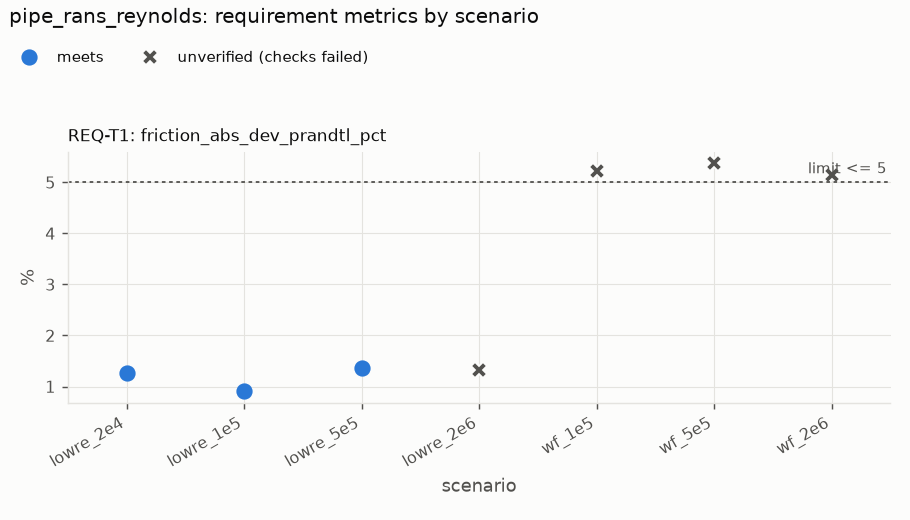
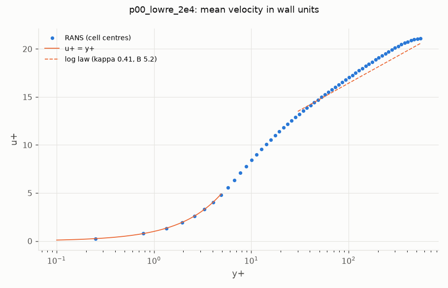
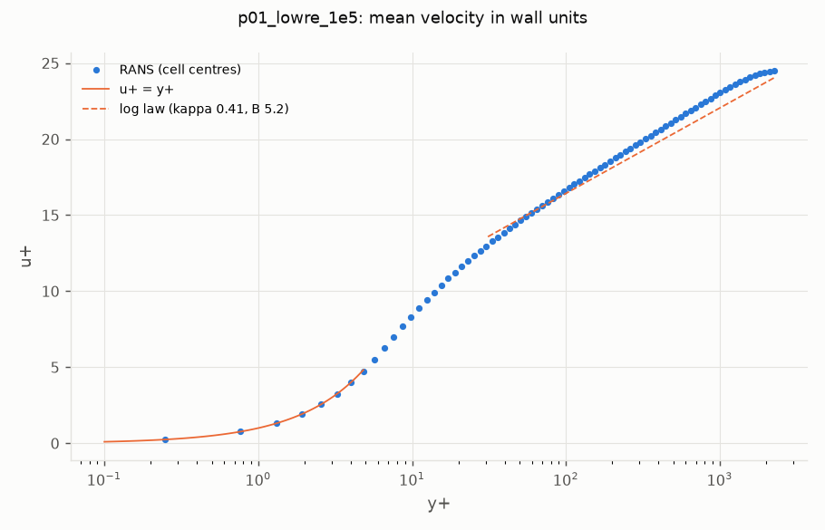
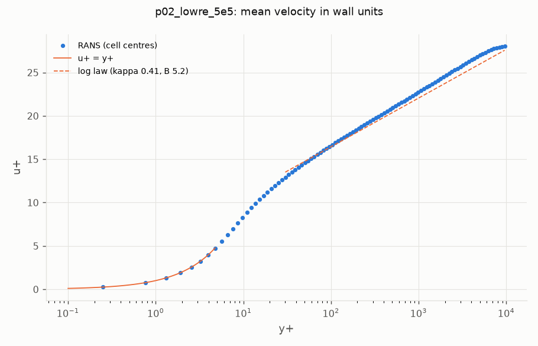
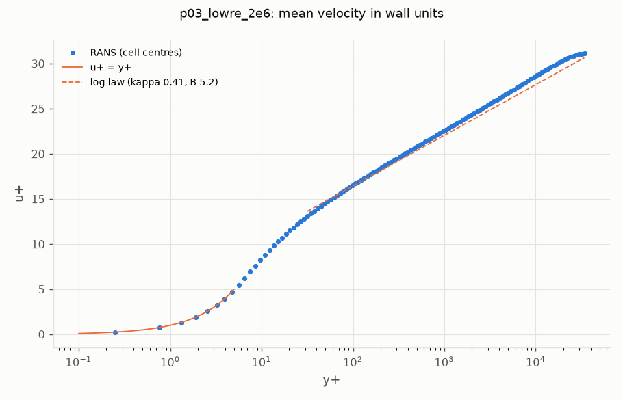
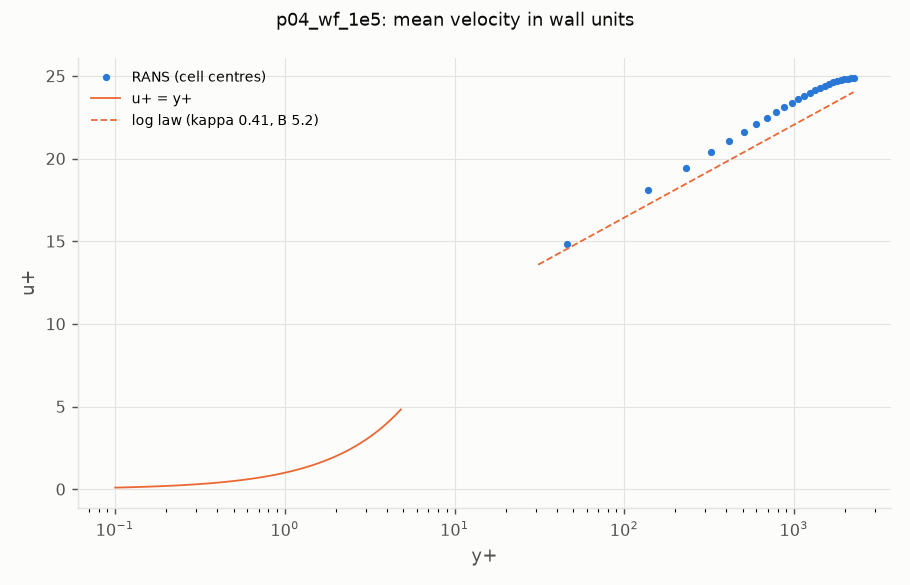
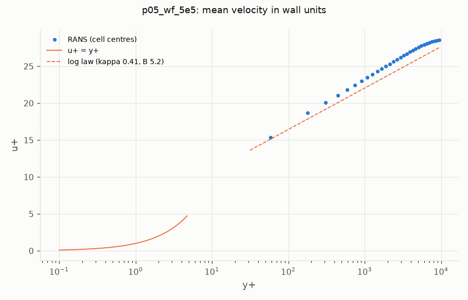
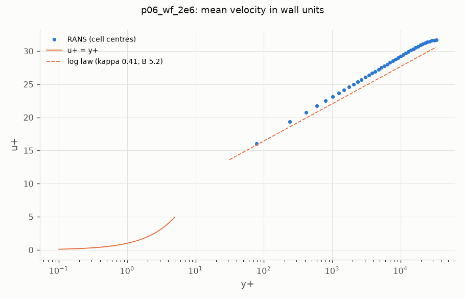

# Engineering review report: pipe_rans_reynolds

- **Run:** `20261122-104744_pipe_rans_reynolds`
- **Generated:** 2026-11-22T16:15:24+00:00
- **Case file SHA-256:** `e8f263de0f581182a640bdbcb97a05802213817bc5755af995668a97a8631e48`
- **Environment:** Python 3.14.10, numpy 2.5.5, scipy 1.18.1, matplotlib 3.11.2, cadquery 2.8.0; Windows-11-10.0.26100-SP0
- **Tools:** openfoam_bashrc /opt/openfoam14/etc/bashrc; openfoam_version 14; openfoam_package openfoam14 20261008; linux Ubuntu 22.04.5 LTS
- **Code version:** git `575b47a542d08345a0934047527094b837f83e48` (uncommitted changes present)
- **Simulation status:** completed
- **Verification status:** FAIL

> **Warning:** verification did not pass for every point. Requirement verdicts marked *(unverified)* are not supported by evidence and must not be used for acceptance.

## Scope

Fully developed turbulent pipe flow (D 0.1 m, nu 1e-6 m^2/s), axisymmetric periodic wedge, RANS k-omega SST; Re 2e4 to 2e6, low-Reynolds wall treatment and wall functions; friction factor against Prandtl's smooth-pipe law.

**Assumptions**

- Fully developed, steady, incompressible, axisymmetric mean flow in a hydraulically smooth pipe.
- RANS with the k-omega SST model (openfoam.org v14 coefficients); its form error is what this study measures.
- Hydraulic diameter of the wedge 2 R cos(2.5 deg) (its wall is a flat face): 0.1 % below D, used consistently.

## Requirements

| ID | Requirement | Metric | Limit |
|---|---|---|---|
| REQ-T1 | The predicted friction factor shall be within 5 % of Prandtl's smooth-pipe law (the Moody chart's smooth curve), a usable accuracy for pressure-drop budgets. | `friction_abs_dev_prandtl_pct` | <= 5 % |

## Summary across points

| Point | scenario | REQ-T1 | Checks |
|---|---|---|---|
| p00_lowre_2e4 | lowre_2e4 | 1.266 %: **PASS** | 7/7 PASS |
| p01_lowre_1e5 | lowre_1e5 | 0.9037 %: **PASS** | 7/7 PASS |
| p02_lowre_5e5 | lowre_5e5 | 1.359 %: **PASS** | 7/7 PASS |
| p03_lowre_2e6 | lowre_2e6 | 1.332 %: **PASS (unverified)** | 6/7 FAIL |
| p04_wf_1e5 | wf_1e5 | 5.215 %: **FAIL (unverified)** | 6/7 FAIL |
| p05_wf_5e5 | wf_5e5 | 5.37 %: **FAIL (unverified)** | 6/7 FAIL |
| p06_wf_2e6 | wf_2e6 | 5.145 %: **FAIL (unverified)** | 6/7 FAIL |

## Point details

### p00_lowre_2e4

Parameters: diameter_m = 0.1, reynolds_number = 2e+04, kinematic_viscosity_m2_per_s = 1e-06, n_radial = 60, first_cell_yplus = 0.5, wall_treatment = low_re, turbulence_model = kOmegaSST, scenario = lowre_2e4

Derived: friction_prandtl = 0.02589, friction_petukhov = 0.02615, friction_blasius = 0.02661

| Requirement | Result | Limit | Margin | Verdict | Evidence |
|---|---|---|---|---|---|
| REQ-T1 | 1.266 % | <= 5 | 3.73 | **PASS** | [point.json](points/p00_lowre_2e4/point.json) |

| Check | Description | Value | Tolerance | Status |
|---|---|---|---|---|
| mesh | checkMesh reports Mesh OK (1 = failed) | 0.00e+00 | 5e-01 | PASS |
| force_balance | |f from the wall shear - f from the applied pressure gradient| / f (periodic flow: dp/dx A = tau_w P exactly) | 2.32e-13 | 1e-04 | PASS |
| bulk_velocity | |bulk velocity of the cell field - target| / target | 3.11e-13 | 1e-06 | PASS |
| iterative_convergence | max change of the pressure gradient over the last 10 % of iterations / final | 5.72e-12 | 1e-06 | PASS |
| wall_uniform | spread of the wall shear along the wall / mean (fully developed: 0) | 0.00e+00 | 1e-04 | PASS |
| yplus_range (validity) | first-cell y+ against the wall treatment's range (below 1 = inside) | 2.51e-01 | 1e+00 | PASS |
| log_law | max |u+ - (ln y+ / 0.41 + 5.2)| / u+ for 50 <= y+ <= 0.15 Re_tau (model form: the log law's constants scatter by a few per cent between experiments) | 2.62e-02 | 5e-02 | PASS |

### p01_lowre_1e5

Parameters: diameter_m = 0.1, reynolds_number = 1e+05, kinematic_viscosity_m2_per_s = 1e-06, n_radial = 80, first_cell_yplus = 0.5, wall_treatment = low_re, turbulence_model = kOmegaSST, scenario = lowre_1e5

Derived: friction_prandtl = 0.01799, friction_petukhov = 0.01799, friction_blasius = 0.01779

| Requirement | Result | Limit | Margin | Verdict | Evidence |
|---|---|---|---|---|---|
| REQ-T1 | 0.9037 % | <= 5 | 4.1 | **PASS** | [point.json](points/p01_lowre_1e5/point.json) |

| Check | Description | Value | Tolerance | Status |
|---|---|---|---|---|
| mesh | checkMesh reports Mesh OK (1 = failed) | 0.00e+00 | 5e-01 | PASS |
| force_balance | |f from the wall shear - f from the applied pressure gradient| / f (periodic flow: dp/dx A = tau_w P exactly) | 1.56e-12 | 1e-04 | PASS |
| bulk_velocity | |bulk velocity of the cell field - target| / target | 1.94e-13 | 1e-06 | PASS |
| iterative_convergence | max change of the pressure gradient over the last 10 % of iterations / final | 7.84e-12 | 1e-06 | PASS |
| wall_uniform | spread of the wall shear along the wall / mean (fully developed: 0) | 0.00e+00 | 1e-04 | PASS |
| yplus_range (validity) | first-cell y+ against the wall treatment's range (below 1 = inside) | 2.49e-01 | 1e+00 | PASS |
| log_law | max |u+ - (ln y+ / 0.41 + 5.2)| / u+ for 50 <= y+ <= 0.15 Re_tau (model form: the log law's constants scatter by a few per cent between experiments) | 3.41e-02 | 5e-02 | PASS |

### p02_lowre_5e5

Parameters: diameter_m = 0.1, reynolds_number = 5e+05, kinematic_viscosity_m2_per_s = 1e-06, n_radial = 100, first_cell_yplus = 0.5, wall_treatment = low_re, turbulence_model = kOmegaSST, scenario = lowre_5e5

Derived: friction_prandtl = 0.01316, friction_petukhov = 0.01313, friction_blasius = 0.0119

| Requirement | Result | Limit | Margin | Verdict | Evidence |
|---|---|---|---|---|---|
| REQ-T1 | 1.359 % | <= 5 | 3.64 | **PASS** | [point.json](points/p02_lowre_5e5/point.json) |

| Check | Description | Value | Tolerance | Status |
|---|---|---|---|---|
| mesh | checkMesh reports Mesh OK (1 = failed) | 0.00e+00 | 5e-01 | PASS |
| force_balance | |f from the wall shear - f from the applied pressure gradient| / f (periodic flow: dp/dx A = tau_w P exactly) | 1.49e-12 | 1e-04 | PASS |
| bulk_velocity | |bulk velocity of the cell field - target| / target | 1.07e-13 | 1e-06 | PASS |
| iterative_convergence | max change of the pressure gradient over the last 10 % of iterations / final | 1.23e-11 | 1e-06 | PASS |
| wall_uniform | spread of the wall shear along the wall / mean (fully developed: 0) | 0.00e+00 | 1e-04 | PASS |
| yplus_range (validity) | first-cell y+ against the wall treatment's range (below 1 = inside) | 2.48e-01 | 1e+00 | PASS |
| log_law | max |u+ - (ln y+ / 0.41 + 5.2)| / u+ for 50 <= y+ <= 0.15 Re_tau (model form: the log law's constants scatter by a few per cent between experiments) | 3.24e-02 | 5e-02 | PASS |

### p03_lowre_2e6

Parameters: diameter_m = 0.1, reynolds_number = 2e+06, kinematic_viscosity_m2_per_s = 1e-06, n_radial = 120, first_cell_yplus = 0.5, wall_treatment = low_re, turbulence_model = kOmegaSST, scenario = lowre_2e6

Derived: friction_prandtl = 0.01037, friction_petukhov = 0.01037, friction_blasius = 0.008414

| Requirement | Result | Limit | Margin | Verdict | Evidence |
|---|---|---|---|---|---|
| REQ-T1 | 1.332 % | <= 5 | 3.67 | **PASS (unverified)** | [point.json](points/p03_lowre_2e6/point.json) |

| Check | Description | Value | Tolerance | Status |
|---|---|---|---|---|
| mesh | checkMesh reports Mesh OK (1 = failed) | 1.00e+00 | 5e-01 | FAIL |
| force_balance | |f from the wall shear - f from the applied pressure gradient| / f (periodic flow: dp/dx A = tau_w P exactly) | 2.47e-12 | 1e-04 | PASS |
| bulk_velocity | |bulk velocity of the cell field - target| / target | 3.03e-13 | 1e-06 | PASS |
| iterative_convergence | max change of the pressure gradient over the last 10 % of iterations / final | 9.76e-12 | 1e-06 | PASS |
| wall_uniform | spread of the wall shear along the wall / mean (fully developed: 0) | 0.00e+00 | 1e-04 | PASS |
| yplus_range (validity) | first-cell y+ against the wall treatment's range (below 1 = inside) | 2.48e-01 | 1e+00 | PASS |
| log_law | max |u+ - (ln y+ / 0.41 + 5.2)| / u+ for 50 <= y+ <= 0.15 Re_tau (model form: the log law's constants scatter by a few per cent between experiments) | 2.96e-02 | 5e-02 | PASS |

### p04_wf_1e5

Parameters: diameter_m = 0.1, reynolds_number = 1e+05, kinematic_viscosity_m2_per_s = 1e-06, n_radial = 25, first_cell_yplus = 100, wall_treatment = wall_function, turbulence_model = kOmegaSST, scenario = wf_1e5

Derived: friction_prandtl = 0.01799, friction_petukhov = 0.01799, friction_blasius = 0.01779

| Requirement | Result | Limit | Margin | Verdict | Evidence |
|---|---|---|---|---|---|
| REQ-T1 | 5.215 % | <= 5 | -0.215 | **FAIL (unverified)** | [point.json](points/p04_wf_1e5/point.json) |

| Check | Description | Value | Tolerance | Status |
|---|---|---|---|---|
| mesh | checkMesh reports Mesh OK (1 = failed) | 0.00e+00 | 5e-01 | PASS |
| force_balance | |f from the wall shear - f from the applied pressure gradient| / f (periodic flow: dp/dx A = tau_w P exactly) | 3.14e-13 | 1e-04 | PASS |
| bulk_velocity | |bulk velocity of the cell field - target| / target | 7.48e-13 | 1e-06 | PASS |
| iterative_convergence | max change of the pressure gradient over the last 10 % of iterations / final | 3.51e-12 | 1e-06 | PASS |
| wall_uniform | spread of the wall shear along the wall / mean (fully developed: 0) | 0.00e+00 | 1e-04 | PASS |
| yplus_range (validity) | first-cell y+ against the wall treatment's range (below 1 = inside) | 6.52e-01 | 1e+00 | PASS |
| log_law | max |u+ - (ln y+ / 0.41 + 5.2)| / u+ for 50 <= y+ <= 0.15 Re_tau (model form: the log law's constants scatter by a few per cent between experiments) | 5.34e-02 | 5e-02 | FAIL |

### p05_wf_5e5

Parameters: diameter_m = 0.1, reynolds_number = 5e+05, kinematic_viscosity_m2_per_s = 1e-06, n_radial = 30, first_cell_yplus = 120, wall_treatment = wall_function, turbulence_model = kOmegaSST, scenario = wf_5e5

Derived: friction_prandtl = 0.01316, friction_petukhov = 0.01313, friction_blasius = 0.0119

| Requirement | Result | Limit | Margin | Verdict | Evidence |
|---|---|---|---|---|---|
| REQ-T1 | 5.37 % | <= 5 | -0.37 | **FAIL (unverified)** | [point.json](points/p05_wf_5e5/point.json) |

| Check | Description | Value | Tolerance | Status |
|---|---|---|---|---|
| mesh | checkMesh reports Mesh OK (1 = failed) | 0.00e+00 | 5e-01 | PASS |
| force_balance | |f from the wall shear - f from the applied pressure gradient| / f (periodic flow: dp/dx A = tau_w P exactly) | 2.68e-13 | 1e-04 | PASS |
| bulk_velocity | |bulk velocity of the cell field - target| / target | 2.47e-14 | 1e-06 | PASS |
| iterative_convergence | max change of the pressure gradient over the last 10 % of iterations / final | 4.49e-11 | 1e-06 | PASS |
| wall_uniform | spread of the wall shear along the wall / mean (fully developed: 0) | 0.00e+00 | 1e-04 | PASS |
| yplus_range (validity) | first-cell y+ against the wall treatment's range (below 1 = inside) | 5.11e-01 | 1e+00 | PASS |
| log_law | max |u+ - (ln y+ / 0.41 + 5.2)| / u+ for 50 <= y+ <= 0.15 Re_tau (model form: the log law's constants scatter by a few per cent between experiments) | 5.40e-02 | 5e-02 | FAIL |

### p06_wf_2e6

Parameters: diameter_m = 0.1, reynolds_number = 2e+06, kinematic_viscosity_m2_per_s = 1e-06, n_radial = 40, first_cell_yplus = 160, wall_treatment = wall_function, turbulence_model = kOmegaSST, scenario = wf_2e6

Derived: friction_prandtl = 0.01037, friction_petukhov = 0.01037, friction_blasius = 0.008414

| Requirement | Result | Limit | Margin | Verdict | Evidence |
|---|---|---|---|---|---|
| REQ-T1 | 5.145 % | <= 5 | -0.145 | **FAIL (unverified)** | [point.json](points/p06_wf_2e6/point.json) |

| Check | Description | Value | Tolerance | Status |
|---|---|---|---|---|
| mesh | checkMesh reports Mesh OK (1 = failed) | 0.00e+00 | 5e-01 | PASS |
| force_balance | |f from the wall shear - f from the applied pressure gradient| / f (periodic flow: dp/dx A = tau_w P exactly) | 1.52e-12 | 1e-04 | PASS |
| bulk_velocity | |bulk velocity of the cell field - target| / target | 1.88e-13 | 1e-06 | PASS |
| iterative_convergence | max change of the pressure gradient over the last 10 % of iterations / final | 1.02e-10 | 1e-06 | PASS |
| wall_uniform | spread of the wall shear along the wall / mean (fully developed: 0) | 0.00e+00 | 1e-04 | PASS |
| yplus_range (validity) | first-cell y+ against the wall treatment's range (below 1 = inside) | 3.82e-01 | 1e+00 | PASS |
| log_law | max |u+ - (ln y+ / 0.41 + 5.2)| / u+ for 50 <= y+ <= 0.15 Re_tau (model form: the log law's constants scatter by a few per cent between experiments) | 5.06e-02 | 5e-02 | FAIL |

## Limitations

- Smooth walls only; roughness (the Colebrook range) not modelled.
- The reference is a correlation of measurements (about +-2 % scatter in Nikuradse's smooth-pipe data), not the measurements themselves.
- A converged solver run that matches an analytical reference shows that the equations were solved correctly. It does not show that the equations represent real hardware.

## Engineering acceptance

Pending human review. This report does not accept or reject the design.
