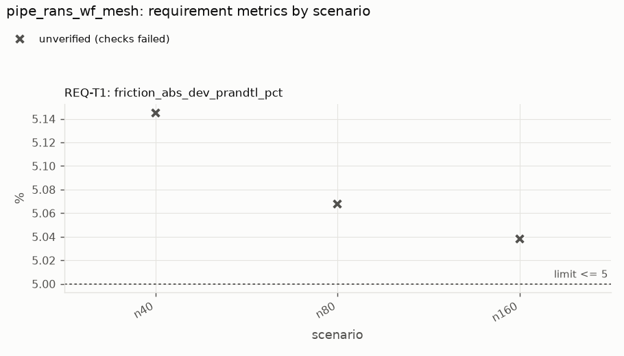
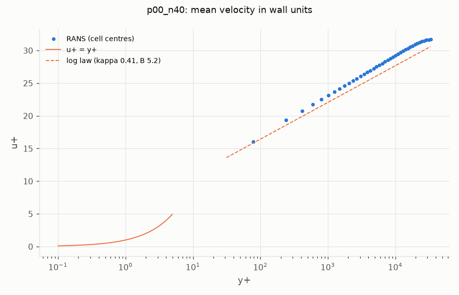
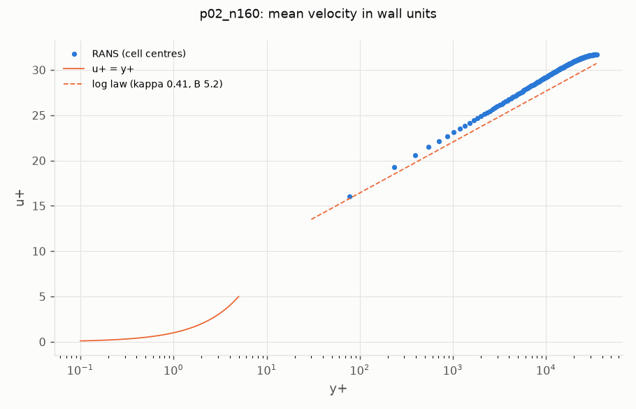

# Engineering review report: pipe_rans_wf_mesh

- **Run:** `20261122-135114_pipe_rans_wf_mesh`
- **Generated:** 2026-11-22T19:02:06+00:00
- **Case file SHA-256:** `a3a9a236e72e4c5750b764988327e440bc5c09f39360b53f95df42fa9dc0f31a`
- **Environment:** Python 3.14.10, numpy 2.5.5, scipy 1.18.1, matplotlib 3.11.2, cadquery 2.8.0; Windows-11-10.0.26100-SP0
- **Tools:** openfoam_bashrc /opt/openfoam14/etc/bashrc; openfoam_version 14; openfoam_package openfoam14 20261008; linux Ubuntu 22.04.5 LTS
- **Code version:** git `9a0cfc13b50b7e4f3ef678143b0173edf0ef402f`
- **Simulation status:** completed
- **Verification status:** FAIL

> **Warning:** verification did not pass for every point. Requirement verdicts marked *(unverified)* are not supported by evidence and must not be used for acceptance.

## Scope

Fully developed turbulent pipe flow at Re 2e6 (D 0.1 m, nu 1e-6 m^2/s), axisymmetric periodic wedge, RANS k-omega SST with wall functions; mesh study on the core (n_radial 40 / 80 / 160) with the first-face y+ held at 160; friction factor against Prandtl's smooth-pipe law.

**Assumptions**

- Fully developed, steady, incompressible, axisymmetric mean flow in a hydraulically smooth pipe.
- RANS with the k-omega SST model (openfoam.org v14 coefficients); its form error is what this study measures.
- Hydraulic diameter of the wedge 2 R cos(2.5 deg) (its wall is a flat face): 0.1 % below D, used consistently.

## Requirements

| ID | Requirement | Metric | Limit |
|---|---|---|---|
| REQ-T1 | The predicted friction factor shall be within 5 % of Prandtl's smooth-pipe law (the Moody chart's smooth curve), a usable accuracy for pressure-drop budgets. | `friction_abs_dev_prandtl_pct` | <= 5 % |

## Summary across points

| Point | scenario | REQ-T1 | Checks |
|---|---|---|---|
| p00_n40 | n40 | 5.145 %: **FAIL (unverified)** | 6/7 FAIL |
| p01_n80 | n80 | 5.068 %: **FAIL (unverified)** | 6/7 FAIL |
| p02_n160 | n160 | 5.038 %: **FAIL (unverified)** | 5/7 FAIL |

## Run-level checks

Checks that use several points together (for example mesh convergence).

| Check | Description | Value | Tolerance | Status |
|---|---|---|---|---|
| discretization_friction_factor | relative discretization uncertainty of the friction factor, monotone (R = 0.379): GCI_fine, observed order 1.40, extrapolated 0.00985489 | 0.000237 | 0.01 | PASS |

## Point details

### p00_n40

Parameters: diameter_m = 0.1, reynolds_number = 2e+06, kinematic_viscosity_m2_per_s = 1e-06, n_radial = 40, first_cell_yplus = 160, wall_treatment = wall_function, turbulence_model = kOmegaSST, scenario = n40

Derived: friction_prandtl = 0.01037, friction_petukhov = 0.01037, friction_blasius = 0.008414

| Requirement | Result | Limit | Margin | Verdict | Evidence |
|---|---|---|---|---|---|
| REQ-T1 | 5.145 % | <= 5 | -0.145 | **FAIL (unverified)** | [point.json](points/p00_n40/point.json) |

| Check | Description | Value | Tolerance | Status |
|---|---|---|---|---|
| mesh | checkMesh reports Mesh OK (1 = failed) | 0.00e+00 | 5e-01 | PASS |
| force_balance | |f from the wall shear - f from the applied pressure gradient| / f (periodic flow: dp/dx A = tau_w P exactly) | 6.39e-12 | 1e-04 | PASS |
| bulk_velocity | |bulk velocity of the cell field - target| / target | 5.14e-13 | 1e-06 | PASS |
| iterative_convergence | max change of the pressure gradient over the last 10 % of iterations / final | 1.93e-10 | 1e-06 | PASS |
| wall_uniform | spread of the wall shear along the wall / mean (fully developed: 0) | 0.00e+00 | 1e-04 | PASS |
| yplus_range (validity) | first-cell y+ against the wall treatment's range (below 1 = inside) | 3.82e-01 | 1e+00 | PASS |
| log_law | max |u+ - (ln y+ / 0.41 + 5.2)| / u+ for 50 <= y+ <= 0.15 Re_tau (model form: the log law's constants scatter by a few per cent between experiments) | 5.06e-02 | 5e-02 | FAIL |

### p01_n80

Parameters: diameter_m = 0.1, reynolds_number = 2e+06, kinematic_viscosity_m2_per_s = 1e-06, n_radial = 80, first_cell_yplus = 160, wall_treatment = wall_function, turbulence_model = kOmegaSST, scenario = n80

Derived: friction_prandtl = 0.01037, friction_petukhov = 0.01037, friction_blasius = 0.008414

| Requirement | Result | Limit | Margin | Verdict | Evidence |
|---|---|---|---|---|---|
| REQ-T1 | 5.068 % | <= 5 | -0.0675 | **FAIL (unverified)** | [point.json](points/p01_n80/point.json) |

| Check | Description | Value | Tolerance | Status |
|---|---|---|---|---|
| mesh | checkMesh reports Mesh OK (1 = failed) | 0.00e+00 | 5e-01 | PASS |
| force_balance | |f from the wall shear - f from the applied pressure gradient| / f (periodic flow: dp/dx A = tau_w P exactly) | 8.70e-12 | 1e-04 | PASS |
| bulk_velocity | |bulk velocity of the cell field - target| / target | 2.32e-13 | 1e-06 | PASS |
| iterative_convergence | max change of the pressure gradient over the last 10 % of iterations / final | 7.91e-10 | 1e-06 | PASS |
| wall_uniform | spread of the wall shear along the wall / mean (fully developed: 0) | 0.00e+00 | 1e-04 | PASS |
| yplus_range (validity) | first-cell y+ against the wall treatment's range (below 1 = inside) | 3.82e-01 | 1e+00 | PASS |
| log_law | max |u+ - (ln y+ / 0.41 + 5.2)| / u+ for 50 <= y+ <= 0.15 Re_tau (model form: the log law's constants scatter by a few per cent between experiments) | 5.05e-02 | 5e-02 | FAIL |

### p02_n160

Parameters: diameter_m = 0.1, reynolds_number = 2e+06, kinematic_viscosity_m2_per_s = 1e-06, n_radial = 160, first_cell_yplus = 160, wall_treatment = wall_function, turbulence_model = kOmegaSST, scenario = n160

Derived: friction_prandtl = 0.01037, friction_petukhov = 0.01037, friction_blasius = 0.008414

| Requirement | Result | Limit | Margin | Verdict | Evidence |
|---|---|---|---|---|---|
| REQ-T1 | 5.038 % | <= 5 | -0.0381 | **FAIL (unverified)** | [point.json](points/p02_n160/point.json) |

| Check | Description | Value | Tolerance | Status |
|---|---|---|---|---|
| mesh | checkMesh reports Mesh OK (1 = failed) | 0.00e+00 | 5e-01 | PASS |
| force_balance | |f from the wall shear - f from the applied pressure gradient| / f (periodic flow: dp/dx A = tau_w P exactly) | 1.09e-06 | 1e-04 | PASS |
| bulk_velocity | |bulk velocity of the cell field - target| / target | 1.12e-13 | 1e-06 | PASS |
| iterative_convergence | max change of the pressure gradient over the last 10 % of iterations / final | 3.79e-06 | 1e-06 | FAIL |
| wall_uniform | spread of the wall shear along the wall / mean (fully developed: 0) | 0.00e+00 | 1e-04 | PASS |
| yplus_range (validity) | first-cell y+ against the wall treatment's range (below 1 = inside) | 3.82e-01 | 1e+00 | PASS |
| log_law | max |u+ - (ln y+ / 0.41 + 5.2)| / u+ for 50 <= y+ <= 0.15 Re_tau (model form: the log law's constants scatter by a few per cent between experiments) | 5.05e-02 | 5e-02 | FAIL |

## Limitations

- Smooth walls only; roughness (the Colebrook range) not modelled.
- The reference is a correlation of measurements (about +-2 % scatter in Nikuradse's smooth-pipe data), not the measurements themselves.
- A converged solver run that matches an analytical reference shows that the equations were solved correctly. It does not show that the equations represent real hardware.

## Engineering acceptance

Pending human review. This report does not accept or reject the design.
