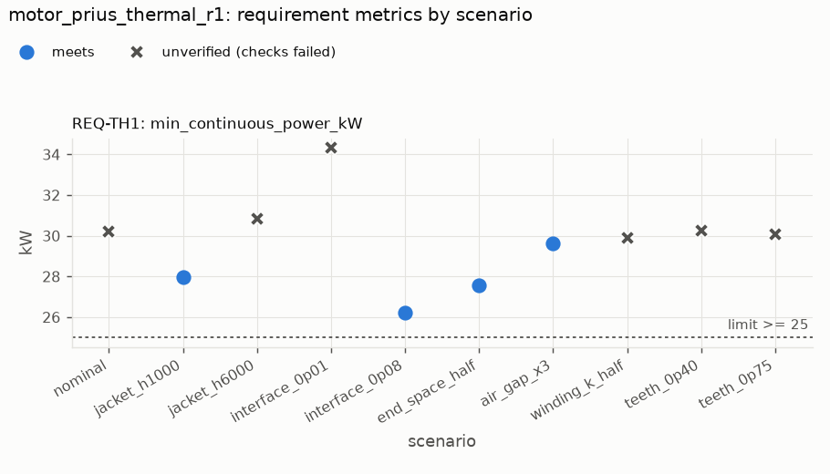
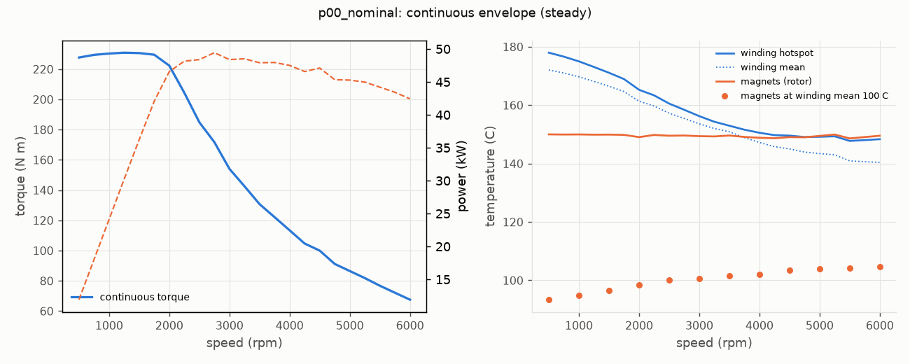
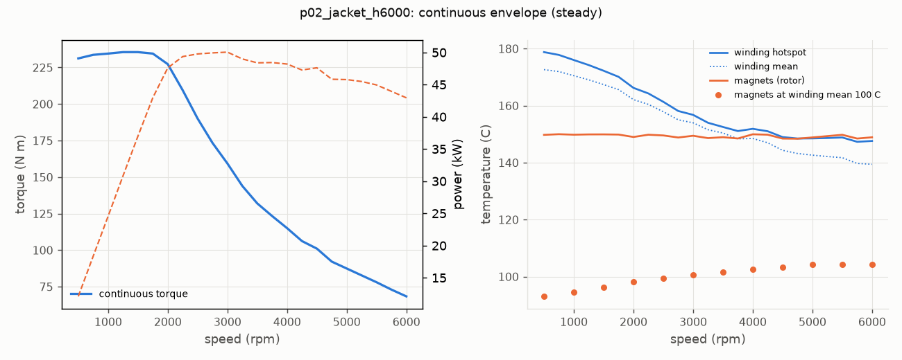
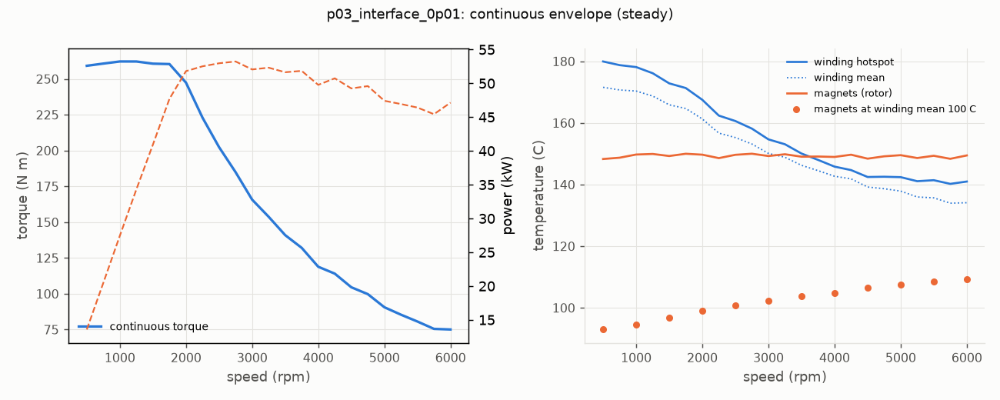
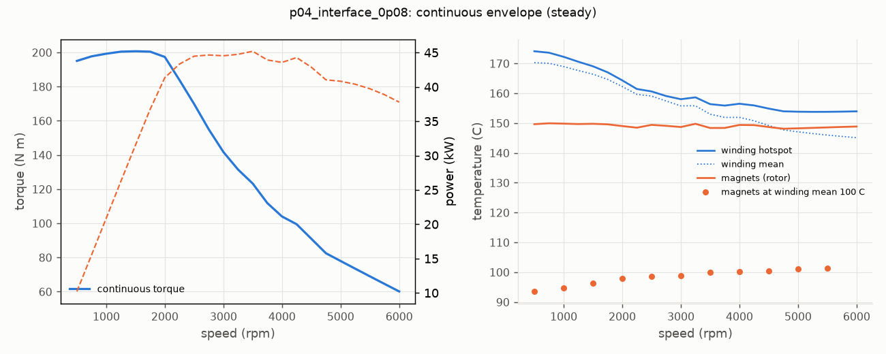
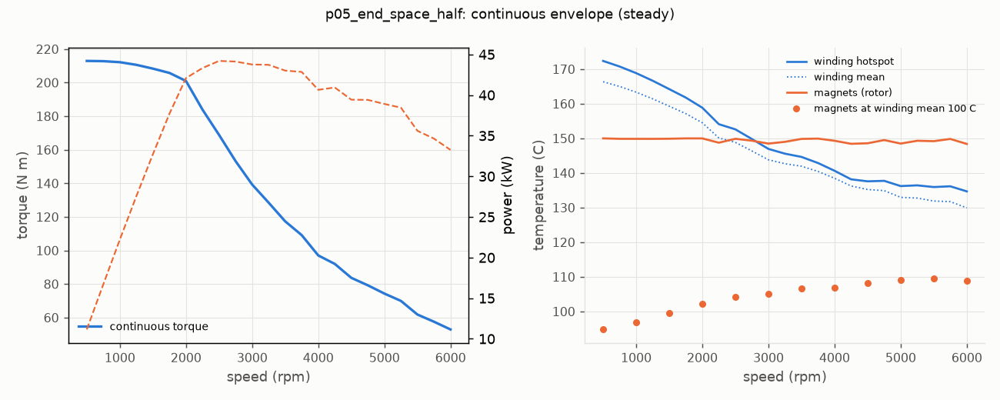
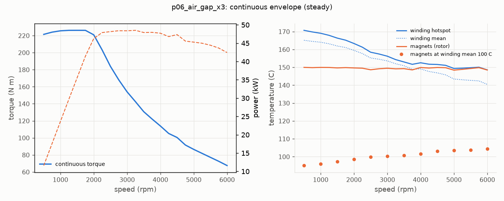
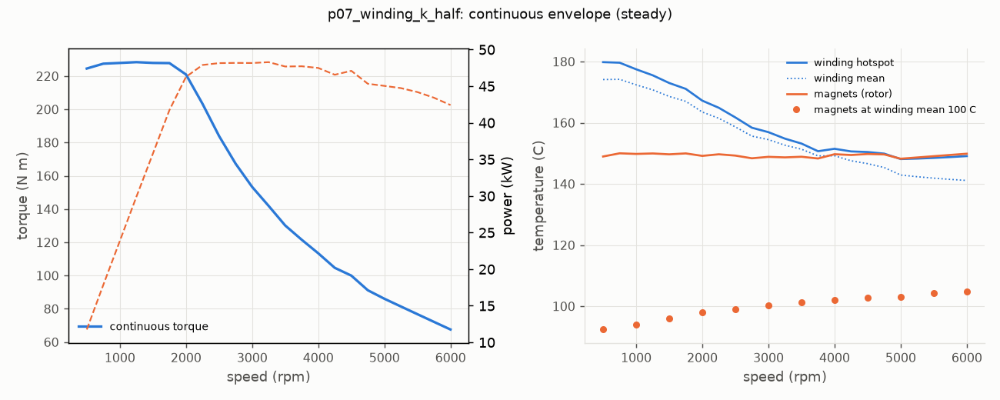
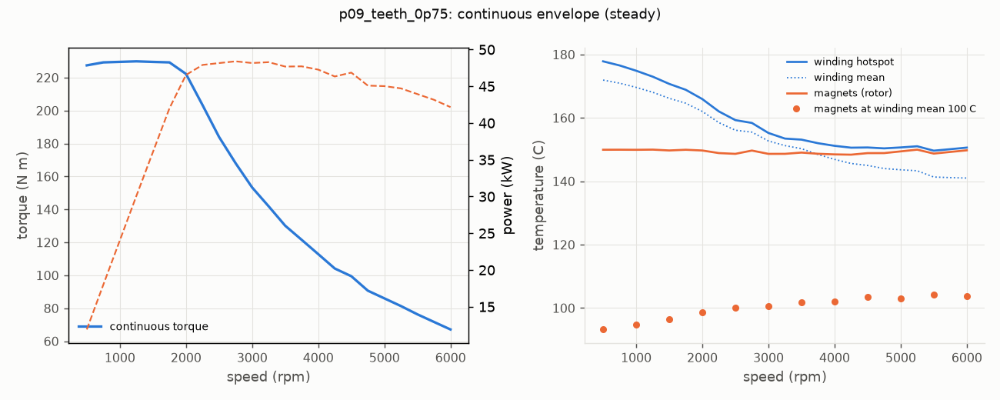

# Engineering review report: motor_prius_thermal_r1

- **Run:** `20261122-174925_motor_prius_thermal_r1`
- **Generated:** 2026-11-22T22:54:10+00:00
- **Case file SHA-256:** `a762a1279b6f50e0c411977abfeecfd7968224bb7fb46ab27679ebee791b13b6`
- **Environment:** Python 3.14.10, numpy 2.5.5, scipy 1.18.1, matplotlib 3.11.2, cadquery 2.8.0; Windows-11-10.0.26100-SP0
- **Tools:** numpy 2.5.5; scipy 1.18.1; gmsh 4.15.0; ccx This is Version 2.22
- **Code version:** git `47608ba06d8a98dca5a4aec23070184e0eb1020b`
- **Simulation status:** completed
- **Verification status:** FAIL

> **Warning:** verification did not pass for every point. Requirement verdicts marked *(unverified)* are not supported by evidence and must not be used for acceptance.

## Scope

2004 Toyota Prius traction motor (our machine): steady lumped thermal network from the geometry, coupled to the verified dq tables (losses at the network's temperatures); continuous torque-speed envelope 500-6000 rpm within a 180 C winding hotspot and 150 C magnets under a synthetic 65 C water jacket, and the magnet temperature where the winding mean reaches the efficiency map's 100 C; nominal and nine sensitivity scenarios; CalculiX slot-pitch conduction check.

**Assumptions**

- Steady state; continuous duty. Losses: copper (DC resistance at each winding part's temperature) and iron (the tables' stator and rotor coefficients); no AC copper, magnet eddy-current or mechanical loss (as in the efficiency study). Magnets carry no loss, so they sit at the rotor's mean temperature.
- Tables blended linearly in magnet temperature between the cold (20 C) and hot (80 C) runs; above 80 C this is an extrapolation (linear reversible Br loss), reported as magnet_extrapolation_above_hot_table_K.
- Cooling synthetic (user, 2026-11-22): water-glycol jacket 65 C, h 3000 W/m^2 K on the housing over the stack and end-winding extensions; the result scales with it through the jacket scenarios.
- Limits synthetic (user, 2026-11-22): winding hotspot 180 C (class H), magnets 150 C.
- Stator-housing interface: an equivalent air gap of 0.037 mm (Staton et al. 2005 Table III average of measured machines); swept 0.01 / 0.08 mm.
- End-space convection from correlations measured on TEFC induction motors (Boglietti and Cavagnino 2007 form; Micallef constants), v = rotor peripheral speed; scenario 0.5x.
- Air gap: conduction only (Nu = 2), the lower bound; scenario 3x. Shaft adiabatic: no heat path through the shaft and bearings (conservative for the rotor).
- Slot hotspot: the larger of the slab value (winding surface + 1.5 (mean - surface)) and the top-of-slot value (tooth-tip temperature + liner drop + local slab rise across the top width; revision 1); checked against the CalculiX section's peak. End-turn hotspot: slot exit + 1.5 (mean - slot exit), not checked by FE.
- Stator iron loss split 0.57 teeth / 0.43 yoke (area x B^2 estimate); scenarios 0.4 and 0.75.

## Requirements

| ID | Requirement | Metric | Limit |
|---|---|---|---|
| REQ-TH1 | The motor shall deliver at least 25 kW continuously (steady state, winding hotspot <= 180 C, magnets <= 150 C) at every speed from 1250 rpm (just above the 1194 rpm rated base speed) to 6000 rpm, under the stated jacket. | `min_continuous_power_kW` | >= 25 kW |

## Summary across points

| Point | scenario | REQ-TH1 | Checks |
|---|---|---|---|
| p00_nominal | nominal | 30.21 kW: **PASS (unverified)** | 8/9 FAIL |
| p01_jacket_h1000 | jacket_h1000 | 27.98 kW: **PASS** | 9/9 PASS |
| p02_jacket_h6000 | jacket_h6000 | 30.83 kW: **PASS (unverified)** | 8/9 FAIL |
| p03_interface_0p01 | interface_0p01 | 34.31 kW: **PASS (unverified)** | 7/9 FAIL |
| p04_interface_0p08 | interface_0p08 | 26.24 kW: **PASS** | 9/9 PASS |
| p05_end_space_half | end_space_half | 27.56 kW: **PASS** | 9/9 PASS |
| p06_air_gap_x3 | air_gap_x3 | 29.6 kW: **PASS** | 9/9 PASS |
| p07_winding_k_half | winding_k_half | 29.89 kW: **PASS (unverified)** | 8/9 FAIL |
| p08_teeth_0p40 | teeth_0p40 | 30.25 kW: **PASS (unverified)** | 8/9 FAIL |
| p09_teeth_0p75 | teeth_0p75 | 30.09 kW: **PASS (unverified)** | 8/9 FAIL |

## Point details

### p00_nominal

Parameters: n_slots = 48, stack_length_mm = 83.82, stator_outer_radius_mm = 134.6, stator_bore_radius_mm = 80.96, slot_shoulder_x_mm = 81.97, slot_width_shoulder_mm = 3.15, slot_width_round_mm = 5.639, slot_round_centre_x_mm = 111.7, slot_opening_mm = 1.93, liner_thickness_mm = 0.25, copper_area_per_slot_mm2 = 76.4, rotor_outer_radius_mm = 80.19, rotor_inner_radius_mm = 55.32, end_connection_length_mm = 120.6, end_extension_mm = 38.4, impregnant_conductivity_W_mK = 0.25, copper_conductivity_W_mK = 390, liner_conductivity_W_mK = 0.2, lamination_conductivity_W_mK = 28, housing_conductivity_W_mK = 160, housing_wall_mm = 6, interface_gap_mm = 0.037, jacket_htc_W_m2K = 3000, coolant_temperature_C = 65, air_gap_h_factor = 1, end_space_h_scale = 1, winding_k_scale = 1, teeth_iron_fraction = 0.57, h_winding_end_space_k1 = 15, h_winding_end_space_k2 = 6, h_winding_end_space_k3 = 0.9, h_housing_end_space_k1 = 20, h_housing_end_space_k2 = 8.7, h_housing_end_space_k3 = 0.7, h_rotor_end_space_k1 = 41.4, h_rotor_end_space_k2 = 6.22, h_rotor_end_space_k3 = 1, lut_run_cold = 20261122-102002_motor_prius_lut_cold,20261122-133946_motor_prius_lut_cold_lowiq, lut_run_hot = 20261122-115824_motor_prius_lut_hot,20261122-143828_motor_prius_lut_hot_lowiq, efficiency_run = 20261122-153450_motor_prius_efficiency_r1, series_turns_per_phase = 72, turn_copper_area_mm2 = 8.492, stack_length_m = 0.08382, end_connection_length_m = 0.1206, copper_resistivity_20C_ohm_m = 1.72e-08, copper_alpha_per_K = 0.00393, bus_voltage_V = 500, current_limit_design_A = 212, winding_hotspot_limit_C = 180, magnet_limit_C = 150, speed_min_rpm = 500, speed_max_rpm = 6000, speed_step_rpm = 250, hot_corner_winding_C = 100, fe_reference_speed_rpm = 3000, scenario = nominal

Derived: phase_resistance_20C_ohm = 0.05962

| Requirement | Result | Limit | Margin | Verdict | Evidence |
|---|---|---|---|---|---|
| REQ-TH1 | 30.21 kW | >= 25 | 5.21 | **PASS (unverified)** | [point.json](points/p00_nominal/point.json) |

| Check | Description | Value | Tolerance | Status |
|---|---|---|---|---|
| energy_balance | max over every network solve of |losses in - heat to the coolant| / losses | 1.66e-12 | 1e-09 | PASS |
| coupling_convergence | max over the envelope and hot-corner searches of the last temperature change of the loss-temperature iteration (K) | 7.93e-04 | 1e-01 | PASS |
| efficiency_consistency | max relative difference of the total loss at fixed hot temperatures (windings 100 C, magnets 80 C) against the efficiency run's hot map at five points | 2.63e-16 | 1e-06 | PASS |
| fe_balance | CalculiX section: |generation - film heat out| / generation, worst mesh | 6.23e-05 | 1e-03 | PASS |
| fe_mesh | CalculiX section: discretization uncertainty (GCI or spread) of the winding peak rise | 0.00e+00 | 1e-02 | PASS |
| section_wind_mean | |network - CalculiX| / CalculiX, winding mean rise above the coolant, cross-section with the same losses and boundary conditions (model form) | 4.44e-02 | 5e-02 | PASS |
| section_wind_peak | |network - CalculiX| / CalculiX, winding peak (network: slab factor 1.5) rise above the coolant, cross-section with the same losses and boundary conditions (model form) | 5.25e-02 | 5e-02 | FAIL |
| section_teeth_mean | |network - CalculiX| / CalculiX, teeth mean rise above the coolant, cross-section with the same losses and boundary conditions (model form) | 3.24e-02 | 5e-02 | PASS |
| section_yoke_mean | |network - CalculiX| / CalculiX, yoke mean rise above the coolant, cross-section with the same losses and boundary conditions (model form) | 6.66e-03 | 5e-02 | PASS |

### p01_jacket_h1000

Parameters: n_slots = 48, stack_length_mm = 83.82, stator_outer_radius_mm = 134.6, stator_bore_radius_mm = 80.96, slot_shoulder_x_mm = 81.97, slot_width_shoulder_mm = 3.15, slot_width_round_mm = 5.639, slot_round_centre_x_mm = 111.7, slot_opening_mm = 1.93, liner_thickness_mm = 0.25, copper_area_per_slot_mm2 = 76.4, rotor_outer_radius_mm = 80.19, rotor_inner_radius_mm = 55.32, end_connection_length_mm = 120.6, end_extension_mm = 38.4, impregnant_conductivity_W_mK = 0.25, copper_conductivity_W_mK = 390, liner_conductivity_W_mK = 0.2, lamination_conductivity_W_mK = 28, housing_conductivity_W_mK = 160, housing_wall_mm = 6, interface_gap_mm = 0.037, jacket_htc_W_m2K = 1000, coolant_temperature_C = 65, air_gap_h_factor = 1, end_space_h_scale = 1, winding_k_scale = 1, teeth_iron_fraction = 0.57, h_winding_end_space_k1 = 15, h_winding_end_space_k2 = 6, h_winding_end_space_k3 = 0.9, h_housing_end_space_k1 = 20, h_housing_end_space_k2 = 8.7, h_housing_end_space_k3 = 0.7, h_rotor_end_space_k1 = 41.4, h_rotor_end_space_k2 = 6.22, h_rotor_end_space_k3 = 1, lut_run_cold = 20261122-102002_motor_prius_lut_cold,20261122-133946_motor_prius_lut_cold_lowiq, lut_run_hot = 20261122-115824_motor_prius_lut_hot,20261122-143828_motor_prius_lut_hot_lowiq, efficiency_run = 20261122-153450_motor_prius_efficiency_r1, series_turns_per_phase = 72, turn_copper_area_mm2 = 8.492, stack_length_m = 0.08382, end_connection_length_m = 0.1206, copper_resistivity_20C_ohm_m = 1.72e-08, copper_alpha_per_K = 0.00393, bus_voltage_V = 500, current_limit_design_A = 212, winding_hotspot_limit_C = 180, magnet_limit_C = 150, speed_min_rpm = 500, speed_max_rpm = 6000, speed_step_rpm = 250, hot_corner_winding_C = 100, fe_reference_speed_rpm = 3000, scenario = jacket_h1000

Derived: phase_resistance_20C_ohm = 0.05962

| Requirement | Result | Limit | Margin | Verdict | Evidence |
|---|---|---|---|---|---|
| REQ-TH1 | 27.98 kW | >= 25 | 2.98 | **PASS** | [point.json](points/p01_jacket_h1000/point.json) |

| Check | Description | Value | Tolerance | Status |
|---|---|---|---|---|
| energy_balance | max over every network solve of |losses in - heat to the coolant| / losses | 1.84e-12 | 1e-09 | PASS |
| coupling_convergence | max over the envelope and hot-corner searches of the last temperature change of the loss-temperature iteration (K) | 4.77e-04 | 1e-01 | PASS |
| efficiency_consistency | max relative difference of the total loss at fixed hot temperatures (windings 100 C, magnets 80 C) against the efficiency run's hot map at five points | 2.63e-16 | 1e-06 | PASS |
| fe_balance | CalculiX section: |generation - film heat out| / generation, worst mesh | 5.62e-05 | 1e-03 | PASS |
| fe_mesh | CalculiX section: discretization uncertainty (GCI or spread) of the winding peak rise | 0.00e+00 | 1e-02 | PASS |
| section_wind_mean | |network - CalculiX| / CalculiX, winding mean rise above the coolant, cross-section with the same losses and boundary conditions (model form) | 3.56e-02 | 5e-02 | PASS |
| section_wind_peak | |network - CalculiX| / CalculiX, winding peak (network: slab factor 1.5) rise above the coolant, cross-section with the same losses and boundary conditions (model form) | 4.28e-02 | 5e-02 | PASS |
| section_teeth_mean | |network - CalculiX| / CalculiX, teeth mean rise above the coolant, cross-section with the same losses and boundary conditions (model form) | 2.51e-02 | 5e-02 | PASS |
| section_yoke_mean | |network - CalculiX| / CalculiX, yoke mean rise above the coolant, cross-section with the same losses and boundary conditions (model form) | 6.31e-03 | 5e-02 | PASS |

### p02_jacket_h6000

Parameters: n_slots = 48, stack_length_mm = 83.82, stator_outer_radius_mm = 134.6, stator_bore_radius_mm = 80.96, slot_shoulder_x_mm = 81.97, slot_width_shoulder_mm = 3.15, slot_width_round_mm = 5.639, slot_round_centre_x_mm = 111.7, slot_opening_mm = 1.93, liner_thickness_mm = 0.25, copper_area_per_slot_mm2 = 76.4, rotor_outer_radius_mm = 80.19, rotor_inner_radius_mm = 55.32, end_connection_length_mm = 120.6, end_extension_mm = 38.4, impregnant_conductivity_W_mK = 0.25, copper_conductivity_W_mK = 390, liner_conductivity_W_mK = 0.2, lamination_conductivity_W_mK = 28, housing_conductivity_W_mK = 160, housing_wall_mm = 6, interface_gap_mm = 0.037, jacket_htc_W_m2K = 6000, coolant_temperature_C = 65, air_gap_h_factor = 1, end_space_h_scale = 1, winding_k_scale = 1, teeth_iron_fraction = 0.57, h_winding_end_space_k1 = 15, h_winding_end_space_k2 = 6, h_winding_end_space_k3 = 0.9, h_housing_end_space_k1 = 20, h_housing_end_space_k2 = 8.7, h_housing_end_space_k3 = 0.7, h_rotor_end_space_k1 = 41.4, h_rotor_end_space_k2 = 6.22, h_rotor_end_space_k3 = 1, lut_run_cold = 20261122-102002_motor_prius_lut_cold,20261122-133946_motor_prius_lut_cold_lowiq, lut_run_hot = 20261122-115824_motor_prius_lut_hot,20261122-143828_motor_prius_lut_hot_lowiq, efficiency_run = 20261122-153450_motor_prius_efficiency_r1, series_turns_per_phase = 72, turn_copper_area_mm2 = 8.492, stack_length_m = 0.08382, end_connection_length_m = 0.1206, copper_resistivity_20C_ohm_m = 1.72e-08, copper_alpha_per_K = 0.00393, bus_voltage_V = 500, current_limit_design_A = 212, winding_hotspot_limit_C = 180, magnet_limit_C = 150, speed_min_rpm = 500, speed_max_rpm = 6000, speed_step_rpm = 250, hot_corner_winding_C = 100, fe_reference_speed_rpm = 3000, scenario = jacket_h6000

Derived: phase_resistance_20C_ohm = 0.05962

| Requirement | Result | Limit | Margin | Verdict | Evidence |
|---|---|---|---|---|---|
| REQ-TH1 | 30.83 kW | >= 25 | 5.83 | **PASS (unverified)** | [point.json](points/p02_jacket_h6000/point.json) |

| Check | Description | Value | Tolerance | Status |
|---|---|---|---|---|
| energy_balance | max over every network solve of |losses in - heat to the coolant| / losses | 1.70e-12 | 1e-09 | PASS |
| coupling_convergence | max over the envelope and hot-corner searches of the last temperature change of the loss-temperature iteration (K) | 8.70e-04 | 1e-01 | PASS |
| efficiency_consistency | max relative difference of the total loss at fixed hot temperatures (windings 100 C, magnets 80 C) against the efficiency run's hot map at five points | 2.63e-16 | 1e-06 | PASS |
| fe_balance | CalculiX section: |generation - film heat out| / generation, worst mesh | 6.36e-05 | 1e-03 | PASS |
| fe_mesh | CalculiX section: discretization uncertainty (GCI or spread) of the winding peak rise | 0.00e+00 | 1e-02 | PASS |
| section_wind_mean | |network - CalculiX| / CalculiX, winding mean rise above the coolant, cross-section with the same losses and boundary conditions (model form) | 4.72e-02 | 5e-02 | PASS |
| section_wind_peak | |network - CalculiX| / CalculiX, winding peak (network: slab factor 1.5) rise above the coolant, cross-section with the same losses and boundary conditions (model form) | 5.55e-02 | 5e-02 | FAIL |
| section_teeth_mean | |network - CalculiX| / CalculiX, teeth mean rise above the coolant, cross-section with the same losses and boundary conditions (model form) | 3.48e-02 | 5e-02 | PASS |
| section_yoke_mean | |network - CalculiX| / CalculiX, yoke mean rise above the coolant, cross-section with the same losses and boundary conditions (model form) | 6.76e-03 | 5e-02 | PASS |

### p03_interface_0p01

Parameters: n_slots = 48, stack_length_mm = 83.82, stator_outer_radius_mm = 134.6, stator_bore_radius_mm = 80.96, slot_shoulder_x_mm = 81.97, slot_width_shoulder_mm = 3.15, slot_width_round_mm = 5.639, slot_round_centre_x_mm = 111.7, slot_opening_mm = 1.93, liner_thickness_mm = 0.25, copper_area_per_slot_mm2 = 76.4, rotor_outer_radius_mm = 80.19, rotor_inner_radius_mm = 55.32, end_connection_length_mm = 120.6, end_extension_mm = 38.4, impregnant_conductivity_W_mK = 0.25, copper_conductivity_W_mK = 390, liner_conductivity_W_mK = 0.2, lamination_conductivity_W_mK = 28, housing_conductivity_W_mK = 160, housing_wall_mm = 6, interface_gap_mm = 0.01, jacket_htc_W_m2K = 3000, coolant_temperature_C = 65, air_gap_h_factor = 1, end_space_h_scale = 1, winding_k_scale = 1, teeth_iron_fraction = 0.57, h_winding_end_space_k1 = 15, h_winding_end_space_k2 = 6, h_winding_end_space_k3 = 0.9, h_housing_end_space_k1 = 20, h_housing_end_space_k2 = 8.7, h_housing_end_space_k3 = 0.7, h_rotor_end_space_k1 = 41.4, h_rotor_end_space_k2 = 6.22, h_rotor_end_space_k3 = 1, lut_run_cold = 20261122-102002_motor_prius_lut_cold,20261122-133946_motor_prius_lut_cold_lowiq, lut_run_hot = 20261122-115824_motor_prius_lut_hot,20261122-143828_motor_prius_lut_hot_lowiq, efficiency_run = 20261122-153450_motor_prius_efficiency_r1, series_turns_per_phase = 72, turn_copper_area_mm2 = 8.492, stack_length_m = 0.08382, end_connection_length_m = 0.1206, copper_resistivity_20C_ohm_m = 1.72e-08, copper_alpha_per_K = 0.00393, bus_voltage_V = 500, current_limit_design_A = 212, winding_hotspot_limit_C = 180, magnet_limit_C = 150, speed_min_rpm = 500, speed_max_rpm = 6000, speed_step_rpm = 250, hot_corner_winding_C = 100, fe_reference_speed_rpm = 3000, scenario = interface_0p01

Derived: phase_resistance_20C_ohm = 0.05962

| Requirement | Result | Limit | Margin | Verdict | Evidence |
|---|---|---|---|---|---|
| REQ-TH1 | 34.31 kW | >= 25 | 9.31 | **PASS (unverified)** | [point.json](points/p03_interface_0p01/point.json) |

| Check | Description | Value | Tolerance | Status |
|---|---|---|---|---|
| energy_balance | max over every network solve of |losses in - heat to the coolant| / losses | 1.60e-12 | 1e-09 | PASS |
| coupling_convergence | max over the envelope and hot-corner searches of the last temperature change of the loss-temperature iteration (K) | 6.41e-04 | 1e-01 | PASS |
| efficiency_consistency | max relative difference of the total loss at fixed hot temperatures (windings 100 C, magnets 80 C) against the efficiency run's hot map at five points | 2.63e-16 | 1e-06 | PASS |
| fe_balance | CalculiX section: |generation - film heat out| / generation, worst mesh | 6.64e-05 | 1e-03 | PASS |
| fe_mesh | CalculiX section: discretization uncertainty (GCI or spread) of the winding peak rise | 9.47e-06 | 1e-02 | PASS |
| section_wind_mean | |network - CalculiX| / CalculiX, winding mean rise above the coolant, cross-section with the same losses and boundary conditions (model form) | 6.39e-02 | 5e-02 | FAIL |
| section_wind_peak | |network - CalculiX| / CalculiX, winding peak (network: slab factor 1.5) rise above the coolant, cross-section with the same losses and boundary conditions (model form) | 7.21e-02 | 5e-02 | FAIL |
| section_teeth_mean | |network - CalculiX| / CalculiX, teeth mean rise above the coolant, cross-section with the same losses and boundary conditions (model form) | 4.94e-02 | 5e-02 | PASS |
| section_yoke_mean | |network - CalculiX| / CalculiX, yoke mean rise above the coolant, cross-section with the same losses and boundary conditions (model form) | 7.92e-03 | 5e-02 | PASS |

### p04_interface_0p08

Parameters: n_slots = 48, stack_length_mm = 83.82, stator_outer_radius_mm = 134.6, stator_bore_radius_mm = 80.96, slot_shoulder_x_mm = 81.97, slot_width_shoulder_mm = 3.15, slot_width_round_mm = 5.639, slot_round_centre_x_mm = 111.7, slot_opening_mm = 1.93, liner_thickness_mm = 0.25, copper_area_per_slot_mm2 = 76.4, rotor_outer_radius_mm = 80.19, rotor_inner_radius_mm = 55.32, end_connection_length_mm = 120.6, end_extension_mm = 38.4, impregnant_conductivity_W_mK = 0.25, copper_conductivity_W_mK = 390, liner_conductivity_W_mK = 0.2, lamination_conductivity_W_mK = 28, housing_conductivity_W_mK = 160, housing_wall_mm = 6, interface_gap_mm = 0.08, jacket_htc_W_m2K = 3000, coolant_temperature_C = 65, air_gap_h_factor = 1, end_space_h_scale = 1, winding_k_scale = 1, teeth_iron_fraction = 0.57, h_winding_end_space_k1 = 15, h_winding_end_space_k2 = 6, h_winding_end_space_k3 = 0.9, h_housing_end_space_k1 = 20, h_housing_end_space_k2 = 8.7, h_housing_end_space_k3 = 0.7, h_rotor_end_space_k1 = 41.4, h_rotor_end_space_k2 = 6.22, h_rotor_end_space_k3 = 1, lut_run_cold = 20261122-102002_motor_prius_lut_cold,20261122-133946_motor_prius_lut_cold_lowiq, lut_run_hot = 20261122-115824_motor_prius_lut_hot,20261122-143828_motor_prius_lut_hot_lowiq, efficiency_run = 20261122-153450_motor_prius_efficiency_r1, series_turns_per_phase = 72, turn_copper_area_mm2 = 8.492, stack_length_m = 0.08382, end_connection_length_m = 0.1206, copper_resistivity_20C_ohm_m = 1.72e-08, copper_alpha_per_K = 0.00393, bus_voltage_V = 500, current_limit_design_A = 212, winding_hotspot_limit_C = 180, magnet_limit_C = 150, speed_min_rpm = 500, speed_max_rpm = 6000, speed_step_rpm = 250, hot_corner_winding_C = 100, fe_reference_speed_rpm = 3000, scenario = interface_0p08

Derived: phase_resistance_20C_ohm = 0.05962

| Requirement | Result | Limit | Margin | Verdict | Evidence |
|---|---|---|---|---|---|
| REQ-TH1 | 26.24 kW | >= 25 | 1.24 | **PASS** | [point.json](points/p04_interface_0p08/point.json) |

| Check | Description | Value | Tolerance | Status |
|---|---|---|---|---|
| energy_balance | max over every network solve of |losses in - heat to the coolant| / losses | 1.86e-12 | 1e-09 | PASS |
| coupling_convergence | max over the envelope and hot-corner searches of the last temperature change of the loss-temperature iteration (K) | 5.34e-04 | 1e-01 | PASS |
| efficiency_consistency | max relative difference of the total loss at fixed hot temperatures (windings 100 C, magnets 80 C) against the efficiency run's hot map at five points | 2.63e-16 | 1e-06 | PASS |
| fe_balance | CalculiX section: |generation - film heat out| / generation, worst mesh | 5.81e-05 | 1e-03 | PASS |
| fe_mesh | CalculiX section: discretization uncertainty (GCI or spread) of the winding peak rise | 0.00e+00 | 1e-02 | PASS |
| section_wind_mean | |network - CalculiX| / CalculiX, winding mean rise above the coolant, cross-section with the same losses and boundary conditions (model form) | 3.03e-02 | 5e-02 | PASS |
| section_wind_peak | |network - CalculiX| / CalculiX, winding peak (network: slab factor 1.5) rise above the coolant, cross-section with the same losses and boundary conditions (model form) | 3.79e-02 | 5e-02 | PASS |
| section_teeth_mean | |network - CalculiX| / CalculiX, teeth mean rise above the coolant, cross-section with the same losses and boundary conditions (model form) | 2.15e-02 | 5e-02 | PASS |
| section_yoke_mean | |network - CalculiX| / CalculiX, yoke mean rise above the coolant, cross-section with the same losses and boundary conditions (model form) | 4.13e-03 | 5e-02 | PASS |

### p05_end_space_half

Parameters: n_slots = 48, stack_length_mm = 83.82, stator_outer_radius_mm = 134.6, stator_bore_radius_mm = 80.96, slot_shoulder_x_mm = 81.97, slot_width_shoulder_mm = 3.15, slot_width_round_mm = 5.639, slot_round_centre_x_mm = 111.7, slot_opening_mm = 1.93, liner_thickness_mm = 0.25, copper_area_per_slot_mm2 = 76.4, rotor_outer_radius_mm = 80.19, rotor_inner_radius_mm = 55.32, end_connection_length_mm = 120.6, end_extension_mm = 38.4, impregnant_conductivity_W_mK = 0.25, copper_conductivity_W_mK = 390, liner_conductivity_W_mK = 0.2, lamination_conductivity_W_mK = 28, housing_conductivity_W_mK = 160, housing_wall_mm = 6, interface_gap_mm = 0.037, jacket_htc_W_m2K = 3000, coolant_temperature_C = 65, air_gap_h_factor = 1, end_space_h_scale = 0.5, winding_k_scale = 1, teeth_iron_fraction = 0.57, h_winding_end_space_k1 = 15, h_winding_end_space_k2 = 6, h_winding_end_space_k3 = 0.9, h_housing_end_space_k1 = 20, h_housing_end_space_k2 = 8.7, h_housing_end_space_k3 = 0.7, h_rotor_end_space_k1 = 41.4, h_rotor_end_space_k2 = 6.22, h_rotor_end_space_k3 = 1, lut_run_cold = 20261122-102002_motor_prius_lut_cold,20261122-133946_motor_prius_lut_cold_lowiq, lut_run_hot = 20261122-115824_motor_prius_lut_hot,20261122-143828_motor_prius_lut_hot_lowiq, efficiency_run = 20261122-153450_motor_prius_efficiency_r1, series_turns_per_phase = 72, turn_copper_area_mm2 = 8.492, stack_length_m = 0.08382, end_connection_length_m = 0.1206, copper_resistivity_20C_ohm_m = 1.72e-08, copper_alpha_per_K = 0.00393, bus_voltage_V = 500, current_limit_design_A = 212, winding_hotspot_limit_C = 180, magnet_limit_C = 150, speed_min_rpm = 500, speed_max_rpm = 6000, speed_step_rpm = 250, hot_corner_winding_C = 100, fe_reference_speed_rpm = 3000, scenario = end_space_half

Derived: phase_resistance_20C_ohm = 0.05962

| Requirement | Result | Limit | Margin | Verdict | Evidence |
|---|---|---|---|---|---|
| REQ-TH1 | 27.56 kW | >= 25 | 2.56 | **PASS** | [point.json](points/p05_end_space_half/point.json) |

| Check | Description | Value | Tolerance | Status |
|---|---|---|---|---|
| energy_balance | max over every network solve of |losses in - heat to the coolant| / losses | 1.78e-12 | 1e-09 | PASS |
| coupling_convergence | max over the envelope and hot-corner searches of the last temperature change of the loss-temperature iteration (K) | 6.99e-04 | 1e-01 | PASS |
| efficiency_consistency | max relative difference of the total loss at fixed hot temperatures (windings 100 C, magnets 80 C) against the efficiency run's hot map at five points | 2.63e-16 | 1e-06 | PASS |
| fe_balance | CalculiX section: |generation - film heat out| / generation, worst mesh | 5.46e-05 | 1e-03 | PASS |
| fe_mesh | CalculiX section: discretization uncertainty (GCI or spread) of the winding peak rise | 1.07e-05 | 1e-02 | PASS |
| section_wind_mean | |network - CalculiX| / CalculiX, winding mean rise above the coolant, cross-section with the same losses and boundary conditions (model form) | 3.99e-02 | 5e-02 | PASS |
| section_wind_peak | |network - CalculiX| / CalculiX, winding peak (network: slab factor 1.5) rise above the coolant, cross-section with the same losses and boundary conditions (model form) | 4.46e-02 | 5e-02 | PASS |
| section_teeth_mean | |network - CalculiX| / CalculiX, teeth mean rise above the coolant, cross-section with the same losses and boundary conditions (model form) | 2.75e-02 | 5e-02 | PASS |
| section_yoke_mean | |network - CalculiX| / CalculiX, yoke mean rise above the coolant, cross-section with the same losses and boundary conditions (model form) | 1.02e-02 | 5e-02 | PASS |

### p06_air_gap_x3

Parameters: n_slots = 48, stack_length_mm = 83.82, stator_outer_radius_mm = 134.6, stator_bore_radius_mm = 80.96, slot_shoulder_x_mm = 81.97, slot_width_shoulder_mm = 3.15, slot_width_round_mm = 5.639, slot_round_centre_x_mm = 111.7, slot_opening_mm = 1.93, liner_thickness_mm = 0.25, copper_area_per_slot_mm2 = 76.4, rotor_outer_radius_mm = 80.19, rotor_inner_radius_mm = 55.32, end_connection_length_mm = 120.6, end_extension_mm = 38.4, impregnant_conductivity_W_mK = 0.25, copper_conductivity_W_mK = 390, liner_conductivity_W_mK = 0.2, lamination_conductivity_W_mK = 28, housing_conductivity_W_mK = 160, housing_wall_mm = 6, interface_gap_mm = 0.037, jacket_htc_W_m2K = 3000, coolant_temperature_C = 65, air_gap_h_factor = 3, end_space_h_scale = 1, winding_k_scale = 1, teeth_iron_fraction = 0.57, h_winding_end_space_k1 = 15, h_winding_end_space_k2 = 6, h_winding_end_space_k3 = 0.9, h_housing_end_space_k1 = 20, h_housing_end_space_k2 = 8.7, h_housing_end_space_k3 = 0.7, h_rotor_end_space_k1 = 41.4, h_rotor_end_space_k2 = 6.22, h_rotor_end_space_k3 = 1, lut_run_cold = 20261122-102002_motor_prius_lut_cold,20261122-133946_motor_prius_lut_cold_lowiq, lut_run_hot = 20261122-115824_motor_prius_lut_hot,20261122-143828_motor_prius_lut_hot_lowiq, efficiency_run = 20261122-153450_motor_prius_efficiency_r1, series_turns_per_phase = 72, turn_copper_area_mm2 = 8.492, stack_length_m = 0.08382, end_connection_length_m = 0.1206, copper_resistivity_20C_ohm_m = 1.72e-08, copper_alpha_per_K = 0.00393, bus_voltage_V = 500, current_limit_design_A = 212, winding_hotspot_limit_C = 180, magnet_limit_C = 150, speed_min_rpm = 500, speed_max_rpm = 6000, speed_step_rpm = 250, hot_corner_winding_C = 100, fe_reference_speed_rpm = 3000, scenario = air_gap_x3

Derived: phase_resistance_20C_ohm = 0.05962

| Requirement | Result | Limit | Margin | Verdict | Evidence |
|---|---|---|---|---|---|
| REQ-TH1 | 29.6 kW | >= 25 | 4.6 | **PASS** | [point.json](points/p06_air_gap_x3/point.json) |

| Check | Description | Value | Tolerance | Status |
|---|---|---|---|---|
| energy_balance | max over every network solve of |losses in - heat to the coolant| / losses | 1.94e-12 | 1e-09 | PASS |
| coupling_convergence | max over the envelope and hot-corner searches of the last temperature change of the loss-temperature iteration (K) | 7.90e-04 | 1e-01 | PASS |
| efficiency_consistency | max relative difference of the total loss at fixed hot temperatures (windings 100 C, magnets 80 C) against the efficiency run's hot map at five points | 2.63e-16 | 1e-06 | PASS |
| fe_balance | CalculiX section: |generation - film heat out| / generation, worst mesh | 6.19e-05 | 1e-03 | PASS |
| fe_mesh | CalculiX section: discretization uncertainty (GCI or spread) of the winding peak rise | 0.00e+00 | 1e-02 | PASS |
| section_wind_mean | |network - CalculiX| / CalculiX, winding mean rise above the coolant, cross-section with the same losses and boundary conditions (model form) | 3.55e-02 | 5e-02 | PASS |
| section_wind_peak | |network - CalculiX| / CalculiX, winding peak (network: slab factor 1.5) rise above the coolant, cross-section with the same losses and boundary conditions (model form) | 3.90e-02 | 5e-02 | PASS |
| section_teeth_mean | |network - CalculiX| / CalculiX, teeth mean rise above the coolant, cross-section with the same losses and boundary conditions (model form) | 2.22e-02 | 5e-02 | PASS |
| section_yoke_mean | |network - CalculiX| / CalculiX, yoke mean rise above the coolant, cross-section with the same losses and boundary conditions (model form) | 1.61e-02 | 5e-02 | PASS |

### p07_winding_k_half

Parameters: n_slots = 48, stack_length_mm = 83.82, stator_outer_radius_mm = 134.6, stator_bore_radius_mm = 80.96, slot_shoulder_x_mm = 81.97, slot_width_shoulder_mm = 3.15, slot_width_round_mm = 5.639, slot_round_centre_x_mm = 111.7, slot_opening_mm = 1.93, liner_thickness_mm = 0.25, copper_area_per_slot_mm2 = 76.4, rotor_outer_radius_mm = 80.19, rotor_inner_radius_mm = 55.32, end_connection_length_mm = 120.6, end_extension_mm = 38.4, impregnant_conductivity_W_mK = 0.25, copper_conductivity_W_mK = 390, liner_conductivity_W_mK = 0.2, lamination_conductivity_W_mK = 28, housing_conductivity_W_mK = 160, housing_wall_mm = 6, interface_gap_mm = 0.037, jacket_htc_W_m2K = 3000, coolant_temperature_C = 65, air_gap_h_factor = 1, end_space_h_scale = 1, winding_k_scale = 0.5, teeth_iron_fraction = 0.57, h_winding_end_space_k1 = 15, h_winding_end_space_k2 = 6, h_winding_end_space_k3 = 0.9, h_housing_end_space_k1 = 20, h_housing_end_space_k2 = 8.7, h_housing_end_space_k3 = 0.7, h_rotor_end_space_k1 = 41.4, h_rotor_end_space_k2 = 6.22, h_rotor_end_space_k3 = 1, lut_run_cold = 20261122-102002_motor_prius_lut_cold,20261122-133946_motor_prius_lut_cold_lowiq, lut_run_hot = 20261122-115824_motor_prius_lut_hot,20261122-143828_motor_prius_lut_hot_lowiq, efficiency_run = 20261122-153450_motor_prius_efficiency_r1, series_turns_per_phase = 72, turn_copper_area_mm2 = 8.492, stack_length_m = 0.08382, end_connection_length_m = 0.1206, copper_resistivity_20C_ohm_m = 1.72e-08, copper_alpha_per_K = 0.00393, bus_voltage_V = 500, current_limit_design_A = 212, winding_hotspot_limit_C = 180, magnet_limit_C = 150, speed_min_rpm = 500, speed_max_rpm = 6000, speed_step_rpm = 250, hot_corner_winding_C = 100, fe_reference_speed_rpm = 3000, scenario = winding_k_half

Derived: phase_resistance_20C_ohm = 0.05962

| Requirement | Result | Limit | Margin | Verdict | Evidence |
|---|---|---|---|---|---|
| REQ-TH1 | 29.89 kW | >= 25 | 4.89 | **PASS (unverified)** | [point.json](points/p07_winding_k_half/point.json) |

| Check | Description | Value | Tolerance | Status |
|---|---|---|---|---|
| energy_balance | max over every network solve of |losses in - heat to the coolant| / losses | 2.03e-12 | 1e-09 | PASS |
| coupling_convergence | max over the envelope and hot-corner searches of the last temperature change of the loss-temperature iteration (K) | 4.66e-04 | 1e-01 | PASS |
| efficiency_consistency | max relative difference of the total loss at fixed hot temperatures (windings 100 C, magnets 80 C) against the efficiency run's hot map at five points | 2.63e-16 | 1e-06 | PASS |
| fe_balance | CalculiX section: |generation - film heat out| / generation, worst mesh | 6.22e-05 | 1e-03 | PASS |
| fe_mesh | CalculiX section: discretization uncertainty (GCI or spread) of the winding peak rise | 0.00e+00 | 1e-02 | PASS |
| section_wind_mean | |network - CalculiX| / CalculiX, winding mean rise above the coolant, cross-section with the same losses and boundary conditions (model form) | 4.60e-02 | 5e-02 | PASS |
| section_wind_peak | |network - CalculiX| / CalculiX, winding peak (network: slab factor 1.5) rise above the coolant, cross-section with the same losses and boundary conditions (model form) | 6.38e-02 | 5e-02 | FAIL |
| section_teeth_mean | |network - CalculiX| / CalculiX, teeth mean rise above the coolant, cross-section with the same losses and boundary conditions (model form) | 3.41e-02 | 5e-02 | PASS |
| section_yoke_mean | |network - CalculiX| / CalculiX, yoke mean rise above the coolant, cross-section with the same losses and boundary conditions (model form) | 6.91e-03 | 5e-02 | PASS |

### p08_teeth_0p40

Parameters: n_slots = 48, stack_length_mm = 83.82, stator_outer_radius_mm = 134.6, stator_bore_radius_mm = 80.96, slot_shoulder_x_mm = 81.97, slot_width_shoulder_mm = 3.15, slot_width_round_mm = 5.639, slot_round_centre_x_mm = 111.7, slot_opening_mm = 1.93, liner_thickness_mm = 0.25, copper_area_per_slot_mm2 = 76.4, rotor_outer_radius_mm = 80.19, rotor_inner_radius_mm = 55.32, end_connection_length_mm = 120.6, end_extension_mm = 38.4, impregnant_conductivity_W_mK = 0.25, copper_conductivity_W_mK = 390, liner_conductivity_W_mK = 0.2, lamination_conductivity_W_mK = 28, housing_conductivity_W_mK = 160, housing_wall_mm = 6, interface_gap_mm = 0.037, jacket_htc_W_m2K = 3000, coolant_temperature_C = 65, air_gap_h_factor = 1, end_space_h_scale = 1, winding_k_scale = 1, teeth_iron_fraction = 0.4, h_winding_end_space_k1 = 15, h_winding_end_space_k2 = 6, h_winding_end_space_k3 = 0.9, h_housing_end_space_k1 = 20, h_housing_end_space_k2 = 8.7, h_housing_end_space_k3 = 0.7, h_rotor_end_space_k1 = 41.4, h_rotor_end_space_k2 = 6.22, h_rotor_end_space_k3 = 1, lut_run_cold = 20261122-102002_motor_prius_lut_cold,20261122-133946_motor_prius_lut_cold_lowiq, lut_run_hot = 20261122-115824_motor_prius_lut_hot,20261122-143828_motor_prius_lut_hot_lowiq, efficiency_run = 20261122-153450_motor_prius_efficiency_r1, series_turns_per_phase = 72, turn_copper_area_mm2 = 8.492, stack_length_m = 0.08382, end_connection_length_m = 0.1206, copper_resistivity_20C_ohm_m = 1.72e-08, copper_alpha_per_K = 0.00393, bus_voltage_V = 500, current_limit_design_A = 212, winding_hotspot_limit_C = 180, magnet_limit_C = 150, speed_min_rpm = 500, speed_max_rpm = 6000, speed_step_rpm = 250, hot_corner_winding_C = 100, fe_reference_speed_rpm = 3000, scenario = teeth_0p40

Derived: phase_resistance_20C_ohm = 0.05962

| Requirement | Result | Limit | Margin | Verdict | Evidence |
|---|---|---|---|---|---|
| REQ-TH1 | 30.25 kW | >= 25 | 5.25 | **PASS (unverified)** | [point.json](points/p08_teeth_0p40/point.json) |

| Check | Description | Value | Tolerance | Status |
|---|---|---|---|---|
| energy_balance | max over every network solve of |losses in - heat to the coolant| / losses | 1.78e-12 | 1e-09 | PASS |
| coupling_convergence | max over the envelope and hot-corner searches of the last temperature change of the loss-temperature iteration (K) | 2.42e-04 | 1e-01 | PASS |
| efficiency_consistency | max relative difference of the total loss at fixed hot temperatures (windings 100 C, magnets 80 C) against the efficiency run's hot map at five points | 3.59e-16 | 1e-06 | PASS |
| fe_balance | CalculiX section: |generation - film heat out| / generation, worst mesh | 6.77e-05 | 1e-03 | PASS |
| fe_mesh | CalculiX section: discretization uncertainty (GCI or spread) of the winding peak rise | 0.00e+00 | 1e-02 | PASS |
| section_wind_mean | |network - CalculiX| / CalculiX, winding mean rise above the coolant, cross-section with the same losses and boundary conditions (model form) | 4.26e-02 | 5e-02 | PASS |
| section_wind_peak | |network - CalculiX| / CalculiX, winding peak (network: slab factor 1.5) rise above the coolant, cross-section with the same losses and boundary conditions (model form) | 5.13e-02 | 5e-02 | FAIL |
| section_teeth_mean | |network - CalculiX| / CalculiX, teeth mean rise above the coolant, cross-section with the same losses and boundary conditions (model form) | 3.11e-02 | 5e-02 | PASS |
| section_yoke_mean | |network - CalculiX| / CalculiX, yoke mean rise above the coolant, cross-section with the same losses and boundary conditions (model form) | 6.67e-03 | 5e-02 | PASS |

### p09_teeth_0p75

Parameters: n_slots = 48, stack_length_mm = 83.82, stator_outer_radius_mm = 134.6, stator_bore_radius_mm = 80.96, slot_shoulder_x_mm = 81.97, slot_width_shoulder_mm = 3.15, slot_width_round_mm = 5.639, slot_round_centre_x_mm = 111.7, slot_opening_mm = 1.93, liner_thickness_mm = 0.25, copper_area_per_slot_mm2 = 76.4, rotor_outer_radius_mm = 80.19, rotor_inner_radius_mm = 55.32, end_connection_length_mm = 120.6, end_extension_mm = 38.4, impregnant_conductivity_W_mK = 0.25, copper_conductivity_W_mK = 390, liner_conductivity_W_mK = 0.2, lamination_conductivity_W_mK = 28, housing_conductivity_W_mK = 160, housing_wall_mm = 6, interface_gap_mm = 0.037, jacket_htc_W_m2K = 3000, coolant_temperature_C = 65, air_gap_h_factor = 1, end_space_h_scale = 1, winding_k_scale = 1, teeth_iron_fraction = 0.75, h_winding_end_space_k1 = 15, h_winding_end_space_k2 = 6, h_winding_end_space_k3 = 0.9, h_housing_end_space_k1 = 20, h_housing_end_space_k2 = 8.7, h_housing_end_space_k3 = 0.7, h_rotor_end_space_k1 = 41.4, h_rotor_end_space_k2 = 6.22, h_rotor_end_space_k3 = 1, lut_run_cold = 20261122-102002_motor_prius_lut_cold,20261122-133946_motor_prius_lut_cold_lowiq, lut_run_hot = 20261122-115824_motor_prius_lut_hot,20261122-143828_motor_prius_lut_hot_lowiq, efficiency_run = 20261122-153450_motor_prius_efficiency_r1, series_turns_per_phase = 72, turn_copper_area_mm2 = 8.492, stack_length_m = 0.08382, end_connection_length_m = 0.1206, copper_resistivity_20C_ohm_m = 1.72e-08, copper_alpha_per_K = 0.00393, bus_voltage_V = 500, current_limit_design_A = 212, winding_hotspot_limit_C = 180, magnet_limit_C = 150, speed_min_rpm = 500, speed_max_rpm = 6000, speed_step_rpm = 250, hot_corner_winding_C = 100, fe_reference_speed_rpm = 3000, scenario = teeth_0p75

Derived: phase_resistance_20C_ohm = 0.05962

| Requirement | Result | Limit | Margin | Verdict | Evidence |
|---|---|---|---|---|---|
| REQ-TH1 | 30.09 kW | >= 25 | 5.09 | **PASS (unverified)** | [point.json](points/p09_teeth_0p75/point.json) |

| Check | Description | Value | Tolerance | Status |
|---|---|---|---|---|
| energy_balance | max over every network solve of |losses in - heat to the coolant| / losses | 1.72e-12 | 1e-09 | PASS |
| coupling_convergence | max over the envelope and hot-corner searches of the last temperature change of the loss-temperature iteration (K) | 8.44e-04 | 1e-01 | PASS |
| efficiency_consistency | max relative difference of the total loss at fixed hot temperatures (windings 100 C, magnets 80 C) against the efficiency run's hot map at five points | 2.63e-16 | 1e-06 | PASS |
| fe_balance | CalculiX section: |generation - film heat out| / generation, worst mesh | 5.60e-05 | 1e-03 | PASS |
| fe_mesh | CalculiX section: discretization uncertainty (GCI or spread) of the winding peak rise | 8.33e-06 | 1e-02 | PASS |
| section_wind_mean | |network - CalculiX| / CalculiX, winding mean rise above the coolant, cross-section with the same losses and boundary conditions (model form) | 4.62e-02 | 5e-02 | PASS |
| section_wind_peak | |network - CalculiX| / CalculiX, winding peak (network: slab factor 1.5) rise above the coolant, cross-section with the same losses and boundary conditions (model form) | 5.38e-02 | 5e-02 | FAIL |
| section_teeth_mean | |network - CalculiX| / CalculiX, teeth mean rise above the coolant, cross-section with the same losses and boundary conditions (model form) | 3.37e-02 | 5e-02 | PASS |
| section_yoke_mean | |network - CalculiX| / CalculiX, yoke mean rise above the coolant, cross-section with the same losses and boundary conditions (model form) | 6.67e-03 | 5e-02 | PASS |

## Limitations

- No test data: thermal is not in the agreed ORNL validation set.
- The CalculiX check covers the stator cross-section only; the axial copper paths, end windings, end space and rotor are network-only (their T-equivalents are exact for 1D conduction, tests/test_motor_thermal.py).
- Steady state only: no transient (peak) ratings.
- Material conductivities and the slot liner are typical values, not measured on this machine.
- A converged solver run that matches an analytical reference shows that the equations were solved correctly. It does not show that the equations represent real hardware.

## Engineering acceptance

Pending human review. This report does not accept or reject the design.
