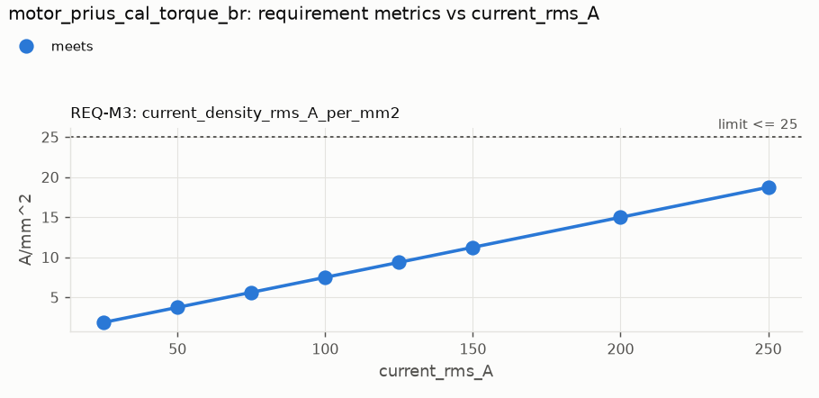
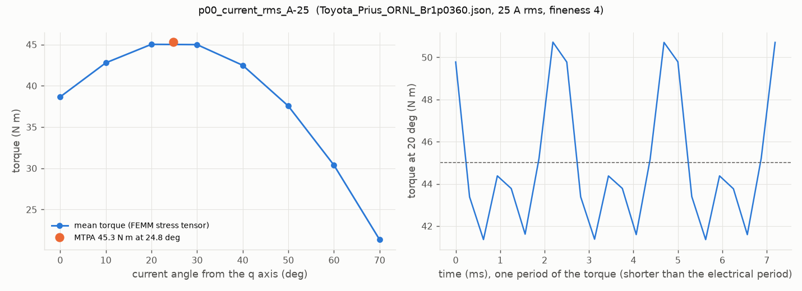
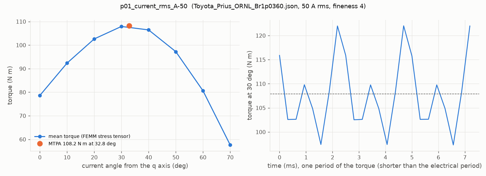
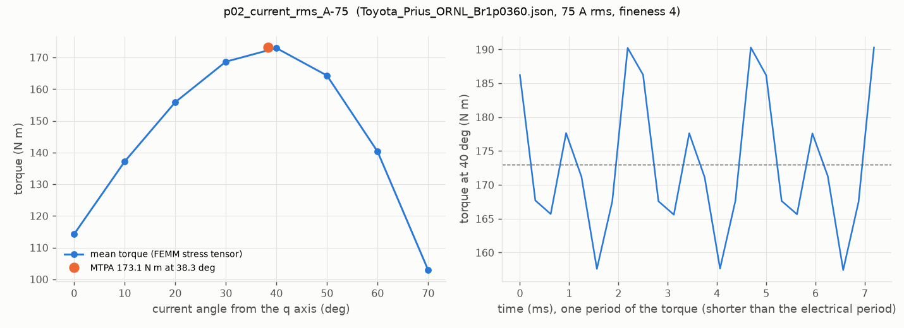
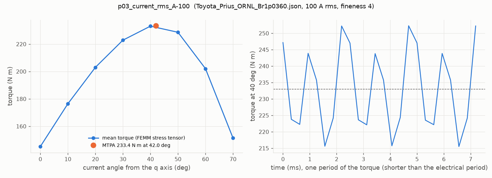
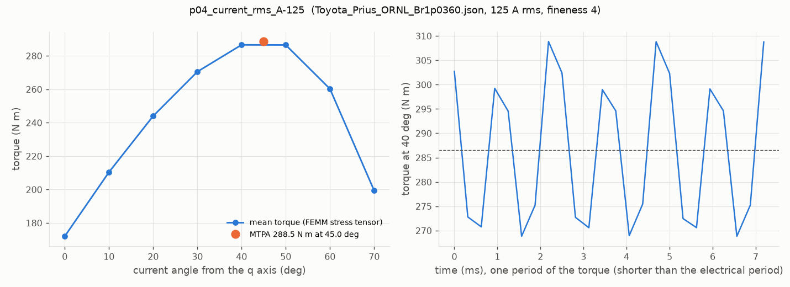
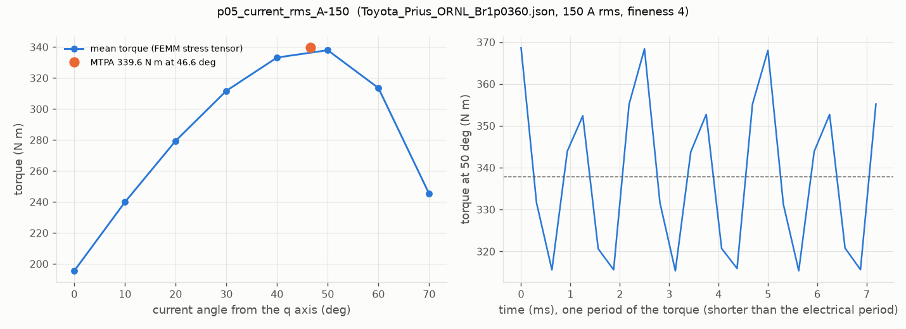
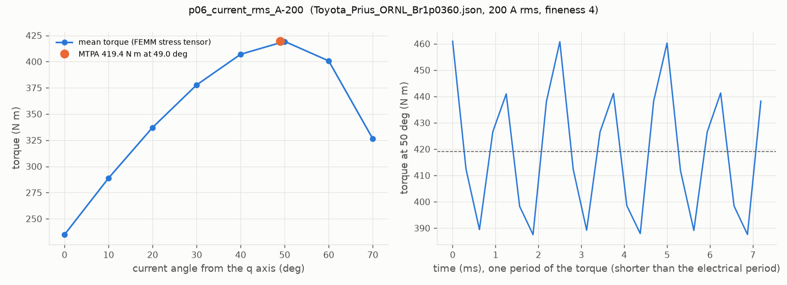
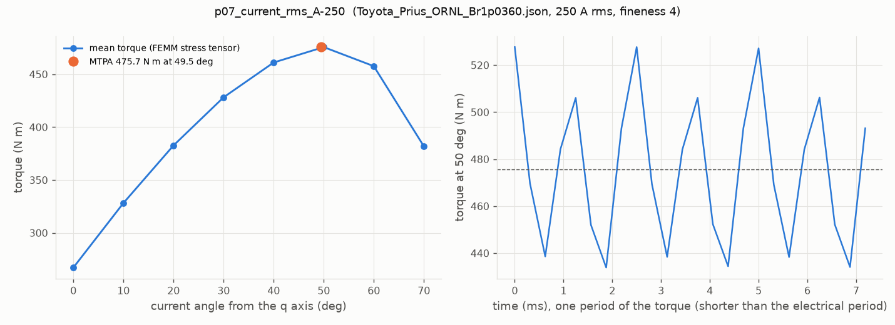

# Engineering review report: motor_prius_cal_torque_br

- **Run:** `20261122-195712_motor_prius_cal_torque_br`
- **Generated:** 2026-11-23T03:10:41+00:00
- **Case file SHA-256:** `3789e34d9efcab5970911103b169c18a6eb078c54d65f0f860393b4b72fd9666`
- **Environment:** Python 3.14.10, numpy 2.5.5, scipy 1.18.1, matplotlib 3.11.2, cadquery 2.8.0; Windows-11-10.0.26100-SP0
- **Tools:** pyleecan 1.5.2; SciDataTool 2.5.0; numpy_pyleecan_env 2.5.5
- **Code version:** git `10ce9153a0ed6c2fa032b25142cd7e446114e601` (uncommitted changes present)
- **Simulation status:** completed
- **Verification status:** PASS

## Scope

2004 Toyota Prius traction motor (our machine from ORNL Fig. 21, laminations M330-35A), magnet remanence 1.036 T (calibrated on ORNL's back-EMF), MTPA torque at 25-250 A rms, 1000 rpm; Pyleecan + FEMM 4.2 magnetostatics, current angle 0-70 deg from the q axis, mesh fineness 4.

**Assumptions**

- 2D magnetostatics (FEMM), no end effects; torque is the mean of FEMM's stress-tensor torque over one electrical period.
- Magnets, magnet pockets and materials as in models/motor/Toyota_Prius_ORNL.json except the remanence, 1.036 T at 20 C (calibrated on ORNL's routine back-EMF test, case motor_prius_cal_oc_br; hypothesis A of validation/motor_ornl/CALIBRATION_PLAN.md); laminations M330-35A, a stand-in grade (Tata Steel typical B-H data to 1.8 T, extrapolated above).
- Magnet temperature 20 C.
- Current-density limit 25 A/mm^2 rms on 0.84 x 143.0 mm^2 of copper per slot (stated assumption).

## Requirements

| ID | Requirement | Metric | Limit |
|---|---|---|---|
| REQ-M3 | Each operating point of the torque curve shall stay within the 25 A/mm^2 rms copper current-density limit (marks which points of the curve the motor can sustain for a short time). | `current_density_rms_A_per_mm2` | <= 25 A/mm^2 |

## Summary across points

| Point | current_rms_A | REQ-M3 | Checks |
|---|---|---|---|
| p00_current_rms_A-25 | 25 | 1.873 A/mm^2: **PASS** | 5/5 PASS |
| p01_current_rms_A-50 | 50 | 3.746 A/mm^2: **PASS** | 5/5 PASS |
| p02_current_rms_A-75 | 75 | 5.619 A/mm^2: **PASS** | 5/5 PASS |
| p03_current_rms_A-100 | 100 | 7.493 A/mm^2: **PASS** | 5/5 PASS |
| p04_current_rms_A-125 | 125 | 9.366 A/mm^2: **PASS** | 5/5 PASS |
| p05_current_rms_A-150 | 150 | 11.24 A/mm^2: **PASS** | 5/5 PASS |
| p06_current_rms_A-200 | 200 | 14.99 A/mm^2: **PASS** | 5/5 PASS |
| p07_current_rms_A-250 | 250 | 18.73 A/mm^2: **PASS** | 5/5 PASS |

## Point details

### p00_current_rms_A-25

Parameters: machine = Toyota_Prius_ORNL_Br1p0360.json, speed_rpm = 1000, current_rms_A = 25, angle_min_deg = 0, angle_max_deg = 70, angle_steps = 8, mesh_fineness = 4, steps_per_period = 48, angle_points = 2048, rated_torque_Nm = 400, slot_fill = 0.84, slot_area_mm2 = 143, turns_per_slot = 9

Derived: current_density_rms_A_per_mm2 = 1.873

| Requirement | Result | Limit | Margin | Verdict | Evidence |
|---|---|---|---|---|---|
| REQ-M3 | 1.873 A/mm^2 | <= 25 | 23.1 | **PASS** | [point.json](points/p00_current_rms_A-25/point.json) |

| Check | Description | Value | Tolerance | Status |
|---|---|---|---|---|
| power_balance | max over current angles of |mean(sum i dphi/dt) - mean torque x omega_m| / (mean torque x omega_m): energy conservation, an independent route to FEMM's stress-tensor torque | 1.75e-03 | 2e-02 | PASS |
| current_amplitude | max |imposed phase current fundamental - sqrt(2) x requested rms| / peak (Pyleecan's dq currents are rms) | 2.01e-16 | 1e-03 | PASS |
| phase_symmetry_load | max over angles of the spread of the three phases' fundamental flux linkage / mean, under load | 4.90e-05 | 2e-03 | PASS |
| mtpa_bracketed (validity) | maximum torque inside the angle sweep (0 = yes) | 0.00e+00 | 0e+00 | PASS |
| time_resolution (validity) | 48 / steps per electrical period (below 1: at least 48) | 1.00e+00 | 1e+00 | PASS |

### p01_current_rms_A-50

Parameters: machine = Toyota_Prius_ORNL_Br1p0360.json, speed_rpm = 1000, current_rms_A = 50, angle_min_deg = 0, angle_max_deg = 70, angle_steps = 8, mesh_fineness = 4, steps_per_period = 48, angle_points = 2048, rated_torque_Nm = 400, slot_fill = 0.84, slot_area_mm2 = 143, turns_per_slot = 9

Derived: current_density_rms_A_per_mm2 = 3.746

| Requirement | Result | Limit | Margin | Verdict | Evidence |
|---|---|---|---|---|---|
| REQ-M3 | 3.746 A/mm^2 | <= 25 | 21.3 | **PASS** | [point.json](points/p01_current_rms_A-50/point.json) |

| Check | Description | Value | Tolerance | Status |
|---|---|---|---|---|
| power_balance | max over current angles of |mean(sum i dphi/dt) - mean torque x omega_m| / (mean torque x omega_m): energy conservation, an independent route to FEMM's stress-tensor torque | 1.50e-03 | 2e-02 | PASS |
| current_amplitude | max |imposed phase current fundamental - sqrt(2) x requested rms| / peak (Pyleecan's dq currents are rms) | 2.01e-16 | 1e-03 | PASS |
| phase_symmetry_load | max over angles of the spread of the three phases' fundamental flux linkage / mean, under load | 5.26e-05 | 2e-03 | PASS |
| mtpa_bracketed (validity) | maximum torque inside the angle sweep (0 = yes) | 0.00e+00 | 0e+00 | PASS |
| time_resolution (validity) | 48 / steps per electrical period (below 1: at least 48) | 1.00e+00 | 1e+00 | PASS |

### p02_current_rms_A-75

Parameters: machine = Toyota_Prius_ORNL_Br1p0360.json, speed_rpm = 1000, current_rms_A = 75, angle_min_deg = 0, angle_max_deg = 70, angle_steps = 8, mesh_fineness = 4, steps_per_period = 48, angle_points = 2048, rated_torque_Nm = 400, slot_fill = 0.84, slot_area_mm2 = 143, turns_per_slot = 9

Derived: current_density_rms_A_per_mm2 = 5.619

| Requirement | Result | Limit | Margin | Verdict | Evidence |
|---|---|---|---|---|---|
| REQ-M3 | 5.619 A/mm^2 | <= 25 | 19.4 | **PASS** | [point.json](points/p02_current_rms_A-75/point.json) |

| Check | Description | Value | Tolerance | Status |
|---|---|---|---|---|
| power_balance | max over current angles of |mean(sum i dphi/dt) - mean torque x omega_m| / (mean torque x omega_m): energy conservation, an independent route to FEMM's stress-tensor torque | 1.11e-03 | 2e-02 | PASS |
| current_amplitude | max |imposed phase current fundamental - sqrt(2) x requested rms| / peak (Pyleecan's dq currents are rms) | 4.02e-16 | 1e-03 | PASS |
| phase_symmetry_load | max over angles of the spread of the three phases' fundamental flux linkage / mean, under load | 1.02e-04 | 2e-03 | PASS |
| mtpa_bracketed (validity) | maximum torque inside the angle sweep (0 = yes) | 0.00e+00 | 0e+00 | PASS |
| time_resolution (validity) | 48 / steps per electrical period (below 1: at least 48) | 1.00e+00 | 1e+00 | PASS |

### p03_current_rms_A-100

Parameters: machine = Toyota_Prius_ORNL_Br1p0360.json, speed_rpm = 1000, current_rms_A = 100, angle_min_deg = 0, angle_max_deg = 70, angle_steps = 8, mesh_fineness = 4, steps_per_period = 48, angle_points = 2048, rated_torque_Nm = 400, slot_fill = 0.84, slot_area_mm2 = 143, turns_per_slot = 9

Derived: current_density_rms_A_per_mm2 = 7.493

| Requirement | Result | Limit | Margin | Verdict | Evidence |
|---|---|---|---|---|---|
| REQ-M3 | 7.493 A/mm^2 | <= 25 | 17.5 | **PASS** | [point.json](points/p03_current_rms_A-100/point.json) |

| Check | Description | Value | Tolerance | Status |
|---|---|---|---|---|
| power_balance | max over current angles of |mean(sum i dphi/dt) - mean torque x omega_m| / (mean torque x omega_m): energy conservation, an independent route to FEMM's stress-tensor torque | 5.60e-04 | 2e-02 | PASS |
| current_amplitude | max |imposed phase current fundamental - sqrt(2) x requested rms| / peak (Pyleecan's dq currents are rms) | 2.01e-16 | 1e-03 | PASS |
| phase_symmetry_load | max over angles of the spread of the three phases' fundamental flux linkage / mean, under load | 1.62e-04 | 2e-03 | PASS |
| mtpa_bracketed (validity) | maximum torque inside the angle sweep (0 = yes) | 0.00e+00 | 0e+00 | PASS |
| time_resolution (validity) | 48 / steps per electrical period (below 1: at least 48) | 1.00e+00 | 1e+00 | PASS |

### p04_current_rms_A-125

Parameters: machine = Toyota_Prius_ORNL_Br1p0360.json, speed_rpm = 1000, current_rms_A = 125, angle_min_deg = 0, angle_max_deg = 70, angle_steps = 8, mesh_fineness = 4, steps_per_period = 48, angle_points = 2048, rated_torque_Nm = 400, slot_fill = 0.84, slot_area_mm2 = 143, turns_per_slot = 9

Derived: current_density_rms_A_per_mm2 = 9.366

| Requirement | Result | Limit | Margin | Verdict | Evidence |
|---|---|---|---|---|---|
| REQ-M3 | 9.366 A/mm^2 | <= 25 | 15.6 | **PASS** | [point.json](points/p04_current_rms_A-125/point.json) |

| Check | Description | Value | Tolerance | Status |
|---|---|---|---|---|
| power_balance | max over current angles of |mean(sum i dphi/dt) - mean torque x omega_m| / (mean torque x omega_m): energy conservation, an independent route to FEMM's stress-tensor torque | 4.56e-04 | 2e-02 | PASS |
| current_amplitude | max |imposed phase current fundamental - sqrt(2) x requested rms| / peak (Pyleecan's dq currents are rms) | 1.61e-16 | 1e-03 | PASS |
| phase_symmetry_load | max over angles of the spread of the three phases' fundamental flux linkage / mean, under load | 2.03e-04 | 2e-03 | PASS |
| mtpa_bracketed (validity) | maximum torque inside the angle sweep (0 = yes) | 0.00e+00 | 0e+00 | PASS |
| time_resolution (validity) | 48 / steps per electrical period (below 1: at least 48) | 1.00e+00 | 1e+00 | PASS |

### p05_current_rms_A-150

Parameters: machine = Toyota_Prius_ORNL_Br1p0360.json, speed_rpm = 1000, current_rms_A = 150, angle_min_deg = 0, angle_max_deg = 70, angle_steps = 8, mesh_fineness = 4, steps_per_period = 48, angle_points = 2048, rated_torque_Nm = 400, slot_fill = 0.84, slot_area_mm2 = 143, turns_per_slot = 9

Derived: current_density_rms_A_per_mm2 = 11.24

| Requirement | Result | Limit | Margin | Verdict | Evidence |
|---|---|---|---|---|---|
| REQ-M3 | 11.24 A/mm^2 | <= 25 | 13.8 | **PASS** | [point.json](points/p05_current_rms_A-150/point.json) |

| Check | Description | Value | Tolerance | Status |
|---|---|---|---|---|
| power_balance | max over current angles of |mean(sum i dphi/dt) - mean torque x omega_m| / (mean torque x omega_m): energy conservation, an independent route to FEMM's stress-tensor torque | 5.79e-04 | 2e-02 | PASS |
| current_amplitude | max |imposed phase current fundamental - sqrt(2) x requested rms| / peak (Pyleecan's dq currents are rms) | 4.02e-16 | 1e-03 | PASS |
| phase_symmetry_load | max over angles of the spread of the three phases' fundamental flux linkage / mean, under load | 1.94e-04 | 2e-03 | PASS |
| mtpa_bracketed (validity) | maximum torque inside the angle sweep (0 = yes) | 0.00e+00 | 0e+00 | PASS |
| time_resolution (validity) | 48 / steps per electrical period (below 1: at least 48) | 1.00e+00 | 1e+00 | PASS |

### p06_current_rms_A-200

Parameters: machine = Toyota_Prius_ORNL_Br1p0360.json, speed_rpm = 1000, current_rms_A = 200, angle_min_deg = 0, angle_max_deg = 70, angle_steps = 8, mesh_fineness = 4, steps_per_period = 48, angle_points = 2048, rated_torque_Nm = 400, slot_fill = 0.84, slot_area_mm2 = 143, turns_per_slot = 9

Derived: current_density_rms_A_per_mm2 = 14.99

| Requirement | Result | Limit | Margin | Verdict | Evidence |
|---|---|---|---|---|---|
| REQ-M3 | 14.99 A/mm^2 | <= 25 | 10 | **PASS** | [point.json](points/p06_current_rms_A-200/point.json) |

| Check | Description | Value | Tolerance | Status |
|---|---|---|---|---|
| power_balance | max over current angles of |mean(sum i dphi/dt) - mean torque x omega_m| / (mean torque x omega_m): energy conservation, an independent route to FEMM's stress-tensor torque | 7.16e-04 | 2e-02 | PASS |
| current_amplitude | max |imposed phase current fundamental - sqrt(2) x requested rms| / peak (Pyleecan's dq currents are rms) | 2.01e-16 | 1e-03 | PASS |
| phase_symmetry_load | max over angles of the spread of the three phases' fundamental flux linkage / mean, under load | 1.54e-04 | 2e-03 | PASS |
| mtpa_bracketed (validity) | maximum torque inside the angle sweep (0 = yes) | 0.00e+00 | 0e+00 | PASS |
| time_resolution (validity) | 48 / steps per electrical period (below 1: at least 48) | 1.00e+00 | 1e+00 | PASS |

### p07_current_rms_A-250

Parameters: machine = Toyota_Prius_ORNL_Br1p0360.json, speed_rpm = 1000, current_rms_A = 250, angle_min_deg = 0, angle_max_deg = 70, angle_steps = 8, mesh_fineness = 4, steps_per_period = 48, angle_points = 2048, rated_torque_Nm = 400, slot_fill = 0.84, slot_area_mm2 = 143, turns_per_slot = 9

Derived: current_density_rms_A_per_mm2 = 18.73

| Requirement | Result | Limit | Margin | Verdict | Evidence |
|---|---|---|---|---|---|
| REQ-M3 | 18.73 A/mm^2 | <= 25 | 6.27 | **PASS** | [point.json](points/p07_current_rms_A-250/point.json) |

| Check | Description | Value | Tolerance | Status |
|---|---|---|---|---|
| power_balance | max over current angles of |mean(sum i dphi/dt) - mean torque x omega_m| / (mean torque x omega_m): energy conservation, an independent route to FEMM's stress-tensor torque | 9.99e-04 | 2e-02 | PASS |
| current_amplitude | max |imposed phase current fundamental - sqrt(2) x requested rms| / peak (Pyleecan's dq currents are rms) | 1.61e-16 | 1e-03 | PASS |
| phase_symmetry_load | max over angles of the spread of the three phases' fundamental flux linkage / mean, under load | 1.21e-04 | 2e-03 | PASS |
| mtpa_bracketed (validity) | maximum torque inside the angle sweep (0 = yes) | 0.00e+00 | 0e+00 | PASS |
| time_resolution (validity) | 48 / steps per electrical period (below 1: at least 48) | 1.00e+00 | 1e+00 | PASS |

## Limitations

- Post-test calibration, not a blind prediction: the remanence is fitted to ORNL's back-EMF, and this curve is scored against ORNL's locked-rotor torque to choose between hypotheses (scripts/motor_calibration.py).
- Sinusoidal currents; no inverter harmonics, no voltage limit (1000 rpm is below base speed).
- The real lamination grade is unknown; the bracketing grades are separate cases.
- A converged solver run that matches an analytical reference shows that the equations were solved correctly. It does not show that the equations represent real hardware.

## Engineering acceptance

Pending human review. This report does not accept or reject the design.
