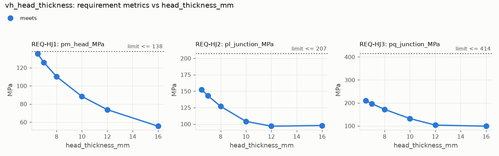
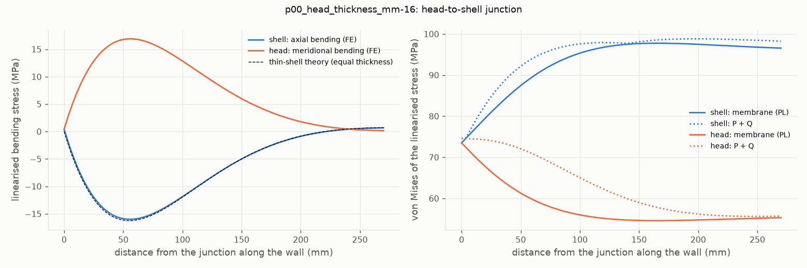
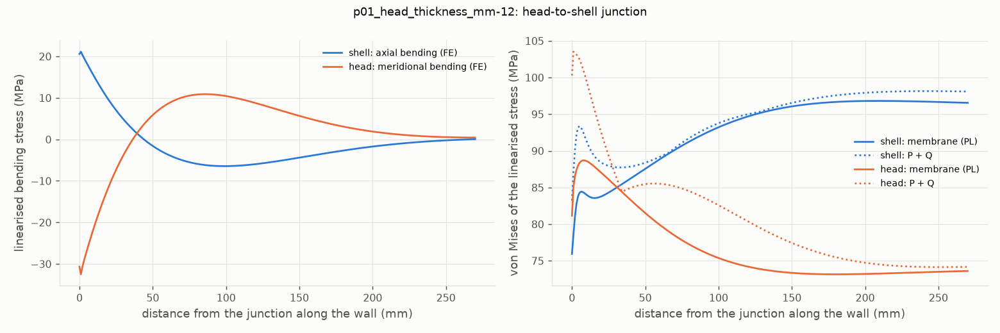
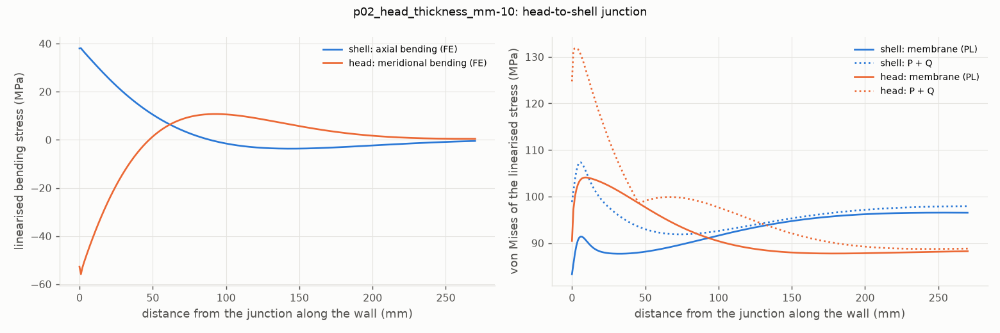
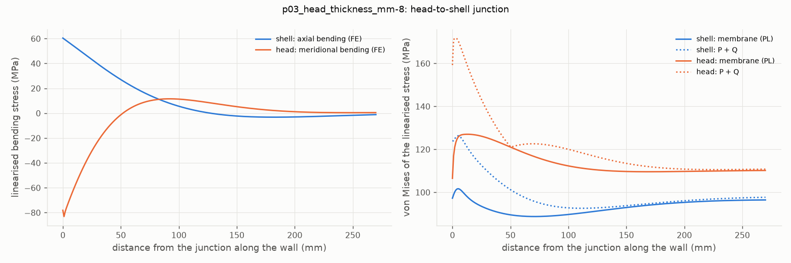
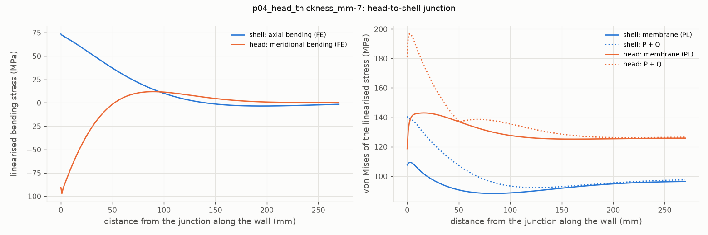
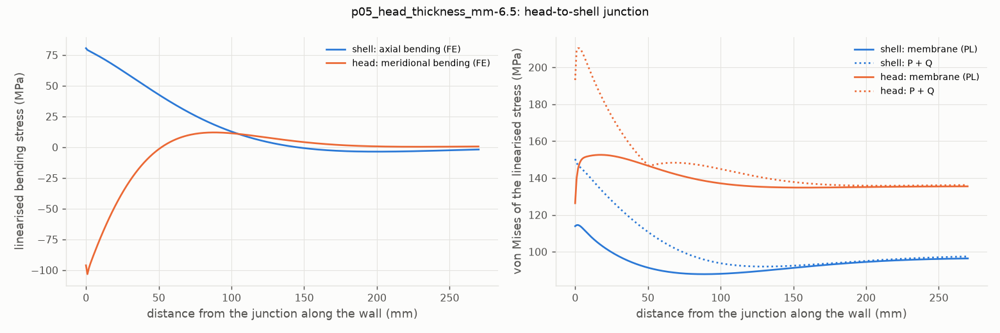

# Engineering review report: vh_head_thickness

- **Run:** `20261122-201358_vh_head_thickness`
- **Generated:** 2026-11-23T01:17:05+00:00
- **Case file SHA-256:** `96ad3a7421263dbf0ca1575ec1b338cb17935278588565afef3a9cc55beb47b3`
- **Environment:** Python 3.14.10, numpy 2.5.5, scipy 1.18.1, matplotlib 3.11.2, cadquery 2.8.0; Windows-11-10.0.26100-SP0
- **Tools:** CalculiX This is Version 2.22
- **Code version:** git `4c77fe0eafecda65fba9b5bdb38291fd0893d47a` (uncommitted changes present)
- **Simulation status:** completed
- **Verification status:** PASS

## Scope

Cylindrical shell (Ri 500 mm, t 16 mm) closed by a hemispherical head 16 / 12 / 10 / 8 / 7 / 6.5 mm thick (flush bore, a step outside), 3.5 MPa; axisymmetric CAX8 in CalculiX, mesh 0.5 mm through the wall; stresses linearised through the wall near the junction.

**Assumptions**

- Linear elastic steel, E 200 GPa, nu 0.3; small displacement (checked).
- Axisymmetric: the study-18 shell (Ri 500 mm, t 16 mm, 3.5 MPa) closed by a hemispherical head with the same bore; the shell's far end is the vessel's mid-length plane (symmetry, u_z = 0), 1000 mm (11 sqrt(R t)) from the junction. No nozzle (the nozzle sits mid-shell, far from the head).
- With a head thinner than the shell the outside steps down at the junction with no taper and no weld detail (a fabricated joint would taper the thicker plate; the step makes a re-entrant corner whose peak is not assessed here).
- Classification as at the nozzle: membrane on the lines within the junction region (3 sqrt(R t) = 270 mm of the junction, along the wall, on both sides) is local primary (PL), membrane plus bending there primary plus secondary (P + Q); the far head line (60 deg from the junction) is general primary (Pm). S_PS = 3 S.
- Allowable S = 138 MPa: synthetic, as in the rest of study 18; not from ASME Section II.

## Requirements

| ID | Requirement | Metric | Limit |
|---|---|---|---|
| REQ-HJ1 | General primary membrane stress in the head away from the junction shall not exceed S (138 MPa). | `pm_head_MPa` | <= 138 MPa |
| REQ-HJ2 | Local primary membrane stress in the head-to-shell junction region (shell and head lines) shall not exceed 1.5 S (207 MPa). | `pl_junction_MPa` | <= 207 MPa |
| REQ-HJ3 | Primary plus secondary stress in the head-to-shell junction region shall not exceed S_PS = 3 S (414 MPa). | `pq_junction_MPa` | <= 414 MPa |

## Summary across points

| Point | head_thickness_mm | REQ-HJ1 | REQ-HJ2 | REQ-HJ3 | Checks |
|---|---|---|---|---|---|
| p00_head_thickness_mm-16 | 16 | 55.54 MPa: **PASS** | 97.76 MPa: **PASS** | 98.82 MPa: **PASS** | 9/9 PASS |
| p01_head_thickness_mm-12 | 12 | 73.77 MPa: **PASS** | 96.81 MPa: **PASS** | 103.5 MPa: **PASS** | 6/6 PASS |
| p02_head_thickness_mm-10 | 10 | 88.36 MPa: **PASS** | 104.1 MPa: **PASS** | 131.9 MPa: **PASS** | 6/6 PASS |
| p03_head_thickness_mm-8 | 8 | 110.2 MPa: **PASS** | 127 MPa: **PASS** | 171.8 MPa: **PASS** | 6/6 PASS |
| p04_head_thickness_mm-7 | 7 | 125.9 MPa: **PASS** | 143 MPa: **PASS** | 196.6 MPa: **PASS** | 6/6 PASS |
| p05_head_thickness_mm-6.5 | 6.5 | 135.5 MPa: **PASS** | 152.6 MPa: **PASS** | 210.4 MPa: **PASS** | 6/6 PASS |

## Point details

### p00_head_thickness_mm-16

Parameters: shell_inner_radius_mm = 500, shell_thickness_mm = 16, head_thickness_mm = 16, shell_length_mm = 1000, pressure_MPa = 3.5, youngs_modulus_MPa = 2e+05, poisson_ratio = 0.3, element_size_mm = 0.5, element_aspect = 2, allowable_stress_MPa = 138

Derived: hoop_membrane_p_Ri_over_t_MPa = 109.4, allowable_PL_MPa = 207, allowable_PS_MPa = 414, sqrt_Rt_mm = 90.16, head_rule_thickness_mm = 6.341, lame_pm_shell_MPa = 96.21, lame_pm_head_MPa = 55.54, theory_beta_per_mm = 0.01426, theory_delta_mm = 0.1411, theory_Q0_N_per_mm = 30.67, theory_Q0_thin_N_per_mm = 30.69, theory_bending_max_MPa = 16.26, theory_x_bending_max_mm = 55.09, theory_hoop_membrane_junction_MPa = 81.6

| Requirement | Result | Limit | Margin | Verdict | Evidence |
|---|---|---|---|---|---|
| REQ-HJ1 | 55.54 MPa | <= 138 | 82.5 | **PASS** | [point.json](points/p00_head_thickness_mm-16/point.json) |
| REQ-HJ2 | 97.76 MPa | <= 207 | 109 | **PASS** | [point.json](points/p00_head_thickness_mm-16/point.json) |
| REQ-HJ3 | 98.82 MPa | <= 414 | 315 | **PASS** | [point.json](points/p00_head_thickness_mm-16/point.json) |

| Check | Description | Value | Tolerance | Status |
|---|---|---|---|---|
| equilibrium_z | |axial reaction on the mid-length plane / 2-degree segment - p pi Ri^2| / p pi Ri^2 (exact: the pressure on the head's projected area) | 6.25e-08 | 1e-05 | PASS |
| lame_shell_membrane | |far-shell linearised membrane (von Mises) - the same linearisation of Lame| / Lame (exact) | 5.65e-04 | 5e-03 | PASS |
| lame_head_membrane | |far-head linearised membrane (von Mises) - the thick sphere's| / exact | 5.97e-06 | 5e-03 | PASS |
| lame_shell_hoop_range | |far-shell hoop stress, bore minus outside, FE - Lame| / Lame (the through-wall gradient, not only the mean) | 1.75e-04 | 5e-03 | PASS |
| small_displacement (validity) | max displacement / shell thickness (linear geometry) | 1.63e-02 | 1e-01 | PASS |
| far_lines_far (validity) | junction region / distance of the far lines (the far shell line at L / 2; the head line at the stated angle): far lines outside the bending zone | 5.41e-01 | 1e+00 | PASS |
| theory_bending_max | |largest axial bending in the shell - thin-shell theory 6 M_max / t^2| / theory (model form: shell theory error of order t / R) | 1.55e-02 | 5e-02 | PASS |
| theory_bending_location | |x of the largest bending - pi / (4 beta)| / (pi / (4 beta)) (the lines are one element length apart) | 1.66e-02 | 1e-01 | PASS |
| theory_hoop_junction | |hoop membrane at the junction - (p Ri / t - E delta / (2 Rm))| / theory | 3.99e-04 | 5e-02 | PASS |

### p01_head_thickness_mm-12

Parameters: shell_inner_radius_mm = 500, shell_thickness_mm = 16, head_thickness_mm = 12, shell_length_mm = 1000, pressure_MPa = 3.5, youngs_modulus_MPa = 2e+05, poisson_ratio = 0.3, element_size_mm = 0.5, element_aspect = 2, allowable_stress_MPa = 138

Derived: hoop_membrane_p_Ri_over_t_MPa = 109.4, allowable_PL_MPa = 207, allowable_PS_MPa = 414, sqrt_Rt_mm = 90.16, head_rule_thickness_mm = 6.341, lame_pm_shell_MPa = 96.21, lame_pm_head_MPa = 73.78

| Requirement | Result | Limit | Margin | Verdict | Evidence |
|---|---|---|---|---|---|
| REQ-HJ1 | 73.77 MPa | <= 138 | 64.2 | **PASS** | [point.json](points/p01_head_thickness_mm-12/point.json) |
| REQ-HJ2 | 96.81 MPa | <= 207 | 110 | **PASS** | [point.json](points/p01_head_thickness_mm-12/point.json) |
| REQ-HJ3 | 103.5 MPa | <= 414 | 310 | **PASS** | [point.json](points/p01_head_thickness_mm-12/point.json) |

| Check | Description | Value | Tolerance | Status |
|---|---|---|---|---|
| equilibrium_z | |axial reaction on the mid-length plane / 2-degree segment - p pi Ri^2| / p pi Ri^2 (exact: the pressure on the head's projected area) | 6.25e-08 | 1e-05 | PASS |
| lame_shell_membrane | |far-shell linearised membrane (von Mises) - the same linearisation of Lame| / Lame (exact) | 5.76e-04 | 5e-03 | PASS |
| lame_head_membrane | |far-head linearised membrane (von Mises) - the thick sphere's| / exact | 6.36e-05 | 5e-03 | PASS |
| lame_shell_hoop_range | |far-shell hoop stress, bore minus outside, FE - Lame| / Lame (the through-wall gradient, not only the mean) | 5.70e-05 | 5e-03 | PASS |
| small_displacement (validity) | max displacement / shell thickness (linear geometry) | 1.61e-02 | 1e-01 | PASS |
| far_lines_far (validity) | junction region / distance of the far lines (the far shell line at L / 2; the head line at the stated angle): far lines outside the bending zone | 5.41e-01 | 1e+00 | PASS |

### p02_head_thickness_mm-10

Parameters: shell_inner_radius_mm = 500, shell_thickness_mm = 16, head_thickness_mm = 10, shell_length_mm = 1000, pressure_MPa = 3.5, youngs_modulus_MPa = 2e+05, poisson_ratio = 0.3, element_size_mm = 0.5, element_aspect = 2, allowable_stress_MPa = 138

Derived: hoop_membrane_p_Ri_over_t_MPa = 109.4, allowable_PL_MPa = 207, allowable_PS_MPa = 414, sqrt_Rt_mm = 90.16, head_rule_thickness_mm = 6.341, lame_pm_shell_MPa = 96.21, lame_pm_head_MPa = 88.36

| Requirement | Result | Limit | Margin | Verdict | Evidence |
|---|---|---|---|---|---|
| REQ-HJ1 | 88.36 MPa | <= 138 | 49.6 | **PASS** | [point.json](points/p02_head_thickness_mm-10/point.json) |
| REQ-HJ2 | 104.1 MPa | <= 207 | 103 | **PASS** | [point.json](points/p02_head_thickness_mm-10/point.json) |
| REQ-HJ3 | 131.9 MPa | <= 414 | 282 | **PASS** | [point.json](points/p02_head_thickness_mm-10/point.json) |

| Check | Description | Value | Tolerance | Status |
|---|---|---|---|---|
| equilibrium_z | |axial reaction on the mid-length plane / 2-degree segment - p pi Ri^2| / p pi Ri^2 (exact: the pressure on the head's projected area) | 6.25e-08 | 1e-05 | PASS |
| lame_shell_membrane | |far-shell linearised membrane (von Mises) - the same linearisation of Lame| / Lame (exact) | 5.76e-04 | 5e-03 | PASS |
| lame_head_membrane | |far-head linearised membrane (von Mises) - the thick sphere's| / exact | 6.63e-05 | 5e-03 | PASS |
| lame_shell_hoop_range | |far-shell hoop stress, bore minus outside, FE - Lame| / Lame (the through-wall gradient, not only the mean) | 4.79e-05 | 5e-03 | PASS |
| small_displacement (validity) | max displacement / shell thickness (linear geometry) | 1.60e-02 | 1e-01 | PASS |
| far_lines_far (validity) | junction region / distance of the far lines (the far shell line at L / 2; the head line at the stated angle): far lines outside the bending zone | 5.41e-01 | 1e+00 | PASS |

### p03_head_thickness_mm-8

Parameters: shell_inner_radius_mm = 500, shell_thickness_mm = 16, head_thickness_mm = 8, shell_length_mm = 1000, pressure_MPa = 3.5, youngs_modulus_MPa = 2e+05, poisson_ratio = 0.3, element_size_mm = 0.5, element_aspect = 2, allowable_stress_MPa = 138

Derived: hoop_membrane_p_Ri_over_t_MPa = 109.4, allowable_PL_MPa = 207, allowable_PS_MPa = 414, sqrt_Rt_mm = 90.16, head_rule_thickness_mm = 6.341, lame_pm_shell_MPa = 96.21, lame_pm_head_MPa = 110.2

| Requirement | Result | Limit | Margin | Verdict | Evidence |
|---|---|---|---|---|---|
| REQ-HJ1 | 110.2 MPa | <= 138 | 27.8 | **PASS** | [point.json](points/p03_head_thickness_mm-8/point.json) |
| REQ-HJ2 | 127 MPa | <= 207 | 80 | **PASS** | [point.json](points/p03_head_thickness_mm-8/point.json) |
| REQ-HJ3 | 171.8 MPa | <= 414 | 242 | **PASS** | [point.json](points/p03_head_thickness_mm-8/point.json) |

| Check | Description | Value | Tolerance | Status |
|---|---|---|---|---|
| equilibrium_z | |axial reaction on the mid-length plane / 2-degree segment - p pi Ri^2| / p pi Ri^2 (exact: the pressure on the head's projected area) | 6.25e-08 | 1e-05 | PASS |
| lame_shell_membrane | |far-shell linearised membrane (von Mises) - the same linearisation of Lame| / Lame (exact) | 5.66e-04 | 5e-03 | PASS |
| lame_head_membrane | |far-head linearised membrane (von Mises) - the thick sphere's| / exact | 5.68e-05 | 5e-03 | PASS |
| lame_shell_hoop_range | |far-shell hoop stress, bore minus outside, FE - Lame| / Lame (the through-wall gradient, not only the mean) | 1.93e-04 | 5e-03 | PASS |
| small_displacement (validity) | max displacement / shell thickness (linear geometry) | 1.86e-02 | 1e-01 | PASS |
| far_lines_far (validity) | junction region / distance of the far lines (the far shell line at L / 2; the head line at the stated angle): far lines outside the bending zone | 5.41e-01 | 1e+00 | PASS |

### p04_head_thickness_mm-7

Parameters: shell_inner_radius_mm = 500, shell_thickness_mm = 16, head_thickness_mm = 7, shell_length_mm = 1000, pressure_MPa = 3.5, youngs_modulus_MPa = 2e+05, poisson_ratio = 0.3, element_size_mm = 0.5, element_aspect = 2, allowable_stress_MPa = 138

Derived: hoop_membrane_p_Ri_over_t_MPa = 109.4, allowable_PL_MPa = 207, allowable_PS_MPa = 414, sqrt_Rt_mm = 90.16, head_rule_thickness_mm = 6.341, lame_pm_shell_MPa = 96.21, lame_pm_head_MPa = 125.9

| Requirement | Result | Limit | Margin | Verdict | Evidence |
|---|---|---|---|---|---|
| REQ-HJ1 | 125.9 MPa | <= 138 | 12.1 | **PASS** | [point.json](points/p04_head_thickness_mm-7/point.json) |
| REQ-HJ2 | 143 MPa | <= 207 | 64 | **PASS** | [point.json](points/p04_head_thickness_mm-7/point.json) |
| REQ-HJ3 | 196.6 MPa | <= 414 | 217 | **PASS** | [point.json](points/p04_head_thickness_mm-7/point.json) |

| Check | Description | Value | Tolerance | Status |
|---|---|---|---|---|
| equilibrium_z | |axial reaction on the mid-length plane / 2-degree segment - p pi Ri^2| / p pi Ri^2 (exact: the pressure on the head's projected area) | 6.25e-08 | 1e-05 | PASS |
| lame_shell_membrane | |far-shell linearised membrane (von Mises) - the same linearisation of Lame| / Lame (exact) | 5.55e-04 | 5e-03 | PASS |
| lame_head_membrane | |far-head linearised membrane (von Mises) - the thick sphere's| / exact | 5.14e-05 | 5e-03 | PASS |
| lame_shell_hoop_range | |far-shell hoop stress, bore minus outside, FE - Lame| / Lame (the through-wall gradient, not only the mean) | 2.83e-04 | 5e-03 | PASS |
| small_displacement (validity) | max displacement / shell thickness (linear geometry) | 2.05e-02 | 1e-01 | PASS |
| far_lines_far (validity) | junction region / distance of the far lines (the far shell line at L / 2; the head line at the stated angle): far lines outside the bending zone | 5.41e-01 | 1e+00 | PASS |

### p05_head_thickness_mm-6.5

Parameters: shell_inner_radius_mm = 500, shell_thickness_mm = 16, head_thickness_mm = 6.5, shell_length_mm = 1000, pressure_MPa = 3.5, youngs_modulus_MPa = 2e+05, poisson_ratio = 0.3, element_size_mm = 0.5, element_aspect = 2, allowable_stress_MPa = 138

Derived: hoop_membrane_p_Ri_over_t_MPa = 109.4, allowable_PL_MPa = 207, allowable_PS_MPa = 414, sqrt_Rt_mm = 90.16, head_rule_thickness_mm = 6.341, lame_pm_shell_MPa = 96.21, lame_pm_head_MPa = 135.5

| Requirement | Result | Limit | Margin | Verdict | Evidence |
|---|---|---|---|---|---|
| REQ-HJ1 | 135.5 MPa | <= 138 | 2.52 | **PASS** | [point.json](points/p05_head_thickness_mm-6.5/point.json) |
| REQ-HJ2 | 152.6 MPa | <= 207 | 54.4 | **PASS** | [point.json](points/p05_head_thickness_mm-6.5/point.json) |
| REQ-HJ3 | 210.4 MPa | <= 414 | 204 | **PASS** | [point.json](points/p05_head_thickness_mm-6.5/point.json) |

| Check | Description | Value | Tolerance | Status |
|---|---|---|---|---|
| equilibrium_z | |axial reaction on the mid-length plane / 2-degree segment - p pi Ri^2| / p pi Ri^2 (exact: the pressure on the head's projected area) | 6.25e-08 | 1e-05 | PASS |
| lame_shell_membrane | |far-shell linearised membrane (von Mises) - the same linearisation of Lame| / Lame (exact) | 5.47e-04 | 5e-03 | PASS |
| lame_head_membrane | |far-head linearised membrane (von Mises) - the thick sphere's| / exact | 4.99e-05 | 5e-03 | PASS |
| lame_shell_hoop_range | |far-shell hoop stress, bore minus outside, FE - Lame| / Lame (the through-wall gradient, not only the mean) | 3.30e-04 | 5e-03 | PASS |
| small_displacement (validity) | max displacement / shell thickness (linear geometry) | 2.17e-02 | 1e-01 | PASS |
| far_lines_far (validity) | junction region / distance of the far lines (the far shell line at L / 2; the head line at the stated angle): far lines outside the bending zone | 5.41e-01 | 1e+00 | PASS |

## Limitations

- Elastic analysis only; pressure only (no weight, no supports, no thermal gradients, no fatigue).
- Thin-shell discontinuity theory is an independent check only with equal thicknesses; with a thinner head the FE is checked by its exact far fields, equilibrium and the mesh study.
- A converged solver run that matches an analytical reference shows that the equations were solved correctly. It does not show that the equations represent real hardware.

## Engineering acceptance

Pending human review. This report does not accept or reject the design.
