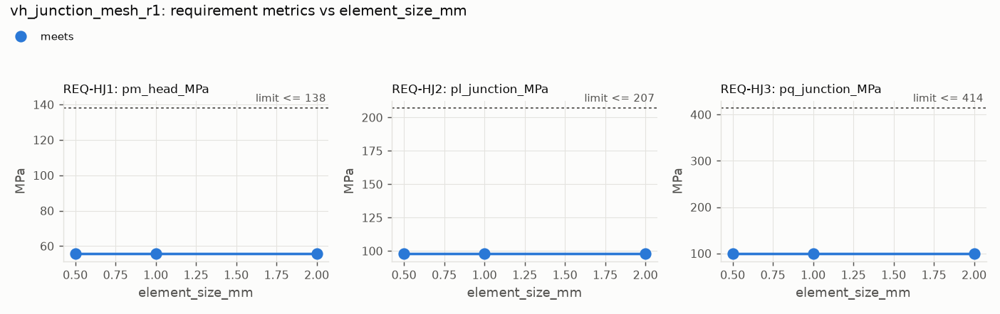
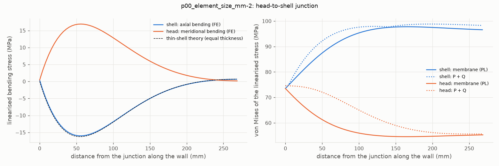

# Engineering review report: vh_junction_mesh_r1

- **Run:** `20261122-201907_vh_junction_mesh_r1`
- **Generated:** 2026-11-23T01:19:59+00:00
- **Case file SHA-256:** `80a1687b86dde09e9df9ba57dacc66976b1d41b5c71f79bc623b7072ba091fe9`
- **Environment:** Python 3.14.10, numpy 2.5.5, scipy 1.18.1, matplotlib 3.11.2, cadquery 2.8.0; Windows-11-10.0.26100-SP0
- **Tools:** CalculiX This is Version 2.22
- **Code version:** git `6e98c5d8d97468d37a7def8071da0bc41cbff4ff` (uncommitted changes present)
- **Simulation status:** completed
- **Verification status:** PASS

## Scope

Cylindrical shell (Ri 500 mm, t 16 mm) closed by a hemispherical head of the same thickness, 3.5 MPa; axisymmetric CAX8 in CalculiX; mesh 2 / 1 / 0.5 mm through the wall (aspect 2); stresses linearised through the wall near the junction, against thin-shell discontinuity theory.

**Assumptions**

- Linear elastic steel, E 200 GPa, nu 0.3; small displacement (checked).
- Axisymmetric: the study-18 shell (Ri 500 mm, t 16 mm, 3.5 MPa) closed by a hemispherical head with the same bore; the shell's far end is the vessel's mid-length plane (symmetry, u_z = 0), 1000 mm (11 sqrt(R t)) from the junction. No nozzle (the nozzle sits mid-shell, far from the head).
- With a head thinner than the shell the outside steps down at the junction with no taper and no weld detail (a fabricated joint would taper the thicker plate; the step makes a re-entrant corner whose peak is not assessed here).
- Classification as at the nozzle: membrane on the lines within the junction region (3 sqrt(R t) = 270 mm of the junction, along the wall, on both sides) is local primary (PL), membrane plus bending there primary plus secondary (P + Q); the far head line (60 deg from the junction) is general primary (Pm). S_PS = 3 S.
- Allowable S = 138 MPa: synthetic, as in the rest of study 18; not from ASME Section II.

## Requirements

| ID | Requirement | Metric | Limit |
|---|---|---|---|
| REQ-HJ1 | General primary membrane stress in the head away from the junction shall not exceed S (138 MPa). | `pm_head_MPa` | <= 138 MPa |
| REQ-HJ2 | Local primary membrane stress in the head-to-shell junction region (shell and head lines) shall not exceed 1.5 S (207 MPa). | `pl_junction_MPa` | <= 207 MPa |
| REQ-HJ3 | Primary plus secondary stress in the head-to-shell junction region shall not exceed S_PS = 3 S (414 MPa). | `pq_junction_MPa` | <= 414 MPa |

## Summary across points

| Point | element_size_mm | REQ-HJ1 | REQ-HJ2 | REQ-HJ3 | Checks |
|---|---|---|---|---|---|
| p00_element_size_mm-2 | 2 | 55.54 MPa: **PASS** | 97.76 MPa: **PASS** | 98.82 MPa: **PASS** | 9/9 PASS |
| p01_element_size_mm-1 | 1 | 55.54 MPa: **PASS** | 97.76 MPa: **PASS** | 98.82 MPa: **PASS** | 9/9 PASS |
| p02_element_size_mm-0.5 | 0.5 | 55.54 MPa: **PASS** | 97.76 MPa: **PASS** | 98.82 MPa: **PASS** | 9/9 PASS |

## Run-level checks

Checks that use several points together (for example mesh convergence).

| Check | Description | Value | Tolerance | Status |
|---|---|---|---|---|
| discretization_pl_junction_MPa | relative discretization uncertainty of pl_junction_MPa, converged to within the noise floor (spread 9.8e-07 <= 1e-05) | 6.14e-07 | 0.03 | PASS |
| discretization_pm_head_MPa | relative discretization uncertainty of pm_head_MPa, converged to within the noise floor (spread 3.3e-06 <= 1e-05) | 2.08e-06 | 0.03 | PASS |
| discretization_pq_junction_MPa | relative discretization uncertainty of pq_junction_MPa, converged to within the noise floor (spread 7.0e-06 <= 1e-05) | 4.39e-06 | 0.03 | PASS |

## Point details

### p00_element_size_mm-2

Parameters: shell_inner_radius_mm = 500, shell_thickness_mm = 16, head_thickness_mm = 16, shell_length_mm = 1000, pressure_MPa = 3.5, youngs_modulus_MPa = 2e+05, poisson_ratio = 0.3, element_size_mm = 2, element_aspect = 2, allowable_stress_MPa = 138

Derived: hoop_membrane_p_Ri_over_t_MPa = 109.4, allowable_PL_MPa = 207, allowable_PS_MPa = 414, sqrt_Rt_mm = 90.16, head_rule_thickness_mm = 6.341, lame_pm_shell_MPa = 96.21, lame_pm_head_MPa = 55.54, theory_beta_per_mm = 0.01426, theory_delta_mm = 0.1411, theory_Q0_N_per_mm = 30.67, theory_Q0_thin_N_per_mm = 30.69, theory_bending_max_MPa = 16.26, theory_x_bending_max_mm = 55.09, theory_hoop_membrane_junction_MPa = 81.6

| Requirement | Result | Limit | Margin | Verdict | Evidence |
|---|---|---|---|---|---|
| REQ-HJ1 | 55.54 MPa | <= 138 | 82.5 | **PASS** | [point.json](points/p00_element_size_mm-2/point.json) |
| REQ-HJ2 | 97.76 MPa | <= 207 | 109 | **PASS** | [point.json](points/p00_element_size_mm-2/point.json) |
| REQ-HJ3 | 98.82 MPa | <= 414 | 315 | **PASS** | [point.json](points/p00_element_size_mm-2/point.json) |

| Check | Description | Value | Tolerance | Status |
|---|---|---|---|---|
| equilibrium_z | |axial reaction on the mid-length plane / 2-degree segment - p pi Ri^2| / p pi Ri^2 (exact: the pressure on the head's projected area) | 6.25e-08 | 1e-05 | PASS |
| lame_shell_membrane | |far-shell linearised membrane (von Mises) - the same linearisation of Lame| / Lame (exact) | 5.67e-04 | 5e-03 | PASS |
| lame_head_membrane | |far-head linearised membrane (von Mises) - the thick sphere's| / exact | 9.26e-06 | 5e-03 | PASS |
| lame_shell_hoop_range | |far-shell hoop stress, bore minus outside, FE - Lame| / Lame (the through-wall gradient, not only the mean) | 1.79e-04 | 5e-03 | PASS |
| small_displacement (validity) | max displacement / shell thickness (linear geometry) | 1.63e-02 | 1e-01 | PASS |
| far_lines_far (validity) | junction region / distance of the far lines (the far shell line at L / 2; the head line at the stated angle): far lines outside the bending zone | 5.41e-01 | 1e+00 | PASS |
| theory_bending_max | |largest axial bending in the shell - thin-shell theory 6 M_max / t^2| / theory (model form: shell theory error of order t / R) | 1.49e-02 | 5e-02 | PASS |
| theory_bending_location | |x of the largest bending - pi / (4 beta)| / (pi / (4 beta)) (the lines are one element length apart) | 9.52e-03 | 1e-01 | PASS |
| theory_hoop_junction | |hoop membrane at the junction - (p Ri / t - E delta / (2 Rm))| / theory | 3.99e-04 | 5e-02 | PASS |

### p01_element_size_mm-1

Parameters: shell_inner_radius_mm = 500, shell_thickness_mm = 16, head_thickness_mm = 16, shell_length_mm = 1000, pressure_MPa = 3.5, youngs_modulus_MPa = 2e+05, poisson_ratio = 0.3, element_size_mm = 1, element_aspect = 2, allowable_stress_MPa = 138

Derived: hoop_membrane_p_Ri_over_t_MPa = 109.4, allowable_PL_MPa = 207, allowable_PS_MPa = 414, sqrt_Rt_mm = 90.16, head_rule_thickness_mm = 6.341, lame_pm_shell_MPa = 96.21, lame_pm_head_MPa = 55.54, theory_beta_per_mm = 0.01426, theory_delta_mm = 0.1411, theory_Q0_N_per_mm = 30.67, theory_Q0_thin_N_per_mm = 30.69, theory_bending_max_MPa = 16.26, theory_x_bending_max_mm = 55.09, theory_hoop_membrane_junction_MPa = 81.6

| Requirement | Result | Limit | Margin | Verdict | Evidence |
|---|---|---|---|---|---|
| REQ-HJ1 | 55.54 MPa | <= 138 | 82.5 | **PASS** | [point.json](points/p01_element_size_mm-1/point.json) |
| REQ-HJ2 | 97.76 MPa | <= 207 | 109 | **PASS** | [point.json](points/p01_element_size_mm-1/point.json) |
| REQ-HJ3 | 98.82 MPa | <= 414 | 315 | **PASS** | [point.json](points/p01_element_size_mm-1/point.json) |

| Check | Description | Value | Tolerance | Status |
|---|---|---|---|---|
| equilibrium_z | |axial reaction on the mid-length plane / 2-degree segment - p pi Ri^2| / p pi Ri^2 (exact: the pressure on the head's projected area) | 6.25e-08 | 1e-05 | PASS |
| lame_shell_membrane | |far-shell linearised membrane (von Mises) - the same linearisation of Lame| / Lame (exact) | 5.65e-04 | 5e-03 | PASS |
| lame_head_membrane | |far-head linearised membrane (von Mises) - the thick sphere's| / exact | 5.93e-06 | 5e-03 | PASS |
| lame_shell_hoop_range | |far-shell hoop stress, bore minus outside, FE - Lame| / Lame (the through-wall gradient, not only the mean) | 1.77e-04 | 5e-03 | PASS |
| small_displacement (validity) | max displacement / shell thickness (linear geometry) | 1.63e-02 | 1e-01 | PASS |
| far_lines_far (validity) | junction region / distance of the far lines (the far shell line at L / 2; the head line at the stated angle): far lines outside the bending zone | 5.41e-01 | 1e+00 | PASS |
| theory_bending_max | |largest axial bending in the shell - thin-shell theory 6 M_max / t^2| / theory (model form: shell theory error of order t / R) | 1.53e-02 | 5e-02 | PASS |
| theory_bending_location | |x of the largest bending - pi / (4 beta)| / (pi / (4 beta)) (the lines are one element length apart) | 9.07e-03 | 1e-01 | PASS |
| theory_hoop_junction | |hoop membrane at the junction - (p Ri / t - E delta / (2 Rm))| / theory | 3.98e-04 | 5e-02 | PASS |

### p02_element_size_mm-0.5

Parameters: shell_inner_radius_mm = 500, shell_thickness_mm = 16, head_thickness_mm = 16, shell_length_mm = 1000, pressure_MPa = 3.5, youngs_modulus_MPa = 2e+05, poisson_ratio = 0.3, element_size_mm = 0.5, element_aspect = 2, allowable_stress_MPa = 138

Derived: hoop_membrane_p_Ri_over_t_MPa = 109.4, allowable_PL_MPa = 207, allowable_PS_MPa = 414, sqrt_Rt_mm = 90.16, head_rule_thickness_mm = 6.341, lame_pm_shell_MPa = 96.21, lame_pm_head_MPa = 55.54, theory_beta_per_mm = 0.01426, theory_delta_mm = 0.1411, theory_Q0_N_per_mm = 30.67, theory_Q0_thin_N_per_mm = 30.69, theory_bending_max_MPa = 16.26, theory_x_bending_max_mm = 55.09, theory_hoop_membrane_junction_MPa = 81.6

| Requirement | Result | Limit | Margin | Verdict | Evidence |
|---|---|---|---|---|---|
| REQ-HJ1 | 55.54 MPa | <= 138 | 82.5 | **PASS** | [point.json](points/p02_element_size_mm-0.5/point.json) |
| REQ-HJ2 | 97.76 MPa | <= 207 | 109 | **PASS** | [point.json](points/p02_element_size_mm-0.5/point.json) |
| REQ-HJ3 | 98.82 MPa | <= 414 | 315 | **PASS** | [point.json](points/p02_element_size_mm-0.5/point.json) |

| Check | Description | Value | Tolerance | Status |
|---|---|---|---|---|
| equilibrium_z | |axial reaction on the mid-length plane / 2-degree segment - p pi Ri^2| / p pi Ri^2 (exact: the pressure on the head's projected area) | 6.25e-08 | 1e-05 | PASS |
| lame_shell_membrane | |far-shell linearised membrane (von Mises) - the same linearisation of Lame| / Lame (exact) | 5.65e-04 | 5e-03 | PASS |
| lame_head_membrane | |far-head linearised membrane (von Mises) - the thick sphere's| / exact | 5.97e-06 | 5e-03 | PASS |
| lame_shell_hoop_range | |far-shell hoop stress, bore minus outside, FE - Lame| / Lame (the through-wall gradient, not only the mean) | 1.75e-04 | 5e-03 | PASS |
| small_displacement (validity) | max displacement / shell thickness (linear geometry) | 1.63e-02 | 1e-01 | PASS |
| far_lines_far (validity) | junction region / distance of the far lines (the far shell line at L / 2; the head line at the stated angle): far lines outside the bending zone | 5.41e-01 | 1e+00 | PASS |
| theory_bending_max | |largest axial bending in the shell - thin-shell theory 6 M_max / t^2| / theory (model form: shell theory error of order t / R) | 1.54e-02 | 5e-02 | PASS |
| theory_bending_location | |x of the largest bending - pi / (4 beta)| / (pi / (4 beta)) (the lines are one element length apart) | 8.98e-03 | 1e-01 | PASS |
| theory_hoop_junction | |hoop membrane at the junction - (p Ri / t - E delta / (2 Rm))| / theory | 3.99e-04 | 5e-02 | PASS |

## Limitations

- Elastic analysis only; pressure only (no weight, no supports, no thermal gradients, no fatigue).
- Thin-shell discontinuity theory is an independent check only with equal thicknesses; with a thinner head the FE is checked by its exact far fields, equilibrium and the mesh study.
- A converged solver run that matches an analytical reference shows that the equations were solved correctly. It does not show that the equations represent real hardware.

## Engineering acceptance

Pending human review. This report does not accept or reject the design.
