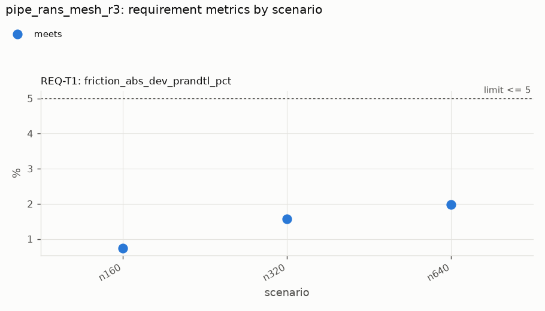
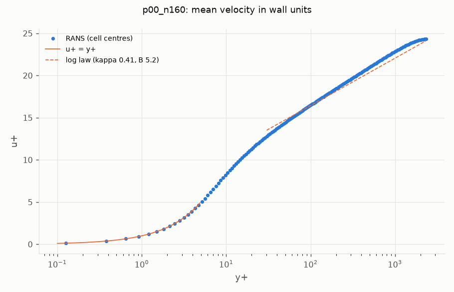
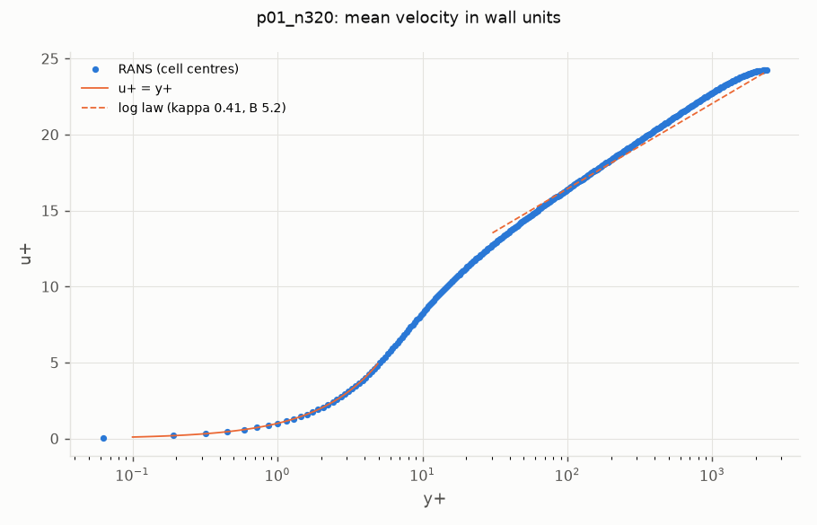
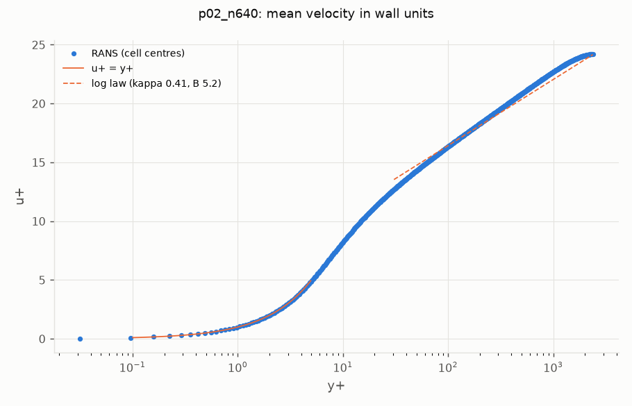

# Engineering review report: pipe_rans_mesh_r3

- **Run:** `20261122-202459_pipe_rans_mesh_r3`
- **Generated:** 2026-11-23T04:12:07+00:00
- **Case file SHA-256:** `a5f0aaf2d80aff02b1a108886678f09d060bc47ea618ab80dd84bcc00bd9b836`
- **Environment:** Python 3.14.10, numpy 2.5.5, scipy 1.18.1, matplotlib 3.11.2, cadquery 2.8.0; Windows-11-10.0.26100-SP0
- **Tools:** openfoam_bashrc /opt/openfoam14/etc/bashrc; openfoam_version 14; openfoam_package openfoam14 20261008; linux Ubuntu 22.04.5 LTS
- **Code version:** git `c6fc5040d76e9d1ee3acb94195640e4e5df8993e` (uncommitted changes present)
- **Simulation status:** completed
- **Verification status:** PASS

## Scope

Fully developed turbulent pipe flow, Re 1e5 (D 0.1 m, nu 1e-6 m^2/s), axisymmetric periodic wedge, RANS k-omega SST, low-Reynolds wall treatment; mesh study on the radial cells (160 / 320 / 640, wall cell halved with them; axial length 1 mm); friction factor against Prandtl's smooth-pipe law.

**Assumptions**

- Fully developed, steady, incompressible, axisymmetric mean flow in a hydraulically smooth pipe.
- RANS with the k-omega SST model (openfoam.org v14 coefficients); its form error is what this study measures.
- Hydraulic diameter of the wedge 2 R cos(2.5 deg) (its wall is a flat face): 0.1 % below D, used consistently.

## Requirements

| ID | Requirement | Metric | Limit |
|---|---|---|---|
| REQ-T1 | The predicted friction factor shall be within 5 % of Prandtl's smooth-pipe law (the Moody chart's smooth curve), a usable accuracy for pressure-drop budgets. | `friction_abs_dev_prandtl_pct` | <= 5 % |

## Summary across points

| Point | scenario | REQ-T1 | Checks |
|---|---|---|---|
| p00_n160 | n160 | 0.7428 %: **PASS** | 7/7 PASS |
| p01_n320 | n320 | 1.577 %: **PASS** | 7/7 PASS |
| p02_n640 | n640 | 1.985 %: **PASS** | 7/7 PASS |

## Run-level checks

Checks that use several points together (for example mesh convergence).

| Check | Description | Value | Tolerance | Status |
|---|---|---|---|---|
| discretization_friction_factor | relative discretization uncertainty of the friction factor, monotone (R = 0.490): GCI_fine, observed order 1.03, extrapolated 0.0184241 | 0.00481 | 0.01 | PASS |

## Point details

### p00_n160

Parameters: diameter_m = 0.1, reynolds_number = 1e+05, kinematic_viscosity_m2_per_s = 1e-06, n_radial = 160, first_cell_yplus = 0.25, wall_treatment = low_re, turbulence_model = kOmegaSST, scenario = n160

Derived: friction_prandtl = 0.01799, friction_petukhov = 0.01799, friction_blasius = 0.01779

| Requirement | Result | Limit | Margin | Verdict | Evidence |
|---|---|---|---|---|---|
| REQ-T1 | 0.7428 % | <= 5 | 4.26 | **PASS** | [point.json](points/p00_n160/point.json) |

| Check | Description | Value | Tolerance | Status |
|---|---|---|---|---|
| mesh | checkMesh reports Mesh OK (1 = failed) | 0.00e+00 | 5e-01 | PASS |
| force_balance | |f from the wall shear - f from the applied pressure gradient| / f (periodic flow: dp/dx A = tau_w P exactly) | 1.03e-11 | 1e-04 | PASS |
| bulk_velocity | |bulk velocity of the cell field - target| / target | 3.03e-13 | 1e-06 | PASS |
| iterative_convergence | max change of the pressure gradient over the last 10 % of iterations / final | 4.08e-11 | 1e-06 | PASS |
| wall_uniform | spread of the wall shear along the wall / mean (fully developed: 0) | 0.00e+00 | 1e-04 | PASS |
| yplus_range (validity) | first-cell y+ against the wall treatment's range (below 1 = inside) | 1.25e-01 | 1e+00 | PASS |
| log_law | max |u+ - (ln y+ / 0.41 + 5.2)| / u+ for 50 <= y+ <= 0.15 Re_tau (model form: the log law's constants scatter by a few per cent between experiments) | 2.54e-02 | 5e-02 | PASS |

### p01_n320

Parameters: diameter_m = 0.1, reynolds_number = 1e+05, kinematic_viscosity_m2_per_s = 1e-06, n_radial = 320, first_cell_yplus = 0.125, wall_treatment = low_re, turbulence_model = kOmegaSST, scenario = n320

Derived: friction_prandtl = 0.01799, friction_petukhov = 0.01799, friction_blasius = 0.01779

| Requirement | Result | Limit | Margin | Verdict | Evidence |
|---|---|---|---|---|---|
| REQ-T1 | 1.577 % | <= 5 | 3.42 | **PASS** | [point.json](points/p01_n320/point.json) |

| Check | Description | Value | Tolerance | Status |
|---|---|---|---|---|
| mesh | checkMesh reports Mesh OK (1 = failed) | 0.00e+00 | 5e-01 | PASS |
| force_balance | |f from the wall shear - f from the applied pressure gradient| / f (periodic flow: dp/dx A = tau_w P exactly) | 3.19e-12 | 1e-04 | PASS |
| bulk_velocity | |bulk velocity of the cell field - target| / target | 3.41e-13 | 1e-06 | PASS |
| iterative_convergence | max change of the pressure gradient over the last 10 % of iterations / final | 4.04e-11 | 1e-06 | PASS |
| wall_uniform | spread of the wall shear along the wall / mean (fully developed: 0) | 0.00e+00 | 1e-04 | PASS |
| yplus_range (validity) | first-cell y+ against the wall treatment's range (below 1 = inside) | 6.29e-02 | 1e+00 | PASS |
| log_law | max |u+ - (ln y+ / 0.41 + 5.2)| / u+ for 50 <= y+ <= 0.15 Re_tau (model form: the log law's constants scatter by a few per cent between experiments) | 2.76e-02 | 5e-02 | PASS |

### p02_n640

Parameters: diameter_m = 0.1, reynolds_number = 1e+05, kinematic_viscosity_m2_per_s = 1e-06, n_radial = 640, first_cell_yplus = 0.0625, wall_treatment = low_re, turbulence_model = kOmegaSST, scenario = n640

Derived: friction_prandtl = 0.01799, friction_petukhov = 0.01799, friction_blasius = 0.01779

| Requirement | Result | Limit | Margin | Verdict | Evidence |
|---|---|---|---|---|---|
| REQ-T1 | 1.985 % | <= 5 | 3.01 | **PASS** | [point.json](points/p02_n640/point.json) |

| Check | Description | Value | Tolerance | Status |
|---|---|---|---|---|
| mesh | checkMesh reports Mesh OK (1 = failed) | 0.00e+00 | 5e-01 | PASS |
| force_balance | |f from the wall shear - f from the applied pressure gradient| / f (periodic flow: dp/dx A = tau_w P exactly) | 4.10e-11 | 1e-04 | PASS |
| bulk_velocity | |bulk velocity of the cell field - target| / target | 1.24e-13 | 1e-06 | PASS |
| iterative_convergence | max change of the pressure gradient over the last 10 % of iterations / final | 1.59e-10 | 1e-06 | PASS |
| wall_uniform | spread of the wall shear along the wall / mean (fully developed: 0) | 0.00e+00 | 1e-04 | PASS |
| yplus_range (validity) | first-cell y+ against the wall treatment's range (below 1 = inside) | 3.15e-02 | 1e+00 | PASS |
| log_law | max |u+ - (ln y+ / 0.41 + 5.2)| / u+ for 50 <= y+ <= 0.15 Re_tau (model form: the log law's constants scatter by a few per cent between experiments) | 3.13e-02 | 5e-02 | PASS |

## Limitations

- Smooth walls only; roughness (the Colebrook range) not modelled.
- The reference is a correlation of measurements (about +-2 % scatter in Nikuradse's smooth-pipe data), not the measurements themselves.
- A converged solver run that matches an analytical reference shows that the equations were solved correctly. It does not show that the equations represent real hardware.

## Engineering acceptance

Pending human review. This report does not accept or reject the design.
