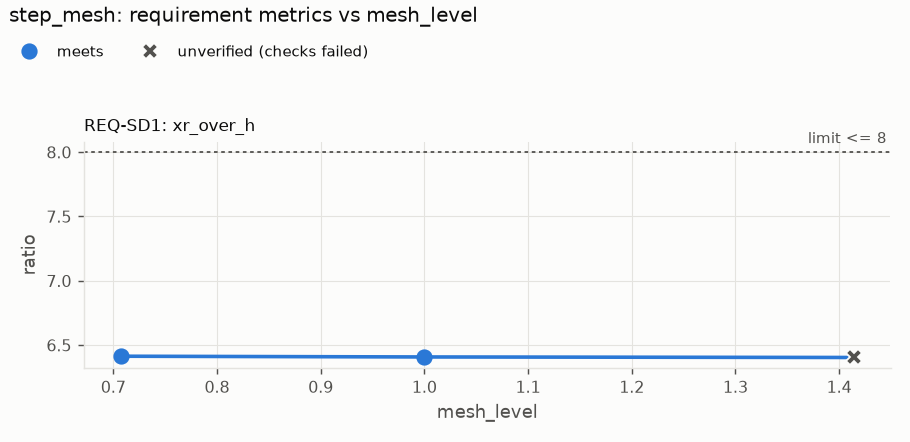
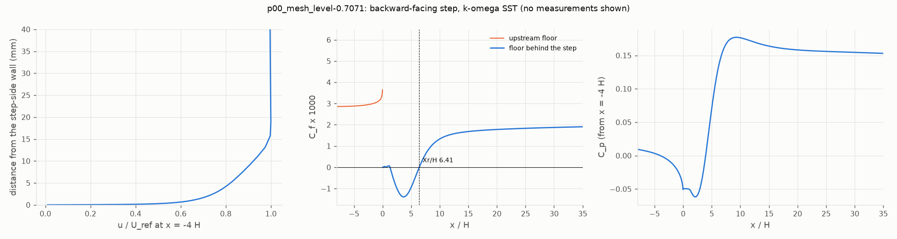
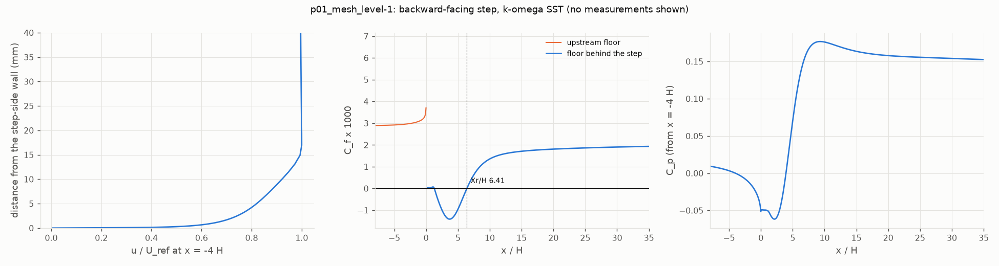
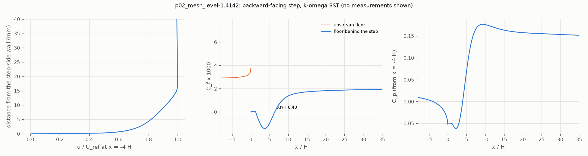

# Engineering review report: step_mesh

- **Run:** `20261122-233146_step_mesh`
- **Generated:** 2026-11-23T15:10:57+00:00
- **Case file SHA-256:** `8a0cbfa243cc90aa997da5ae0f1847b1e51fda1ed41f4e4fa161066eb6113cfa`
- **Environment:** Python 3.14.10, numpy 2.5.5, scipy 1.18.1, matplotlib 3.11.2, cadquery 2.8.0; Windows-11-10.0.26100-SP0
- **Tools:** openfoam_bashrc /opt/openfoam14/etc/bashrc; openfoam_version 14; openfoam_package openfoam14 20261008; linux Ubuntu 22.04.5 LTS
- **Code version:** git `75b4fbf09b6fc5ad7fd23e87f358af97ac4cc628`
- **Simulation status:** completed
- **Verification status:** FAIL

> **Warning:** verification did not pass for every point. Requirement verdicts marked *(unverified)* are not supported by evidence and must not be used for acceptance.

## Scope

Backward-facing step (Driver and Seegmiller, ERCOFTAC 030, parallel walls), 2D RANS k-omega SST, walls resolved; mesh study, levels 0.7 / 1 / 1.41 (about 35k / 71k / 142k cells).

**Assumptions**

- 2D, steady, incompressible RANS (M 0.128); k-omega SST (openfoam.org v14), walls resolved (y+ under 1 on the floors and the top wall).
- Geometry from the case description: step H 12.7 mm, inlet duct 8 H (expansion 1.125), parallel top wall; Re_H 37500 at U_ref 44.2 m/s (nu 1.497e-5 m^2/s).
- Inflow: uniform velocity 1.153 m upstream of the step (as the experiment's trip, 1.0 m), turbulence intensity 1 % and eddy-viscosity ratio 10; both walls grow their own boundary layers; matched on the step-side momentum thickness and edge velocity at x = -4 H.
- Outlet at 50 H, fixed pressure; Cp referred to the floor at x = -4 H.

## Requirements

| ID | Requirement | Metric | Limit |
|---|---|---|---|
| REQ-SD1 | Design use (synthetic): the flow shall be reattached by x/H = 8, where a heat-transfer surface starts. | `xr_over_h` | <= 8 - |

## Summary across points

| Point | mesh_level | REQ-SD1 | Checks |
|---|---|---|---|
| p00_mesh_level-0.7071 | 0.7071 | 6.414 -: **PASS** | 7/7 PASS |
| p01_mesh_level-1 | 1 | 6.408 -: **PASS** | 7/7 PASS |
| p02_mesh_level-1.4142 | 1.414 | 6.404 -: **PASS (unverified)** | 6/7 FAIL |

## Run-level checks

Checks that use several points together (for example mesh convergence).

| Check | Description | Value | Tolerance | Status |
|---|---|---|---|---|
| discretization_xr_over_h | relative discretization uncertainty of xr_over_h, monotone (R = 0.718): GCI_fine, observed order 0.95, extrapolated 6.39341 | 0.00205 | 0.03 | PASS |
| discretization_cf_x20h | relative discretization uncertainty of cf_x20h, monotone (R = 0.614): GCI_fine, observed order 1.41, extrapolated 0.0018517 | 0.0188 | 0.03 | PASS |
| discretization_cp_recovery_30h | relative discretization uncertainty of cp_recovery_30h, divergent (R = 1.387): no estimate | inf | 0.03 | FAIL |

A failed run-level check withholds the verdicts of requirements on `cp_recovery_30h` at every point: they are marked *(unverified)* in the table above.

## Point details

### p00_mesh_level-0.7071

Parameters: step_height_m = 0.0127, inlet_height_ratio = 8, reynolds_number_h = 3.75e+04, inlet_velocity_m_per_s = 41.95, reference_velocity_m_per_s = 44.2, upstream_length_m = 1.153, downstream_length_over_h = 50, inlet_turbulence_intensity = 0.01, inlet_viscosity_ratio = 10, mesh_level = 0.7071, turbulence_model = kOmegaSST

Derived: nu_m2_per_s = 1.497e-05, cells = 3.568e+04, y1_m = 4.243e-06, dx_lip_m = 0.000449, dx_up_max_m = 0.03598, dx_far_max_m = 0.008743

| Requirement | Result | Limit | Margin | Verdict | Evidence |
|---|---|---|---|---|---|
| REQ-SD1 | 6.414 - | <= 8 | 1.59 | **PASS** | [point.json](points/p00_mesh_level-0.7071/point.json) |

| Check | Description | Value | Tolerance | Status |
|---|---|---|---|---|
| converged | SIMPLE residual control reached (0 = yes) | 0.00e+00 | 0e+00 | PASS |
| continuity | time-step continuity error, sum local (last iteration) | 1.06e-08 | 1e-06 | PASS |
| inflow_theta (validity) | |momentum thickness at x = -4 H - stated| / stated (the inflow condition) | 1.44e-03 | 5e-02 | PASS |
| inflow_velocity (validity) | |edge velocity at x = -4 H - stated reference| / reference | 1.71e-03 | 2e-02 | PASS |
| yplus_floors (validity) | max y+ on the walls but the step face (viscous sublayer resolved) | 6.30e-01 | 1e+00 | PASS |
| mesh | checkMesh failures other than the aspect-ratio test (0 = none) | 0.00e+00 | 0e+00 | PASS |
| reattachment_found | number of reattachment points found on the floor (1 or more = found; 0 = none) | 0.00e+00 | 0e+00 | PASS |

### p01_mesh_level-1

Parameters: step_height_m = 0.0127, inlet_height_ratio = 8, reynolds_number_h = 3.75e+04, inlet_velocity_m_per_s = 41.95, reference_velocity_m_per_s = 44.2, upstream_length_m = 1.153, downstream_length_over_h = 50, inlet_turbulence_intensity = 0.01, inlet_viscosity_ratio = 10, mesh_level = 1, turbulence_model = kOmegaSST

Derived: nu_m2_per_s = 1.497e-05, cells = 7.08e+04, y1_m = 3e-06, dx_lip_m = 0.0003175, dx_up_max_m = 0.02543, dx_far_max_m = 0.00626

| Requirement | Result | Limit | Margin | Verdict | Evidence |
|---|---|---|---|---|---|
| REQ-SD1 | 6.408 - | <= 8 | 1.59 | **PASS** | [point.json](points/p01_mesh_level-1/point.json) |

| Check | Description | Value | Tolerance | Status |
|---|---|---|---|---|
| converged | SIMPLE residual control reached (0 = yes) | 0.00e+00 | 0e+00 | PASS |
| continuity | time-step continuity error, sum local (last iteration) | 9.17e-09 | 1e-06 | PASS |
| inflow_theta (validity) | |momentum thickness at x = -4 H - stated| / stated (the inflow condition) | 4.46e-03 | 5e-02 | PASS |
| inflow_velocity (validity) | |edge velocity at x = -4 H - stated reference| / reference | 1.13e-03 | 2e-02 | PASS |
| yplus_floors (validity) | max y+ on the walls but the step face (viscous sublayer resolved) | 3.35e-01 | 1e+00 | PASS |
| mesh | checkMesh failures other than the aspect-ratio test (0 = none) | 0.00e+00 | 0e+00 | PASS |
| reattachment_found | number of reattachment points found on the floor (1 or more = found; 0 = none) | 0.00e+00 | 0e+00 | PASS |

### p02_mesh_level-1.4142

Parameters: step_height_m = 0.0127, inlet_height_ratio = 8, reynolds_number_h = 3.75e+04, inlet_velocity_m_per_s = 41.95, reference_velocity_m_per_s = 44.2, upstream_length_m = 1.153, downstream_length_over_h = 50, inlet_turbulence_intensity = 0.01, inlet_viscosity_ratio = 10, mesh_level = 1.414, turbulence_model = kOmegaSST

Derived: nu_m2_per_s = 1.497e-05, cells = 1.421e+05, y1_m = 2.121e-06, dx_lip_m = 0.0002245, dx_up_max_m = 0.01801, dx_far_max_m = 0.004455

| Requirement | Result | Limit | Margin | Verdict | Evidence |
|---|---|---|---|---|---|
| REQ-SD1 | 6.404 - | <= 8 | 1.6 | **PASS (unverified)** | [point.json](points/p02_mesh_level-1.4142/point.json) |

| Check | Description | Value | Tolerance | Status |
|---|---|---|---|---|
| converged | SIMPLE residual control reached (0 = yes) | 1.00e+00 | 0e+00 | FAIL |
| continuity | time-step continuity error, sum local (last iteration) | 1.48e-08 | 1e-06 | PASS |
| inflow_theta (validity) | |momentum thickness at x = -4 H - stated| / stated (the inflow condition) | 6.65e-03 | 5e-02 | PASS |
| inflow_velocity (validity) | |edge velocity at x = -4 H - stated reference| / reference | 7.22e-04 | 2e-02 | PASS |
| yplus_floors (validity) | max y+ on the walls but the step face (viscous sublayer resolved) | 3.48e-01 | 1e+00 | PASS |
| mesh | checkMesh failures other than the aspect-ratio test (0 = none) | 0.00e+00 | 0e+00 | PASS |
| reattachment_found | number of reattachment points found on the floor (1 or more = found; 0 = none) | 0.00e+00 | 0e+00 | PASS |

## Limitations

- 2D: the tunnel's span is 12 H, so the side walls' boundary layers and any spanwise flow are not modelled.
- One turbulence model; its boundary layer is fuller than the measured one at the same momentum thickness (delta99 15 against 19 mm).
- Steady RANS: the shear layer's unsteadiness is not resolved.
- A converged solver run that matches an analytical reference shows that the equations were solved correctly. It does not show that the equations represent real hardware.

## Engineering acceptance

Pending human review. This report does not accept or reject the design.
