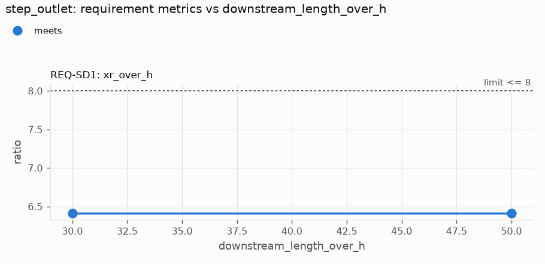
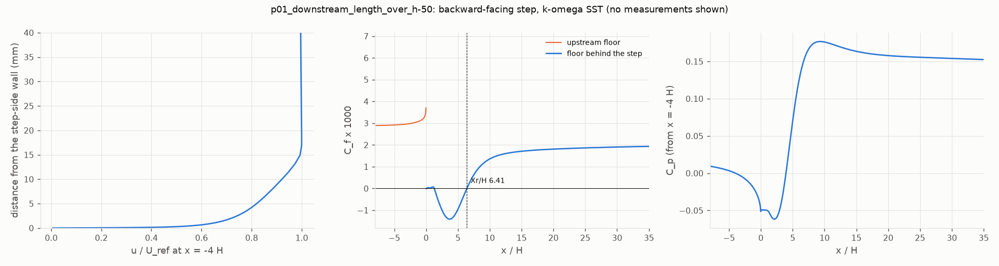

# Engineering review report: step_outlet

- **Run:** `20261122-233146_step_outlet`
- **Generated:** 2026-11-23T08:57:47+00:00
- **Case file SHA-256:** `a390eb9764769d354d4f4da5ee7e295a09022f4684cc4db02e3c50a2a9a51edb`
- **Environment:** Python 3.14.10, numpy 2.5.5, scipy 1.18.1, matplotlib 3.11.2, cadquery 2.8.0; Windows-11-10.0.26100-SP0
- **Tools:** openfoam_bashrc /opt/openfoam14/etc/bashrc; openfoam_version 14; openfoam_package openfoam14 20261008; linux Ubuntu 22.04.5 LTS
- **Code version:** git `75b4fbf09b6fc5ad7fd23e87f358af97ac4cc628`
- **Simulation status:** completed
- **Verification status:** PASS

## Scope

Backward-facing step (as step_mesh), level 1; outlet at 30 and 50 step heights.

**Assumptions**

- 2D, steady, incompressible RANS (M 0.128); k-omega SST (openfoam.org v14), walls resolved (y+ under 1 on the floors and the top wall).
- Geometry from the case description: step H 12.7 mm, inlet duct 8 H (expansion 1.125), parallel top wall; Re_H 37500 at U_ref 44.2 m/s (nu 1.497e-5 m^2/s).
- Inflow: uniform velocity 1.153 m upstream of the step (as the experiment's trip, 1.0 m), turbulence intensity 1 % and eddy-viscosity ratio 10; both walls grow their own boundary layers; matched on the step-side momentum thickness and edge velocity at x = -4 H.
- Outlet at 50 H, fixed pressure; Cp referred to the floor at x = -4 H.

## Requirements

| ID | Requirement | Metric | Limit |
|---|---|---|---|
| REQ-SD1 | Design use (synthetic): the flow shall be reattached by x/H = 8, where a heat-transfer surface starts. | `xr_over_h` | <= 8 - |

## Summary across points

| Point | downstream_length_over_h | REQ-SD1 | Checks |
|---|---|---|---|
| p00_downstream_length_over_h-30 | 30 | 6.408 -: **PASS** | 7/7 PASS |
| p01_downstream_length_over_h-50 | 50 | 6.408 -: **PASS** | 7/7 PASS |

## Point details

### p00_downstream_length_over_h-30

Parameters: step_height_m = 0.0127, inlet_height_ratio = 8, reynolds_number_h = 3.75e+04, inlet_velocity_m_per_s = 41.95, reference_velocity_m_per_s = 44.2, upstream_length_m = 1.153, downstream_length_over_h = 30, inlet_turbulence_intensity = 0.01, inlet_viscosity_ratio = 10, mesh_level = 1, turbulence_model = kOmegaSST

Derived: nu_m2_per_s = 1.497e-05, cells = 7.08e+04, y1_m = 3e-06, dx_lip_m = 0.0003175, dx_up_max_m = 0.02543, dx_far_max_m = 0.001105

| Requirement | Result | Limit | Margin | Verdict | Evidence |
|---|---|---|---|---|---|
| REQ-SD1 | 6.408 - | <= 8 | 1.59 | **PASS** | [point.json](points/p00_downstream_length_over_h-30/point.json) |

| Check | Description | Value | Tolerance | Status |
|---|---|---|---|---|
| converged | SIMPLE residual control reached (0 = yes) | 0.00e+00 | 0e+00 | PASS |
| continuity | time-step continuity error, sum local (last iteration) | 6.76e-09 | 1e-06 | PASS |
| inflow_theta (validity) | |momentum thickness at x = -4 H - stated| / stated (the inflow condition) | 4.46e-03 | 5e-02 | PASS |
| inflow_velocity (validity) | |edge velocity at x = -4 H - stated reference| / reference | 1.13e-03 | 2e-02 | PASS |
| yplus_floors (validity) | max y+ on the walls but the step face (viscous sublayer resolved) | 4.54e-01 | 1e+00 | PASS |
| mesh | checkMesh failures other than the aspect-ratio test (0 = none) | 0.00e+00 | 0e+00 | PASS |
| reattachment_found | number of reattachment points found on the floor (1 or more = found; 0 = none) | 0.00e+00 | 0e+00 | PASS |

### p01_downstream_length_over_h-50

Parameters: step_height_m = 0.0127, inlet_height_ratio = 8, reynolds_number_h = 3.75e+04, inlet_velocity_m_per_s = 41.95, reference_velocity_m_per_s = 44.2, upstream_length_m = 1.153, downstream_length_over_h = 50, inlet_turbulence_intensity = 0.01, inlet_viscosity_ratio = 10, mesh_level = 1, turbulence_model = kOmegaSST

Derived: nu_m2_per_s = 1.497e-05, cells = 7.08e+04, y1_m = 3e-06, dx_lip_m = 0.0003175, dx_up_max_m = 0.02543, dx_far_max_m = 0.00626

| Requirement | Result | Limit | Margin | Verdict | Evidence |
|---|---|---|---|---|---|
| REQ-SD1 | 6.408 - | <= 8 | 1.59 | **PASS** | [point.json](points/p01_downstream_length_over_h-50/point.json) |

| Check | Description | Value | Tolerance | Status |
|---|---|---|---|---|
| converged | SIMPLE residual control reached (0 = yes) | 0.00e+00 | 0e+00 | PASS |
| continuity | time-step continuity error, sum local (last iteration) | 9.17e-09 | 1e-06 | PASS |
| inflow_theta (validity) | |momentum thickness at x = -4 H - stated| / stated (the inflow condition) | 4.46e-03 | 5e-02 | PASS |
| inflow_velocity (validity) | |edge velocity at x = -4 H - stated reference| / reference | 1.13e-03 | 2e-02 | PASS |
| yplus_floors (validity) | max y+ on the walls but the step face (viscous sublayer resolved) | 3.35e-01 | 1e+00 | PASS |
| mesh | checkMesh failures other than the aspect-ratio test (0 = none) | 0.00e+00 | 0e+00 | PASS |
| reattachment_found | number of reattachment points found on the floor (1 or more = found; 0 = none) | 0.00e+00 | 0e+00 | PASS |

## Limitations

- 2D: the tunnel's span is 12 H, so the side walls' boundary layers and any spanwise flow are not modelled.
- One turbulence model; its boundary layer is fuller than the measured one at the same momentum thickness (delta99 15 against 19 mm).
- Steady RANS: the shear layer's unsteadiness is not resolved.
- A converged solver run that matches an analytical reference shows that the equations were solved correctly. It does not show that the equations represent real hardware.

## Engineering acceptance

Pending human review. This report does not accept or reject the design.
