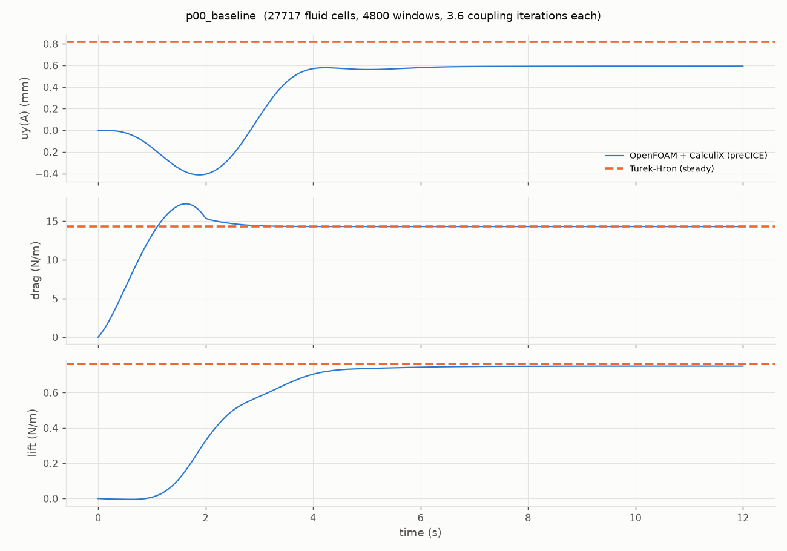

# Engineering review report: turek_hron_fsi1_noise_a

- **Run:** `20261123-031538_turek_hron_fsi1_noise_a`
- **Generated:** 2026-11-23T10:04:05+00:00
- **Case file SHA-256:** `7ee870346b5f7a6757ed9148710634cf832a15242ba2679db3e2fd7a21814f33`
- **Environment:** Python 3.14.10, numpy 2.5.5, scipy 1.18.1, matplotlib 3.11.2, cadquery 2.8.0; Windows-11-10.0.26100-SP0
- **Tools:** openfoam_bashrc /usr/lib/openfoam/openfoam2512/etc/bashrc; gmsh 4.15.0; openfoam_version v2512; openfoam_package openfoam2512 2512.0-2; precice 3.4.1; calculix_precice 2.20.2-1; linux Ubuntu 22.04.5 LTS
- **Code version:** git `b2d7092497449bdcd7797c736780db31f9405f13` (uncommitted changes present)
- **Simulation status:** completed
- **Verification status:** PASS

## Scope

Turek-Hron FSI1: steady laminar flow (Re 20) bending the elastic flag behind the cylinder; OpenFOAM v2512 (moving mesh) coupled to CalculiX through preCICE; fluid cell size at the body 2.5 / 1.77 / 1.25 mm, solid 2.5 mm, dt 0.0025 s to 12 s; tip displacements, drag and lift against the published benchmark.

**Assumptions**

- 2D: one cell deep in the fluid, plane strain in the solid (one element layer, as deep as the fluid).
- St. Venant-Kirchhoff solid (CalculiX *ELASTIC under NLGEOM), no gravity, as the FSI tests define it.
- Steady target: numerical damping in the solid only speeds up settling (ALPHA -0.3).
- Inflow: the benchmark's parabola with its (1 - cos) ramp over 2 s.

## Requirements

| ID | Requirement | Metric | Limit |
|---|---|---|---|
| REQ-FSI-1 | The coupled model shall reproduce the Turek-Hron FSI1 horizontal displacement of point A within 5 % (a second-order quantity, 3 % of the vertical one). | `ux_A_deviation_pct` | <= 5 % |
| REQ-FSI-2 | It shall reproduce the FSI1 vertical displacement of point A within 3 %. | `uy_A_deviation_pct` | <= 3 % |
| REQ-FSI-3 | It shall reproduce the FSI1 drag within 1 %. | `drag_deviation_pct` | <= 1 % |
| REQ-FSI-4 | It shall reproduce the FSI1 lift within 5 % (lift is about 5 % of the drag and moved 30 % from the rigid CFD1 value once the flag bends). | `lift_deviation_pct` | <= 5 % |

## Summary across points

| Point | REQ-FSI-1 | REQ-FSI-2 | REQ-FSI-3 | REQ-FSI-4 | Checks |
|---|---|---|---|---|---|
| p00_baseline | 2.048 %: **PASS** | 27.78 %: **FAIL** | 0.06963 %: **PASS** | 1.726 %: **PASS** | 6/6 PASS |

## Point details

### p00_baseline

Parameters: solid_density_kg_per_m3 = 1000, shear_modulus_Pa = 5e+05, poisson_ratio = 0.4, fluid_density_kg_per_m3 = 1000, kinematic_viscosity_m2_per_s = 0.001, mean_velocity_m_per_s = 0.2, fluid_cell_size_m = 0.00172, solid_element_size_mm = 2.5, time_step_s = 0.0025, end_time_s = 12, benchmark_ux_A_m = 2.27e-05, benchmark_uy_A_m = 0.0008209, benchmark_drag_N_per_m = 14.29, benchmark_lift_N_per_m = 0.7637

Derived: reynolds_D = 20, mass_ratio = 1

| Requirement | Result | Limit | Margin | Verdict | Evidence |
|---|---|---|---|---|---|
| REQ-FSI-1 | 2.048 % | <= 5 | 2.95 | **PASS** | [point.json](points/p00_baseline/point.json) |
| REQ-FSI-2 | 27.78 % | <= 3 | -24.8 | **FAIL** | [point.json](points/p00_baseline/point.json) |
| REQ-FSI-3 | 0.06963 % | <= 1 | 0.93 | **PASS** | [point.json](points/p00_baseline/point.json) |
| REQ-FSI-4 | 1.726 % | <= 5 | 3.27 | **PASS** | [point.json](points/p00_baseline/point.json) |

| Check | Description | Value | Tolerance | Status |
|---|---|---|---|---|
| mesh | checkMesh reports Mesh OK (1 = failed) | 0.00e+00 | 5e-01 | PASS |
| coupling_converged | coupling windows that hit the iteration limit without converging | 0.00e+00 | 5e-01 | PASS |
| steady | max over uy(A), drag, lift of the change of the mean between the two halves of the last 2 s / mean (drift, not jitter) | 1.47e-04 | 1e-03 | PASS |
| force_transfer | |fluid force on the flag + clamp reaction in the solid| / |fluid force on the flag| averaged over the last 2 s (the coupling conserves force) | 4.34e-05 | 1e-03 | PASS |
| inflow_profile | max over inlet faces |U - benchmark parabola| / (1.5 U_mean), after the ramp | 4.89e-10 | 1e-06 | PASS |
| laminar (validity) | Reynolds number (D) / 200 | 1.00e-01 | 1e+00 | PASS |

## Limitations

- The solid mesh is not refined in this study (CSM1 put it within 0.08 % at 2.5 mm; at the coupled load, 1.25 mm moved uy(A) by 0.035 %: prototype B).
- The fluid mesh is regenerated at each size (not nested), which made the CFD lift scatter by about +-0.6 %.
- A converged solver run that matches an analytical reference shows that the equations were solved correctly. It does not show that the equations represent real hardware.

## Engineering acceptance

Pending human review. This report does not accept or reject the design.
