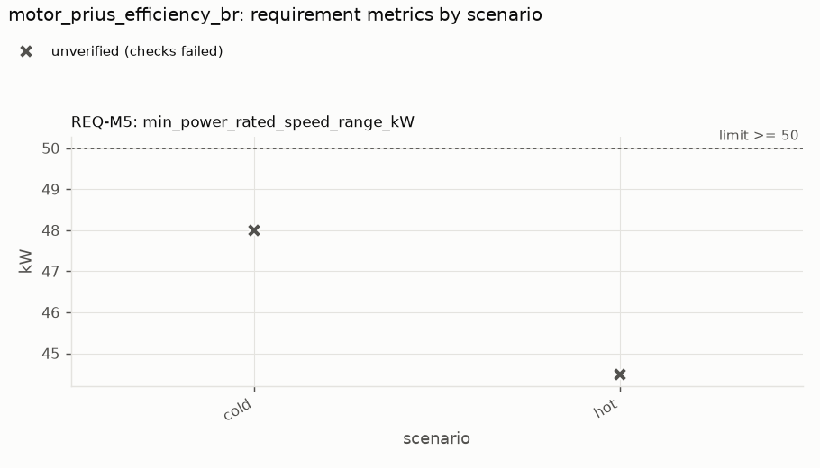
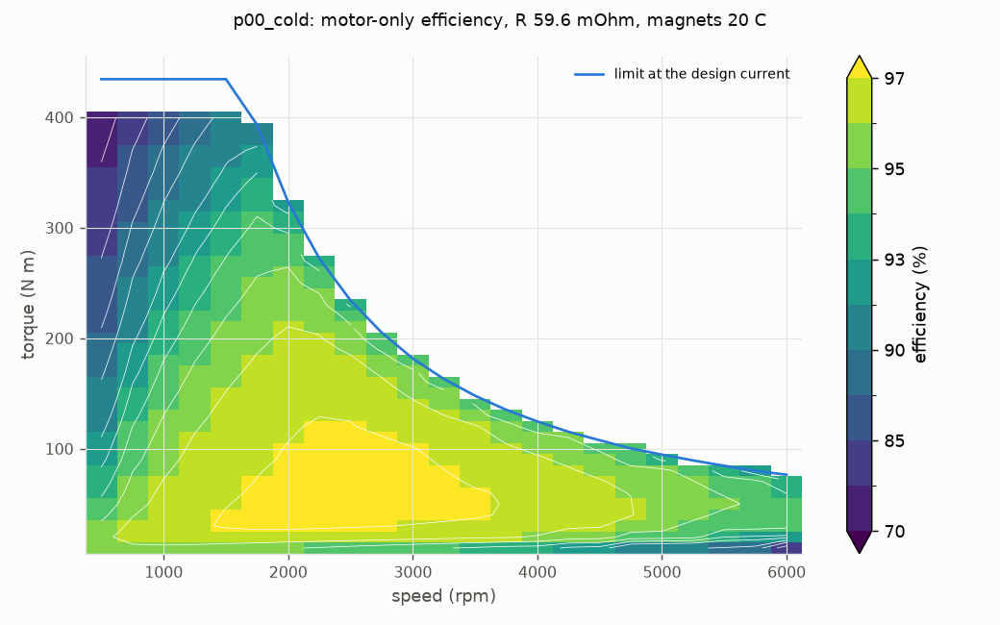
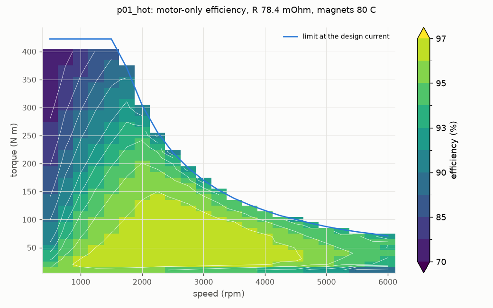

# Engineering review report: motor_prius_efficiency_br

- **Run:** `20261123-032756_motor_prius_efficiency_br`
- **Generated:** 2026-11-23T08:27:58+00:00
- **Case file SHA-256:** `cd85b2c06dd288a1190f40f974ea7a8842cd7f9001ada97eff3b7d8bd99fa20e`
- **Environment:** Python 3.14.10, numpy 2.5.5, scipy 1.18.1, matplotlib 3.11.2, cadquery 2.8.0; Windows-11-10.0.26100-SP0
- **Tools:** numpy 2.5.5; scipy 1.18.1
- **Code version:** git `c6d39dc3f0fc0c07979059e124a450068e715517`
- **Simulation status:** completed
- **Verification status:** FAIL

> **Warning:** verification did not pass for every point. Requirement verdicts marked *(unverified)* are not supported by evidence and must not be used for acceptance.

## Scope

2004 Toyota Prius traction motor, POST-TEST CALIBRATED (hypothesis A: magnet remanence 1.036 T), motor-only efficiency map from the verified dq look-up tables (25 A tables merged with low-q-current tables at 6.25 A): 500-6000 rpm, 10-400 N m, least copper + iron loss under the 500 V bus voltage limit and the current limit; cold (all 20 C) and hot (windings 100 C, magnets 80 C) scenarios.

**Assumptions**

- Motor-only efficiency: copper (DC resistance, end connections included) and iron loss; no mechanical, magnet eddy-current, AC copper or inverter loss (user's framing, 2026-11-22).
- Voltage limit Vdc / sqrt 6 phase rms (linear modulation of a 500 V bus); the resistive drop is included, inductive coupling to the inverter is not.
- Current limit 212 A rms for the design (25 A/mm^2 on 76.4 mm^2 of bare copper per slot, a stated assumption) and 300 A for the map's edge.
- Iron loss from the table's coefficients, P = A f + B f^2 + C f^1.5 with f the electrical frequency, at each grid point.
- Copper 1.72e-8 ohm m at 20 C, alpha 0.00393 /K; one parallel path; end connection 120.6 mm per side (geometry estimate, see header).

## Requirements

| ID | Requirement | Metric | Limit |
|---|---|---|---|
| REQ-M5 | The motor shall deliver its rated 50 kW from the rated base speed (50 kW at 400 N m: 1194 rpm) to 6000 rpm within the 500 V bus voltage limit and the 212 A rms design current limit. | `min_power_rated_speed_range_kW` | >= 50 kW |

## Summary across points

| Point | scenario | REQ-M5 | Checks |
|---|---|---|---|
| p00_cold | cold | 48 kW: **FAIL (unverified)** | 5/8 FAIL |
| p01_hot | hot | 44.48 kW: **FAIL (unverified)** | 4/5 FAIL |

## Point details

### p00_cold

Parameters: lut_run = 20261122-222259_motor_prius_lut_cold_br,20261123-000206_motor_prius_lut_cold_lowiq_br, magnet_temperature_C = 20, winding_temperature_C = 20, series_turns_per_phase = 72, turn_copper_area_mm2 = 8.492, stack_length_m = 0.08382, end_connection_length_m = 0.1206, copper_resistivity_20C_ohm_m = 1.72e-08, copper_alpha_per_K = 0.00393, bus_voltage_V = 500, current_limit_design_A = 212, current_limit_map_A = 300, speed_min_rpm = 500, speed_max_rpm = 6000, speed_step_rpm = 250, torque_min_Nm = 10, torque_max_Nm = 400, torque_step_Nm = 10, rated_power_kW = 50, rated_torque_Nm = 400, ref_back_emf_V = 89.37, ref_mtpa_100A_Nm = 233.4, ref_mtpa_200A_Nm = 419.4, scenario = cold

Derived: phase_resistance_20C_ohm = 0.05962, voltage_limit_rms_V = 204.1

| Requirement | Result | Limit | Margin | Verdict | Evidence |
|---|---|---|---|---|---|
| REQ-M5 | 48 kW | >= 50 | -2 | **FAIL (unverified)** | [point.json](points/p00_cold/point.json) |

| Check | Description | Value | Tolerance | Status |
|---|---|---|---|---|
| lut_back_emf | |table open-circuit back-EMF (sqrt 3 w phi_d at id = iq = 0) - open-circuit study| / open-circuit study (same mesh fineness) | 1.01e-03 | 1e-03 | FAIL |
| lut_mtpa_100A | |table MTPA torque at 100 A rms - torque-curve study| / torque-curve study (cubic interpolation against an angle sweep with a parabola) | 6.90e-04 | 1e-02 | PASS |
| lut_mtpa_200A | |table MTPA torque at 200 A rms - torque-curve study| / torque-curve study (cubic interpolation against an angle sweep with a parabola) | 8.64e-04 | 1e-02 | PASS |
| interp_torque | max over the left-out nodes (|T| >= 20 N m) of the torque error of the table on every second node: bounds the full table's interpolation error (cubic: about 1/16 of this) | 1.13e-02 | 5e-02 | PASS |
| interp_iron_loss | the same for the iron loss at 6000 rpm | 6.87e-02 | 5e-02 | FAIL |
| magnet_temperature (validity) | |table's magnet temperature - this scenario's| (K) | 0.00e+00 | 0e+00 | PASS |
| lut_merge | max relative difference over the nodes two merged table runs both computed (same model, mesh and rotor positions: it must reproduce itself) | 0.00e+00 | 1e-04 | PASS |
| interp_map | max |efficiency from the half table - from the full table| over the map (efficiency points): bounds the full table's interpolation error on the output itself | 6.38e+00 | 2e+00 | FAIL |

### p01_hot

Parameters: lut_run = 20261123-005801_motor_prius_lut_hot_br,20261123-023248_motor_prius_lut_hot_lowiq_br, magnet_temperature_C = 80, winding_temperature_C = 100, series_turns_per_phase = 72, turn_copper_area_mm2 = 8.492, stack_length_m = 0.08382, end_connection_length_m = 0.1206, copper_resistivity_20C_ohm_m = 1.72e-08, copper_alpha_per_K = 0.00393, bus_voltage_V = 500, current_limit_design_A = 212, current_limit_map_A = 300, speed_min_rpm = 500, speed_max_rpm = 6000, speed_step_rpm = 250, torque_min_Nm = 10, torque_max_Nm = 400, torque_step_Nm = 10, rated_power_kW = 50, rated_torque_Nm = 400, ref_back_emf_V = 0, ref_mtpa_100A_Nm = 0, ref_mtpa_200A_Nm = 0, scenario = hot

Derived: phase_resistance_20C_ohm = 0.05962, voltage_limit_rms_V = 204.1

| Requirement | Result | Limit | Margin | Verdict | Evidence |
|---|---|---|---|---|---|
| REQ-M5 | 44.48 kW | >= 50 | -5.52 | **FAIL (unverified)** | [point.json](points/p01_hot/point.json) |

| Check | Description | Value | Tolerance | Status |
|---|---|---|---|---|
| interp_torque | max over the left-out nodes (|T| >= 20 N m) of the torque error of the table on every second node: bounds the full table's interpolation error (cubic: about 1/16 of this) | 1.26e-02 | 5e-02 | PASS |
| interp_iron_loss | the same for the iron loss at 6000 rpm | 7.47e-02 | 5e-02 | FAIL |
| magnet_temperature (validity) | |table's magnet temperature - this scenario's| (K) | 0.00e+00 | 0e+00 | PASS |
| lut_merge | max relative difference over the nodes two merged table runs both computed (same model, mesh and rotor positions: it must reproduce itself) | 0.00e+00 | 1e-04 | PASS |
| interp_map | max |efficiency from the half table - from the full table| over the map (efficiency points): bounds the full table's interpolation error on the output itself | 1.27e+00 | 2e+00 | PASS |

## Limitations

- Calibrated after the test (remanence from ORNL's back-EMF, hypothesis chosen on its static inductances); ORNL's efficiency is not used here and is scored separately.
- The tables are 2D magnetostatic at 1000 rpm; the iron loss is scaled to speed by the fitted coefficients, not recomputed per speed.
- Steady thermal corners only (cold and hot); no thermal model links temperature to the operating point yet.
- A converged solver run that matches an analytical reference shows that the equations were solved correctly. It does not show that the equations represent real hardware.

## Engineering acceptance

Pending human review. This report does not accept or reject the design.
