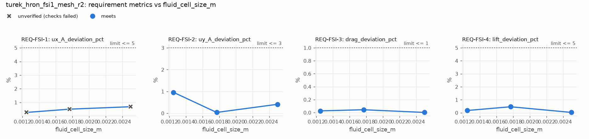
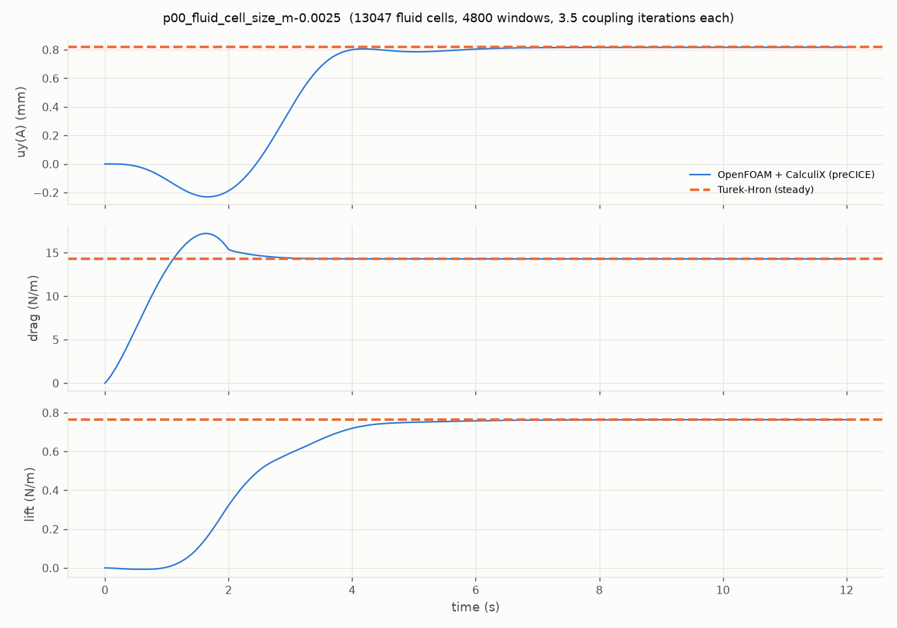
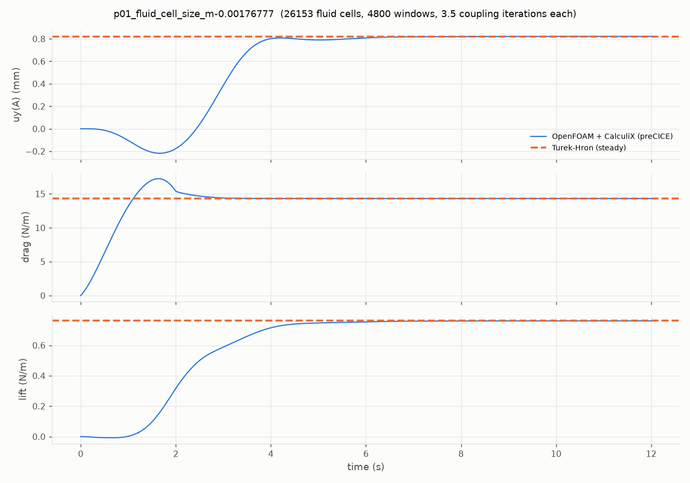
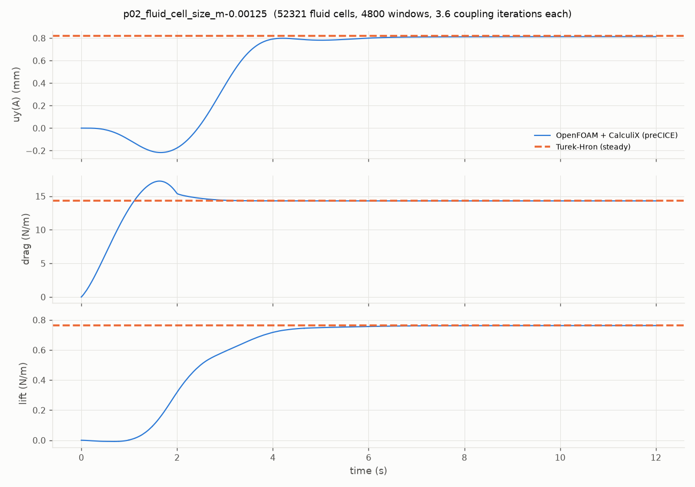

# Engineering review report: turek_hron_fsi1_mesh_r2

- **Run:** `20261123-070600_turek_hron_fsi1_mesh_r2`
- **Generated:** 2026-11-23T18:37:02+00:00
- **Case file SHA-256:** `58c16da4c4ea49771817e9c5c8c800b7cd96a98c1a6ebf22f7ed4d2f8c787cd0`
- **Environment:** Python 3.14.10, numpy 2.5.5, scipy 1.18.1, matplotlib 3.11.2, cadquery 2.8.0; Windows-11-10.0.26100-SP0
- **Tools:** openfoam_bashrc /usr/lib/openfoam/openfoam2512/etc/bashrc; gmsh 4.15.0; openfoam_version v2512; openfoam_package openfoam2512 2512.0-2; precice 3.4.1; calculix_precice 2.20.2-1; linux Ubuntu 22.04.5 LTS
- **Code version:** git `7c4038fc90731f063fbf243905371224d6e72df8`
- **Simulation status:** completed
- **Verification status:** FAIL

> **Warning:** verification did not pass for every point. Requirement verdicts marked *(unverified)* are not supported by evidence and must not be used for acceptance.

## Scope

Turek-Hron FSI1: steady laminar flow (Re 20) bending the elastic flag behind the cylinder; OpenFOAM v2512 (moving mesh) coupled to CalculiX through preCICE; fluid cell size at the body 2.5 / 1.77 / 1.25 mm, solid 2.5 mm, dt 0.0025 s to 12 s; tip displacements, drag and lift against the published benchmark.

**Assumptions**

- 2D: one cell deep in the fluid, plane strain in the solid (one element layer, as deep as the fluid).
- St. Venant-Kirchhoff solid (CalculiX *ELASTIC under NLGEOM), no gravity, as the FSI tests define it.
- Steady target: numerical damping in the solid only speeds up settling (ALPHA -0.3).
- Inflow: the benchmark's parabola with its (1 - cos) ramp over 2 s.

## Requirements

| ID | Requirement | Metric | Limit |
|---|---|---|---|
| REQ-FSI-1 | The coupled model shall reproduce the Turek-Hron FSI1 horizontal displacement of point A within 5 % (a second-order quantity, 3 % of the vertical one). | `ux_A_deviation_pct` | <= 5 % |
| REQ-FSI-2 | It shall reproduce the FSI1 vertical displacement of point A within 3 %. | `uy_A_deviation_pct` | <= 3 % |
| REQ-FSI-3 | It shall reproduce the FSI1 drag within 1 %. | `drag_deviation_pct` | <= 1 % |
| REQ-FSI-4 | It shall reproduce the FSI1 lift within 5 % (lift is about 5 % of the drag and moved 30 % from the rigid CFD1 value once the flag bends). | `lift_deviation_pct` | <= 5 % |

## Summary across points

| Point | fluid_cell_size_m | REQ-FSI-1 | REQ-FSI-2 | REQ-FSI-3 | REQ-FSI-4 | Checks |
|---|---|---|---|---|---|---|
| p00_fluid_cell_size_m-0.0025 | 0.0025 | 0.6818 %: **PASS (unverified)** | 0.4123 %: **PASS** | 0.002595 %: **PASS** | 0.02661 %: **PASS** | 7/7 PASS |
| p01_fluid_cell_size_m-0.00176777 | 0.001768 | 0.5037 %: **PASS (unverified)** | 0.03869 %: **PASS** | 0.04419 %: **PASS** | 0.4628 %: **PASS** | 7/7 PASS |
| p02_fluid_cell_size_m-0.00125 | 0.00125 | 0.2635 %: **PASS (unverified)** | 0.9601 %: **PASS** | 0.02665 %: **PASS** | 0.1754 %: **PASS** | 7/7 PASS |

## Run-level checks

Checks that use several points together (for example mesh convergence).

| Check | Description | Value | Tolerance | Status |
|---|---|---|---|---|
| discretization_ux_A_m | relative discretization uncertainty of ux_A_m, divergent (R = 1.348): no estimate | inf | 0.01 | FAIL |
| discretization_uy_A_m | relative discretization uncertainty of uy_A_m, converged to within the noise floor (spread 1.0e-02 <= 0.019) | 0.0063 | 0.01 | PASS |
| discretization_drag_N_per_m | relative discretization uncertainty of drag_N_per_m, converged to within the noise floor (spread 4.7e-04 <= 0.00075) | 0.000292 | 0.01 | PASS |
| discretization_lift_N_per_m | relative discretization uncertainty of lift_N_per_m, converged to within the noise floor (spread 4.9e-03 <= 0.011) | 0.00306 | 0.01 | PASS |

A failed run-level check withholds the verdicts of requirements on `ux_A_deviation_pct` at every point: they are marked *(unverified)* in the table above.

## Point details

### p00_fluid_cell_size_m-0.0025

Parameters: solid_density_kg_per_m3 = 1000, shear_modulus_Pa = 5e+05, poisson_ratio = 0.4, fluid_density_kg_per_m3 = 1000, kinematic_viscosity_m2_per_s = 0.001, mean_velocity_m_per_s = 0.2, fluid_cell_size_m = 0.0025, solid_element_size_mm = 2.5, time_step_s = 0.0025, end_time_s = 12, benchmark_ux_A_m = 2.27e-05, benchmark_uy_A_m = 0.0008209, benchmark_drag_N_per_m = 14.29, benchmark_lift_N_per_m = 0.7637

Derived: reynolds_D = 20, mass_ratio = 1

| Requirement | Result | Limit | Margin | Verdict | Evidence |
|---|---|---|---|---|---|
| REQ-FSI-1 | 0.6818 % | <= 5 | 4.32 | **PASS (unverified)** | [point.json](points/p00_fluid_cell_size_m-0.0025/point.json) |
| REQ-FSI-2 | 0.4123 % | <= 3 | 2.59 | **PASS** | [point.json](points/p00_fluid_cell_size_m-0.0025/point.json) |
| REQ-FSI-3 | 0.002595 % | <= 1 | 0.997 | **PASS** | [point.json](points/p00_fluid_cell_size_m-0.0025/point.json) |
| REQ-FSI-4 | 0.02661 % | <= 5 | 4.97 | **PASS** | [point.json](points/p00_fluid_cell_size_m-0.0025/point.json) |

| Check | Description | Value | Tolerance | Status |
|---|---|---|---|---|
| mesh | checkMesh reports Mesh OK (1 = failed) | 0.00e+00 | 5e-01 | PASS |
| flag_cells | largest interior angle (deg) of the fluid cells touching the flag, at (0.3455, 0.2110) m (a cell wrapped around a tip corner reads near 180) | 1.23e+02 | 1e+02 | PASS |
| coupling_converged | coupling windows that hit the iteration limit without converging | 0.00e+00 | 5e-01 | PASS |
| steady | max over uy(A), drag, lift of the change of the mean between the two halves of the last 2 s / mean (drift, not jitter) | 1.04e-04 | 1e-03 | PASS |
| force_transfer | force transfer per coupling window over 10-12 s: the larger of |force the solid receives - force the fluid writes| and |force the fluid writes - OpenFOAM's force on the flag|, each over the largest force in the window | 1.92e-09 | 1e-03 | PASS |
| inflow_profile | max over inlet faces |U - benchmark parabola| / (1.5 U_mean), after the ramp | 4.66e-10 | 1e-06 | PASS |
| laminar (validity) | Reynolds number (D) / 200 | 1.00e-01 | 1e+00 | PASS |

### p01_fluid_cell_size_m-0.00176777

Parameters: solid_density_kg_per_m3 = 1000, shear_modulus_Pa = 5e+05, poisson_ratio = 0.4, fluid_density_kg_per_m3 = 1000, kinematic_viscosity_m2_per_s = 0.001, mean_velocity_m_per_s = 0.2, fluid_cell_size_m = 0.001768, solid_element_size_mm = 2.5, time_step_s = 0.0025, end_time_s = 12, benchmark_ux_A_m = 2.27e-05, benchmark_uy_A_m = 0.0008209, benchmark_drag_N_per_m = 14.29, benchmark_lift_N_per_m = 0.7637

Derived: reynolds_D = 20, mass_ratio = 1

| Requirement | Result | Limit | Margin | Verdict | Evidence |
|---|---|---|---|---|---|
| REQ-FSI-1 | 0.5037 % | <= 5 | 4.5 | **PASS (unverified)** | [point.json](points/p01_fluid_cell_size_m-0.00176777/point.json) |
| REQ-FSI-2 | 0.03869 % | <= 3 | 2.96 | **PASS** | [point.json](points/p01_fluid_cell_size_m-0.00176777/point.json) |
| REQ-FSI-3 | 0.04419 % | <= 1 | 0.956 | **PASS** | [point.json](points/p01_fluid_cell_size_m-0.00176777/point.json) |
| REQ-FSI-4 | 0.4628 % | <= 5 | 4.54 | **PASS** | [point.json](points/p01_fluid_cell_size_m-0.00176777/point.json) |

| Check | Description | Value | Tolerance | Status |
|---|---|---|---|---|
| mesh | checkMesh reports Mesh OK (1 = failed) | 0.00e+00 | 5e-01 | PASS |
| flag_cells | largest interior angle (deg) of the fluid cells touching the flag, at (0.3616, 0.1891) m (a cell wrapped around a tip corner reads near 180) | 1.22e+02 | 1e+02 | PASS |
| coupling_converged | coupling windows that hit the iteration limit without converging | 0.00e+00 | 5e-01 | PASS |
| steady | max over uy(A), drag, lift of the change of the mean between the two halves of the last 2 s / mean (drift, not jitter) | 1.02e-04 | 1e-03 | PASS |
| force_transfer | force transfer per coupling window over 10-12 s: the larger of |force the solid receives - force the fluid writes| and |force the fluid writes - OpenFOAM's force on the flag|, each over the largest force in the window | 1.91e-09 | 1e-03 | PASS |
| inflow_profile | max over inlet faces |U - benchmark parabola| / (1.5 U_mean), after the ramp | 5.16e-10 | 1e-06 | PASS |
| laminar (validity) | Reynolds number (D) / 200 | 1.00e-01 | 1e+00 | PASS |

### p02_fluid_cell_size_m-0.00125

Parameters: solid_density_kg_per_m3 = 1000, shear_modulus_Pa = 5e+05, poisson_ratio = 0.4, fluid_density_kg_per_m3 = 1000, kinematic_viscosity_m2_per_s = 0.001, mean_velocity_m_per_s = 0.2, fluid_cell_size_m = 0.00125, solid_element_size_mm = 2.5, time_step_s = 0.0025, end_time_s = 12, benchmark_ux_A_m = 2.27e-05, benchmark_uy_A_m = 0.0008209, benchmark_drag_N_per_m = 14.29, benchmark_lift_N_per_m = 0.7637

Derived: reynolds_D = 20, mass_ratio = 1

| Requirement | Result | Limit | Margin | Verdict | Evidence |
|---|---|---|---|---|---|
| REQ-FSI-1 | 0.2635 % | <= 5 | 4.74 | **PASS (unverified)** | [point.json](points/p02_fluid_cell_size_m-0.00125/point.json) |
| REQ-FSI-2 | 0.9601 % | <= 3 | 2.04 | **PASS** | [point.json](points/p02_fluid_cell_size_m-0.00125/point.json) |
| REQ-FSI-3 | 0.02665 % | <= 1 | 0.973 | **PASS** | [point.json](points/p02_fluid_cell_size_m-0.00125/point.json) |
| REQ-FSI-4 | 0.1754 % | <= 5 | 4.82 | **PASS** | [point.json](points/p02_fluid_cell_size_m-0.00125/point.json) |

| Check | Description | Value | Tolerance | Status |
|---|---|---|---|---|
| mesh | checkMesh reports Mesh OK (1 = failed) | 0.00e+00 | 5e-01 | PASS |
| flag_cells | largest interior angle (deg) of the fluid cells touching the flag, at (0.4502, 0.2106) m (a cell wrapped around a tip corner reads near 180) | 1.28e+02 | 1e+02 | PASS |
| coupling_converged | coupling windows that hit the iteration limit without converging | 0.00e+00 | 5e-01 | PASS |
| steady | max over uy(A), drag, lift of the change of the mean between the two halves of the last 2 s / mean (drift, not jitter) | 1.04e-04 | 1e-03 | PASS |
| force_transfer | force transfer per coupling window over 10-12 s: the larger of |force the solid receives - force the fluid writes| and |force the fluid writes - OpenFOAM's force on the flag|, each over the largest force in the window | 1.90e-09 | 1e-03 | PASS |
| inflow_profile | max over inlet faces |U - benchmark parabola| / (1.5 U_mean), after the ramp | 5.04e-10 | 1e-06 | PASS |
| laminar (validity) | Reynolds number (D) / 200 | 1.00e-01 | 1e+00 | PASS |

## Limitations

- The solid mesh is not refined in this study (CSM1 put it within 0.08 % at 2.5 mm; at the coupled load, 1.25 mm moved uy(A) by 0.035 %: prototype B).
- The fluid mesh is regenerated at each size (not nested), which made the CFD lift scatter by about +-0.6 %.
- A converged solver run that matches an analytical reference shows that the equations were solved correctly. It does not show that the equations represent real hardware.

## Engineering acceptance

Pending human review. This report does not accept or reject the design.
