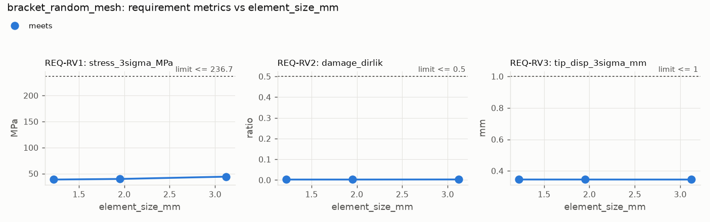
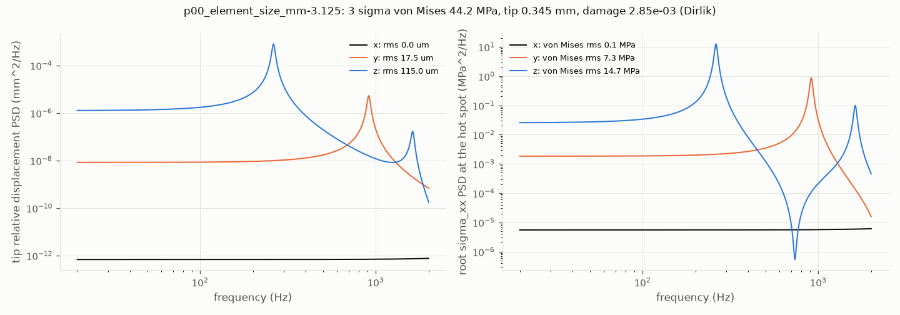
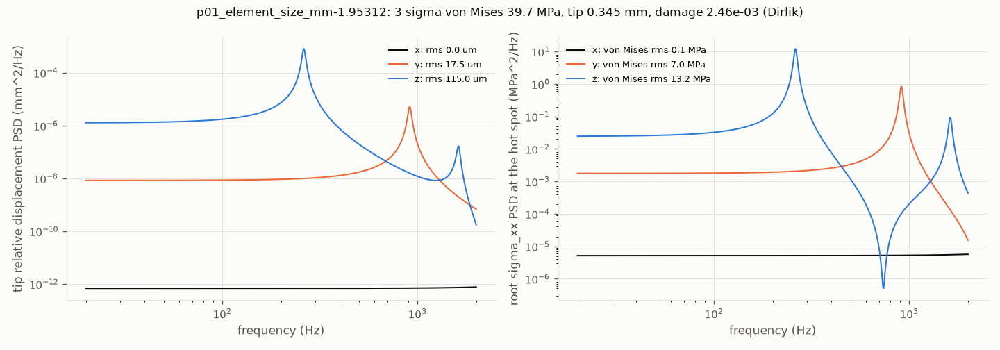
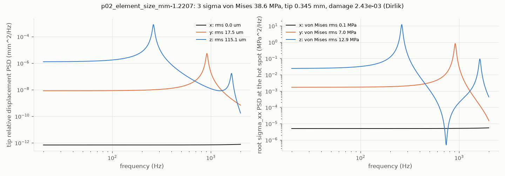

# Engineering review report: bracket_random_mesh

- **Run:** `20261123-100907_bracket_random_mesh`
- **Generated:** 2026-11-23T15:46:56+00:00
- **Case file SHA-256:** `86383af6a164a055cf2826762988a7f1cdf7ccea873f60dc4597fb1e83508ccc`
- **Environment:** Python 3.14.10, numpy 2.5.5, scipy 1.18.1, matplotlib 3.11.2, cadquery 2.8.0; Windows-11-10.0.26100-SP0
- **Tools:** cadquery 2.8.0; gmsh 4.15.0; CalculiX This is Version 2.22
- **Code version:** git `d72df070709503e2f6d4971d7202374f3adb1e2f`
- **Simulation status:** completed
- **Verification status:** PASS

## Scope

Study C: study 4's steel bracket arm (150 x 25 x 7 mm, clamped) under a flat 0.04 g^2/Hz base PSD from 20 to 2000 Hz, 1 h per axis, 2 % damping; CalculiX modes and modal stresses, modal superposition in Python; 3 sigma root stress (hot-spot), fatigue damage (Dirlik, EN 1993-1-9 detail 160) and tip displacement; quadratic-tetrahedron mesh 3.125 / 1.95 / 1.22 mm.

**Assumptions**

- Linear elastic steel (E 210 GPa, nu 0.3, 7850 kg/m^3); stationary Gaussian base acceleration, one axis at a time; zero mean stress.
- Rigid clamp over the whole root face (as study 4); 2 % modal damping on every mode (synthetic).
- Root stress by surface extrapolation from 0.4 t and 1.0 t (IIW hot-spot rule) applied to each mode; the clamp-corner nodal value is singular and not used.
- Fatigue on the root's axial stress (sigma_xx), the dominant component; Dirlik's range distribution; Miner's sum over the three axes.

## Requirements

| ID | Requirement | Metric | Limit |
|---|---|---|---|
| REQ-RV1 | The 3 sigma von Mises stress at the clamp (hot-spot) shall not exceed yield / 1.5 (355 / 1.5 = 236.7 MPa) on any axis. | `stress_3sigma_MPa` | <= 236.7 MPa |
| REQ-RV2 | The fatigue damage of the qualification (1 h per axis, three axes, Miner) shall not exceed 0.5 (Dirlik, EN 1993-1-9 detail 160). | `damage_dirlik` | <= 0.5 - |
| REQ-RV3 | The 3 sigma tip displacement relative to the base shall not exceed the 1.0 mm clearance (synthetic) on any axis. | `tip_disp_3sigma_mm` | <= 1 mm |

## Summary across points

| Point | element_size_mm | REQ-RV1 | REQ-RV2 | REQ-RV3 | Checks |
|---|---|---|---|---|---|
| p00_element_size_mm-3.125 | 3.125 | 44.17 MPa: **PASS** | 0.002851 -: **PASS** | 0.345 mm: **PASS** | 6/6 PASS |
| p01_element_size_mm-1.95312 | 1.953 | 39.75 MPa: **PASS** | 0.002462 -: **PASS** | 0.3451 mm: **PASS** | 6/6 PASS |
| p02_element_size_mm-1.2207 | 1.221 | 38.6 MPa: **PASS** | 0.002429 -: **PASS** | 0.3452 mm: **PASS** | 6/6 PASS |

## Run-level checks

Checks that use several points together (for example mesh convergence).

| Check | Description | Value | Tolerance | Status |
|---|---|---|---|---|
| discretization_stress_3sigma_MPa | relative discretization uncertainty of stress_3sigma_MPa, monotone (R = 0.260): GCI_fine, observed order 2.87, extrapolated 38.1988 | 0.013 | 0.05 | PASS |
| discretization_tip_disp_3sigma_mm | relative discretization uncertainty of tip_disp_3sigma_mm, monotone (R = 0.705): GCI_fine, observed order 0.74, extrapolated 0.345511 | 0.00099 | 0.05 | PASS |

## Point details

### p00_element_size_mm-3.125

Parameters: length_mm = 150, width_mm = 25, thickness_mm = 7, youngs_modulus_MPa = 2.1e+05, poisson_ratio = 0.3, density_t_per_mm3 = 7.85e-09, element_size_mm = 3.125, n_modes = 30, damping_ratio = 0.02, psd_g2_per_Hz = 0.04, f_low_Hz = 20, f_high_Hz = 2000, duration_per_axis_s = 3600, yield_MPa = 355, detail_category_MPa = 160, clearance_mm = 1

Derived: base_grms_g = 8.899, stress_limit_MPa = 236.7

| Requirement | Result | Limit | Margin | Verdict | Evidence |
|---|---|---|---|---|---|
| REQ-RV1 | 44.17 MPa | <= 236.7 | 193 | **PASS** | [point.json](points/p00_element_size_mm-3.125/point.json) |
| REQ-RV2 | 0.002851 - | <= 0.5 | 0.497 | **PASS** | [point.json](points/p00_element_size_mm-3.125/point.json) |
| REQ-RV3 | 0.345 mm | <= 1 | 0.655 | **PASS** | [point.json](points/p00_element_size_mm-3.125/point.json) |

| Check | Description | Value | Tolerance | Status |
|---|---|---|---|---|
| harmonic_vs_calculix | max over the 3 axes and CalculiX's frequencies of |modal sum - CalculiX harmonic tip displacement| / max |CalculiX| (modal sum with CalculiX's absolute damping and the base motion added) | 5.49e-07 | 1e-04 | PASS |
| miles_mode1 | |mode-1 tip rms integrated over the band / Miles' closed form - 1| | 9.87e-04 | 1e-02 | PASS |
| effective_mass | 1 - least effective-mass fraction over x, y, z (modes kept) | 6.72e-02 | 1e-01 | PASS |
| modes_cover_band | highest mode kept / (1.5 x the band's top frequency), must be >= 1 (reported as 1 / that) | 5.68e-02 | 1e+00 | PASS |
| psd_grid | max over axes of the change in tip rms and hot-spot von Mises rms when the frequency grid is doubled | 2.07e-04 | 1e-03 | PASS |
| root_stress_vs_beam | max of |surface-extrapolated root sigma_xx rms / beam M c / I - 1| on the top centre (z axis) and the side centre (y axis); M from the rotational participation factors (model form: the clamp's Poisson restraint, shear lag) | 7.55e-02 | 1e-01 | PASS |

### p01_element_size_mm-1.95312

Parameters: length_mm = 150, width_mm = 25, thickness_mm = 7, youngs_modulus_MPa = 2.1e+05, poisson_ratio = 0.3, density_t_per_mm3 = 7.85e-09, element_size_mm = 1.953, n_modes = 30, damping_ratio = 0.02, psd_g2_per_Hz = 0.04, f_low_Hz = 20, f_high_Hz = 2000, duration_per_axis_s = 3600, yield_MPa = 355, detail_category_MPa = 160, clearance_mm = 1

Derived: base_grms_g = 8.899, stress_limit_MPa = 236.7

| Requirement | Result | Limit | Margin | Verdict | Evidence |
|---|---|---|---|---|---|
| REQ-RV1 | 39.75 MPa | <= 236.7 | 197 | **PASS** | [point.json](points/p01_element_size_mm-1.95312/point.json) |
| REQ-RV2 | 0.002462 - | <= 0.5 | 0.498 | **PASS** | [point.json](points/p01_element_size_mm-1.95312/point.json) |
| REQ-RV3 | 0.3451 mm | <= 1 | 0.655 | **PASS** | [point.json](points/p01_element_size_mm-1.95312/point.json) |

| Check | Description | Value | Tolerance | Status |
|---|---|---|---|---|
| harmonic_vs_calculix | max over the 3 axes and CalculiX's frequencies of |modal sum - CalculiX harmonic tip displacement| / max |CalculiX| (modal sum with CalculiX's absolute damping and the base motion added) | 1.08e-06 | 1e-04 | PASS |
| miles_mode1 | |mode-1 tip rms integrated over the band / Miles' closed form - 1| | 9.85e-04 | 1e-02 | PASS |
| effective_mass | 1 - least effective-mass fraction over x, y, z (modes kept) | 6.85e-02 | 1e-01 | PASS |
| modes_cover_band | highest mode kept / (1.5 x the band's top frequency), must be >= 1 (reported as 1 / that) | 5.69e-02 | 1e+00 | PASS |
| psd_grid | max over axes of the change in tip rms and hot-spot von Mises rms when the frequency grid is doubled | 2.24e-04 | 1e-03 | PASS |
| root_stress_vs_beam | max of |surface-extrapolated root sigma_xx rms / beam M c / I - 1| on the top centre (z axis) and the side centre (y axis); M from the rotational participation factors (model form: the clamp's Poisson restraint, shear lag) | 5.16e-02 | 1e-01 | PASS |

### p02_element_size_mm-1.2207

Parameters: length_mm = 150, width_mm = 25, thickness_mm = 7, youngs_modulus_MPa = 2.1e+05, poisson_ratio = 0.3, density_t_per_mm3 = 7.85e-09, element_size_mm = 1.221, n_modes = 30, damping_ratio = 0.02, psd_g2_per_Hz = 0.04, f_low_Hz = 20, f_high_Hz = 2000, duration_per_axis_s = 3600, yield_MPa = 355, detail_category_MPa = 160, clearance_mm = 1

Derived: base_grms_g = 8.899, stress_limit_MPa = 236.7

| Requirement | Result | Limit | Margin | Verdict | Evidence |
|---|---|---|---|---|---|
| REQ-RV1 | 38.6 MPa | <= 236.7 | 198 | **PASS** | [point.json](points/p02_element_size_mm-1.2207/point.json) |
| REQ-RV2 | 0.002429 - | <= 0.5 | 0.498 | **PASS** | [point.json](points/p02_element_size_mm-1.2207/point.json) |
| REQ-RV3 | 0.3452 mm | <= 1 | 0.655 | **PASS** | [point.json](points/p02_element_size_mm-1.2207/point.json) |

| Check | Description | Value | Tolerance | Status |
|---|---|---|---|---|
| harmonic_vs_calculix | max over the 3 axes and CalculiX's frequencies of |modal sum - CalculiX harmonic tip displacement| / max |CalculiX| (modal sum with CalculiX's absolute damping and the base motion added) | 2.31e-07 | 1e-04 | PASS |
| miles_mode1 | |mode-1 tip rms integrated over the band / Miles' closed form - 1| | 9.85e-04 | 1e-02 | PASS |
| effective_mass | 1 - least effective-mass fraction over x, y, z (modes kept) | 6.92e-02 | 1e-01 | PASS |
| modes_cover_band | highest mode kept / (1.5 x the band's top frequency), must be >= 1 (reported as 1 / that) | 5.70e-02 | 1e+00 | PASS |
| psd_grid | max over axes of the change in tip rms and hot-spot von Mises rms when the frequency grid is doubled | 2.04e-04 | 1e-03 | PASS |
| root_stress_vs_beam | max of |surface-extrapolated root sigma_xx rms / beam M c / I - 1| on the top centre (z axis) and the side centre (y axis); M from the rotational participation factors (model form: the clamp's Poisson restraint, shear lag) | 5.08e-02 | 1e-01 | PASS |

## Limitations

- Synthetic excitation, damping, clearance and S-N detail; no attached component, no bolt-joint flexibility (it would lower the first mode, the main risk, as in study 4).
- No fretting at the clamp edge (the S-N detail is for plain rolled plate).
- A converged solver run that matches an analytical reference shows that the equations were solved correctly. It does not show that the equations represent real hardware.

## Engineering acceptance

Pending human review. This report does not accept or reject the design.
