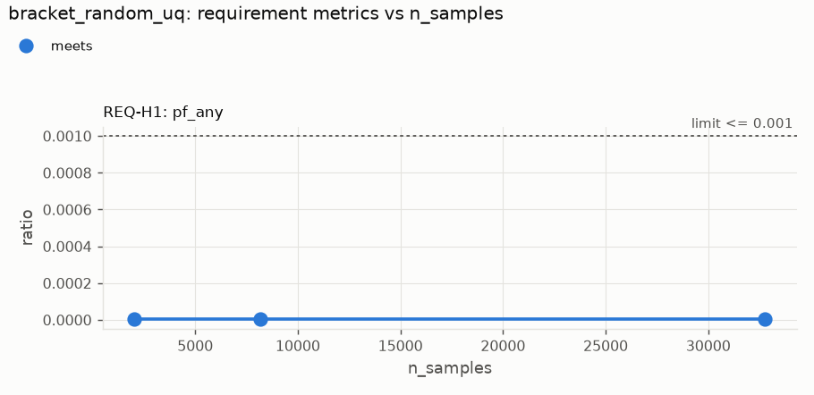
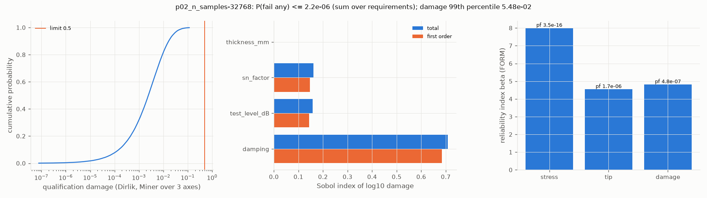

# Engineering review report: bracket_random_uq

- **Run:** `20261123-104847_bracket_random_uq`
- **Generated:** 2026-11-23T20:02:52+00:00
- **Case file SHA-256:** `206343c8923d0733b4f1806d335b3de3cf3b2ef22c26c18e04b1e531b08dc325`
- **Environment:** Python 3.14.10, numpy 2.5.5, scipy 1.18.1, matplotlib 3.11.2, cadquery 2.8.0; Windows-11-10.0.26100-SP0
- **Tools:** cadquery 2.8.0; gmsh 4.15.0; CalculiX This is Version 2.22
- **Code version:** git `5ca357489e010941f7cd36312cdc0b849079cabf` (uncommitted changes present)
- **Simulation status:** completed
- **Verification status:** PASS

## Scope

Study H: uncertainty on study C's random-vibration qualification of the bracket arm: damping, test level, S-N strength and plate thickness uncertain (synthetic); failure probability of each requirement (FORM, importance sampling, Monte Carlo) and Sobol indices; sample-size sweep 2048 / 8192 / 32768 on study C's 1.22 mm mesh.

**Assumptions**

- Study C's model and assumptions (linear elastic, rigid clamp, hot-spot extrapolation, Dirlik on sigma_xx, Miner over three axes).
- Inputs independent; distributions synthetic (approved framing): damping lognormal (median 2 %, 90 % in 1-4 %), test level uniform +-1.5 dB, S-N factor lognormal (median 1, CoV 10 %), thickness normal (7.0, sd 0.1 mm).
- The same damping on every mode (one random variable); thickness changes the whole arm uniformly.

## Requirements

| ID | Requirement | Metric | Limit |
|---|---|---|---|
| REQ-H1 | The probability of failing any of study C's requirements (REQ-RV1 stress, REQ-RV2 damage, REQ-RV3 tip clearance) under the stated input uncertainties shall not exceed 1e-3 (synthetic target). pf_any is the sum of the three importance-sampling estimates: an upper bound on the union. | `pf_any` | <= 0.001 - |

## Summary across points

| Point | n_samples | REQ-H1 | Checks |
|---|---|---|---|
| p00_n_samples-2048 | 2048 | 2.177e-06 -: **PASS** | 11/11 PASS |
| p01_n_samples-8192 | 8192 | 2.177e-06 -: **PASS** | 11/11 PASS |
| p02_n_samples-32768 | 3.277e+04 | 2.177e-06 -: **PASS** | 11/11 PASS |

## Run-level checks

Checks that use several points together (for example mesh convergence).

| Check | Description | Value | Tolerance | Status |
|---|---|---|---|---|
| sobol_ci_width | max half-width of the total-index 95 % intervals at p02_n_samples-32768 | 0.0119 | 0.03 | PASS |
| sobol_stable | max change of a total index from p01_n_samples-8192 to p02_n_samples-32768 | 0.0018 | 0.03 | PASS |

## Point details

### p00_n_samples-2048

Parameters: length_mm = 150, width_mm = 25, thickness_mm = 7, youngs_modulus_MPa = 2.1e+05, poisson_ratio = 0.3, density_t_per_mm3 = 7.85e-09, element_size_mm = 1.221, n_modes = 30, damping_ratio = 0.02, psd_g2_per_Hz = 0.04, f_low_Hz = 20, f_high_Hz = 2000, duration_per_axis_s = 3600, yield_MPa = 355, detail_category_MPa = 160, clearance_mm = 1, damping_sigma_ln = 0.4214, test_level_tolerance_dB = 1.5, sn_factor_cov = 0.1, thickness_sd_mm = 0.1, damage_limit = 0.5, n_samples = 2048, seed = 1

Derived: stress_limit_MPa = 236.7, n_model_calls = 1.229e+04

| Requirement | Result | Limit | Margin | Verdict | Evidence |
|---|---|---|---|---|---|
| REQ-H1 | 2.177e-06 - | <= 0.001 | 0.000998 | **PASS** | [point.json](points/p00_n_samples-2048/point.json) |

| Check | Description | Value | Tolerance | Status |
|---|---|---|---|---|
| fe_harmonic | max over the FE solves of study C's harmonic check (modal sum against CalculiX) | 1.04e-06 | 1e-04 | PASS |
| fe_effective_mass | 1 - least effective-mass fraction over x, y, z and the FE solves | 6.93e-02 | 1e-01 | PASS |
| nominal_reproduces_study_c | max |response from the saved basis / study C's own numbers - 1| over stress, tip and damage at the nominal point | 2.22e-16 | 1e-09 | PASS |
| surrogate_nominal | max |surrogate / direct - 1| over stress and tip at the nominal point (damping between grid nodes) | 2.51e-05 | 5e-03 | PASS |
| surrogate_offgrid_stress_tip | max |surrogate / direct - 1| over stress and tip at the check dampings, on the off-grid thickness and the nominal one | 1.10e-04 | 5e-03 | PASS |
| surrogate_offgrid_damage | max |surrogate / direct - 1| of the damage at the same points | 3.63e-04 | 3e-02 | PASS |
| dirlik_grid | |nominal damage with the sampling grid / with study C's 4000 points - 1| | 2.18e-03 | 1e-02 | PASS |
| form_vs_importance_sampling | max over the requirements of |ln(pf importance sampling / pf FORM)| | 5.77e-01 | 1e+00 | PASS |
| importance_sampling_cov | max coefficient of variation of the importance-sampling estimates | 2.57e-02 | 1e-01 | PASS |
| mc_vs_importance_sampling | importance-sampling estimate outside the Monte Carlo Wilson 95 % interval for any requirement (0 = inside for all) | 0.00e+00 | 0e+00 | PASS |
| design_points_in_range | design points outside the surrogate's damping and thickness range (count) | 0.00e+00 | 0e+00 | PASS |

### p01_n_samples-8192

Parameters: length_mm = 150, width_mm = 25, thickness_mm = 7, youngs_modulus_MPa = 2.1e+05, poisson_ratio = 0.3, density_t_per_mm3 = 7.85e-09, element_size_mm = 1.221, n_modes = 30, damping_ratio = 0.02, psd_g2_per_Hz = 0.04, f_low_Hz = 20, f_high_Hz = 2000, duration_per_axis_s = 3600, yield_MPa = 355, detail_category_MPa = 160, clearance_mm = 1, damping_sigma_ln = 0.4214, test_level_tolerance_dB = 1.5, sn_factor_cov = 0.1, thickness_sd_mm = 0.1, damage_limit = 0.5, n_samples = 8192, seed = 1

Derived: stress_limit_MPa = 236.7, n_model_calls = 4.915e+04

| Requirement | Result | Limit | Margin | Verdict | Evidence |
|---|---|---|---|---|---|
| REQ-H1 | 2.177e-06 - | <= 0.001 | 0.000998 | **PASS** | [point.json](points/p01_n_samples-8192/point.json) |

| Check | Description | Value | Tolerance | Status |
|---|---|---|---|---|
| fe_harmonic | max over the FE solves of study C's harmonic check (modal sum against CalculiX) | 1.04e-06 | 1e-04 | PASS |
| fe_effective_mass | 1 - least effective-mass fraction over x, y, z and the FE solves | 6.93e-02 | 1e-01 | PASS |
| nominal_reproduces_study_c | max |response from the saved basis / study C's own numbers - 1| over stress, tip and damage at the nominal point | 2.22e-16 | 1e-09 | PASS |
| surrogate_nominal | max |surrogate / direct - 1| over stress and tip at the nominal point (damping between grid nodes) | 2.51e-05 | 5e-03 | PASS |
| surrogate_offgrid_stress_tip | max |surrogate / direct - 1| over stress and tip at the check dampings, on the off-grid thickness and the nominal one | 1.10e-04 | 5e-03 | PASS |
| surrogate_offgrid_damage | max |surrogate / direct - 1| of the damage at the same points | 3.63e-04 | 3e-02 | PASS |
| dirlik_grid | |nominal damage with the sampling grid / with study C's 4000 points - 1| | 2.18e-03 | 1e-02 | PASS |
| form_vs_importance_sampling | max over the requirements of |ln(pf importance sampling / pf FORM)| | 5.77e-01 | 1e+00 | PASS |
| importance_sampling_cov | max coefficient of variation of the importance-sampling estimates | 2.57e-02 | 1e-01 | PASS |
| mc_vs_importance_sampling | importance-sampling estimate outside the Monte Carlo Wilson 95 % interval for any requirement (0 = inside for all) | 0.00e+00 | 0e+00 | PASS |
| design_points_in_range | design points outside the surrogate's damping and thickness range (count) | 0.00e+00 | 0e+00 | PASS |

### p02_n_samples-32768

Parameters: length_mm = 150, width_mm = 25, thickness_mm = 7, youngs_modulus_MPa = 2.1e+05, poisson_ratio = 0.3, density_t_per_mm3 = 7.85e-09, element_size_mm = 1.221, n_modes = 30, damping_ratio = 0.02, psd_g2_per_Hz = 0.04, f_low_Hz = 20, f_high_Hz = 2000, duration_per_axis_s = 3600, yield_MPa = 355, detail_category_MPa = 160, clearance_mm = 1, damping_sigma_ln = 0.4214, test_level_tolerance_dB = 1.5, sn_factor_cov = 0.1, thickness_sd_mm = 0.1, damage_limit = 0.5, n_samples = 3.277e+04, seed = 1

Derived: stress_limit_MPa = 236.7, n_model_calls = 1.966e+05

| Requirement | Result | Limit | Margin | Verdict | Evidence |
|---|---|---|---|---|---|
| REQ-H1 | 2.177e-06 - | <= 0.001 | 0.000998 | **PASS** | [point.json](points/p02_n_samples-32768/point.json) |

| Check | Description | Value | Tolerance | Status |
|---|---|---|---|---|
| fe_harmonic | max over the FE solves of study C's harmonic check (modal sum against CalculiX) | 1.04e-06 | 1e-04 | PASS |
| fe_effective_mass | 1 - least effective-mass fraction over x, y, z and the FE solves | 6.93e-02 | 1e-01 | PASS |
| nominal_reproduces_study_c | max |response from the saved basis / study C's own numbers - 1| over stress, tip and damage at the nominal point | 2.22e-16 | 1e-09 | PASS |
| surrogate_nominal | max |surrogate / direct - 1| over stress and tip at the nominal point (damping between grid nodes) | 2.51e-05 | 5e-03 | PASS |
| surrogate_offgrid_stress_tip | max |surrogate / direct - 1| over stress and tip at the check dampings, on the off-grid thickness and the nominal one | 1.10e-04 | 5e-03 | PASS |
| surrogate_offgrid_damage | max |surrogate / direct - 1| of the damage at the same points | 3.63e-04 | 3e-02 | PASS |
| dirlik_grid | |nominal damage with the sampling grid / with study C's 4000 points - 1| | 2.18e-03 | 1e-02 | PASS |
| form_vs_importance_sampling | max over the requirements of |ln(pf importance sampling / pf FORM)| | 5.77e-01 | 1e+00 | PASS |
| importance_sampling_cov | max coefficient of variation of the importance-sampling estimates | 2.57e-02 | 1e-01 | PASS |
| mc_vs_importance_sampling | importance-sampling estimate outside the Monte Carlo Wilson 95 % interval for any requirement (0 = inside for all) | 0.00e+00 | 0e+00 | PASS |
| design_points_in_range | design points outside the surrogate's damping and thickness range (count) | 0.00e+00 | 0e+00 | PASS |

## Limitations

- Synthetic input distributions: the answer is conditional on them; correlations (e.g. damping between modes) not modelled.
- Model-form uncertainty (clamp stiffness, the S-N detail itself) is outside this study; study C's mesh error (1.3 % on stress) is not sampled.
- pf_any is an upper bound (the sum over requirements, which are strongly correlated through damping).
- A converged solver run that matches an analytical reference shows that the equations were solved correctly. It does not show that the equations represent real hardware.

## Engineering acceptance

Pending human review. This report does not accept or reject the design.
