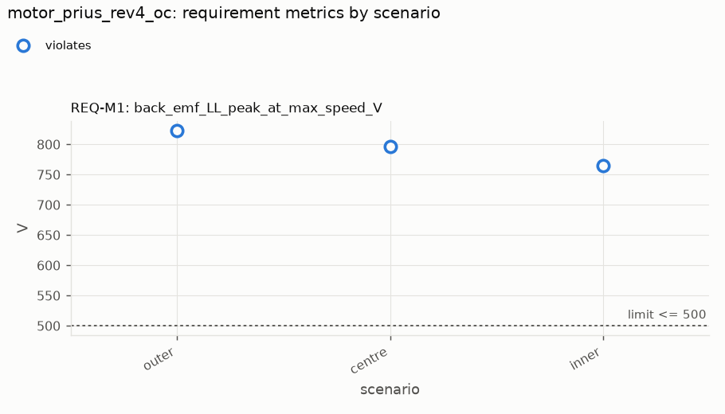
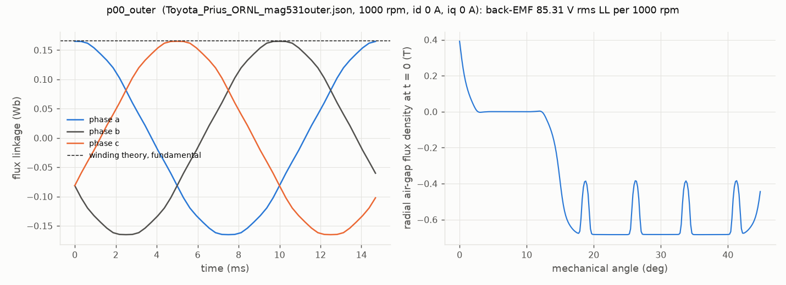
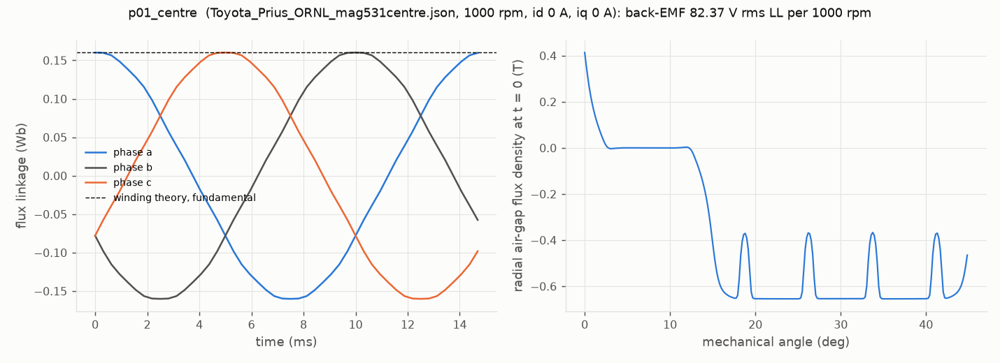
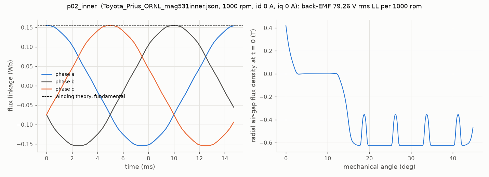

# Engineering review report: motor_prius_rev4_oc

- **Run:** `20261123-110021_motor_prius_rev4_oc`
- **Generated:** 2026-11-23T16:54:57+00:00
- **Case file SHA-256:** `8dc105405e0cae7e72d8219a8de753ccc456f4c902ace9d8a958c6b187817ac0`
- **Environment:** Python 3.14.10, numpy 2.5.5, scipy 1.18.1, matplotlib 3.11.2, cadquery 2.8.0; Windows-11-10.0.26100-SP0
- **Tools:** pyleecan 1.5.2; SciDataTool 2.5.0; numpy_pyleecan_env 2.5.5
- **Code version:** git `29ed9fd44aee6fd0de77f4ad50ad36a5ddec52b2`
- **Simulation status:** completed
- **Verification status:** PASS

## Scope

2004 Toyota Prius traction motor rebuilt from ORNL/TM-2005/33 Fig. 21 (radii, air gap 0.775 mm, slot, pocket thickness and position), ORNL/TM-2004/120 (bridge) and ORNL/TM-2004/137 Fig. 14 (magnet B-H line), laminations M330-35A (stand-in grade), at open circuit, 1000 rpm; Pyleecan + FEMM 4.2 magnetostatics over one electrical period (48 steps), mesh fineness 8; REVISION 4: the design magnet (TM-2004/120: 19.24 x 5.31 mm) in the drawn 6.80 mm pocket, measured remanence 1.243 T, placed outer / centre / inner; no calibration; back-EMF and the uncontrolled-generator voltage at top speed.

**Assumptions**

- 2D magnetostatics (FEMM), no end effects: the stack (83.8 mm) is long against the air gap (0.775 mm), but end-winding leakage and axial fringing are not modelled.
- Stator, rotor, slot and pocket thickness from ORNL/TM-2005/33 Fig. 21; bridge 1.45 mm from ORNL/TM-2004/120; magnet Br 1.243 T and recoil permeability 1.129 from ORNL/TM-2004/137 Fig. 14 (temperature not stated, taken as 20 C); magnet width and winding still Pyleecan's.
- Laminations M330-35A, a stand-in: ORNL gives the thickness (0.36 mm) but not the grade. B-H curve from Tata Steel's typical data (50 Hz) up to 1.8 T, extrapolated above (saturation polarization 2.0 T).
- Magnet temperature 20 C; Br falls about 0.1 %/K, so a hot motor has a lower back-EMF (stated, not modelled here).
- Maximum speed 6000 rpm, the commonly published rating for this motor; ORNL's design report tabulates ratings only up to base speed.

## Requirements

| ID | Requirement | Metric | Limit |
|---|---|---|---|
| REQ-M1 | With the inverter not switching (a fault at top speed), the line-to-line back-EMF peak at 6000 rpm shall not exceed the 500 V maximum bus voltage. | `back_emf_LL_peak_at_max_speed_V` | <= 500 V |

## Summary across points

| Point | scenario | REQ-M1 | Checks |
|---|---|---|---|
| p00_outer | outer | 822.5 V: **FAIL** | 5/5 PASS |
| p01_centre | centre | 796.3 V: **FAIL** | 5/5 PASS |
| p02_inner | inner | 764.5 V: **FAIL** | 5/5 PASS |

## Point details

### p00_outer

Parameters: machine = Toyota_Prius_ORNL_mag531outer.json, speed_rpm = 1000, id_A = 0, iq_A = 0, mesh_fineness = 8, steps_per_period = 48, angle_points = 2048, max_speed_rpm = 6000, bus_voltage_V = 500, rated_torque_Nm = 400, scenario = outer

Derived: speed_ratio_to_max = 6

| Requirement | Result | Limit | Margin | Verdict | Evidence |
|---|---|---|---|---|---|
| REQ-M1 | 822.5 V | <= 500 | -322 | **FAIL** | [point.json](points/p00_outer/point.json) |

| Check | Description | Value | Tolerance | Status |
|---|---|---|---|---|
| phase_symmetry | spread of the three phases' fundamental flux linkage / mean | 3.54e-05 | 1e-03 | PASS |
| phase_shift | max |phase shift between phases - 120 deg| (deg) | 1.02e-02 | 5e-01 | PASS |
| winding_theory | |2 N k_w1 B_1 R L / p from the air-gap field - FEMM coil flux linkage| / FEMM (model form: mid-gap sampling, slot openings, leakage) | 1.57e-03 | 2e-02 | PASS |
| open_circuit_torque | |mean torque at zero current| / rated torque (no net torque without current) | 9.76e-07 | 1e-03 | PASS |
| time_resolution (validity) | 48 / steps per electrical period (below 1: at least 48) | 1.00e+00 | 1e+00 | PASS |

### p01_centre

Parameters: machine = Toyota_Prius_ORNL_mag531centre.json, speed_rpm = 1000, id_A = 0, iq_A = 0, mesh_fineness = 8, steps_per_period = 48, angle_points = 2048, max_speed_rpm = 6000, bus_voltage_V = 500, rated_torque_Nm = 400, scenario = centre

Derived: speed_ratio_to_max = 6

| Requirement | Result | Limit | Margin | Verdict | Evidence |
|---|---|---|---|---|---|
| REQ-M1 | 796.3 V | <= 500 | -296 | **FAIL** | [point.json](points/p01_centre/point.json) |

| Check | Description | Value | Tolerance | Status |
|---|---|---|---|---|
| phase_symmetry | spread of the three phases' fundamental flux linkage / mean | 9.30e-05 | 1e-03 | PASS |
| phase_shift | max |phase shift between phases - 120 deg| (deg) | 1.44e-02 | 5e-01 | PASS |
| winding_theory | |2 N k_w1 B_1 R L / p from the air-gap field - FEMM coil flux linkage| / FEMM (model form: mid-gap sampling, slot openings, leakage) | 1.20e-03 | 2e-02 | PASS |
| open_circuit_torque | |mean torque at zero current| / rated torque (no net torque without current) | 5.66e-07 | 1e-03 | PASS |
| time_resolution (validity) | 48 / steps per electrical period (below 1: at least 48) | 1.00e+00 | 1e+00 | PASS |

### p02_inner

Parameters: machine = Toyota_Prius_ORNL_mag531inner.json, speed_rpm = 1000, id_A = 0, iq_A = 0, mesh_fineness = 8, steps_per_period = 48, angle_points = 2048, max_speed_rpm = 6000, bus_voltage_V = 500, rated_torque_Nm = 400, scenario = inner

Derived: speed_ratio_to_max = 6

| Requirement | Result | Limit | Margin | Verdict | Evidence |
|---|---|---|---|---|---|
| REQ-M1 | 764.5 V | <= 500 | -264 | **FAIL** | [point.json](points/p02_inner/point.json) |

| Check | Description | Value | Tolerance | Status |
|---|---|---|---|---|
| phase_symmetry | spread of the three phases' fundamental flux linkage / mean | 3.59e-05 | 1e-03 | PASS |
| phase_shift | max |phase shift between phases - 120 deg| (deg) | 3.82e-03 | 5e-01 | PASS |
| winding_theory | |2 N k_w1 B_1 R L / p from the air-gap field - FEMM coil flux linkage| / FEMM (model form: mid-gap sampling, slot openings, leakage) | 1.12e-03 | 2e-02 | PASS |
| open_circuit_torque | |mean torque at zero current| / rated torque (no net torque without current) | 4.64e-06 | 1e-03 | PASS |
| time_resolution (validity) | 48 / steps per electrical period (below 1: at least 48) | 1.00e+00 | 1e+00 | PASS |

## Limitations

- No test data in this case: the ORNL comparison is a separate, blind step.
- The magnet fills the pocket thickness (HoleM50); TM-2004/120 gives a thinner magnet (5.31 mm), not modelled.
- Line-to-line peak from the phase flux linkages with their harmonics; the inverter's own clamping is not modelled.
- The real lamination grade is unknown; the bracketing grades (M250-35A, a high-strength rotor grade) are separate cases.
- A converged solver run that matches an analytical reference shows that the equations were solved correctly. It does not show that the equations represent real hardware.

## Engineering acceptance

Pending human review. This report does not accept or reject the design.
