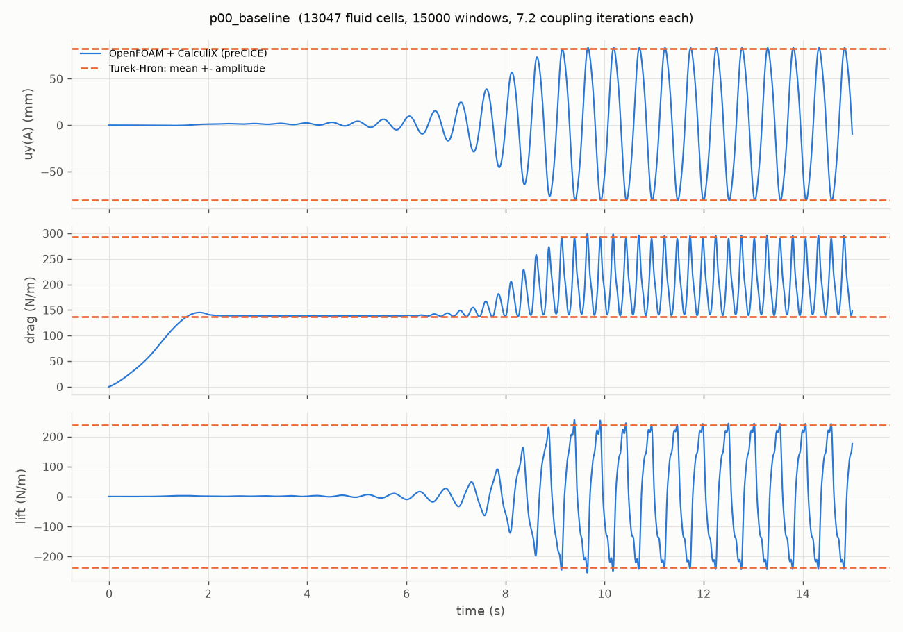

# Engineering review report: turek_hron_fsi2_mesh_b

- **Run:** `20261123-123352_turek_hron_fsi2_mesh_b`
- **Generated:** 2026-11-24T02:28:15+00:00
- **Case file SHA-256:** `2f4f026f20894f7b0e3d9eea59e88e930a8f9e17ff2bf143a094a51b84500f07`
- **Environment:** Python 3.14.10, numpy 2.5.5, scipy 1.18.1, matplotlib 3.11.2, cadquery 2.8.0; Windows-11-10.0.26100-SP0
- **Tools:** openfoam_bashrc /usr/lib/openfoam/openfoam2512/etc/bashrc; gmsh 4.15.0; openfoam_version v2512; openfoam_package openfoam2512 2512.0-2; precice 3.4.1; calculix_precice 2.20.2-1; linux Ubuntu 22.04.5 LTS
- **Code version:** git `8306afb11b72c345a31e8a44e2ac60d69fe35df2`
- **Simulation status:** completed
- **Verification status:** PASS

## Scope

Turek-Hron FSI2: self-excited periodic oscillation of the elastic flag behind the cylinder (Re 100, density ratio 10); OpenFOAM v2512 (moving mesh) coupled to CalculiX through preCICE; fluid 2.50 mm at the body (mesh study level b), solid 2.5 mm, dt 0.001 s to 15 s; mean, amplitude and frequency of the tip displacements, drag and lift over the last periods against the published benchmark.

**Assumptions**

- 2D: one cell deep in the fluid, plane strain in the solid (one element layer, as deep as the fluid).
- St. Venant-Kirchhoff solid (CalculiX *ELASTIC under NLGEOM), no gravity, as the FSI tests define it.
- No numerical damping in the solid (HHT alpha 0).
- Inflow: the benchmark's parabola with its (1 - cos) ramp over 2 s.
- Statistics from the last whole periods (benchmark definition); the oscillation is periodic (checked: last two periods).

## Requirements

| ID | Requirement | Metric | Limit |
|---|---|---|---|
| REQ-FSI2-1 | The coupled model shall reproduce the FSI2 amplitude of the tip's vertical displacement within 5 %. | `uy_A_amp_deviation_pct` | <= 5 % |
| REQ-FSI2-2 | It shall reproduce the FSI2 oscillation frequency (uy of point A) within 3 %. | `uy_A_freq_Hz_deviation_pct` | <= 3 % |
| REQ-FSI2-3 | It shall reproduce the FSI2 mean drag within 5 %. | `drag_mean_deviation_pct` | <= 5 % |
| REQ-FSI2-4 | It shall reproduce the FSI2 drag amplitude within 15 % (the benchmark's own levels spread 15 %). | `drag_amp_deviation_pct` | <= 15 % |
| REQ-FSI2-5 | It shall reproduce the FSI2 lift amplitude within 10 %. | `lift_amp_deviation_pct` | <= 10 % |
| REQ-FSI2-6 | It shall reproduce the FSI2 mean horizontal tip displacement within 10 % (second order, as in FSI1). | `ux_A_mean_deviation_pct` | <= 10 % |

## Summary across points

| Point | REQ-FSI2-1 | REQ-FSI2-2 | REQ-FSI2-3 | REQ-FSI2-4 | REQ-FSI2-5 | REQ-FSI2-6 | Checks |
|---|---|---|---|---|---|---|---|
| p00_baseline | 0.6628 %: **PASS** | 0.07689 %: **PASS** | 1.094 %: **PASS** | 0.444 %: **PASS** | 2.073 %: **PASS** | 1.104 %: **PASS** | 7/7 PASS |

## Point details

### p00_baseline

Parameters: solid_density_kg_per_m3 = 1e+04, shear_modulus_Pa = 5e+05, poisson_ratio = 0.4, fluid_density_kg_per_m3 = 1000, kinematic_viscosity_m2_per_s = 0.001, mean_velocity_m_per_s = 1, fluid_cell_size_m = 0.0025, solid_element_size_mm = 2.5, time_step_s = 0.001, end_time_s = 15, benchmark_ux_A_m = -0.01485, benchmark_uy_A_m = 0.0013, benchmark_drag_N_per_m = 215.1, benchmark_lift_N_per_m = 0.61, benchmark_ux_A_mean = -0.01485, benchmark_ux_A_amp = 0.0127, benchmark_ux_A_freq_Hz = 3.86, benchmark_uy_A_mean = 0.0013, benchmark_uy_A_amp = 0.0816, benchmark_uy_A_freq_Hz = 1.93, benchmark_drag_mean = 215.1, benchmark_drag_amp = 77.65, benchmark_drag_freq_Hz = 3.86, benchmark_lift_mean = 0.61, benchmark_lift_amp = 237.8, benchmark_lift_freq_Hz = 1.93

Derived: reynolds_D = 100, mass_ratio = 10

| Requirement | Result | Limit | Margin | Verdict | Evidence |
|---|---|---|---|---|---|
| REQ-FSI2-1 | 0.6628 % | <= 5 | 4.34 | **PASS** | [point.json](points/p00_baseline/point.json) |
| REQ-FSI2-2 | 0.07689 % | <= 3 | 2.92 | **PASS** | [point.json](points/p00_baseline/point.json) |
| REQ-FSI2-3 | 1.094 % | <= 5 | 3.91 | **PASS** | [point.json](points/p00_baseline/point.json) |
| REQ-FSI2-4 | 0.444 % | <= 15 | 14.6 | **PASS** | [point.json](points/p00_baseline/point.json) |
| REQ-FSI2-5 | 2.073 % | <= 10 | 7.93 | **PASS** | [point.json](points/p00_baseline/point.json) |
| REQ-FSI2-6 | 1.104 % | <= 10 | 8.9 | **PASS** | [point.json](points/p00_baseline/point.json) |

| Check | Description | Value | Tolerance | Status |
|---|---|---|---|---|
| mesh | checkMesh reports Mesh OK (1 = failed) | 0.00e+00 | 5e-01 | PASS |
| flag_cells | largest interior angle (deg) of the fluid cells touching the flag, at (0.3455, 0.2110) m (a cell wrapped around a tip corner reads near 180) | 1.23e+02 | 1e+02 | PASS |
| coupling_converged | coupling windows that hit the iteration limit without converging | 0.00e+00 | 5e-01 | PASS |
| periodic | periodic state: max of |uy(A) amplitude, last period - the one before| / amplitude and the same for the drag mean | 1.53e-04 | 2e-02 | PASS |
| force_transfer | force transfer per coupling window over 12.6612-14.7329 s: the larger of |force the solid receives - force the fluid writes| and |force the fluid writes - OpenFOAM's force on the flag|, each over the largest force in the window | 2.31e-09 | 1e-03 | PASS |
| inflow_profile | max over inlet faces |U - benchmark parabola| / (1.5 U_mean), after the ramp | 4.73e-10 | 1e-06 | PASS |
| laminar (validity) | Reynolds number (D) / 200 | 5.00e-01 | 1e+00 | PASS |

## Limitations

- One level of a three-level mesh study run as separate cases side by side (scripts/combine_mesh_levels.py applies the study's run-level check to the three runs).
- The fluid mesh is regenerated per size (FSI1: about +-0.5 % mesh-to-mesh scatter on the tip displacement).
- A converged solver run that matches an analytical reference shows that the equations were solved correctly. It does not show that the equations represent real hardware.

## Engineering acceptance

Pending human review. This report does not accept or reject the design.
