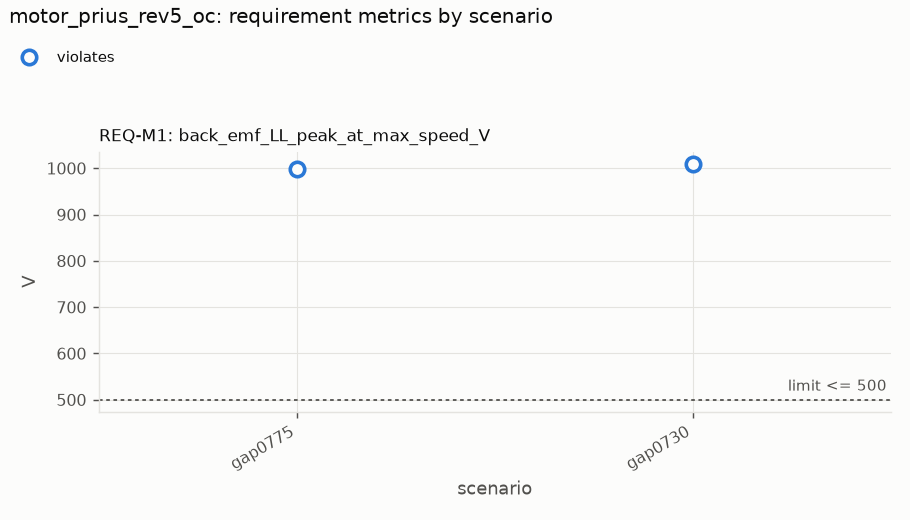
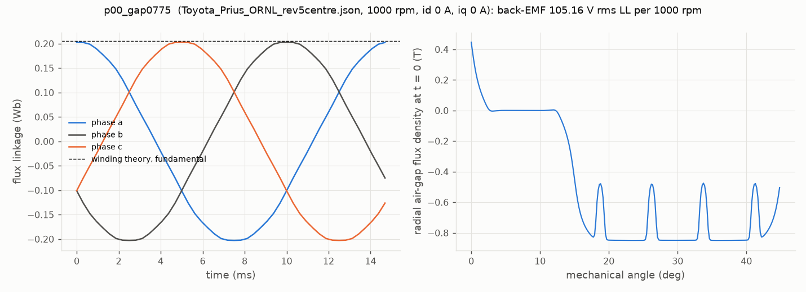
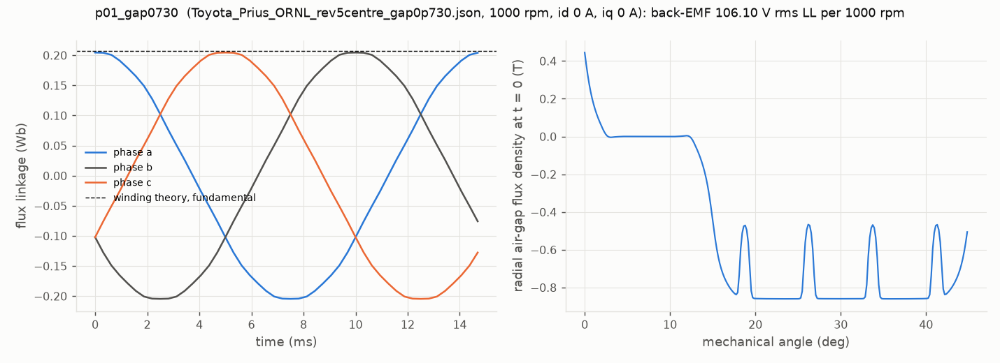

# Engineering review report: motor_prius_rev5_oc

- **Run:** `20261123-141642_motor_prius_rev5_oc`
- **Generated:** 2026-11-23T20:04:03+00:00
- **Case file SHA-256:** `5116dacabc6a16304f810738e80acb54495849cb9580605d2be7bc6e8c631777`
- **Environment:** Python 3.14.10, numpy 2.5.5, scipy 1.18.1, matplotlib 3.11.2, cadquery 2.8.0; Windows-11-10.0.26100-SP0
- **Tools:** pyleecan 1.5.2; SciDataTool 2.5.0; numpy_pyleecan_env 2.5.5
- **Code version:** git `507adaf0638d444407c98f72ab59594540373d4d`
- **Simulation status:** completed
- **Verification status:** PASS

## Scope

2004 Toyota Prius traction motor, REVISION 5 (client data): lamination geometry from ORNL/TM-2005/33 Fig. 21 (radii, slot, pocket thickness and position), bridge 1.45 mm (ORNL/TM-2004/120), magnet 83.1 x 18.9 x 6.5 mm centred in the 6.80 mm pocket (ORNL/TM-2010/253 Table 2.7), remanence 1.255 T at 20 C, -0.10 %/C (TM-2010/253 Fig. 2.72), magnet at 25 C, laminations M330-35A (stand-in grade), at open circuit, 1000 rpm; air gap 0.775 mm (drawing) and 0.730 mm (BOM); Pyleecan + FEMM 4.2 magnetostatics over one electrical period (48 steps), mesh fineness 8; no calibration.

**Assumptions**

- 2D magnetostatics (FEMM), no end effects: the stack (83.8 mm) is long against the air gap (0.73-0.775 mm), but end-winding leakage and axial fringing are not modelled. [model form]
- Lamination geometry from ORNL/TM-2005/33 Fig. 21 [client: drawing]; bridge 1.45 mm from ORNL/TM-2004/120 [design report]; stator geometry confirmed by the stator core mass, 19.05 kg (ORNL/TM-2010/253 Table 2.7) [client: BOM].
- Magnet 83.1 x 18.9 x 6.5 mm, 77 g (ORNL/TM-2010/253 Table 2.7) [client: BOM], centred in the 6.80 mm pocket: the 0.30 mm left is polymer moulding (ORNL/TM-2004/137 pp. 9-10), magnetically air. The 2D solve uses the stack length (83.82 mm), not the magnet's 83.1 mm (at most -0.9 % on magnet flux).
- Magnet remanence 1.255 T at 20 C, -0.10 %/C (ORNL/TM-2010/253 Fig. 2.72, hysteresisgraph of a 2004 Prius motor magnet) [client: material data]; recoil permeability 1.129 (ORNL/TM-2004/137 Fig. 14). Assumes the magnets in the rotor are magnetised to the hysteresisgraph's saturation [manufacturing: not known].
- Magnet temperature 25 C: ORNL's back-EMF test ran with oil at a nominal 25 C, near room temperature (ORNL/TM-2006/423 p. 21) [client: test conditions].
- Laminations M330-35A, a stand-in: thickness 0.33 mm (BOM) or 0.36 mm (teardown), grade not found; FEMM's magnetostatic solve reads only the B-H curve [assumption; three grades moved back-EMF 0.13 %].
- Winding 9 turns per coil, 8 coils in series per phase, one path, 13 x AWG 19 (ORNL/TM-2010/253 Table 2.7) [client: BOM].
- Maximum speed 6000 rpm (ORNL's back-EMF test range, ORNL/TM-2006/423 Table 3.3).

## Requirements

| ID | Requirement | Metric | Limit |
|---|---|---|---|
| REQ-M1 | With the inverter not switching (a fault at top speed), the line-to-line back-EMF peak at 6000 rpm shall not exceed the 500 V maximum bus voltage. | `back_emf_LL_peak_at_max_speed_V` | <= 500 V |

## Summary across points

| Point | scenario | REQ-M1 | Checks |
|---|---|---|---|
| p00_gap0775 | gap0775 | 998.5 V: **FAIL** | 5/5 PASS |
| p01_gap0730 | gap0730 | 1010 V: **FAIL** | 5/5 PASS |

## Point details

### p00_gap0775

Parameters: machine = Toyota_Prius_ORNL_rev5centre.json, speed_rpm = 1000, id_A = 0, iq_A = 0, mesh_fineness = 8, steps_per_period = 48, angle_points = 2048, max_speed_rpm = 6000, bus_voltage_V = 500, rated_torque_Nm = 400, magnet_temperature_C = 25, scenario = gap0775

Derived: speed_ratio_to_max = 6

| Requirement | Result | Limit | Margin | Verdict | Evidence |
|---|---|---|---|---|---|
| REQ-M1 | 998.5 V | <= 500 | -499 | **FAIL** | [point.json](points/p00_gap0775/point.json) |

| Check | Description | Value | Tolerance | Status |
|---|---|---|---|---|
| phase_symmetry | spread of the three phases' fundamental flux linkage / mean | 8.42e-05 | 1e-03 | PASS |
| phase_shift | max |phase shift between phases - 120 deg| (deg) | 1.56e-03 | 5e-01 | PASS |
| winding_theory | |2 N k_w1 B_1 R L / p from the air-gap field - FEMM coil flux linkage| / FEMM (model form: mid-gap sampling, slot openings, leakage) | 1.85e-03 | 2e-02 | PASS |
| open_circuit_torque | |mean torque at zero current| / rated torque (no net torque without current) | 1.38e-06 | 1e-03 | PASS |
| time_resolution (validity) | 48 / steps per electrical period (below 1: at least 48) | 1.00e+00 | 1e+00 | PASS |

### p01_gap0730

Parameters: machine = Toyota_Prius_ORNL_rev5centre_gap0p730.json, speed_rpm = 1000, id_A = 0, iq_A = 0, mesh_fineness = 8, steps_per_period = 48, angle_points = 2048, max_speed_rpm = 6000, bus_voltage_V = 500, rated_torque_Nm = 400, magnet_temperature_C = 25, scenario = gap0730

Derived: speed_ratio_to_max = 6

| Requirement | Result | Limit | Margin | Verdict | Evidence |
|---|---|---|---|---|---|
| REQ-M1 | 1010 V | <= 500 | -510 | **FAIL** | [point.json](points/p01_gap0730/point.json) |

| Check | Description | Value | Tolerance | Status |
|---|---|---|---|---|
| phase_symmetry | spread of the three phases' fundamental flux linkage / mean | 1.01e-04 | 1e-03 | PASS |
| phase_shift | max |phase shift between phases - 120 deg| (deg) | 8.60e-03 | 5e-01 | PASS |
| winding_theory | |2 N k_w1 B_1 R L / p from the air-gap field - FEMM coil flux linkage| / FEMM (model form: mid-gap sampling, slot openings, leakage) | 1.80e-03 | 2e-02 | PASS |
| open_circuit_torque | |mean torque at zero current| / rated torque (no net torque without current) | 1.24e-06 | 1e-03 | PASS |
| time_resolution (validity) | 48 / steps per electrical period (below 1: at least 48) | 1.00e+00 | 1e+00 | PASS |

## Limitations

- The back-EMF test (89.78 V full waveform per 1000 rpm, line to line) is the comparison, made in CALIBRATION_PLAN.md after the run.
- Line-to-line peak from the phase flux linkages with their harmonics; the inverter's own clamping is not modelled.
- Air-gap band only at the centred placement; the outer / inner placements of a 0.30 mm strip are estimated at +-1.5 % from revision 4's spread (7.6 % for a 1.49 mm strip), not run.
- A converged solver run that matches an analytical reference shows that the equations were solved correctly. It does not show that the equations represent real hardware.

## Engineering acceptance

Pending human review. This report does not accept or reject the design.
