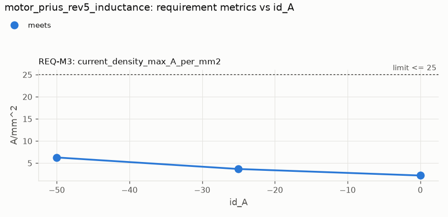
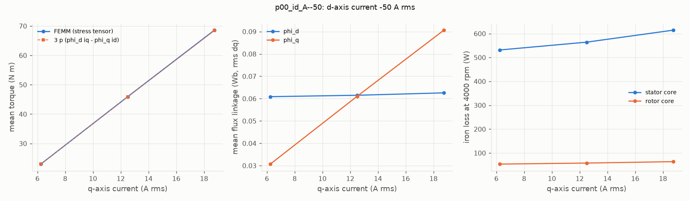
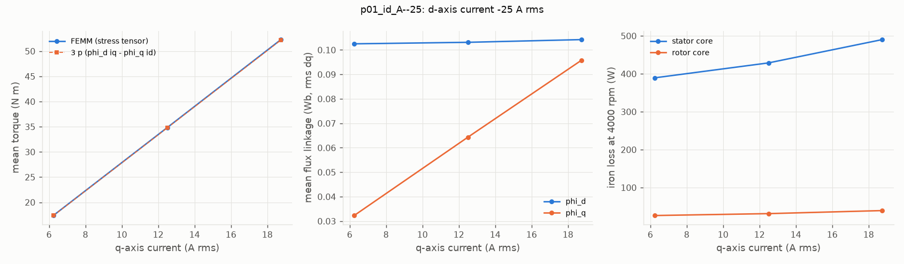
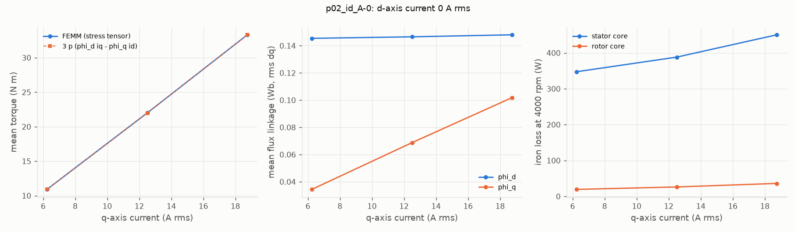

# Engineering review report: motor_prius_rev5_inductance

- **Run:** `20261123-150432_motor_prius_rev5_inductance`
- **Generated:** 2026-11-23T20:10:07+00:00
- **Case file SHA-256:** `0a27376016c96ebf1674f371f1f1d26ee95706f44ef0c47d97e90ec9b19b85ad`
- **Environment:** Python 3.14.10, numpy 2.5.5, scipy 1.18.1, matplotlib 3.11.2, cadquery 2.8.0; Windows-11-10.0.26100-SP0
- **Tools:** pyleecan 1.5.2; SciDataTool 2.5.0; numpy_pyleecan_env 2.5.5
- **Code version:** git `e2fcf1992d4cf3e5f0a3f4481bf1873aed96a7a0` (uncommitted changes present)
- **Simulation status:** completed
- **Verification status:** PASS

## Scope

2004 Toyota Prius traction motor, REVISION 5 (client-data machine: magnet 83.1 x 18.9 x 6.5 mm centred in the 6.80 mm pocket, 1.255 T at 20 C, magnets at 25 C, air gap 0.775 mm), small dq table for the static inductances: id 0 / -25 / -50 A rms, iq 6.25-18.75 A rms in 3 steps, 1000 rpm; Pyleecan + FEMM 4.2 magnetostatics over one electrical period (48 steps) with element fields; mesh fineness 2.

**Assumptions**

- 2D magnetostatics (FEMM), no end effects; torque is the mean of FEMM's stress-tensor torque over one electrical period.
- Iron loss from the element fields with the M330-35A three-term fit applied per harmonic; rotational fields counted as two orthogonal alternating ones; minor loops and DC bias not modelled.
- Core mass without the stacking factor (FEMM models the stack as solid steel, lam_fill 1).
- Magnet temperature 25 C (room temperature; MagFEMM T_mag; Br 1.255 T at 20 C falls 0.10 %/C, ORNL/TM-2010/253 Fig. 2.72) [client: material data; the static test's temperature is not stated].
- Copper 76.4 mm^2 per slot: 13 x AWG 19 (0.912 mm) per turn, 9 turns (ORNL/TM-2010/253 Table 2.7) [client: BOM].

## Requirements

| ID | Requirement | Metric | Limit |
|---|---|---|---|
| REQ-M3 | The column's operating points shall stay within the 25 A/mm^2 rms copper current-density limit (marks the grid points the motor can sustain for a short time). | `current_density_max_A_per_mm2` | <= 25 A/mm^2 |

## Summary across points

| Point | id_A | REQ-M3 | Checks |
|---|---|---|---|
| p00_id_A--50 | -50 | 6.288 A/mm^2: **PASS** | 5/5 PASS |
| p01_id_A--25 | -25 | 3.68 A/mm^2: **PASS** | 5/5 PASS |
| p02_id_A-0 | 0 | 2.208 A/mm^2: **PASS** | 5/5 PASS |

## Point details

### p00_id_A--50

Parameters: machine = Toyota_Prius_ORNL_rev5centre.json, speed_rpm = 1000, id_A = -50, iq_min_A = 6.25, iq_max_A = 18.75, iq_steps = 3, mesh_fineness = 2, steps_per_period = 48, angle_points = 2048, magnet_temperature_C = 25, iron_kh = 0.0202, iron_alpha = 1.791, iron_kc = 7.91e-05, iron_ke = 0.00037, slot_fill = 0.5345, slot_area_mm2 = 143, turns_per_slot = 9

Derived: current_rms_max_A = 53.4

| Requirement | Result | Limit | Margin | Verdict | Evidence |
|---|---|---|---|---|---|
| REQ-M3 | 6.288 A/mm^2 | <= 25 | 18.7 | **PASS** | [point.json](points/p00_id_A--50/point.json) |

| Check | Description | Value | Tolerance | Status |
|---|---|---|---|---|
| power_balance | max over q-axis currents (|T| >= 5 N m) of |mean(sum i dphi/dt) - mean torque x omega_m| / (mean torque x omega_m) | 1.82e-03 | 2e-02 | PASS |
| dq_torque | max over q-axis currents (|T| >= 5 N m) of |3 p (phi_d i_q - phi_q i_d) - FEMM torque| / FEMM torque: the mean dq flux linkages the efficiency map interpolates reproduce the torque (model form: harmonics are left out of the dq means) | 1.82e-03 | 5e-03 | PASS |
| current_amplitude | max |imposed phase current fundamental - sqrt(2) x requested rms| / peak | 3.90e-16 | 1e-03 | PASS |
| iron_coefficients_non_negative | min iron-loss coefficient over cores and currents (W), below 0 would be unphysical | -5.62e-04 | 0e+00 | PASS |
| time_resolution (validity) | 48 / steps per electrical period (below 1: at least 48) | 1.00e+00 | 1e+00 | PASS |

### p01_id_A--25

Parameters: machine = Toyota_Prius_ORNL_rev5centre.json, speed_rpm = 1000, id_A = -25, iq_min_A = 6.25, iq_max_A = 18.75, iq_steps = 3, mesh_fineness = 2, steps_per_period = 48, angle_points = 2048, magnet_temperature_C = 25, iron_kh = 0.0202, iron_alpha = 1.791, iron_kc = 7.91e-05, iron_ke = 0.00037, slot_fill = 0.5345, slot_area_mm2 = 143, turns_per_slot = 9

Derived: current_rms_max_A = 31.25

| Requirement | Result | Limit | Margin | Verdict | Evidence |
|---|---|---|---|---|---|
| REQ-M3 | 3.68 A/mm^2 | <= 25 | 21.3 | **PASS** | [point.json](points/p01_id_A--25/point.json) |

| Check | Description | Value | Tolerance | Status |
|---|---|---|---|---|
| power_balance | max over q-axis currents (|T| >= 5 N m) of |mean(sum i dphi/dt) - mean torque x omega_m| / (mean torque x omega_m) | 1.84e-03 | 2e-02 | PASS |
| dq_torque | max over q-axis currents (|T| >= 5 N m) of |3 p (phi_d i_q - phi_q i_d) - FEMM torque| / FEMM torque: the mean dq flux linkages the efficiency map interpolates reproduce the torque (model form: harmonics are left out of the dq means) | 1.84e-03 | 5e-03 | PASS |
| current_amplitude | max |imposed phase current fundamental - sqrt(2) x requested rms| / peak | 3.90e-16 | 1e-03 | PASS |
| iron_coefficients_non_negative | min iron-loss coefficient over cores and currents (W), below 0 would be unphysical | -2.70e-04 | 0e+00 | PASS |
| time_resolution (validity) | 48 / steps per electrical period (below 1: at least 48) | 1.00e+00 | 1e+00 | PASS |

### p02_id_A-0

Parameters: machine = Toyota_Prius_ORNL_rev5centre.json, speed_rpm = 1000, id_A = 0, iq_min_A = 6.25, iq_max_A = 18.75, iq_steps = 3, mesh_fineness = 2, steps_per_period = 48, angle_points = 2048, magnet_temperature_C = 25, iron_kh = 0.0202, iron_alpha = 1.791, iron_kc = 7.91e-05, iron_ke = 0.00037, slot_fill = 0.5345, slot_area_mm2 = 143, turns_per_slot = 9

Derived: current_rms_max_A = 18.75

| Requirement | Result | Limit | Margin | Verdict | Evidence |
|---|---|---|---|---|---|
| REQ-M3 | 2.208 A/mm^2 | <= 25 | 22.8 | **PASS** | [point.json](points/p02_id_A-0/point.json) |

| Check | Description | Value | Tolerance | Status |
|---|---|---|---|---|
| power_balance | max over q-axis currents (|T| >= 5 N m) of |mean(sum i dphi/dt) - mean torque x omega_m| / (mean torque x omega_m) | 1.59e-03 | 2e-02 | PASS |
| dq_torque | max over q-axis currents (|T| >= 5 N m) of |3 p (phi_d i_q - phi_q i_d) - FEMM torque| / FEMM torque: the mean dq flux linkages the efficiency map interpolates reproduce the torque (model form: harmonics are left out of the dq means) | 1.59e-03 | 5e-03 | PASS |
| current_amplitude | max |imposed phase current fundamental - sqrt(2) x requested rms| / peak | 2.68e-16 | 1e-03 | PASS |
| iron_coefficients_non_negative | min iron-loss coefficient over cores and currents (W), below 0 would be unphysical | -2.08e-04 | 0e+00 | PASS |
| time_resolution (validity) | 48 / steps per electrical period (below 1: at least 48) | 1.00e+00 | 1e+00 | PASS |

## Limitations

- The comparison with ORNL's static inductances is made in CALIBRATION_PLAN.md after the run; the static test's current is not stated, so low current is compared (rule agreed 2026-11-22).
- The loss fit covers 0.1-1.8 T at 50-2500 Hz; deep-saturation regions (tooth tips at load) extrapolate it.
- No magnet eddy-current loss, no AC copper loss (proximity, skin), no mechanical loss.
- A converged solver run that matches an analytical reference shows that the equations were solved correctly. It does not show that the equations represent real hardware.

## Engineering acceptance

Pending human review. This report does not accept or reject the design.
