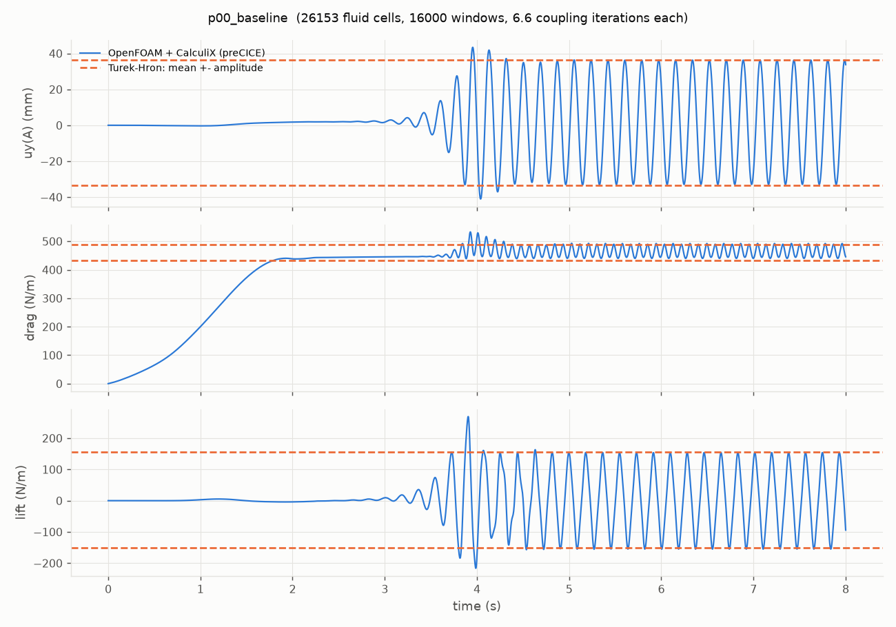

# Engineering review report: turek_hron_fsi3_mesh_c

- **Run:** `20261123-161128_turek_hron_fsi3_mesh_c`
- **Generated:** 2026-11-24T08:12:57+00:00
- **Case file SHA-256:** `b014abbfd2c222e55e89667f7681ed5edc49da9fd4efe7d87d8ede5b19f4abf2`
- **Environment:** Python 3.14.10, numpy 2.5.5, scipy 1.18.1, matplotlib 3.11.2, cadquery 2.8.0; Windows-11-10.0.26100-SP0
- **Tools:** openfoam_bashrc /usr/lib/openfoam/openfoam2512/etc/bashrc; gmsh 4.15.0; openfoam_version v2512; openfoam_package openfoam2512 2512.0-2; precice 3.4.1; calculix_precice 2.20.2-1; linux Ubuntu 22.04.5 LTS
- **Code version:** git `df688e8ffb670bbd3913205875e2c75180481729`
- **Simulation status:** completed
- **Verification status:** PASS

## Scope

Turek-Hron FSI3: self-excited periodic oscillation of the elastic flag behind the cylinder (Re 200, density ratio 1); OpenFOAM v2512 (moving mesh) coupled to CalculiX through preCICE; fluid 1.77 mm at the body (mesh study level c), solid 2.5 mm, dt 0.0005 s to 8 s; mean, amplitude and frequency of the tip displacements, drag and lift over the last periods against the published benchmark.

**Assumptions**

- 2D: one cell deep in the fluid, plane strain in the solid (one element layer, as deep as the fluid).
- St. Venant-Kirchhoff solid (CalculiX *ELASTIC under NLGEOM), no gravity, as the FSI tests define it.
- No numerical damping in the solid (HHT alpha 0).
- Inflow: the benchmark's parabola with its (1 - cos) ramp over 2 s.
- Statistics from the last whole periods (benchmark definition); the oscillation is periodic (checked: last two periods).

## Requirements

| ID | Requirement | Metric | Limit |
|---|---|---|---|
| REQ-FSI3-1 | The coupled model shall reproduce the FSI3 amplitude of the tip's vertical displacement within 5 %. | `uy_A_amp_deviation_pct` | <= 5 % |
| REQ-FSI3-2 | It shall reproduce the FSI3 oscillation frequency (uy of point A) within 3 %. | `uy_A_freq_Hz_deviation_pct` | <= 3 % |
| REQ-FSI3-3 | It shall reproduce the FSI3 mean drag within 5 %. | `drag_mean_deviation_pct` | <= 5 % |
| REQ-FSI3-4 | It shall reproduce the FSI3 drag amplitude within 25 % (the benchmark's own tables spread about 40 %). | `drag_amp_deviation_pct` | <= 25 % |
| REQ-FSI3-5 | It shall reproduce the FSI3 lift amplitude within 10 %. | `lift_amp_deviation_pct` | <= 10 % |
| REQ-FSI3-6 | It shall reproduce the FSI3 mean horizontal tip displacement within 15 % (second order; the benchmark spreads 12 %). | `ux_A_mean_deviation_pct` | <= 15 % |

## Summary across points

| Point | REQ-FSI3-1 | REQ-FSI3-2 | REQ-FSI3-3 | REQ-FSI3-4 | REQ-FSI3-5 | REQ-FSI3-6 | Checks |
|---|---|---|---|---|---|---|---|
| p00_baseline | 1.129 %: **PASS** | 0.08913 %: **PASS** | 1.196 %: **PASS** | 5.847 %: **PASS** | 0.2399 %: **PASS** | 0.639 %: **PASS** | 7/7 PASS |

## Point details

### p00_baseline

Parameters: solid_density_kg_per_m3 = 1000, shear_modulus_Pa = 2e+06, poisson_ratio = 0.4, fluid_density_kg_per_m3 = 1000, kinematic_viscosity_m2_per_s = 0.001, mean_velocity_m_per_s = 2, fluid_cell_size_m = 0.001768, solid_element_size_mm = 2.5, time_step_s = 0.0005, end_time_s = 8, benchmark_ux_A_m = -0.00288, benchmark_uy_A_m = 0.00147, benchmark_drag_N_per_m = 460.5, benchmark_lift_N_per_m = 2.5, benchmark_ux_A_mean = -0.00288, benchmark_ux_A_amp = 0.00272, benchmark_ux_A_freq_Hz = 10.93, benchmark_uy_A_mean = 0.00147, benchmark_uy_A_amp = 0.03499, benchmark_uy_A_freq_Hz = 5.46, benchmark_drag_mean = 460.5, benchmark_drag_amp = 27.74, benchmark_drag_freq_Hz = 10.93, benchmark_lift_mean = 2.5, benchmark_lift_amp = 153.9, benchmark_lift_freq_Hz = 5.46

Derived: reynolds_D = 200, mass_ratio = 1

| Requirement | Result | Limit | Margin | Verdict | Evidence |
|---|---|---|---|---|---|
| REQ-FSI3-1 | 1.129 % | <= 5 | 3.87 | **PASS** | [point.json](points/p00_baseline/point.json) |
| REQ-FSI3-2 | 0.08913 % | <= 3 | 2.91 | **PASS** | [point.json](points/p00_baseline/point.json) |
| REQ-FSI3-3 | 1.196 % | <= 5 | 3.8 | **PASS** | [point.json](points/p00_baseline/point.json) |
| REQ-FSI3-4 | 5.847 % | <= 25 | 19.2 | **PASS** | [point.json](points/p00_baseline/point.json) |
| REQ-FSI3-5 | 0.2399 % | <= 10 | 9.76 | **PASS** | [point.json](points/p00_baseline/point.json) |
| REQ-FSI3-6 | 0.639 % | <= 15 | 14.4 | **PASS** | [point.json](points/p00_baseline/point.json) |

| Check | Description | Value | Tolerance | Status |
|---|---|---|---|---|
| mesh | checkMesh reports Mesh OK (1 = failed) | 0.00e+00 | 5e-01 | PASS |
| flag_cells | largest interior angle (deg) of the fluid cells touching the flag, at (0.3616, 0.1891) m (a cell wrapped around a tip corner reads near 180) | 1.22e+02 | 1e+02 | PASS |
| coupling_converged | coupling windows that hit the iteration limit without converging | 0.00e+00 | 5e-01 | PASS |
| periodic | periodic state: max of |uy(A) amplitude, last period - the one before| / amplitude and the same for the drag mean | 9.36e-06 | 2e-02 | PASS |
| force_transfer | force transfer per coupling window over 7.21082-7.94435 s: the larger of |force the solid receives - force the fluid writes| and |force the fluid writes - OpenFOAM's force on the flag|, each over the largest force in the window | 3.05e-09 | 1e-03 | PASS |
| inflow_profile | max over inlet faces |U - benchmark parabola| / (1.5 U_mean), after the ramp | 5.16e-10 | 1e-06 | PASS |
| laminar (validity) | Reynolds number (D) / 200 | 1.00e+00 | 1e+00 | PASS |

## Limitations

- One level of a three-level mesh study run as separate cases side by side (scripts/combine_mesh_levels.py applies the study's run-level check to the three runs).
- The fluid mesh is regenerated per size (FSI1: about +-0.5 % mesh-to-mesh scatter on the tip displacement).
- A converged solver run that matches an analytical reference shows that the equations were solved correctly. It does not show that the equations represent real hardware.

## Engineering acceptance

Pending human review. This report does not accept or reject the design.
