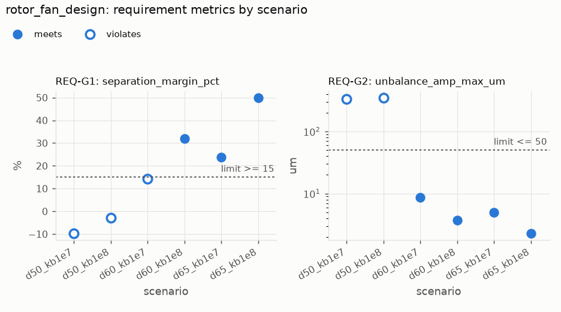
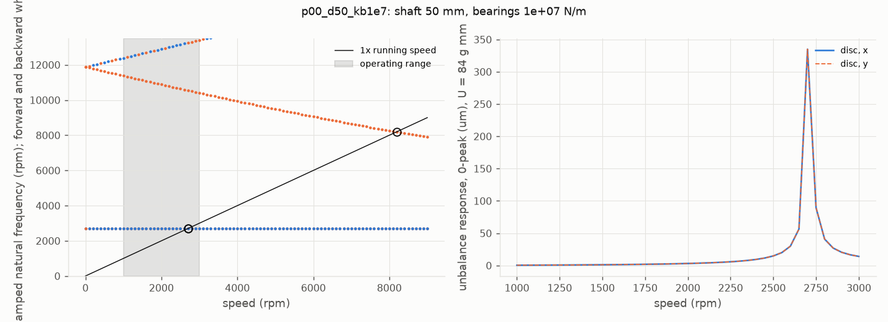
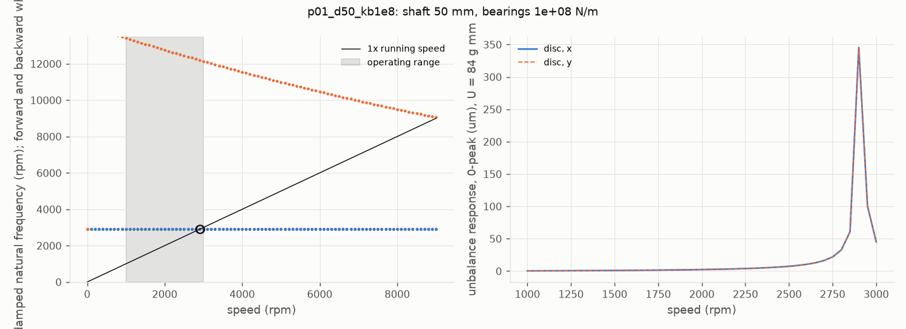
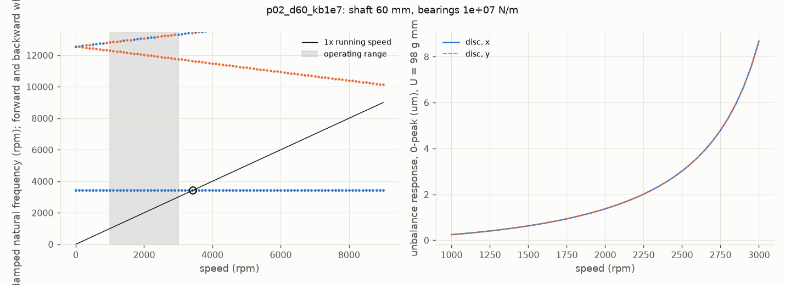
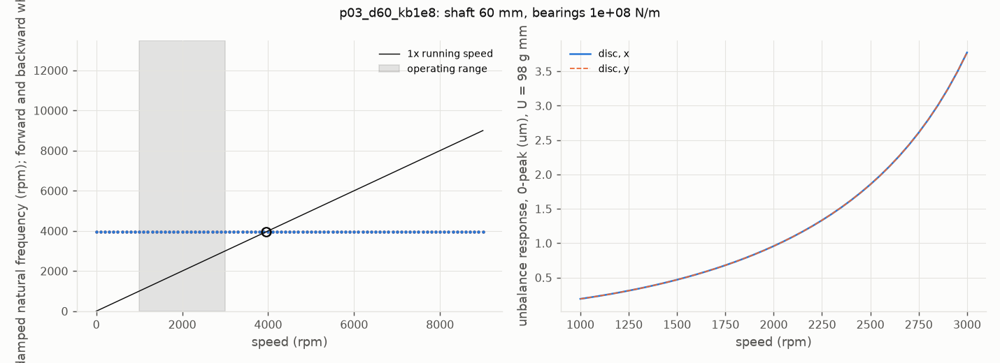
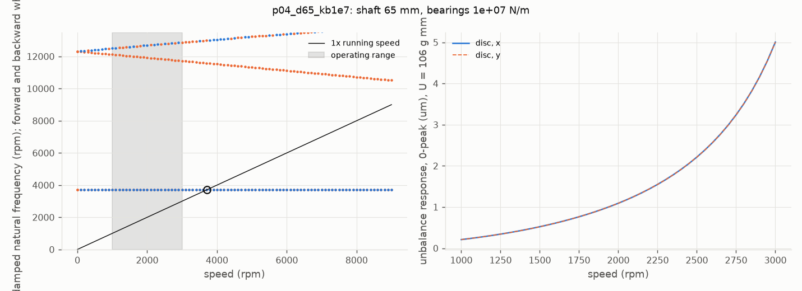
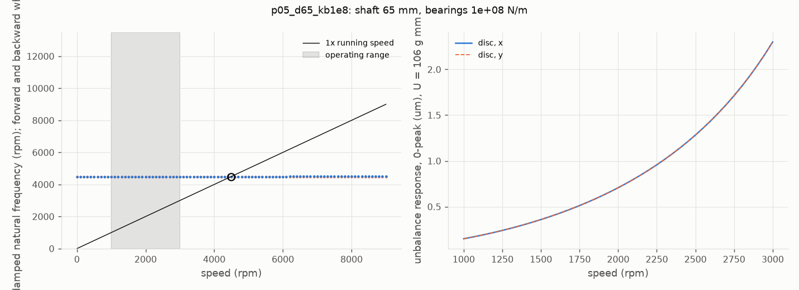

# Engineering review report: rotor_fan_design

- **Run:** `20261123-162721_rotor_fan_design`
- **Generated:** 2026-11-23T21:30:44+00:00
- **Case file SHA-256:** `59953b67c54b80bcdb7dc4c9e0ea0b021ab092f173825ebad01f427acc60d3d2`
- **Environment:** Python 3.14.10, numpy 2.5.5, scipy 1.18.1, matplotlib 3.11.2, cadquery 2.8.0; Windows-11-10.0.26100-SP0
- **Tools:** ross ERROR:; numpy_ross_env Could; scipy_ross_env not
- **Code version:** git `a8a0736a398f30c42d1a0fd21bf0bab41fbe8dac` (uncommitted changes present)
- **Simulation status:** completed
- **Verification status:** PASS

## Scope

Fan rotor critical speeds and unbalance response: steel shaft 50 / 60 / 65 mm, bearing span 1.0 m, 400 x 25 mm steel impeller at mid-span, bearings 1e7 and 1e8 N/m, operating range 1000-3000 rpm; ROSS 3.1 Timoshenko rotor, Campbell diagram to 9000 rpm, critical speeds as the 1x crossings, unbalance response with API 684's unbalance.

**Assumptions**

- Solid steel shaft (E 205 GPa, density 7850 kg/m^3, Poisson 0.29), Timoshenko elements with rotary inertia and gyroscopic terms; the impeller a rigid steel disc 400 x 25 mm bored to the shaft, at mid-span. [synthetic geometry]
- Two equal linear isotropic bearings at the shaft ends, stiffness 1e7-1e8 N/m (rolling bearings on pedestals: the band covers the unknown pedestal), damping 500 N s/m each. [synthetic]
- No aerodynamic cross-coupling, no foundation mass, no seal forces; the impeller's overhang and blades are lumped in the disc.
- API 684-style unbalance U = 6350 W / N_max g mm with W the rotor mass (kg), N_max 3000 rpm, at the disc.

## Requirements

| ID | Requirement | Metric | Limit |
|---|---|---|---|
| REQ-G1 | Every forward critical speed shall lie at least 15 % outside the 1000-3000 rpm operating range (none in 850-3450 rpm; API 684-style separation margin, simplified to a fixed 15 %). | `separation_margin_pct` | >= 15 % |
| REQ-G2 | The impeller's unbalance response (0-peak) shall stay at or below 50 um over the operating range with API 684's unbalance, U = 6350 W / N_max g mm. | `unbalance_amp_max_um` | <= 50 um |

## Summary across points

| Point | scenario | REQ-G1 | REQ-G2 | Checks |
|---|---|---|---|---|
| p00_d50_kb1e7 | d50_kb1e7 | -9.666 %: **FAIL** | 334.9 um: **FAIL** | 5/5 PASS |
| p01_d50_kb1e8 | d50_kb1e8 | -2.965 %: **FAIL** | 345.2 um: **FAIL** | 5/5 PASS |
| p02_d60_kb1e7 | d60_kb1e7 | 14.3 %: **FAIL** | 8.67 um: **PASS** | 5/5 PASS |
| p03_d60_kb1e8 | d60_kb1e8 | 31.89 %: **PASS** | 3.773 um: **PASS** | 5/5 PASS |
| p04_d65_kb1e7 | d65_kb1e7 | 23.81 %: **PASS** | 5.004 um: **PASS** | 5/5 PASS |
| p05_d65_kb1e8 | d65_kb1e8 | 49.82 %: **PASS** | 2.3 um: **PASS** | 5/5 PASS |

## Point details

### p00_d50_kb1e7

Parameters: density_kg_per_m3 = 7850, youngs_modulus_Pa = 2.05e+11, poisson_ratio = 0.29, n_elements = 20, bearing_span_m = 1, shaft_diameter_m = 0.05, disc_width_m = 0.025, disc_diameter_m = 0.4, bearing_stiffness_N_per_m = 1e+07, bearing_damping_Ns_per_m = 500, speed_min_rpm = 1000, speed_max_rpm = 3000, campbell_max_rpm = 9000, campbell_points = 91, modes = 6, response_points = 41, scenario = d50_kb1e7

| Requirement | Result | Limit | Margin | Verdict | Evidence |
|---|---|---|---|---|---|
| REQ-G1 | -9.666 % | >= 15 | -24.7 | **FAIL** | [point.json](points/p00_d50_kb1e7/point.json) |
| REQ-G2 | 334.9 um | <= 50 | -285 | **FAIL** | [point.json](points/p00_d50_kb1e7/point.json) |

| Check | Description | Value | Tolerance | Status |
|---|---|---|---|---|
| jeffcott | Jeffcott rotor (massless shaft, rigid supports, central disc): |ROSS - sqrt(48 EI / m L^3)| / closed form (model form: shear deformation, the disc's width) | 2.72e-03 | 1e-02 | PASS |
| series_bearings | Jeffcott rotor on the case's bearings: |ROSS - closed form with the shaft and two bearings as springs in series| / closed form | 2.36e-03 | 1e-02 | PASS |
| bare_shaft | bare shaft on rigid supports, first bending: |ROSS (Timoshenko) - Euler-Bernoulli pinned-pinned| / Euler-Bernoulli | 3.00e-03 | 1e-02 | PASS |
| critical_crosscheck | |first forward 1x crossing of the Campbell diagram - ROSS's own critical speed search| / ROSS's | 5.64e-07 | 1e-02 | PASS |
| campbell_resolution (validity) | Campbell speed step / first forward critical speed (below the tolerance: the crossing is resolved) | 3.69e-02 | 5e-02 | PASS |

### p01_d50_kb1e8

Parameters: density_kg_per_m3 = 7850, youngs_modulus_Pa = 2.05e+11, poisson_ratio = 0.29, n_elements = 20, bearing_span_m = 1, shaft_diameter_m = 0.05, disc_width_m = 0.025, disc_diameter_m = 0.4, bearing_stiffness_N_per_m = 1e+08, bearing_damping_Ns_per_m = 500, speed_min_rpm = 1000, speed_max_rpm = 3000, campbell_max_rpm = 9000, campbell_points = 91, modes = 6, response_points = 41, scenario = d50_kb1e8

| Requirement | Result | Limit | Margin | Verdict | Evidence |
|---|---|---|---|---|---|
| REQ-G1 | -2.965 % | >= 15 | -18 | **FAIL** | [point.json](points/p01_d50_kb1e8/point.json) |
| REQ-G2 | 345.2 um | <= 50 | -295 | **FAIL** | [point.json](points/p01_d50_kb1e8/point.json) |

| Check | Description | Value | Tolerance | Status |
|---|---|---|---|---|
| jeffcott | Jeffcott rotor (massless shaft, rigid supports, central disc): |ROSS - sqrt(48 EI / m L^3)| / closed form (model form: shear deformation, the disc's width) | 2.72e-03 | 1e-02 | PASS |
| series_bearings | Jeffcott rotor on the case's bearings: |ROSS - closed form with the shaft and two bearings as springs in series| / closed form | 2.68e-03 | 1e-02 | PASS |
| bare_shaft | bare shaft on rigid supports, first bending: |ROSS (Timoshenko) - Euler-Bernoulli pinned-pinned| / Euler-Bernoulli | 3.00e-03 | 1e-02 | PASS |
| critical_crosscheck | |first forward 1x crossing of the Campbell diagram - ROSS's own critical speed search| / ROSS's | 7.78e-11 | 1e-02 | PASS |
| campbell_resolution (validity) | Campbell speed step / first forward critical speed (below the tolerance: the crossing is resolved) | 3.44e-02 | 5e-02 | PASS |

### p02_d60_kb1e7

Parameters: density_kg_per_m3 = 7850, youngs_modulus_Pa = 2.05e+11, poisson_ratio = 0.29, n_elements = 20, bearing_span_m = 1, shaft_diameter_m = 0.06, disc_width_m = 0.025, disc_diameter_m = 0.4, bearing_stiffness_N_per_m = 1e+07, bearing_damping_Ns_per_m = 500, speed_min_rpm = 1000, speed_max_rpm = 3000, campbell_max_rpm = 9000, campbell_points = 91, modes = 6, response_points = 41, scenario = d60_kb1e7

| Requirement | Result | Limit | Margin | Verdict | Evidence |
|---|---|---|---|---|---|
| REQ-G1 | 14.3 % | >= 15 | -0.696 | **FAIL** | [point.json](points/p02_d60_kb1e7/point.json) |
| REQ-G2 | 8.67 um | <= 50 | 41.3 | **PASS** | [point.json](points/p02_d60_kb1e7/point.json) |

| Check | Description | Value | Tolerance | Status |
|---|---|---|---|---|
| jeffcott | Jeffcott rotor (massless shaft, rigid supports, central disc): |ROSS - sqrt(48 EI / m L^3)| / closed form (model form: shear deformation, the disc's width) | 3.91e-03 | 1e-02 | PASS |
| series_bearings | Jeffcott rotor on the case's bearings: |ROSS - closed form with the shaft and two bearings as springs in series| / closed form | 2.98e-03 | 1e-02 | PASS |
| bare_shaft | bare shaft on rigid supports, first bending: |ROSS (Timoshenko) - Euler-Bernoulli pinned-pinned| / Euler-Bernoulli | 4.30e-03 | 1e-02 | PASS |
| critical_crosscheck | |first forward 1x crossing of the Campbell diagram - ROSS's own critical speed search| / ROSS's | 3.21e-06 | 1e-02 | PASS |
| campbell_resolution (validity) | Campbell speed step / first forward critical speed (below the tolerance: the crossing is resolved) | 2.92e-02 | 5e-02 | PASS |

### p03_d60_kb1e8

Parameters: density_kg_per_m3 = 7850, youngs_modulus_Pa = 2.05e+11, poisson_ratio = 0.29, n_elements = 20, bearing_span_m = 1, shaft_diameter_m = 0.06, disc_width_m = 0.025, disc_diameter_m = 0.4, bearing_stiffness_N_per_m = 1e+08, bearing_damping_Ns_per_m = 500, speed_min_rpm = 1000, speed_max_rpm = 3000, campbell_max_rpm = 9000, campbell_points = 91, modes = 6, response_points = 41, scenario = d60_kb1e8

| Requirement | Result | Limit | Margin | Verdict | Evidence |
|---|---|---|---|---|---|
| REQ-G1 | 31.89 % | >= 15 | 16.9 | **PASS** | [point.json](points/p03_d60_kb1e8/point.json) |
| REQ-G2 | 3.773 um | <= 50 | 46.2 | **PASS** | [point.json](points/p03_d60_kb1e8/point.json) |

| Check | Description | Value | Tolerance | Status |
|---|---|---|---|---|
| jeffcott | Jeffcott rotor (massless shaft, rigid supports, central disc): |ROSS - sqrt(48 EI / m L^3)| / closed form (model form: shear deformation, the disc's width) | 3.91e-03 | 1e-02 | PASS |
| series_bearings | Jeffcott rotor on the case's bearings: |ROSS - closed form with the shaft and two bearings as springs in series| / closed form | 3.79e-03 | 1e-02 | PASS |
| bare_shaft | bare shaft on rigid supports, first bending: |ROSS (Timoshenko) - Euler-Bernoulli pinned-pinned| / Euler-Bernoulli | 4.30e-03 | 1e-02 | PASS |
| critical_crosscheck | |first forward 1x crossing of the Campbell diagram - ROSS's own critical speed search| / ROSS's | 6.58e-10 | 1e-02 | PASS |
| campbell_resolution (validity) | Campbell speed step / first forward critical speed (below the tolerance: the crossing is resolved) | 2.53e-02 | 5e-02 | PASS |

### p04_d65_kb1e7

Parameters: density_kg_per_m3 = 7850, youngs_modulus_Pa = 2.05e+11, poisson_ratio = 0.29, n_elements = 20, bearing_span_m = 1, shaft_diameter_m = 0.065, disc_width_m = 0.025, disc_diameter_m = 0.4, bearing_stiffness_N_per_m = 1e+07, bearing_damping_Ns_per_m = 500, speed_min_rpm = 1000, speed_max_rpm = 3000, campbell_max_rpm = 9000, campbell_points = 91, modes = 6, response_points = 41, scenario = d65_kb1e7

| Requirement | Result | Limit | Margin | Verdict | Evidence |
|---|---|---|---|---|---|
| REQ-G1 | 23.81 % | >= 15 | 8.81 | **PASS** | [point.json](points/p04_d65_kb1e7/point.json) |
| REQ-G2 | 5.004 um | <= 50 | 45 | **PASS** | [point.json](points/p04_d65_kb1e7/point.json) |

| Check | Description | Value | Tolerance | Status |
|---|---|---|---|---|
| jeffcott | Jeffcott rotor (massless shaft, rigid supports, central disc): |ROSS - sqrt(48 EI / m L^3)| / closed form (model form: shear deformation, the disc's width) | 4.58e-03 | 1e-02 | PASS |
| series_bearings | Jeffcott rotor on the case's bearings: |ROSS - closed form with the shaft and two bearings as springs in series| / closed form | 3.21e-03 | 1e-02 | PASS |
| bare_shaft | bare shaft on rigid supports, first bending: |ROSS (Timoshenko) - Euler-Bernoulli pinned-pinned| / Euler-Bernoulli | 5.04e-03 | 1e-02 | PASS |
| critical_crosscheck | |first forward 1x crossing of the Campbell diagram - ROSS's own critical speed search| / ROSS's | 6.15e-06 | 1e-02 | PASS |
| campbell_resolution (validity) | Campbell speed step / first forward critical speed (below the tolerance: the crossing is resolved) | 2.69e-02 | 5e-02 | PASS |

### p05_d65_kb1e8

Parameters: density_kg_per_m3 = 7850, youngs_modulus_Pa = 2.05e+11, poisson_ratio = 0.29, n_elements = 20, bearing_span_m = 1, shaft_diameter_m = 0.065, disc_width_m = 0.025, disc_diameter_m = 0.4, bearing_stiffness_N_per_m = 1e+08, bearing_damping_Ns_per_m = 500, speed_min_rpm = 1000, speed_max_rpm = 3000, campbell_max_rpm = 9000, campbell_points = 91, modes = 6, response_points = 41, scenario = d65_kb1e8

| Requirement | Result | Limit | Margin | Verdict | Evidence |
|---|---|---|---|---|---|
| REQ-G1 | 49.82 % | >= 15 | 34.8 | **PASS** | [point.json](points/p05_d65_kb1e8/point.json) |
| REQ-G2 | 2.3 um | <= 50 | 47.7 | **PASS** | [point.json](points/p05_d65_kb1e8/point.json) |

| Check | Description | Value | Tolerance | Status |
|---|---|---|---|---|
| jeffcott | Jeffcott rotor (massless shaft, rigid supports, central disc): |ROSS - sqrt(48 EI / m L^3)| / closed form (model form: shear deformation, the disc's width) | 4.58e-03 | 1e-02 | PASS |
| series_bearings | Jeffcott rotor on the case's bearings: |ROSS - closed form with the shaft and two bearings as springs in series| / closed form | 4.40e-03 | 1e-02 | PASS |
| bare_shaft | bare shaft on rigid supports, first bending: |ROSS (Timoshenko) - Euler-Bernoulli pinned-pinned| / Euler-Bernoulli | 5.04e-03 | 1e-02 | PASS |
| critical_crosscheck | |first forward 1x crossing of the Campbell diagram - ROSS's own critical speed search| / ROSS's | 1.71e-09 | 1e-02 | PASS |
| campbell_resolution (validity) | Campbell speed step / first forward critical speed (below the tolerance: the crossing is resolved) | 2.22e-02 | 5e-02 | PASS |

## Limitations

- Separation margin simplified to a fixed 15 %; API 684 sets it from each mode's amplification factor.
- Linear bearings: a rolling bearing's stiffness rises with load and speed; the band is meant to cover that.
- A converged solver run that matches an analytical reference shows that the equations were solved correctly. It does not show that the equations represent real hardware.

## Engineering acceptance

Pending human review. This report does not accept or reject the design.
