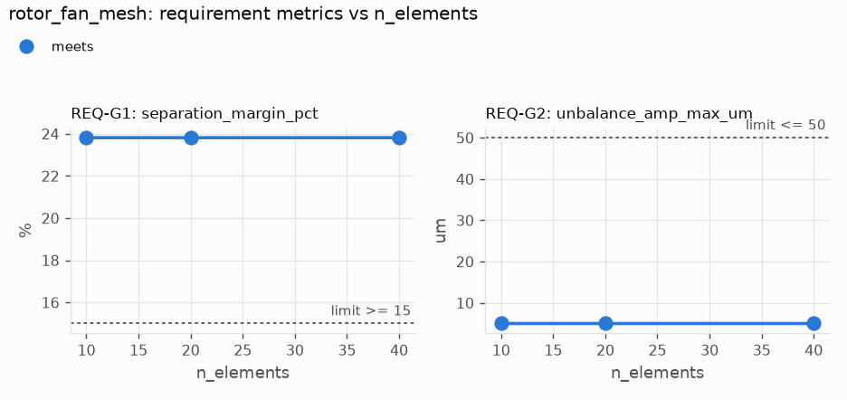
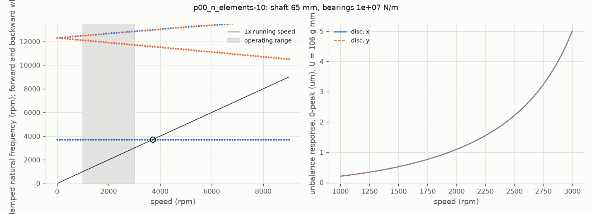
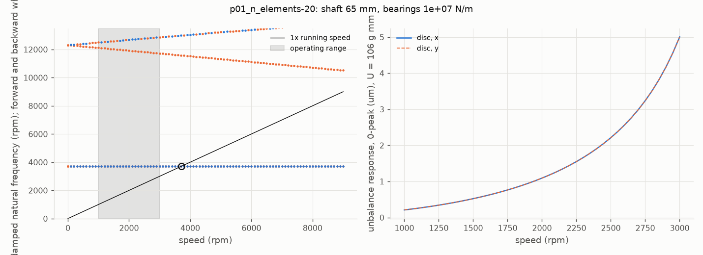
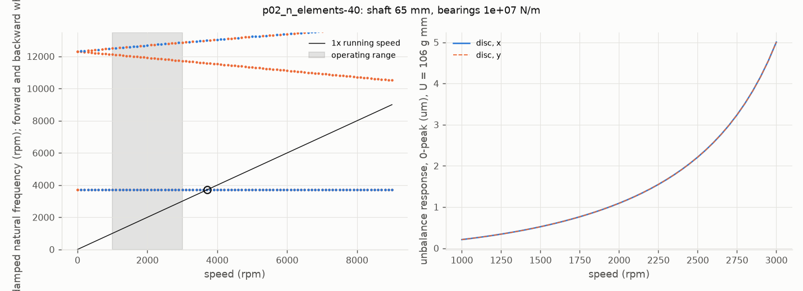

# Engineering review report: rotor_fan_mesh

- **Run:** `20261123-163104_rotor_fan_mesh`
- **Generated:** 2026-11-23T21:33:33+00:00
- **Case file SHA-256:** `79249ed3a2dfc2eab800c45f7967d81760669f9415cf4fc76afd02a0e5e72723`
- **Environment:** Python 3.14.10, numpy 2.5.5, scipy 1.18.1, matplotlib 3.11.2, cadquery 2.8.0; Windows-11-10.0.26100-SP0
- **Tools:** ross ERROR:; numpy_ross_env Could; scipy_ross_env not
- **Code version:** git `a8a0736a398f30c42d1a0fd21bf0bab41fbe8dac` (uncommitted changes present)
- **Simulation status:** completed
- **Verification status:** PASS

## Scope

Element convergence of the fan rotor (65 mm shaft, bearings 1e7 N/m): 10 / 20 / 40 Timoshenko elements; first forward critical speed and unbalance response.

**Assumptions**

- Solid steel shaft (E 205 GPa, density 7850 kg/m^3, Poisson 0.29), Timoshenko elements with rotary inertia and gyroscopic terms; the impeller a rigid steel disc 400 x 25 mm bored to the shaft, at mid-span. [synthetic geometry]
- Two equal linear isotropic bearings at the shaft ends, stiffness 1e7-1e8 N/m (rolling bearings on pedestals: the band covers the unknown pedestal), damping 500 N s/m each. [synthetic]
- No aerodynamic cross-coupling, no foundation mass, no seal forces; the impeller's overhang and blades are lumped in the disc.
- API 684-style unbalance U = 6350 W / N_max g mm with W the rotor mass (kg), N_max 3000 rpm, at the disc.

## Requirements

| ID | Requirement | Metric | Limit |
|---|---|---|---|
| REQ-G1 | Every forward critical speed shall lie at least 15 % outside the 1000-3000 rpm operating range (none in 850-3450 rpm; API 684-style separation margin, simplified to a fixed 15 %). | `separation_margin_pct` | >= 15 % |
| REQ-G2 | The impeller's unbalance response (0-peak) shall stay at or below 50 um over the operating range with API 684's unbalance, U = 6350 W / N_max g mm. | `unbalance_amp_max_um` | <= 50 um |

## Summary across points

| Point | n_elements | REQ-G1 | REQ-G2 | Checks |
|---|---|---|---|---|
| p00_n_elements-10 | 10 | 23.81 %: **PASS** | 5.004 um: **PASS** | 5/5 PASS |
| p01_n_elements-20 | 20 | 23.81 %: **PASS** | 5.004 um: **PASS** | 5/5 PASS |
| p02_n_elements-40 | 40 | 23.81 %: **PASS** | 5.004 um: **PASS** | 5/5 PASS |

## Run-level checks

Checks that use several points together (for example mesh convergence).

| Check | Description | Value | Tolerance | Status |
|---|---|---|---|---|
| discretization_first_forward_critical_rpm | relative discretization uncertainty of first_forward_critical_rpm, monotone (R = 0.210): GCI_fine, observed order 2.25, extrapolated 3714.42 | 1.86e-07 | 0.01 | PASS |
| discretization_unbalance_amp_max_um | relative discretization uncertainty of unbalance_amp_max_um, monotone (R = 0.210): GCI_fine, observed order 2.25, extrapolated 5.00429 | 4.51e-07 | 0.01 | PASS |

## Point details

### p00_n_elements-10

Parameters: density_kg_per_m3 = 7850, youngs_modulus_Pa = 2.05e+11, poisson_ratio = 0.29, n_elements = 10, bearing_span_m = 1, shaft_diameter_m = 0.065, disc_width_m = 0.025, disc_diameter_m = 0.4, bearing_stiffness_N_per_m = 1e+07, bearing_damping_Ns_per_m = 500, speed_min_rpm = 1000, speed_max_rpm = 3000, campbell_max_rpm = 9000, campbell_points = 91, modes = 6, response_points = 41

| Requirement | Result | Limit | Margin | Verdict | Evidence |
|---|---|---|---|---|---|
| REQ-G1 | 23.81 % | >= 15 | 8.81 | **PASS** | [point.json](points/p00_n_elements-10/point.json) |
| REQ-G2 | 5.004 um | <= 50 | 45 | **PASS** | [point.json](points/p00_n_elements-10/point.json) |

| Check | Description | Value | Tolerance | Status |
|---|---|---|---|---|
| jeffcott | Jeffcott rotor (massless shaft, rigid supports, central disc): |ROSS - sqrt(48 EI / m L^3)| / closed form (model form: shear deformation, the disc's width) | 4.58e-03 | 1e-02 | PASS |
| series_bearings | Jeffcott rotor on the case's bearings: |ROSS - closed form with the shaft and two bearings as springs in series| / closed form | 3.21e-03 | 1e-02 | PASS |
| bare_shaft | bare shaft on rigid supports, first bending: |ROSS (Timoshenko) - Euler-Bernoulli pinned-pinned| / Euler-Bernoulli | 5.01e-03 | 1e-02 | PASS |
| critical_crosscheck | |first forward 1x crossing of the Campbell diagram - ROSS's own critical speed search| / ROSS's | 6.15e-06 | 1e-02 | PASS |
| campbell_resolution (validity) | Campbell speed step / first forward critical speed (below the tolerance: the crossing is resolved) | 2.69e-02 | 5e-02 | PASS |

### p01_n_elements-20

Parameters: density_kg_per_m3 = 7850, youngs_modulus_Pa = 2.05e+11, poisson_ratio = 0.29, n_elements = 20, bearing_span_m = 1, shaft_diameter_m = 0.065, disc_width_m = 0.025, disc_diameter_m = 0.4, bearing_stiffness_N_per_m = 1e+07, bearing_damping_Ns_per_m = 500, speed_min_rpm = 1000, speed_max_rpm = 3000, campbell_max_rpm = 9000, campbell_points = 91, modes = 6, response_points = 41

| Requirement | Result | Limit | Margin | Verdict | Evidence |
|---|---|---|---|---|---|
| REQ-G1 | 23.81 % | >= 15 | 8.81 | **PASS** | [point.json](points/p01_n_elements-20/point.json) |
| REQ-G2 | 5.004 um | <= 50 | 45 | **PASS** | [point.json](points/p01_n_elements-20/point.json) |

| Check | Description | Value | Tolerance | Status |
|---|---|---|---|---|
| jeffcott | Jeffcott rotor (massless shaft, rigid supports, central disc): |ROSS - sqrt(48 EI / m L^3)| / closed form (model form: shear deformation, the disc's width) | 4.58e-03 | 1e-02 | PASS |
| series_bearings | Jeffcott rotor on the case's bearings: |ROSS - closed form with the shaft and two bearings as springs in series| / closed form | 3.21e-03 | 1e-02 | PASS |
| bare_shaft | bare shaft on rigid supports, first bending: |ROSS (Timoshenko) - Euler-Bernoulli pinned-pinned| / Euler-Bernoulli | 5.04e-03 | 1e-02 | PASS |
| critical_crosscheck | |first forward 1x crossing of the Campbell diagram - ROSS's own critical speed search| / ROSS's | 6.15e-06 | 1e-02 | PASS |
| campbell_resolution (validity) | Campbell speed step / first forward critical speed (below the tolerance: the crossing is resolved) | 2.69e-02 | 5e-02 | PASS |

### p02_n_elements-40

Parameters: density_kg_per_m3 = 7850, youngs_modulus_Pa = 2.05e+11, poisson_ratio = 0.29, n_elements = 40, bearing_span_m = 1, shaft_diameter_m = 0.065, disc_width_m = 0.025, disc_diameter_m = 0.4, bearing_stiffness_N_per_m = 1e+07, bearing_damping_Ns_per_m = 500, speed_min_rpm = 1000, speed_max_rpm = 3000, campbell_max_rpm = 9000, campbell_points = 91, modes = 6, response_points = 41

| Requirement | Result | Limit | Margin | Verdict | Evidence |
|---|---|---|---|---|---|
| REQ-G1 | 23.81 % | >= 15 | 8.81 | **PASS** | [point.json](points/p02_n_elements-40/point.json) |
| REQ-G2 | 5.004 um | <= 50 | 45 | **PASS** | [point.json](points/p02_n_elements-40/point.json) |

| Check | Description | Value | Tolerance | Status |
|---|---|---|---|---|
| jeffcott | Jeffcott rotor (massless shaft, rigid supports, central disc): |ROSS - sqrt(48 EI / m L^3)| / closed form (model form: shear deformation, the disc's width) | 4.58e-03 | 1e-02 | PASS |
| series_bearings | Jeffcott rotor on the case's bearings: |ROSS - closed form with the shaft and two bearings as springs in series| / closed form | 3.21e-03 | 1e-02 | PASS |
| bare_shaft | bare shaft on rigid supports, first bending: |ROSS (Timoshenko) - Euler-Bernoulli pinned-pinned| / Euler-Bernoulli | 5.05e-03 | 1e-02 | PASS |
| critical_crosscheck | |first forward 1x crossing of the Campbell diagram - ROSS's own critical speed search| / ROSS's | 6.15e-06 | 1e-02 | PASS |
| campbell_resolution (validity) | Campbell speed step / first forward critical speed (below the tolerance: the crossing is resolved) | 2.69e-02 | 5e-02 | PASS |

## Limitations

- Separation margin simplified to a fixed 15 %; API 684 sets it from each mode's amplification factor.
- Linear bearings: a rolling bearing's stiffness rises with load and speed; the band is meant to cover that.
- A converged solver run that matches an analytical reference shows that the equations were solved correctly. It does not show that the equations represent real hardware.

## Engineering acceptance

Pending human review. This report does not accept or reject the design.
