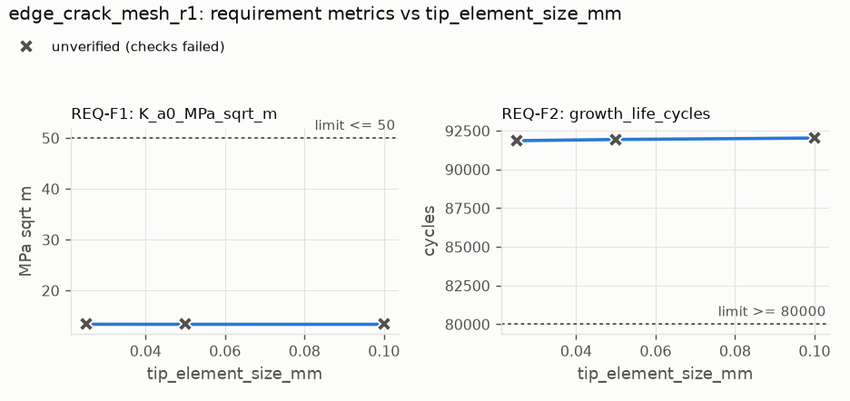
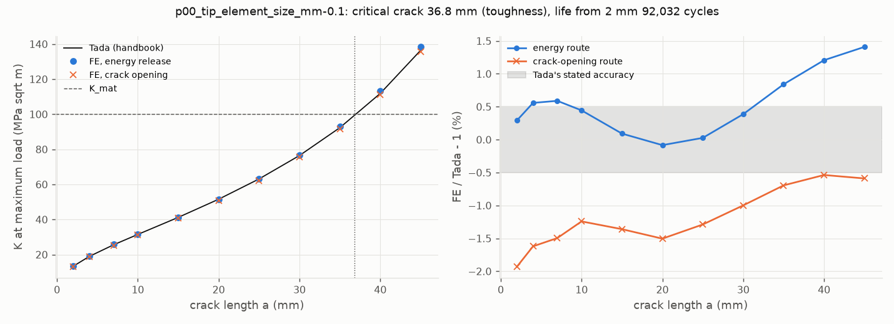
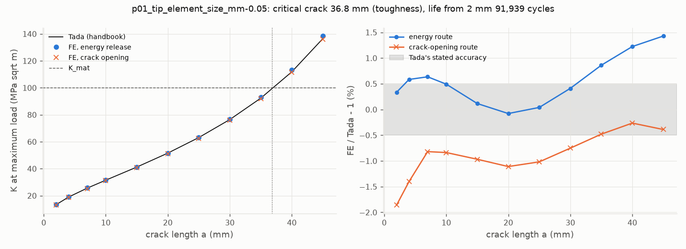
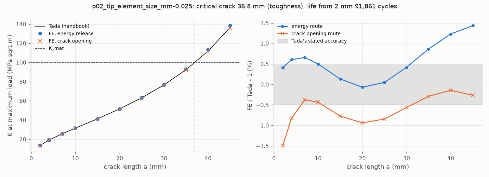

# Engineering review report: edge_crack_mesh_r1

- **Run:** `20261123-164209_edge_crack_mesh_r1`
- **Generated:** 2026-11-23T21:45:39+00:00
- **Case file SHA-256:** `9b0460133eba9c374348921224a4fc79d37f404d4134eef9d3fa487fe9e5de97`
- **Environment:** Python 3.14.10, numpy 2.5.5, scipy 1.18.1, matplotlib 3.11.2, cadquery 2.8.0; Windows-11-10.0.26100-SP0
- **Tools:** gmsh 4.15.0; calculix This is Version 2.22
- **Code version:** git `1703f2816746d3924ca96a083dd0774957e86f0b`
- **Simulation status:** completed
- **Verification status:** FAIL

> **Warning:** verification did not pass for every point. Requirement verdicts marked *(unverified)* are not supported by evidence and must not be used for acceptance.

## Scope

Edge-cracked S355 plate (100 mm wide, 10 mm thick) in cyclic tension, 150 MPa maximum, R = 0.1: K(a) by FE at 11 crack lengths 2-45 mm (energy release rate and crack opening, CalculiX plane strain on a Gmsh half model refined at the tip), critical crack against Kmat 100 MPa sqrt m and net-section yield, BS 7910 crack growth life from 2 mm; tip element sizes 0.1 / 0.05 / 0.025 mm.

**Assumptions**

- Linear elastic fracture mechanics, plane strain (K from G with E / (1 - nu^2)); the plastic zone at Kmax 13-100 MPa sqrt m in S355 (r_p = (K / sigma_y)^2 / 6 pi up to 4 mm at the critical crack) is small against the ligament until the last few millimetres. [model form]
- Uniform remote tension with the plate's ends free to rotate (Tada's case); the half model's height (200 mm, 2 W) makes the end conditions irrelevant at the crack.
- Crack growth by the BS 7910 / IIW simplified law for steels in air (R < 0.5): da/dN = 5.21e-13 dK^3 mm/cycle, dK in N/mm^1.5, threshold 63 N/mm^1.5. [published design law]
- Fracture toughness Kmat 100 MPa sqrt m [synthetic: a client would give CTOD or Charpy results]; net-section yield at 355 MPa (S355) [standard].
- Constant-amplitude loading, 150 MPa maximum at R = 0.1 [synthetic]; detectable crack 2 mm (magnetic particle inspection) [synthetic].

## Requirements

| ID | Requirement | Metric | Limit |
|---|---|---|---|
| REQ-F1 | At the detectable crack (2 mm) the maximum stress intensity shall not exceed half the fracture toughness (Kmat / 2 = 50 MPa sqrt m). | `K_a0_MPa_sqrt_m` | <= 50 MPa sqrt m |
| REQ-F2 | The crack growth life from the detectable crack to the critical crack shall be at least twice the planned inspection interval of 40,000 cycles. | `growth_life_cycles` | >= 80000 cycles |

## Summary across points

| Point | tip_element_size_mm | REQ-F1 | REQ-F2 | Checks |
|---|---|---|---|---|
| p00_tip_element_size_mm-0.1 | 0.1 | 13.35 MPa sqrt m: **PASS (unverified)** | 9.203e+04 cycles: **PASS (unverified)** | 5/6 FAIL |
| p01_tip_element_size_mm-0.05 | 0.05 | 13.35 MPa sqrt m: **PASS (unverified)** | 9.194e+04 cycles: **PASS (unverified)** | 5/6 FAIL |
| p02_tip_element_size_mm-0.025 | 0.025 | 13.36 MPa sqrt m: **PASS (unverified)** | 9.186e+04 cycles: **PASS (unverified)** | 5/6 FAIL |

## Run-level checks

Checks that use several points together (for example mesh convergence).

| Check | Description | Value | Tolerance | Status |
|---|---|---|---|---|
| discretization_K_a0_MPa_sqrt_m | relative discretization uncertainty of K_a0_MPa_sqrt_m, divergent (R = 1.681): no estimate | inf | 0.01 | FAIL |
| discretization_crit_crack_mm | relative discretization uncertainty of crit_crack_mm, monotone (R = 0.410): GCI_fine, observed order 1.29, extrapolated 36.8308 | 4.45e-05 | 0.01 | PASS |
| discretization_growth_life_cycles | relative discretization uncertainty of growth_life_cycles, monotone (R = 0.837): GCI_fine, observed order 0.26, extrapolated 91461.5 | 0.00544 | 0.01 | PASS |

A failed run-level check withholds the verdicts of requirements on `K_a0_MPa_sqrt_m` at every point: they are marked *(unverified)* in the table above.

## Point details

### p00_tip_element_size_mm-0.1

Parameters: width_mm = 100, half_height_mm = 200, thickness_mm = 10, sigma_max_MPa = 150, stress_ratio = 0.1, youngs_modulus_MPa = 2.1e+05, poisson_ratio = 0.3, yield_strength_MPa = 355, k_mat_MPa_sqrt_m = 100, paris_C = 5.21e-13, paris_m = 3, dK_threshold = 63, initial_crack_mm = 2, tip_element_size_mm = 0.1, far_element_size_mm = 5

| Requirement | Result | Limit | Margin | Verdict | Evidence |
|---|---|---|---|---|---|
| REQ-F1 | 13.35 MPa sqrt m | <= 50 | 36.7 | **PASS (unverified)** | [point.json](points/p00_tip_element_size_mm-0.1/point.json) |
| REQ-F2 | 9.203e+04 cycles | >= 80000 | 1.2e+04 | **PASS (unverified)** | [point.json](points/p00_tip_element_size_mm-0.1/point.json) |

| Check | Description | Value | Tolerance | Status |
|---|---|---|---|---|
| tada | max |K (energy route) / Tada - 1| for a/W <= 0.6 (Tada's own accuracy 0.5 %) | 1.41e-02 | 1e-02 | FAIL |
| k_routes | max |K (crack opening) / K (energy) - 1| over the crack lengths | 2.22e-02 | 3e-02 | PASS |
| equilibrium | max |ligament reaction + applied load| / applied load | 1.21e-16 | 1e-06 | PASS |
| energy_step | |K (energy, step eps) / K (step eps / 2) - 1| at a = 10 mm (the central difference's step and the mesh noise in U together) | 5.81e-04 | 1e-03 | PASS |
| life_integral | |life by adaptive quadrature - by Simpson on 4000 steps| / quadrature | 4.13e-09 | 1e-04 | PASS |
| crack_range (validity) | critical crack / largest sampled crack (below 1: K(a) is sampled past the critical crack) | 8.19e-01 | 1e+00 | PASS |

### p01_tip_element_size_mm-0.05

Parameters: width_mm = 100, half_height_mm = 200, thickness_mm = 10, sigma_max_MPa = 150, stress_ratio = 0.1, youngs_modulus_MPa = 2.1e+05, poisson_ratio = 0.3, yield_strength_MPa = 355, k_mat_MPa_sqrt_m = 100, paris_C = 5.21e-13, paris_m = 3, dK_threshold = 63, initial_crack_mm = 2, tip_element_size_mm = 0.05, far_element_size_mm = 5

| Requirement | Result | Limit | Margin | Verdict | Evidence |
|---|---|---|---|---|---|
| REQ-F1 | 13.35 MPa sqrt m | <= 50 | 36.6 | **PASS (unverified)** | [point.json](points/p01_tip_element_size_mm-0.05/point.json) |
| REQ-F2 | 9.194e+04 cycles | >= 80000 | 1.19e+04 | **PASS (unverified)** | [point.json](points/p01_tip_element_size_mm-0.05/point.json) |

| Check | Description | Value | Tolerance | Status |
|---|---|---|---|---|
| tada | max |K (energy route) / Tada - 1| for a/W <= 0.6 (Tada's own accuracy 0.5 %) | 1.43e-02 | 1e-02 | FAIL |
| k_routes | max |K (crack opening) / K (energy) - 1| over the crack lengths | 2.19e-02 | 3e-02 | PASS |
| equilibrium | max |ligament reaction + applied load| / applied load | 1.21e-16 | 1e-06 | PASS |
| energy_step | |K (energy, step eps) / K (step eps / 2) - 1| at a = 10 mm (the central difference's step and the mesh noise in U together) | 3.02e-04 | 1e-03 | PASS |
| life_integral | |life by adaptive quadrature - by Simpson on 4000 steps| / quadrature | 4.96e-10 | 1e-04 | PASS |
| crack_range (validity) | critical crack / largest sampled crack (below 1: K(a) is sampled past the critical crack) | 8.19e-01 | 1e+00 | PASS |

### p02_tip_element_size_mm-0.025

Parameters: width_mm = 100, half_height_mm = 200, thickness_mm = 10, sigma_max_MPa = 150, stress_ratio = 0.1, youngs_modulus_MPa = 2.1e+05, poisson_ratio = 0.3, yield_strength_MPa = 355, k_mat_MPa_sqrt_m = 100, paris_C = 5.21e-13, paris_m = 3, dK_threshold = 63, initial_crack_mm = 2, tip_element_size_mm = 0.025, far_element_size_mm = 5

| Requirement | Result | Limit | Margin | Verdict | Evidence |
|---|---|---|---|---|---|
| REQ-F1 | 13.36 MPa sqrt m | <= 50 | 36.6 | **PASS (unverified)** | [point.json](points/p02_tip_element_size_mm-0.025/point.json) |
| REQ-F2 | 9.186e+04 cycles | >= 80000 | 1.19e+04 | **PASS (unverified)** | [point.json](points/p02_tip_element_size_mm-0.025/point.json) |

| Check | Description | Value | Tolerance | Status |
|---|---|---|---|---|
| tada | max |K (energy route) / Tada - 1| for a/W <= 0.6 (Tada's own accuracy 0.5 %) | 1.44e-02 | 1e-02 | FAIL |
| k_routes | max |K (crack opening) / K (energy) - 1| over the crack lengths | 1.90e-02 | 3e-02 | PASS |
| equilibrium | max |ligament reaction + applied load| / applied load | 1.21e-16 | 1e-06 | PASS |
| energy_step | |K (energy, step eps) / K (step eps / 2) - 1| at a = 10 mm (the central difference's step and the mesh noise in U together) | 3.54e-04 | 1e-03 | PASS |
| life_integral | |life by adaptive quadrature - by Simpson on 4000 steps| / quadrature | 4.40e-10 | 1e-04 | PASS |
| crack_range (validity) | critical crack / largest sampled crack (below 1: K(a) is sampled past the critical crack) | 8.18e-01 | 1e+00 | PASS |

## Limitations

- Through-thickness straight crack front; a real surface crack starts semi-elliptical (BS 7910 Annex M would give its K).
- No crack closure, no load sequence effects, no environment (air).
- Net-section yield by the simple uniform-stress formula; the eccentric ligament also bends.
- A converged solver run that matches an analytical reference shows that the equations were solved correctly. It does not show that the equations represent real hardware.

## Engineering acceptance

Pending human review. This report does not accept or reject the design.
