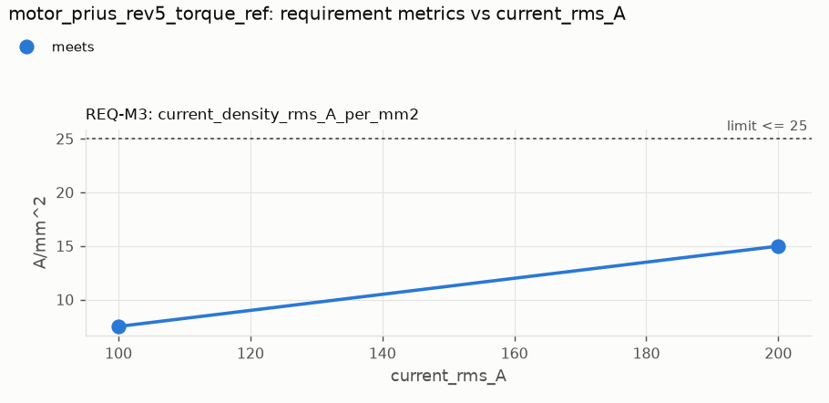
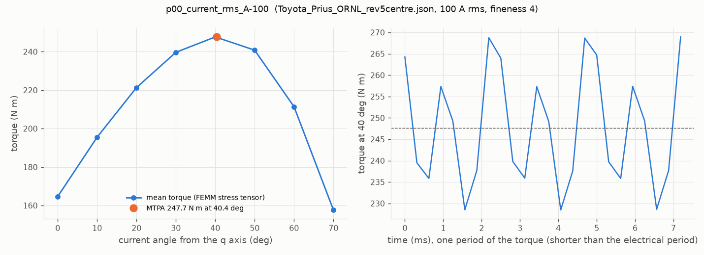
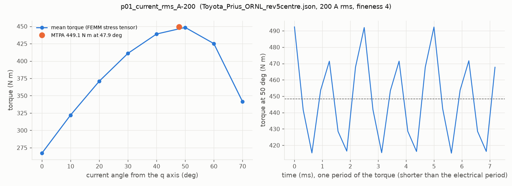

# Engineering review report: motor_prius_rev5_torque_ref

- **Run:** `20261123-223541_motor_prius_rev5_torque_ref`
- **Generated:** 2026-11-24T04:06:41+00:00
- **Case file SHA-256:** `ed2387a621ae5f3b47ca7b80a3ece4dbad9aff40d1b92e9f259ca1d0a93ea4c8`
- **Environment:** Python 3.14.10, numpy 2.5.5, scipy 1.18.1, matplotlib 3.11.2, cadquery 2.8.0; Windows-11-10.0.26100-SP0
- **Tools:** pyleecan 1.5.2; SciDataTool 2.5.0; numpy_pyleecan_env 2.5.5
- **Code version:** git `b4e208947409c4d21dcdce0b7b3cca66f385bf31`
- **Simulation status:** completed
- **Verification status:** PASS

## Scope

2004 Toyota Prius traction motor, REVISION 5 (client data: magnet 83.1 x 18.9 x 6.5 mm centred in the 6.80 mm pocket, 1.255 T at 20 C, magnets at 20 C, air gap 0.775 mm, winding from the BOM), MTPA torque at 100 and 200 A rms (the efficiency check's reference points), magnets at 20 C, 1000 rpm; Pyleecan + FEMM 4.2 magnetostatics, current angle 0-70 deg from the q axis, mesh fineness 4.

**Assumptions**

- 2D magnetostatics (FEMM), no end effects; torque is the mean of FEMM's stress-tensor torque over one electrical period. [model form]
- Machine: revision 5 (models/motor/Toyota_Prius_ORNL_rev5centre.json): lamination geometry from ORNL/TM-2005/33 Fig. 21 [client: drawing]; magnet 83.1 x 18.9 x 6.5 mm, 1.255 T at 20 C, -0.10 %/C (ORNL/TM-2010/253 Table 2.7, Fig. 2.72) [client: BOM, material data], centred in the 6.80 mm pocket; winding 9 turns per coil, 8 coils in series per phase [client: BOM].
- Magnet temperature 20 C: the cold dq tables' temperature, so the efficiency case's MTPA check compares like with like [reference run].
- ORNL's currents read as peak: the DC test sets Ia, -Ia/2, -Ia/2 in the three phases (ORNL/TM-2004/185), a current space vector of magnitude Ia, so Ia is the peak of the equivalent sinusoidal current.
- Current-density limit 25 A/mm^2 rms on 0.84 x 143.0 mm^2 of copper per slot (stated assumption).

## Requirements

| ID | Requirement | Metric | Limit |
|---|---|---|---|
| REQ-M3 | Each operating point of the torque curve shall stay within the 25 A/mm^2 rms copper current-density limit (marks which points of the curve the motor can sustain for a short time). | `current_density_rms_A_per_mm2` | <= 25 A/mm^2 |

## Summary across points

| Point | current_rms_A | REQ-M3 | Checks |
|---|---|---|---|
| p00_current_rms_A-100 | 100 | 7.493 A/mm^2: **PASS** | 5/5 PASS |
| p01_current_rms_A-200 | 200 | 14.99 A/mm^2: **PASS** | 5/5 PASS |

## Point details

### p00_current_rms_A-100

Parameters: machine = Toyota_Prius_ORNL_rev5centre.json, speed_rpm = 1000, current_rms_A = 100, angle_min_deg = 0, angle_max_deg = 70, angle_steps = 8, mesh_fineness = 4, steps_per_period = 48, angle_points = 2048, rated_torque_Nm = 400, slot_fill = 0.84, slot_area_mm2 = 143, turns_per_slot = 9, magnet_temperature_C = 20

Derived: current_density_rms_A_per_mm2 = 7.493

| Requirement | Result | Limit | Margin | Verdict | Evidence |
|---|---|---|---|---|---|
| REQ-M3 | 7.493 A/mm^2 | <= 25 | 17.5 | **PASS** | [point.json](points/p00_current_rms_A-100/point.json) |

| Check | Description | Value | Tolerance | Status |
|---|---|---|---|---|
| power_balance | max over current angles of |mean(sum i dphi/dt) - mean torque x omega_m| / (mean torque x omega_m): energy conservation, an independent route to FEMM's stress-tensor torque | 4.90e-04 | 2e-02 | PASS |
| current_amplitude | max |imposed phase current fundamental - sqrt(2) x requested rms| / peak (Pyleecan's dq currents are rms) | 2.01e-16 | 1e-03 | PASS |
| phase_symmetry_load | max over angles of the spread of the three phases' fundamental flux linkage / mean, under load | 2.40e-04 | 2e-03 | PASS |
| mtpa_bracketed (validity) | maximum torque inside the angle sweep (0 = yes) | 0.00e+00 | 0e+00 | PASS |
| time_resolution (validity) | 48 / steps per electrical period (below 1: at least 48) | 1.00e+00 | 1e+00 | PASS |

### p01_current_rms_A-200

Parameters: machine = Toyota_Prius_ORNL_rev5centre.json, speed_rpm = 1000, current_rms_A = 200, angle_min_deg = 0, angle_max_deg = 70, angle_steps = 8, mesh_fineness = 4, steps_per_period = 48, angle_points = 2048, rated_torque_Nm = 400, slot_fill = 0.84, slot_area_mm2 = 143, turns_per_slot = 9, magnet_temperature_C = 20

Derived: current_density_rms_A_per_mm2 = 14.99

| Requirement | Result | Limit | Margin | Verdict | Evidence |
|---|---|---|---|---|---|
| REQ-M3 | 14.99 A/mm^2 | <= 25 | 10 | **PASS** | [point.json](points/p01_current_rms_A-200/point.json) |

| Check | Description | Value | Tolerance | Status |
|---|---|---|---|---|
| power_balance | max over current angles of |mean(sum i dphi/dt) - mean torque x omega_m| / (mean torque x omega_m): energy conservation, an independent route to FEMM's stress-tensor torque | 4.14e-04 | 2e-02 | PASS |
| current_amplitude | max |imposed phase current fundamental - sqrt(2) x requested rms| / peak (Pyleecan's dq currents are rms) | 2.01e-16 | 1e-03 | PASS |
| phase_symmetry_load | max over angles of the spread of the three phases' fundamental flux linkage / mean, under load | 1.02e-04 | 2e-03 | PASS |
| mtpa_bracketed (validity) | maximum torque inside the angle sweep (0 = yes) | 0.00e+00 | 0e+00 | PASS |
| time_resolution (validity) | 48 / steps per electrical period (below 1: at least 48) | 1.00e+00 | 1e+00 | PASS |

## Limitations

- ORNL takes the largest torque over shaft angle at each current, which includes the torque ripple at that angle; the model's value is the mean over an electrical period at the best current angle.
- Sinusoidal currents; no inverter harmonics, no voltage limit (1000 rpm is below base speed).
- The real lamination grade is unknown (M330-35A stand-in); it matters most at high current, where the steel saturates.
- A converged solver run that matches an analytical reference shows that the equations were solved correctly. It does not show that the equations represent real hardware.

## Engineering acceptance

Pending human review. This report does not accept or reject the design.
